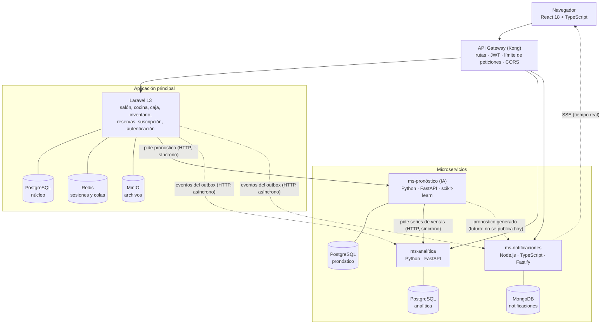

# Arquitectura distribuida de RestaurantCloud AI (Unidad II)

| | |
|---|---|
| **Documento** | 01 — Diseño de arquitectura, razón de ser de cada microservicio y stack |
| **Estado** | Diseño acordado. Todavía no hay código de microservicios. |
| **Fecha** | 16/11/2026 |
| **Rama de trabajo** | `betta` (la rama `monolito` conserva el producto de la Unidad I, estable y con la suite en verde) |
| **Sirve para** | Secciones 2 y 3 del informe del segundo avance ("Arquitectura distribuida" y "Diseño de microservicios") y como punto de partida para continuar el trabajo |

---

## 1. Punto de partida

El producto de la Unidad I es un monolito modular:

- **API:** Laravel 13 sobre PHP 8.3, con Octane y FrankenPHP. El código está organizado por dominios en `restaurantcloud/apps/api/app/Domains`.
- **Web:** React 18 + TypeScript (Vite).
- **Datos:** PostgreSQL 16 (49 tablas), Redis 7 (sesiones, caché y colas) y MinIO (archivos).
- **Asíncrono:** ya existe el patrón *outbox*: la tabla `outbox_event`, un comando del scheduler que despacha los eventos y la cola `documentos` en Redis. Hoy solo se usa para generar el PDF del comprobante.

La guía del curso pide para la semana 11: conservar y mejorar esta aplicación, **mínimo tres microservicios** con responsabilidades diferenciadas y comunicación comprobable, API documentada, contenedores Docker, un componente de **IA integrado en un flujo real** (para este proyecto: pronóstico de demanda o recomendación de reposición a partir de ventas e inventario), un despliegue PaaS/serverless y un laboratorio de Kubernetes.

## 2. Criterios de diseño

1. **El núcleo transaccional no se parte.** Pedidos, cocina, caja, inventario y reservas se modifican juntos dentro de una misma transacción (cobrar emite el comprobante, descuenta stock y mueve la caja). Separarlos obligaría a reconstruir esa atomicidad entre servicios. Ese núcleo sigue siendo la aplicación principal en Laravel.
2. **Los microservicios implementan funcionalidades nuevas**, no extraen código que ya funciona. Así no se pone en riesgo el cobro y cada servicio cuenta como funcionalidad nueva del avance.
3. **Una base de datos por servicio.** Ningún servicio lee ni escribe la base de otro. No hay claves foráneas ni JOIN entre servicios; solo se guardan identificadores (UUID).
4. **Cada servicio habla con el resto solo por eventos o por una API estrecha.**
5. **Cada tecnología se justifica por la característica del servicio**, no por uniformidad.

### Evidencia usada para decidir qué separar

Se contó cuántos módulos del monolito usan cada tabla:

| Tabla | Módulos que la usan | Conclusión |
|---|---|---|
| `local` | 14 | Centro del sistema; no separable |
| `empresa` | 11 | No separable |
| `usuario` | 10 | No separable |
| `plan` | 8 | Los límites del plan se consultan en muchos módulos |
| `caja` | 7 | Ligada al cobro |
| `pedido` | 6 | Ligada a cobro, cocina e inventario |
| `notificacion` | 3 | Solo se escribía; ninguna pantalla la leía. **Retirada en la etapa 7** (migración `2026_11_22_000001_retirar_tabla_notificacion`): sus avisos son ahora eventos que ms-notificaciones convierte en avisos. El esquema inicial (`02_schema_ddl.sql`) la conserva y la migración la quita, como se hizo con el módulo de incidentes |
| `snapshot_stock_diario` | 0 | Sin uso |

Además, dos casos de uso están diseñados en los wireframes pero **no implementados** en el backend: **CU-ADMIN-13** (reportes de ventas y desempeño) y **CU-TRANS-01** (notificaciones del sistema). Junto con el componente de IA, son los tres microservicios.

## 3. Arquitectura propuesta

Líneas continuas: llamadas síncronas. Líneas punteadas: comunicación asíncrona.

| Componente | Responsabilidad | Tecnología | Datos propios |
|---|---|---|---|
| **API Gateway** | Punto de entrada único | Kong (modo sin base de datos) | Ninguno |
| **Aplicación principal** | Proceso central del negocio y autenticación | Laravel 13, PHP 8.3 | PostgreSQL, Redis, MinIO |
| **ms-analítica** | Reportes de ventas y desempeño; series de ventas para la IA | Python, FastAPI, pandas | PostgreSQL |
| **ms-pronóstico** | Pronóstico de demanda por plato (IA) | Python, FastAPI, scikit-learn | PostgreSQL + archivos del modelo |
| **ms-notificaciones** | Bandeja de avisos y entrega en tiempo real | Node.js, TypeScript, Fastify | MongoDB |

## 4. Razón de ser de cada microservicio

### 4.1 ms-analítica

**Qué hace.** Implementa CU-ADMIN-13: ventas por día y por hora, horas punta, rentabilidad de los platos (ingeniería de menú), desempeño del personal de salón y exportación a Excel/CSV. Solo **lee ventas ya cerradas**: no emite comprobantes ni cobra (la facturación fiscal y el cobro de suscripciones siguen en Laravel).

**Por qué existe como servicio separado.**
- Los reportes son consultas pesadas sobre meses de ventas. Si corren en la misma base que el POS, pueden volver lentos los cobros en hora punta. Con su propia base, alimentada por eventos, la operación no se ve afectada. Es el patrón CQRS: un modelo para escribir (núcleo) y otro para leer (analítica).
- Es una funcionalidad nueva: no existe ningún endpoint de reportes en el monolito.
- Entrega a la IA un historial limpio de ventas diarias por plato, sin que la IA toque la base del núcleo.

**Datos que gestiona.** Copia de las ventas en forma de agregados por hora, día, plato y mozo.

**Cómo se comunica.** Recibe los eventos `venta.registrada`, `comprobante.anulado` y `pedido.anulado`. Expone la API de reportes (al navegador, por el gateway) y la API de series de ventas (a ms-pronóstico).

### 4.2 ms-pronóstico (componente de IA)

**Qué hace.** Pronostica cuántas unidades de cada plato se venderán en los próximos 7 días. Guarda qué versión del modelo se usó, con qué datos y cuándo.

**Por qué existe como servicio separado.**
- Necesita Python y librerías de aprendizaje automático (scikit-learn, pandas) que no tienen equivalente en PHP.
- Entrenar y predecir consume CPU de forma muy distinta al POS; conviene que escale aparte. No guarda estado entre peticiones, lo que lo hace apto para un despliegue serverless.
- Es el componente de IA que exige la guía y el objeto de la investigación del curso.

**Reparto del trabajo con el núcleo.** El servicio solo pronostica demanda de platos. La **recomendación de reposición de insumos** (pronóstico × receta − stock actual) se calcula en Laravel, que es el dueño de las recetas y del stock. El administrador acepta, ajusta o descarta la recomendación; la IA nunca genera compras por sí sola.

**Modelo.** HistGradientBoosting (scikit-learn), comparado contra el pronóstico ingenuo estacional como baseline. La primera versión del servicio usa solo el baseline para completar el recorrido de punta a punta; después se cambia el modelo sin tocar el resto.

**Datos que gestiona.** Versiones del modelo, ejecuciones y predicciones. Los archivos del modelo van al almacenamiento de objetos.

**Cómo se comunica.** Laravel le pide el pronóstico (síncrono). El servicio pide las series de ventas a ms-analítica (síncrono) y no publica eventos: `pronostico.generado` quedó fuera de la etapa 7 (el pronóstico es síncrono y quien lo pide ya ve el resultado) y se retomará con pronósticos programados.

### 4.3 ms-notificaciones

**Qué hace.** Implementa CU-TRANS-01: bandeja de avisos por usuario y rol (plato listo, anulaciones, sustituciones, producto agotado, turno previo pendiente y cierres de caja con diferencia; las reservas y el pronóstico disponible quedan para después), estado leído/no leído y entrega en tiempo real al navegador.

**Por qué existe como servicio separado.**
- Antes de la etapa 7, `CajaController`, `CocinaController` y `MozoController` insertaban directamente en la tabla `notificacion` y nada la mostraba: no había bandeja ni entrega en tiempo real. Ahora publican eventos y este servicio los convierte en avisos, con bandeja y SSE; el núcleo ya no guarda avisos.
- Mantiene muchas conexiones abiertas a la vez (una por usuario conectado), una carga distinta a la del resto del sistema.
- Si se cae, el restaurante sigue operando: es un servicio de apoyo, bien aislado del proceso central.

**Datos que gestiona.** Los avisos y su estado de lectura.

**Cómo se comunica.** Recibe eventos firmados del núcleo (por el outbox) y expone la bandeja y el canal Server-Sent Events (SSE) al navegador, siempre por Kong y con el JWT que emite el núcleo.

**Estado (etapa 7 cerrada).** Siete tipos de aviso, bandeja con «leído» por persona, canal SSE con renovación del token y la campana en los cinco roles. Probado con 226 pruebas de vitest contra MongoDB real y con `scripts/smoke-notificaciones.sh` (129 comprobaciones de punta a punta).

**Límites conocidos** (decididos, no son errores):
- **Una sola instancia.** El reparto a las conexiones abiertas es en memoria: con más de una instancia, un aviso solo llegaría a las conexiones de la instancia que lo recibió. Para escalar haría falta un canal común (Redis o un change stream de MongoDB). No se construye.
- **Retraso del outbox.** Del núcleo al navegador pasan entre 1 y 3 s según el ciclo del worker; el tramo servicio → navegador es inmediato. Si el servicio cae, los eventos esperan en el outbox hasta 7 días y los avisos llegan con retraso, no se pierden.
- **Sin avisos de reservas ni de entregas fallidas.** «Reserva próxima» necesita un programador de tareas, y la alerta de entregas fallidas se lee del outbox, no de un evento.
- **Una conexión por pestaña**, sin límite por usuario; el gateway cuenta la petición solo al abrirse.

## 5. Stack propuesto y justificación

| Elemento | Elección | Por qué |
|---|---|---|
| ms-analítica | **Python 3.12 + FastAPI + pandas** | Agregaciones y exportación a Excel/CSV; comparte stack con la IA. La serie de ventas se arma en SQL; pandas entra con los reportes y la exportación |
| ms-analítica, base | **PostgreSQL** | Datos tabulares y temporales; SQL analítico y funciones de ventana |
| ms-pronóstico | **Python 3.12 + FastAPI + scikit-learn** | Ecosistema de aprendizaje automático; FastAPI genera la documentación OpenAPI automáticamente |
| ms-pronóstico, base | **PostgreSQL** | Trazabilidad relacional: versión de modelo → ejecución → predicciones |
| ms-notificaciones | **Node.js 22 + TypeScript + Fastify** | Maneja bien muchas conexiones SSE simultáneas; el equipo ya usa TypeScript en el frontend |
| ms-notificaciones, base | **MongoDB** | Cada tipo de aviso trae datos distintos (esquema flexible), se escribe mucho y caduca solo con un índice TTL |
| API Gateway | **Kong** en modo sin base de datos | Rutas, validación de JWT, límite de peticiones y CORS declarados en un archivo versionado; corre igual en Docker y en Kubernetes |
| Eventos asíncronos | **Outbox + envío HTTP** | Reutiliza el outbox que ya existe; no requiere un broker adicional y funciona en serverless |
| Contenedores | **Docker**, un Dockerfile por servicio, `docker compose` en local | Requisito de la guía |

Cada microservicio vive en `restaurantcloud/services/<nombre>` con su código, pruebas, Dockerfile y `.env.example`.

## 6. Comunicación

**Síncrona (HTTP/REST con JSON).** Para cuando quien llama necesita la respuesta: Laravel → ms-pronóstico, ms-pronóstico → ms-analítica, navegador → cualquier servicio a través del gateway. Toda llamada entre servicios lleva tiempo de espera máximo y reintentos limitados. Si ms-pronóstico no responde, Laravel lo informa y el POS sigue funcionando.

**Asíncrona (outbox + HTTP).** El núcleo guarda el evento en `outbox_event` dentro de la misma transacción del negocio; un worker lo envía después al servicio suscrito, con reintentos. Los servicios deben aceptar el mismo evento dos veces sin duplicar nada (usan el identificador del evento). La consecuencia es que analítica y notificaciones se actualizan con segundos de retraso respecto del núcleo.

Eventos previstos:

| Evento | Lo emite | Lo reciben |
|---|---|---|
| `venta.registrada` | Laravel (al cobrar) | ms-analítica |
| `comprobante.anulado` | Laravel | ms-analítica, ms-notificaciones |
| `pedido.anulado` | Laravel | ms-analítica, ms-notificaciones |
| `plato.listo`, `producto.agotado` | Laravel (cocina) | ms-notificaciones |
| `pedido.item_sustituido` | Laravel (mozo) | ms-notificaciones |
| `caja.turno_previo_pendiente`, `caja.cerrada` (con diferencia) | Laravel (caja) | ms-notificaciones |
| `reserva.creada`, `reserva.cancelada`, `pronostico.generado` | — | Fuera de la etapa 7 (ver el catálogo) |

La lista cerrada está en el [catálogo de eventos](servicios/eventos.md).

## 7. Componentes de infraestructura

| Componente | Decisión | Cómo se resuelve |
|---|---|---|
| API Gateway | **Componente propio** | Kong (sección 5) |
| Descubrimiento de servicios | **Lo da la plataforma**, no se monta un registro (Eureka, Consul) | DNS interno en Docker Compose (`http://ms-pronostico:8000`), `Service` en Kubernetes, URL estable en Cloud Run |
| Configuración centralizada | **Lo da la plataforma**, no se monta un Config Server | Variables de entorno, `ConfigMap`/`Secret` en Kubernetes y Secret Manager en GCP |
| Resiliencia | **En el código** | Tiempos de espera, reintentos y respuesta degradada en los clientes HTTP |
| Observabilidad | **Unidad III** | Por ahora, logs en JSON con un identificador de petición que viaja entre servicios |

La guía pide justificar cada servicio por la arquitectura; por eso no se agregan piezas que el orquestador ya provee.

## 8. Lo que se descartó separar

| Candidato | Por qué no |
|---|---|
| Suscripción y planes | El estado de la empresa se consulta en cada petición y 8 módulos consultan los límites del plan |
| Autenticación | Todas las peticiones dependen de ella; separarla crea un punto único de fallo |
| Reservas, inventario, cocina | Comparten transacciones con el salón y el cobro |
| Documentos (PDF y QR de comprobantes) | Es separable, pero implica mover código que hoy funciona dentro del cobro fiscal. Queda como cuarto servicio opcional |

## 9. Autenticación y autorización (decidido)

Se comparó el costo por petición de tres opciones:

| Opción | Costo por petición | Problema |
|---|---|---|
| **JWT firmado, validado en cada servicio** (elegida) | Solo CPU para verificar la firma; ninguna llamada de red | No se revoca al instante; se compensa con vida corta |
| Leer la sesión en el Redis de Laravel | 1 consulta a Redis | Todos los servicios dependerían del Redis del núcleo |
| Preguntar a Laravel si el token es válido | 1 llamada HTTP | La más lenta; si Laravel cae, caen todos |

Cómo se aplica:

- **Laravel no cambia su autenticación.** Sus rutas siguen usando el token actual con sesión en Redis (`auth.redis`).
- **El login y el refresh devuelven además un JWT** de unos 10 minutos, firmado con clave privada (RS256), con el usuario, el rol, `empresa_id` y `local_id`. El frontend lo usa solo para llamar a los microservicios y lo renueva con `/auth/refresh`.
- **Kong valida la firma** en las rutas de los microservicios. Cada servicio la vuelve a validar con la clave pública y filtra sus datos por el `empresa_id` del token.
- **Entre servidores** (eventos del outbox, Laravel → ms-pronóstico, ms-pronóstico → ms-analítica) no hay usuario: se usa un secreto compartido por servicio y la firma HMAC del cuerpo.
- Las claves y los secretos llegan por variables de entorno; nunca van al repositorio.

## 10. Despliegue (decidido)

Las mismas imágenes deben poder ejecutarse en una máquina virtual y en una plataforma PaaS como Cloud Run. Para eso cada servicio cumple cuatro reglas desde el inicio:

1. Toda la configuración llega por variables de entorno.
2. Escucha en el puerto que indique la variable `PORT`.
3. No guarda nada en el disco del contenedor.
4. Escribe los logs en la salida estándar y expone un endpoint `/health`.

| Destino | Qué corre | Alcance |
|---|---|---|
| **VM (Compute Engine)** | Todo el sistema con `docker compose`, incluidas las bases de datos | Unidad II. Cubre también la evidencia de ejecución en VM y el plan de migración pendientes de la Unidad I |
| **Cloud Run** | ms-pronóstico | Unidad II (la guía pide al menos un componente en PaaS/serverless) |
| **GKE** | Un servicio, como laboratorio (Deployment, Service, Pods) | Unidad II |
| **Cloud Run, resto de servicios** | ms-analítica, ms-notificaciones, API de Laravel | Unidad III (requisito de dos plataformas) |

Diferencias de Cloud Run frente a la VM que el diseño ya considera:

- **Bases de datos:** Cloud Run no las aloja. Se usan Cloud SQL (PostgreSQL) y MongoDB Atlas.
- **Cola y scheduler de Laravel:** son procesos permanentes. En Cloud Run se reemplazan por Cloud Scheduler llamando a un endpoint, o por Cloud Run Jobs. El despacho del outbox depende de esto.
- **ms-notificaciones:** una petición de Cloud Run dura como máximo 60 minutos, pero el canal SSE ya se cierra antes: el servicio lo termina 30 s antes de que venza el JWT (15 minutos como máximo) con el evento `renovar`, y el navegador renueva el token y vuelve a abrirlo. Con más de una instancia, los avisos deben repartirse por un canal común; se limita a una instancia (ver 4.3).
- **Arranque en frío:** la primera petición tras un periodo sin uso tarda unos segundos.

## 11. Seguridad multiempresa (decidido)

**Estado actual.** Las políticas RLS del núcleo están definidas en 42 tablas, pero no se aplican porque la API se conecta como superusuario. El aislamiento lo hace hoy la aplicación (filtro por sede en cada consulta) y está verificado por `AislamientoEntreEmpresasTest`: 21 comprobaciones, sin fugas.

**Preparación en la Unidad II** (no cambia el comportamiento de la API):

1. Crear por migración el rol de aplicación `rc_app`, sin superusuario ni `BYPASSRLS`, con sus permisos. La API todavía no lo usa.
2. Una prueba que se conecte con ese rol y demuestre en la base que, con el contexto de una empresa, no se ven filas de otra. Si las políticas tienen huecos, esta prueba los mostrará.
3. Los microservicios nacen con su propio usuario de base sin privilegios y filtran por el `empresa_id` del JWT.
4. Inventario de los puntos del núcleo que consultan sin usuario autenticado (login, registro, webhooks, jobs, comandos).

**Unidad III.** Cambiar la conexión de la API al rol `rc_app`, usando el inventario del punto 4.

## 12. Pendientes

1. ~~**Contrato de API y de eventos** de cada servicio.~~ Hecho: una ficha por servicio y el catálogo de eventos en [servicios/](servicios/README.md), con un contrato JSON por evento.
2. **Datos para la IA.** La base tiene 3 pedidos de un solo día. Se usarán ventas sintéticas, generadas con un script versionado y declaradas como sintéticas en el informe. Se define al llegar a la IA.
3. **Imagen de la API de Laravel.** El `api.Dockerfile` actual no copia el código a la imagen; hay que corregirlo para publicarla en Artifact Registry.
4. **Qué servicio va al laboratorio de GKE.**

## 13. Orden de construcción previsto

1. Generalizar el outbox para publicar eventos, emitir el JWT en el login y preparar el rol `rc_app`.
2. ms-analítica (recibe ventas y expone las series).
3. Ventas sintéticas y ms-pronóstico con el baseline, integrado de punta a punta con la pantalla de reposición; después, el modelo definitivo.
4. ms-notificaciones (hecho en la etapa 7).
5. Gateway, imágenes en Artifact Registry, VM, Cloud Run y laboratorio de GKE.

## 14. Correspondencia con la guía (sección 3.1)

| Punto de la guía | Dónde se cubre |
|---|---|
| 2. Arquitectura distribuida | Secciones 3 y 6 |
| 3. Diseño de microservicios | Secciones 4 y 8 (se completa con las fichas de endpoints) |
| 4. Contrato de API | [servicios/](servicios/README.md): fichas y catálogo de eventos |
| 5. Contenedorización | Secciones 5 y 10; se detalla al implementar |
| 7. Integración de IA | Sección 4.2 |
| 10. Despliegue PaaS/Serverless | Sección 10 |
| 11. Prueba de Kubernetes/GKE | Sección 10 |
| 12. Seguridad y configuración | Secciones 7, 9 y 11 |
