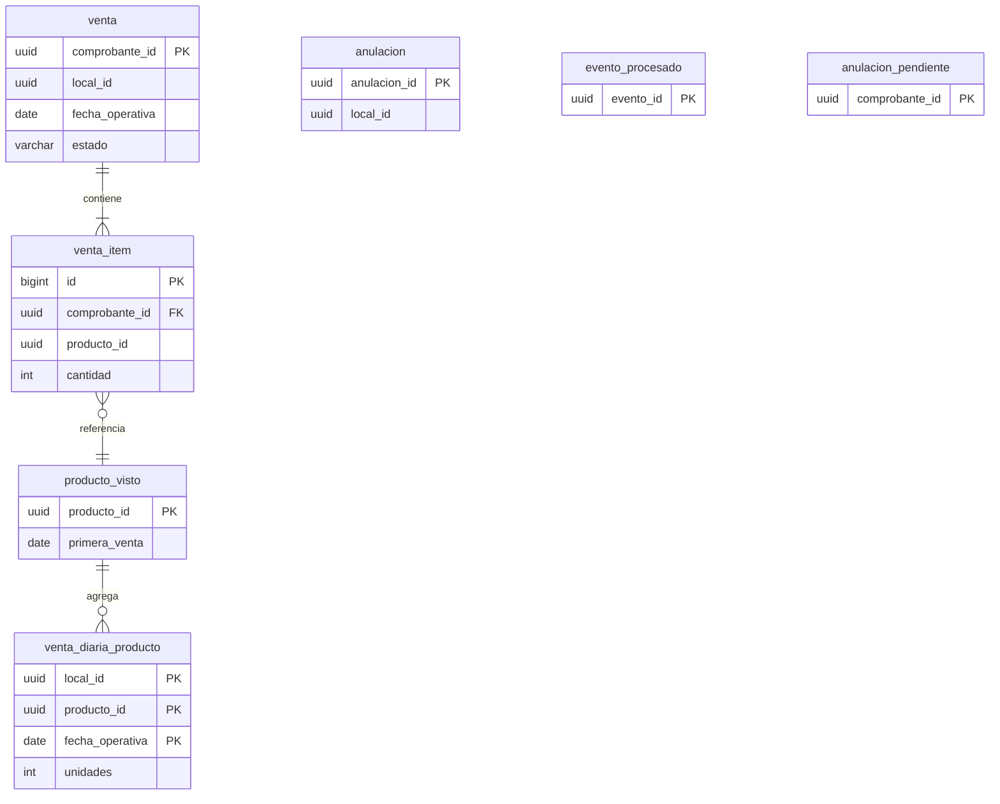

# ms-analítica

Estructura y reglas comunes: [README.md](README.md).

## 1. Identificación

| | |
|---|---|
| **Responsabilidad** | Reportes de ventas y desempeño (CU-ADMIN-13) y series de ventas para la IA. Solo lee ventas ya cerradas; no emite comprobantes ni cobra |
| **Stack** | Python 3.12, FastAPI, SQLAlchemy 2, Alembic. pandas se incorpora con los reportes y la exportación (CU-ADMIN-13): la serie de ventas se arma en SQL |
| **Base de datos** | PostgreSQL propia |
| **Código** | `restaurantcloud/services/analitica` |
| **Puerto local** | 8001 |
| **Prefijo en el gateway** | `/api/v1/analitica` |
| **Despliegue** | VM en la Unidad II; Cloud Run en la Unidad III |

## 2. Datos que gestiona

Motor: PostgreSQL. Reglas comunes: [README.md](README.md), sección 2.1.



| Tabla | Tipo | Propósito |
|---|---|---|
| `venta` | Base | Una fila por comprobante cobrado |
| `venta_item` | Base | Una fila por plato de cada comprobante |
| `anulacion` | Base | Ítems y comandas anulados antes del cobro |
| `producto_visto` | Derivada | Último nombre y categoría conocidos de cada producto, y su primera venta |
| `venta_diaria_producto` | Derivada | Unidades e ingreso por local, producto y jornada. Es la serie que consume la IA |
| `evento_procesado` | Técnica | Eventos ya aplicados |
| `anulacion_pendiente` | Técnica | Anulaciones que llegaron antes que su venta |

```sql
CREATE TABLE venta (
    comprobante_id   uuid PRIMARY KEY,              -- lo asigna el núcleo
    empresa_id       uuid NOT NULL,
    local_id         uuid NOT NULL,
    pedido_id        uuid NOT NULL,
    tipo             varchar(15) NOT NULL CHECK (tipo IN ('boleta','factura','nota_venta')),
    fecha            timestamptz NOT NULL,
    fecha_operativa  date NOT NULL,
    mozo_id          uuid NOT NULL,
    mozo_nombre      varchar(150) NOT NULL,
    comensales       smallint,
    medio_pago       varchar(20) NOT NULL CHECK (medio_pago IN ('efectivo','tarjeta','billetera_digital')),
    subtotal_consumo numeric(12,2) NOT NULL,
    descuento        numeric(12,2) NOT NULL DEFAULT 0,
    monto_recargo    numeric(12,2) NOT NULL DEFAULT 0,
    total            numeric(12,2) NOT NULL,
    promocion_id     uuid,
    estado           varchar(10) NOT NULL DEFAULT 'vigente' CHECK (estado IN ('vigente','anulada')),
    anulada_en       timestamptz,
    recibido_en      timestamptz NOT NULL DEFAULT now()
);
CREATE INDEX ix_venta_local_jornada ON venta (local_id, fecha_operativa);
CREATE INDEX ix_venta_local_fecha   ON venta (local_id, fecha);                    -- ventas por hora
CREATE INDEX ix_venta_local_mozo    ON venta (local_id, mozo_id, fecha_operativa); -- desempeño

CREATE TABLE venta_item (
    id               bigint GENERATED ALWAYS AS IDENTITY PRIMARY KEY,
    comprobante_id   uuid NOT NULL REFERENCES venta (comprobante_id) ON DELETE CASCADE,
    local_id         uuid NOT NULL,                 -- copiado de venta para filtrar sin JOIN
    fecha_operativa  date NOT NULL,
    producto_id      uuid NOT NULL,
    producto_nombre  varchar(150) NOT NULL,
    categoria_id     uuid,
    categoria_nombre varchar(100),
    cantidad         integer NOT NULL CHECK (cantidad > 0),
    precio_unitario  numeric(10,2) NOT NULL,
    subtotal         numeric(12,2) NOT NULL,
    costo_estandar   numeric(10,2)
);
CREATE INDEX ix_item_local_producto ON venta_item (local_id, producto_id, fecha_operativa);
CREATE INDEX ix_item_comprobante    ON venta_item (comprobante_id);

CREATE TABLE producto_visto (
    producto_id      uuid PRIMARY KEY,
    empresa_id       uuid NOT NULL,
    local_id         uuid NOT NULL,
    nombre           varchar(150) NOT NULL,
    categoria_nombre varchar(100),
    primera_venta    date NOT NULL,
    ultima_venta     date NOT NULL
);
CREATE INDEX ix_producto_local ON producto_visto (local_id);

CREATE TABLE venta_diaria_producto (
    local_id        uuid NOT NULL,
    producto_id     uuid NOT NULL,
    fecha_operativa date NOT NULL,
    empresa_id      uuid NOT NULL,
    unidades        integer NOT NULL,
    ingreso         numeric(14,2) NOT NULL,
    PRIMARY KEY (local_id, producto_id, fecha_operativa)
);

CREATE TABLE anulacion (
    anulacion_id       uuid PRIMARY KEY,            -- lo asigna el núcleo
    empresa_id         uuid NOT NULL,
    local_id           uuid NOT NULL,
    pedido_id          uuid NOT NULL,
    pedido_item_id     uuid,
    producto_id        uuid,
    producto_nombre    varchar(150),
    cantidad           integer NOT NULL,
    monto_total        numeric(12,2) NOT NULL,
    tipo_anulacion     varchar(30) NOT NULL,
    motivo_categoria   varchar(50),
    es_merma           boolean NOT NULL DEFAULT false,
    costo_merma        numeric(10,2),
    minutos_espera     integer,
    mozo_id            uuid,
    mozo_nombre        varchar(150),
    anulado_por_id     uuid,
    anulado_por_nombre varchar(150),
    anulado_en         timestamptz NOT NULL,
    fecha_operativa    date NOT NULL
);
CREATE INDEX ix_anulacion_local_jornada ON anulacion (local_id, fecha_operativa);

CREATE TABLE evento_procesado (
    evento_id    uuid PRIMARY KEY,
    tipo         varchar(60) NOT NULL,
    procesado_en timestamptz NOT NULL DEFAULT now()
);

CREATE TABLE anulacion_pendiente (
    comprobante_id uuid PRIMARY KEY,
    anulada_en     timestamptz NOT NULL,
    recibido_en    timestamptz NOT NULL DEFAULT now()
);
```

**Decisiones de diseño**

- **Claves naturales del núcleo.** `comprobante_id` y `anulacion_id` son la clave primaria: garantizan que una venta no se inserte dos veces aunque fallara `evento_procesado`.
- **Qué pasa al recibir cada evento**, siempre en una sola transacción:
  - `venta.registrada`: inserta `venta` y `venta_item`, actualiza `producto_visto` y suma en `venta_diaria_producto`. Si hay una fila en `anulacion_pendiente` para ese comprobante, aplica la anulación y la borra.
  - `comprobante.anulado`: marca la venta como `anulada` y resta sus ítems de `venta_diaria_producto`. Si la venta aún no existe, guarda la fila en `anulacion_pendiente`.
  - `pedido.anulado`: inserta en `anulacion`.
- **Un solo agregado.** Solo se materializa la serie diaria por producto, porque es la consulta más frecuente y la que usa la IA. Los demás reportes (por hora, por mozo, ranking) se calculan sobre `venta` y `venta_item` con sus índices. Se agregan más tablas derivadas solo si una consulta resulta lenta.
- **Reconstruible.** `venta_diaria_producto` y `producto_visto` se pueden recalcular desde `venta` y `venta_item` (ventas con estado `vigente`).
- **Desnormalización deliberada.** `local_id` y `fecha_operativa` se copian en `venta_item` para que las consultas por producto no necesiten unir con `venta`. Los nombres se guardan como estaban al vender: un reporte histórico no cambia si después se renombra el plato.
- **Sin datos de comensales.**
- **Retención:** `evento_procesado` puede purgarse pasados 30 días; el resto se conserva.

## 3. API

| Método | Ruta | Propósito | Quién llama |
|---|---|---|---|
| GET | `/api/v1/analitica/ventas/resumen` | Totales del periodo y comparación con el periodo anterior | Navegador |
| GET | `/api/v1/analitica/ventas/por-hora` | Ventas por franja horaria (horas punta) | Navegador |
| GET | `/api/v1/analitica/productos/ranking` | Platos más y menos vendidos y su rentabilidad | Navegador |
| GET | `/api/v1/analitica/personal/desempeno` | Ventas y tickets por mozo | Navegador |
| GET | `/api/v1/analitica/exportar` | Reporte del periodo en Excel o CSV | Navegador |
| GET | `/interno/series/ventas-diarias` | Unidades vendidas por día y producto de un local | ms-pronóstico |
| POST | `/interno/eventos` | Recepción de eventos | Núcleo |
| GET | `/health` | Estado del servicio | Plataforma |

Roles de las rutas públicas: `admin_local` y `propietario`.

Están detallados los dos endpoints de los que depende la IA. Los de reportes se detallan al definir el alcance de CU-ADMIN-13.

### POST /interno/eventos

**Propósito:** recibir un evento del núcleo y aplicarlo a los datos de analítica.
**Autenticación:** firma HMAC (`X-Timestamp`, `X-Firma`).

**Cuerpo:** el sobre común de eventos (README, sección 4). Tipos aceptados: `venta.registrada`, `comprobante.anulado` y `pedido.anulado`.

**Respuestas**

| HTTP | `datos.estado` | Cuándo |
|---|---|---|
| 202 | `aceptado` | Evento nuevo, aplicado |
| 200 | `duplicado` | Ese `id` ya se había procesado; no se hace nada |
| 200 | `ignorado` | Tipo de evento que este servicio no usa. Se responde 200 para que el emisor no lo reintente |

**Errores**

| HTTP | Código | Cuándo |
|---|---|---|
| 401 | `ERR_FIRMA_INVALIDA` | Falta la firma, no coincide o el timestamp tiene más de 5 minutos |
| 422 | `ERR_EVENTO_INVALIDO` | El cuerpo no es JSON, el sobre está incompleto, la `version` no está soportada, o `datos` no cumple el contrato. `detalles.campos` lista cada campo y su motivo |
| 503 | `ERR_BD_NO_DISPONIBLE` | No se pudo guardar; el emisor debe reintentar |

**Notas**

- Guardar el `id` en `evento_procesado` y aplicar el evento ocurren en una sola transacción, y esa transacción termina antes de responder: un 202 significa que el evento quedó guardado.
- Un 422 indica un error del emisor que el reintento no arregla; el núcleo lo marca como `fallido` para revisión, sin reintentos, y conserva el código de error en `outbox_entrega.ultimo_error`.
- Los eventos de una misma venta pueden llegar a la vez o en desorden. El servicio serializa los eventos de un mismo comprobante, y una anulación que llega antes que su venta queda en `anulacion_pendiente`: al llegar la venta entra ya anulada y no suma a la serie.
- Un evento con el mismo `comprobante_id` o `anulacion_id` que otro ya aplicado, aunque traiga otro `id`, no duplica nada.
- El nombre y la categoría de un producto solo se actualizan con una venta igual o más reciente que la última registrada.

### GET /interno/series/ventas-diarias

**Propósito:** entregar a ms-pronóstico las unidades vendidas por jornada y producto de un local.
**Autenticación:** firma HMAC sobre la cadena de consulta (sección 2 del [README](README.md)), tal como se envía. Sin firma válida responde 401 antes de validar los parámetros.

**Parámetros**

| Nombre | En | Tipo | Obligatorio | Descripción |
|---|---|---|---|---|
| `empresa_id` | query | uuid | sí | Empresa dueña del local |
| `local_id` | query | uuid | sí | Local |
| `desde` | query | día | sí | Primera jornada |
| `hasta` | query | día | sí | Última jornada (incluida) |
| `producto_ids` | query | lista de uuid | no | Limita la respuesta a esos productos. Se repite el parámetro por cada uno: `producto_ids=a&producto_ids=b` |

**Respuesta 200**

```json
{
  "exito": true,
  "datos": {
    "local_id": "00000000-0000-4000-8000-000000000010",
    "desde": "2026-08-01",
    "hasta": "2026-11-15",
    "ultimo_evento_en": "2026-11-15T23:41:12-05:00",
    "productos": [
      {
        "producto_id": "00000000-0000-4000-8000-000000000431",
        "nombre": "Lomo saltado",
        "categoria_nombre": "Fondos",
        "primera_venta": "2026-08-01",
        "serie": [
          { "fecha": "2026-08-01", "unidades": 14, "ingreso": 532.00 },
          { "fecha": "2026-08-02", "unidades": 0, "ingreso": 0.00 }
        ]
      }
    ]
  },
  "meta": { "timestamp": "2026-11-16T08:00:00-05:00" }
}
```

**Errores**

| HTTP | Código | Cuándo |
|---|---|---|
| 401 | `ERR_FIRMA_INVALIDA` | Firma ausente o incorrecta |
| 422 | `ERR_RANGO_INVALIDO` | `desde` posterior a `hasta`, o rango mayor a 730 días (contando ambos extremos: 730 se acepta y 731 no) |
| 422 | `ERR_VALIDACION` | Falta un parámetro o no tiene el formato esperado (uuid o `YYYY-MM-DD`) |

**Notas**

- La serie de cada producto es continua: incluye con `unidades: 0` las jornadas sin ventas entre `max(primera_venta, desde)` y `hasta`. Así el modelo no tiene que rellenar huecos. Un producto cuya primera venta es posterior a `hasta` no aparece.
- Las ventas anuladas ya están descontadas. Un producto cuya única venta se anuló sigue apareciendo, con ceros desde su `primera_venta`.
- Un local sin ventas en el rango devuelve `productos: []` con 200; no es un error.
- Los productos se ordenan por nombre. Solo se devuelven los del `empresa_id` y `local_id` indicados.
- `ultimo_evento_en` es el instante en que llegó la última venta del local (`MAX(venta.recibido_en)`), en la zona horaria del servicio, o `null` si no hay ventas. Permite a ms-pronóstico saber qué tan al día están los datos y registrarlo en la ejecución.
- Limitación conocida: un cero puede significar que no hubo demanda, que el local estuvo cerrado o que el plato estuvo agotado, y analítica no los distingue. Se resuelve al diseñar las variables del modelo (ver «Decisiones abiertas»).

## 4. Eventos

| Evento | Sentido | Efecto |
|---|---|---|
| [`venta.registrada`](eventos.md) | Consume | Inserta la venta y sus ítems; actualiza el agregado diario |
| [`comprobante.anulado`](eventos.md) | Consume | Marca la venta como anulada y la resta del agregado |
| [`pedido.anulado`](eventos.md) | Consume | Registra la anulación para el reporte de desempeño |

No publica eventos.

## 5. Dependencias y fallos

| Depende de | Si no responde |
|---|---|
| Su PostgreSQL | Responde 503 |
| Eventos del núcleo | Los reportes quedan desactualizados hasta que el outbox reintente; no se pierde información |

Ningún otro componente se detiene si ms-analítica cae, salvo ms-pronóstico, que no podrá generar pronósticos nuevos.

## 6. Configuración

| Variable | Descripción |
|---|---|
| `PORT` | Puerto de escucha |
| `DATABASE_URL` | Conexión a su PostgreSQL (usuario sin privilegios de administración) |
| `JWT_PUBLIC_KEY` | Clave pública para validar los JWT. Se usa en las rutas públicas de reportes (aún no implementadas) |
| `SECRETO_INTERNO` | Secreto HMAC para `/interno`; es el mismo `ANALITICA_SECRETO` del núcleo |
| `ZONA_HORARIA` | `America/Lima` |
| `MIGRATIONS_DATABASE_URL` | Conexión del usuario administrador. La usa solo el contenedor `analitica-migraciones`, no el servicio |

## 7. Decisiones abiertas

- Carga inicial: cómo se copian a analítica las ventas anteriores a la activación del servicio (reenviar eventos históricos desde el núcleo).
- Días cerrados y platos agotados: cómo llegan a la IA para no confundirlos con falta de demanda (por ejemplo, que el núcleo los envíe a ms-pronóstico junto con la petición, o un evento diario de disponibilidad).
- Alcance de los reportes de CU-ADMIN-13 que entran en la Unidad II.

Resuelto: el costo del plato viaja en `venta.registrada` (`producto.costo_estandar`), así que la rentabilidad se puede calcular desde la primera versión.
