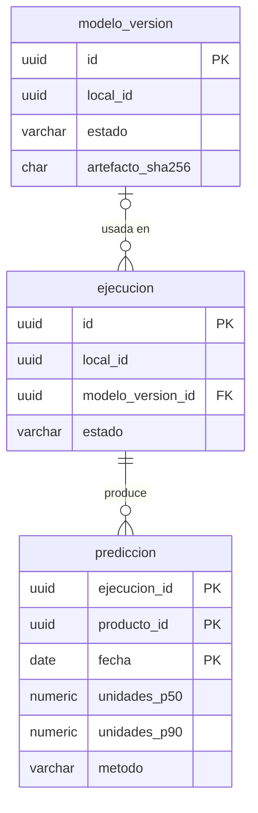

# ms-pronóstico (IA)

Estructura y reglas comunes: [README.md](README.md). Qué recibe y qué devuelve el modelo: [model-ia/CONTRATO.md](../../model-ia/CONTRATO.md); por qué: [model-ia/DECISIONES.md](../../model-ia/DECISIONES.md) (D-01 a D-23).

## 1. Identificación

| | |
|---|---|
| **Responsabilidad** | Pronosticar las unidades que se venderán de cada plato de un local en los próximos días (de 1 a 7), con su mediana (P50) y un percentil alto (P90), y dejar trazabilidad de cada ejecución. **No entrena**: usa el modelo publicado por `model-ia`. No calcula la reposición de insumos: eso lo hace el núcleo con las recetas y el stock |
| **Stack** | Python 3.12, FastAPI, SQLAlchemy 2 (Core), Alembic, uv. Para predecir: el paquete `rc_pronostico` de `model-ia` con `scikit-learn==1.7.2`, `skops==0.13.0`, `numpy==2.5.5` y `pandas==3.1.1`; para los feriados, `holidays==0.109`. Las mismas versiones que `model-ia/uv.lock` |
| **Base de datos** | PostgreSQL propia (`db-pronostico`). Los archivos del modelo están en el repositorio de modelos, no en la base |
| **Código** | `restaurantcloud/services/pronostico` |
| **Puerto local** | 8002 |
| **Prefijo en el gateway** | Ninguno: solo lo llama el núcleo |
| **Despliegue** | VM y **Cloud Run** en la Unidad II |

## 2. Datos que gestiona

Motor: PostgreSQL. Reglas comunes: [README.md](README.md), sección 2.1.



| Tabla | Propósito |
|---|---|
| `modelo_version` | Cada modelo que el servicio cargó y verificó: de dónde salió, con qué datos se entrenó, qué métricas obtuvo y si está en uso |
| `ejecucion` | Cada pronóstico pedido: quién, para qué local, con qué modelo, con qué datos y con qué calendario. También las que fallaron |
| `prediccion` | P50 y P90 por plato y día de una ejecución, y el método con que se calculó |

```sql
CREATE TABLE modelo_version (
    id                uuid PRIMARY KEY,                 -- el `modelo_version` de la ficha (lo asigna model-ia)
    empresa_id        uuid NOT NULL,
    local_id          uuid NOT NULL,
    algoritmo         varchar(80) NOT NULL,             -- `algoritmo` de la ficha
    version_variables varchar(10) NOT NULL,
    datos_desde       date NOT NULL,                    -- datos con que se entrenó
    datos_hasta       date NOT NULL,
    metricas          jsonb NOT NULL DEFAULT '{}',      -- `metricas_validacion` de la ficha (puerta D-17)
    ficha             jsonb NOT NULL,                   -- copia completa de ficha.json
    artefacto_uri     text NOT NULL,                    -- carpeta de la versión en el repositorio
    artefacto_sha256  char(64) NOT NULL,
    estado            varchar(10) NOT NULL CHECK (estado IN ('vigente','retirado')),
    publicado_en      timestamptz NOT NULL,             -- `publicado_en` de vigente.json
    registrado_en     timestamptz NOT NULL DEFAULT now(),
    retirado_en       timestamptz
);
-- Como mucho un modelo vigente por local
CREATE UNIQUE INDEX uq_modelo_vigente ON modelo_version (local_id) WHERE estado = 'vigente';

CREATE TABLE ejecucion (
    id                       uuid PRIMARY KEY,          -- UUID v7
    solicitud_id             uuid NOT NULL,             -- lo genera el núcleo; hace idempotente el reintento
    empresa_id               uuid NOT NULL,
    local_id                 uuid NOT NULL,
    solicitada_por           uuid NOT NULL,             -- usuario del núcleo
    modelo_version_id        uuid REFERENCES modelo_version (id),  -- NULL: no había modelo y todo fue baseline
    version_rc_pronostico    varchar(20) NOT NULL,      -- versión del paquete que calculó
    jornada_actual           date NOT NULL,             -- jornada operativa en curso según el núcleo
    fecha_inicio             date NOT NULL,             -- primer día pronosticado
    horizonte_dias           smallint NOT NULL CHECK (horizonte_dias BETWEEN 1 AND 7),
    datos_desde              date,                      -- rango del historial usado
    datos_hasta              date,
    huella_datos             char(64),                  -- SHA-256 del historial usado (CONTRATO 3)
    calendario               jsonb NOT NULL DEFAULT '{}', -- dias_cerrados y feriados con que se calculó
    datos_actualizados_hasta timestamptz,               -- `ultimo_evento_en` de ms-analítica (informativo)
    estado                   varchar(12) NOT NULL CHECK (estado IN ('completada','fallida')),
    error                    varchar(40),               -- código de error si falló
    duracion_ms              integer,
    creada_en                timestamptz NOT NULL DEFAULT now()
);
CREATE INDEX ix_ejecucion_local ON ejecucion (local_id, creada_en DESC);
-- Un reintento del núcleo no crea una segunda ejecución completada
CREATE UNIQUE INDEX uq_ejecucion_solicitud ON ejecucion (solicitud_id) WHERE estado = 'completada';

CREATE TABLE prediccion (
    ejecucion_id    uuid NOT NULL REFERENCES ejecucion (id) ON DELETE CASCADE,
    producto_id     uuid NOT NULL,
    fecha           date NOT NULL,
    producto_nombre varchar(150) NOT NULL,              -- como lo envió el núcleo
    unidades_p50    numeric(10,2) NOT NULL CHECK (unidades_p50 >= 0),
    unidades_p90    numeric(10,2) NOT NULL,
    metodo          varchar(14) NOT NULL
                    CHECK (metodo IN ('modelo','baseline','cerrado','sin_historial')),
    motivo          varchar(40)
                    CHECK (motivo IN ('historial_minimo','modelo_no_disponible',
                                      'producto_no_visto','historial_reciente_insuficiente')),
    PRIMARY KEY (ejecucion_id, producto_id, fecha),
    CHECK (unidades_p90 >= unidades_p50),
    CHECK ((metodo = 'baseline') = (motivo IS NOT NULL))
);
```

**Decisiones de diseño**

- **Trazabilidad completa.** De cualquier número que vea el administrador se llega a la ejecución, al modelo (con su SHA-256 y su ficha), al rango y la huella de los datos y al calendario usado. Es lo que pide la guía («persistencia y trazabilidad del resultado de IA»).
- **Solo se agrega, nunca se modifica, y lo hace cumplir la base.** El usuario del servicio puede leer e insertar en `ejecucion` y `prediccion`, pero no actualizar ni borrar (migración 0002). En la Unidad III se compara lo pronosticado con lo vendido para medir el experimento en producción. Lo único que puede cambiar es `modelo_version.estado` y `retirado_en` (de `vigente` a `retirado` y al revés).
- **`modelo_version` solo registra lo que el servicio cargó y verificó.** Su `id` es el mismo `modelo_version` que asignó `model-ia` al publicar, así que el registro y el repositorio coinciden sin tabla de correspondencia. Los candidatos que no pasaron la puerta de calidad no llegan aquí: el servicio solo sigue el puntero `vigente.json` (D-22).
- **El baseline no es una fila de `modelo_version`.** Si no hay modelo vigente o no se pudo cargar, `ejecucion.modelo_version_id` queda en `NULL` y cada predicción lleva `metodo = baseline` con `motivo = modelo_no_disponible`. Cambia lo previsto en la primera versión de esta ficha: una «versión» falsa por local no aporta trazabilidad y obligaba a inventar sus métricas.
- **`metodo` y `motivo` por predicción**, con las listas cerradas del CONTRATO (4.1). Las restricciones `CHECK` impiden un baseline sin motivo o un motivo en otro método.
- **No guarda ventas.** Las pide a ms-analítica en cada ejecución y guarda el rango y la huella de lo que usó.
- **No guarda la decisión del administrador.** Aceptar, ajustar o descartar la reposición se registra en el núcleo (`recomendacion_reposicion`), que es el dueño del inventario.
- **También se registran las ejecuciones fallidas** (`estado = 'fallida'`, con su código de error), para saber cuántas veces el pronóstico no estuvo disponible y por qué.
- **Copia del nombre del plato** en `prediccion`, como pide la regla común de identificadores ajenos.
- **Tabla de control de Alembic.** Además de las tres tablas, la base tiene `alembic_version` (una fila con la última migración aplicada). La crea y la usa solo `pronostico-migraciones`; el usuario del servicio no tiene permisos sobre ella.
- **Nombres en singular**, como el resto del sistema (README, sección 2.1). `modelo_version` conserva el nombre del campo `modelo_version` de la ficha del artefacto y de `vigente.json`, que es el vínculo entre el repositorio y la tabla.

## 3. API

| Método | Ruta | Propósito | Quién llama |
|---|---|---|---|
| POST | `/interno/pronosticos` | Genera el pronóstico de un local, lo guarda y lo devuelve | Núcleo |
| GET | `/interno/pronosticos/{id}` | Recupera una ejecución anterior con sus predicciones | Núcleo |
| GET | `/interno/modelos/vigente` | Modelo en uso para un local, sus métricas y el estado de la última carga | Núcleo |
| GET | `/health` | Estado del servicio | Plataforma |

Todas las rutas `/interno` usan la firma HMAC del [README](README.md), sección 2, con el secreto `SECRETO_INTERNO` (el `PRONOSTICO_SECRETO` del núcleo). Sin firma válida responden 401 antes de validar nada más.

### POST /interno/pronosticos

**Propósito:** pronosticar los platos pedidos de un local, guardar la ejecución y devolverla.
**Autenticación:** firma HMAC sobre el cuerpo.

**Cuerpo**

```json
{
  "solicitud_id": "019a8f2e-4c1b-7d3a-9e5f-1a2b3c4d5e6f",
  "empresa_id": "00000000-0000-4000-8000-000000000001",
  "local_id": "00000000-0000-4000-8000-000000000010",
  "solicitada_por": "019a0000-0000-7000-8000-000000000123",
  "jornada_actual": "2026-11-20",
  "fecha_inicio": "2026-11-21",
  "horizonte_dias": 7,
  "productos": [
    { "producto_id": "00000000-0000-4000-8000-000000000431", "nombre": "Ceviche Clásico" },
    { "producto_id": "00000000-0000-4000-8000-000000000432", "nombre": "Lomo Saltado Criollo" }
  ],
  "dias_cerrados": ["2026-11-25"]
}
```

| Campo | Tipo | Obligatorio | Regla |
|---|---|---|---|
| `solicitud_id` | uuid | sí | Lo genera el núcleo por cada pedido del usuario. Si ya existe una ejecución completada con ese id, se devuelve esa sin recalcular |
| `empresa_id`, `local_id` | uuid | sí | Local a pronosticar |
| `solicitada_por` | uuid | sí | Usuario del núcleo que pidió el pronóstico |
| `jornada_actual` | día | sí | Jornada operativa en curso del local, calculada por el núcleo con su horario y su zona horaria (`JornadaOperativaService`). Debe estar entre ayer y hoy según el reloj del servicio en `ZONA_HORARIA` |
| `fecha_inicio` | día | no | Primer día pronosticado. Por defecto, `jornada_actual + 1` (mañana, D-03). Solo se acepta `jornada_actual` o `jornada_actual + 1` |
| `horizonte_dias` | entero | sí | De 1 a 7. El núcleo pide 7 y recorta la cobertura (3, 5 o 7 días) de su lado |
| `productos` | lista | sí | Platos activos de la carta, de 1 a 500, sin repetir. Cada uno con `producto_id` (uuid) y `nombre` (hasta 150 caracteres). Un plato retirado de la carta no se pide |
| `dias_cerrados` | lista de días | no | Días **del periodo pronosticado** en que el local no abrirá: días de la semana sin atención en `horario_atencion` y excepciones con `cerrado = true` en `horario_excepcion`. Una fecha fuera del periodo es un error de validación |

**Qué hace, en orden**

1. Valida el cuerpo. Calcula `datos_hasta = jornada_actual − 1` y `datos_desde = datos_hasta − (VENTANA_HISTORIAL_DIAS − 1)`.
2. Pide a ms-analítica `GET /interno/series/ventas-diarias` de ese rango, **sin filtrar productos**, para que la regla de cierres vea las ventas de todo el local, igual que al entrenar. Es una sola petición: la ventana (365 días) está bajo el límite de 730.
3. Arma el calendario:
   - `dias_cerrados` = cierres del historial detectados con la regla de respaldo de D-05 (el local entero vendió 0), **unidos** a los cierres futuros que envió el núcleo. `rc_pronostico` recibe la lista ya unida.
   - `feriados` = `holidays.Peru` (librería, `PAIS_FERIADOS`) de los años entre `datos_desde` y el último día pronosticado, igual que en el entrenamiento (cuaderno 02).
4. Obtiene el modelo vigente del local (sección «Carga del modelo», abajo).
5. Llama a `rc_pronostico.pronosticar(historial, calendario, peticion, artefacto, hoy=jornada_actual)`. Si el local no tiene ninguna venta en la ventana, no lo llama: todos los platos van como `sin_historial`.
6. Guarda la ejecución y sus predicciones en una transacción y responde.

**Respuesta 201** (ejecución nueva) o **200** (reintento de una `solicitud_id` ya completada, con la misma ejecución)

```json
{
  "exito": true,
  "datos": {
    "ejecucion_id": "019a9b10-7f00-7c2e-8a31-0d4e5f6a7b8c",
    "solicitud_id": "019a8f2e-4c1b-7d3a-9e5f-1a2b3c4d5e6f",
    "local_id": "00000000-0000-4000-8000-000000000010",
    "fecha_inicio": "2026-11-21",
    "horizonte_dias": 7,
    "modelo": {
      "modelo_version": "01a1fa8e-c1e3-7fd8-aafc-1cc0df79e715",
      "algoritmo": "HistGradientBoostingRegressor, cuantiles 0,5 y 0,9",
      "entrenado_hasta": "2026-11-17",
      "publicado_en": "2026-11-20T20:03:42+00:00"
    },
    "datos": {
      "desde": "2025-11-20",
      "hasta": "2026-11-19",
      "huella": "e4c8c839…f68",
      "actualizados_hasta": "2026-11-19T23:12:40-05:00"
    },
    "resumen": { "modelo": 12, "baseline": 0, "cerrado": 2, "sin_historial": 0 },
    "advertencias": [],
    "predicciones": [
      {
        "producto_id": "00000000-0000-4000-8000-000000000431",
        "nombre": "Ceviche Clásico",
        "dias": [
          { "fecha": "2026-11-21", "p50": 31.40, "p90": 39.85, "metodo": "modelo", "motivo": null },
          { "fecha": "2026-11-25", "p50": 0.00, "p90": 0.00, "metodo": "cerrado", "motivo": null }
        ]
      }
    ]
  },
  "meta": { "timestamp": "2026-11-20T18:30:00-05:00" }
}
```

- `modelo` es `null` cuando no había modelo vigente o no se pudo cargar; entonces todo lo que no es `cerrado` ni `sin_historial` lleva `metodo = baseline` y `motivo = modelo_no_disponible`.
- `resumen` cuenta filas (plato × día) por método.
- `predicciones` va ordenada por nombre del plato, igual en el POST y en el GET (el POST responde con lo que quedó guardado), y cada plato trae sus días en orden. Los platos pedidos que no tienen ventas también aparecen, como `sin_historial`.
- La respuesta incluye además `estado`, `error` (nulo si la ejecución se completó), `solicitada_por` y `creada_en`.
- `advertencias` es informativa y no cambia el resultado. Valor posible: `datos_desactualizados`, si `actualizados_hasta` falta o es anterior a `datos_hasta − 3 días`. Indica que ms-analítica puede no estar recibiendo ventas: esos días aparecen en 0 y la regla de respaldo los toma como cerrados.

**Errores**

| HTTP | Código | Cuándo |
|---|---|---|
| 401 | `ERR_FIRMA_INVALIDA` | Firma ausente, incorrecta o con más de 5 minutos |
| 422 | `ERR_VALIDACION` | Cuerpo que no es JSON, campo faltante o con formato inválido, `horizonte_dias` fuera de 1 a 7, `productos` vacío, con repetidos o con más de 500, `dias_cerrados` fuera del periodo. `detalles.campos` lista cada campo y su motivo |
| 422 | `ERR_FECHAS_INVALIDAS` | `jornada_actual` no está entre ayer y hoy según el reloj del servicio, o `fecha_inicio` no es `jornada_actual` ni el día siguiente |
| 502 | `ERR_SERIE_INVALIDA` | ms-analítica respondió con otra forma que la pactada, o con una serie que no cumple el contrato del historial (CONTRATO 2.1): huecos, días repetidos, datos de la jornada en curso o que no terminan en `datos_hasta`. Se guarda la ejecución como `fallida` y `detalles.ejecucion_id` la identifica |
| 503 | `ERR_ANALITICA_NO_DISPONIBLE` | ms-analítica no responde en `ANALITICA_TIMEOUT_SEGUNDOS`, responde con cualquier estado distinto de 200 (5xx, o un 401 por secreto distinto, que es un error de configuración) o falla la red. Se guarda la ejecución como `fallida` y `detalles.ejecucion_id` la identifica |
| 503 | `ERR_BD_NO_DISPONIBLE` | No se pudo guardar la ejecución. No se devuelve un pronóstico sin guardar |

**Notas**

- Es síncrono: con 20 platos la serie llega en unos 0,2 s y la predicción tarda milisegundos. El núcleo espera hasta `PRONOSTICO_TIMEOUT_SEGUNDOS` (30 s).
- Si el núcleo no recibe respuesta y reintenta con el mismo `solicitud_id`, recibe la misma ejecución (200) si la primera terminó; si la primera falló, se calcula de nuevo. Un `solicitud_id` repetido no se compara con el cuerpo: el núcleo genera uno nuevo por cada pedido del usuario.
- **Mismo resultado con la ventana que con el historial completo.** Las variables miran como mucho 63 días antes del corte (ventanas de 28 días y 8 semanas del mismo día de la semana), y las reglas cuentan días abiertos de los últimos 56. Con 365 días de ventana el pronóstico es igual al que daría el historial completo, salvo un plato sin ventas en el último año, que queda `sin_historial`. Se comprueba con una prueba del servicio sobre la serie de ÁUREA.
- `hoy = jornada_actual` hace que `rc_pronostico` rechace una serie que incluya la jornada en curso, que está incompleta (CONTRATO 2.1).
- El pronóstico es determinista: misma serie, mismo calendario, mismo modelo y misma petición dan las mismas cifras.

### GET /interno/pronosticos/{id}

**Propósito:** recuperar una ejecución guardada, por ejemplo para mostrar el último pronóstico sin recalcularlo.
**Autenticación:** firma HMAC sobre la cadena de consulta.

**Parámetros**

| Nombre | En | Tipo | Obligatorio | Descripción |
|---|---|---|---|---|
| `id` | ruta | uuid | sí | `ejecucion_id` |
| `empresa_id` | query | uuid | sí | Empresa del local |
| `local_id` | query | uuid | sí | Local dueño de la ejecución |

**Respuesta 200:** la misma forma que la respuesta del POST. Una ejecución `fallida` se devuelve con `estado = "fallida"`, su `error` y `predicciones: []`.

**Errores**

| HTTP | Código | Cuándo |
|---|---|---|
| 401 | `ERR_FIRMA_INVALIDA` | Firma ausente o incorrecta |
| 404 | `ERR_NO_ENCONTRADO` | No existe, o es de otro local o de otra empresa (no se distingue) |
| 422 | `ERR_VALIDACION` | `id`, `empresa_id` o `local_id` no son uuid |

### GET /interno/modelos/vigente

**Propósito:** informar qué modelo usará el próximo pronóstico de un local y con qué métricas pasó la puerta de calidad. Lo usa la pantalla para mostrar «versión del modelo» (CU-PROP-08).
**Autenticación:** firma HMAC sobre la cadena de consulta.

**Parámetros:** `empresa_id` y `local_id` en la query (uuid, obligatorios).

**Respuesta 200**

```json
{
  "exito": true,
  "datos": {
    "local_id": "00000000-0000-4000-8000-000000000010",
    "metodo": "modelo",
    "modelo": {
      "modelo_version": "01a1fa8e-c1e3-7fd8-aafc-1cc0df79e715",
      "algoritmo": "HistGradientBoostingRegressor, cuantiles 0,5 y 0,9",
      "version_variables": "1",
      "datos_desde": "2024-11-18",
      "datos_hasta": "2026-11-17",
      "metricas": { "tramo": ["2026-09-23", "2026-11-17"], "cortes": 8, "filas": 1100, "mae_modelo": 4.87, "mae_ingenuo": 6.37, "aprobada": true, "criterio": "mae_modelo < mae_ingenuo (h 2 a 8, últimas 8 semanas)" },
      "artefacto_sha256": "66310cae…ee2e",
      "publicado_en": "2026-11-20T20:03:42+00:00"
    },
    "revisado_en": "2026-11-20T18:29:51-05:00",
    "ultimo_error": null
  },
  "meta": { "timestamp": "2026-11-20T18:30:00-05:00" }
}
```

- `metricas` son las `metricas_validacion` de la ficha del modelo, tal cual.
- Sin modelo usable: `metodo = "baseline"` y `modelo = null`.
- `ultimo_error` explica la última carga fallida aunque se siga usando el modelo anterior (por ejemplo, `"El SHA-256 del modelo no coincide con la ficha o el puntero"`). Es `null` si la última revisión fue correcta.
- Consultarlo revisa el puntero en ese momento, sin esperar `MODELOS_REVISAR_SEGUNDOS`.

**Errores:** 401 `ERR_FIRMA_INVALIDA`; 422 `ERR_VALIDACION`. Un local sin modelo no es un error: responde 200 con `metodo = "baseline"`.

### GET /health

Sin autenticación. Responde 200 con `{"estado": "ok", "servicio": "ms-pronostico", "bd": "ok", "repositorio": "ok"}` si la base responde y el repositorio de modelos se puede leer.

- **La base no responde:** 503 `ERR_BD_NO_DISPONIBLE`. Sin base no se puede guardar ninguna ejecución.
- **El repositorio no responde:** sigue siendo 200, con `estado = "degradado"` y `repositorio = "no_disponible"`. El servicio sigue pronosticando con el último modelo verificado o con el baseline (sección 5), así que la plataforma no debe reiniciarlo ni sacarlo de rotación por eso.
- No consulta a ms-analítica, para que una caída de esta no marque a ms-pronóstico como caído.

### Carga del modelo

Dos piezas con responsabilidades distintas (sección 8):

- **`AlmacenArtefactos`** (puerto): lee bytes de una ruta del repositorio (`modelos/{local_id}/vigente.json`, `…/ficha.json`, `…/modelo.skops`) y dice si el repositorio responde. Tiene un adaptador por proveedor (carpeta local hoy, Cloud Storage en la etapa 8). Es lo único que cambia al cambiar de proveedor.
- **`ProveedorModelos`** (servicio de aplicación): las reglas de abajo. No sabe de dónde vienen los bytes.

Cómo pasa un archivo del repositorio de modelos (D-22) a una predicción:

1. **Cuándo se revisa.** El servicio no carga nada al arrancar. En cada pronóstico de un local lee `modelos/{local_id}/vigente.json`, como mucho una vez cada `MODELOS_REVISAR_SEGUNDOS` (60) por local. Si el puntero no cambió, usa el modelo que ya tiene en memoria. El modelo no se vuelve a descargar en cada petición: cargarlo cuesta unos 0,5 s y 2 a 3 MB de memoria, y predecir, milisegundos.
2. **Cómo se carga.** Si el puntero cambió, o el proceso aún no tiene ese local, copia la versión (`modelo.skops` y `ficha.json`) del almacén a una carpeta temporal y llama a `rc_pronostico.artefacto.cargar_version(carpeta, local_id, versión, sha256 del puntero)`. Una carga a la vez por local (candado). Esa función:
   - verifica el SHA-256 del archivo contra la ficha y el puntero;
   - comprueba que la versión de scikit-learn sea idéntica;
   - comprueba que `version_variables` y la lista de variables coincidan con el paquete instalado;
   - carga con skops aceptando solo la lista fija de tipos de D-16.

   El servicio comprueba además que `ficha.aprobado_puerta` sea `true`, que `ficha.local_id` sea el local pedido y que `ficha.modelo_version` sea la versión a la que apunta el puntero. El puntero debe traer un UUID y un SHA-256 válidos: así ninguna ruta del almacén se arma con texto libre.
3. **Si carga bien**, en una transacción registra la versión como `vigente` en `modelo_version` y pasa la anterior a `retirado`. Si el puntero vuelve a una versión ya registrada, esa fila vuelve a `vigente`.
4. **Si falla** (`ErrorArtefacto`), sigue con el último modelo verificado del local:
   - si es el que tiene en memoria, lo usa;
   - si no lo tiene (por ejemplo, tras reiniciar), carga la versión `vigente` de su tabla con `cargar_version` y su SHA-256, porque las versiones del repositorio son inmutables;
   - si tampoco hay una, pronostica con el baseline (`motivo = modelo_no_disponible`).

   El error queda en el log y en `ultimo_error`. Nunca se usa un modelo sin verificar. Un modelo que falla **no se reintenta en cada petición**: la revisión cuenta como hecha y se vuelve a intentar pasado `MODELOS_REVISAR_SEGUNDOS`, para no copiar el archivo una y otra vez.

   Un local sin `vigente.json` no es un error: es un local sin modelo publicado, se pronostica con el baseline y `ultimo_error` es nulo. Solo se avisa si había un modelo y el puntero desapareció (se sigue con el que está en memoria).
5. **Memoria acotada.** La caché guarda como mucho `MODELOS_MAX_EN_MEMORIA` locales (50, unos 150 MB) y descarta el menos usado. Una instancia de Cloud Run tiene memoria limitada.
6. **Varias réplicas o procesos** cargan cada uno su copia, sin coordinarse. Como las versiones son inmutables y se identifican por su SHA-256, todas usan el mismo modelo. Tras un arranque en frío, la primera petición de cada local paga la carga.

## 4. Eventos

| Evento | Sentido | Efecto |
|---|---|---|
| [`pronostico.generado`](eventos.md) | Publica (desde la etapa 7) | ms-notificaciones avisa al administrador |

No consume eventos. `pronostico.generado` no se implementa en la etapa 5B porque nadie lo consume hasta ms-notificaciones (etapa 7) y, como el pronóstico es síncrono, quien lo pide ya ve el resultado. En la etapa 7 se decide cómo publicarlo con garantía de entrega (outbox propio) o si se deja para pronósticos programados.

## 5. Dependencias y fallos

| Depende de | Si no responde |
|---|---|
| ms-analítica (series de ventas) | Responde 503 `ERR_ANALITICA_NO_DISPONIBLE` y guarda la ejecución como `fallida`; el núcleo informa que el pronóstico no está disponible |
| Su PostgreSQL | Responde 503 `ERR_BD_NO_DISPONIBLE` |
| Repositorio de modelos | Usa el último modelo verificado del local o, si no hay ninguno, el baseline. **No es un fallo del pronóstico** |
| Historial insuficiente de un plato | No es un fallo: aplica las reglas del CONTRATO 4.1 (`baseline` con su motivo, o `sin_historial`) y lo marca en cada predicción |

Si ms-pronóstico cae, el salón, la cocina y la caja siguen funcionando.

## 6. Configuración

| Variable | Descripción |
|---|---|
| `PORT` | Puerto de escucha (8002) |
| `DATABASE_URL` | Conexión a su PostgreSQL con el usuario `pronostico_app`, sin privilegios de DDL |
| `MIGRATIONS_DATABASE_URL` | Conexión del usuario administrador. La usa solo el contenedor `pronostico-migraciones`, no el servicio |
| `APP_DB_USER` | Nombre del usuario de la aplicación, al que la migración 0002 concede sus permisos. Solo lo usa `pronostico-migraciones` |
| `SECRETO_INTERNO` | Secreto HMAC para `/interno`; es el `PRONOSTICO_SECRETO` del núcleo |
| `ANALITICA_URL`, `ANALITICA_SECRETO` | Dirección de ms-analítica y su secreto (el `SECRETO_INTERNO` de ms-analítica) |
| `ANALITICA_TIMEOUT_SEGUNDOS` | Espera máxima de la serie (10) |
| `MODELOS_REPOSITORIO` | Raíz del repositorio de modelos: `file:///repositorio` en local (carpeta `model-ia/repositorio/` montada de solo lectura) o `gs://…` en la nube. El esquema elige el adaptador de `AlmacenArtefactos`; un esquema sin adaptador impide arrancar |
| `MODELOS_MAX_EN_MEMORIA` | Locales con modelo cargado a la vez (50) |
| `MODELOS_REVISAR_SEGUNDOS` | Cada cuánto, como mucho, se relee `vigente.json` de un local (60) |
| `VENTANA_HISTORIAL_DIAS` | Días de historial que se piden a ms-analítica (365; de 70 a 730). El mínimo cubre las 8 semanas del P90 del baseline (63 días); con 20 días el pronóstico ya cambia |
| `PAIS_FERIADOS` | País de los feriados de `holidays` (`PE`) |
| `ZONA_HORARIA` | `America/Lima`. Solo para comprobar que `jornada_actual` es razonable y para las fechas de los logs |

`NOTIFICACIONES_URL` y `NOTIFICACIONES_SECRETO` se agregan en la etapa 7, junto con `pronostico.generado`.

**Montaje en Docker Compose:** `../model-ia/repositorio:/repositorio:ro`. El servicio nunca escribe en el repositorio: publicar es tarea de `model-ia` (cuaderno 07).

**Cómo llega `rc_pronostico` a la imagen:** el `pyproject.toml` del servicio lo declara como dependencia por ruta (`[tool.uv.sources]`, versión 0.1.0) y el compose pasa `model-ia/` como contexto adicional de construcción (`build.additional_contexts`). Hay una sola copia del código (D-02) y la imagen no arrastra las dependencias del experimento.

## 7. Decisiones

**Decididas**

- **Un modelo por local**, con el plato como variable categórica. No hay modelo global en la versión 1 (D-06); por eso `empresa_id` y `local_id` no admiten nulo en `modelo_version`.
- **El servicio no entrena.** El modelo se entrena, se evalúa y se publica en `model-ia` (cuaderno 07), que mueve `vigente.json` solo si pasa la puerta de calidad (D-17). El servicio descarga, verifica y usa (D-02, D-22). Reentrenar es ejecutar de nuevo el cuaderno 07.
- **Variables:** las de D-07, calculadas solo por `rc_pronostico` (`version_variables = 1`). Promociones, precio y clima quedan fuera de la versión 1 (D-12).
- **Desde qué día:** se pronostica desde mañana con datos hasta ayer (D-03), contando por jornada operativa, que la informa el núcleo.
- **Ventana de historial de 365 días en una sola petición**, en lugar de pedir todo el historial por tramos de 730 días como preveía D-21: el resultado es el mismo y nunca se alcanza el límite de ms-analítica.
- **Cierres y feriados:** los cierres pasados los detecta la regla de respaldo (igual que al entrenar ÁUREA); los futuros los envía el núcleo, que conoce el horario y sus excepciones. Los feriados los calcula el servicio con `holidays`, la misma librería y versión del entrenamiento. Resuelve el pendiente de D-05 y D-23.
- **Datos sintéticos de entrenamiento:** los genera un comando dentro de ms-analítica (`python -m app.sinteticos`), con semilla y perfil versionado, hasta una fecha de corte y sin pasar por el outbox del núcleo. Para reemplazarlos por datos reales se purga todo lo anterior al corte.
- **Un solo modelo de IA** (pronóstico por plato). El núcleo usa `P90 − P50` como stock de seguridad al calcular la reposición, que no es un segundo modelo.
- **Reposición en el núcleo:** cobertura elegida en pantalla (3, 5 o 7 días, 3 por defecto) sobre un pronóstico de 7 días. Aceptar la recomendación prellena la ficha de compra; ajustar y descartar quedan del lado del núcleo.

**Abiertas**

- **Promociones planificadas** como variable (versión 2 del modelo, D-12): el núcleo tendría que enviarlas en la petición, como los cierres.

**Resueltas el 20/11 (5B.1)**

- **`gs://` no entra en `rc_pronostico`.** La librería sigue leyendo solo del disco. El servicio copia la versión desde el almacén a una carpeta temporal y la carga con `cargar_version`, que verifica el SHA-256 antes de leer. Cambiar de proveedor (Cloud Storage, S3, otro) es escribir un adaptador de `AlmacenArtefactos`, sin tocar `ProveedorModelos` ni `rc_pronostico`. La seguridad no depende del proveedor.
- **El modelo se mantiene en memoria por local** y se revisa su puntero cada 60 s (sección 3, «Carga del modelo»).

**Limitaciones conocidas**

- **Demanda censurada:** sin historial de disponibilidad, los días con platos agotados subestiman la demanda (D-20).
- **Un día sin ventas por falla de entrega se toma como cerrado.** Si ms-analítica deja de recibir ventas, esos días llegan en 0 y la regla de respaldo los trata como cierres; por eso existe la advertencia `datos_desactualizados`. Con su tolerancia de 3 días **no detecta una falla de 1 o 2 días**: se observó con el histórico sintético, que terminaba dos días antes (el 18 y el 19 de noviembre se tomaron como cierres sin advertencia). Un cierre real de un solo día no se puede distinguir de esto sin información del núcleo.

## 8. Arquitectura interna

Puertos y adaptadores, en versión ligera: hay una interfaz solo donde existen dos implementaciones (la real y una de prueba, o la de hoy y la de la etapa 8). El cálculo del pronóstico ya está aislado en `rc_pronostico`, que no tiene red ni base de datos.

```text
app/
  main.py                    crea la aplicación; composicion.py arma los adaptadores y los inyecta
  config.py
  api/                       cómo se habla HTTP
    rutas/                   salud, pronosticos, modelos
    esquemas/                entrada.py (valida el cuerpo) y salida.py (forma JSON de la respuesta)
    errores.py               traducción de errores a HTTP
  aplicacion/                qué hace el servicio
    casos_de_uso/            consultar_salud, generar_pronostico, consultar_ejecucion, consultar_modelo_vigente
    servicios/               proveedor_modelos: puntero, caché, verificación y respaldo (independiente del almacenamiento)
    puertos.py               AlmacenArtefactos, SondaBd, FuenteSeries, RegistroEjecuciones, Reloj, ModelosVigentes, RegistroModelos
    tipos.py  errores.py  contenedor.py
  dominio/                   reglas propias y puras: ventana de datos, unión de cierres, advertencias
  adaptadores/               con quién habla, agrupado por quién está al otro lado
    clientes/analitica.py    httpx y firma HMAC
    almacenamiento/          local.py (file://); gcs.py llega en la etapa 8
    bd/                      SQLAlchemy Core: conexión, tablas y consultas
    reloj.py
  soporte/                   firma, logs, X-Request-Id, respuestas (copiado de ms-analítica)
```

**Reglas de dependencias** (las comprueba `tests/test_arquitectura.py`):

- `api` depende de `aplicacion`; no importa `adaptadores`.
- `aplicacion` y `dominio` no importan FastAPI, Starlette, SQLAlchemy, httpx ni `adaptadores`.
- `dominio` no importa `aplicacion`.
- Solo `composicion.py` conoce los adaptadores concretos.

**Qué no tiene interfaz, a propósito:** PostgreSQL (SQLAlchemy Core ya aísla el driver, y se prueba contra una base real), FastAPI y el algoritmo del modelo (lo absorbe `rc_pronostico` y el artefacto).
