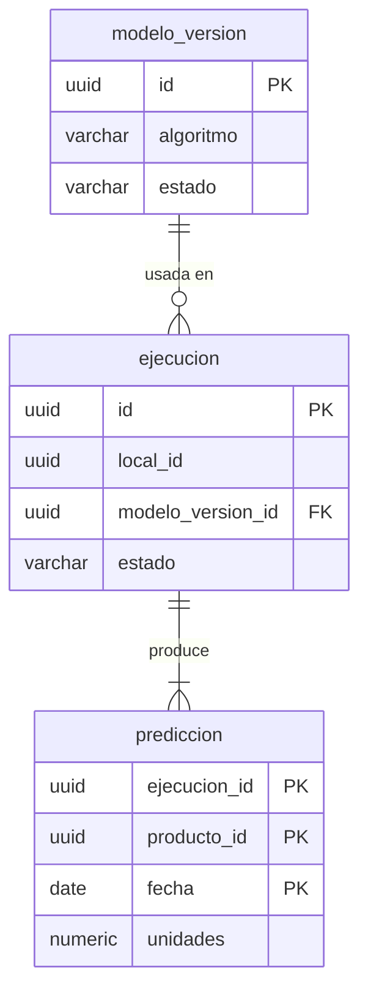

# ms-pronóstico (IA)

Estructura y reglas comunes: [README.md](README.md).

## 1. Identificación

| | |
|---|---|
| **Responsabilidad** | Pronosticar las unidades que se venderán de cada plato en los próximos 7 días y dejar trazabilidad de cada ejecución. No calcula la reposición de insumos: eso lo hace el núcleo con las recetas y el stock |
| **Stack** | Python 3.12, FastAPI, scikit-learn, pandas |
| **Base de datos** | PostgreSQL propia; los archivos del modelo van al almacenamiento de objetos |
| **Código** | `restaurantcloud/services/pronostico` |
| **Puerto local** | 8002 |
| **Prefijo en el gateway** | Ninguno: solo lo llama el núcleo |
| **Despliegue** | VM y **Cloud Run** en la Unidad II |

## 2. Datos que gestiona

Motor: PostgreSQL. Reglas comunes: [README.md](README.md), sección 2.1.



| Tabla | Propósito |
|---|---|
| `modelo_version` | Cada modelo entrenado: con qué datos, con qué parámetros, qué métricas obtuvo y dónde está su archivo |
| `ejecucion` | Cada pronóstico pedido: quién, para qué local, con qué versión del modelo y con qué datos |
| `prediccion` | Unidades pronosticadas por producto y día de una ejecución |

```sql
CREATE TABLE modelo_version (
    id            uuid PRIMARY KEY,
    empresa_id    uuid,                             -- NULL si el modelo es global
    local_id      uuid,                             -- NULL si el modelo es global
    algoritmo     varchar(40) NOT NULL,             -- 'ingenuo_estacional', 'hist_gradient_boosting'
    parametros    jsonb NOT NULL DEFAULT '{}',
    variables     jsonb NOT NULL DEFAULT '[]',      -- variables de entrada usadas
    datos_desde   date NOT NULL,
    datos_hasta   date NOT NULL,
    metricas      jsonb NOT NULL DEFAULT '{}',      -- MAE, RMSE, MASE, sesgo
    artefacto_uri text,                             -- archivo del modelo; NULL en el baseline
    estado        varchar(12) NOT NULL DEFAULT 'candidato'
                  CHECK (estado IN ('candidato','vigente','retirado')),
    entrenado_en  timestamptz NOT NULL DEFAULT now()
);
-- Como mucho un modelo vigente por local (o uno global)
CREATE UNIQUE INDEX uq_modelo_vigente
    ON modelo_version (COALESCE(local_id, '00000000-0000-0000-0000-000000000000'::uuid))
    WHERE estado = 'vigente';

CREATE TABLE ejecucion (
    id                       uuid PRIMARY KEY,
    empresa_id               uuid NOT NULL,
    local_id                 uuid NOT NULL,
    modelo_version_id        uuid NOT NULL REFERENCES modelo_version (id),
    solicitada_por           uuid NOT NULL,         -- usuario del núcleo
    fecha_inicio             date NOT NULL,         -- primer día pronosticado
    horizonte_dias           smallint NOT NULL CHECK (horizonte_dias BETWEEN 1 AND 14),
    datos_desde              date,
    datos_hasta              date,
    datos_actualizados_hasta timestamptz,           -- `ultimo_evento_en` que informó ms-analítica
    estado                   varchar(12) NOT NULL CHECK (estado IN ('completada','fallida')),
    error                    text,
    duracion_ms              integer,
    creada_en                timestamptz NOT NULL DEFAULT now()
);
CREATE INDEX ix_ejecucion_local ON ejecucion (local_id, creada_en DESC);

CREATE TABLE prediccion (
    ejecucion_id uuid NOT NULL REFERENCES ejecucion (id) ON DELETE CASCADE,
    producto_id  uuid NOT NULL,
    fecha        date NOT NULL,
    unidades     numeric(10,2) NOT NULL CHECK (unidades >= 0),
    metodo       varchar(12) NOT NULL CHECK (metodo IN ('modelo','baseline')),
    PRIMARY KEY (ejecucion_id, producto_id, fecha)
);
```

**Decisiones de diseño**

- **Trazabilidad completa.** De cualquier número mostrado al administrador se puede llegar a la ejecución, a la versión del modelo y al rango de datos con que se calculó. Es lo que pide la guía («persistencia y trazabilidad del resultado de IA»).
- **Solo se agrega, nunca se modifica.** Las ejecuciones y predicciones no se actualizan ni se sobrescriben. Así, en la Unidad III se puede comparar lo pronosticado con lo realmente vendido para calcular las métricas del experimento.
- **El baseline es una versión más del modelo** (`algoritmo = 'ingenuo_estacional'`), no un caso aparte. El servicio funciona de punta a punta antes de entrenar nada.
- **`metodo` por predicción.** Indica si ese plato se pronosticó con el modelo o con el baseline por falta de historial.
- **No guarda ventas.** Las pide a ms-analítica en cada ejecución; guarda solo qué rango usó.
- **No guarda la decisión del administrador.** Aceptar, ajustar o descartar la reposición se registra en el núcleo, que es el dueño del inventario.
- **`parametros`, `variables` y `metricas` en `jsonb`**, porque cambian de un algoritmo a otro.
- **El archivo del modelo no va en la base**, sino en el almacenamiento de objetos; aquí solo su ubicación.
- `empresa_id` y `local_id` admiten nulo en `modelo_version` porque sigue abierta la decisión de un modelo por local o uno global.

## 3. API

| Método | Ruta | Propósito | Quién llama |
|---|---|---|---|
| POST | `/interno/pronosticos` | Genera el pronóstico de un local y lo devuelve | Núcleo |
| GET | `/interno/pronosticos/{id}` | Recupera una ejecución anterior | Núcleo |
| GET | `/interno/modelos/vigente` | Versión del modelo en uso y sus métricas | Núcleo |
| GET | `/health` | Estado del servicio | Plataforma |

_Detalle de cada endpoint: por completar con la plantilla del README._

## 4. Eventos

| Evento | Sentido | Efecto |
|---|---|---|
| [`pronostico.generado`](eventos.md) | Publica | ms-notificaciones avisa al administrador |

No consume eventos.

## 5. Dependencias y fallos

| Depende de | Si no responde |
|---|---|
| ms-analítica (series de ventas) | Responde 503; el núcleo informa que el pronóstico no está disponible |
| Su PostgreSQL | Responde 503 |
| Historial insuficiente de un plato | No es un fallo: usa el pronóstico ingenuo estacional para ese plato y lo marca en la respuesta |

Si ms-pronóstico cae, el salón, la cocina y la caja siguen funcionando.

## 6. Configuración

| Variable | Descripción |
|---|---|
| `PORT` | Puerto de escucha |
| `DATABASE_URL` | Conexión a su PostgreSQL |
| `SECRETO_INTERNO` | Secreto HMAC para `/interno` |
| `ANALITICA_URL`, `ANALITICA_SECRETO` | Dirección y secreto de ms-analítica |
| `NOTIFICACIONES_URL`, `NOTIFICACIONES_SECRETO` | Dirección y secreto de ms-notificaciones |
| `MODELOS_BUCKET` | Almacenamiento de los archivos del modelo |

## 7. Decisiones abiertas

- Cuándo se entrena: bajo demanda, programado o fuera del servicio (script) con carga del archivo resultante.
- Un modelo por local o uno global con el local como variable.
- Variables de entrada definitivas (rezagos, medias móviles, día de la semana, feriados, promociones).

**Decididas**

- **Datos sintéticos de entrenamiento:** los genera un comando dentro de ms-analítica (`python -m app.sinteticos`), con semilla y perfil versionado, hasta una fecha de corte y sin pasar por el outbox del núcleo. Para reemplazarlos por datos reales se purga todo lo anterior al corte.
- **Un solo modelo de IA** (pronóstico por plato). Además de la mediana, el modelo entrega un percentil alto (P90, regresión cuantílica de HistGradientBoosting); el núcleo usa `P90 − P50` como stock de seguridad al calcular la reposición. La reposición no es un segundo modelo.
- **Reposición en el núcleo:** cobertura elegida en pantalla (3, 5 o 7 días, 3 por defecto). Aceptar la recomendación prellena la ficha de compra; ajustar y descartar quedan del lado del núcleo.
- **Limitación conocida:** sin historial de disponibilidad, los días con platos agotados subestiman la demanda (demanda censurada).
