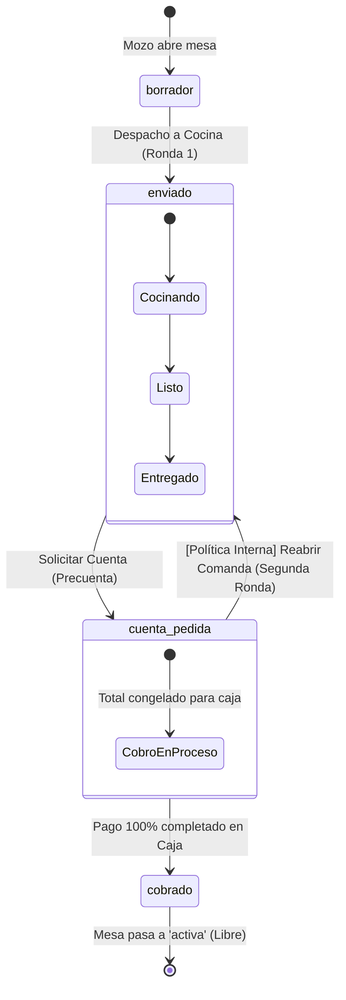

# Diccionario de Estados y Reglas de Negocio del Sistema

Este documento establece la semántica oficial y concisa de cada estado en las entidades clave del sistema (salón, cocina, finanzas y caja), así como las reglas de negocio y políticas operativas que regulan su ciclo de vida.

---

## 1. Diccionario de Estados (En Pocas Palabras)

### 1.1 Comanda (`pedido.estado`)
*Representa la etapa global de atención y consumo de la mesa.*

| Estado | Significado en pocas palabras |
| :--- | :--- |
| `borrador` | Comanda en armado por el mozo; **no visible** para cocina. |
| `enviado` | Comanda despachada a cocina/bar; comensales en consumo activo. |
| `cuenta_pedida` | Precuenta solicitada; comanda en proceso de cobro en caja. |
| `cobrado` | Consumo 100% liquidado con comprobantes; mesa lista para liberarse. |
| `anulado` | Comanda cancelada sin cobro (autorizado por supervisor/administrador). |

---

### 1.2 Platos y Bebidas: Dimensión Culinaria (`pedido_item.estado`)
*Representa la preparación física del plato en KDS / cocina / barra.*

| Estado | Significado en pocas palabras |
| :--- | :--- |
| `en_cola` | Recibido en cocina; en espera de asignación a estación. |
| `en_preparacion` | Cocinero o barman inició la elaboración del plato. |
| `listo` | Plato terminado en pase; listo para ser servido a la mesa. |
| `entregado` | Plato servido en la mesa del cliente. |
| `no_disponible` | Insumo agotado (86'd); alerta inmediata al mozo para cambio. |
| `anulado` | Plato cancelado antes o durante cocción (registra merma si aplica). |

---

### 1.3 Platos y Bebidas: Dimensión Financiera (`pedido_item.estado_pago`)
*Representa la condición de pago del consumo individual.*

| Estado | Significado en pocas palabras |
| :--- | :--- |
| `pendiente` | Consumo aún no liquidado; debe incluirse en la precuenta/cobro. |
| `cobrado` | Consumo ya cancelado y respaldado en un comprobante emitido. |

---

### 1.4 División de Cuentas (`pedido_subcuenta.estado`)
*Borrador de salón para repartir platos entre comensales de la misma mesa.*

| Estado | Significado en pocas palabras |
| :--- | :--- |
| `pendiente` | Grupo de platos asignado y listo para cobrar de forma individual. |
| `cobrado` | Subcuenta liquidada en caja con su comprobante emitido. |
| `anulado` | División descartada o reestructurada por el mozo antes de cobrar. |

---

### 1.5 Facturación y SUNAT (`comprobante.estado`)
*Documento fiscal oficial (Boleta, Factura o Nota de Venta).*

| Estado | Significado en pocas palabras |
| :--- | :--- |
| `emitido` | Comprobante fiscalmente válido y registrado en la caja activa. |
| `anulado` | Comprobante invalidado formalmente mediante Nota de Crédito. |

---

### 1.6 Turno de Caja (`caja.estado`)
*Estado de la gaveta de dinero y terminal POS por sede.*

| Estado | Significado en pocas palabras |
| :--- | :--- |
| `abierta` | Turno activo; recibe cobros, egresos menores y notas de venta. |
| `cerrada` | Turno finalizado; arqueo ciego completado y Reporte Z generado. |

---

### 1.7 Mesa Física (`mesa.estado`)
*Disponibilidad de la mesa física en el plano de salón.*

| Estado | Significado en pocas palabras |
| :--- | :--- |
| `activa` | Mesa libre, limpia y disponible para sentar nuevos comensales. |
| `ocupada` | Mesa con clientes asignados y comanda en curso. |
| `mantenimiento` | Fuera de servicio temporal (reparación o reserva programada). |

---

## 2. Reglas de Negocio y Políticas Operativas



### Regla 1: Política de Bloqueo y Adiciones en `cuenta_pedida`
- **Propósito:** Evitar descalces de caja y confusiones entre el cajero y el mozo mientras se cuenta dinero o se procesa el cobro.
- **Comportamiento en Cocina:** Si la comanda pasa a `cuenta_pedida`, la cocina **no se detiene**. Los platos en preparación pueden pasar a `listo` y `entregado` sin restricciones.
- **Comportamiento en Salón:**
  - Mientras el pedido esté en `cuenta_pedida`, la app de mozo muestra la comanda en modo "Cuenta Solicitada" e inhibe la adición accidental de platos.
  - **Segunda Ronda:** Si los comensales deciden pedir más platos (ej. postres, cafés o tragos) tras haber pedido la cuenta, se aplica la acción explícita **"Reabrir Comanda"**:
    1. El pedido regresa a `enviado` y se limpia `precuenta_generada_at`.
    2. Los nuevos platos ingresan como Ronda 2 con `estado_pago = 'pendiente'`.
    3. Los platos de la Ronda 1 que ya hubieran sido pagados permanecen con `estado_pago = 'cobrado'`.

---

### Regla 2: Prevención de Sobrecobros (Inmunidad de Ítems Cobrados)
- Toda consulta que liquide o calcule importes (precuenta, división de cuenta o cobro total) filtra obligatoriamente:
  ```sql
  WHERE pedido_id = :id 
    AND estado != 'anulado' 
    AND estado_pago = 'pendiente'
  ```
- **Mesas con Pagos Parciales:** Si 2 comensales pagan primero sus platos en una subcuenta y se retiran, sus ítems quedan en `estado_pago = 'cobrado'`. Cuando el resto de la mesa pida la cuenta final, el sistema únicamente sumará los platos pendientes. Es imposible duplicar cobros.

---

### Regla 3: Autonomía Legal con `comprobante_item`
- Cada Boleta, Factura o Nota de Venta guarda una réplica física inmutable de sus líneas (`comprobante_item`): descripción, cantidad, precio unitario, subtotal, base e IGV al momento exacto de la emisión.
- Los cambios posteriores de precios en la carta del restaurante jamás alteran el historial contable de comprobantes ya emitidos (conforme a SUNAT UBL 2.1).

---

### Regla 4: Liberación Automática de Mesa
- Una mesa pasa automáticamente de `ocupada` a `activa` (libre) únicamente cuando:
  1. El pedido matriz pasa al estado `cobrado` (todos los ítems no anulados tienen `estado_pago = 'cobrado'`), **O**
  2. El pedido es `anulado` sin consumo (liberación sin consumo autorizada).
- No se permite liberar una mesa si existen consumos pendientes de cobro.

---

### Regla 5: Subcuentas como Borrador de Salón
- La tabla `pedido_subcuenta` funciona como un organizador dinámico de salón para distribuir consumos antes de pagar.
- La fuente de verdad jurídica y financiera final es siempre el `comprobante` y su detalle `comprobante_item`.
- Si una subcuenta no se llega a pagar y se decide cancelar la división para cobrar todo junto, la subcuenta pasa a `anulado` sin afectar la comanda madre.
