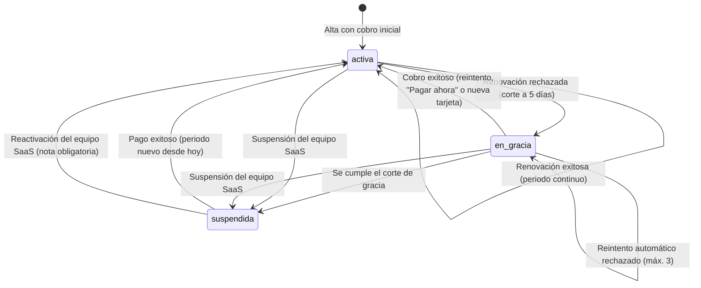

# Estados y Reglas de Negocio de la Suscripción

Este documento describe la semántica de los estados de la suscripción SaaS de una empresa (cobro, gracia, suspensión y recuperación) y las reglas que gobiernan su ciclo de vida. Complementa a `estados_y_reglas_de_negocio.md`, que cubre la operación del salón.

La suscripción define si una empresa puede operar. Hay dos estados que se mueven juntos pero no son lo mismo:
- `suscripcion.estado` dice **cómo va el cobro**.
- `empresa.estado` dice **si se puede entrar y operar**.

---

## 1. Diccionario de Estados (En Pocas Palabras)

### 1.1 Suscripción (`suscripcion.estado`)
*Representa la situación de cobro del periodo contratado.*

| Estado | Significado en pocas palabras |
| :--- | :--- |
| `activa` | Periodo pagado y vigente. Si `fecha_fin_periodo` ya pasó, está pendiente de renovar en la siguiente corrida del cobro. |
| `en_gracia` | El banco rechazó la renovación. La empresa sigue operando, con 5 días para regularizar. |
| `suspendida` | Terminó la gracia (o el equipo SaaS la suspendió). La empresa queda bloqueada. |
| `pendiente_ajuste`, `cancelada` | Existen en la BD pero el sistema **no los usa**. Se descartó `pendiente_ajuste`: una baja de plan nunca deja la empresa sin poder operar. |

---

### 1.2 Empresa (`empresa.estado`)
*Representa si la empresa puede ingresar y operar.*

| Estado | Significado en pocas palabras |
| :--- | :--- |
| `activa` | Puede operar. También lo es durante la gracia. |
| `suspendida` | Solo el propietario entra, y únicamente a "Mi suscripción". |
| `periodo_gracia`, `pendiente_baja`, `eliminada` | Reservados; hoy no se usan. La gracia se maneja solo en la suscripción. |

---

### 1.3 Pago (`pago.estado`)
*Representa cada intento de cobro de la suscripción.*

| Estado | Significado en pocas palabras |
| :--- | :--- |
| `exitoso` | Cobro confirmado; genera constancia PDF. |
| `fallido` | Cobro rechazado; se guarda el motivo. Alimenta el historial y las claves de idempotencia. |
| `reembolsado` | Existe en el esquema, pero no hay un flujo de reembolso. |

---

### 1.4 Suspensión del SaaS (`suscripcion_suspension.estado`)
*Registro de las suspensiones decididas por el equipo SaaS (no por falta de pago).*

| Estado | Significado en pocas palabras |
| :--- | :--- |
| `activa` | El equipo SaaS suspendió la cuenta con motivo y detalle. Pagar no la levanta. |
| `resuelta_reactivada` | El equipo SaaS la reactivó, con nota de auditoría. |
| `ejecutada_baja` | Existe en el esquema; la baja definitiva no está implementada. |

---

## 2. Qué puede hacer la empresa en cada situación

| Situación | Operación de sedes | Mi suscripción | Cambiar de plan | Pagar |
| :--- | :--- | :--- | :--- | :--- |
| Activa y al día | Sí | Sí | Sí | n/a |
| Activa con periodo vencido | Sí | Sí | No | Se cobra en la siguiente corrida |
| En gracia | Sí, con aviso | Sí | No (solo cancelar un cambio ya programado) | Sí |
| Suspendida por falta de pago | No | Sí (único acceso) | No | Sí, y reactiva |
| Suspendida por el SaaS | No | Sí, solo lectura | No | No (403 `SUSPENSION_ADMINISTRATIVA`) |

---

## 3. Reglas de Negocio y Políticas Operativas

### Regla 1: Renovación
- **Cuándo corre:** el comando `suscripciones:procesar-cobros` corre todos los días a las 06:00 (hora de Lima).
- **Qué cobra:** a toda suscripción `activa` con `fecha_fin_periodo` vencida le cobra con la tarjeta guardada, por el precio del plan y ciclo contratados.
- **Si sale bien:**
  - extiende el periodo desde la fecha de fin anterior, para no perder días;
  - mensual suma un mes y anual suma un año;
  - registra el pago y genera la constancia en PDF.
- **Sin Stripe Billing:** el cobro es un PaymentIntent off-session y la base de datos es la única fuente de verdad del estado de cobro (`CobroSuscripcionService`).

---

### Regla 2: Gracia
- **Cuándo empieza:** si la renovación falla, la suscripción pasa a `en_gracia` y se fija `fecha_corte_gracia` a 5 días desde ese momento.
- **Qué se registra:** se guarda un pago `fallido` con el motivo y se muestra en Mi suscripción.
- **La empresa sigue operando:** en esta fase la cocina, el salón y la caja no se interrumpen.
- **Reintentos:**
  - el comando diario reintenta hasta 3 veces en total, contando el cobro original;
  - no más de uno cada ~20 horas;
  - **solo los intentos del comando cuentan**: los manuales ("Pagar ahora" o cambiar la tarjeta) no consumen esos reintentos.
- **Cambios de plan:** no se permiten durante la gracia, pero se puede cancelar uno ya programado.

---

### Regla 3: Suspensión por falta de pago
- **Cuándo:** el comando suspende la suscripción y la empresa cuando se cumple `fecha_corte_gracia`.
- **Quién entra:**
  - al iniciar sesión solo pasa el propietario;
  - el resto del personal queda bloqueado (403);
  - en cada petición, el middleware `TenantContext` devuelve 403 `EMPRESA_SUSPENDIDA`, salvo para `/propietario/suscripcion*` y las rutas de autenticación;
  - el frontend redirige al propietario a Mi suscripción.
- **No se borra nada:** los datos quedan intactos.
- **Duración:** la empresa sigue suspendida mientras no se regularice; no hay baja automática.

---

### Regla 4: Recuperación
- **Qué la dispara:** "Pagar ahora" o confirmar una tarjeta nueva intenta cobrar lo adeudado.
- **Si sale bien:**
  - la suscripción vuelve a `activa` y la empresa a `activa`;
  - **el periodo nuevo empieza hoy**, porque venía de gracia o suspensión (a diferencia de la renovación normal, que continúa el periodo);
  - se reinician los contadores y los errores;
  - se emite la constancia.
- **Si falla:** responde 402 `COBRO_PENDIENTE_FALLIDO`, el estado no cambia y se registra otro pago `fallido`.
- **Claves de idempotencia:** cada intento usa una clave propia (cuenta los pagos fallidos); si no, Stripe repetiría el rechazo anterior sin cobrar.

---

### Regla 5: Suspensión administrativa
- **Cómo se registra:** el equipo SaaS suspende con motivo y detalle (mínimo 15 caracteres) y queda una fila `activa` en `suscripcion_suspension`.
- **Qué cambia con respecto a la suspensión por falta de pago:**
  - no es una deuda: el monto pendiente es 0;
  - pagar no la levanta;
  - el comando de cobro no la toca;
  - Mi suscripción muestra un aviso para contactar a soporte, sin botones de pago.
- **Reactivación:** `POST /saas/tenants/{id}/reactivar`, con nota de auditoría (mínimo 15 caracteres). Cierra la suspensión y deja empresa y suscripción `activa`. Si el periodo ya había vencido, el comando intenta cobrarlo en su siguiente corrida.

---

### Regla 6: Cambio de plan y de ciclo
- **Mejorar el plan:**
  - es inmediato y solo se permite con la suscripción `activa` y al día;
  - se cobra el prorrateo (precio nuevo menos el crédito de los días no usados), con un mínimo de S/ 2.00;
  - si el banco rechaza, todo se revierte.
- **Bajar de plan o pasar de anual a mensual:**
  - se programa para el final del periodo ya pagado;
  - hasta esa fecha se conserva todo lo del plan actual, sin reembolso ni saldo a favor;
  - no se bloquea crear locales ni personal mientras tanto.
- **Aplicar el cambio programado:**
  - **El cobro decide:** en la renovación se cobra el plan y ciclo nuevos, y el cambio solo se aplica si ese cobro sale bien. Si falla, se sigue en el plan actual, en gracia, y el cambio se aplica cuando un reintento prospere.
  - **Qué se desactiva:** lo que exceda los límites del plan nuevo pasa a inactivo, nunca se borra. La selección del asistente "qué conservar" se respeta y el cupo libre se completa por antigüedad.

---

### Regla 7: Límites del plan
- **Por empresa:** el número de locales.
- **Por local:** pisos, mesas y personal.
- **Quién cuenta:** el propietario no cuenta. Un administrador cuenta en su sede; mientras no tiene sede, solo se limita a tantos como locales permite el plan.

---

## 4. Lo que hoy no está implementado
- **Avisos por correo o WhatsApp:** no se envían cuando falla un cobro, cuando faltan pocos días de gracia, ni al suspender.
- **Baja definitiva:** no hay baja ni eliminación, aunque el esquema tiene `pendiente_baja`, `eliminada` y `ejecutada_baja`.
- **Reembolsos:** no existe flujo de reembolsos.
- **Cambio a anual:** no se puede pasar de mensual a anual de forma inmediata (queda para la Etapa 5).
- **Realizar pruebas de cuenta Sustpendida**: Se ha hecho pruebas manuales de estos cambios en el sistema
