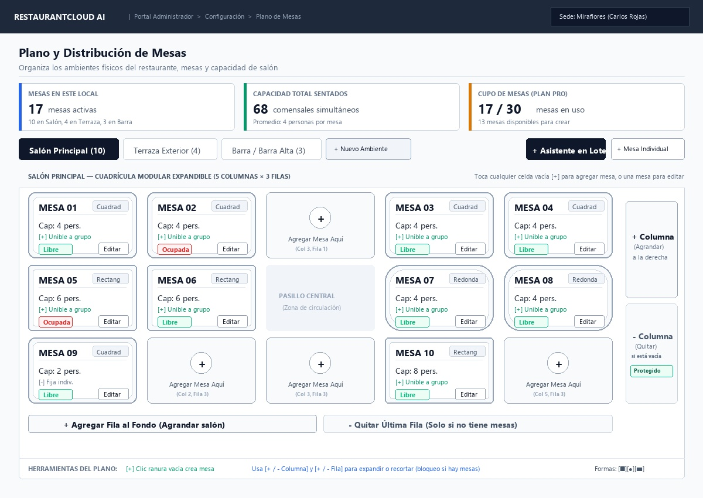
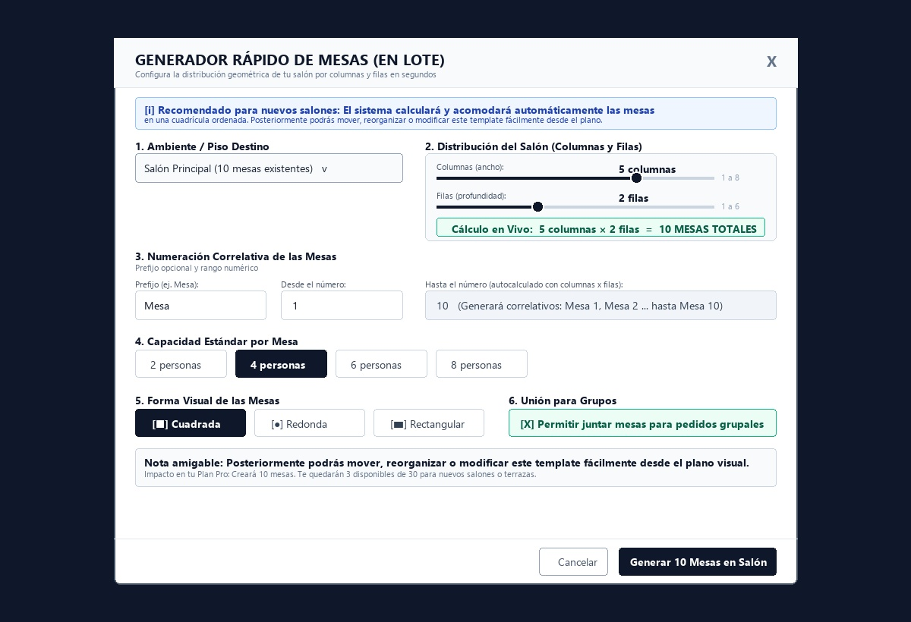
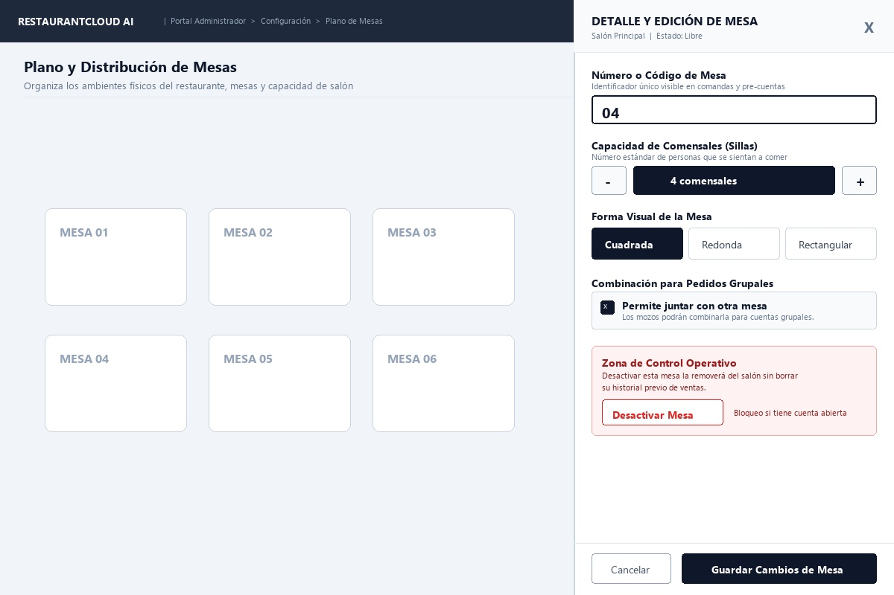
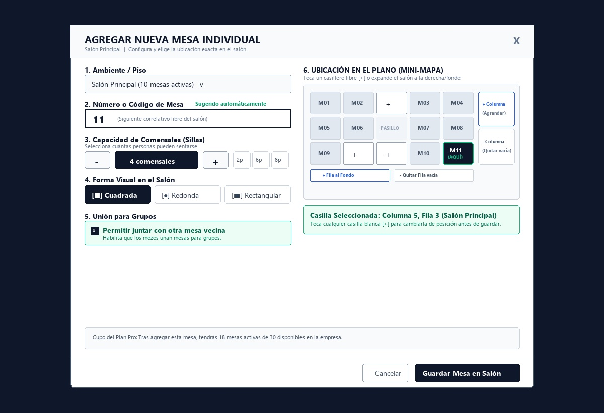
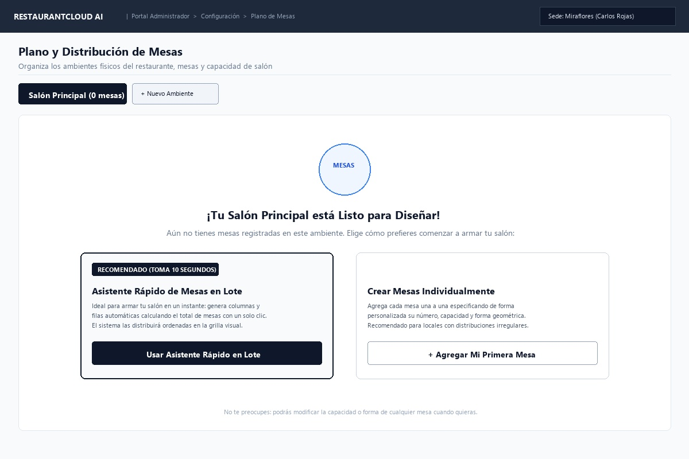

# CU-ADMIN-01: Gestionar Plano de Mesas

Especificación técnica de interfaz de usuario, arquitectura de información, estados UX y contratos de API para la organización física de ambientes, configuración de mesas y control de capacidad en **RestaurantCloud AI**.

## Contrato vigente de implementación (Laravel)

La implementación usa Laravel, autenticación Bearer con sesión Redis y el middleware `TenantContext`. Esta sección prevalece sobre los ejemplos históricos de Go de la sección 6. La sede y empresa se obtienen de la sesión, nunca del cuerpo enviado por el cliente.

| Método | Ruta bajo `/api/v1/admin` | Operación |
| :--- | :--- | :--- |
| GET | `/pisos` | Plano, mesas no inactivas y cuota empresarial |
| POST | `/pisos` | Crear ambiente con `nombre`, `columnas`, `filas` |
| PATCH | `/pisos/{id}/nombre` | Renombrar ambiente |
| PATCH | `/pisos/{id}/dimensiones` | Modificar columnas y filas |
| PATCH | `/pisos/{id}/desactivar` | Baja lógica del ambiente |
| POST | `/pisos/{id}/mesas` | Crear mesa individual |
| POST | `/pisos/{id}/mesas/lote` | Generación atómica en ambiente vacío |
| PUT | `/mesas/{id}` | Editar o reubicar; admite `piso_id` de la misma sede |
| PATCH | `/mesas/{id}/desactivar` | Baja lógica de mesa sin comanda ni unión |

Respuesta exitosa: `{ "exito": true, "datos": { ... }, "meta": { "timestamp": "..." } }`. Las altas responden 201 y las demás operaciones 200. Los errores usan `{ "exito": false, "errores": [{ "codigo": "...", "mensaje": "...", "detalles": { ... } }], "meta": { "timestamp": "..." } }`; `detalles` es opcional. Validación: 422; cuota o rol: 403; recurso fuera de sede: 404; conflicto operativo: 409.

`datos` del plano contiene `local_id`, `local_nombre`, `pisos` y `cuota_mesas`. Cada piso incluye sus campos SQL, `mesas`, `total_mesas` y `capacidad_total_personas`. Las mesas incluyen campos SQL y ocupación derivada de pedidos. `cuota_mesas` contiene `plan_nombre`, `mesas_activas_empresa`, `max_mesas_plan`, `mesas_disponibles`, `pisos_activos_empresa`, `max_pisos_plan`. Los KPI de sede se calculan exclusivamente con sus pisos; la cuota suma todas las sedes de la empresa.

Reglas vigentes:

- Nombre de piso: 1–60 caracteres; único entre ambientes activos de la sede, sin distinguir mayúsculas. Columnas: 1–12; filas: 1–10.
- Código de mesa: 1–10 caracteres incluyendo prefijo; sin espacios externos. Se rechaza duplicidad, incluso histórica y sin distinguir mayúsculas. Capacidad: 1–20; formas: `cuadrada`, `redonda`, `rectangular`.
- Una mesa `bloqueada` sigue ocupando casilla y cupo, aparece en el plano e impide recortar o desactivar su ambiente. Las mesas inactivas no consumen cupo ni casilla.
- Coordenadas enteras desde cero, dentro del ambiente y sin superposición. Se permite mover una mesa a otro ambiente activo de la misma sede si su número y casilla están disponibles. Las mesas con comanda o unión no se reubican.
- Pedidos abiertos: `borrador`, `enviado`, `cuenta_pedida`. Los estados de cocina pertenecen a `pedido_item`. La baja consulta también el grupo unido y devuelve detalles reales de comanda, mozo y consumo.
- Lote exclusivamente sobre un ambiente sin mesas activas ni bloqueadas; no reemplaza registros. Cualquier fallo revierte el lote y sus dimensiones. Responde con `{ "piso": { ... }, "mesas_creadas": N }` en `datos`.
- Las bajas responden con `{ "mensaje": "...", "mesa_id": "..." }` o `{ "mensaje": "...", "piso_id": "..." }` en `datos`; nunca se borra físicamente.
- Se serializan las escrituras con el bloqueo de empresa y la apertura/envío de comanda con el bloqueo de mesa. Los agregados empresariales restauran el contexto RLS de sede al terminar.
- Los formularios permanecen abiertos ante un fallo; el simulador solo aparece cuando `VITE_USE_REAL_API` no es `true`.

---

## 1. Ficha Técnica del Caso de Uso

| Atributo | Detalle |
| :--- | :--- |
| **Código CU** | `CU-ADMIN-01` |
| **Nombre** | Gestionar plano de mesas |
| **Actor(es)** | `administrador_local` (gestión exclusiva de la sede titular asignada) |
| **Dispositivo / Viewport** | Responsive Desktop (`1440x900`), Tablet (`768x1024`), Mobile (`375x812`) |
| **Precondición** | El local se encuentra en estado `activo` (`CU-PROP-04`) y el usuario tiene sesión iniciada con rol `admin_local` vinculado a esa sede (`CU-PROP-05`). |
| **Postcondición** | Ambientes/pisos registrados, mesas creadas y distribuidas visualmente en la grilla del salón, capacidades auditadas contra el plan (`max_pisos`, `max_mesas`) y mesas inactivadas preservadas para trazabilidad de ventas históricas. |

---

## 2. Diagrama de Flujo y Secuencia

```mermaid
sequenceDiagram
    autonumber
    actor A as Administrador del Local
    participant FE as Frontend Dashboard
    participant BE as Backend (Laravel API)
    participant DB as PostgreSQL (RLS)

    %% 1. Consulta del Plano de Mesas
    A->>FE: 1. Ingresa a "Plano de Mesas" desde el menú Configuración
    FE->>BE: GET /api/v1/admin/pisos?con_mesas=true
    BE->>DB: SET app.tenant_id = :empresa_id;<br/>SELECT pisos y mesas WHERE local_id = :admin_local_id
    DB-->>BE: Retorna lista de pisos, mesas y consumo de cuotas del plan
    BE-->>FE: 200 OK (apiresponse.Response con PisosConMesasDTO)
    FE->>A: Renderiza Vista 1: Grilla Visual del Salón con Pestañas de Ambientes

    %% 2. Creación en Lote desde Salón Vacío (Onboarding Asistido)
    alt Administrador usa el Asistente Rápido en Salón Vacío
        A->>FE: 2. En salón vacío, clic en "[ Usar Asistente Rápido en Lote ]"
        FE->>A: Despliega Vista 2: Asistente Wizard contextual del ambiente activo (sin dropdown redundante)
        A->>FE: Configura: 10 mesas (5 col × 2 fil), 4 comensales, cuadrada, "Mesa", 1 a 10
        FE->>BE: POST /api/v1/admin/pisos/{piso_id}/mesas/lote
        BE->>DB: Valida cuota de plan (max_mesas) + Inserta atómicamente 10 mesas
        DB-->>BE: Inserción completada
        BE-->>FE: 201 Created (apiresponse.Response con MesasBatchResultDTO)
        FE->>A: Cierra modal, dibuja las mesas ordenadas en la grilla y muestra Toast verde
    end

    %% 3. Edición Rápida con Panel Lateral (Quick-Drawer)
    alt Administrador ajusta capacidad o forma de una mesa
        A->>FE: 3. Toca tarjeta de "Mesa 04" en la grilla visual
        FE->>A: Despliega Vista 3: Panel Lateral Quick-Drawer
        A->>FE: Modifica capacidad a 6 personas y forma a "Rectangular"
        FE->>BE: PUT /api/v1/admin/mesas/{id} {numero: "04", capacidad: 6, forma: "rectangular", permite_union: true}
        BE->>DB: UPDATE mesa SET ... WHERE id = :id AND local_id = :admin_local_id
        DB-->>BE: Registro actualizado
        BE-->>FE: 200 OK (apiresponse.Response con MesaDetalleDTO)
        FE->>A: Actualiza la tarjeta visual en el plano al instante
    end

    %% 4. Desactivación de Mesa con Bloqueo Duro
    alt Administrador intenta dar de baja una mesa
        A->>FE: 4. Clic en "[ Desactivar Mesa ]" en el panel lateral
        FE->>BE: PATCH /api/v1/admin/mesas/{id}/desactivar
        BE->>DB: Bloquea mesa y audita pedidos de mesa/grupo con estado IN ('borrador','enviado','cuenta_pedida')
        alt Mesa con comensales o comanda abierta
            DB-->>BE: Conteo = 1 (Comanda #104 activa)
            BE-->>FE: 409 Conflict (ERR_MESA_CON_PEDIDOS_ACTIVOS)
            FE->>A: Alerta roja de Bloqueo Duro: "Mesa con comensales activos en Comanda #104. Cobrar en Caja antes de dar de baja."
        else Mesa libre y sin órdenes pendientes
            BE->>DB: UPDATE mesa SET estado = 'inactiva', updated_at = NOW() WHERE id = :id
            DB-->>BE: Actualización confirmada
            BE-->>FE: 200 OK (apiresponse.Response con {mensaje: "Mesa desactivada exitosamente"})
            FE->>A: Remueve la mesa del plano activo y actualiza los medidores de salón
        end
    end

    %% 5. Expansión y Recorte Seguro de Cuadrícula (Columnas y Filas)
    alt Administrador recorta una columna o fila del salón
        A->>FE: 5. Clic en "[- Columna]" o "[- Quitar Fila]" en pestañas o mini-mapa
        FE->>BE: PATCH /api/v1/admin/pisos/{piso_id}/dimensiones {columnas: 4, filas: 3}
        BE->>DB: SELECT COUNT(*) FROM mesa WHERE piso_id = :piso_id AND posicion_x >= 4 AND estado = 'activa'
        alt Existen mesas en la columna/fila a eliminar (Bloqueo de Seguridad)
            DB-->>BE: Conteo = 2 (Mesa 04 y Mesa 08 en columna 4)
            BE-->>FE: 409 Conflict (ERR_COLUMNA_CON_MESAS)
            FE->>A: Modal de Bloqueo de Seguridad: "No se puede eliminar la Columna 5 porque contiene la Mesa 04 y Mesa 08. Reubícalas o desactívalas primero."
        else Columna/fila completamente vacía (sin mesas)
            BE->>DB: UPDATE piso SET columnas = 4, updated_at = NOW() WHERE id = :piso_id
            DB-->>BE: Registro actualizado
            BE-->>FE: 200 OK (apiresponse.Response con PisoDimensionesDTO)
            FE->>A: Recorta visualmente el salón de inmediato y confirma con Toast verde
        end
    end

    %% 6. Renombrar Ambiente Físico
    alt Administrador renombra el ambiente
        A->>FE: 6. Clic en icono (⚙️) de la pestaña activa y modifica nombre a "Salón Los Sauces"
        FE->>BE: PATCH /api/v1/admin/pisos/{piso_id}/nombre {nombre: "Salón Los Sauces"}
        BE->>DB: Valida unicidad en la sede + UPDATE piso SET nombre = 'Salón Los Sauces', updated_at = NOW() WHERE id = :piso_id
        DB-->>BE: Registro actualizado
        BE-->>FE: 200 OK (apiresponse.Response con PisoAdminDTO)
        FE->>A: Actualiza el nombre en pestañas y cabecera de inmediato con Toast verde
    end

    %% 7. Eliminación / Desactivación de Ambiente con Bloqueo Duro 409
    alt Administrador intenta dar de baja un ambiente
        A->>FE: 7. Clic en "[ Eliminar este Ambiente ]" en modal de configuración
        FE->>BE: PATCH /api/v1/admin/pisos/{piso_id}/desactivar
        BE->>DB: Valida pisos activos restantes (> 1) y audita mesas: SELECT COUNT(*) FROM mesa WHERE piso_id = :piso_id AND estado = 'activa'
        alt Ambiente con mesas configuradas (Bloqueo de Seguridad 409)
            DB-->>BE: Conteo > 0 (Ej. 10 mesas activas)
            BE-->>FE: 409 Conflict (ERR_PISO_CON_MESAS_ACTIVAS)
            FE->>A: Alerta de Bloqueo: "No puedes eliminar 'Salón Principal' porque contiene 10 mesas activas. Reubica o desactiva las mesas primero."
        else Ambiente vacío (0 mesas activas) y > 1 piso activo
            BE->>DB: UPDATE piso SET estado = 'inactivo', updated_at = NOW() WHERE id = :piso_id
            DB-->>BE: Actualización confirmada
            BE-->>FE: 200 OK (apiresponse.Response con {mensaje: "Ambiente eliminado exitosamente"})
            FE->>A: Oculta pestaña, conmuta al primer ambiente activo restante y muestra Toast verde
        end
    end

```

---

## 3. Especificación de Pantallas y Wireframes Blueprint

### Vista 1: Grilla Visual del Salón y Pestañas de Pisos (`wf_admin_01_plano_grilla.jpg`)



#### Layout Estructural ASCII (Desktop 1440x900)
```text
+----------------------------------------------------------------------------------------------------+
| RESTAURANTCLOUD AI   | Portal Administrador > Configuración > Plano de Mesas   [ Sede: Miraflores] |
+----------------------------------------------------------------------------------------------------+
|                                                                                                    |
| Plano y Distribución de Mesas                                                                      |
| Organiza los ambientes físicos del restaurante, mesas y capacidad de salón                         |
|----------------------------------------------------------------------------------------------------|
|                                                                                                    |
| +-------------------------+ +-------------------------+ +----------------------------------------+ |
| | MESAS EN ESTE LOCAL     | | CAPACIDAD TOTAL SENTADOS| | CUPO DE MESAS (PLAN PRO)               | |
| | [ 17 ] mesas activas    | | [ 68 ] comensales       | | [ 17 / 30 ] mesas en uso               | |
| | 10 Salón, 4 Terraza...  | | Promedio: 4 personas    | | 13 mesas disponibles para crear        | |
| +-------------------------+ +-------------------------+ +----------------------------------------+ |
|                                                                                                    |
| [ Salón Principal (10) ⚙️ ] [ Terraza (4) ] [ Barra (3) ] [ + Ambiente ]  [ + Mesa Individual ]     |
|                                                                          [ + Nuevo Ambiente ]      |
| +------------------------------------------------------------------------------------------------+ |
| | SALÓN PRINCIPAL — 10 MESAS CONFIGURADAS (DISTRIBUCIÓN VISUAL)        Haz clic en una para editar| |
| | Cuadrícula: 5 col × 2 filas | Col: [-] [+] | Fil: [-] [+]                                      | |
| |------------------------------------------------------------------------------------------------| |
| |  +---------------+  +---------------+  +---------------+  +---------------+  +---------------+ | |
| |  | MESA 01 [Cuad]|  | MESA 02 [Cuad]|  | MESA 03 [Cuad]|  | MESA 04 [Cuad]|  | MESA 05 [Rect]| | |
| |  | Cap: 4 pers.  |  | Cap: 4 pers.  |  | Cap: 4 pers.  |  | Cap: 4 pers.  |  | Cap: 6 pers.  | | |
| |  | [+] Perm.unir |  | [+] Perm.unir |  | [+] Perm.unir |  | [+] Perm.unir |  | [+] Perm.unir | | |
| |  | [Libre][Edit] |  | [Ocupa][Edit] |  | [Libre][Edit] |  | [Libre][Edit] |  | [Ocupa][Edit] | | |
| |  +---------------+  +---------------+  +---------------+  +---------------+  +---------------+ | |
| |                                                                                                | |
| |  +---------------+  +---------------+  +---------------+  +---------------+  +---------------+ | |
| |  | MESA 06 [Rect]|  | MESA 07 [Redo]|  | MESA 08 [Redo]|  | MESA 09 [Cuad]|  | MESA 10 [Rect]| | |
| |  | Cap: 6 pers.  |  | Cap: 4 pers.  |  | Cap: 4 pers.  |  | Cap: 2 pers.  |  | Cap: 8 pers.  | | |
| |  | [+] Perm.unir |  | [+] Perm.unir |  | [+] Perm.unir |  | [-] Fija indiv |  | [+] Perm.unir | | |
| |  | [Libre][Edit] |  | [Libre][Edit] |  | [Libre][Edit] |  | [Libre][Edit] |  | [Libre][Edit] | | |
| |  +---------------+  +---------------+  +---------------+  +---------------+  +---------------+ | |
| |------------------------------------------------------------------------------------------------| |
| | SIMBOLOGÍA: Formas: [■] Cuadrada [●] Redonda [▬] Rectangular | [+] Unión grupos | (Verde) Libre| |
+----------------------------------------------------------------------------------------------------+
```

#### Elementos Clave y Reglas de la Grilla Visual
1. **Medidores de Capacidad del Local:**
   - **Mesas activas en la sede:** Suma de mesas en todos los pisos del local.
   - **Capacidad total sentados:** Aforo total de comensales sumando las sillas de cada mesa.
   - **Cupo de la Empresa:** Comparación contra `plan.max_mesas` para prevenir infracciones de cuota.
2. **Pestañas de Ambientes / Pisos y Configuración en Vivo:**
   - Permite conmutar instantáneamente entre áreas (`Salón Principal`, `Terraza`, `Barra`).
   - Muestra el número de mesas activas en cada ambiente para feedback inmediato.
   - **Botón de Configuración del Salón `(⚙️)`:** Ubicado en la pestaña del ambiente activo; abre el modal de ajustes para renombrar el piso o darlo de baja con validación de seguridad (bloqueo 409 si tiene mesas activas o si es el único ambiente de la sede).
   - **Controles de Cuadrícula en Vivo (`Col: [-][+]  Fil: [-][+]`):** Ajusta las dimensiones de columnas y filas en tiempo real con validación preventiva de conflicto si el recorte afecta casillas con mesas activas.
3. **Acciones de Cabecera:**
   - `[ + Mesa Individual ]`: Alta rápida de una mesa con mini-mapa selector de ranura.
   - `[ + Nuevo Ambiente ]`: Alta de un nuevo ambiente físico en la sede con control de cuota `max_pisos_plan`.
   - *Nota de Usabilidad:* El botón de creación en lote se reservó exclusivamente para el estado de bienvenida (`OnboardingPisoVacio`) cuando el salón está vacío, protegiendo las mesas ya distribuidas de sobreescrituras accidentales.
4. **Tarjetas de Mesa con Formas Distintivas:**
   - Bordes redondeados sutiles para mesas cuadradas (radio 14px).
   - Bordes circulares acentuados para mesas redondas (radio 35px).
   - Proporción visual más alargada para mesas rectangulares de 6 a 8 personas.
   - Indicador de estado operativo en vivo: `Libre` (verde) u `Ocupada` (rojo).


---

### Vista 2: Asistente Rápido de Creación en Lote (`wf_admin_01_generador_lote.jpg`)



#### Layout Estructural ASCII
```text
+-----------------------------------------------------------------------------------------------+
| GENERADOR RÁPIDO DE MESAS (EN LOTE)                                                       [X] |
| Salón Principal · Configura la distribución geométrica de tu salón por columnas y filas       |
+-----------------------------------------------------------------------------------------------+
| [i] Ambiente Destino: Salón Principal (0 mesas activas)                                       |
| [💡] Generación para salón vacío: El sistema calculará y acomodará automáticamente las         |
| mesas en orden. Posteriormente podrás mover, reorganizar o modificar cada mesa en el plano.   |
|-----------------------------------------------------------------------------------------------|
| 1. Distribución del Salón (Columnas y Filas)                                                  |
| +-------------------------------------------------------------------------------------------+ |
| | Columnas (ancho):        [●------] 5 col     Filas (profundidad):     [---●---] 2 filas   | |
| | [✓] Cálculo: 5 col × 2 filas = 10 MESAS TOTALES                                           | |
| +-------------------------------------------------------------------------------------------+ |
|                                                                                               |
| 2. Numeración Correlativa de las Mesas                                                        |
| Prefijo:            Desde el número:       Hasta el número (autocalculado con col × filas):   |
| [ Mesa           ]  [ 1                  ] [ 10  (Generará: Mesa 1 ... Mesa 10)             ] |
|                                                                                               |
| 3. Capacidad Estándar por Mesa                                                                |
| [ 2 personas ]  [(4 personas)]  [ 6 personas ]  [ 8 personas ]                                |
|                                                                                               |
| 4. Forma Visual de las Mesas               | 5. Unión para Grupos                             |
| [ (■ Cuadrada) ] [ ● Redonda ] [ ▬ Rect ]  | [X] Permitir juntar mesas para pedidos grupales  |
|-----------------------------------------------------------------------------------------------|
| Nota amigable: Posteriormente podrás mover o modificar este template fácilmente en el plano.  |
| Impacto en tu Plan Pro: Creará 10 mesas. Te quedarán 3 disponibles de 30 para nuevos salones. |
|-----------------------------------------------------------------------------------------------|
|                                            [ Cancelar ]  [ Generar 10 Mesas en el Salón ]     |
+-----------------------------------------------------------------------------------------------+
```

#### Reglas de Operación del Asistente Rápido
1. **Contexto Automático de Salón (Sin Dropdown Redundante):** El asistente se asocia directamente al ambiente activo en curso (`Salón Principal`). Se eliminó el selector manual de piso para simplificar el flujo, ya que se invoca desde el salón vacío que se está configurando.
2. **Control Dimensional por Sliders:** Permite elegir columnas (1 a 8) y filas (1 a 6) con previsualización numérica inmediata.
3. **Cálculo Automático Transparente:** La caja verde `[ 5 col × 2 filas = 10 MESAS TOTALES ]` informa al usuario el aforo resultante sin obligarlo a calcular.
4. **Distribución Automática:** El backend calcula automáticamente las coordenadas `posicion_x` y `posicion_y` en la cuadrícula para que aparezcan visualmente alineadas en el plano sin intervención manual.
5. **Auditoría de Cuota Previa:** Antes de enviar el payload, la interfaz valida si `mesas_actuales + (columnas * filas) <= max_mesas`. Si excede, deshabilita el botón principal e indica cuántas mesas faltan en el plan.


---

### Vista 3: Panel Lateral Quick-Drawer de Edición (`wf_admin_01_editar_mesa_drawer.jpg`)



#### Layout Estructural ASCII
```text
+-------------------------------------------------------------------+
| DETALLE Y EDICIÓN DE MESA                                     [X] |
| Salón Principal  |  Estado: Libre                                 |
|-------------------------------------------------------------------|
| Número o Código de Mesa                                           |
| Identificador único visible en comandas y pre-cuentas             |
| +---------------------------------------------------------------+ |
| | 04                                                            | |
| +---------------------------------------------------------------+ |
|                                                                   |
| Capacidad de Comensales (Sillas)                                  |
| Número estándar de personas que se sientan a comer                |
| +-------+ +-------------------------------------------+ +-------+ |
| |  - 1  | |              4 comensales                 | |  + 1  | |
| +-------+ +-------------------------------------------+ +-------+ |
|                                                                   |
| Forma Visual de la Mesa                                           |
| [ (Cuadrada) ]        [ Redonda ]        [ Rectangular ]          |
|                                                                   |
| Combinación para Pedidos Grupales                                 |
| +---------------------------------------------------------------+ |
| | [X] Permite juntar con otra mesa                              | |
| |     Los mozos podrán combinarla para cuentas grupales.        | |
| +---------------------------------------------------------------+ |
|                                                                   |
| +---------------------------------------------------------------+ |
| | Zona de Control Operativo                                     | |
| | Desactivar esta mesa la removerá del salón sin borrar su      | |
| | historial previo de ventas.                                   | |
| | [ Desactivar Mesa ]  (Bloqueo duro si tiene cuenta abierta)   | |
| +---------------------------------------------------------------+ |
|-------------------------------------------------------------------|
|                      [ Cancelar ]     [ Guardar Cambios de Mesa ] |
+-------------------------------------------------------------------+
```

#### Reglas de Interacción en la Edición Rápida
1. **Acceso Inmediato sin Navegación Externa:** El panel lateral se abre deslizándose desde la derecha (`drawer`) sobre el plano visual, manteniendo al usuario en contexto.
2. **Selectores Ergonómicos:** Capacidad con botones grandes `[-]` y `[+]` accesibles en pantallas táctiles (tablets de punto de venta / POS).
3. **Desactivación No Destructiva con Bloqueo Duro:**
   - La acción conmuta `estado = 'inactiva'` (nunca ejecuta `DELETE`).
   - Si la mesa tiene comensales sentados o pedidos abiertos, la operación es rechazada con código `ERR_MESA_CON_PEDIDOS_ACTIVOS`.

---

### Vista 4: Agregar Nueva Mesa Individual (`wf_admin_01_agregar_mesa_individual.jpg`)



#### Layout Estructural ASCII
```text
+-----------------------------------------------------------------------------------------------+
| AGREGAR NUEVA MESA INDIVIDUAL                                                             [X] |
| Salón Principal | Configura y elige la ubicación exacta en el salón                           |
+-----------------------------------------------------------------------------------------------+
| FORMULARIO DE DATOS DE MESA                | UBICACIÓN EN EL PLANO (MINI-MAPA INTERACTIVO)    |
| [ Ambiente Destino: Salón Principal ]      | Cuadrícula: 5 col × 3 filas | Col: [-][+]        |
| (10 mesas configuradas)                    | +----------------------------------------------+ |
|                                            | | [M01] [M02] [ + ] [M03] [M04]                | |
| 1. Número o Código de Mesa                 | | [M05] [M06] [ + ] [M07] [M08]                | |
| [ 11 ] (Sugerido automáticamente)          | | [M09] [ + ] [ + ] [M10] [M11*] (Seleccionado)| |
|                                            | +----------------------------------------------+ |
| 2. Capacidad de Comensales (Sillas)        | Filas: [- Quitar vacía]  [+ Añadir al fondo]    |
| [-]  [ 4 comensales ]  [+]  [2p][6p][8p]   | +----------------------------------------------+ |
|                                            | | Casilla Seleccionada: Columna 5, Fila 3      | |
| 3. Forma Visual en el Salón                | | Toca cualquier casilla blanca [+] para mover | |
| [ (■ Cuadrada) ] [ ● Redonda ] [ ▬ Rect ]  | +----------------------------------------------+ |
|                                            |                                                  |
| 4. Unión para Grupos                       |                                                  |
| [X] Permitir juntar con otra mesa vecina   |                                                  |
|-----------------------------------------------------------------------------------------------|
| Cupo del Plan Pro: Tras agregar esta mesa, tendrás 18 mesas activas de 30 disponibles.        |
|-----------------------------------------------------------------------------------------------|
|                                            [ Cancelar ]     [ Guardar Mesa en Salón ]         |
+-----------------------------------------------------------------------------------------------+
```

#### Reglas de la Creación Individual y Mini-Mapa Interactivo
1. **Contexto Automático de Salón (Sin Dropdown Redundante):** La nueva mesa se crea automáticamente en el ambiente visualmente activo (`Salón Principal`). Se retiró el selector desplegable redundante para agilizar la interacción y evitar desvíos accidentales a otros pisos.
2. **Sugerencia Automática de Correlativo:** El sistema inspecciona los números existentes del piso y propone el siguiente número correlativo disponible (ej. si existen de la 1 a la 10, sugiere `11`), editable libremente por el usuario.
3. **Mini-Mapa Interactivo de Ranuras (Slot Selector):** A la derecha se despliega una réplica compacta de la cuadrícula del salón. Las mesas ocupadas aparecen identificadas con su número `[M01]`, y las ranuras disponibles muestran `[ + ]`.
4. **Selección Visual sin Teclear Coordenadas:** El usuario toca cualquier ranura libre `[ + ]` y esta se ilumina en color oscuro con el badge `M11*`. La caja informativa inferior confirma en lenguaje humano: `Casilla Seleccionada: Columna 5, Fila 3 (Salón Principal)`.
5. **Ajuste Dimensional Directo en el Mini-Mapa:** Controles ergonómicos duales superiores e inferiores `[Col: - / +]` y `[Fil: - / +]` permiten añadir o recortar columnas y filas en tiempo real sin salir del modal, con validación de seguridad si la fila o columna a recortar contiene mesas activas.


---

### Vista 5: Estado Inicial / Bienvenida para Local Nuevo (`wf_admin_01_onboarding_vacio.jpg`)



#### Layout Estructural ASCII
```text
+-----------------------------------------------------------------------------------------------+
| [ Salón Principal (0 mesas) ]  [ + Nuevo Ambiente ]                                           |
+-----------------------------------------------------------------------------------------------+
|                                                                                               |
|                                          ( MESAS )                                            |
|                                                                                               |
|                              ¡Tu Salón Principal está Listo para Diseñar!                     |
|          Aún no tienes mesas registradas en este ambiente. Elige cómo prefieres comenzar:     |
|                                                                                               |
|  +---------------------------------------+  +---------------------------------------+         |
|  | [ RECOMENDADO (TOMA 10 SEGUNDOS) ]    |  |                                       |         |
|  | Asistente Rápido de Mesas en Lote     |  | Crear Mesas Individualmente           |         |
|  | Genera 5, 10 o 20 mesas correlativas  |  | Agrega cada mesa una a una            |         |
|  | de 4 personas con un solo clic. El    |  | especificando número, capacidad y     |         |
|  | sistema las distribuirá en orden.     |  | forma personalizada.                  |         |
|  |                                       |  |                                       |         |
|  |    [ Usar Asistente Rápido en Lote ]  |  |       [ + Agregar Mi Primera Mesa ]   |         |
|  +---------------------------------------+  +---------------------------------------+         |
|                                                                                               |
|       No te preocupes: podrás modificar la capacidad o forma de cualquier mesa cuando quieras.|
+-----------------------------------------------------------------------------------------------+
```

---

### Vista 6: Configuración del Ambiente y Baja Protegida (`ModalEditarPiso`)

#### Layout Estructural ASCII
```text
+-------------------------------------------------------------------+
| CONFIGURACIÓN DEL AMBIENTE                                    [X] |
| Salón Principal · Ajustes físicos y ciclo de vida del salón       |
+-------------------------------------------------------------------+
| [ Resumen de Métricas del Salón ]                                 |
| +-----------------------------+ +-------------------------------+ |
| | MESAS ACTIVAS               | | CAPACIDAD TOTAL               | |
| | [ 10 ] mesas registradas    | | [ 42 ] comensales             | |
| +-----------------------------+ +-------------------------------+ |
|                                                                   |
| 1. Renombrar Ambiente                                             |
| Nombre del Ambiente                                               |
| +---------------------------------------------------------------+ |
| | Salón Principal                                               | |
| +---------------------------------------------------------------+ |
| (El nombre debe ser único entre los ambientes de esta sede)       |
|                                         [ Guardar Nombre ]        |
|-------------------------------------------------------------------|
| 2. Zona de Peligro: Eliminar Ambiente                             |
| +---------------------------------------------------------------+ |
| | [⚠️] Bloqueo de Seguridad: Contiene 10 mesas activas           | |
| | No puedes eliminar este ambiente mientras contenga mesas      | |
| | configuradas. Primero debes vaciar o reubicar sus mesas.      | |
| | Mesas: Mesa 01, Mesa 02, Mesa 03, Mesa 04, Mesa 05...         | |
| +---------------------------------------------------------------+ |
| (Si tuviera 0 mesas activas y > 1 piso activo en sede):           |
|                                 [ Eliminar este Ambiente ]        |
| (Confirmación explícita):                                         |
| [ ¿Confirmar eliminación permanente de "Terraza 2"? ]             |
|                  [ Cancelar ]     [ Sí, Eliminar Ambiente ]       |
+-------------------------------------------------------------------+
```

#### Reglas de Operación del Ciclo de Vida del Ambiente
1. **Acceso Rápido desde la Pestaña Activa:** Se invoca pulsando el icono de engranaje `(⚙️)` situado junto al nombre de la pestaña activa en `PisosTabs`.
2. **Renombrado con Validación de Unicidad:** Permite modificar el nombre físico del espacio (ej. de *"Salón Principal"* a *"Salón Los Sauces"*). El backend y frontend validan que no exista otro piso activo con el mismo nombre en la sede (`ERR_NOMBRE_PISO_DUPLICADO`).
3. **Protección de Sede (Mínimo 1 Ambiente Activo):** Si el local solo cuenta con un ambiente activo, el sistema deshabilita la eliminación con el aviso preventivo: *"Este es el único ambiente activo en la sede. El restaurante debe mantener al menos un ambiente."* (`ERR_MINIMO_UN_PISO_ACTIVO`).
4. **Bloqueo Duro 409 ante Mesas Activas (`ERR_PISO_CON_MESAS_ACTIVAS`):** Si el ambiente contiene una o más mesas activas, la acción de baja se bloquea visualmente y el backend responde `409 Conflict`, impidiendo que queden mesas huérfanas en el sistema.
5. **Baja No Destructiva (Soft Archival):** Al confirmar la eliminación de un ambiente vacío (0 mesas activas), conmuta `piso.estado = 'inactivo'`, preservando la integridad histórica en PostgreSQL 16. La vista conmuta de inmediato al primer ambiente activo restante con notificación toast verde.

---

## 4. Matriz de Estados UX (5 Estados Obligatorios)

| Estado | Indicador Visual | Comportamiento del Sistema | Acción del Administrador |
| :--- | :--- | :--- | :--- |
| **1. Vacío (Onboarding)** | Banner de bienvenida con ilustración de plano y tarjetas de doble camino (Asistente en Lote vs Manual). | Muestra piso inicial "Salón Principal" con contador `(0 mesas)`. | Clic en `[ Usar Asistente Rápido en Lote ]`. |
| **2. Cargando (Skeleton)** | Pestañas de pisos parpadeando en gris suave (`animate-pulse`) y 10 tarjetas esqueleto en el canvas. | Deshabilita clics e interacción en el plano mientras resuelve `GET /api/v1/admin/pisos`. | Espera reactiva (~150ms). |
| **3. Éxito / Poblado** | Grilla visual nítida con mesas ordenadas, badges de capacidad (`4 personas`), indicador de unión y aforo total. | Habilita clic en tarjetas para abrir el drawer de edición, pestañas de ambientes con ajustes `(⚙️)`. | Clic en mesa para ajustar o crear nuevos ambientes. |
| **4. Error Controlado** | Toast o banner superior: *"No se pudo guardar la configuración de mesas. Error de red."* | Conserva los cambios locales temporalmente en memoria sin recargar la página. | Clic en `[ Reintentar Guardado ]`. |
| **5. Bloqueo Operativo** | Modal de alerta con badge ámbar/rojo al intentar desactivar: *"Mesa ocupada con comensales activos"* o *"Piso con mesas activas"*. | Bloquea el botón de desactivar e indica el recurso en conflicto (`#104` o lista de mesas). | Liquidar comanda en Caja o reubicar mesas antes de dar de baja. |

---

## 5. Catálogo de Errores y Alertas de Sistema

| Código de Error | HTTP Status | Causa Raíz | Mensaje Visual al Usuario | Acción de Recuperación |
| :--- | :--- | :--- | :--- | :--- |
| `ERR_CUOTA_MESAS_EXCEDIDA` | `403 Forbidden` | La suma de mesas de la empresa supera `plan.max_mesas`. | *"Has alcanzado el límite de 30 mesas de tu Plan Pro. Contacta al propietario para ampliar el plan."* | El usuario solicita upgrade o desactiva mesas sin uso. |
| `ERR_CUOTA_PISOS_EXCEDIDA` | `403 Forbidden` | La suma de ambientes de la empresa supera `plan.max_pisos`. | *"Tu plan actual solo permite registrar hasta 3 ambientes físicos en la empresa."* | Solicitar ampliación de plan o reorganizar áreas. |
| `ERR_NOMBRE_PISO_DUPLICADO` | `409 Conflict` | Ya existe un ambiente activo con ese nombre en la sede. | *"Ya existe un ambiente activo con el nombre 'Salón Principal' en esta sede."* | Modificar el nombre por uno distintivo. |
| `ERR_MINIMO_UN_PISO_ACTIVO` | `409 Conflict` | Se intenta eliminar el único ambiente activo restante del local. | *"No se puede eliminar el único ambiente de la sede. El restaurante debe contar con al menos un ambiente activo."* | Registrar un nuevo ambiente antes de dar de baja el actual. |
| `ERR_PISO_CON_MESAS_ACTIVAS` | `409 Conflict` | Se intenta eliminar/desactivar un ambiente que aún contiene mesas activas. | *"No puedes eliminar 'Salón Principal' mientras contenga mesas activas. Reubica o desactiva las mesas primero."* | Desactivar o mover las mesas antes de dar de baja el piso. |
| `ERR_MESA_NUMERO_DUPLICADO` | `409 Conflict` | Ya existe una mesa con ese número en el mismo ambiente. | *"Ya existe una mesa con el número '04' en el Salón Principal. Elige otro identificador."* | Cambiar el número de la mesa. |
| `ERR_MESA_CON_PEDIDOS_ACTIVOS` | `409 Conflict` | Se intenta desactivar una mesa que tiene comandas abiertas. | *"No se puede desactivar la Mesa 02 porque tiene la Comanda #104 abierta en cocina y salón."* | Cobrar o anular la comanda en caja antes de desactivar. |
| `ERR_COLUMNA_CON_MESAS` | `409 Conflict` | Se intenta recortar cuadrícula con mesas activas en la columna/fila. | *"No se puede recortar la cuadrícula porque contiene mesas activas: Mesa 04, Mesa 08. Reubícalas primero."* | Mover o dar de baja las mesas antes de achicar la cuadrícula. |


---

## 6. Ejemplos históricos de API Backend Go (no normativos)

Estos ejemplos se conservan como antecedentes del diseño. Sus envoltorios `success/data/error`, identificadores ilustrativos y respuestas no representan el contrato Laravel vigente, documentado al inicio.

### 6.1. Listar Pisos y Mesas del Local
- **Endpoint:** `GET /api/v1/admin/pisos`
- **Headers:** `Authorization: Bearer <token_jwt>` (Rol `admin_local`)

#### Respuesta Exitosa (`200 OK`)
```json
{
  "success": true,
  "data": {
    "local_id": "a1b2c3d4-0001-4000-8000-000000000001",
    "local_nombre": "Sede Miraflores",
    "cuota_mesas": {
      "mesas_activas_empresa": 17,
      "max_mesas_plan": 30,
      "mesas_disponibles": 13
    },
    "pisos": [
      {
        "id": "c1d2e3f4-0001-4000-8000-000000000001",
        "nombre": "Salón Principal",
        "estado": "activo",
        "total_mesas": 10,
        "capacidad_total_personas": 42,
        "mesas": [
          {
            "id": "m1a2b3c4-0001-4000-8000-000000000001",
            "numero": "01",
            "capacidad": 4,
            "forma": "cuadrada",
            "posicion_x": 0,
            "posicion_y": 0,
            "permite_union": true,
            "estado": "activa"
          },
          {
            "id": "m1a2b3c4-0002-4000-8000-000000000002",
            "numero": "02",
            "capacidad": 4,
            "forma": "cuadrada",
            "posicion_x": 1,
            "posicion_y": 0,
            "permite_union": true,
            "estado": "activa"
          }
        ]
      },
      {
        "id": "c1d2e3f4-0002-4000-8000-000000000002",
        "nombre": "Terraza Exterior",
        "estado": "activo",
        "total_mesas": 4,
        "capacidad_total_personas": 16,
        "mesas": []
      }
    ]
  },
  "message": "Plano de mesas y ambientes obtenido exitosamente",
  "meta": {
    "timestamp": "2026-10-02T21:40:00Z"
  }
}
```

---

### 6.2. Creación en Lote de Mesas (Asistente Rápido)
- **Endpoint:** `POST /api/v1/admin/pisos/{piso_id}/mesas/lote`
- **Headers:** `Authorization: Bearer <token_jwt>`, `Content-Type: application/json`

#### Request Payload
```json
{
  "columnas": 5,
  "filas": 2,
  "prefijo": "Mesa ",
  "numero_inicio": 1,
  "capacidad": 4,
  "forma": "cuadrada",
  "permite_union": true
}
```

#### Respuesta Exitosa (`201 Created`)
```json
{
  "success": true,
  "data": {
    "piso_id": "c1d2e3f4-0001-4000-8000-000000000001",
    "mesas_creadas": 10,
    "rango_numeros": "Mesa 1 a Mesa 10",
    "cuota_restante": 3
  },
  "message": "10 mesas generadas y distribuidas exitosamente en el salón",
  "meta": {
    "timestamp": "2026-10-02T21:40:30Z"
  }
}
```

#### Respuesta de Error por Cuota Excedida (`403 Forbidden`)
```json
{
  "success": false,
  "error": {
    "code": "ERR_CUOTA_MESAS_EXCEDIDA",
    "message": "La cantidad de mesas solicitada excede el límite contratado en su suscripción",
    "details": [
      {
        "field": "cantidad",
        "mesas_solicitadas": 10,
        "mesas_disponibles": 3,
        "max_mesas_plan": 30
      }
    ]
  },
  "meta": {
    "timestamp": "2026-10-02T21:40:30Z"
  }
}
```

---

### 6.3. Creación Individual de Mesa
- **Endpoint:** `POST /api/v1/admin/pisos/{piso_id}/mesas`
- **Headers:** `Authorization: Bearer <token_jwt>`, `Content-Type: application/json`

#### Request Payload
```json
{
  "numero": "11",
  "capacidad": 6,
  "forma": "rectangular",
  "posicion_x": 0,
  "posicion_y": 2,
  "permite_union": true
}
```

#### Respuesta Exitosa (`201 Created`)
```json
{
  "success": true,
  "data": {
    "id": "m1a2b3c4-0011-4000-8000-000000000011",
    "piso_id": "c1d2e3f4-0001-4000-8000-000000000001",
    "numero": "11",
    "capacidad": 6,
    "forma": "rectangular",
    "posicion_x": 0,
    "posicion_y": 2,
    "permite_union": true,
    "estado": "activa",
    "created_at": "2026-10-02T21:41:00Z"
  },
  "message": "Mesa creada exitosamente en el ambiente",
  "meta": {
    "timestamp": "2026-10-02T21:41:00Z"
  }
}
```

---

### 6.4. Actualizar Datos de una Mesa (Quick-Drawer)
- **Endpoint:** `PUT /api/v1/admin/mesas/{id}`
- **Headers:** `Authorization: Bearer <token_jwt>`, `Content-Type: application/json`

#### Request Payload
```json
{
  "numero": "04",
  "capacidad": 6,
  "forma": "rectangular",
  "posicion_x": 3,
  "posicion_y": 0,
  "permite_union": true
}
```

#### Respuesta Exitosa (`200 OK`)
```json
{
  "success": true,
  "data": {
    "id": "m1a2b3c4-0004-4000-8000-000000000004",
    "piso_id": "c1d2e3f4-0001-4000-8000-000000000001",
    "numero": "04",
    "capacidad": 6,
    "forma": "rectangular",
    "posicion_x": 3,
    "posicion_y": 0,
    "permite_union": true,
    "estado": "activa",
    "updated_at": "2026-10-02T21:41:30Z"
  },
  "message": "Mesa actualizada exitosamente",
  "meta": {
    "timestamp": "2026-10-02T21:41:30Z"
  }
}
```

---

### 6.5. Desactivación de Mesa con Bloqueo Duro
- **Endpoint:** `PATCH /api/v1/admin/mesas/{id}/desactivar`
- **Headers:** `Authorization: Bearer <token_jwt>`

#### Respuesta Exitosa si Mesa está Desocupada (`200 OK`)
```json
{
  "success": true,
  "data": {
    "id": "m1a2b3c4-0004-4000-8000-000000000004",
    "estado": "inactiva",
    "updated_at": "2026-10-02T21:42:00Z"
  },
  "message": "Mesa desactivada exitosamente del salón",
  "meta": {
    "timestamp": "2026-10-02T21:42:00Z"
  }
}
```

#### Respuesta de Conflicto si Mesa tiene Comanda Abierta (`409 Conflict`)
```json
{
  "success": false,
  "error": {
    "code": "ERR_MESA_CON_PEDIDOS_ACTIVOS",
    "message": "No se puede desactivar la mesa porque tiene pedidos en curso en salón o cocina",
    "details": [
      {
        "field": "mesa_id",
        "pedido_id": "ped-88129-001",
        "codigo_comanda": "COM-0104",
        "estado_pedido": "en_preparacion",
        "total_cuenta": 142.50
      }
    ]
  },
  "meta": {
    "timestamp": "2026-10-02T21:42:00Z"
  }
}
```

---

### 6.6. Crear Nuevo Ambiente / Piso
- **Endpoint:** `POST /api/v1/admin/pisos`
- **Headers:** `Authorization: Bearer <token_jwt>`, `Content-Type: application/json`

#### Request Payload
```json
{
  "nombre": "Terraza Exterior"
}
```

#### Respuesta Exitosa (`201 Created`)
```json
{
  "success": true,
  "data": {
    "id": "c1d2e3f4-0002-4000-8000-000000000002",
    "local_id": "a1b2c3d4-0001-4000-8000-000000000001",
    "nombre": "Terraza Exterior",
    "estado": "activo",
    "total_mesas": 0,
    "capacidad_total_personas": 0
  },
  "message": "Ambiente físico creado exitosamente",
  "meta": {
    "timestamp": "2026-10-02T21:42:30Z"
  }
}
```

---

---

### 6.7. Actualizar Dimensiones de Cuadrícula del Salón (Expandir o Recortar)
- **Endpoint:** `PATCH /api/v1/admin/pisos/{piso_id}/dimensiones`
- **Headers:** `Authorization: Bearer <token_jwt>`, `Content-Type: application/json`

#### Request Payload
```json
{
  "columnas": 4,
  "filas": 3
}
```

#### Respuesta Exitosa (`200 OK`)
```json
{
  "success": true,
  "data": {
    "piso_id": "c1d2e3f4-0001-4000-8000-000000000001",
    "nombre": "Salón Principal",
    "columnas": 4,
    "filas": 3,
    "updated_at": "2026-10-02T22:20:00Z"
  },
  "message": "Dimensiones del salón actualizadas exitosamente",
  "meta": {
    "timestamp": "2026-10-02T22:20:00Z"
  }
}
```

#### Respuesta de Error por Bloqueo de Seguridad (`409 Conflict`)
```json
{
  "success": false,
  "error": {
    "code": "ERR_COLUMNA_CON_MESAS",
    "message": "No se puede recortar la columna solicitada porque alberga mesas activas",
    "details": [
      {
        "field": "columnas",
        "columna_afectada": 5,
        "mesas_en_conflicto": ["04", "08"]
      }
    ]
  },
  "meta": {
    "timestamp": "2026-10-02T22:20:00Z"
  }
}
```

---

### 6.8. Renombrar Ambiente Físico / Piso
- **Endpoint:** `PATCH /api/v1/admin/pisos/{piso_id}/nombre`
- **Headers:** `Authorization: Bearer <token_jwt>`, `Content-Type: application/json`

#### Request Payload
```json
{
  "nombre": "Salón Los Sauces"
}
```

#### Respuesta Exitosa (`200 OK`)
```json
{
  "success": true,
  "data": {
    "id": "c1d2e3f4-0001-4000-8000-000000000001",
    "local_id": "a1b2c3d4-0001-4000-8000-000000000001",
    "nombre": "Salón Los Sauces",
    "columnas": 5,
    "filas": 2,
    "estado": "activo",
    "total_mesas": 10,
    "capacidad_total_personas": 42,
    "updated_at": "2026-10-12T18:30:00Z"
  },
  "message": "Ambiente renombrado exitosamente",
  "meta": {
    "timestamp": "2026-10-12T18:30:00Z"
  }
}
```

#### Respuesta de Error por Nombre Duplicado (`409 Conflict`)
```json
{
  "success": false,
  "error": {
    "code": "ERR_NOMBRE_PISO_DUPLICADO",
    "message": "Ya existe un ambiente activo con el nombre 'Salón Los Sauces' en esta sede",
    "details": [
      {
        "field": "nombre",
        "valor": "Salón Los Sauces"
      }
    ]
  },
  "meta": {
    "timestamp": "2026-10-12T18:30:00Z"
  }
}
```

---

### 6.9. Desactivar / Eliminar Ambiente con Bloqueo de Seguridad
- **Endpoint:** `PATCH /api/v1/admin/pisos/{piso_id}/desactivar`
- **Headers:** `Authorization: Bearer <token_jwt>`

#### Respuesta Exitosa si Salón está Vacío (`200 OK`)
```json
{
  "success": true,
  "data": {
    "id": "c1d2e3f4-0003-4000-8000-000000000003",
    "nombre": "Terraza Lounge 2",
    "estado": "inactivo",
    "updated_at": "2026-10-12T18:32:00Z"
  },
  "message": "Ambiente eliminado exitosamente de la sede",
  "meta": {
    "timestamp": "2026-10-12T18:32:00Z"
  }
}
```

#### Respuesta de Error por Mesas Activas (`409 Conflict`)
```json
{
  "success": false,
  "error": {
    "code": "ERR_PISO_CON_MESAS_ACTIVAS",
    "message": "No se puede eliminar el ambiente 'Salón Principal' porque contiene 10 mesas activas",
    "details": [
      {
        "field": "piso_id",
        "mesas_activas_count": 10,
        "mesas_ejemplo": ["Mesa 01", "Mesa 02", "Mesa 03", "Mesa 04", "Mesa 05"]
      }
    ]
  },
  "meta": {
    "timestamp": "2026-10-12T18:32:00Z"
  }
}
```

#### Respuesta de Error por Único Piso en Sede (`409 Conflict`)
```json
{
  "success": false,
  "error": {
    "code": "ERR_MINIMO_UN_PISO_ACTIVO",
    "message": "No se puede eliminar el único ambiente de la sede. El restaurante debe contar con al menos un ambiente activo",
    "details": [
      {
        "field": "piso_id"
      }
    ]
  },
  "meta": {
    "timestamp": "2026-10-12T18:32:00Z"
  }
}
```

---

## 7. Reglas de Negocio y Seguridad Multi-Tenant

1. **Aislamiento Multi-Tenant y Restricción por Sede Titular:**
   - Cada administrador de local solo puede gestionar los pisos y mesas del `local_id` de su sesión Redis. `TenantContext` instala los parámetros dentro de una transacción:
     ```sql
     SET LOCAL app.current_empresa_id = '<empresa_id>';
     SET LOCAL app.current_local_id = '<local_id>';
     ```
   - Las consultas a `piso` y `mesa` siempre filtran obligatoriamente por `piso.local_id = :admin_local_id`.
2. **Prohibición de `DELETE` Físico (Soft Archival):**
   - Las mesas y pisos nunca se eliminan mediante `DELETE`. Conmutan a `estado = 'inactiva'` o `estado = 'inactivo'`. Esto garantiza que los reportes de ventas, historiales de comandas y auditorías de caja sigan vinculando la mesa real donde se sentó el comensal.
3. **Bloqueo Duro de Desactivación de Mesa:**
   - La baja se bloquea si la mesa o su grupo tiene un `pedido` en `borrador`, `enviado` o `cuenta_pedida`. Código: `ERR_MESA_CON_PEDIDOS_ACTIVOS`. Una unión sin comanda también debe separarse antes de la baja (`ERR_MESA_UNIDA`).
4. **Unicidad de Numeración por Ambiente:**
   - Dentro del mismo local y piso no se repiten números, incluyendo mesas inactivas. El servicio también normaliza espacios externos y rechaza equivalencias sin distinguir mayúsculas. Código: `ERR_MESA_NUMERO_DUPLICADO`.
5. **Unicidad de Nombre de Ambiente por Sede:**
   - No pueden coexistir dos ambientes activos con el mismo nombre en la misma sede. Código de error: `ERR_NOMBRE_PISO_DUPLICADO`.
6. **Protección de Sede (Piso Mínimo Obligatorio):**
   - Cada local debe mantener al menos 1 ambiente físico activo en todo momento. Se bloquea la baja del último ambiente restante con código `ERR_MINIMO_UN_PISO_ACTIVO`.
7. **Bloqueo Duro de Desactivación de Ambiente con Mesas Activas:**
   - Un ambiente solo puede darse de baja si su recuento de mesas activas es `0`. Si contiene mesas activas, el backend rechaza la operación con código `ERR_PISO_CON_MESAS_ACTIVAS` (HTTP 409 Conflict).
8. **Protección Dimensional de Cuadrícula:**
   - Al reducir columnas o filas (`PATCH /dimensiones`), se valida que ninguna mesa activa ocupe casillas fuera de los nuevos límites (`posicion_x >= nuevas_columnas` o `posicion_y >= nuevas_filas`). Si hay conflicto, se rechaza con `ERR_COLUMNA_CON_MESAS` (HTTP 409 Conflict).

