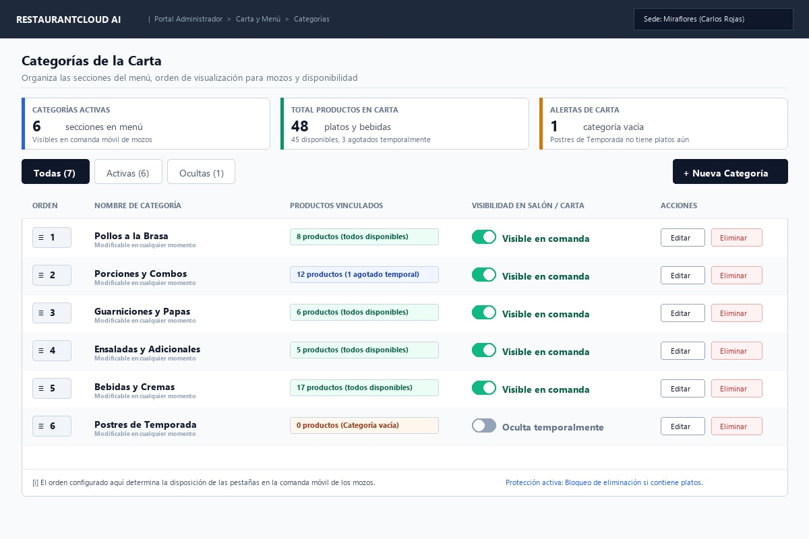
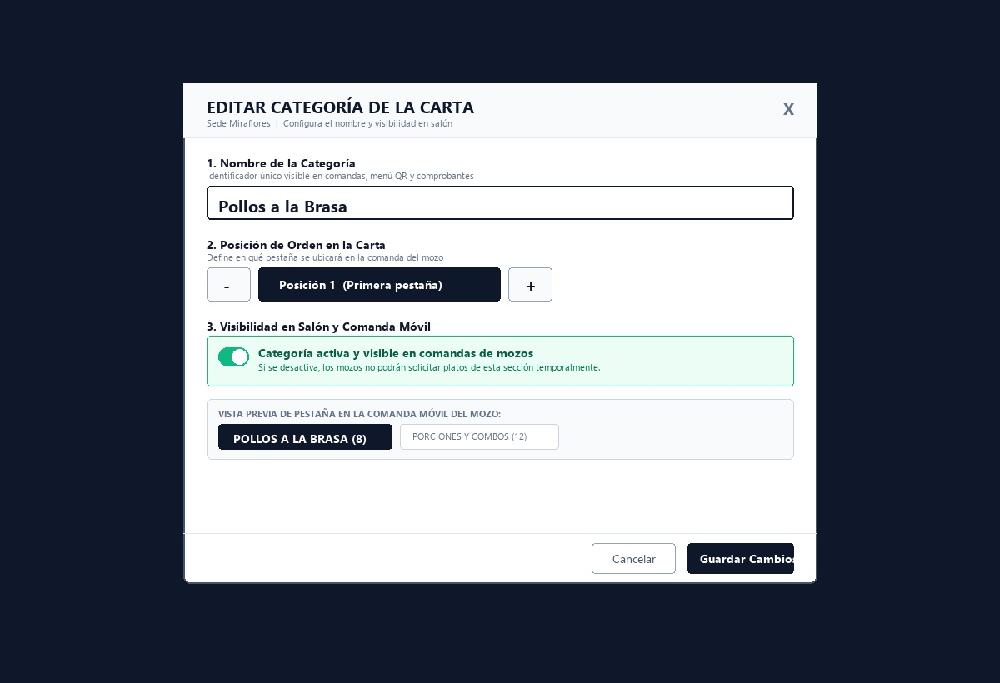
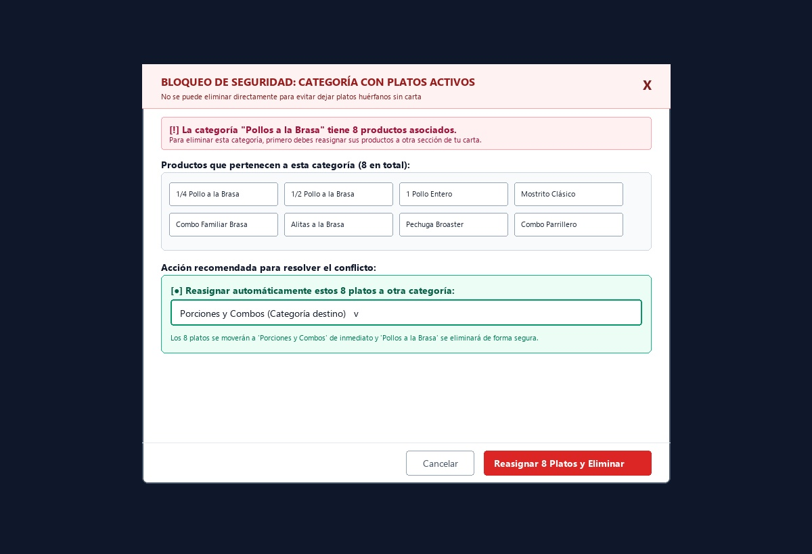
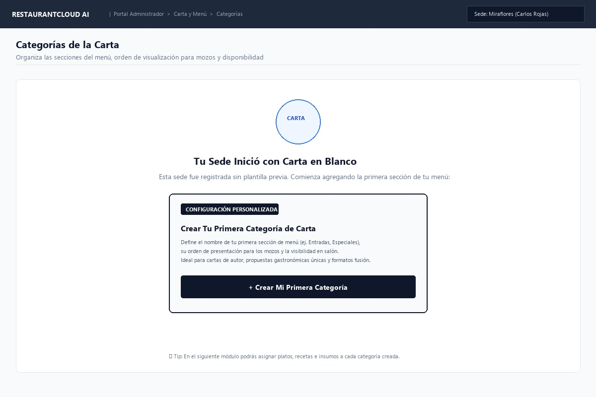

# CU-ADMIN-02: Gestionar Categorías de la Carta

Especificación técnica de interfaz de usuario, arquitectura de información, estados UX, reglas de integridad relacional (`ON DELETE RESTRICT`) y contratos exhaustivos de API Go (`pkg/apiresponse`) para la organización de secciones del menú, ordenamiento secuencial para la comanda móvil de mozos (`CU-MOZO-01`) y disponibilidad en salón y carta digital QR en **RestaurantCloud AI**.

---

## 1. Ficha Técnica del Caso de Uso

| Atributo | Detalle |
| :--- | :--- |
| **Código CU** | `CU-ADMIN-02` |
| **Nombre** | Gestionar categorías de la carta |
| **Actor(es)** | `administrador_local` (gestión exclusiva del catálogo gastronómico de su sede asignada) |
| **Dispositivo / Viewport** | Responsive Desktop (`1440x900`), Tablet POS (`768x1024`), Smartphone (`375x812`) |
| **Rutas Frontend** | `/admin/categorias` (Ruta canónica), `/admin/carta` (Alias de menú lateral `DashboardLayout`) |
| **Tablas BD (PostgreSQL 16)** | `categoria_producto` (`02_schema_ddl.sql`, líneas 252-261) y `producto` (FK `categoria_id REFERENCES categoria_producto(id) ON DELETE RESTRICT`, líneas 315-329) |
| **Precondición** | El local se encuentra en estado `activo` (`CU-PROP-04`) y el usuario tiene sesión iniciada con rol `admin_local` vinculado a esa sede (`CU-PROP-05`). |
| **Postcondición** | Secciones del menú creadas, ordenadas correlativamente (`orden ASC`), visibilidad conmutada para salón/QR y protección relacional ante eliminación de categorías con platos mediante asistente de reasignación masiva o selectiva. |

---

## 2. Diagrama de Flujo y Secuencia

```mermaid
sequenceDiagram
    autonumber
    actor A as Administrador del Local
    participant FE as Frontend Dashboard
    participant BE as Backend (Go Core API)
    participant DB as PostgreSQL 16 (RLS + Tenant)

    %% 1. Listado de Categorías con conteo de platos
    A->>FE: 1. Ingresa a "Categorías de la Carta" (/admin/categorias)
    FE->>BE: GET /api/v1/admin/categorias
    BE->>DB: SET app.tenant_id = :empresa_id;<br/>SELECT c.*, COUNT(p.id) as total_productos, COUNT(CASE WHEN p.disponibilidad = 'disponible' THEN 1 END) as disponibles, COUNT(CASE WHEN p.disponibilidad = 'agotado' THEN 1 END) as agotados<br/>FROM categoria_producto c LEFT JOIN producto p ON p.categoria_id = c.id<br/>WHERE c.local_id = :admin_local_id GROUP BY c.id ORDER BY c.orden ASC
    DB-->>BE: Retorna lista de categorías con métricas agregadas
    BE-->>FE: 200 OK (apiresponse.Response con CategoriasAdminResponseDTO)
    FE->>A: Renderiza Vista 1: Directorio con KPIs, tabla de orden, switches y buscador

    %% 2. Conmutación Inmediata de Visibilidad
    alt Administrador oculta una sección temporalmente
        A->>FE: 2. Clic en switch [ Visible / Oculta ]
        FE->>BE: PATCH /api/v1/admin/categorias/{id}/visibilidad { activa: false }
        BE->>DB: UPDATE categoria_producto SET activa = false, updated_at = NOW() WHERE id = :id AND local_id = :admin_local_id
        DB-->>BE: Registro actualizado
        BE-->>FE: 200 OK (apiresponse.Response con CategoriaAdminDTO)
        FE->>A: Actualiza switch al instante y notifica: "Categoría ahora oculta en salón y comanda"
    end

    %% 3. Reordenamiento Secuencial (Drag o Botones Táctiles ↑ / ↓)
    alt Administrador reordena las pestañas de comanda
        A->>FE: 3. Cambia posición con botones [ ↑ / ↓ ] o arrastre (≡)
        FE->>BE: PATCH /api/v1/admin/categorias/reordenar { categorias: [{ id: "...", orden: 1 }, ...] }
        BE->>DB: BEGIN; UPDATE categoria_producto SET orden = :orden, updated_at = NOW() WHERE id = :id; COMMIT;
        DB-->>BE: Transacción atómica completada
        BE-->>FE: 200 OK (apiresponse.Response con lista actualizada)
        FE->>A: Reindexa visualmente y notifica: "Secuencia de comanda actualizada"
    end

    %% 4. Intento de Eliminación y Bloqueo Relacional 409
    alt Administrador intenta eliminar categoría con productos
        A->>FE: 4. Clic en botón [ Eliminar ] de "Entradas"
        FE->>BE: DELETE /api/v1/admin/categorias/{id}
        BE->>DB: SELECT COUNT(*), json_agg(json_build_object('id', id, 'nombre', nombre, 'precio', precio, 'disponibilidad', disponibilidad)) FROM producto WHERE categoria_id = :id
        alt Conteo de platos > 0 (Restricción ON DELETE RESTRICT)
            DB-->>BE: Conteo = 2 (Ceviche Clásico, Causa Limeña)
            BE-->>FE: 409 Conflict (ERR_CATEGORIA_CON_PRODUCTOS + detalles)
            FE->>A: Despliega Vista 3: Modal de Bloqueo con Checkboxes individuales y "Seleccionar todos"
            
            %% Reasignación Parcial o Total
            A->>FE: Marca solo "Ceviche Clásico", elige destino "Fondos" y pulsa [ Transferir 1 plato a Fondos ]
            FE->>FE: Muestra spinner animado en el botón (Loader2)
            FE->>BE: POST /api/v1/admin/categorias/{id}/reasignar-y-eliminar { nueva_categoria_id: "uuid-fondos", producto_ids: ["uuid-ceviche"] }
            BE->>DB: BEGIN; UPDATE producto SET categoria_id = :destino WHERE id = :uuid_ceviche; SELECT COUNT(*) FROM producto WHERE categoria_id = :id; COMMIT;
            DB-->>BE: 1 transferido, 1 restante ("Causa Limeña"). Categoría NO eliminada aún.
            BE-->>FE: 200 OK (categoria_eliminada: false, platos_restantes: 1)
            FE->>A: Remueve "Ceviche Clásico" del modal. Solo permanece "Causa Limeña". Muestra aviso de avance.
            
            %% Reasignación del Lote Final
            A->>FE: Marca "Causa Limeña", elige destino "Postres" y pulsa [ Reasignar todos (1) y Eliminar ]
            FE->>FE: Muestra spinner animado en el botón (Loader2)
            FE->>BE: POST /api/v1/admin/categorias/{id}/reasignar-y-eliminar { nueva_categoria_id: "uuid-postres", producto_ids: ["uuid-causa"] }
            BE->>DB: BEGIN; UPDATE producto SET categoria_id = :destino WHERE id = :uuid_causa; DELETE FROM categoria_producto WHERE id = :id; COMMIT;
            DB-->>BE: 1 transferido, 0 restantes. Categoría ELIMINADA.
            BE-->>FE: 200 OK (categoria_eliminada: true, platos_restantes: 0)
            FE->>A: Cierra modal, remueve "Entradas" del directorio y muestra Toast verde
        else Conteo de platos = 0 (Categoría vacía)
            BE->>DB: DELETE FROM categoria_producto WHERE id = :id AND local_id = :admin_local_id
            DB-->>BE: Eliminación confirmada
            BE-->>FE: 200 OK (apiresponse.Response con { mensaje: "Categoría eliminada" })
            FE->>A: Remueve la categoría sin abrir modal de reasignación
        end
    end
```

---

## 3. Especificación de Pantallas y Wireframes Blueprint

### Vista 1: Directorio y Gestión de Categorías (`wf_admin_02_directorio_categorias.jpg`)



#### Layout Estructural ASCII (Desktop 1440x900)
```text
+----------------------------------------------------------------------------------------------------+
| RESTAURANTCLOUD AI | Administración > Carta & Menú > Categorías        [📍 Sede Miraflores (Principal)]|
+----------------------------------------------------------------------------------------------------+
|                                                                                                    |
| Categorías de la Carta                                                                             |
| Organiza las secciones del menú, su visibilidad en salón/QR y el orden secuencial de comandas.     |
|                                                                                                    |
| +--------------------+ +--------------------+ +--------------------+ +---------------------------+ |
| | TOTAL SECCIONES    | | VISIBLES EN SALÓN  | | PLATOS EN CARTA    | | MAYOR VOLUMEN             | |
| | [ 4 ] secciones    | | [ 4 ] activas      | | [ 5 ] platos       | | Entradas (2 platos)       | |
| +--------------------+ +--------------------+ +--------------------+ +---------------------------+ |
|                                                                                                    |
| [ Todas las Secciones (4) ] [ Visibles en Salón (4) ] [ Ocultas (0) ]    [ Buscar categoría... ]  |
|                                                     [ Plantillas Rápidas ]  [ + Nueva Categoría ] |
|----------------------------------------------------------------------------------------------------|
| ℹ️ Orden de Comanda: La posición define la secuencia de pestañas en comanda móvil de mozos (CU-MOZO-01).|
|----------------------------------------------------------------------------------------------------|
| SECUENCIA   | NOMBRE DE CATEGORÍA      | PLATOS VINCULADOS        | VISIBILIDAD CARTA | ACCIONES   |
|-------------+--------------------------+--------------------------+-------------------+------------|
| (≡) [#1][↑↓]| Entradas                 | [ 2 platos (2 disp.)   ] | [● Visible (ON) ] | [✏️] [🗑️]   |
| (≡) [#2][↑↓]| Fondos                   | [ 1 plato  (1 disp.)   ] | [● Visible (ON) ] | [✏️] [🗑️]   |
| (≡) [#3][↑↓]| Bebidas                  | [ 1 plato  (1 disp.)   ] | [● Visible (ON) ] | [✏️] [🗑️]   |
| (≡) [#4][↑↓]| Postres                  | [ 1 plato  (1 disp.)   ] | [● Visible (ON) ] | [✏️] [🗑️]   |
+----------------------------------------------------------------------------------------------------+
```

#### Reglas de Interacción de la Vista de Directorio
1. **Controles Híbridos de Reordenamiento Secuencial:**
   - Cada fila dispone del icono de arrastre visual `(≡)` para mouse en Desktop y de **botones táctiles directos `[ ↑ ]` y `[ ↓ ]`**.
   - Los botones `[ ↑ ]` y `[ ↓ ]` garantizan accesibilidad en tablets POS y smartphones sin depender del drag-and-drop táctil del navegador.
   - El botón `[ ↑ ]` está deshabilitado en la primera posición (`#1`); el botón `[ ↓ ]` en la última (`#N`).
2. **Conmutación Inmediata de Visibilidad (`[ Visible ]` / `[ Oculta ]`):**
   - Un solo toque conmuta `activa = false`, apagando la sección en la carta digital QR y comanda móvil sin borrar los platos.
   - Actualización optimista en cliente con confirmación toast verde.
3. **Búsqueda Reactiva:**
   - Input con debounce que filtra en tiempo real por nombre de categoría. Si no hay coincidencias, despliega un estado de búsqueda vacía con botón `[ Limpiar filtros ]`.

---

### Vista 2: Modal de Creación / Edición de Categoría (`wf_admin_02_crear_editar_modal.jpg`)



#### Layout Estructural ASCII
```text
+-------------------------------------------------------------------------------+
| NUEVA SECCIÓN GASTRONÓMICA / MODIFICAR SECCIÓN                            [X] |
| Configura el nombre y visibilidad en salón                                    |
+-------------------------------------------------------------------------------+
| Nombre de la Categoría *                                              [ 18/60 ]|
| +---------------------------------------------------------------------------+ |
| | Entradas Criollas                                                         | |
| +---------------------------------------------------------------------------+ |
| Debe ser único en la sede. Aparecerá en el menú QR y en comanda móvil.        |
|                                                                               |
| +---------------------------------------------------------------------------+ |
| | Visible en Carta y Comanda                                     [● ON]     | |
| | Si está activa, los clientes podrán verla en QR y los mozos pedir platos.| |
| +---------------------------------------------------------------------------+ |
|                                                                               |
| 📱 VISTA PREVIA: PESTAÑA EN COMANDA MÓVIL (CU-MOZO-01)                        |
| Así visualizarán los mozos esta pestaña en la barra superior de pedidos:      |
| +---------------------------------------------------------------------------+ |
| |  [ ✨ Entradas Criollas ]   [ Fondos ]   [ Bebidas ]                      | |
| +---------------------------------------------------------------------------+ |
|-------------------------------------------------------------------------------|
|                                            [ Cancelar ]   [ Guardar Cambios ] |
+-------------------------------------------------------------------------------+
```

#### Reglas de Validación
1. **Unicidad de Nombre:** Case-insensitive `UNIQUE(local_id, LOWER(nombre))` $\rightarrow$ si ya existe, error `ERR_CATEGORIA_DUPLICADA` (409).
2. **Límite y Contador:** Entre 2 y 60 caracteres. Muestra contador numérico interactivo `X/60` que se resalta al acercarse al límite.
3. **Vista Previa WYSIWYG de Comanda Mozo:** Reproduce en vivo el botón interactivo tal como lo verá el personal en su terminal móvil (`CU-MOZO-01`).

---

### Vista 3: Modal de Bloqueo de Seguridad y Reasignación Asistida (`wf_admin_02_bloqueo_eliminar_modal.jpg`)



#### Layout Estructural ASCII (Con Checkboxes y Reasignación Parcial / Total)
```text
+-------------------------------------------------------------------------------+
| ⚠️ BLOQUEO DE INTEGRIDAD RELACIONAL (409)                                  [X] |
| Reasignar Platos de "Entradas"                                                |
+-------------------------------------------------------------------------------+
| La categoría "Entradas" tiene 2 plato(s) asociado(s).                         |
| Selecciona cuáles deseas mover y a qué sección enviarlos:                     |
|                                                                               |
| [🛡️] Puedes mover platos a distintas categorías según corresponda.             |
|     La categoría de origen se eliminará al reasignar el último plato.         |
|-------------------------------------------------------------------------------|
| [X] SELECCIONAR TODOS                              [ 2 de 2 seleccionados ]   |
| +---------------------------------------------------------------------------+ |
| | [X] 🍽️ Ceviche Clásico                                        S/ 48.00    | |
| | [X] 🍽️ Causa Limeña de Pollo                                  S/ 32.00    | |
| +---------------------------------------------------------------------------+ |
|                                                                               |
| Transferir seleccionados (2) a: *                                             |
| +---------------------------------------------------------------------------+ |
| | Fondos (1 platos actuales)                                              v | |
| +---------------------------------------------------------------------------+ |
| Todos los platos restantes se moverán a esta sección y "Entradas" se eliminará.|
|-------------------------------------------------------------------------------|
|                                [ Cancelar ]   [ Reasignar todos (2) y Eliminar]|
+-------------------------------------------------------------------------------+

* En caso de selección parcial (ej. solo marca 1 plato):
| [ ] SELECCIONAR TODOS                              [ 1 de 2 seleccionados ]   |
| +---------------------------------------------------------------------------+ |
| | [X] 🍽️ Ceviche Clásico (Fila resaltada champán)                S/ 48.00    | |
| | [ ] 🍽️ Causa Limeña de Pollo                                  S/ 32.00    | |
| +---------------------------------------------------------------------------+ |
| Transferir seleccionados (1) a: [ Fondos v ]                                  |
|                                [ Cancelar ]   [ Transferir 1 plato(s) a Fondos]|
| (Al pulsar, muestra spinner en botón y tras confirmarse, solo queda en lista  |
|  la Causa Limeña con aviso: "✓ Se transfirió 1 plato a Fondos. Queda 1 plato.")|
```

#### Reglas del Bloqueo y Reasignación
1. **Contramedida `ON DELETE RESTRICT`:** Impide que se produzcan platos huérfanos con `categoria_id` nulo o inválido en la base de datos.
2. **Selección Múltiple e Individual:**
   - Cada fila de producto incluye un checkbox con área táctil $\ge 44\text{px}$.
   - Control superior *"Seleccionar todos (X de N)"* con soporte de estado `indeterminate` cuando solo algunos están marcados.
   - Resaltado cromático Áurea en filas seleccionadas (`aurea-champagne/25` con borde `aurea-copper/50`).
3. **Comportamiento ante Reasignación Parcial:**
   - Si el administrador transfiere un subconjunto, los platos transferidos se actualizan a la categoría destino.
   - El modal permanece abierto y **únicamente quedan en la lista los platos que aún continúan asociados a la categoría de origen**.
4. **Spinner y Estado de Carga:** El botón de acción despliega `Loader2 animate-spin` ("Transfiriendo platos..." / "Eliminando...") y deshabilita controles mientras viaja la petición.
5. **Eliminación Definitiva Automática:** Cuando se transfiere el último plato pendiente, la categoría de origen queda con 0 platos, se elimina atómicamente y el modal se cierra con notificación verde de éxito.

---

### Vista 4: Modal de Carga de Plantillas Gastronómicas Rápidas

#### Layout Estructural ASCII
```text
+-------------------------------------------------------------------------------+
| CONFIGURACIÓN ASISTIDA                                                    [X] |
| Plantillas Gastronómicas Rápidas                                              |
+-------------------------------------------------------------------------------+
| Selecciona una plantilla gastronómica peruana para estructurar tu carta con    |
| las secciones y orden estándar de la industria.                               |
|                                                                               |
| TIPO DE NEGOCIO GASTRONÓMICO:                                                 |
| +-----------------------------------+ +-------------------------------------+ |
| | [✓] Restaurante Criollo           | | [ ] Pollería Tradicional            | |
| |     Guisos tradicionales peruanos | |     Estructura clásica para brasas  | |
| +-----------------------------------+ +-------------------------------------+ |
| | [ ] Cevichería & Pescados         | | [ ] Chifa & Fusión Wok              | |
| |     Especializada en mariscos     | |     Gastronomía chino-peruana al wok| |
| +-----------------------------------+ +-------------------------------------+ |
| | [ ] Cafetería & Brunch            |                                         |
| |     Cafés de especialidad y brunch|                                         |
| +-----------------------------------+                                         |
|                                                                               |
| ✨ SECCIONES QUE SE CREARÁN (5):                                              |
| [ #1 Entradas Criollas ] [ #2 Segundos Tradicionales ] [ #3 Guisos de la Casa]|
| [ #4 Bebidas & Refrescos ] [ #5 Postres Tradicionales ]                       |
|                                                                               |
| MODO DE INSERCIÓN:                                                            |
| (●) Anexar a las existentes (Recomendado) - No borra categorías actuales      |
| ( ) Reemplazar todas las categorías - Reasigna platos a la primera sección    |
|-------------------------------------------------------------------------------|
|                                             [ Cancelar ]   [ Aplicar Plantilla|
+-------------------------------------------------------------------------------+
```

---

### Vista 5: Estado Inicial / Bienvenida (Carta en Blanco) (`wf_admin_02_onboarding_vacio.jpg`)



#### Layout Estructural ASCII
```text
+-------------------------------------------------------------------------------+
|                                                                               |
|                              ( 🍽️ CARTA ÁUREA )                                |
|                                                                               |
|                    Estructura las Categorías de tu Carta                      |
|       Las categorías agrupan tus platos, ordenan el menú en los códigos QR    |
|       y definen las pestañas que tus mozos utilizarán al tomar comandas.      |
|                                                                               |
|       +-------------------+ +-------------------+ +-------------------+       |
|       | 📱 Comanda Móvil  | | 🏷️ Carta QR Salón | | ✨ Cero Fugas     |       |
|       | Pestañas ordenadas| | Control en mesas  | | Platos protegidos |       |
|       +-------------------+ +-------------------+ +-------------------+       |
|                                                                               |
|       [ + Crear Primera Categoría ]   [ Usar Plantilla Peruana (Pollería...) ]|
|                                                                               |
+-------------------------------------------------------------------------------+
```

---

## 4. Catálogo de Estados UX

| Estado | Evento Desencadenante | Respuesta Visual del Sistema | Acción del Usuario |
| :--- | :--- | :--- | :--- |
| **1. Skeleton / Carga** | Carga inicial `GET /api/v1/admin/categorias`. | Shimmer `animate-pulse` en tarjetas KPI y filas de tabla. | Espera no bloqueante (~120ms). |
| **2. Loaded (Poblado)** | Respuesta `200 OK` con categorías. | Renderiza directorio con KPIs, buscador, tabla/cards y switches. | Navegar, reordenar, crear o editar. |
| **3. Empty State (Onboarding)** | Local nuevo sin categorías (`COUNT = 0`). | Renderiza `OnboardingCategoriasVacia` con doble botón asistido. | Clic en *Crear Primera Categoría* o *Usar Plantilla*. |
| **4. Error de Red** | Falla de conexión con el Core API. | Tarjeta de error con icono rojo y mensaje descriptivo. | Clic en `[ Reintentar Conexión ]`. |
| **5. Bloqueo 409 Relacional** | Intento de baja con platos vinculados. | Despliega `ModalBloqueoReasignacion` con checkboxes y selector destino. | Seleccionar platos y destino para transferir. |

---

## 5. Catálogo de Errores Operativos

| Código de Error | HTTP Status | Causa Operativa | Payload de Detalles Devuelto |
| :--- | :---: | :--- | :--- |
| `ERR_CATEGORIA_CON_PRODUCTOS` | `409 Conflict` | Intento de eliminación de categoría que contiene $\ge 1$ platos (`ON DELETE RESTRICT`). | `{ categoria_id, categoria_nombre, total_productos, productos_muestras: [...] }` |
| `ERR_CATEGORIA_DUPLICADA` | `409 Conflict` | Ya existe una categoría con ese mismo nombre en la sede (`LOWER(nombre)`). | `{ campo: "nombre", valor: "..." }` |
| `ERR_NOMBRE_CATEGORIA_REQUERIDO` | `422 Unprocessable` | Nombre vacío o menor a 2 caracteres. | `{ campo: "nombre", mensaje: "..." }` |
| `ERR_CATEGORIA_NO_ENCONTRADA` | `404 Not Found` | Categoría inexistente o perteneciente a otra sede. | `{ campo: "id" }` |
| `ERR_CATEGORIA_DESTINO_INVALIDA` | `422 Unprocessable` | La categoría destino seleccionada es la misma que la de origen. | `{ campo: "nueva_categoria_id" }` |
| `ERR_CATEGORIA_DESTINO_NO_ENCONTRADA` | `404 Not Found` | La categoría receptora no existe o está inactiva. | `{ campo: "nueva_categoria_id" }` |
| `ERR_TIPO_PLANTILLA_INVALIDO` | `400 Bad Request` | Código de plantilla gastronómica no reconocido. | `{ campo: "tipo_plantilla" }` |

---

## 6. Especificación de Endpoints y Contratos de API Go (`pkg/apiresponse`)

Todos los endpoints requieren autenticación mediante JWT (`Authorization: Bearer <token>`) y operan bajo aislamiento estricto por tenant y sede (`local_id`).

### 6.1. `GET /api/v1/admin/categorias` — Listar Categorías del Local con Métricas
- **Propósito:** Retorna todas las categorías del local ordenadas por secuencia (`orden ASC`), con métricas agregadas de productos y KPIs globales.
- **Headers:** `Authorization: Bearer <token_jwt>`
- **Query Params Opcionales:**
  - `solo_activas` (`bool`): Si es `true`, filtra solo las visibles en comanda (`activa = true`).
  - `con_conteos` (`bool`, default `true`): Si incluye el desglose de productos disponibles/agotados.

#### Respuesta Exitosa (`200 OK`)
```json
{
  "exito": true,
  "datos": {
    "local_id": "00000000-0000-4000-8000-000000000010",
    "local_nombre": "Sede Miraflores (Principal)",
    "resumen": {
      "total_categorias": 4,
      "categorias_activas": 4,
      "categorias_ocultas": 0,
      "total_productos_asociados": 5,
      "categoria_con_mas_platos": {
        "id": "00000000-0000-4000-8000-000000000060",
        "nombre": "Entradas",
        "cantidad": 2
      }
    },
    "categorias": [
      {
        "id": "00000000-0000-4000-8000-000000000060",
        "local_id": "00000000-0000-4000-8000-000000000010",
        "nombre": "Entradas",
        "orden": 1,
        "activa": true,
        "total_productos": 2,
        "productos_disponibles": 2,
        "productos_agotados": 0,
        "created_at": "2026-10-01T10:00:00Z",
        "updated_at": "2026-10-01T10:00:00Z"
      },
      {
        "id": "00000000-0000-4000-8000-000000000061",
        "local_id": "00000000-0000-4000-8000-000000000010",
        "nombre": "Fondos",
        "orden": 2,
        "activa": true,
        "total_productos": 1,
        "productos_disponibles": 1,
        "productos_agotados": 0,
        "created_at": "2026-10-01T10:00:00Z",
        "updated_at": "2026-10-01T10:00:00Z"
      },
      {
        "id": "00000000-0000-4000-8000-000000000062",
        "local_id": "00000000-0000-4000-8000-000000000010",
        "nombre": "Bebidas",
        "orden": 3,
        "activa": true,
        "total_productos": 1,
        "productos_disponibles": 1,
        "productos_agotados": 0,
        "created_at": "2026-10-01T10:00:00Z",
        "updated_at": "2026-10-01T10:00:00Z"
      },
      {
        "id": "00000000-0000-4000-8000-000000000063",
        "local_id": "00000000-0000-4000-8000-000000000010",
        "nombre": "Postres",
        "orden": 4,
        "activa": true,
        "total_productos": 1,
        "productos_disponibles": 1,
        "productos_agotados": 0,
        "created_at": "2026-10-01T10:00:00Z",
        "updated_at": "2026-10-01T10:00:00Z"
      }
    ]
  },
  "meta": {
    "timestamp": "2026-10-13T05:25:00Z",
    "total": 4
  }
}
```

---

### 6.2. `POST /api/v1/admin/categorias` — Crear Categoría Individual
- **Propósito:** Da de alta una nueva categoría. El backend calcula automáticamente `orden = MAX(orden) + 1` dentro de la sede y valida la unicidad de nombre (`LOWER(nombre)`).
- **Headers:** `Authorization: Bearer <token_jwt>`, `Content-Type: application/json`

#### Request Payload
```json
{
  "nombre": "Piqueos & Brasas",
  "activa": true
}
```

#### Respuesta Exitosa (`201 Created`)
```json
{
  "exito": true,
  "datos": {
    "id": "a1b2c3d4-e5f6-4000-8000-000000000064",
    "local_id": "00000000-0000-4000-8000-000000000010",
    "nombre": "Piqueos & Brasas",
    "orden": 5,
    "activa": true,
    "total_productos": 0,
    "productos_disponibles": 0,
    "productos_agotados": 0,
    "created_at": "2026-10-13T05:26:00Z",
    "updated_at": "2026-10-13T05:26:00Z"
  },
  "meta": {
    "timestamp": "2026-10-13T05:26:00Z"
  }
}
```

#### Error por Nombre Duplicado (`409 Conflict`)
```json
{
  "exito": false,
  "datos": null,
  "errores": [
    {
      "codigo": "ERR_CATEGORIA_DUPLICADA",
      "mensaje": "Ya existe una categoría con el nombre \"Piqueos & Brasas\" en esta sede.",
      "campo": "nombre"
    }
  ],
  "meta": {
    "timestamp": "2026-10-13T05:26:05Z"
  }
}
```

---

### 6.3. `PUT /api/v1/admin/categorias/{id}` — Actualizar Nombre y Visibilidad
- **Propósito:** Modifica los atributos de una categoría existente.
- **Headers:** `Authorization: Bearer <token_jwt>`, `Content-Type: application/json`

#### Request Payload
```json
{
  "nombre": "Entradas & Aperitivos",
  "activa": true
}
```

#### Respuesta Exitosa (`200 OK`)
```json
{
  "exito": true,
  "datos": {
    "id": "00000000-0000-4000-8000-000000000060",
    "local_id": "00000000-0000-4000-8000-000000000010",
    "nombre": "Entradas & Aperitivos",
    "orden": 1,
    "activa": true,
    "total_productos": 2,
    "productos_disponibles": 2,
    "productos_agotados": 0,
    "created_at": "2026-10-01T10:00:00Z",
    "updated_at": "2026-10-13T05:27:00Z"
  },
  "meta": {
    "timestamp": "2026-10-13T05:27:00Z"
  }
}
```

---

### 6.4. `PATCH /api/v1/admin/categorias/{id}/visibilidad` — Conmutación Rápida de Visibilidad
- **Propósito:** Activa o pausa la visibilidad de una categoría en 1 clic sin enviar el objeto completo.
- **Headers:** `Authorization: Bearer <token_jwt>`, `Content-Type: application/json`

#### Request Payload
```json
{
  "activa": false
}
```

#### Respuesta Exitosa (`200 OK`)
```json
{
  "exito": true,
  "datos": {
    "id": "00000000-0000-4000-8000-000000000060",
    "local_id": "00000000-0000-4000-8000-000000000010",
    "nombre": "Entradas",
    "orden": 1,
    "activa": false,
    "total_productos": 2,
    "productos_disponibles": 2,
    "productos_agotados": 0,
    "created_at": "2026-10-01T10:00:00Z",
    "updated_at": "2026-10-13T05:28:00Z"
  },
  "meta": {
    "timestamp": "2026-10-13T05:28:00Z"
  }
}
```

---

### 6.5. `PATCH /api/v1/admin/categorias/reordenar` — Reordenamiento Secuencial en Lote
- **Propósito:** Modifica atómicamente la secuencia de comanda (`orden`) en una sola transacción SQL.
- **Headers:** `Authorization: Bearer <token_jwt>`, `Content-Type: application/json`

#### Request Payload
```json
{
  "categorias": [
    { "id": "00000000-0000-4000-8000-000000000062", "orden": 1 },
    { "id": "00000000-0000-4000-8000-000000000060", "orden": 2 },
    { "id": "00000000-0000-4000-8000-000000000061", "orden": 3 },
    { "id": "00000000-0000-4000-8000-000000000063", "orden": 4 }
  ]
}
```

#### Respuesta Exitosa (`200 OK`)
```json
{
  "exito": true,
  "datos": [
    {
      "id": "00000000-0000-4000-8000-000000000062",
      "nombre": "Bebidas",
      "orden": 1,
      "activa": true,
      "total_productos": 1
    },
    {
      "id": "00000000-0000-4000-8000-000000000060",
      "nombre": "Entradas",
      "orden": 2,
      "activa": true,
      "total_productos": 2
    }
  ],
  "meta": {
    "timestamp": "2026-10-13T05:29:00Z"
  }
}
```

---

### 6.6. `DELETE /api/v1/admin/categorias/{id}` — Eliminación con Bloqueo `409 Conflict` (`ON DELETE RESTRICT`)
- **Propósito:** Intenta eliminar una categoría. Si contiene platos, el backend **rechaza la operación** con `409 Conflict` devolviendo la muestra de platos para alimentar el modal de reasignación.
- **Headers:** `Authorization: Bearer <token_jwt>`

#### Respuesta de Conflicto Relacional (`409 Conflict`)
```json
{
  "exito": false,
  "datos": {
    "categoria_id": "00000000-0000-4000-8000-000000000060",
    "categoria_nombre": "Entradas",
    "total_productos": 2,
    "productos_muestras": [
      {
        "id": "00000000-0000-4000-8000-000000000080",
        "nombre": "Ceviche Clásico",
        "precio": 48.00,
        "disponibilidad": "disponible"
      },
      {
        "id": "00000000-0000-4000-8000-000000000084",
        "nombre": "Causa Limeña de Pollo",
        "precio": 32.00,
        "disponibilidad": "disponible"
      }
    ]
  },
  "errores": [
    {
      "codigo": "ERR_CATEGORIA_CON_PRODUCTOS",
      "mensaje": "No se puede eliminar la categoría \"Entradas\" porque contiene 2 plato(s) asociado(s). Reasigna los platos a otra categoría o vacía su contenido antes de continuar.",
      "campo": "categoria_id"
    }
  ],
  "meta": {
    "timestamp": "2026-10-13T05:30:00Z"
  }
}
```

#### Respuesta Exitosa cuando tiene 0 platos (`200 OK`)
```json
{
  "exito": true,
  "datos": {
    "mensaje": "La categoría \"Postres Especiales\" fue eliminada exitosamente.",
    "categoria_id": "00000000-0000-4000-8000-000000000065"
  },
  "meta": {
    "timestamp": "2026-10-13T05:30:30Z"
  }
}
```

---

### 6.7. `POST /api/v1/admin/categorias/{id}/reasignar-y-eliminar` — Reasignación Selectiva o Total
- **Propósito:** Mueve platos a una categoría destino (`nueva_categoria_id`). Soporta **transferencia parcial por lista de IDs** (`producto_ids`) o **transferencia total**.
  - Si tras la reasignación quedan platos en la categoría de origen $\rightarrow$ la categoría **permanece activa** (`categoria_eliminada: false`).
  - Si quedan 0 platos en la categoría de origen $\rightarrow$ la categoría **se elimina de inmediato** (`categoria_eliminada: true`) y se reindexa el orden correlativo de las demás.
- **Headers:** `Authorization: Bearer <token_jwt>`, `Content-Type: application/json`

#### Caso A: Reasignación Parcial (Solo algunos platos)
##### Request Payload
```json
{
  "nueva_categoria_id": "00000000-0000-4000-8000-000000000061",
  "producto_ids": [
    "00000000-0000-4000-8000-000000000080"
  ]
}
```

##### Respuesta Exitosa (`200 OK`)
```json
{
  "exito": true,
  "datos": {
    "mensaje": "Se transfirieron 1 plato(s) a \"Fondos\". Quedan 1 plato(s) pendientes de reasignar.",
    "categoria_id": "00000000-0000-4000-8000-000000000060",
    "platos_reasignados": 1,
    "platos_restantes": 1,
    "categoria_eliminada": false
  },
  "meta": {
    "timestamp": "2026-10-13T05:31:00Z"
  }
}
```

#### Caso B: Reasignación Total (Todos los platos restantes)
##### Request Payload
```json
{
  "nueva_categoria_id": "00000000-0000-4000-8000-000000000063",
  "producto_ids": [
    "00000000-0000-4000-8000-000000000084"
  ]
}
```

##### Respuesta Exitosa (`200 OK`)
```json
{
  "exito": true,
  "datos": {
    "mensaje": "Se reasignaron 1 plato(s) a \"Postres\" y la categoría \"Entradas\" fue eliminada exitosamente.",
    "categoria_id": "00000000-0000-4000-8000-000000000060",
    "platos_reasignados": 1,
    "platos_restantes": 0,
    "categoria_eliminada": true
  },
  "meta": {
    "timestamp": "2026-10-13T05:31:30Z"
  }
}
```

---

### 6.8. `POST /api/v1/admin/categorias/plantilla` — Carga Masiva de Plantillas Gastronómicas
- **Propósito:** Puebla rápidamente la carta con las secciones y secuencias de negocios gastronómicos típicos del Perú (*Pollería*, *Cevichería*, *Chifa*, *Criollo*, *Cafetería*).
- **Headers:** `Authorization: Bearer <token_jwt>`, `Content-Type: application/json`

#### Request Payload
```json
{
  "tipo_plantilla": "polleria",
  "reemplazar_existentes": false
}
```
*Valores soportados para `tipo_plantilla`: `"polleria"`, `"cevicheria"`, `"chifa"`, `"criollo"`, `"cafeteria"`.*

#### Catálogo Estándar de Plantillas Gastronómicas:
1. **`polleria`:** `["Pollos a la Brasa", "Guarniciones & Papas", "Ensaladas Frescas", "Bebidas & Gaseosas", "Cervezas & Tragos", "Postres"]`
2. **`cevicheria`:** `["Ceviches & Tiraditos", "Causas & Entradas Frías", "Chicharrones & Jaleas", "Arroces & Sudados", "Chilcanos & Bebidas", "Postres Criollos"]`
3. **`chifa`:** `["Sopas & Wantanes", "Arroz Chaufa", "Tallarines & Wantán Frito", "Especialidades al Wok", "Bebidas & Té Jazmín"]`
4. **`criollo`:** `["Entradas Criollas", "Segundos Tradicionales", "Guisos de la Casa", "Bebidas & Refrescos", "Postres Tradicionales"]`
5. **`cafeteria`:** `["Cafés de Especialidad", "Bebidas Frías & Frappés", "Sándwiches & Tostones", "Pastelería Fina", "Desayunos & Combos"]`

#### Respuesta Exitosa (`200 OK`)
Retorna el objeto completo `CategoriasAdminResponseDTO` idéntico a `GET /api/v1/admin/categorias` con las categorías recién integradas y el resumen actualizado.

---

## 7. Directrices Técnicas para el Backend (Go Core API)

1. **Aislamiento Multi-Tenant Obligatorio:**  
   Todo query debe filtrar por `local_id = :local_id` derivado del token JWT verificado en middleware.
2. **Restricción de Clave Foránea (`ON DELETE RESTRICT`):**  
   En la base de datos PostgreSQL 16:
   ```sql
   ALTER TABLE producto 
   ADD CONSTRAINT fk_producto_categoria 
   FOREIGN KEY (categoria_id) REFERENCES categoria_producto(id) ON DELETE RESTRICT;
   ```
   El handler Go de `DELETE /categorias/{id}` debe ejecutar un conteo preventivo (`SELECT COUNT(*) FROM producto WHERE categoria_id = :id`) y, de ser mayor a cero, responder anticipadamente `409 Conflict` con el código `ERR_CATEGORIA_CON_PRODUCTOS` antes de que el motor de base de datos genere una excepción no controlada.
3. **Transaccionalidad en Reasignación:**  
   El endpoint `POST /categorias/{id}/reasignar-y-eliminar` debe ejecutarse estrictamente dentro de un bloque `tx, err := db.BeginTx(ctx, nil)`. Si la transferencia o la eliminación fallan, se debe invocar `tx.Rollback()`.
4. **Unicidad de Nombre:**  
   Asegurar que la restricción SQL `uq_categoria_local_nombre UNIQUE (local_id, LOWER(nombre))` esté activa y que el backend capture la violación del índice para responder de forma amigable con `ERR_CATEGORIA_DUPLICADA` (HTTP 409).
