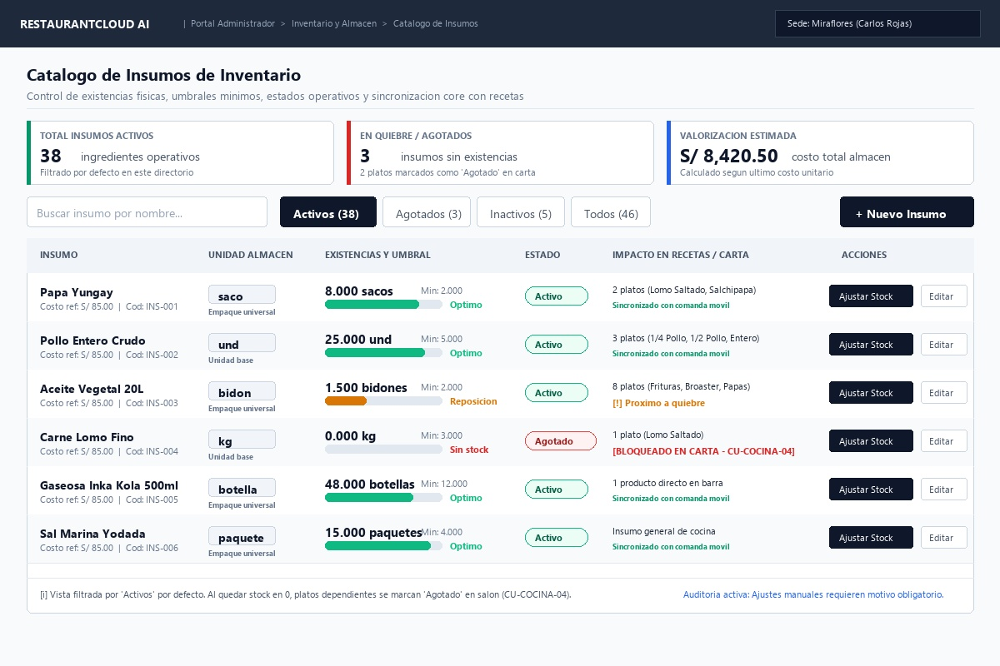
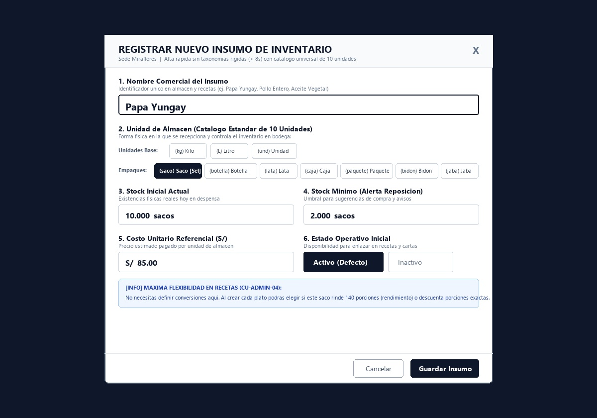
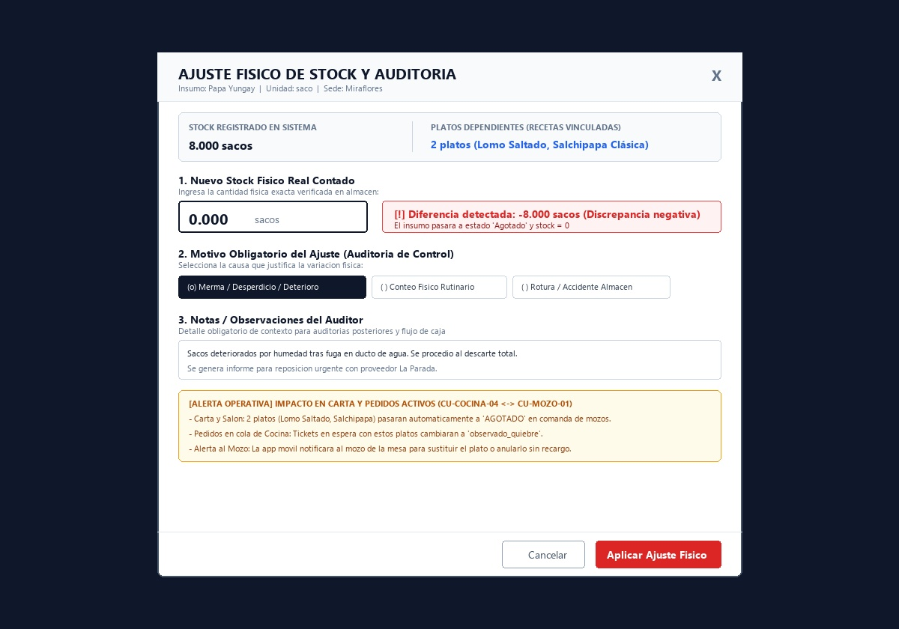
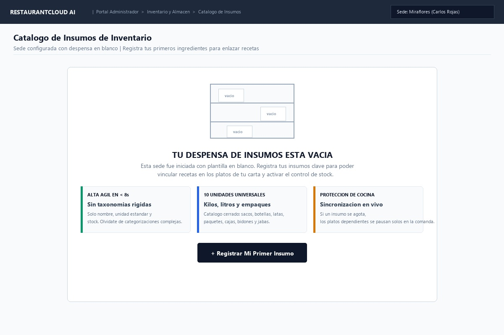

# CU-ADMIN-03: Gestionar Catálogo de Insumos de Inventario

Especificación técnica de interfaz de usuario, arquitectura de información, semáforos de stock, 3 estados operativos (`activo`, `agotado`, `inactivo`), filtro por defecto, auditoría de ajustes físicos y sincronización core con cocina y pedidos en salón (`CU-COCINA-04` $\leftrightarrow$ `CU-MOZO-01`) en **RestaurantCloud AI**.

---

## 1. Ficha Técnica del Caso de Uso

| Atributo | Detalle |
| :--- | :--- |
| **Código CU** | `CU-ADMIN-03` |
| **Nombre** | Gestionar catálogo de insumos de inventario |
| **Actor(es)** | `administrador_local` (gestión del inventario y bodega de su sede asignada) |
| **Dispositivo / Viewport** | Responsive Desktop (`1440x900`), Tablet (`768x1024`), Mobile (`375x812`) |
| **Precondición** | El local se encuentra en estado `activo` (`CU-PROP-04`) y el usuario tiene sesión iniciada con rol `admin_local` vinculado a esa sede (`CU-PROP-05`). |
| **Postcondición** | Insumos registrados y controlados mediante el catálogo universal de 10 unidades de almacén; ajustes físicos auditados en `auditoria_stock_ajuste`; platos de la carta y pedidos en curso en cocina (`CU-COCINA-04` $\leftrightarrow$ `CU-MOZO-01`) sincronizados atómicamente ante quiebre o reposición. |

---

## 2. Diagrama de Flujo y Secuencia

```mermaid
sequenceDiagram
    autonumber
    actor A as Administrador del Local
    participant FE as Frontend Dashboard
    participant BE as Backend (Go Core API)
    participant DB as PostgreSQL (RLS)
    actor M as Mozo en Salón (CU-MOZO-01)
    participant KDS as Pantalla Cocina (CU-COCINA-04)

    %% 1. Consulta del inventario filtrado por defecto en "Activo"
    A->>FE: 1. Ingresa a "Inventario de Insumos"
    FE->>BE: GET /api/v1/admin/insumos?estado=activo&pagina=1&limite=20
    BE->>DB: SET app.tenant_id = :empresa_id;<br/>SELECT i.*, COUNT(pri.producto_id) as platos_en_receta<br/>FROM insumo i LEFT JOIN producto_insumo pri ON pri.insumo_id = i.id<br/>WHERE i.local_id = :admin_local_id AND i.estado = 'activo'<br/>GROUP BY i.id ORDER BY i.nombre ASC
    DB-->>BE: Retorna lista de insumos activos con métricas de platos
    BE-->>FE: 200 OK (apiresponse.Response con InsumosListDTO)
    FE->>A: Renderiza Vista 1: Directorio con píldora "Activos" seleccionada por defecto

    %% 2. Alta Rápida de Insumo (< 8 segundos)
    alt Administrador crea nuevo insumo
        A->>FE: 2. Clic en "[ + Nuevo Insumo ]"
        FE->>A: Despliega Vista 2: Modal con chips de 10 unidades
        A->>FE: Nombre: "Papa Yungay" -> Chip [ (saco) Saco ] -> Stock: 10 -> Mín: 2 -> Costo: S/ 85
        A->>FE: Clic en "[ Guardar Insumo ]"
        FE->>BE: POST /api/v1/admin/insumos {nombre: "Papa Yungay", unidad_medida: "saco", stock_actual: 10, stock_minimo: 2, costo_unitario: 85, estado: "activo"}
        BE->>DB: Valida UNIQUE(local_id, LOWER(nombre)) + INSERT INTO insumo
        DB-->>BE: Insumo creado en estado 'activo'
        BE-->>FE: 201 Created (apiresponse.Response con InsumoDetalleDTO)
        FE->>A: Cierra modal, agrega fila a tabla y muestra Toast verde
    end

    %% 3. Ajuste Físico de Stock con Auditoría Obligatoria
    alt Administrador registra recuento físico o merma
        A->>FE: 3. Clic en "[ Ajustar Stock ]" en fila "Papa Yungay"
        FE->>A: Despliega Vista 3: Modal de Ajuste con stock actual (8 sacos)
        A->>FE: Ingresa Nuevo Stock: 0.000 sacos -> Motivo: "merma_desperdicio" -> Notas: "Humedad por fuga"
        FE->>BE: PATCH /api/v1/admin/insumos/{id}/ajuste-stock {stock_fisico: 0, motivo: "merma_desperdicio", notas: "Humedad"}
        
        rect rgb(255, 240, 240)
            Note over BE,DB: Transacción Atómica de Quiebre Operativo
            BE->>DB: 1. UPDATE insumo SET stock_actual = 0, estado = 'agotado' WHERE id = :id
            BE->>DB: 2. INSERT INTO auditoria_stock_ajuste (stock_anterior: 8, stock_nuevo: 0, diferencia: -8, motivo: 'merma_desperdicio')
            BE->>DB: 3. UPDATE producto SET disponibilidad = 'agotado' WHERE id IN (SELECT producto_id FROM producto_insumo WHERE insumo_id = :id)
            BE->>DB: 4. UPDATE pedido_item SET estado = 'no_disponible' WHERE producto_id IN (SELECT producto_id FROM producto_insumo WHERE insumo_id = :id) AND estado = 'en_cola'
        end

        DB-->>BE: 2 platos pasados a 'agotado' (Lomo Saltado, Salchipapa) y 1 pedido_item en cola observado
        BE->>KDS: Notificación WebSocket: Plato marcado como agotado en pantalla KDS
        BE->>M: Push Alert WebSocket: "Mesa 04: Lomo Saltado en quiebre. Insumo agotado."
        M->>M: Mozo modifica plato con el cliente en mesa sin cobro de penalidad (CU-MOZO-06)
        BE-->>FE: 200 OK (apiresponse.Response con AjusteResultDTO)
        FE->>A: Notificación de confirmación: Insumo en estado Agotado y platos sincronizados
    end
```

---

## 3. Especificación de Pantallas y Wireframes Blueprint

### Vista 1: Directorio y Gestión de Insumos (`wf_admin_03_directorio_insumos.jpg`)



#### Layout Estructural ASCII (Desktop 1440x900)
```text
+----------------------------------------------------------------------------------------------------+
| RESTAURANTCLOUD AI   | Portal Administrador > Inventario y Almacén > Catálogo de Insumos [ Sede: ] |
+----------------------------------------------------------------------------------------------------+
|                                                                                                    |
| Catálogo de Insumos de Inventario                                                                  |
| Control de existencias físicas, umbrales mínimos, estados operativos y sincronización con recetas  |
|----------------------------------------------------------------------------------------------------|
|                                                                                                    |
| +-------------------------+ +-------------------------+ +----------------------------------------+ |
| | TOTAL INSUMOS ACTIVOS   | | EN QUIEBRE / AGOTADOS   | | VALORIZACIÓN ESTIMADA                  | |
| | [ 38 ] ingredientes     | | [ 3 ] insumos agotados  | | [ S/ 8,420.50 ] costo total almacén    | |
| | Filtrado por defecto    | | 2 platos 'Agotado' carta| | Calculado según costo unitario         | |
| +-------------------------+ +-------------------------+ +----------------------------------------+ |
|                                                                                                    |
| [ Buscar insumo por nombre... ] [● Activos (38)] [Agotados (3)] [Inactivos (5)] [Todos (46)]     [+ Nuevo]
| +------------------------------------------------------------------------------------------------+ |
| | INSUMO          | UNIDAD ALMACÉN | EXISTENCIAS Y UMBRAL      | ESTADO   | RECETAS / IMPACTO|ACCIONES | |
| |-----------------+----------------+---------------------------+----------+------------------+---------| |
| | Papa Yungay     | [ saco ]       | 8.000 sacos [====  ] Opt  | [●Activo]| 2 platos en carta| [Ajuste]| |
| | Pollo Entero    | [ und ]        | 25.000 und  [===== ] Opt  | [●Activo]| 3 platos en carta| [Ajuste]| |
| | Aceite Vegetal  | [ bidon ]      | 1.500 bidon [==    ] Rep  | [●Activo]| [!] Próx. quiebre| [Ajuste]| |
| | Carne Lomo Fino | [ kg ]         | 0.000 kg    [      ] Sin  | [xAgotad]| [BLOQ. EN CARTA] | [Ajuste]| |
| | Inka Kola 500ml | [ botella ]    | 48.000 bot. [====  ] Opt  | [●Activo]| 1 prod. en barra | [Ajuste]| |
| | Sal Marina Yod. | [ paquete ]    | 15.000 paq. [===== ] Opt  | [●Activo]| Insumo general   | [Ajuste]| |
| |------------------------------------------------------------------------------------------------| |
| | [i] Vista filtrada por 'Activos' por defecto. El stock 0 marca automáticamente platos agotados.| |
| |     Auditoría activa: Ajustes manuales requieren motivo obligatorio.                           | |
| +------------------------------------------------------------------------------------------------+ |
+----------------------------------------------------------------------------------------------------+
```

#### Reglas de Interacción de la Vista de Directorio
1. **Filtro Inteligente por Defecto en `Activos`:**
   - La pantalla siempre carga con la píldora `[ ● Activos ]` seleccionada por defecto. Los insumos agotados o inactivos no entorpecen la supervisión diaria de bodega.
   - El administrador puede conmutar en un clic a `[ Agotados ]`, `[ Inactivos ]` o `[ Todos ]`.
2. **Barra de Búsqueda Omnicanal con Debounce (300ms):**
   - Entrada de texto reactiva que filtra por nombre del insumo sin requerir pulsar Enter ni recargar la página.
3. **Semáforo Cromático de Stock en 4 Niveles:**
   - 🟢 **Óptimo:** `stock_actual > stock_minimo * 1.5`
   - 🟡 **Reposición:** `stock_minimo < stock_actual <= stock_minimo * 1.5`
   - 🔴 **Crítico:** `0 < stock_actual <= stock_minimo`
   - ⚫ **Sin Stock / Agotado:** `stock_actual == 0` (dispara bloqueo de carta).
4. **Acción Rápida de Ajuste Físico:**
   - El botón `[ Ajustar Stock ]` en cada fila abre el modal de recuento físico y merma sin abandonar la tabla.

---

### Vista 2: Modal de Creación / Edición Rápida de Insumo (`wf_admin_03_crear_editar_modal.jpg`)



#### Layout Estructural ASCII
```text
+-------------------------------------------------------------------------------+
| REGISTRAR NUEVO INSUMO DE INVENTARIO                                      [X] |
| Sede Miraflores | Alta rápida sin taxonomías rígidas (< 8s) con 10 unidades   |
+-------------------------------------------------------------------------------+
| 1. Nombre Comercial del Insumo                                                |
| Identificador único en almacén y recetas                                      |
| +---------------------------------------------------------------------------+ |
| | Papa Yungay                                                               | |
| +---------------------------------------------------------------------------+ |
|                                                                               |
| 2. Unidad de Almacén (Catálogo Estándar de 10 Unidades)                       |
| Forma física en la que se recepciona y controla el inventario en bodega:      |
| Unidades Base:    [ (kg) Kilo ]     [ (L) Litro ]     [ (und) Unidad ]        |
| Empaques:         [ (saco) Saco [Sel] ] [ (botella) Botella ] [ (lata) Lata ] |
|                   [ (caja) Caja ] [ (paquete) Paquete ] [ (bidon) Bidón ]     |
|                   [ (jaba) Jaba ]                                             |
|                                                                               |
| 3. Stock Inicial Actual                 4. Stock Mínimo (Alerta Reposición)   |
| Existencias reales hoy en despensa      Umbral para sugerencias de compra     |
| +-------------------------------------+ +-----------------------------------+ |
| | 10.000  sacos                       | | 2.000  sacos                      | |
| +-------------------------------------+ +-----------------------------------+ |
|                                                                               |
| 5. Costo Unitario Referencial (S/)      6. Estado Operativo Inicial           |
| Precio estimado pagado por unidad       Disponibilidad en recetas             |
| +-------------------------------------+ +-----------------------------------+ |
| | S/  85.00                           | | [● Activo (Defecto)]  [ Inactivo] | |
| +-------------------------------------+ +-----------------------------------+ |
|                                                                               |
| [INFO] MÁXIMA FLEXIBILIDAD EN RECETAS (CU-ADMIN-04):                          |
| No necesitas definir conversiones aquí. Al crear cada plato podrás elegir si  |
| este saco rinde 140 porciones (rendimiento) o descuenta porciones exactas.    |
|-------------------------------------------------------------------------------|
|                                            [ Cancelar ]  [ Guardar Insumo ]   |
+-------------------------------------------------------------------------------+
```

#### Reglas de Interacción del Modal de Creación
1. **Velocidad de Registro (< 8 segundos):**
   - Sin campos forzados de categorías. El usuario escribe el nombre, selecciona la unidad mediante un chip táctil, define existencias y guarda.
2. **Catálogo Cerrado de 10 Unidades Universales:**
   - 3 Unidades Base: `kg`, `L`, `und`.
   - 7 Empaques Comerciales: `saco`, `botella`, `lata`, `caja`, `paquete`, `bidon`, `jaba`.
   - No se permiten unidades ambiguas ni hiper-específicas (`botella_750ml`); la dosificación por plato se resuelve en `CU-ADMIN-04`.
3. **Estado Inicial por Defecto:**
   - Todo nuevo insumo se crea con `estado = 'activo'` habilitado para recetas de platos.

---

### Vista 3: Modal de Ajuste Físico de Stock y Auditoría (`wf_admin_03_ajuste_stock_modal.jpg`)



#### Layout Estructural ASCII
```text
+-------------------------------------------------------------------------------+
| AJUSTE FÍSICO DE STOCK Y AUDITORÍA                                        [X] |
| Insumo: Papa Yungay | Unidad: saco | Sede: Miraflores                         |
+-------------------------------------------------------------------------------+
| +---------------------------------------------------------------------------+ |
| | STOCK REGISTRADO EN SISTEMA       | PLATOS DEPENDIENTES (RECETAS)         | |
| | 8.000 sacos                       | 2 platos (Lomo Saltado, Salchipapa)   | |
| +---------------------------------------------------------------------------+ |
|                                                                               |
| 1. Nuevo Stock Físico Real Contado                                            |
| Ingresa la cantidad física exacta verificada en almacén:                      |
| +-----------------------+  +------------------------------------------------+ |
| | 0.000  sacos          |  | [!] Diferencia: -8.000 sacos (Discrepancia)    | |
| +-----------------------+  | Insumo pasará a estado 'Agotado' y stock = 0   | |
|                            +------------------------------------------------+ |
|                                                                               |
| 2. Motivo Obligatorio del Ajuste (Auditoría de Control)                       |
| [(o) Merma/Desperdicio/Deterioro] [() Conteo Rutinario] [() Rotura/Accidente] |
|                                                                               |
| 3. Notas / Observaciones del Auditor                                          |
| +---------------------------------------------------------------------------+ |
| | Sacos deteriorados por humedad tras fuga en ducto. Descarte total.        | |
| +---------------------------------------------------------------------------+ |
|                                                                               |
| [ALERTA OPERATIVA] IMPACTO EN CARTA Y PEDIDOS ACTIVOS (CU-COCINA-04 <-> MOZO) |
| - Carta y Salón: 2 platos (Lomo Saltado, Salchipapa) pasarán a AGOTADO.       |
| - Pedidos en cola de Cocina: Tickets en espera cambiarán a observado_quiebre. |
| - Alerta al Mozo: App notificará al mozo de la mesa para cambiar plato.       |
|-------------------------------------------------------------------------------|
|                                            [ Cancelar ]  [ Aplicar Ajuste ]   |
+-------------------------------------------------------------------------------+
```

#### Reglas de Interacción del Modal de Ajuste
1. **Auditoría Estricta:**
   - No es posible modificar stock sin registrar motivo obligatorio en `auditoria_stock_ajuste`.
2. **Cálculo de Diferencia en Vivo:**
   - El sistema calcula `diferencia = nuevo_stock - stock_anterior` en milisegundos con feedback visual dinámico.
3. **Disparo de Quiebre Operativo:**
   - Si `nuevo_stock == 0`:
     - El insumo conmuta automáticamente a `estado = 'agotado'`.
     - Los platos dependientes pasan a `disponibilidad = 'agotado'` en carta.
     - Los pedidos en cocina en estado `en_cola` pasan a `no_disponible` (observados por quiebre).
     - El mozo responsable recibe alerta push reactiva para atender la mesa sin penalidades.

---

### Vista 4: Estado Inicial - Despensa de Insumos Vacía (`wf_admin_03_onboarding_vacio.jpg`)



#### Layout Estructural ASCII
```text
+----------------------------------------------------------------------------------------------------+
| RESTAURANTCLOUD AI   | Portal Administrador > Inventario y Almacén > Catálogo de Insumos [ Sede: ] |
+----------------------------------------------------------------------------------------------------+
|                                                                                                    |
| Catálogo de Insumos de Inventario                                                                  |
| Sede configurada con despensa en blanco | Registra tus primeros ingredientes para recetas          |
|----------------------------------------------------------------------------------------------------|
|                                                                                                    |
|          +----------------------------------------------------------------------+                  |
|          |                         [ Estantes Vacíos ]                          |                  |
|          |                                                                      |                  |
|          |                  TU DESPENSA DE INSUMOS ESTÁ VACÍA                   |                  |
|          |   Esta sede fue iniciada con plantilla en blanco. Registra tus       |                  |
|          |   insumos clave para vincular recetas y activar control de stock.    |                  |
|          |                                                                      |                  |
|          |  +--------------------+ +--------------------+ +------------------+  |                  |
|          |  | ⚡ ALTA ÁGIL < 8s  | | 📦 10 UNIDADES     | | 🍳 PROTECCIÓN    |  |                  |
|          |  | Sin taxonomías     | | Catálogo cerrado   | | Cocina y mozos   |  |                  |
|          |  | rígidas forzadas   | | universales        | | sincronizados    |  |                  |
|          |  +--------------------+ +--------------------+ +------------------+  |                  |
|          |                                                                      |                  |
|          |                  [ + Registrar Mi Primer Insumo ]                    |                  |
|          +----------------------------------------------------------------------+                  |
|                                                                                                    |
+----------------------------------------------------------------------------------------------------+
```

---

## 4. Árbol de Componentes Frontend

```text
src/
└── modules/
    └── admin/
        └── inventario/
            ├── pages/
            │   └── InsumosPage.tsx                   # Controlador de vista principal
            ├── components/
            │   ├── InsumosHeader.tsx                 # Título y breadcrumb de navegación
            │   ├── InsumosKpis.tsx                   # Tarjetas KPI (Total Activos, Quiebres, Valorización)
            │   ├── InsumosToolbar.tsx                # Buscador con debounce y píldoras de estado
            │   ├── InsumosTable.tsx                  # Tabla de insumos con barras de progreso y acciones
            │   ├── InsumoRow.tsx                     # Fila con semáforo y popover de recetas dependientes
            │   ├── InsumoModal.tsx                   # Modal de creación y edición rápida (< 8s)
            │   │   ├── UnitSelectorChips.tsx         # Selector de 10 unidades estándar (Base vs Empaque)
            │   │   └── StockThresholdInputs.tsx      # Entradas de stock actual, mínimo y costo
            │   ├── AjusteStockModal.tsx              # Modal de recuento físico, merma y auditoría
            │   │   ├── DiscrepancyBadge.tsx          # Cálculo en tiempo real de diferencia numérica
            │   │   ├── ReasonSelector.tsx            # Selector de motivo auditable
            │   │   └── ImpactAlertBox.tsx            # Alerta de bloqueo de carta y pedidos en cocina
            │   └── InsumosEmptyState.tsx             # Onboarding visual para despensa en blanco
            ├── hooks/
            │   ├── useInsumos.ts                     # React Query: query GET y mutations POST/PATCH
            │   ├── useAjusteStock.ts                 # Mutation de ajuste físico con invalidación de queries
            │   └── useInsumoRealtime.ts              # Suscripción WebSocket a eventos de stock de cocina
            └── types/
                └── insumo.types.ts                   # Interfaces TypeScript sincronizadas con Backend Go
```

---

## 5. Modelo de Datos y Esquema Relacional

```sql
-- 1. Catálogo cerrado de 10 unidades de almacén universales
CREATE TYPE unidad_insumo_enum AS ENUM (
    'kg', 'L', 'und', 'saco', 'botella', 'lata', 'caja', 'paquete', 'bidon', 'jaba'
);

-- 2. Tres estados de insumo
CREATE TYPE estado_insumo_enum AS ENUM (
    'activo', 'agotado', 'inactivo'
);

-- 3. Motivo auditable para ajustes manuales y mermas
CREATE TYPE motivo_ajuste_stock_enum AS ENUM (
    'conteo_fisico_inventario', 'merma_desperdicio', 'ingreso_manual', 'vencimiento_caducidad', 'rotura_accidente'
);

-- 4. Tabla insumo (Limpia, sin taxonomía restrictiva de categorías)
CREATE TABLE insumo (
    id UUID PRIMARY KEY DEFAULT gen_random_uuid(),
    local_id UUID NOT NULL REFERENCES local(id) ON DELETE CASCADE,
    nombre VARCHAR(80) NOT NULL,
    unidad_medida unidad_insumo_enum NOT NULL,
    stock_actual DECIMAL(12, 3) NOT NULL DEFAULT 0 CHECK (stock_actual >= 0),
    stock_minimo DECIMAL(12, 3) NOT NULL DEFAULT 0 CHECK (stock_minimo >= 0),
    costo_unitario DECIMAL(10, 2) DEFAULT 0.00 CHECK (costo_unitario >= 0),
    moneda VARCHAR(3) NOT NULL DEFAULT 'PEN',
    ultimo_proveedor_id UUID REFERENCES proveedor(id) ON DELETE SET NULL,
    fecha_ultima_compra TIMESTAMP,
    estado estado_insumo_enum NOT NULL DEFAULT 'activo',
    created_at TIMESTAMP NOT NULL DEFAULT NOW(),
    updated_at TIMESTAMP NOT NULL DEFAULT NOW(),
    CONSTRAINT uq_insumo_local_nombre UNIQUE (local_id, LOWER(nombre))
);

-- 5. Tabla de Auditoría de Ajustes de Stock Físico
CREATE TABLE auditoria_stock_ajuste (
    id UUID PRIMARY KEY DEFAULT gen_random_uuid(),
    local_id UUID NOT NULL REFERENCES local(id) ON DELETE CASCADE,
    insumo_id UUID NOT NULL REFERENCES insumo(id) ON DELETE CASCADE,
    usuario_id UUID NOT NULL REFERENCES usuario(id),
    stock_anterior DECIMAL(12, 3) NOT NULL,
    stock_nuevo DECIMAL(12, 3) NOT NULL CHECK (stock_nuevo >= 0),
    diferencia DECIMAL(12, 3) NOT NULL,
    motivo motivo_ajuste_stock_enum NOT NULL,
    notas TEXT,
    created_at TIMESTAMP NOT NULL DEFAULT NOW()
);

-- Índices de Alto Rendimiento para Inventario y RLS
CREATE INDEX idx_insumo_local_estado ON insumo (local_id, estado);
CREATE INDEX idx_insumo_local_nombre ON insumo (local_id, LOWER(nombre));
CREATE INDEX idx_auditoria_insumo_fecha ON auditoria_stock_ajuste (insumo_id, created_at DESC);
```

---

## 6. Contratos de API Go (`pkg/apiresponse`)

### 1. `GET /api/v1/admin/insumos`
Lista los insumos del local con filtros por estado y texto. Por defecto, `estado=activo`.

**Query Parameters:**
- `estado` (string, opcional, default: `activo`): `activo` | `agotado` | `inactivo` | `todos`
- `q` (string, opcional): Búsqueda por coincidencia de nombre
- `pagina` (int, default: 1)
- `limite` (int, default: 20)

**Response 200 OK:**
```json
{
  "success": true,
  "data": {
    "kpis": {
      "total_activos": 38,
      "total_agotados": 3,
      "total_inactivos": 5,
      "valorizacion_total": 8420.50
    },
    "filtro_actual": "activo",
    "insumos": [
      {
        "id": "7b8f9e12-4c3a-4e2b-a8d1-9f2e3d4c5b6a",
        "nombre": "Papa Yungay",
        "unidad_medida": "saco",
        "stock_actual": 8.000,
        "stock_minimo": 2.000,
        "nivel_semaforo": "optimo",
        "costo_unitario": 85.00,
        "platos_afectados_si_quiebra": 2,
        "platos_detalle": ["Lomo Saltado", "Salchipapa Clásica"],
        "estado": "activo",
        "updated_at": "2026-10-08T14:30:00Z"
      },
      {
        "id": "8c9a0b1c-5d4e-3f2a-1b0c-9d8e7f6a5b4c",
        "nombre": "Aceite Vegetal 20L",
        "unidad_medida": "bidon",
        "stock_actual": 1.500,
        "stock_minimo": 2.000,
        "nivel_semaforo": "reposicion",
        "costo_unitario": 140.00,
        "platos_afectados_si_quiebra": 8,
        "platos_detalle": ["Pollo Broaster", "Papas Fritas", "Alitas BBQ"],
        "estado": "activo",
        "updated_at": "2026-10-08T14:25:00Z"
      }
    ],
    "paginacion": {
      "total": 38,
      "pagina": 1,
      "limite": 20,
      "total_paginas": 2
    }
  },
  "error": null
}
```

---

### 2. `POST /api/v1/admin/insumos`
Alta ágil de insumo (< 8 segundos).

**Request Body:**
```json
{
  "nombre": "Pollo Entero Crudo",
  "unidad_medida": "und",
  "stock_actual": 25.0,
  "stock_minimo": 5.0,
  "costo_unitario": 18.50,
  "estado": "activo"
}
```

**Response 201 Created:**
```json
{
  "success": true,
  "data": {
    "id": "9c1a2b3c-4d5e-6f7a-8b9c-0d1e2f3a4b5c",
    "nombre": "Pollo Entero Crudo",
    "unidad_medida": "und",
    "stock_actual": 25.000,
    "stock_minimo": 5.000,
    "costo_unitario": 18.50,
    "estado": "activo",
    "created_at": "2026-10-08T15:00:00Z",
    "mensaje": "Insumo registrado correctamente y disponible para recetas"
  },
  "error": null
}
```

**Response 409 Conflict (Nombre duplicado):**
```json
{
  "success": false,
  "data": null,
  "error": {
    "code": "ERR_INSUMO_DUPLICADO",
    "message": "Ya existe un insumo registrado con el nombre 'Pollo Entero Crudo' en este local",
    "details": {
      "campo": "nombre",
      "valor": "Pollo Entero Crudo"
    }
  }
}
```

---

### 3. `PATCH /api/v1/admin/insumos/{id}/ajuste-stock`
Ajuste físico de stock con auditoría obligatoria y sincronización atómica con cocina y salón (`CU-COCINA-04` $\leftrightarrow$ `CU-MOZO-01`).

**Request Body:**
```json
{
  "stock_fisico": 0.0,
  "motivo": "merma_desperdicio",
  "notas": "Sacos deteriorados por filtración de agua. Descarte total verificado."
}
```

**Response 200 OK:**
```json
{
  "success": true,
  "data": {
    "insumo_id": "7b8f9e12-4c3a-4e2b-a8d1-9f2e3d4c5b6a",
    "nombre": "Papa Yungay",
    "stock_anterior": 8.000,
    "stock_nuevo": 0.000,
    "diferencia": -8.000,
    "estado_resultante": "agotado",
    "auditoria_id": "f4b2c1d0-9e8a-7b6c-5d4e-3f2a1b0c9d8e",
    "platos_bloqueados_en_carta": [
      { "id": "prod-001", "nombre": "Lomo Saltado" },
      { "id": "prod-002", "nombre": "Salchipapa Clásica" }
    ],
    "pedidos_en_cola_observados": [
      {
        "pedido_id": "ped-881",
        "mesa": "Mesa 04",
        "producto": "Lomo Saltado",
        "mozo_id": "usr-12",
        "alerta_emitida": true
      }
    ],
    "mensaje": "Ajuste aplicado. Insumo en estado AGOTADO. 2 platos bloqueados en carta y alerta despachada al mozo de Mesa 04."
  },
  "error": null
}
```

**Response 422 Unprocessable Entity (Motivo inválido):**
```json
{
  "success": false,
  "data": null,
  "error": {
    "code": "ERR_VALIDACION",
    "message": "El motivo del ajuste debe pertenecer a la lista de motivos auditables válidos",
    "details": {
      "motivos_permitidos": [
        "conteo_fisico_inventario",
        "merma_desperdicio",
        "ingreso_manual",
        "vencimiento_caducidad",
        "rotura_accidente"
      ]
    }
  }
}
```

---

### 4. `PATCH /api/v1/admin/insumos/{id}/estado`
Conmutación de estado operativo (`activo` $\leftrightarrow$ `agotado` $\leftrightarrow$ `inactivo`).

**Request Body:**
```json
{
  "estado": "inactivo"
}
```

**Response 200 OK:**
```json
{
  "success": true,
  "data": {
    "id": "7b8f9e12-4c3a-4e2b-a8d1-9f2e3d4c5b6a",
    "nombre": "Papa Yungay",
    "estado": "inactivo",
    "mensaje": "Insumo archivado como inactivo. No aparecerá en el inventario activo."
  },
  "error": null
}
```

---

## 7. Matriz de Trazabilidad y Casos de Prueba

| ID Prueba | Escenario de Prueba | Entrada | Resultado Esperado | Código HTTP |
| :--- | :--- | :--- | :--- | :--- |
| `TC-INS-01` | Carga inicial del módulo de inventario | Token `admin_local` | Retorna lista de insumos con `estado = 'activo'` por defecto y métricas KPI. | `200 OK` |
| `TC-INS-02` | Búsqueda reactiva por texto | `?q=papa` | Retorna únicamente insumos cuyo nombre contenga "papa" (case-insensitive). | `200 OK` |
| `TC-INS-03` | Alta rápida con unidad válida | `nombre="Arroz Extra"`, `unidad="saco"` | Insumo creado en BD con `estado = 'activo'` y stock inicial verificado. | `201 Created` |
| `TC-INS-04` | Alta rechazada por unidad no permitida | `unidad="botella_750ml"` | Rechaza la petición informando el catálogo de 10 unidades permitidas. | `422 Unprocessable` |
| `TC-INS-05` | Alta rechazada por duplicidad | `nombre="Papa Yungay"` existente | Retorna `ERR_INSUMO_DUPLICADO` con mensaje contextual claro. | `409 Conflict` |
| `TC-INS-06` | Ajuste físico que deja stock en 0 | `stock_fisico = 0`, `motivo = 'merma'` | Insumo pasa a `agotado`, se audita en BD, platos pasan a `agotado` y pedidos en cola se marcan `no_disponible`. | `200 OK` |
| `TC-INS-07` | Ajuste físico sin motivo | `motivo = ""` | Rechaza la transacción exigiendo motivo auditable obligatorio. | `422 Unprocessable` |
| `TC-INS-08` | Intento de borrado físico (`DELETE`) | `DELETE /api/v1/admin/insumos/{id}` | Endpoint no expuesto / rechazado; el sistema exige cambiar a `inactivo`. | `405 Method Not Allowed` |
| `TC-INS-09` | Reposición de stock sobre insumo agotado | `stock_fisico = 15.0` | Insumo pasa a `activo`, notifica al administrador para reactivar platos. | `200 OK` |
| `TC-INS-10` | Sede inicial con plantilla en blanco | Sede sin insumos | Renderiza estado vacío guiado (Onboarding) orientando al primer registro. | `200 OK` |
