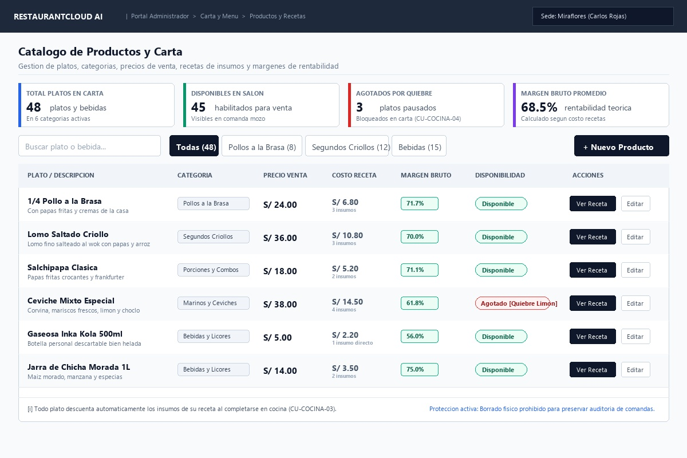
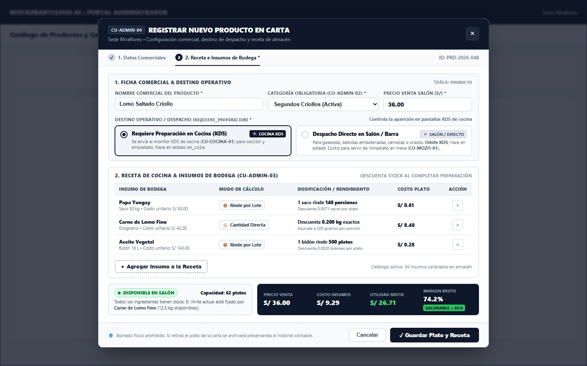
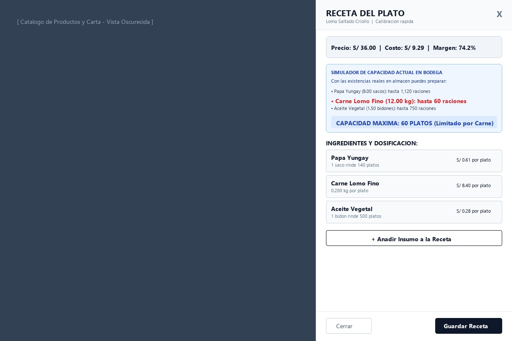
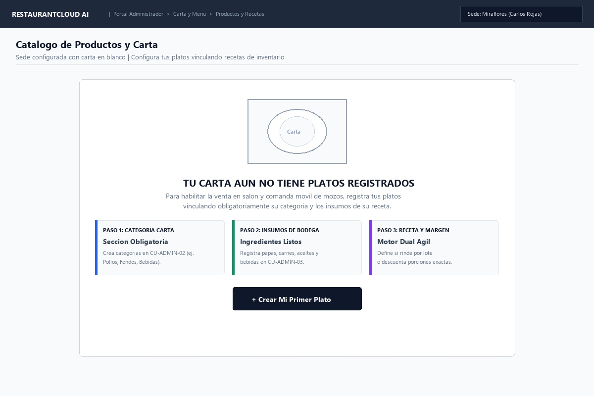

# CU-ADMIN-04: Gestionar Productos de la Carta y Recetas

Especificación técnica de interfaz de usuario, arquitectura de información, motor dual de recetas (`rendimiento` vs `exacto`), cálculo dinámico de costo y margen bruto, disponibilidad inteligente y contratos de API Go en **RestaurantCloud AI**.

---

## 1. Ficha Técnica del Caso de Uso

| Atributo | Detalle |
| :--- | :--- |
| **Código CU** | `CU-ADMIN-04` |
| **Nombre** | Gestionar productos de la carta y recetas |
| **Actor(es)** | `administrador_local` (gestión de la carta comercial y fichas técnicas de cocina de su sede) |
| **Dispositivo / Viewport** | Responsive Desktop (`1440x900`), Tablet (`768x1024`), Mobile (`375x812`) |
| **Precondición** | La sede está activa (`CU-PROP-04`); existe al menos una categoría de carta activa (`CU-ADMIN-02`) e insumos registrados en el inventario (`CU-ADMIN-03`). |
| **Postcondición** | Productos registrados en carta con categoría obligatoria y receta enlazada; costo teórico y margen bruto calculados; disponibilidad sincronizada con existencias de bodega (`CU-COCINA-04` $\leftrightarrow$ `CU-MOZO-01`). |

---

## 2. Diagrama de Flujo y Secuencia

```mermaid
sequenceDiagram
    autonumber
    actor A as Administrador del Local
    participant FE as Frontend Dashboard
    participant BE as Backend (Go Core API)
    participant DB as PostgreSQL (RLS)
    actor M as Mozo en Salón (CU-MOZO-01)
    participant KDS as Pantalla Cocina (CU-COCINA-03/04)

    %% 1. Consulta del Catálogo de Carta
    A->>FE: 1. Ingresa a "Productos y Carta"
    FE->>BE: GET /api/v1/admin/productos?categoria_id=&disponibilidad=todos
    BE->>DB: SET app.tenant_id = :empresa_id;<br/>SELECT p.*, c.nombre as categoria_nombre, COUNT(pri.insumo_id) as total_insumos,<br/>SUM(pri.cantidad_descuenta * i.costo_unitario) as costo_teorico<br/>FROM producto p JOIN categoria_producto c ON c.id = p.categoria_id<br/>LEFT JOIN producto_insumo pri ON pri.producto_id = p.id<br/>LEFT JOIN insumo i ON i.id = pri.insumo_id<br/>WHERE p.local_id = :admin_local_id AND p.activo = true<br/>GROUP BY p.id, c.nombre ORDER BY p.nombre ASC
    DB-->>BE: Retorna productos con costos teóricos y márgenes
    BE-->>FE: 200 OK (apiresponse.Response con ProductosListDTO)
    FE->>A: Renderiza Vista 1: Directorio con KPIs de margen y tablas

    %% 2. Alta de Producto con Receta Dual
    alt Administrador registra nuevo plato
        A->>FE: 2. Clic en "[ + Nuevo Producto ]"
        FE->>A: Despliega Vista 2: Modal en 2 pasos
        A->>FE: Paso 1: "Lomo Saltado Criollo", Categoría: "Segundos Criollos", Precio: S/ 36.00
        A->>FE: Paso 2: Insumo Papa Yungay -> [ Rinde por Lote: 140 platos ]<br/>Insumo Carne Lomo -> [ Cantidad Directa: 0.200 kg ]<br/>Insumo Aceite -> [ Rinde por Lote: 500 platos ]
        Note over FE: Calculadora en vivo: Costo S/ 9.29 | Margen 74.2%
        A->>FE: Clic en "[ Guardar Plato y Receta ]"
        FE->>BE: POST /api/v1/admin/productos {nombre, categoria_id, precio, receta: [...]}
        
        rect rgb(240, 255, 240)
            Note over BE,DB: Transacción Atómica de Alta y Validación de Stock
            BE->>DB: 1. INSERT INTO producto (local_id, categoria_id, nombre, precio, disponibilidad)
            BE->>DB: 2. INSERT INTO producto_insumo (producto_id, insumo_id, modo_calculo, ...)
            BE->>DB: 3. Comprueba stock de insumos: Si alguno está en 0, asigna 'agotado', si no 'disponible'
        end

        DB-->>BE: Plato y receta creados exitosamente
        BE-->>FE: 201 Created (apiresponse.Response con ProductoDetalleDTO)
        FE->>A: Cierra modal, actualiza tabla y muestra Toast de margen exitoso
        BE->>M: Plato disponible inmediatamente en comanda móvil de salón
    end

    %% 3. Calibración Rápida de Receta en Drawer
    alt Administrador calibra rendimientos sin tocar ficha comercial
        A->>FE: 3. Clic en "[ Ver Receta ]" en Lomo Saltado
        FE->>A: Despliega Vista 3: Quick-Drawer con simulador de capacidad
        Note over A,FE: Visualiza: "Capacidad máxima actual: 60 platos por stock de carne"
        A->>FE: Ajusta rendimiento de Papa a 150 platos -> Clic en "[ Guardar Receta ]"
        FE->>BE: PUT /api/v1/admin/productos/{id}/receta {receta: [...]}
        BE->>DB: UPDATE producto_insumo ...
        DB-->>BE: Receta actualizada con nuevo costo teórico
        BE-->>FE: 200 OK (apiresponse.Response con RecetaCalibradaDTO)
        FE->>A: Actualiza fila en tabla con nuevo margen (74.8%)
    end
```

---

## 3. Especificación de Pantallas y Wireframes Blueprint

### Vista 1: Directorio y Catálogo de Productos y Carta (`wf_admin_04_directorio_productos.jpg`)



#### Layout Estructural ASCII (Desktop 1440x900)
```text
+----------------------------------------------------------------------------------------------------+
| RESTAURANTCLOUD AI   | Portal Administrador > Carta y Menú > Productos y Recetas [ Sede: ]         |
+----------------------------------------------------------------------------------------------------+
|                                                                                                    |
| Catálogo de Productos y Carta                                                                      |
| Gestión de platos, categorías, precios de venta, recetas de insumos y márgenes de rentabilidad     |
|----------------------------------------------------------------------------------------------------|
|                                                                                                    |
| +---------------------+ +---------------------+ +---------------------+ +------------------------+ |
| | TOTAL PLATOS CARTA  | | DISPONIBLES SALÓN   | | AGOTADOS POR QUIEBRE| | MARGEN BRUTO PROMEDIO  | |
| | [ 48 ] platos/beb   | | [ 45 ] para venta   | | [ 3 ] platos pausad | | [ 68.5% ] rentabilidad | |
| | En 6 categorías     | | En comanda mozo     | | Bloq. CU-COCINA-04  | | Según costo recetas    | |
| +---------------------+ +---------------------+ +---------------------+ +------------------------+ |
|                                                                                                    |
| [ Buscar plato o bebida... ] [Todas (48)] [Pollos (8)] [Segundos (12)] [Bebidas (15)]  [+ Nuevo]   |
| +------------------------------------------------------------------------------------------------+ |
| | PLATO / DESCRIPCIÓN  | CATEGORÍA    | PRECIO VENTA | COSTO RECETA | MARGEN | DISPONIBILIDAD |ACCIONES| |
| |----------------------+--------------+--------------+--------------+--------+----------------+--------| |
| | 1/4 Pollo a la Brasa | Pollos Brasa | S/ 24.00     | S/ 6.80 (3)  | 71.7%  | [●] Disponible |[Receta]| |
| | Lomo Saltado Criollo | Segundos Cr. | S/ 36.00     | S/ 10.80 (3) | 70.0%  | [●] Disponible |[Receta]| |
| | Salchipapa Clásica   | Porciones    | S/ 18.00     | S/ 5.20 (2)  | 71.1%  | [●] Disponible |[Receta]| |
| | Ceviche Mixto Espec. | Marinos Cev. | S/ 38.00     | S/ 14.50 (4) | 61.8%  | [x] Agot [Limó]|[Receta]| |
| | Inka Kola 500ml      | Bebidas Lic. | S/ 5.00      | S/ 2.20 (1)  | 56.0%  | [●] Disponible |[Receta]| |
| | Jarra Chicha 1L      | Bebidas Lic. | S/ 14.00     | S/ 3.50 (2)  | 75.0%  | [●] Disponible |[Receta]| |
| |------------------------------------------------------------------------------------------------| |
| | [i] Todo plato descuenta automáticamente insumos de su receta al completarse en cocina.        | |
| |     Protección activa: Borrado físico prohibido para preservar auditoría de comandas históricas.| |
| +------------------------------------------------------------------------------------------------+ |
+----------------------------------------------------------------------------------------------------+
```

#### Reglas de Interacción de la Vista de Directorio
1. **Métricas de Rentabilidad Directa:**
   - La tabla exhibe el costo teórico de ingredientes calculado atómicamente y el margen bruto porcentual (`margen = (precio - costo) / precio * 100`).
2. **Filtrado Rápido por Pestañas de Categoría:**
   - El administrador puede segmentar en un solo clic por las categorías creadas en `CU-ADMIN-02`.
3. **Acceso Dual de Edición:**
   - `[ Ver Receta ]`: Abre el Drawer lateral de calibración ágil sin recargar.
   - `[ Editar ]`: Abre el formulario comercial completo para modificar precio, nombre o descripción.

---

### Vista 2: Modal de Alta y Edición de Producto con Receta Integrada (`wf_admin_04_crear_editar_producto_modal.jpg`)



#### Layout Estructural ASCII
```text
+-------------------------------------------------------------------------------+
| REGISTRAR NUEVO PLATO EN CARTA                                            [X] |
| Sede Miraflores | Configura datos comerciales y vincula insumos de bodega     |
+-------------------------------------------------------------------------------+
| [ 1. Datos Comerciales ]  [ 2. Receta e Insumos (Intuitiva) * ]               |
|                                                                               |
| +---------------------------------------------------------------------------+ |
| | PLATO: Lomo Saltado Criollo | CATEGORÍA: Segundos Criollos | PRECIO: S/36 | |
| |                                                                           | |
| | DESTINO OPERATIVO / DESPACHO:                                             | |
| | (●) Requiere preparación en cocina (KDS)  [Comidas, fondos, elaboración]  | |
| | ( ) Despacho directo en salón / barra     [Gaseosas, bebidas embotelladas]| |
| +---------------------------------------------------------------------------+ |
|                                                                               |
| RECETA DE COCINA (Insumos que descuenta al venderse)                          |
| Elige el modo más cómodo: rendimiento por lote o cantidad directa exacta:     |
| +---------------------------------------------------------------------------+ |
| | INSUMO DE BODEGA | MODO DE CÁLCULO    | DOSIFICACIÓN / RINDE | COSTO PLATO| |
| |------------------+--------------------+----------------------+------------| |
| | Papa Yungay (sac)| [ Rinde por Lote ] | 1 saco rinde 140 pl. | S/ 0.61 [X]| |
| | Carne Lomo (kg)  | [ Cantidad Directa]| Descuenta 0.200 kg   | S/ 8.40 [X]| |
| | Aceite (bidon)   | [ Rinde por Lote ] | 1 bidón rinde 500 pl.| S/ 0.28 [X]| |
| |---------------------------------------------------------------------------| |
| | [ + Agregar Insumo a la Receta ]                                          | |
| +---------------------------------------------------------------------------+ |
|                                                                               |
| +---------------------------------------------------------------------------+ |
| | PRECIO: S/ 36.00 | COSTO TOTAL: S/ 9.29 | UTILIDAD: S/ 26.71 | MARGEN:74% | |
| +---------------------------------------------------------------------------+ |
|-------------------------------------------------------------------------------|
|                                         [ Cancelar ]  [ Guardar Plato y Rec ] |
+-------------------------------------------------------------------------------+
```

#### Reglas de Interacción del Modal de Creación
1. **Categoría Obligatoria (`CU-ADMIN-02`):**
   - El selector de categoría es de selección obligatoria. Si no hay categorías creadas, el modal despliega un aviso bloqueante con enlace a `CU-ADMIN-02`.
2. **Motor Dual de Dosificación Culinaria:**
   - **`[ Rinde por Lote ]`:** Diseñado para insumos en empaque (`saco`, `bidon`, `jaba`, `caja`). El usuario escribe cuántos platos rinde la unidad y el sistema calcula la fracción atómica de descuento.
   - **`[ Cantidad Directa ]`:** Diseñado para insumos fraccionables o unitarios (`kg`, `L`, `und`, `botella`). El usuario escribe el consumo directo (ej. `0.200 kg`, `0.25 und`).
3. **Calculadora de Rentabilidad en Vivo:**
   - Al tipear dosis o rendimientos, la barra inferior actualiza instantáneamente: Costo Total, Utilidad Teórica y Margen Bruto (%).
4. **Disponibilidad Inicial Inteligente:**
   - Si todos los insumos tienen stock > 0, nace `disponible`.
   - Si al menos un insumo tiene stock 0, nace automáticamente `agotado` con aviso visual para proteger la cocina.
5. **Destino Operativo (`requiere_preparacion`):**
   - **`true` (Default):** El producto se envía a los monitores KDS de Cocina (`CU-COCINA-01`) para su cocción.
   - **`false`:** Producto de despacho directo por salón/mozo (gaseosas, aguas, cervezas en botella, snacks). No se despacha al KDS de cocina, evitando ruido visual en fogones y permitiendo al mozo servirlo de inmediato en mesa en `CU-MOZO-01`. Si descuenta insumo, descuenta 1 unidad directa sin exigir receta por porciones.

---

### Vista 3: Quick-Drawer de Calibración Rápida de Recetas y Capacidad (`wf_admin_04_receta_drawer.jpg`)



#### Layout Estructural ASCII
```text
+--------------------------------------------------+-----------------------------+
|                                                  | RECETA DEL PLATO        [X] |
|                                                  | Lomo Saltado | Calibración  |
|                                                  |-----------------------------|
|                                                  | [Precio:S/36|Costo:S/9.2|74%|
|                                                  |                             |
|                                                  | +-------------------------+ |
|                                                  | | SIMULADOR DE CAPACIDAD  | |
|                                                  | | Existencias en bodega:  | |
|                                                  | | • Papa: hasta 1,120 rac.| |
|                                                  | | • Carne: hasta 60 rac.  | |
|                                                  | | • Aceite: hasta 750 rac.| |
|                                                  | | CAPACIDAD: 60 PLATOS    | |
|                                                  | +-------------------------+ |
|                                                  |                             |
|                                                  | INGREDIENTES Y DOSIFICACIÓN:|
|                                                  | +-------------------------+ |
|                                                  | | Papa Yungay             | |
|                                                  | | 1 saco rinde 140 platos | |
|                                                  | | S/ 0.61 por plato       | |
|                                                  | +-------------------------+ |
|                                                  | | Carne Lomo Fino         | |
|                                                  | | 0.200 kg por plato      | |
|                                                  | | S/ 8.40 por plato       | |
|                                                  | +-------------------------+ |
|                                                  |                             |
|                                                  | [+ Añadir Insumo]           |
|                                                  |-----------------------------|
|                                                  | [Cerrar]   [Guardar Receta] |
+--------------------------------------------------+-----------------------------+
```

#### Reglas de Interacción del Drawer Lateral
1. **Calibración Ágil sin Fricción:**
   - Permite al jefe de cocina o administrador afinar rendimientos observados en bodega sin abrir pantallas completas.
2. **Simulador de Capacidad Limitante:**
   - Analiza el `stock_actual` de cada insumo versus su `cantidad_descuenta` y destaca cuál es el ingrediente "cuello de botella" que limita las ventas del turno.

---

### Vista 4: Estado Inicial - Carta sin Productos (Onboarding Guiado) (`wf_admin_04_onboarding_vacio.jpg`)



#### Layout Estructural ASCII
```text
+----------------------------------------------------------------------------------------------------+
| RESTAURANTCLOUD AI   | Portal Administrador > Carta y Menú > Productos y Recetas [ Sede: ]         |
+----------------------------------------------------------------------------------------------------+
|                                                                                                    |
| Catálogo de Productos y Carta                                                                      |
| Sede configurada con carta en blanco | Configura tus platos vinculando recetas de inventario        |
|----------------------------------------------------------------------------------------------------|
|                                                                                                    |
|          +----------------------------------------------------------------------+                  |
|          |                         [ Plato de Menú ]                            |                  |
|          |                                                                      |                  |
|          |                TU CARTA AÚN NO TIENE PLATOS REGISTRADOS              |                  |
|          |   Para habilitar la venta en salón y comanda móvil de mozos,         |                  |
|          |   registra tus platos vinculando categoría e insumos de su receta.   |                  |
|          |                                                                      |                  |
|          |  +--------------------+ +--------------------+ +------------------+  |                  |
|          |  | PASO 1: CATEGORÍA  | | PASO 2: INSUMOS    | | PASO 3: RECETA   |  |                  |
|          |  | Sección Obligatoria| | Ingredientes listos| | Motor dual ágil  |  |                  |
|          |  | en CU-ADMIN-02     | | en CU-ADMIN-03     | | y margen en vivo |  |                  |
|          |  +--------------------+ +--------------------+ +------------------+  |                  |
|          |                                                                      |                  |
|          |                    [ + Crear Mi Primer Plato ]                       |                  |
|          +----------------------------------------------------------------------+                  |
|                                                                                                    |
+----------------------------------------------------------------------------------------------------+
```

---

## 4. Árbol de Componentes Frontend

```text
src/
└── modules/
    └── admin/
        └── carta/
            ├── pages/
            │   └── ProductosPage.tsx                     # Controlador de la vista de catálogo de platos
            ├── components/
            │   ├── ProductosHeader.tsx                   # Título y breadcrumb
            │   ├── ProductosKpis.tsx                     # Métricas KPI (Total, Disponibles, Agotados, Margen)
            │   ├── ProductosToolbar.tsx                  # Buscador, tabs de categorías y filtro disponibilidad
            │   ├── ProductosTable.tsx                    # Grilla de platos con costos y márgenes
            │   ├── ProductoRow.tsx                       # Fila con switch de disponibilidad y badges
            │   ├── ProductoModal.tsx                     # Modal de 2 pasos (Comercial + Receta)
            │   │   ├── DatosComercialesStep.tsx          # Categoría obligatoria, nombre, precio, descripción
            │   │   ├── RecetaBuilderStep.tsx             # Tabla dinámica de insumos con motor dual
            │   │   ├── DualModeToggle.tsx                # Conmutador [ Rinde por Lote ] vs [ Cantidad Directa ]
            │   │   └── LiveProfitabilityBar.tsx          # Calculadora en vivo de costo, utilidad y margen (%)
            │   ├── RecetaDrawer.tsx                      # Panel lateral de calibración rápida y simulación
            │   │   └── PantryBottleneckCard.tsx          # Simulador de porciones según stock actual
            │   └── ProductosEmptyState.tsx               # Onboarding guiado para carta en blanco
            ├── hooks/
            │   ├── useProductos.ts                       # React Query para productos y recetas
            │   └── useRecetaCalculator.ts                # Hook de cálculo dinámico de costo y margen
            └── types/
                └── producto.types.ts                     # Interfaces TypeScript alineadas a contratos Go
```

---

## 5. Modelo de Datos y Esquema Relacional

```sql
-- 1. Tabla producto (con categoría obligatoria y archivado lógico)
CREATE TABLE producto (
    id UUID PRIMARY KEY DEFAULT gen_random_uuid(),
    local_id UUID NOT NULL REFERENCES local(id) ON DELETE CASCADE,
    categoria_id UUID NOT NULL REFERENCES categoria_producto(id) ON DELETE RESTRICT,
    nombre VARCHAR(100) NOT NULL,
    descripcion TEXT,
    precio DECIMAL(10, 2) NOT NULL CHECK (precio >= 0),
    moneda VARCHAR(3) NOT NULL DEFAULT 'PEN',
    foto_url VARCHAR(255),
    disponibilidad VARCHAR(15) NOT NULL DEFAULT 'disponible' CHECK (disponibilidad IN ('disponible', 'agotado')),
    activo BOOLEAN NOT NULL DEFAULT true, -- Para archivado lógico seguro
    created_at TIMESTAMP NOT NULL DEFAULT NOW(),
    updated_at TIMESTAMP NOT NULL DEFAULT NOW(),
    CONSTRAINT uq_producto_local_nombre UNIQUE (local_id, LOWER(nombre))
);

-- 2. Motor Dual de Receta (producto_insumo)
CREATE TYPE modo_calculo_receta_enum AS ENUM ('rendimiento', 'exacto');

CREATE TABLE producto_insumo (
    producto_id UUID NOT NULL REFERENCES producto(id) ON DELETE CASCADE,
    insumo_id UUID NOT NULL REFERENCES insumo(id) ON DELETE RESTRICT,
    modo_calculo modo_calculo_receta_enum NOT NULL DEFAULT 'rendimiento',
    rendimiento_platos DECIMAL(10, 2) CHECK (rendimiento_platos > 0),
    cantidad_descuenta DECIMAL(12, 5) NOT NULL CHECK (cantidad_descuenta > 0),
    created_at TIMESTAMP NOT NULL DEFAULT NOW(),
    PRIMARY KEY (producto_id, insumo_id)
);

-- Índices de Consulta y RLS
CREATE INDEX idx_producto_local_activo ON producto (local_id, activo, disponibilidad);
CREATE INDEX idx_producto_categoria ON producto (categoria_id);
CREATE INDEX idx_producto_insumo_insumo ON producto_insumo (insumo_id);
```

---

## 6. Contratos de API Go (`pkg/apiresponse`)

### 1. `GET /api/v1/admin/productos`
Lista productos activos del local con filtros por categoría y disponibilidad.

**Query Parameters:**
- `categoria_id` (UUID, opcional)
- `disponibilidad` (string, opcional, default: `todos`): `todos` | `disponible` | `agotado`
- `q` (string, opcional): Búsqueda por nombre de plato
- `pagina` (int, default: 1)
- `limite` (int, default: 20)

**Response 200 OK:**
```json
{
  "success": true,
  "data": {
    "kpis": {
      "total_productos": 48,
      "disponibles": 45,
      "agotados": 3,
      "margen_promedio": 68.5
    },
    "productos": [
      {
        "id": "prod-101",
        "nombre": "Lomo Saltado Criollo",
        "descripcion": "Lomo fino salteado al wok con papas fritas y arroz",
        "categoria": {
          "id": "cat-001",
          "nombre": "Segundos Criollos"
        },
        "precio": 36.00,
        "costo_teorico": 9.29,
        "margen_bruto_pct": 74.2,
        "disponibilidad": "disponible",
        "total_ingredientes": 3,
        "insumos_en_quiebre": 0,
        "foto_url": null,
        "activo": true
      }
    ],
    "paginacion": {
      "total": 48,
      "pagina": 1,
      "limite": 20
    }
  },
  "error": null
}
```

---

### 2. `POST /api/v1/admin/productos`
Alta atómica de plato y receta vinculada.

**Request Body:**
```json
{
  "categoria_id": "cat-001",
  "nombre": "Lomo Saltado Criollo",
  "descripcion": "Lomo fino salteado al wok con papas fritas y arroz",
  "precio": 36.00,
  "foto_url": null,
  "requiere_preparacion": true, // true: cocina KDS, false: despacho directo en salón (gaseosas, aguas)
  "receta": [
    {
      "insumo_id": "7b8f9e12-4c3a-4e2b-a8d1-9f2e3d4c5b6a", // Papa Yungay (saco)
      "modo_calculo": "rendimiento",
      "rendimiento_platos": 140.0
    },
    {
      "insumo_id": "8c9a0b1c-5d4e-3f2a-1b0c-9d8e7f6a5b4c", // Carne Lomo Fino (kg)
      "modo_calculo": "exacto",
      "cantidad_descuenta": 0.200
    },
    {
      "insumo_id": "9d0e1f2a-6b5c-4d3e-2f1a-0e9d8c7b6a5b", // Aceite Vegetal (bidon)
      "modo_calculo": "rendimiento",
      "rendimiento_platos": 500.0
    }
  ]
}
```

**Response 201 Created:**
```json
{
  "success": true,
  "data": {
    "id": "prod-101",
    "nombre": "Lomo Saltado Criollo",
    "precio": 36.00,
    "costo_teorico": 9.29,
    "margen_bruto_pct": 74.2,
    "requiere_preparacion": true,
    "disponibilidad": "disponible",
    "mensaje": "Plato y receta registrados exitosamente. Disponible en comanda de mozos."
  },
  "error": null
}
```

**Response 409 Conflict (Categoría requerida o producto duplicado):**
```json
{
  "success": false,
  "data": null,
  "error": {
    "code": "ERR_PRODUCTO_DUPLICADO",
    "message": "Ya existe un plato con el nombre 'Lomo Saltado Criollo' en este local",
    "details": {
      "campo": "nombre",
      "valor": "Lomo Saltado Criollo"
    }
  }
}
```

**Response 422 Unprocessable Entity (Receta vacía):**
```json
{
  "success": false,
  "data": null,
  "error": {
    "code": "ERR_RECETA_VACIA",
    "message": "Todo producto en carta debe tener al menos un insumo vinculado en su receta para control de stock",
    "details": null
  }
}
```

---

### 3. `PUT /api/v1/admin/productos/{id}/receta`
Calibración rápida de receta desde el Quick-Drawer.

**Request Body:**
```json
{
  "receta": [
    {
      "insumo_id": "7b8f9e12-4c3a-4e2b-a8d1-9f2e3d4c5b6a",
      "modo_calculo": "rendimiento",
      "rendimiento_platos": 150.0
    },
    {
      "insumo_id": "8c9a0b1c-5d4e-3f2a-1b0c-9d8e7f6a5b4c",
      "modo_calculo": "exacto",
      "cantidad_descuenta": 0.200
    }
  ]
}
```

**Response 200 OK:**
```json
{
  "success": true,
  "data": {
    "producto_id": "prod-101",
    "nuevo_costo_teorico": 8.97,
    "nuevo_margen_pct": 75.1,
    "mensaje": "Receta calibrada correctamente. Costo teórico y márgenes actualizados."
  },
  "error": null
}
```

---

### 4. `PATCH /api/v1/admin/productos/{id}/archivar`
Archivado lógico (`activo = false`) para retiro de carta protegiendo históricos.

**Response 200 OK:**
```json
{
  "success": true,
  "data": {
    "id": "prod-101",
    "activo": false,
    "mensaje": "Plato archivado. No aparecerá en comandas ni carta digital, preservando el histórico de ventas."
  },
  "error": null
}
```

---

## 7. Matriz de Trazabilidad y Casos de Prueba

| ID Prueba | Escenario de Prueba | Entrada | Resultado Esperado | Código HTTP |
| :--- | :--- | :--- | :--- | :--- |
| `TC-PROD-01` | Carga inicial del catálogo de carta | Token `admin_local` | Retorna lista de platos activos con costos, márgenes y categorías. | `200 OK` |
| `TC-PROD-02` | Alta de plato con categoría e insumos válidos | Datos completos + receta de 3 insumos | Producto creado con `disponibilidad = 'disponible'` y receta enlazada. | `201 Created` |
| `TC-PROD-03` | Alta rechazada por receta vacía | Array `receta: []` | Retorna `ERR_RECETA_VACIA` exigiendo al menos 1 ingrediente. | `422 Unprocessable` |
| `TC-PROD-04` | Alta rechazada por categoría inexistente | `categoria_id = UUID inválido` | Retorna error de clave foránea `ERR_CATEGORIA_INVALIDA`. | `404 Not Found` |
| `TC-PROD-05` | Alta con insumo en stock 0 | Insumo Carne con `stock_actual = 0` | Producto creado exitosamente pero nace con `disponibilidad = 'agotado'`. | `201 Created` |
| `TC-PROD-06` | Modo rendimiento fraccional | Insumo Papa con `rendimiento_platos = 140` | Se calcula atómicamente `cantidad_descuenta = 0.00714`. | `200 OK` |
| `TC-PROD-07` | Calibración de receta vía Drawer | Nuevo rendimiento en Papa | Actualiza costo teórico y margen en tiempo real. | `200 OK` |
| `TC-PROD-08` | Intento de borrado físico (`DELETE`) | Petición DELETE a producto con comandas | Bloqueado (`405 Method Not Allowed`); se exige archivar (`activo = false`). | `405 Method Not Allowed` |
| `TC-PROD-09` | Simulación de capacidad en bodega | Stock actual de 3 insumos | Drawer destaca el ingrediente limitante y porciones máximas posibles. | `200 OK` |
| `TC-PROD-10` | Sede sin productos (carta vacía) | Local en blanco | Muestra Onboarding guiado orientando la secuencia: Categoría -> Insumos -> Platos. | `200 OK` |
