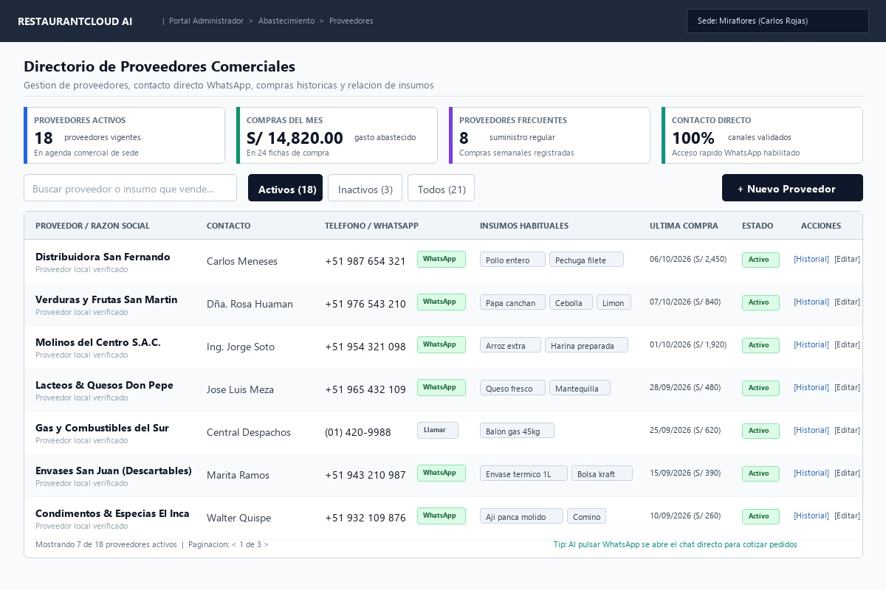
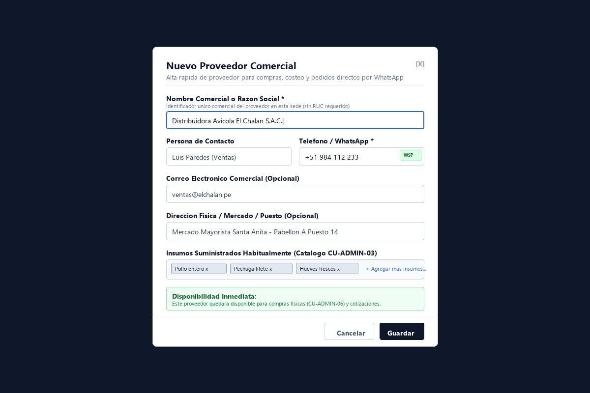
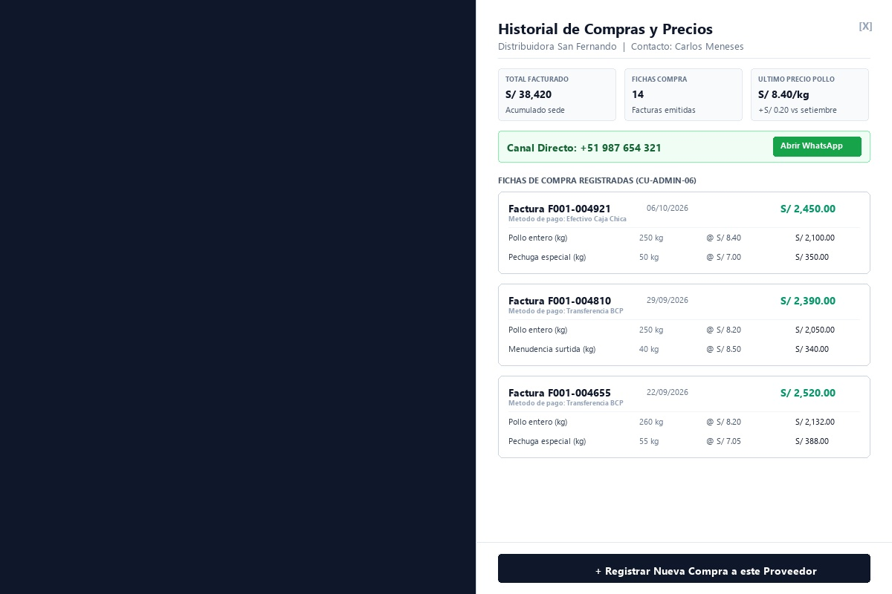
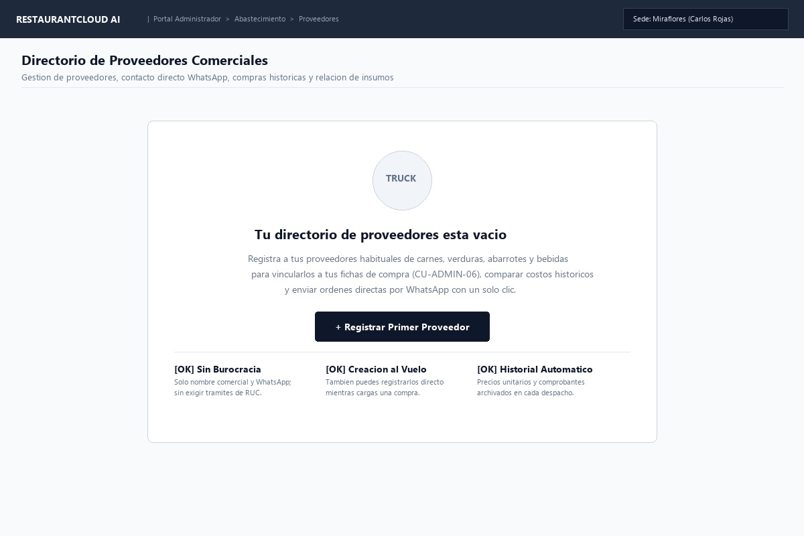
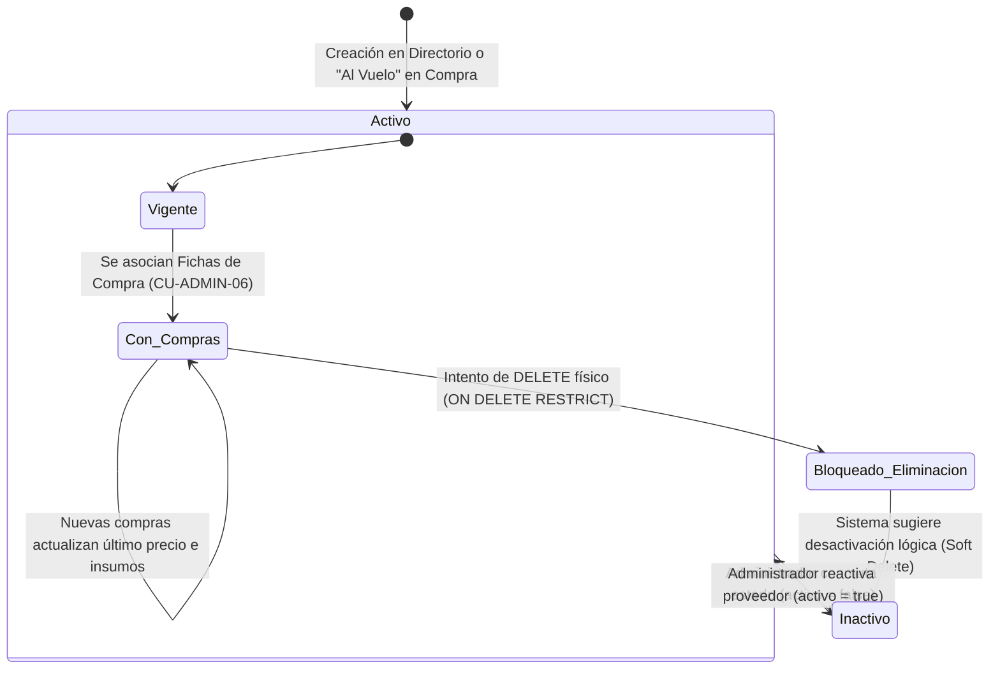

# CU-ADMIN-05: Gestionar Catálogo de Proveedores

Especificación técnica de interfaz de usuario, arquitectura de información, directorio comercial, contacto directo WhatsApp, compras históricas e integración de contratos de API Go en **RestaurantCloud AI**.

---

## 1. Ficha Técnica del Caso de Uso

| Atributo | Detalle |
| :--- | :--- |
| **Código CU** | `CU-ADMIN-05` |
| **Nombre** | Gestionar catálogo de proveedores |
| **Actor(es)** | `administrador_local` (gestión del directorio comercial, compras y cotizaciones de su sede) |
| **Dispositivo / Viewport** | Responsive Desktop (`1440x900`), Tablet (`768x1024`), Mobile (`375x812`) |
| **Precondición** | La sede está activa (`CU-PROP-04`); el usuario tiene rol de Administrador de Local. |
| **Postcondición** | Proveedor registrado en la agenda comercial de la sede; disponible para emisión ágil de compras físicas (`CU-ADMIN-06`), cotización de insumos y auditoría de precios; sin eliminación física si tiene compras registradas (`ON DELETE RESTRICT`), garantizando integridad contable. |

---

## 2. Diagrama de Flujo y Secuencia

```mermaid
sequenceDiagram
    autonumber
    actor A as Administrador del Local
    participant FE as Frontend Dashboard
    participant BE as Backend (Go Core API)
    participant DB as PostgreSQL (RLS)
    participant WSP as WhatsApp Web / App

    %% 1. Consulta del Directorio Comercial
    A->>FE: 1. Accede a "Abastecimiento" -> "Proveedores"
    FE->>BE: GET /api/v1/admin/proveedores?estado=activos&query=
    BE->>DB: SET app.tenant_id = :empresa_id;<br/>SELECT p.*, COUNT(fc.id) as total_compras, COALESCE(SUM(fc.total), 0) as total_gastado,<br/>MAX(fc.fecha_emision) as ultima_compra_fecha<br/>FROM proveedor p LEFT JOIN ficha_compra fc ON fc.proveedor_id = p.id<br/>WHERE p.local_id = :admin_local_id AND p.activo = true<br/>GROUP BY p.id ORDER BY p.nombre ASC
    DB-->>BE: Retorna lista de proveedores con métricas de compras
    BE-->>FE: 200 OK (apiresponse.Response con ProveedoresListDTO)
    FE->>A: Renderiza Vista 1: Directorio con KPIs de abastecimiento y tabla

    %% 2. Enlace Directo a WhatsApp para Pedidos
    alt Administrador contacta a proveedor para coordinar despacho
        A->>FE: Clic en botón "[ WhatsApp ]" de "Distribuidora San Fernando"
        FE->>WSP: Abre wa.me/51987654321?text=Hola%20Distribuidora%20San%20Fernando...
        WSP-->>A: Interfaz de chat lista para consultar disponibilidad y precios
    end

    %% 3. Alta de Proveedor (Sin Burocracia de RUC)
    alt Administrador registra nuevo proveedor
        A->>FE: 2. Clic en "[ + Nuevo Proveedor ]"
        FE->>A: Despliega Vista 2: Modal Ágil (< 10 segundos)
        A->>FE: Ingresa: Nombre "Avícola El Chalán", Contacto "Luis Paredes",<br/>WhatsApp "+51 984 112 233", Dirección "Mdo. Santa Anita Pab. A",<br/>Insumos: [Pollo entero, Pechuga, Huevos]
        A->>FE: Clic en "[ Guardar ]"
        FE->>BE: POST /api/v1/admin/proveedores {nombre, contacto, telefono, direccion, insumos_ids: [...]}
        
        rect rgb(240, 255, 240)
            Note over BE,DB: Validación y Persistencia Atómica
            BE->>DB: SELECT id FROM proveedor WHERE local_id = :local_id AND LOWER(nombre) = LOWER(:nombre)
            BE->>DB: INSERT INTO proveedor (local_id, nombre, contacto, telefono, email, direccion, activo)<br/>VALUES (:local_id, :nombre, :contacto, :telefono, :email, :direccion, true) RETURNING id
        end

        DB-->>BE: Registro creado exitosamente
        BE-->>FE: 201 Created (apiresponse.Response con ProveedorDetalleDTO)
        FE->>A: Cierra modal, actualiza tabla y muestra Toast de alta inmediata
    end

    %% 4. Consulta de Historial de Compras en Drawer Lateral
    alt Administrador audita fluctuación de costos de un proveedor
        A->>FE: 3. Clic en "[ Historial ]" en fila de proveedor
        FE->>BE: GET /api/v1/admin/proveedores/{id}/historial-compras
        BE->>DB: SELECT fc.id, fc.numero_comprobante, fc.fecha_emision, fc.metodo_pago, fc.total,<br/>json_agg(json_build_object('insumo', i.nombre, 'cantidad', fcd.cantidad, 'unidad', i.unidad_medida, 'precio_unitario', fcd.precio_unitario, 'subtotal', fcd.subtotal)) as detalle<br/>FROM ficha_compra fc JOIN ficha_compra_detalle fcd ON fcd.ficha_compra_id = fc.id<br/>JOIN insumo i ON i.id = fcd.insumo_id<br/>WHERE fc.proveedor_id = :id GROUP BY fc.id ORDER BY fc.fecha_emision DESC LIMIT 20
        DB-->>BE: Retorna historial cronológico de compras con desglose de insumos
        BE-->>FE: 200 OK (apiresponse.Response con ProveedorHistorialComprasDTO)
        FE->>A: Despliega Vista 3: Drawer lateral con evolución de precios y montos
    end

    %% 5. Baja Lógica / Conmutación de Estado
    alt Administrador desactiva un proveedor
        A->>FE: 4. Clic en "[ Desactivar ]"
        FE->>BE: PATCH /api/v1/admin/proveedores/{id}/estado {activo: false}
        BE->>DB: UPDATE proveedor SET activo = false, updated_at = NOW() WHERE id = :id AND local_id = :local_id
        DB-->>BE: Estado actualizado a inactivo
        BE-->>FE: 200 OK (apiresponse.Response con ProveedorDetalleDTO)
        FE->>A: Fila pasa a pestaña "Inactivos"; historial previo permanece intacto
    end
```

---

## 3. Especificación de Pantallas y Wireframes Blueprint

### Vista 1: Directorio y Catálogo de Proveedores (`wf_admin_05_directorio_proveedores.jpg`)



#### Layout Estructural ASCII (Desktop 1440x900)
```text
+----------------------------------------------------------------------------------------------------+
| RESTAURANTCLOUD AI   | Portal Administrador > Abastecimiento > Proveedores        [ Sede: Miraflores ]
+----------------------------------------------------------------------------------------------------+
|                                                                                                    |
| Directorio de Proveedores Comerciales                                                              |
| Gestión de proveedores, contacto directo WhatsApp, compras históricas y relación de insumos        |
|----------------------------------------------------------------------------------------------------|
|                                                                                                    |
| +---------------------+ +---------------------+ +---------------------+ +------------------------+ |
| | PROVEEDORES ACTIVOS | | COMPRAS DEL MES     | | PROVEEDORES FRECUENT| | CONTACTO DIRECTO       | |
| | [ 18 ] vigentes     | | [ S/ 14,820.00 ]    | | [ 8 ] regulares     | | [ 100% ] validados     | |
| | En agenda de sede   | | En 24 fichas compra | | Compras semanales   | | WhatsApp directo OK    | |
| +---------------------+ +---------------------+ +---------------------+ +------------------------+ |
|                                                                                                    |
| [ Buscar proveedor o insumo que vende...    ]  [ Activos (18) ] [ Inactivos (3) ] [ Todos ]   [ + Nuevo Proveedor ]
|                                                                                                    |
| +------------------------------------------------------------------------------------------------+ |
| | PROVEEDOR / RAZÓN SOCIAL | CONTACTO        | TELÉFONO / WHATSAPP | INSUMOS HABITUALES | ÚLTIMA COMPRA | ESTADO | ACCIONES |
| |--------------------------+-----------------+---------------------+--------------------+---------------+--------+----------|
| | Distribuidora San Fndo   | Carlos Meneses  | +51 987 654 321 [WSP]| [Pollo] [Pechuga]  | 06/10 S/2,450 | [Activo]| [Hist] [Edit]|
| | Verduras San Martín      | Rosa Huamán     | +51 976 543 210 [WSP]| [Papa] [Cebolla]   | 07/10 S/ 840  | [Activo]| [Hist] [Edit]|
| | Molinos del Centro S.A.C.| Ing. Jorge Soto | +51 954 321 098 [WSP]| [Arroz] [Harina]   | 01/10 S/1,920 | [Activo]| [Hist] [Edit]|
| | Lácteos Don Pepe         | Jose Luis Meza  | +51 965 432 109 [WSP]| [Queso] [Manteq.]  | 28/09 S/ 480  | [Activo]| [Hist] [Edit]|
| | Gas del Sur              | Despachos       | (01) 420-9988 [Llam]| [Balón gas 45kg]   | 25/09 S/ 620  | [Activo]| [Hist] [Edit]|
| | Envases San Juan         | Marita Ramos    | +51 943 210 987 [WSP]| [Envase 1L] [Bolsa]| 15/09 S/ 390  | [Activo]| [Hist] [Edit]|
| +------------------------------------------------------------------------------------------------+ |
| Mostrando 7 de 18 proveedores activos  | Paginación: < 1 de 3 >     Tip: Clic en WhatsApp para abrir chat directo |
+----------------------------------------------------------------------------------------------------+
```

#### Componentes Clave de la Interfaz
1. **KPIs Operativos:** Indicadores en tiempo real del gasto mensual en abastecimiento, cantidad de proveedores activos y frecuencia de compras.
2. **Buscador Reactivo y Filtro Multidimensional:** Búsqueda instantánea tanto por razón social comercial como por insumos que suministra (ej. si el usuario tipea `"papa"` o `"gas"`, filtra automáticamente a los proveedores respectivos).
3. **Botón Integrado de WhatsApp:** Al pulsar `[ WhatsApp ]`, se dispara un enlace universal `wa.me/51...` que abre la aplicación móvil o WhatsApp Web con el contacto precargado para solicitar cotizaciones o confirmar despachos sin salir del flujo de trabajo.
4. **Selector de Estado Rápido:** Pestañas superiores `[ Activos (default) ]`, `[ Inactivos ]`, `[ Todos ]`.

---

### Vista 2: Modal Ágil de Alta / Edición de Proveedor (`wf_admin_05_crear_editar_proveedor_modal.jpg`)



#### Especificación de Formulario (Sin RUC)
- **Diseño sin burocracia:** Diseñado para completarse en **menos de 10 segundos**. En la realidad operativa de restaurantes en Perú, exigir RUC obligatorio traba las compras a proveedores de mercados mayoristas locales o personas naturales.
- **Campos:**
  1. `Nombre Comercial o Razón Social *`: Obligatorio. Texto limpio de 3 a 100 caracteres. Unicidad validada a nivel de sede (`UNIQUE(local_id, LOWER(nombre))`).
  2. `Persona de Contacto`: Opcional. Nombre o apodo del vendedor o despachador (ej. "Carlos Ventas").
  3. `Teléfono / WhatsApp *`: Obligatorio. Número telefónico local o celular (ej. `+51 984 112 233`) con detector de formato WhatsApp.
  4. `Correo Electrónico Comercial`: Opcional. Para recepción de facturas electrónicas o cotizaciones formales.
  5. `Dirección Física / Mercado / Puesto`: Opcional. Ubicación física (ej. "Mercado Mayorista Santa Anita - Pabellón A Puesto 14").
  6. `Insumos que Suministra Habitualmente`: Multi-selector interactivo tipo *chip tags* sincronizado con el catálogo de insumos de inventario (`CU-ADMIN-03`). Permite vincular los insumos que comúnmente se le compran para agilizar filtros y recomendaciones de reposición (`CU-ADMIN-07`).
- **Disponibilidad Inmediata:** Al guardar, el proveedor queda activo y seleccionable de inmediato tanto en el catálogo como en la Ficha de Compra (`CU-ADMIN-06`).

---

### Vista 3: Quick-Drawer de Historial de Compras y Evolución de Precios (`wf_admin_05_historial_compras_drawer.jpg`)



#### Características del Drawer Lateral (560px)
1. **Acceso No Disruptivo:** Se abre lateralmente sin hacer navegar al usuario fuera de su lista principal de proveedores.
2. **KPIs Acumulados del Proveedor:**
   - *Total Facturado*: Monto acumulado histórico comprado a este proveedor.
   - *Fichas de Compra*: Número total de compras formalizadas.
   - *Último Precio Referencial*: Variación porcentual o numérica respecto al mes previo (ej. *"Pollo: S/ 8.40/kg (+S/ 0.20 vs setiembre)"*).
3. **Banner de Contacto Rápido:** Botón destacado `[ Abrir WhatsApp ]` para comunicarse directamente.
4. **Línea de Tiempo de Compras:** Tarjetas cronológicas con fecha, número de comprobante físico (`F001-004921`), método de pago empleado y desglose pormenorizado de los insumos comprados, cantidades y precios unitarios facturados.
5. **Acceso Directo a Nueva Compra:** Botón inferior `[ + Registrar Nueva Compra a este Proveedor ]` que abre directamente el modal de `CU-ADMIN-06` con el proveedor ya seleccionado.

---

### Vista 4: Onboarding Vacío Orientador (`wf_admin_05_onboarding_vacio.jpg`)



#### Guía para Sede Nueva
- Ilustración amigable de abastecimiento.
- Explicación de los beneficios de registrar proveedores: control de costos, precios históricos y enlaces directos a WhatsApp.
- Botón principal de acción: `[ + Registrar Primer Proveedor ]`.
- Recordatorio de agilidad operativa: *"💡 También puedes registrarlos directamente 'al vuelo' mientras ingresas una Ficha de Compra (CU-ADMIN-06)."*

---

## 4. Matriz de Estados y Ciclo de Vida del Proveedor



### Reglas de Negocio y Validación
1. **Unicidad de Nombre:** No pueden existir dos proveedores con el mismo nombre comercial dentro del mismo local (insensible a mayúsculas/minúsculas): `UNIQUE(local_id, LOWER(nombre))`.
2. **Sin Exigencia de RUC:** No se bloquea el registro si el proveedor no posee RUC. El nombre comercial y el teléfono son suficientes para la operativa ágil del negocio gastronómico.
3. **Integridad de Compras (No Borrado Físico):** Si un proveedor tiene al menos una compra registrada (`COUNT(ficha_compra) > 0`), cualquier intento de borrado físico es rechazado con error `409 Conflict (ERR_PROVEEDOR_TIENE_COMPRAS)` debido a la clave foránea `ON DELETE RESTRICT`. El administrador debe usar la desactivación lógica (`activo = false`).
4. **Creación "Al Vuelo":** El endpoint de creación de proveedores puede ser invocado de forma transparente por el modal de registro de compras (`CU-ADMIN-06`) sin requerir salir de la pantalla de compra.

---

## 5. Contratos de API Backend en Go

Todos los endpoints respetan el estándar corporativo de respuestas `pkg/apiresponse.Response` y aplican aislamiento multi-tenant mediante Row-Level Security (RLS) en PostgreSQL.

### 5.1. DTOs de Request y Response (`internal/domain/proveedor/dto.go`)

```go
package proveedor

import (
	"time"

	"github.com/google/uuid"
)

// InsumoHabitualDTO representa un insumo suministrado por el proveedor
type InsumoHabitualDTO struct {
	InsumoID        uuid.UUID `json:"insumo_id"`
	Nombre          string    `json:"nombre"`
	UnidadMedida    string    `json:"unidad_medida"`
	UltimoPrecio    float64   `json:"ultimo_precio"`
}

// ProveedorResumenDTO representa un proveedor en el directorio principal
type ProveedorResumenDTO struct {
	ID                uuid.UUID           `json:"id"`
	LocalID           uuid.UUID           `json:"local_id"`
	Nombre            string              `json:"nombre"`
	Contacto          *string             `json:"contacto,omitempty"`
	Telefono          *string             `json:"telefono,omitempty"`
	Email             *string             `json:"email,omitempty"`
	Direccion         *string             `json:"direccion,omitempty"`
	Activo            bool                `json:"activo"`
	InsumosHabituales []InsumoHabitualDTO `json:"insumos_habituales"`
	TotalCompras      int                 `json:"total_compras"`
	TotalGastado      float64             `json:"total_gastado"`
	UltimaCompraFecha *time.Time          `json:"ultima_compra_fecha,omitempty"`
	UltimaCompraTotal *float64            `json:"ultima_compra_total,omitempty"`
	CreatedAt         time.Time           `json:"created_at"`
}

// ProveedoresKPIsDTO consolida las métricas del encabezado
type ProveedoresKPIsDTO struct {
	TotalActivos          int     `json:"total_activos"`
	ComprasMesTotal       float64 `json:"compras_mes_total"`
	FichasMesTotal        int     `json:"fichas_mes_total"`
	ProveedoresFrecuentes int     `json:"proveedores_frecuentes"`
}

// ProveedoresListDTO envuelve la respuesta con KPIs y paginación
type ProveedoresListDTO struct {
	KPIs        ProveedoresKPIsDTO    `json:"kpis"`
	Proveedores []ProveedorResumenDTO `json:"proveedores"`
	TotalItems  int                   `json:"total_items"`
	Pagina      int                   `json:"pagina"`
	ItemsPagina int                   `json:"items_pagina"`
}

// CrearProveedorRequestDTO payload para dar de alta un proveedor
type CrearProveedorRequestDTO struct {
	Nombre     string      `json:"nombre" validate:"required,min=3,max=100"`
	Contacto   *string     `json:"contacto,omitempty" validate:"omitempty,max=80"`
	Telefono   *string     `json:"telefono,omitempty" validate:"omitempty,max=20"`
	Email      *string     `json:"email,omitempty" validate:"omitempty,email,max=100"`
	Direccion  *string     `json:"direccion,omitempty" validate:"omitempty,max=150"`
	InsumosIDs []uuid.UUID `json:"insumos_ids,omitempty"`
}

// ActualizarProveedorRequestDTO payload para modificar datos
type ActualizarProveedorRequestDTO struct {
	Nombre     string      `json:"nombre" validate:"required,min=3,max=100"`
	Contacto   *string     `json:"contacto,omitempty" validate:"omitempty,max=80"`
	Telefono   *string     `json:"telefono,omitempty" validate:"omitempty,max=20"`
	Email      *string     `json:"email,omitempty" validate:"omitempty,email,max=100"`
	Direccion  *string     `json:"direccion,omitempty" validate:"omitempty,max=150"`
	InsumosIDs []uuid.UUID `json:"insumos_ids,omitempty"`
}

// ConmutarEstadoRequestDTO payload para alternar activo/inactivo
type ConmutarEstadoRequestDTO struct {
	Activo bool `json:"activo"`
}

// ItemCompraHistorialDTO línea de insumo comprada en el histórico
type ItemCompraHistorialDTO struct {
	InsumoID       uuid.UUID `json:"insumo_id"`
	InsumoNombre   string    `json:"insumo_nombre"`
	UnidadMedida   string    `json:"unidad_medida"`
	Cantidad       float64   `json:"cantidad"`
	PrecioUnitario float64   `json:"precio_unitario"`
	Subtotal       float64   `json:"subtotal"`
}

// FichaCompraHistorialDTO cabecera y detalle de una compra pasada
type FichaCompraHistorialDTO struct {
	ID                uuid.UUID                `json:"id"`
	NumeroComprobante string                   `json:"numero_comprobante"`
	TipoComprobante   string                   `json:"tipo_comprobante"`
	FechaEmision      string                   `json:"fecha_emision"` // YYYY-MM-DD
	MetodoPago        string                   `json:"metodo_pago"`
	Total             float64                  `json:"total"`
	Items             []ItemCompraHistorialDTO `json:"items"`
}

// ProveedorHistorialComprasDTO respuesta para el Drawer lateral
type ProveedorHistorialComprasDTO struct {
	ProveedorID       uuid.UUID                 `json:"proveedor_id"`
	ProveedorNombre   string                    `json:"proveedor_nombre"`
	Contacto          *string                   `json:"contacto,omitempty"`
	Telefono          *string                   `json:"telefono,omitempty"`
	TotalFacturado    float64                   `json:"total_facturado"`
	TotalFichas       int                       `json:"total_fichas"`
	Compras           []FichaCompraHistorialDTO `json:"compras"`
}
```

---

### 5.2. Definición de Endpoints RESTful

| Método | Endpoint | Descripción | Códigos HTTP |
| :--- | :--- | :--- | :--- |
| `GET` | `/api/v1/admin/proveedores` | Lista proveedores con KPIs, filtros (`estado=activos\|inactivos\|todos`), buscador y paginación. | `200 OK`, `401 Unauthorized`, `403 Forbidden` |
| `POST` | `/api/v1/admin/proveedores` | Crea un nuevo proveedor comercial (admite llamada "al vuelo" desde compra). | `201 Created`, `400 Bad Request`, `409 Conflict (ERR_PROVEEDOR_DUPLICADO)` |
| `GET` | `/api/v1/admin/proveedores/{id}` | Retorna el detalle completo de un proveedor y sus insumos habituales. | `200 OK`, `404 Not Found` |
| `PUT` | `/api/v1/admin/proveedores/{id}` | Actualiza datos comerciales del proveedor. | `200 OK`, `400 Bad Request`, `409 Conflict` |
| `PATCH` | `/api/v1/admin/proveedores/{id}/estado` | Conmuta estado `activo` (soft toggle para excluirlo de compras). | `200 OK`, `404 Not Found` |
| `GET` | `/api/v1/admin/proveedores/{id}/historial-compras` | Retorna compras históricas y variación de precios para el Drawer lateral. | `200 OK`, `404 Not Found` |
| `DELETE` | `/api/v1/admin/proveedores/{id}` | Intento de eliminación física (bloqueado con 409 si tiene compras asociadas). | `204 No Content`, `409 Conflict (ERR_PROVEEDOR_TIENE_COMPRAS)` |

---

### 5.3. Ejemplo de Respuestas HTTP con `apiresponse.Response`

#### Ejemplo 1: `GET /api/v1/admin/proveedores?estado=activos`
```json
{
  "success": true,
  "data": {
    "kpis": {
      "total_activos": 18,
      "compras_mes_total": 14820.00,
      "fichas_mes_total": 24,
      "proveedores_frecuentes": 8
    },
    "proveedores": [
      {
        "id": "e8a93e32-23c4-4d80-87ba-15103faec121",
        "local_id": "497f6eca-6276-4993-bfeb-53cbbbba6f08",
        "nombre": "Distribuidora San Fernando",
        "contacto": "Carlos Meneses",
        "telefono": "+51 987 654 321",
        "email": "ventas@sanfernando.pe",
        "direccion": "Av. República de Panamá 4200, Surquillo",
        "activo": true,
        "insumos_habituales": [
          {
            "insumo_id": "a1b2c3d4-0001-4000-8000-000000000001",
            "nombre": "Pollo entero eviscerado",
            "unidad_medida": "kg",
            "ultimo_precio": 8.40
          },
          {
            "insumo_id": "a1b2c3d4-0002-4000-8000-000000000002",
            "nombre": "Filete de pechuga",
            "unidad_medida": "kg",
            "ultimo_precio": 7.00
          }
        ],
        "total_compras": 14,
        "total_gastado": 38420.00,
        "ultima_compra_fecha": "2026-10-06T11:30:00Z",
        "ultima_compra_total": 2450.00,
        "created_at": "2026-08-15T09:00:00Z"
      }
    ],
    "total_items": 18,
    "pagina": 1,
    "items_pagina": 10
  },
  "error": null
}
```

#### Ejemplo 2: `POST /api/v1/admin/proveedores` (Error de Duplicidad)
```json
{
  "success": false,
  "data": null,
  "error": {
    "code": "ERR_PROVEEDOR_DUPLICADO",
    "message": "Ya existe un proveedor registrado con el nombre 'Distribuidora San Fernando' en esta sede.",
    "details": {
      "campo": "nombre",
      "valor": "Distribuidora San Fernando"
    }
  }
}
```

#### Ejemplo 3: `DELETE /api/v1/admin/proveedores/{id}` (Bloqueo por Compras Históricas)
```json
{
  "success": false,
  "data": null,
  "error": {
    "code": "ERR_PROVEEDOR_TIENE_COMPRAS",
    "message": "No es posible eliminar físicamente al proveedor porque cuenta con 14 fichas de compra registradas. Puede desactivarlo para excluirlo de futuras compras sin perder el histórico contable.",
    "details": {
      "proveedor_id": "e8a93e32-23c4-4d80-87ba-15103faec121",
      "total_compras_asociadas": 14
    }
  }
}
```

---

## 6. Esquema Relacional de Base de Datos (`PostgreSQL 16`)

```sql
-- 1. Tabla de proveedores por local comercial (sin RUC)
CREATE TABLE proveedor (
    id UUID PRIMARY KEY DEFAULT gen_random_uuid(),
    local_id UUID NOT NULL REFERENCES local(id) ON DELETE CASCADE,
    nombre VARCHAR(100) NOT NULL,
    contacto VARCHAR(80),
    telefono VARCHAR(20),
    email VARCHAR(100),
    direccion VARCHAR(150),
    activo BOOLEAN NOT NULL DEFAULT true,
    created_at TIMESTAMP NOT NULL DEFAULT NOW(),
    updated_at TIMESTAMP NOT NULL DEFAULT NOW(),
    CONSTRAINT uq_proveedor_local_nombre UNIQUE (local_id, LOWER(nombre))
);

-- 2. Índices de optimización para búsquedas y RLS
CREATE INDEX idx_proveedor_local_activo ON proveedor (local_id, activo);
CREATE INDEX idx_proveedor_nombre_trgm ON proveedor USING gin (nombre gin_trgm_ops);

-- 3. Tabla relacional de insumos habituales que suministra el proveedor
CREATE TABLE proveedor_insumo_habitual (
    proveedor_id UUID NOT NULL REFERENCES proveedor(id) ON DELETE CASCADE,
    insumo_id UUID NOT NULL REFERENCES insumo(id) ON DELETE CASCADE,
    created_at TIMESTAMP NOT NULL DEFAULT NOW(),
    PRIMARY KEY (proveedor_id, insumo_id)
);

CREATE INDEX idx_prov_insumo_habitual ON proveedor_insumo_habitual (insumo_id);
```

---

## 7. Verificación de Accesibilidad (WCAG 2.1 AA)

- **Contraste de Colores:** Tipografía `#0F172A` sobre `#FFFFFF` (16.2:1) y subtextos `#64748B` sobre `#FFFFFF` (4.8:1), superando el umbral de 4.5:1 exigido para texto normal.
- **Teclado y Focus:** Navegación secuencial por `Tab` en todos los campos del modal; apertura de Drawer lateral atrapa el foco del usuario y permite cerrarlo mediante tecla `Escape`.
- **Botón WhatsApp:** Cuenta con atributo `aria-label="Abrir conversación de WhatsApp con el proveedor [Nombre] al número [Teléfono]"` para lectores de pantalla.
