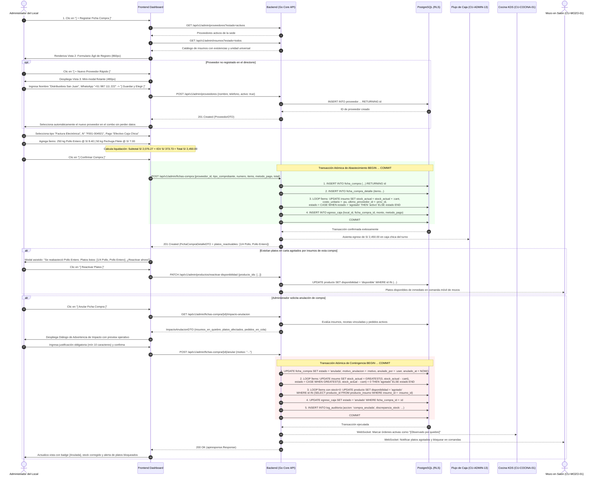
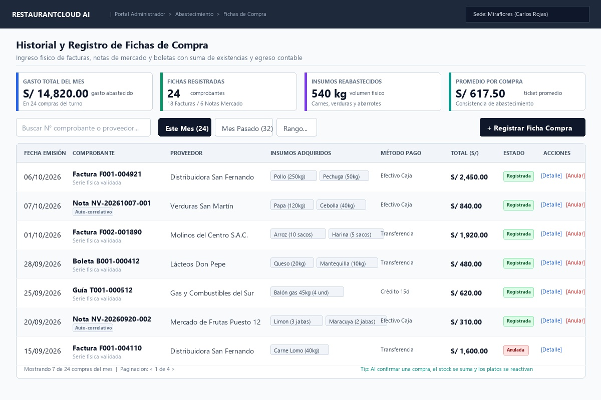
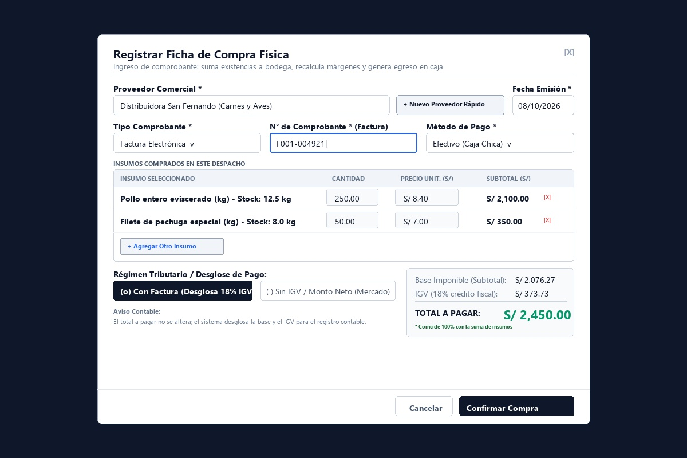
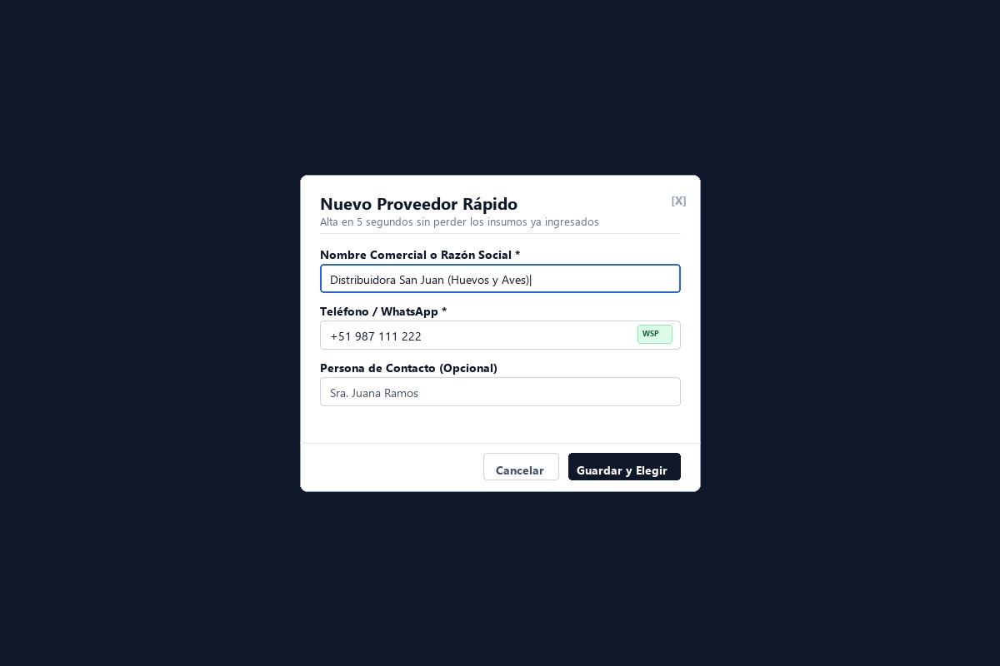
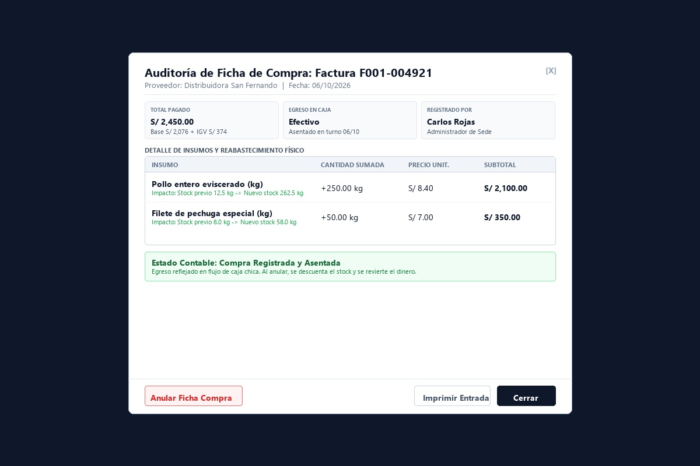
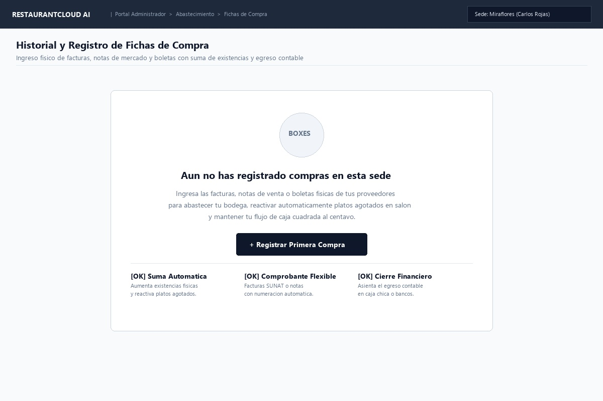
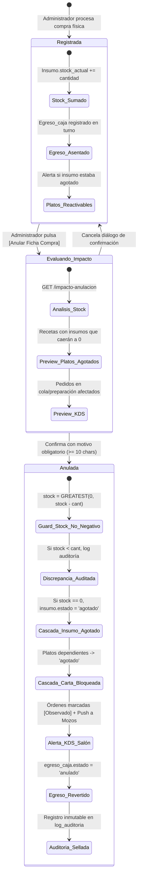

# CU-ADMIN-06: Registrar Ficha de Compra de Insumos

Especificación técnica de interfaz de usuario, arquitectura de información, transacción atómica de abastecimiento, actualización de existencias en almacén, sincronización de cartas/recetas, cálculo de egresos contables y contratos de API Go en **RestaurantCloud AI**.

---

## 1. Ficha Técnica del Caso de Uso

| Atributo | Detalle |
| :--- | :--- |
| **Código CU** | `CU-ADMIN-06` |
| **Nombre** | Registrar ficha de compra de insumos |
| **Actor(es)** | `administrador_local` (responsable del abastecimiento físico y control de egresos de la sede) |
| **Dispositivo / Viewport** | Responsive Desktop (`1440x900`), Tablet (`768x1024`), Mobile (`375x812`) |
| **Precondición** | La sede está activa (`CU-PROP-04`); insumos registrados en catálogo (`CU-ADMIN-03`); proveedores activos (`CU-ADMIN-05`) o creación "al vuelo". |
| **Postcondición** | Ficha de compra registrada con serie/folio; existencias sumadas al inventario (`stock_actual += cantidad`); costos unitarios actualizados; platos agotados sincronizados para reactivación en carta (`CU-ADMIN-04` $\leftrightarrow$ `CU-MOZO-01`); egreso financiero asentado en flujo de caja (`CU-ADMIN-13`). |

---

## 2. Diagrama de Flujo y Secuencia



---

## 3. Especificación de Pantallas y Wireframes Blueprint

### Vista 1: Historial y Libro de Fichas de Compra (`wf_admin_06_directorio_compras.jpg`)



#### Layout Estructural ASCII (Desktop 1440x900)
```text
+----------------------------------------------------------------------------------------------------+
| RESTAURANTCLOUD AI   | Portal Administrador > Abastecimiento > Fichas de Compra   [ Sede: Miraflores ]
+----------------------------------------------------------------------------------------------------+
|                                                                                                    |
| Historial y Registro de Fichas de Compra                                                           |
| Ingreso físico de facturas, notas de mercado y boletas con suma de existencias y egreso contable   |
|----------------------------------------------------------------------------------------------------|
|                                                                                                    |
| +---------------------+ +---------------------+ +---------------------+ +------------------------+ |
| | GASTO TOTAL DEL MES | | FICHAS REGISTRADAS  | | INSUMOS REABASTECID | | PROMEDIO POR COMPRA    | |
| | [ S/ 14,820.00 ]    | | [ 24 ] comprobantes | | [ 540 kg ] volumen  | | [ S/ 617.50 ]          | |
| | En 24 compras turno | | 18 Fact / 6 Notas   | | Carnes, verduras... | | Consistencia compras   | |
| +---------------------+ +---------------------+ +---------------------+ +------------------------+ |
|                                                                                                    |
| [ Buscar N° comprobante o proveedor... ]  [ Este Mes (24) ] [ Mes Pasado ] [ Rango ]   [ + Registrar Ficha Compra ]
|                                                                                                    |
| +------------------------------------------------------------------------------------------------+ |
| | FECHA EMISIÓN | COMPROBANTE        | PROVEEDOR          | INSUMOS ADQUIRIDOS | MÉTODO PAGO | TOTAL (S/) | ESTADO     | ACCIONES   |
| |---------------+--------------------+--------------------+--------------------+-------------+------------+------------+------------|
| | 06/10/2026    | Factura F001-004921| San Fernando       | [Pollo] [Pechuga]  | Efect. Caja | S/ 2,450.00| [Registrad]| [Det] [Anul|
| | 07/10/2026    | Nota NV-20261007-01| San Martín Verduras| [Papa] [Cebolla]   | Efect. Caja | S/   840.00| [Registrad]| [Det] [Anul|
| | 01/10/2026    | Factura F002-001890| Molinos Centro SAC | [Arroz] [Harina]   | Transferenc | S/ 1,920.00| [Registrad]| [Det] [Anul|
| | 28/09/2026    | Boleta B001-000412 | Lácteos Don Pepe   | [Queso] [Manteq.]  | Transferenc | S/   480.00| [Registrad]| [Det] [Anul|
| | 25/09/2026    | Guía T001-000512   | Gas del Sur        | [Balón gas 45kg]   | Crédito 15d | S/   620.00| [Registrad]| [Det] [Anul|
| | 20/09/2026    | Nota NV-20260920-02| Mdo Frutas Puesto12| [Limón] [Maracuyá] | Efect. Caja | S/   310.00| [Registrad]| [Det] [Anul|
| | 15/09/2026    | Factura F001-004110| San Fernando       | [Carne Lomo]       | Transferenc | S/ 1,600.00| [Anulada]  | [Detalle]  |
| +------------------------------------------------------------------------------------------------+ |
| Mostrando 7 de 24 compras del mes  | Paginación: < 1 de 4 >      Tip: Confirmar suma existencias y reactiva platos |
+----------------------------------------------------------------------------------------------------+
```

---

### Vista 2: Formulario / Modal de Registro de Ficha de Compra (`wf_admin_06_registro_compra_modal.jpg`)



#### Especificación Funcional de Formulario (860px)
1. **Diferenciación Dinámica de Comprobantes:**
   - Si se selecciona `Factura Electrónica`, `Boleta` o `Guía de Remisión`: El campo `N° de Comprobante` exige validación de serie y número físico (ej. `F001-004921`).
   - Si se selecciona `Nota de Venta` o `Recibo`: El campo `N° de Comprobante` es **Opcional**. Si viene en blanco, el backend autogenera el código de control correlativo de sede: `NV-YYYYMMDD-####`.
2. **Selector de Proveedor y Creación "Al Vuelo":**
   - Selector reactivo con autocompletado de la agenda comercial (`CU-ADMIN-05`).
   - Botón `[ + Nuevo Proveedor Rápido ]` para emergencias de mercado.
3. **Detalle Dinámico de Insumos:**
   - Selector de insumo (`CU-ADMIN-03`) que exhibe en tiempo real el stock actual disponible y la unidad universal de compra (ej. `kg`, `saco`, `und`).
   - Inputs numéricos de `Cantidad` y `Precio Unitario (S/)` con cálculo instantáneo de subtotal de línea.
   - Botón de remoción rápida `[X]` y enlace `+ Agregar Otro Insumo`.
4. **Desglose Tributario Claro (Sin Ambigüedades):**
   - Selector explícito de **Régimen de Compra**:
     - `[ (o) Con Factura (Desglosa 18% IGV) ]`: Calcula Base Imponible (`Total / 1.18`) e IGV (`Total - Base`) para crédito fiscal contable.
     - `[ ( ) Sin IGV / Monto Neto (Mercado) ]`: Subtotal = Total (IGV = S/ 0.00).
   - **Garantía Contable:** El total a pagar es **siempre la suma exacta de los insumos digitados**; el sistema no altera ni añade recargos imprevistos.

---

### Vista 3: Modal de Creación de Proveedor "Al Vuelo" (`wf_admin_06_proveedor_al_vuelo_modal.jpg`)



#### Características del Submodal Rápido (480px)
- **Activación:** Se abre como submodal sin recargar la pantalla cuando el transportista entrega insumos de un nuevo proveedor no agendado.
- **Campos esenciales (< 5 segundos):**
  - `Nombre Comercial o Razón Social *`: Obligatorio (ej. "Distribuidora San Juan").
  - `Teléfono / WhatsApp *`: Obligatorio con validación móvil.
  - `Persona de Contacto`: Opcional.
- **Botón `[ Guardar y Elegir ]`:** Persiste al proveedor en base de datos y lo selecciona automáticamente en el formulario de compra conservando intactos todos los insumos ya tipeados.

---

### Vista 4: Modal de Consulta y Auditoría de Ficha de Compra (`wf_admin_06_detalle_compra_modal.jpg`)



#### Capacidades de Auditoría (760px)
1. **Trazabilidad Física:** Muestra qué insumos se adquirieron y exactamente cuánto stock sumaron al inventario en esa fecha (ej. *"Pollo entero: Stock previo 12.5 kg $\rightarrow$ Nuevo stock 262.5 kg"*).
2. **Trazabilidad Financiera:** Asiento contable del egreso (monto pagado, método de pago y turno de caja asociado).
3. **Anulación Asistida con Plan de Contingencia:** Botón `[ Anular Ficha Compra ]` (borde rojo) que invoca la evaluación previa de impacto y despliega el diálogo de advertencia operativa.
4. **Comprobante de Entrada:** Botón `[ Imprimir Entrada ]` para archivo físico o control de almacén.

#### Submodal: Diálogo de Advertencia de Impacto Operativo por Anulación (800px)
```text
+----------------------------------------------------------------------------------------------------+
| ⚠️ CONFIRMAR ANULACIÓN DE COMPRA Y APLICAR CONTINGENCIA                   [ Ficha: F001-004921 ]   |
+----------------------------------------------------------------------------------------------------+
|                                                                                                    |
|  ¡ADVERTENCIA DE IMPACTO OPERATIVO EN SALÓN Y COCINA!                                             |
|  Al anular esta compra se descontarán las cantidades ingresadas. El sistema aplicará salvaguardas  |
|  para evitar stock negativo y desactivará platos de la carta de forma inmediata.                   |
|                                                                                                    |
|  1. INSUMOS AFECTADOS Y SALDO DE STOCK:                                                            |
|  ------------------------------------------------------------------------------------------------  |
|  • Pollo Entero: Comprado: 250.00 kg | Stock actual: 240.00 kg                                     |
|    -> Resultado: 0.00 kg  [ESTADO: AGOTADO]                                                        |
|    Nota: Se vendieron 10 kg en el turno. El stock se ajustará a 0 (diferencia auditada).           |
|  • Pechuga Filete: Comprado: 50.00 kg | Stock actual: 65.00 kg                                     |
|    -> Resultado: 15.00 kg [ESTADO: ACTIVO]                                                         |
|                                                                                                    |
|  2. PLATOS DE LA CARTA QUE SE BLOQUEARÁN AUTOMÁTICAMENTE (CU-ADMIN-04):                            |
|  ------------------------------------------------------------------------------------------------  |
|  [🚫 1/4 Pollo a la Brasa]  [🚫 Pollo a la Brasa Entero]  [🚫 Mostrito Especial]                  |
|  * Se marcarán como 'agotado' de inmediato para mozos en salón (CU-MOZO-01) y carta QR.           |
|                                                                                                    |
|  3. PEDIDOS EN COCINA EN CURSO (KDS) EN RIESGO:                                                    |
|  ------------------------------------------------------------------------------------------------  |
|  • Mesa 4: Pedido #102 [En preparación] (2x 1/4 Pollo) -> Se marcará: [Observado por quiebre]     |
|  • Mesa 9: Pedido #105 [En cola] (1x Pollo Entero)     -> Se marcará: [Observado por quiebre]     |
|                                                                                                    |
|  4. REVERSIÓN EN CAJA CHICA:                                                                       |
|  ------------------------------------------------------------------------------------------------  |
|  • Egreso #EG-0042 de S/ 2,450.00 pasará a estado [ANULADO].                                       |
|                                                                                                    |
|  MOTIVO OBLIGATORIO DE ANULACIÓN (Mínimo 10 caracteres) *:                                         |
|  +----------------------------------------------------------------------------------------------+  |
|  | Error de digitación en peso de pollo, proveedor envió nota de crédito para refacturar...     |  |
|  +----------------------------------------------------------------------------------------------+  |
|                                                                                                    |
|  [ Cancelar y Mantener Compra ]                   [ ⚠️ Confirmar Anulación y Aplicar Contingencia ]|
+----------------------------------------------------------------------------------------------------+
```

---

### Vista 5: Estado Inicial - Sin Compras Registradas (`wf_admin_06_onboarding_vacio.jpg`)



#### Pantalla Guía para Sede Nueva
- Orientación didáctica al administrador sobre el flujo de compras.
- Destaca los 3 beneficios automáticos: suma de stock físico, correlativos flexibles y asiento contable en caja.
- Botón principal: `[ + Registrar Primera Compra ]`.

---

## 4. Matriz de Estados de la Ficha de Compra y Plan de Contingencia



---

## 5. Contratos de API Backend en Go

Todos los endpoints respetan el estándar corporativo `pkg/apiresponse.Response` y aplican aislamiento multi-tenant mediante Row-Level Security (RLS) en PostgreSQL.

### 5.1. DTOs de Request y Response (`internal/domain/compra/dto.go`)

```go
package compra

import (
	"time"

	"github.com/google/uuid"
)

// ItemCompraRequestDTO detalle de cada insumo dentro de la compra
type ItemCompraRequestDTO struct {
	InsumoID       uuid.UUID `json:"insumo_id" validate:"required"`
	Cantidad       float64   `json:"cantidad" validate:"required,gt=0"`
	PrecioUnitario float64   `json:"precio_unitario" validate:"required,gte=0"`
}

// RegistrarFichaCompraRequestDTO payload para formalizar una compra física
type RegistrarFichaCompraRequestDTO struct {
	ProveedorID       uuid.UUID              `json:"proveedor_id" validate:"required"`
	TipoComprobante   string                 `json:"tipo_comprobante" validate:"required,oneof=factura boleta nota_venta guia_remision recibo"`
	NumeroComprobante *string                `json:"numero_comprobante,omitempty" validate:"omitempty,max=30"` // Opcional en nota_venta/recibo (autogenerado si vacío)
	FechaEmision      string                 `json:"fecha_emision" validate:"required"`                       // YYYY-MM-DD
	MetodoPago        string                 `json:"metodo_pago" validate:"required,oneof=efectivo transferencia tarjeta_debito credito_proveedor"`
	DesglosaIGV       bool                   `json:"desglosa_igv"` // true para Factura (extrae 18%), false para Neto/Mercado
	Items             []ItemCompraRequestDTO `json:"items" validate:"required,min=1,dive"`
	Notas             *string                `json:"notas,omitempty"`
}

// InsumoImpactadoDTO detalle del impacto en un insumo al revertir compra
type InsumoImpactadoDTO struct {
	InsumoID           uuid.UUID `json:"insumo_id"`
	InsumoNombre       string    `json:"insumo_nombre"`
	UnidadMedida       string    `json:"unidad_medida"`
	CantidadComprada   float64   `json:"cantidad_comprada"`
	StockActual        float64   `json:"stock_actual"`
	StockResultante    float64   `json:"stock_resultante"`
	EstadoResultante   string    `json:"estado_resultante"` // 'activo' | 'agotado'
	DiferenciaAuditada float64   `json:"diferencia_auditada"` // >0 si hubo ventas intermedias
}

// PlatoImpactadoDTO plato de la carta que pasa a agotado automáticamente
type PlatoImpactadoDTO struct {
	ProductoID     uuid.UUID `json:"producto_id"`
	Nombre         string    `json:"nombre"`
	Categoria      string    `json:"categoria"`
	InsumoFaltante string    `json:"insumo_faltante"`
}

// PedidoCocinaImpactadoDTO comanda en curso en cocina afectada
type PedidoCocinaImpactadoDTO struct {
	PedidoID        uuid.UUID `json:"pedido_id"`
	NumeroMesa      string    `json:"numero_mesa"`
	EstadoPedido    string    `json:"estado_pedido"` // 'en_cola' | 'en_preparacion'
	PlatosAfectados []string  `json:"platos_afectados"`
}

// ImpactoAnulacionDTO proyección previa del impacto antes de confirmar la anulación
type ImpactoAnulacionDTO struct {
	FichaCompraID       uuid.UUID                  `json:"ficha_compra_id"`
	NumeroComprobante   string                     `json:"numero_comprobante"`
	InsumosImpactados   []InsumoImpactadoDTO       `json:"insumos_impactados"`
	PlatosBloqueados    []PlatoImpactadoDTO        `json:"platos_bloqueados"`
	PedidosCocinaAlerta []PedidoCocinaImpactadoDTO `json:"pedidos_cocina_alerta"`
	MontoEgresoRevertir float64                    `json:"monto_egreso_revertir"`
	RequiereAtencion    bool                       `json:"requiere_atencion"` // true si hay platos bloqueados o pedidos en riesgo
}

// AnularFichaCompraRequestDTO payload para reversión de compra
type AnularFichaCompraRequestDTO struct {
	Motivo string `json:"motivo" validate:"required,min=10,max=300"`
}

// PlatoReactivableDTO plato de la carta que puede reactivarse tras la compra
type PlatoReactivableDTO struct {
	ProductoID uuid.UUID `json:"producto_id"`
	Nombre     string    `json:"nombre"`
	Categoria  string    `json:"categoria"`
}

// ItemCompraDetalleDTO desglose de insumo devuelto en la consulta
type ItemCompraDetalleDTO struct {
	ID             uuid.UUID `json:"id"`
	InsumoID       uuid.UUID `json:"insumo_id"`
	InsumoNombre   string    `json:"insumo_nombre"`
	UnidadMedida   string    `json:"unidad_medida"`
	Cantidad       float64   `json:"cantidad"`
	PrecioUnitario float64   `json:"precio_unitario"`
	Subtotal       float64   `json:"subtotal"`
	StockPrevio    float64   `json:"stock_previo"`
	NuevoStock     float64   `json:"nuevo_stock"`
}

// FichaCompraResumenDTO resumen para la tabla del listado
type FichaCompraResumenDTO struct {
	ID                uuid.UUID `json:"id"`
	NumeroComprobante string    `json:"numero_comprobante"`
	TipoComprobante   string    `json:"tipo_comprobante"`
	EsAutogenerado    bool      `json:"es_autogenerado"`
	FechaEmision      string    `json:"fecha_emision"`
	ProveedorID       uuid.UUID `json:"proveedor_id"`
	ProveedorNombre   string    `json:"proveedor_nombre"`
	TotalItems        int       `json:"total_items"`
	InsumosResumen    []string  `json:"insumos_resumen"`
	MetodoPago        string    `json:"metodo_pago"`
	DesglosaIGV       bool      `json:"desglosa_igv"`
	Subtotal          float64   `json:"subtotal"`
	Impuestos         float64   `json:"impuestos"`
	Total             float64   `json:"total"`
	Estado            string    `json:"estado"` // 'registrada' | 'anulada'
	MotivoAnulacion   *string   `json:"motivo_anulacion,omitempty"`
	RegistradoPor     string    `json:"registrado_por"`
	CreatedAt         time.Time `json:"created_at"`
}

// FichaCompraDetalleCompletoDTO auditoría completa de una compra
type FichaCompraDetalleCompletoDTO struct {
	FichaCompraResumenDTO
	Items              []ItemCompraDetalleDTO `json:"items"`
	PlatosReactivables []PlatoReactivableDTO  `json:"platos_reactivables,omitempty"`
}
```

---

### 5.2. Definición de Endpoints RESTful

| Método | Endpoint | Descripción | Códigos HTTP |
| :--- | :--- | :--- | :--- |
| `GET` | `/api/v1/admin/fichas-compra` | Listado histórico con filtros de fecha, tipo comprobante y paginación. | `200 OK`, `401 Unauthorized` |
| `POST` | `/api/v1/admin/fichas-compra` | Registro transaccional atómico de la compra física (aumenta stock, actualiza costos y egreso). | `201 Created`, `400 Bad Request`, `409 Conflict` |
| `GET` | `/api/v1/admin/fichas-compra/{id}` | Detalle exhaustivo de la compra, desglose de insumos y auditoría de egreso. | `200 OK`, `404 Not Found` |
| `GET` | `/api/v1/admin/fichas-compra/{id}/impacto-anulacion` | Proyecta el impacto en insumos, platos en carta y pedidos en cocina antes de anular. | `200 OK`, `404 Not Found` |
| `POST` | `/api/v1/admin/fichas-compra/{id}/anular` | Anula una ficha de compra con motivo obligatorio (aplica contingencia, cascada y reversión). | `200 OK`, `400 Bad Request`, `409 Conflict` |
| `PATCH` | `/api/v1/admin/productos/reactivar-disponibilidad` | Reactiva disponibilidad de platos seleccionados tras reabastecimiento. | `200 OK`, `400 Bad Request` |

---

### 5.3. Ejemplo de Respuestas HTTP con `apiresponse.Response`

#### Ejemplo 1: `GET /api/v1/admin/fichas-compra/{id}/impacto-anulacion` (Preview de Contingencia)
```json
{
  "success": true,
  "data": {
    "ficha_compra_id": "7b3a1a9e-4e31-4a92-8ec2-192a5b8214fa",
    "numero_comprobante": "F001-004921",
    "insumos_impactados": [
      {
        "insumo_id": "c1a2c3d4-0001-4000-8000-000000000001",
        "insumo_nombre": "Pollo Entero",
        "unidad_medida": "kg",
        "cantidad_comprada": 250.00,
        "stock_actual": 240.00,
        "stock_resultante": 0.00,
        "estado_resultante": "agotado",
        "diferencia_auditada": 10.00
      },
      {
        "insumo_id": "c1a2c3d4-0002-4000-8000-000000000002",
        "insumo_nombre": "Pechuga Filete",
        "unidad_medida": "kg",
        "cantidad_comprada": 50.00,
        "stock_actual": 65.00,
        "stock_resultante": 15.00,
        "estado_resultante": "activo",
        "diferencia_auditada": 0.00
      }
    ],
    "platos_bloqueados": [
      {
        "producto_id": "b1a2c3d4-1111-4000-8000-000000000001",
        "nombre": "1/4 Pollo a la Brasa",
        "categoria": "Pollos a la Brasa",
        "insumo_faltante": "Pollo Entero"
      },
      {
        "producto_id": "b1a2c3d4-2222-4000-8000-000000000002",
        "nombre": "Pollo a la Brasa Entero",
        "categoria": "Pollos a la Brasa",
        "insumo_faltante": "Pollo Entero"
      }
    ],
    "pedidos_cocina_alerta": [
      {
        "pedido_id": "d1a2c3d4-3333-4000-8000-000000000001",
        "numero_mesa": "Mesa 4",
        "estado_pedido": "en_preparacion",
        "platos_afectados": ["1/4 Pollo a la Brasa (x2)"]
      }
    ],
    "monto_egreso_revertir": 2450.00,
    "requiere_atencion": true
  },
  "error": null
}
```

#### Ejemplo 2: `POST /api/v1/admin/fichas-compra/{id}/anular` (Ejecución Exitosa de Contingencia)
```json
{
  "success": true,
  "data": {
    "id": "7b3a1a9e-4e31-4a92-8ec2-192a5b8214fa",
    "numero_comprobante": "F001-004921",
    "estado": "anulada",
    "motivo_anulacion": "Error en digitación de cantidad de pollo, proveedor envió nota de crédito para refacturar",
    "anulado_por": "Carlos Rojas",
    "anulado_at": "2026-10-08T11:55:00Z",
    "resumen_contingencia": {
      "insumos_revertidos": 2,
      "insumos_en_quiebre": ["Pollo Entero"],
      "platos_desactivados": ["1/4 Pollo a la Brasa", "Pollo a la Brasa Entero"],
      "pedidos_cocina_observados": 1,
      "discrepancia_stock_registrada": 10.00,
      "egreso_caja_revertido": 2450.00
    },
    "mensaje": "La ficha de compra ha sido anulada. Se restó el stock del almacén con piso en 0, se bloquearon 2 platos en carta por quiebre de insumo y se alertó a cocina."
  },
  "error": null
}
```

---

## 6. Esquema Relacional de Base de Datos (`PostgreSQL 16`)

```sql
-- 1. Enums para comprobantes, métodos de pago y estados de compra
CREATE TYPE tipo_comprobante_compra_enum AS ENUM (
    'factura', 'boleta', 'nota_venta', 'guia_remision', 'recibo'
);

CREATE TYPE metodo_pago_compra_enum AS ENUM (
    'efectivo', 'transferencia', 'tarjeta_debito', 'credito_proveedor'
);

CREATE TYPE estado_ficha_compra_enum AS ENUM (
    'registrada', 'anulada'
);

-- 2. Cabecera de Ficha de Compra
CREATE TABLE ficha_compra (
    id UUID PRIMARY KEY DEFAULT gen_random_uuid(),
    local_id UUID NOT NULL REFERENCES local(id) ON DELETE CASCADE,
    proveedor_id UUID NOT NULL REFERENCES proveedor(id) ON DELETE RESTRICT,
    usuario_id UUID NOT NULL REFERENCES usuario(id),
    tipo_comprobante tipo_comprobante_compra_enum NOT NULL DEFAULT 'factura',
    numero_comprobante VARCHAR(30) NOT NULL,
    es_autogenerado BOOLEAN NOT NULL DEFAULT false,
    fecha_emision DATE NOT NULL DEFAULT CURRENT_DATE,
    metodo_pago metodo_pago_compra_enum NOT NULL DEFAULT 'efectivo',
    desglosa_igv BOOLEAN NOT NULL DEFAULT true,
    subtotal DECIMAL(10, 2) NOT NULL DEFAULT 0.00 CHECK (subtotal >= 0),
    impuestos DECIMAL(10, 2) NOT NULL DEFAULT 0.00 CHECK (impuestos >= 0),
    total DECIMAL(10, 2) NOT NULL CHECK (total >= 0),
    moneda VARCHAR(3) NOT NULL DEFAULT 'PEN',
    estado estado_ficha_compra_enum NOT NULL DEFAULT 'registrada',
    motivo_anulacion TEXT,
    anulado_por UUID REFERENCES usuario(id),
    anulado_at TIMESTAMP,
    notas TEXT,
    created_at TIMESTAMP NOT NULL DEFAULT NOW(),
    CONSTRAINT uq_compra_local_comprobante UNIQUE (local_id, proveedor_id, numero_comprobante)
);

CREATE INDEX idx_ficha_compra_local_fecha ON ficha_compra (local_id, fecha_emision DESC);
CREATE INDEX idx_ficha_compra_proveedor ON ficha_compra (proveedor_id);

-- 3. Detalle de Ficha de Compra
CREATE TABLE ficha_compra_detalle (
    id UUID PRIMARY KEY DEFAULT gen_random_uuid(),
    ficha_compra_id UUID NOT NULL REFERENCES ficha_compra(id) ON DELETE CASCADE,
    insumo_id UUID NOT NULL REFERENCES insumo(id) ON DELETE RESTRICT,
    cantidad DECIMAL(10, 4) NOT NULL CHECK (cantidad > 0),
    precio_unitario DECIMAL(10, 4) NOT NULL CHECK (precio_unitario >= 0),
    subtotal DECIMAL(10, 2) NOT NULL CHECK (subtotal >= 0),
    created_at TIMESTAMP NOT NULL DEFAULT NOW()
);

CREATE INDEX idx_fcd_ficha ON ficha_compra_detalle (ficha_compra_id);
CREATE INDEX idx_fcd_insumo ON ficha_compra_detalle (insumo_id);

-- 4. Procedimiento Transaccional de Anulación con Plan de Contingencia
-- Garantiza: stock no negativo, conmutación automática a agotado, cascada a platos de carta,
-- observación de pedidos en cocina, reversión en caja y registro inmutable en auditoría.
DO $$
DECLARE
    v_compra_id UUID := '7b3a1a9e-4e31-4a92-8ec2-192a5b8214fa';
    v_usuario_id UUID := 'a1b2c3d4-e5f6-4a5b-8c9d-0e1f2a3b4c5d';
    v_motivo TEXT := 'Error en digitación de cantidad de pollo, proveedor envió nota de crédito';
    v_item RECORD;
    v_stock_actual DECIMAL(12, 3);
    v_stock_nuevo DECIMAL(12, 3);
    v_diferencia_auditada DECIMAL(12, 3);
BEGIN
    -- 1. Marcar cabecera como anulada
    UPDATE ficha_compra
    SET estado = 'anulada',
        motivo_anulacion = v_motivo,
        anulado_por = v_usuario_id,
        anulado_at = NOW()
    WHERE id = v_compra_id AND estado = 'registrada';

    -- 2. Procesar reversión de cada insumo
    FOR v_item IN (SELECT insumo_id, cantidad FROM ficha_compra_detalle WHERE ficha_compra_id = v_compra_id) LOOP
        SELECT stock_actual INTO v_stock_actual FROM insumo WHERE id = v_item.insumo_id;
        
        -- Salvaguarda contra stock negativo (Ventas intermedias)
        v_stock_nuevo := GREATEST(0.000, v_stock_actual - v_item.cantidad);
        
        -- Si hubo consumo intermedio mayor al stock disponible
        IF v_stock_actual < v_item.cantidad THEN
            v_diferencia_auditada := v_item.cantidad - v_stock_actual;
            INSERT INTO log_auditoria (local_id, usuario_id, accion, entidad, entidad_id, detalle)
            VALUES (
                (SELECT local_id FROM ficha_compra WHERE id = v_compra_id),
                v_usuario_id,
                'discrepancia_anulacion_compra',
                'insumo',
                v_item.insumo_id,
                json_build_object(
                    'mensaje', 'Venta intermedia sin respaldo tras anulación',
                    'cantidad_comprada', v_item.cantidad,
                    'stock_al_anular', v_stock_actual,
                    'deficit_consumido', v_diferencia_auditada
                )
            );
        END IF;

        -- Actualizar existencias y conmutar estado
        UPDATE insumo
        SET stock_actual = v_stock_nuevo,
            estado = CASE WHEN v_stock_nuevo = 0 THEN 'agotado' ELSE estado END,
            updated_at = NOW()
        WHERE id = v_item.insumo_id;

        -- Cascada a platos de la carta si el insumo quedó en 0 / agotado
        IF v_stock_nuevo = 0 THEN
            UPDATE producto
            SET disponibilidad = 'agotado',
                updated_at = NOW()
            WHERE id IN (
                SELECT DISTINCT producto_id FROM producto_insumo WHERE insumo_id = v_item.insumo_id
            );
        END IF;
    END LOOP;

    -- 3. Reversión del movimiento en flujo de caja chica
    UPDATE egreso_caja
    SET estado = 'anulado'
    WHERE ficha_compra_id = v_compra_id;

    -- 4. Registrar en log de auditoría
    INSERT INTO log_auditoria (local_id, usuario_id, accion, entidad, entidad_id, detalle)
    VALUES (
        (SELECT local_id FROM ficha_compra WHERE id = v_compra_id),
        v_usuario_id,
        'anular_ficha_compra',
        'ficha_compra',
        v_compra_id,
        json_build_object('motivo', v_motivo, 'fecha', NOW())
    );
END $$;
```

---

## 7. Verificación de Accesibilidad (WCAG 2.1 AA)

- **Contraste de Colores:** Texto oscuro `#0F172A` sobre `#FFFFFF` (16.2:1); etiquetas de auto-correlativo `#64748B` sobre `#F1F5F9` (4.8:1); badges verdes `#166534` sobre `#DCFCE7` (5.1:1).
- **Indicadores de Error:** El input de `N° de Comprobante` en Facturas/Boletas resalta en rojo con mensaje `aria-live="polite"` si se deja vacío; en Notas de Venta/Recibos informa en gris la asignación automática de correlativo.
- **Trampa de Foco:** La apertura del submodal de "Proveedor al Vuelo" atrapa el foco del teclado y permite cancelarlo con `Escape` sin perder el foco previo en el formulario principal de compra.
