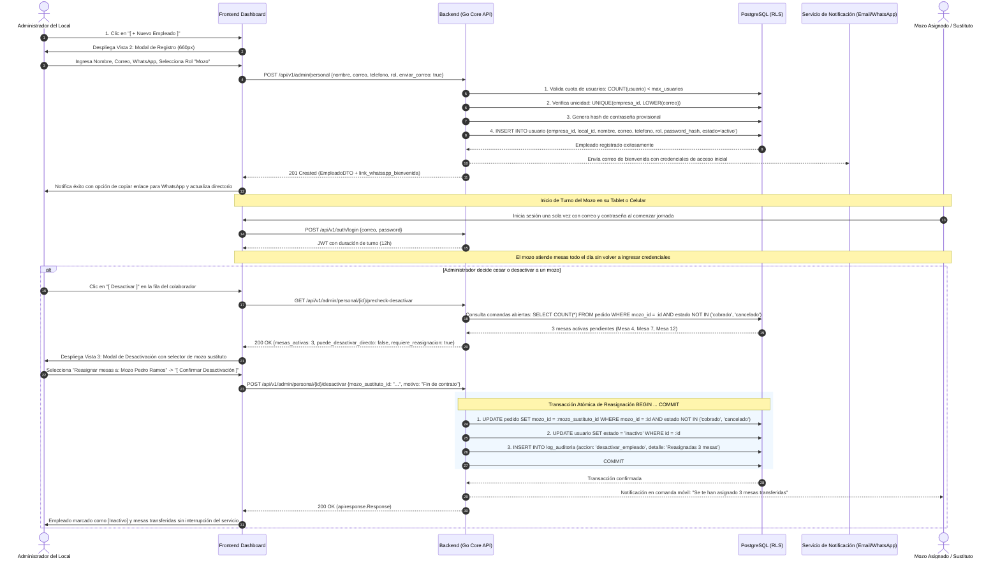
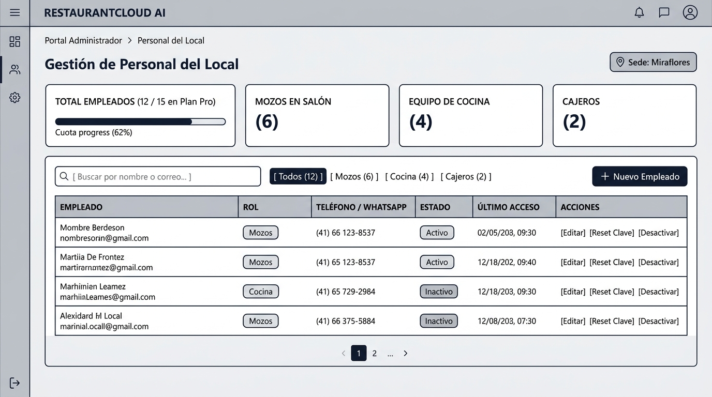
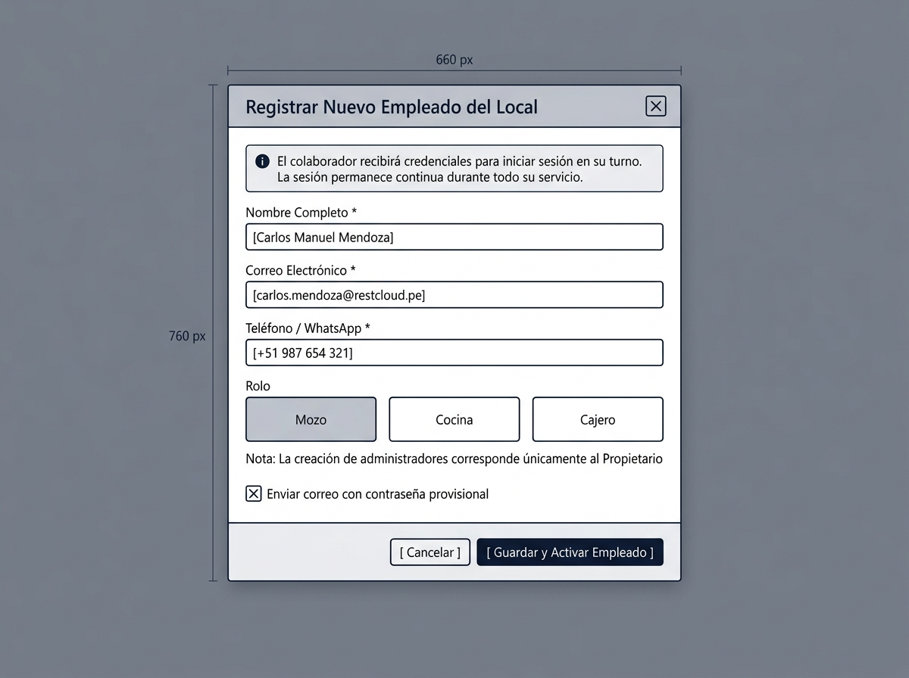
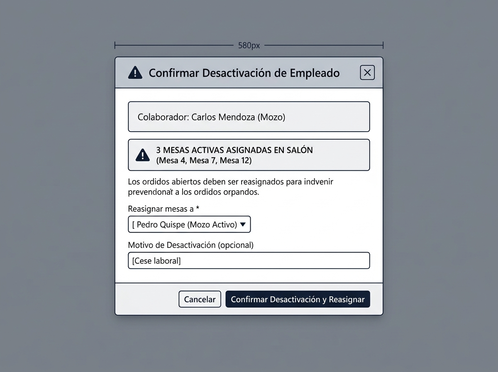
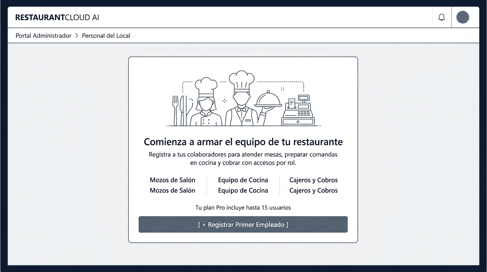
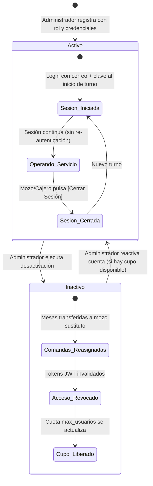

# CU-ADMIN-08: Gestionar Personal del Local

Especificación técnica de interfaz de usuario, arquitectura de información, control de acceso basado en roles (RBAC), ciclo de vida del colaborador, salvaguarda de reasignación de mesas activas, control de cuotas SaaS y contratos de API Go en **RestaurantCloud AI**.

---

## 1. Ficha Técnica del Caso de Uso

| Atributo | Detalle |
| :--- | :--- |
| **Código CU** | `CU-ADMIN-08` |
| **Nombre** | Gestionar personal del local |
| **Actor(es)** | `administrador_local` (responsable operativo del equipo de la sede) |
| **Dispositivo / Viewport** | Responsive Desktop (`1440x900`), Tablet (`768x1024`), Mobile (`375x812`) |
| **Precondición** | La sede está activa (`CU-PROP-04`); el administrador cuenta con sesión activa; la empresa dispone de cupos de usuario en su plan SaaS (`COUNT(usuario) < plan.max_usuarios`). |
| **Postcondición** | Colaborador registrado o actualizado con rol específico (`mozo`, `cocina`, `cajero`, `admin_local`); credenciales de acceso inicial despachadas por email y enlace WhatsApp; sesión continua habilitada por turno; desactivación segura con reasignación atómica de comandas abiertas y log de auditoría (`CU-ADMIN-15`). |

---

## 2. Diagrama de Flujo y Secuencia



---

## 3. Especificación de Pantallas y Wireframes Blueprint

### Vista 1: Directorio y Listado de Personal (`wf_admin_08_directorio_personal.jpg`)



#### Layout Estructural ASCII (Desktop 1440x900)
```text
+----------------------------------------------------------------------------------------------------+
| RESTAURANTCLOUD AI   | Portal Administrador > Personal del Local                  [ Sede: Miraflores ]
+----------------------------------------------------------------------------------------------------+
|                                                                                                    |
| Gestión de Personal del Local                                                                      |
| Administra el equipo operativo de salón, cocina y caja con control de acceso por roles y cuota SaaS|
|----------------------------------------------------------------------------------------------------|
|                                                                                                    |
| +-----------------------+ +---------------------+ +---------------------+ +----------------------+ |
| | TOTAL EMPLEADOS       | | MOZOS EN SALÓN      | | EQUIPO DE COCINA    | | CAJEROS EN TURNO     | |
| | [ 12 / 15 en Plan Pro]| | [ 6 mozos ]         | | [ 4 cocineros ]     | | [ 2 cajeros ]        | |
| | [========..] 80% cuota| | 4 activos en turno  | | Pantalla KDS activa | | 1 caja abierta (T-1) | |
| +-----------------------+ +---------------------+ +---------------------+ +----------------------+ |
|                                                                                                    |
| [ Buscar por nombre o correo... ]  [ Todos (12) ] [ Mozos (6) ] [ Cocina (4) ] [ Cajeros (2) ]  [ + Nuevo Empleado ]
|                                                                                                    |
| +------------------------------------------------------------------------------------------------+ |
| | EMPLEADO                 | ROL       | TELÉFONO / WHATSAPP | ESTADO    | ÚLTIMO ACCESO  | ACCIONES |
| |--------------------------+-----------+---------------------+-----------+----------------+----------|
| | Carlos Mendoza           | [ Mozo ]  | +51 987 112 233 [WA]| [Activo]  | Hoy 12:40 PM   | [E][R][D]|
| | carlos.mendoza@rest...   |           |                     |           |                |          |
| | Lucía Ramos              | [Cocina]  | +51 976 543 210 [WA]| [Activo]  | Hoy 11:15 AM   | [E][R][D]|
| | lucia.ramos@restcloud.pe |           |                     |           |                |          |
| | Raúl Torres              | [Cajero]  | +51 998 877 665 [WA]| [Activo]  | Hoy 08:30 AM   | [E][R][D]|
| | raul.torres@restcloud.pe |           |                     |           |                |          |
| | Pedro Quispe             | [ Mozo ]  | +51 912 345 678 [WA]| [Activo]  | Ayer 10:15 PM  | [E][R][D]|
| | pedro.quispe@rest...     |           |                     |           |                |          |
| | Jorge Campos             | [ Mozo ]  | +51 933 221 144 [WA]| [Inactivo]| Hace 5 días    | [Editar] |
| | jorge.campos@rest...     |           |                     |           |                | [Activar]|
| +------------------------------------------------------------------------------------------------+ |
| Mostrando 5 de 12 empleados  | Paginación: < 1 de 2 >        Tip: [R] Resetear clave | [D] Desactivar     |
+----------------------------------------------------------------------------------------------------+
```

#### Elementos Clave de la Interfaz:
1. **Medidor Visual de Cuota SaaS:** Tarjeta KPI con barra de progreso que alerta al administrador cuántos cupos de usuarios le restan respecto a su suscripción (`CU-PROP-02`).
2. **Acceso Directo WhatsApp:** Cada número telefónico cuenta con enlace `wa.me/51...` para coordinaciones operativas directas o envío de accesos.
3. **Filtros por Rol Operativo:** Pestañas segmentadas para revisar específicamente la dotación de Mozos, Cocineros o Cajeros.
4. **Acciones Inmediatas:** Modificar datos (`[Editar]`), enviar nueva contraseña provisional (`[Reset Clave]`) o suspender acceso con control de seguridad (`[Desactivar]`).

---

### Vista 2: Formulario / Modal de Registro y Edición de Empleado (`wf_admin_08_registro_empleado_modal.jpg`)



#### Especificación Funcional de Formulario (660px)
```text
+--------------------------------------------------------------------+
| Registrar Nuevo Empleado del Local                             [X] |
+--------------------------------------------------------------------+
|                                                                    |
|  (i) El colaborador recibirá sus credenciales para iniciar sesión   |
|      en su turno. La sesión permanece continua durante el servicio.|
|                                                                    |
|  Nombre Completo *                                                 |
|  [ Carlos Manuel Mendoza Quispe                                  ] |
|                                                                    |
|  Correo Electrónico (Identificador de Acceso) *                    |
|  [ carlos.mendoza@restcloud.pe                                   ] |
|                                                                    |
|  Teléfono Celular / WhatsApp *                                     |
|  [ +51 987 654 321                                               ] |
|                                                                    |
|  Rol en el Local *                                                 |
|  +--------------------+ +--------------------+ +-----------------+ |
|  | [x] Mozo           | | [ ] Cocina         | | [ ] Cajero      | |
|  | Comandas y mesas   | | Monitor KDS        | | Cobros y caja   | |
|  +--------------------+ +--------------------+ +-----------------+ |
|                                                                    |
|  Nota: La creación de administradores corresponde únicamente al    |
|        Propietario de la empresa (CU-PROP-04).                     |
|                                                                    |
|  [x] Enviar correo con contraseña provisional generada             |
|                                                                    |
|  [ Cancelar ]                        [ Guardar y Activar Empleado ]|
+--------------------------------------------------------------------+
```

#### Reglas de Validación:
- `Nombre Completo`: Mínimo 3 caracteres, obligatorio.
- `Correo Electrónico`: Formato email válido, validación de unicidad en la empresa (`UNIQUE(empresa_id, LOWER(correo))`).
- `Teléfono / WhatsApp`: Obligatorio (validación de número peruano 9 dígitos).
- `Rol`: Selección excluyente de una sola tarjeta operativa (`mozo`, `cocina`, `cajero`). **El rol `admin_local` está estrictamente restringido al Propietario (`CU-PROP-04`)** y su envío es rechazado con `403 Forbidden`.
- Al guardar, el backend autogenera una contraseña criptográfica provisional (ej. `Rest@9482`) y despacha la bienvenida.

---

### Vista 3: Modal de Seguridad y Reasignación al Desactivar Empleado (`wf_admin_08_desactivar_empleado_modal.jpg`)



#### Submodal de Seguridad Operativa (580px)
```text
+--------------------------------------------------------------------+
| ⚠️ Confirmar Desactivación de Empleado                         [X] |
+--------------------------------------------------------------------+
|                                                                    |
|  Colaborador: Carlos Mendoza (Mozo de Salón)                       |
|  Estado actual: Activo | Correo: carlos.mendoza@restcloud.pe       |
|                                                                    |
|  +---------------------------------------------------------------+ |
|  | ⚠️ 3 MESAS ACTIVAS ASIGNADAS EN SALÓN (Mesa 4, Mesa 7, Mesa 12)| |
|  +---------------------------------------------------------------+ |
|  Los pedidos abiertos deben ser reasignados para prevenir pedidos  |
|  huérfanos y evitar interrupciones en el servicio a los clientes. |
|                                                                    |
|  Reasignar mesas y comandas a *                                    |
|  [ Pedro Quispe (Mozo Activo en Turno)                         ▼ ] |
|                                                                    |
|  Motivo de Desactivación (opcional)                                |
|  [ Cese laboral / Fin de temporada                             ] |
|                                                                    |
|  [ Cancelar ]                 [ Confirmar Desactivación y Reasignar]|
+--------------------------------------------------------------------+
```

#### Salvaguardas Implementadas:
1. **Detección Dinámica de Pendientes (`Precheck`):**
   - Si el empleado es **Mozo** y tiene comandas abiertas $\rightarrow$ El botón de confirmación permanece deshabilitado hasta que se seleccione un mozo receptor.
   - Si el empleado es **Cajero** con caja abierta $\rightarrow$ El sistema bloquea el modal indicando: *"El cajero tiene la caja del Turno 1 abierta. Realice el cierre y supervisión en CU-ADMIN-14 antes de desactivar."*
2. **Reasignación Atómica:** Se ejecuta en una única transacción de base de datos junto con la actualización a `estado = 'inactivo'`.

---

### Vista 4: Estado Inicial - Sin Personal Registrado (`wf_admin_08_onboarding_vacio.jpg`)



#### Pantalla Guía para Sede Nueva
- Orientación didáctica al administrador sobre cómo estructurar el equipo de su sede en sus 3 frentes principales:
  - **Mozos de Salón:** Para toma ágil de comandas en mesas y reservas.
  - **Equipo de Cocina:** Para visualización de comandas en tiempo real en la pantalla KDS.
  - **Cajeros y Cobros:** Para apertura de turno, cobranza y emisión de comprobantes.
- Recordatorio del plan contratado: *"Tu plan Pro incluye hasta 15 usuarios activos simultáneos."*
- Botón principal: `[ + Registrar Primer Empleado ]`.

---

## 4. Matriz de Roles y Ciclo de Vida del Colaborador

### 4.1. Matriz de Roles y Permisos (RBAC)

| Módulo del Sistema | Mozo (`mozo`) | Cocina (`cocina`) | Cajero (`cajero`) | Admin Local (`admin_local`) |
| :--- | :---: | :---: | :---: | :---: |
| **Plano de Mesas y Estado** (`CU-MOZO-01`) | Lectura / Uso | — | Solo lectura | Total (`CU-ADMIN-01`) |
| **Comanda Móvil / Toma Pedido** (`CU-MOZO-02`) | Total | — | — | Total |
| **Monitor Cocina KDS** (`CU-COCINA-01`) | — | Total | — | Solo lectura |
| **Quiebres de Carta** (`CU-COCINA-04`) | Solo lectura | Actualización | — | Total (`CU-ADMIN-04`) |
| **Apertura y Cierre de Caja** (`CU-CAJA-01`) | — | — | Total | Supervisión (`CU-ADMIN-14`) |
| **Cobros y Facturación** (`CU-CAJA-03`) | — | — | Total | Total |
| **Gestión de Personal** (`CU-ADMIN-08`) | — | — | — | Total |
| **Compras e Inventario** (`CU-ADMIN-03, 06`) | — | — | — | Total |

### 4.2. Ciclo de Vida del Empleado



---

## 5. Contratos de API Backend en Go

Todos los endpoints respetan el estándar corporativo `pkg/apiresponse.Response` y aplican aislamiento multi-tenant mediante Row-Level Security (RLS) en PostgreSQL.

### 5.1. DTOs de Request y Response (`internal/domain/personal/dto.go`)

```go
package personal

import (
	"time"

	"github.com/google/uuid"
)

// RegistrarEmpleadoRequestDTO payload para registrar un nuevo colaborador operativo
type RegistrarEmpleadoRequestDTO struct {
	Nombre           string  `json:"nombre" validate:"required,min=3,max=100"`
	Correo           string  `json:"correo" validate:"required,email"`
	Telefono         string  `json:"telefono" validate:"required,max=20"`
	Rol              string  `json:"rol" validate:"required,oneof=mozo cocina cajero"` // admin_local restringido al propietario
	EnviarBienvenida bool    `json:"enviar_bienvenida"`                                 // Envía email con contraseña provisional
}

// ActualizarEmpleadoRequestDTO payload para editar datos de un colaborador
type ActualizarEmpleadoRequestDTO struct {
	Nombre   string `json:"nombre" validate:"required,min=3,max=100"`
	Telefono string `json:"telefono" validate:"required,max=20"`
	Rol      string `json:"rol" validate:"required,oneof=mozo cocina cajero"` // admin_local restringido al propietario
}

// PrecheckDesactivacionDTO evaluación previa de pendientes antes de desactivar
type PrecheckDesactivacionDTO struct {
	UsuarioID              uuid.UUID `json:"usuario_id"`
	Nombre                 string    `json:"nombre"`
	Rol                    string    `json:"rol"`
	MesasActivasPendientes int       `json:"mesas_activas_pendientes"` // Solo si rol == 'mozo'
	CajaAbiertaPendiente   bool      `json:"caja_abierta_pendiente"`   // Solo si rol == 'cajero'
	PuedeDesactivarDirecto bool      `json:"puede_desactivar_directo"`
	RequiereReasignacion   bool      `json:"requiere_reasignacion"`
}

// DesactivarEmpleadoRequestDTO confirmación de baja con reasignación
type DesactivarEmpleadoRequestDTO struct {
	MozoSustitutoID *uuid.UUID `json:"mozo_sustituto_id,omitempty"` // Obligatorio si tiene mesas activas
	Motivo          *string    `json:"motivo,omitempty" validate:"omitempty,max=255"`
}

// EmpleadoResumenDTO resumen para la tabla de administración
type EmpleadoResumenDTO struct {
	ID          uuid.UUID  `json:"id"`
	Nombre      string     `json:"nombre"`
	Correo      string     `json:"correo"`
	Telefono    string     `json:"telefono"`
	Rol         string     `json:"rol"`
	Estado      string     `json:"estado"` // 'activo' | 'inactivo' | 'pendiente_activacion'
	UltimoLogin *time.Time `json:"ultimo_login,omitempty"`
	CreatedAt   time.Time  `json:"created_at"`
}

// EmpleadoDetalleDTO detalle completo devuelto tras el registro
type EmpleadoDetalleDTO struct {
	EmpleadoResumenDTO
	PasswordTemporal   *string `json:"password_temporal,omitempty"` // Solo visible en la creación
	EnlaceWhatsAppLink string  `json:"enlace_whatsapp_link"`
}

// MetricasPersonalDTO indicadores para las tarjetas KPI superiores
type MetricasPersonalDTO struct {
	TotalEmpleados   int `json:"total_empleados"`
	MaxUsuariosPlan  int `json:"max_usuarios_plan"`
	CuposDisponibles int `json:"cupos_disponibles"`
	MozosActivos     int `json:"mozos_activos"`
	CocinaActivos    int `json:"cocina_activos"`
	CajerosActivos   int `json:"cajeros_activos"`
}
```

---

### 5.2. Definición de Endpoints RESTful

| Método | Endpoint | Descripción | Códigos HTTP |
| :--- | :--- | :--- | :--- |
| `GET` | `/api/v1/admin/personal` | Listado histórico con filtros de rol, estado y búsqueda. | `200 OK`, `401 Unauthorized` |
| `GET` | `/api/v1/admin/personal/metricas` | Tarjetas KPI de consumo de cuota SaaS y personal en turno. | `200 OK`, `401 Unauthorized` |
| `POST` | `/api/v1/admin/personal` | Registra colaborador operativo validando cuota SaaS (`max_usuarios`). Rechaza intento de crear administradores. | `201 Created`, `400 Bad Request`, `403 Forbidden`, `409 Conflict` |
| `GET` | `/api/v1/admin/personal/{id}` | Detalle exhaustivo del colaborador. | `200 OK`, `404 Not Found` |
| `PUT` | `/api/v1/admin/personal/{id}` | Modifica nombre, teléfono o rol operativo del colaborador. | `200 OK`, `400 Bad Request`, `403 Forbidden` |
| `GET` | `/api/v1/admin/personal/{id}/precheck-desactivar` | Evalúa si tiene mesas activas (mozo) o turno abierto (cajero). | `200 OK`, `404 Not Found` |
| `POST` | `/api/v1/admin/personal/{id}/desactivar` | Desactiva colaborador y reasigna mesas activas de forma atómica. | `200 OK`, `400 Bad Request`, `409 Conflict` |
| `POST` | `/api/v1/admin/personal/{id}/reactivar` | Reactiva el acceso verificando disponibilidad de cupo en el plan. | `200 OK`, `409 Conflict` |
| `POST` | `/api/v1/admin/personal/{id}/reset-password` | Genera una nueva contraseña provisional y enlace para WhatsApp. | `200 OK`, `400 Bad Request` |

---

### 5.3. Ejemplos de Respuestas HTTP con `apiresponse.Response`

#### Ejemplo 1: `POST /api/v1/admin/personal` (Registro Exitoso de Mozo)
```json
{
  "success": true,
  "data": {
    "id": "e3a1b2c4-8888-4000-8000-000000000001",
    "nombre": "Carlos Manuel Mendoza Quispe",
    "correo": "carlos.mendoza@restcloud.pe",
    "telefono": "+51987654321",
    "rol": "mozo",
    "estado": "activo",
    "ultimo_login": null,
    "created_at": "2026-10-08T16:30:00Z",
    "password_temporal": "Rest@8492",
    "enlace_whatsapp_link": "https://wa.me/51987654321?text=Hola%20Carlos,%20bienvenido%20a%20RestaurantCloud%20AI.%20Tu%20usuario%20es:%20carlos.mendoza@restcloud.pe%20y%20tu%20clave%20inicial:%20Rest@8492"
  },
  "error": null
}
```

#### Ejemplo 2: `GET /api/v1/admin/personal/{id}/precheck-desactivar` (Diagnóstico de Comandas)
```json
{
  "success": true,
  "data": {
    "usuario_id": "e3a1b2c4-8888-4000-8000-000000000001",
    "nombre": "Carlos Manuel Mendoza Quispe",
    "rol": "mozo",
    "mesas_activas_pendientes": 3,
    "caja_abierta_pendiente": false,
    "puede_desactivar_directo": false,
    "requiere_reasignacion": true
  },
  "error": null
}
```

#### Ejemplo 3: `POST /api/v1/admin/personal/{id}/desactivar` (Reasignación Exitosa)
```json
{
  "success": true,
  "data": {
    "usuario_id": "e3a1b2c4-8888-4000-8000-000000000001",
    "estado": "inactivo",
    "mesas_reasignadas": 3,
    "mozo_sustituto_id": "e3a1b2c4-9999-4000-8000-000000000002",
    "mozo_sustituto_nombre": "Pedro Quispe",
    "mensaje": "El mozo ha sido desactivado y sus 3 mesas activas fueron transferidas exitosamente a Pedro Quispe."
  },
  "error": null
}
```

---

## 6. Esquema Relacional de Base de Datos (`PostgreSQL 16`)

```sql
-- 1. Ampliación de la tabla usuario para soporte operativo y auditoría
ALTER TABLE usuario 
    ADD COLUMN IF NOT EXISTS telefono VARCHAR(20),
    ADD COLUMN IF NOT EXISTS ultimo_login TIMESTAMP;

CREATE INDEX IF NOT EXISTS idx_usuario_local_rol ON usuario (local_id, rol);
CREATE INDEX IF NOT EXISTS idx_usuario_estado ON usuario (local_id, estado);

-- 2. Procedimiento Transaccional de Desactivación con Salvaguarda de Comandas
DO $$
DECLARE
    v_usuario_id UUID := 'e3a1b2c4-8888-4000-8000-000000000001';
    v_mozo_sustituto_id UUID := 'e3a1b2c4-9999-4000-8000-000000000002';
    v_motivo TEXT := 'Cese laboral';
    v_admin_id UUID := 'a1b2c3d4-e5f6-4a5b-8c9d-0e1f2a3b4c5d';
    v_rol TEXT;
    v_mesas_activas INT;
BEGIN
    -- Obtener rol del colaborador
    SELECT rol INTO v_rol FROM usuario WHERE id = v_usuario_id;

    -- Si es mozo, verificar y transferir mesas abiertas
    IF v_rol = 'mozo' THEN
        SELECT COUNT(*) INTO v_mesas_activas 
        FROM pedido 
        WHERE mozo_id = v_usuario_id AND estado NOT IN ('cobrado', 'cancelado');

        IF v_mesas_activas > 0 THEN
            IF v_mozo_sustituto_id IS NULL THEN
                RAISE EXCEPTION 'ERR_REASIGNACION_REQUERIDA: El mozo tiene % mesas activas y requiere un sustituto', v_mesas_activas;
            END IF;

            -- Transferencia atómica de mesas activas
            UPDATE pedido
            SET mozo_id = v_mozo_sustituto_id
            WHERE mozo_id = v_usuario_id AND estado NOT IN ('cobrado', 'cancelado');
        END IF;
    END IF;

    -- Desactivar usuario
    UPDATE usuario
    SET estado = 'inactivo'
    WHERE id = v_usuario_id;

    -- Registrar evento en log de auditoría
    INSERT INTO log_auditoria (local_id, usuario_id, accion, entidad, entidad_id, detalle)
    VALUES (
        (SELECT local_id FROM usuario WHERE id = v_usuario_id),
        v_admin_id,
        'desactivar_empleado',
        'usuario',
        v_usuario_id,
        json_build_object(
            'motivo', v_motivo,
            'mesas_reasignadas', v_mesas_activas,
            'mozo_sustituto_id', v_mozo_sustituto_id,
            'fecha', NOW()
        )
    );
END $$;
```

---

## 7. Verificación de Accesibilidad (WCAG 2.1 AA)

- **Contraste de Colores:** Texto principal `#0F172A` sobre fondos blancos `#FFFFFF` (ratio 16.2:1); texto secundario `#64748B` sobre `#F8FAFC` (ratio 4.8:1); badges `#0F172A` con bordes nítidos.
- **Formularios Semánticos:** Etiquetas `<label>` asociadas con `id` / `for`; mensajes de error con `aria-live="polite"`.
- **Selector de Roles:** Tarjetas accesibles con soporte completo de navegación por flechas de teclado y `role="radiogroup"`.
- **Atrapamiento de Foco:** Modales atrapan el foco del teclado y permiten cancelación con la tecla `Escape`.
