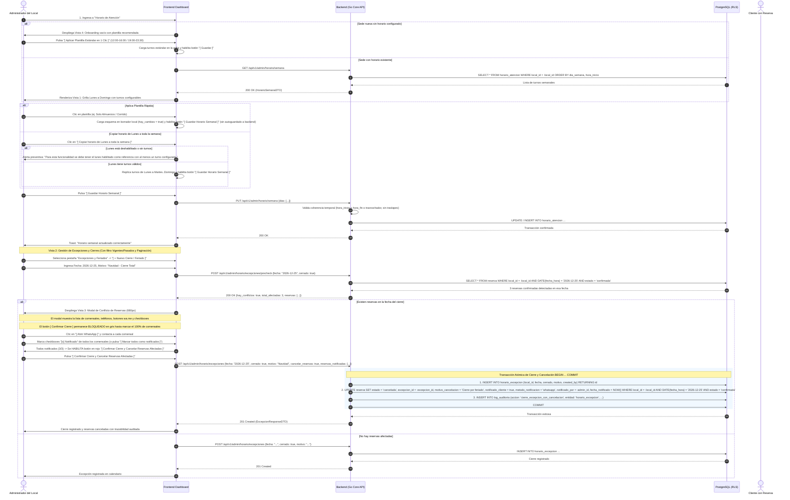
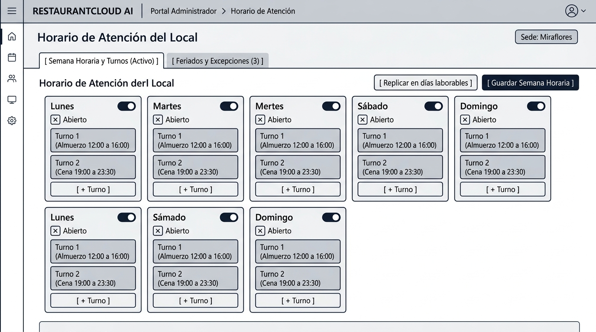
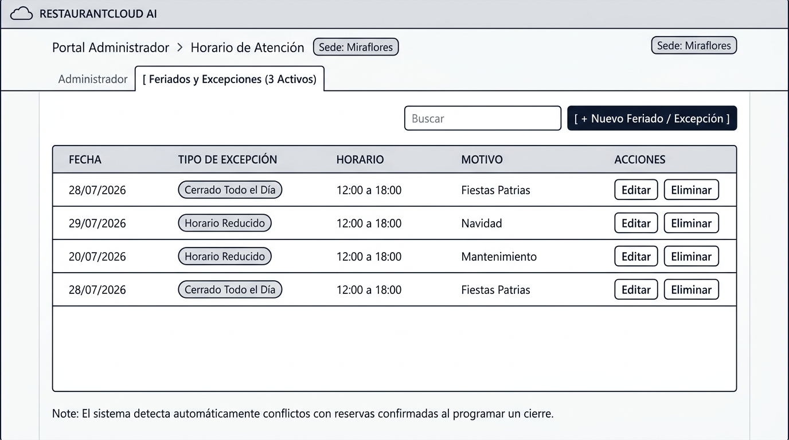
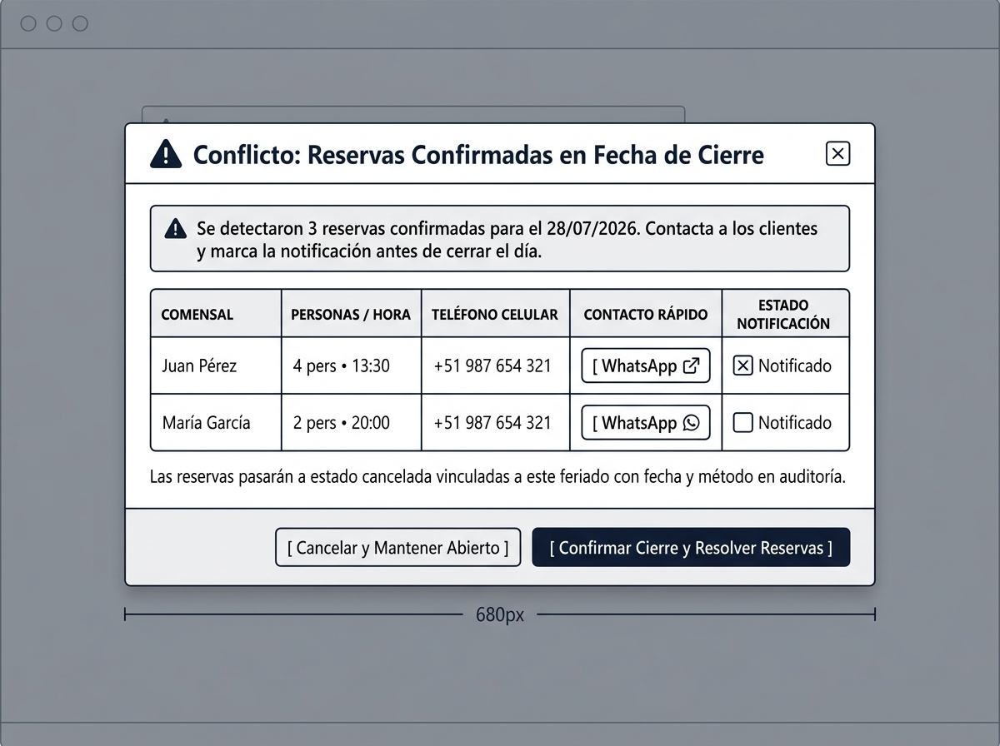
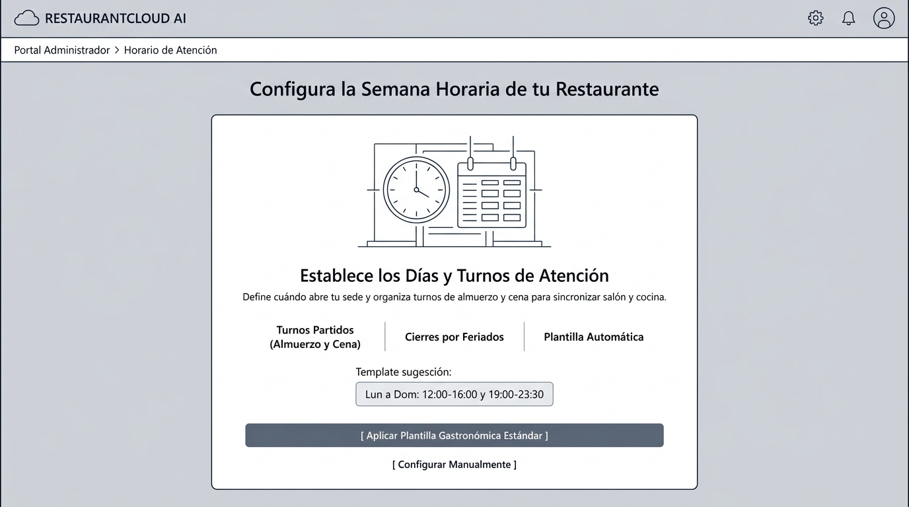

# CU-ADMIN-09: Configurar Horario de Atención y Feriados del Local

Especificación técnica de interfaz de usuario, arquitectura de información, control de acceso basado en roles (RBAC), gestión de turnos partidos, detección y resolución asistida de conflictos con reservas (WhatsApp `wa.me` y telefonía), y contratos de API Go en **RestaurantCloud AI**.

---

## 1. Ficha Técnica del Caso de Uso

| Atributo | Detalle |
| :--- | :--- |
| **Código CU** | `CU-ADMIN-09` |
| **Nombre** | Configurar horario de atención y feriados del local |
| **Actor(es)** | `administrador_local` (responsable operativo de la sede), `propietario` (supervisión multi-sede) |
| **Dispositivo / Viewport** | Responsive Desktop (`1440x900`), Tablet (`768x1024`), Mobile (`375x812`) |
| **Precondición** | La sede está activa (`CU-PROP-04`); el usuario cuenta con sesión activa y rol autorizado sobre el local. |
| **Postcondición** | Horario semanal configurado en `horario_atencion` con soporte para mono-turno o turnos partidos (ej. Almuerzo y Cena); excepciones y feriados registrados en `horario_excepcion`; resolución asistida de reservas afectadas con enlaces directos WhatsApp (`wa.me`), llamada telefónica, actualización transaccional en `reserva` y trazabilidad en `log_auditoria` (`CU-ADMIN-16`). Módulo desacoplado de las políticas y parámetros de reserva de mesas (`CU-ADMIN-10`). |

---

## 2. Diagrama de Flujo y Secuencia



---

## 3. Especificación de Pantallas y Wireframes Blueprint

### Vista 1: Configuración de Semana Horaria (`wf_admin_09_semana_horaria.jpg`)

Grilla semanal de operación continua de Lunes a Domingo. Cada día permite conmutar apertura o cierre semanal y soporta la configuración de uno o múltiples turnos diarios (ej. Turno 1: Almuerzo de 12:00 a 16:00, Turno 2: Cena de 19:00 a 23:30).



#### Layout Estructural ASCII (Desktop 1440x900)
```text
+----------------------------------------------------------------------------------------------------+
| RESTAURANTCLOUD AI   | Portal Administrador > Horario de Atención y Feriados      [ Sede: Miraflores ]
+----------------------------------------------------------------------------------------------------+
|                                                                                                    |
| Horario de Atención y Feriados                     [ 🕒 68.5 hrs / semana ]                         |
| Configura los días y turnos de atención al público, feriados oficiales y cierres con reservas.     |
|                                                                                                    |
| [ 🕒 SEMANA REGULAR (Activo) ]    [ 📅 EXCEPCIONES Y FERIADOS (5) ]                                |
|----------------------------------------------------------------------------------------------------|
|                                                                                                    |
| +------------------------------------------------------------------------------------------------+ |
| | ✨ Plantillas Operativas Rápidas:  [ 🍽️ Estándar ] [ ☀️ Solo Almuerzos ] [ ⚡ Corrido Continuo ]| |
| | (Aplica esquemas en borrador local; pulsa 'Guardar Horario Semanal' para confirmar)            | |
| +------------------------------------------------------------------------------------------------+ |
|                                                                                                    |
| +------------------------------------------------------------------------------------------------+ |
| | DIA DE LA SEMANA | ESTADO      | TURNOS CONFIGURADOS                          | ACCIONES       | |
| |------------------+-------------+----------------------------------------------+----------------| |
| | Lunes            | (o) Abierto | Turno 1 (Almuerzo): 12:00 - 16:00            | [+ Turno] [x]  | |
| |                  |             | Turno 2 (Cena):     19:00 - 23:30            |                | |
| | Martes           | (o) Abierto | Turno 1 (Almuerzo): 12:00 - 16:00            | [+ Turno] [x]  | |
| |                  |             | Turno 2 (Cena):     19:00 - 23:30            |                | |
| | Miércoles        | (o) Abierto | Turno 1 (Almuerzo): 12:00 - 16:00            | [+ Turno] [x]  | |
| |                  |             | Turno 2 (Cena):     19:00 - 23:30            |                | |
| | Jueves           | (o) Abierto | Turno 1 (Almuerzo): 12:00 - 16:00            | [+ Turno] [x]  | |
| |                  |             | Turno 2 (Cena):     19:00 - 23:30            |                | |
| | Viernes          | (o) Abierto | Turno 1 (Almuerzo): 12:00 - 16:00            | [+ Turno] [x]  | |
| |                  |             | Turno 2 (Cena):     19:00 - 00:30 [🌙+1 día] |                | |
| | Sábado           | (o) Abierto | Turno 1 (Continuo): 12:00 - 00:30 [🌙+1 día] | [+ Turno] [x]  | |
| | Domingo          | (o) Abierto | Turno 1 (Almuerzo): 12:00 - 18:00            | [+ Turno] [x]  | |
| +------------------------------------------------------------------------------------------------+ |
|                                                                                                    |
| [ Copiar horario de Lunes a toda la semana ]*       [ Descartar ]  [ Guardar Horario Semanal ]     |
| * Requiere Lunes habilitado con turnos; si está cerrado emite alerta preventiva y no copia.        |
|                                                                                                    |
+----------------------------------------------------------------------------------------------------+
```

---

### Vista 2: Calendario y Directorio de Excepciones y Feriados (`wf_admin_09_excepciones_calendario.jpg`)

Gestor anual de fechas especiales, feriados oficiales peruanos y cierres extraordinarios (mantenimiento, inventario o eventos privados) con desglose de impacto operativo, filtro de vigencia temporal y paginación responsive.



#### Layout Estructural ASCII (Desktop 1440x900)
```text
+----------------------------------------------------------------------------------------------------+
| RESTAURANTCLOUD AI   | Portal Administrador > Excepciones y Feriados              [ Sede: Miraflores ]
+----------------------------------------------------------------------------------------------------+
|                                                                                                    |
| Horario de Atención y Feriados del Local                                                           |
| Define fechas específicas donde el local permanecerá cerrado o atenderá en horario especial.      |
|                                                                                                    |
| [ 🕒 SEMANA REGULAR ]    [ 📅 EXCEPCIONES Y FERIADOS (Activo) (5) ]                                |
|----------------------------------------------------------------------------------------------------|
|                                                                                                    |
| [ Todos (5) ] [ 🟢 Vigentes / Próximos (4) ] [ ⏳ Pasados / Históricos (1) ]                        |
|                                                     [ 🔍 Buscar fecha/motivo... ] [+ Nuevo Cierre] |
|                                                                                                    |
| +------------------------------------------------------------------------------------------------+ |
| | FECHA       | ESTADO    | TIPO DE EXCEPCIÓN | MOTIVO / DESCRIPCIÓN  | HORARIO     | ACCIONES   | |
| |-------------+-----------+-------------------+-----------------------+-------------+------------| |
| | 28/07/2026  | [Vigente] | [ Cierre Total ]  | Fiestas Patrias       | Cerrado     | [Eliminar] | |
| | 29/07/2026  | [Vigente] | [ Horario Especial| Fiestas Patrias D2    | 12:00-17:00 | [Eliminar] | |
| | 01/11/2026  | [Vigente] | [ Cierre Total ]  | Día de Todos Santos   | Cerrado     | [Eliminar] | |
| | 25/12/2026  | [Vigente] | [ Cierre Total ]  | Navidad               | Cerrado (3r)| [Eliminar] | |
| | 01/01/2027  | [Vigente] | [ Cierre Total ]  | Año Nuevo             | Cerrado     | [Eliminar] | |
| +------------------------------------------------------------------------------------------------+ |
|                                                                                                    |
| Mostrando 1 a 5 de 5 excepciones                    [ < Anterior ]  [ 1 ]  [ Siguiente > ]         |
|                                                                                                    |
+----------------------------------------------------------------------------------------------------+
```

---

### Vista 3: Modal de Resolución de Conflicto con Reservas (`wf_admin_09_conflicto_reservas_modal.jpg`)

Modal asistido de 680px que se dispara automáticamente cuando un cierre coincide con reservas de salón previamente confirmadas (`CU-MOZO-05`). Requiere confirmación estricta al 100% de comensales contactados antes de habilitar el botón de confirmación definitiva.



#### Layout Estructural ASCII (Modal 680px)
```text
+------------------------------------------------------------------------+
|  ADVERTENCIA DE IMPACTO: 3 RESERVAS AFECTADAS                          |
|  Cierre programado para el 25/12/2026 (Navidad)                        |
+------------------------------------------------------------------------+
|                                                                        |
|  Se detectaron 3 reservas confirmadas (12 PAX). Para evitar reclamos,  |
|  contacta a los comensales directamente vía WhatsApp o llamada:        |
|                                                                        |
|  Comensales Programados (2/3 contactados)   [ Marcar todos notificados]|
|  +------------------------------------------------------------------+  |
|  | CLIENTE       | HORA     | PAX | CONTACTO / ACCIONES             |  |
|  |---------------+----------+-----+---------------------------------|  |
|  | María Flores  | 13:30    |  4  | Tel: 987 654 321 | Mesa 04      |  |
|  |               |          |     | [ Abrir WhatsApp (wa.me) ]      |  |
|  |               |          |     | [x] Notificado                  |  |
|  |---------------+----------+-----+---------------------------------|  |
|  | Jorge Ramos   | 14:00    |  6  | Tel: 912 345 678 | Mesa 08      |  |
|  |               |          |     | [ Abrir WhatsApp (wa.me) ]      |  |
|  |               |          |     | [x] Notificado                  |  |
|  |---------------+----------+-----+---------------------------------|  |
|  | Ana Castillo  | 20:30    |  2  | Tel: 998 877 665 | Mesa 02      |  |
|  |               |          |     | [ Abrir WhatsApp (wa.me) ]      |  |
|  |               |          |     | [ ] Marcar notificado           |  |
|  +------------------------------------------------------------------+  |
|                                                                        |
|  Al confirmar, las reservas pasarán automáticamente a estado cancelada.|
|                                                                        |
|  [!] Debes contactar y marcar a todos los comensales (2/3) para cerrar.|
|                                                                        |
|  [ Cancelar Operación ]        [ Confirmar Cierre y Cancelar (Bloqueado)]
+------------------------------------------------------------------------+
```

---

### Vista 4: Estado Vacío y Onboarding con Plantilla (`wf_admin_09_onboarding_vacio.jpg`)

Pantalla de bienvenida y aceleración para sedes recién creadas que no tienen turnos de atención asignados.



#### Layout Estructural ASCII (Desktop 1440x900)
```text
+----------------------------------------------------------------------------------------------------+
| RESTAURANTCLOUD AI   | Portal Administrador > Horario de Atención                 [ Sede: Miraflores ]
+----------------------------------------------------------------------------------------------------+
|                                                                                                    |
|                                     [ ICONO CALENDARIO / RELOJ ]                                   |
|                                                                                                    |
|                                    Aún no configuras tu horario                                    |
|                      Define los turnos de apertura para que tu salón y comandas                     |
|                               puedan operar de forma ordenada y puntual.                           |
|                                                                                                    |
|       +------------------------------------------------------------------------------------+       |
|       | [ RECOMENDADO: PLANTILLA RESTAURANTE ESTÁNDAR ]                                    |       |
|       | Configura automáticamente de Lunes a Domingo:                                      |       |
|       | - Almuerzo: 12:00 PM a 04:00 PM                                                    |       |
|       | - Cena:     07:00 PM a 11:30 PM                                                    |       |
|       |                                                                                    |       |
|       | [ Aplicar Plantilla Estándar en 1 Clic ]                                           |       |
|       +------------------------------------------------------------------------------------+       |
|                                                                                                    |
|                                                 - o -                                              |
|                                                                                                    |
|                               [ Configurar Turnos Manualmente desde Cero ]                         |
|                                                                                                    |
+----------------------------------------------------------------------------------------------------+
```

---

## 4. Matriz de Control de Acceso (RBAC)

| Rol | Ver Horario Semanal | Editar Horario Semanal | Crear / Eliminar Feriado | Cancelar Reservas por Conflicto |
| :--- | :---: | :---: | :---: | :---: |
| **Propietario** | Sí | Sí (Cualquier sede) | Sí | Sí |
| **Administrador Local** | Sí (Su sede) | Sí (Su sede) | Sí (Su sede) | Sí (Su sede) |
| **Cajero** | Solo Lectura | No | No | No |
| **Mozo** | Solo Lectura | No | No | No |
| **Cocinero** | Solo Lectura | No | No | No |

---

## 5. Contratos de API Go (DTOs y Endpoints REST)

### 5.1 Estructuras de Datos (`internal/domain/horario/dto.go`)

```go
package horario

import (
	"time"

	"github.com/google/uuid"
)

// TurnoHorarioDTO representa un bloque o turno de atención dentro de un día
type TurnoHorarioDTO struct {
	ID          *uuid.UUID `json:"id,omitempty"`
	NombreTurno string     `json:"nombre_turno" binding:"required,max=50"` // ej. "Almuerzo", "Cena"
	HoraInicio  string     `json:"hora_inicio" binding:"required"`          // Formato "HH:MM", ej. "12:00"
	HoraFin     string     `json:"hora_fin" binding:"required"`             // Formato "HH:MM", ej. "16:00"
}

// DiaHorarioDTO define la programación de un día de la semana (1=Lunes .. 7=Domingo)
type DiaHorarioDTO struct {
	DiaSemana int               `json:"dia_semana" binding:"required,min=1,max=7"` // 1: Lunes, 7: Domingo
	NombreDia string            `json:"nombre_dia"`                                // "Lunes", "Martes", etc.
	Atiende   bool              `json:"atiende"`
	Turnos    []TurnoHorarioDTO `json:"turnos"`
}

// ConfigSemanaHorariaRequest payload para actualizar toda la grilla semanal
type ConfigSemanaHorariaRequest struct {
	Dias []DiaHorarioDTO `json:"dias" binding:"required,len=7"`
}

// HorarioSemanaResponse respuesta del horario semanal
type HorarioSemanaResponse struct {
	LocalID uuid.UUID       `json:"local_id"`
	Dias    []DiaHorarioDTO `json:"dias"`
}

// AplicarPlantillaRequest solicita cargar una plantilla predefinida
type AplicarPlantillaRequest struct {
	Plantilla string `json:"plantilla" binding:"required,oneof=restaurante_estandar solo_almuerzo corrido_continuo"`
}

// ExcepcionHorarioDTO representa un feriado o cierre extraordinario
type ExcepcionHorarioDTO struct {
	ID         uuid.UUID  `json:"id"`
	LocalID    uuid.UUID  `json:"local_id"`
	Fecha      string     `json:"fecha"` // "YYYY-MM-DD"
	Cerrado    bool       `json:"cerrado"`
	HoraInicio *string    `json:"hora_inicio,omitempty"` // Formato "HH:MM"
	HoraFin    *string    `json:"hora_fin,omitempty"`
	Motivo     string     `json:"motivo"`
	CreatedAt  time.Time  `json:"created_at"`
	CreatedBy  uuid.UUID  `json:"created_by"`
}

// PrecheckExcepcionRequest verifica si hay reservas afectadas antes de guardar
type PrecheckExcepcionRequest struct {
	Fecha      string  `json:"fecha" binding:"required"` // "YYYY-MM-DD"
	Cerrado    bool    `json:"cerrado"`
	HoraInicio *string `json:"hora_inicio,omitempty"`
	HoraFin    *string `json:"hora_fin,omitempty"`
}

// ReservaConflictoDTO detalle de reserva afectada por un cierre o feriado
type ReservaConflictoDTO struct {
	ID              uuid.UUID `json:"id"`
	ClienteNombre   string    `json:"cliente_nombre"`
	ClienteTelefono string    `json:"cliente_telefono"`
	FechaHora       time.Time `json:"fecha_hora"`
	NumPersonas     int       `json:"num_personas"`
	MesasAsignadas  []string  `json:"mesas_asignadas"`
	LinkWhatsApp    string    `json:"link_whatsapp"` // Enlace wa.me con texto de cortesía pre-redactado
}

// PrecheckExcepcionResponse resultado de la verificación de impacto
type PrecheckExcepcionResponse struct {
	HayConflictos  bool                  `json:"hay_conflictos"`
	TotalAfectadas int                   `json:"total_afectadas"`
	Reservas       []ReservaConflictoDTO `json:"reservas"`
}

// NotificacionContactoDTO registro de contacto individual con el cliente
type NotificacionContactoDTO struct {
	ReservaID          uuid.UUID `json:"reserva_id" binding:"required"`
	Notificado         bool      `json:"notificado"`
	MetodoNotificacion string    `json:"metodo_notificacion" binding:"oneof=whatsapp llamada presencial ninguno"`
}

// ExcepcionesPaginadasResponse respuesta paginada con métricas de vigencia
type ExcepcionesPaginadasResponse struct {
	Total         int                   `json:"total"`
	Pagina        int                   `json:"pagina"`
	Limite        int                   `json:"limite"`
	TotalPaginas  int                   `json:"total_paginas"`
	VigentesCount int                   `json:"vigentes_count"`
	PasadosCount  int                   `json:"pasados_count"`
	Excepciones   []ExcepcionHorarioDTO `json:"excepciones"`
}

// CrearExcepcionRequest registra el cierre y procesa las cancelaciones correspondientes
type CrearExcepcionRequest struct {
	Fecha                string                    `json:"fecha" binding:"required"`
	Cerrado              bool                      `json:"cerrado"`
	HoraInicio           *string                   `json:"hora_inicio,omitempty"`
	HoraFin              *string                   `json:"hora_fin,omitempty"`
	Motivo               string                    `json:"motivo" binding:"required,min=3,max=150"`
	CancelarReservas     bool                      `json:"cancelar_reservas"`
	ReservasNotificadas  []NotificacionContactoDTO `json:"reservas_notificadas,omitempty"`
}
```

---

### 5.2 Catálogo de Endpoints REST

| Método | Endpoint | Descripción | Formato Respuesta |
| :--- | :--- | :--- | :--- |
| `GET` | `/api/v1/admin/horario/semana` | Obtiene el horario semanal completo por días y turnos | `apiresponse.Response{Data: HorarioSemanaResponse}` |
| `PUT` | `/api/v1/admin/horario/semana` | Guarda o actualiza los días y turnos de la semana | `apiresponse.Response{Data: HorarioSemanaResponse}` |
| `POST` | `/api/v1/admin/horario/plantilla` | Aplica una plantilla de horario estándar en 1 clic | `apiresponse.Response{Data: HorarioSemanaResponse}` |
| `GET` | `/api/v1/admin/horario/excepciones` | Lista feriados y cierres con filtro de vigencia (`filtro=todos\|vigentes\|pasados`), paginación (`pagina`, `limite`) y búsqueda | `apiresponse.Response{Data: ExcepcionesPaginadasResponse}` |
| `POST` | `/api/v1/admin/horario/excepciones/precheck` | Analiza reservas en conflicto antes de guardar | `apiresponse.Response{Data: PrecheckExcepcionResponse}` |
| `POST` | `/api/v1/admin/horario/excepciones` | Crea excepción y cancela reservas afectadas (requiere 100% comensales marcados si hay conflicto) | `apiresponse.Response{Data: ExcepcionHorarioDTO}` |
| `DELETE` | `/api/v1/admin/horario/excepciones/{id}` | Elimina una excepción o feriado programado | `apiresponse.Response{Data: nil}` |
| `POST` | `/api/v1/admin/horario/feriados-peru/cargar` | Importa automáticamente feriados oficiales del calendario peruano 2026 evitando duplicados | `apiresponse.Response{Data: map[string]int}` |

---

### 5.3 Ejemplos de Payloads JSON

#### Ejemplo 1: `PUT /api/v1/admin/horario/semana` (Actualización de Turnos)
```json
{
  "dias": [
    {
      "dia_semana": 1,
      "nombre_dia": "Lunes",
      "atiende": true,
      "turnos": [
        {
          "nombre_turno": "Almuerzo",
          "hora_inicio": "12:00",
          "hora_fin": "16:00"
        },
        {
          "nombre_turno": "Cena",
          "hora_inicio": "19:00",
          "hora_fin": "23:30"
        }
      ]
    },
    {
      "dia_semana": 7,
      "nombre_dia": "Domingo",
      "atiende": true,
      "turnos": [
        {
          "nombre_turno": "Continuo",
          "hora_inicio": "12:00",
          "hora_fin": "18:00"
        }
      ]
    }
  ]
}
```

#### Ejemplo 2: `POST /api/v1/admin/horario/excepciones/precheck` (Detección de Conflictos)
```json
// Solicitud:
{
  "fecha": "2026-12-25",
  "cerrado": true
}

// Respuesta:
{
  "success": true,
  "data": {
    "hay_conflictos": true,
    "total_afectadas": 1,
    "reservas": [
      {
        "id": "c1a2b3d4-7777-4000-8000-000000000001",
        "cliente_nombre": "María Flores",
        "cliente_telefono": "+51987654321",
        "fecha_hora": "2026-12-25T13:30:00Z",
        "num_personas": 4,
        "mesas_asignadas": ["Mesa 04"],
        "link_whatsapp": "https://wa.me/51987654321?text=Estimada%20Mar%C3%ADa%20Flores%2C%20le%20saludamos%20de%20RestaurantCloud.%20Lamentamos%20informarle%20que%20por%20cierre%20de%20Navidad%20su%20reserva%20para%20el%2025%2F12%20debe%20ser%20reprogramada."
      }
    ]
  },
  "error": null
}
```

---

## 6. Esquema Relacional de Base de Datos (`PostgreSQL 16`)

```sql
-- 1. Tabla de horario regular de atención semanal
CREATE TABLE IF NOT EXISTS horario_atencion (
    id UUID PRIMARY KEY DEFAULT gen_random_uuid(),
    local_id UUID NOT NULL REFERENCES local(id) ON DELETE CASCADE,
    dia_semana SMALLINT NOT NULL CHECK (dia_semana BETWEEN 1 AND 7), -- 1: Lunes, 7: Domingo
    nombre_turno VARCHAR(50) NOT NULL DEFAULT 'Principal',
    atiende BOOLEAN NOT NULL DEFAULT true,
    hora_inicio TIME NOT NULL,
    hora_fin TIME NOT NULL,
    created_at TIMESTAMP WITH TIME ZONE DEFAULT NOW(),
    updated_at TIMESTAMP WITH TIME ZONE DEFAULT NOW(),
    CONSTRAINT chk_horas_validas CHECK (hora_fin > hora_inicio OR hora_fin < hora_inicio), -- Soporte horario trasnochador
    CONSTRAINT uq_local_dia_inicio UNIQUE (local_id, dia_semana, hora_inicio)
);

CREATE INDEX IF NOT EXISTS idx_horario_local_dia ON horario_atencion (local_id, dia_semana);

-- 2. Tabla de excepciones y feriados del local
CREATE TABLE IF NOT EXISTS horario_excepcion (
    id UUID PRIMARY KEY DEFAULT gen_random_uuid(),
    local_id UUID NOT NULL REFERENCES local(id) ON DELETE CASCADE,
    fecha DATE NOT NULL,
    cerrado BOOLEAN NOT NULL DEFAULT true,
    hora_inicio TIME,
    hora_fin TIME,
    motivo VARCHAR(150) NOT NULL,
    created_by UUID REFERENCES usuario(id) ON DELETE SET NULL,
    created_at TIMESTAMP WITH TIME ZONE DEFAULT NOW(),
    CONSTRAINT uq_local_fecha_excepcion UNIQUE (local_id, fecha)
);

CREATE INDEX IF NOT EXISTS idx_excepcion_local_fecha ON horario_excepcion (local_id, fecha);

-- 3. Ampliación relacional de la tabla reserva para resolución auditada de conflictos
ALTER TABLE reserva
    ADD COLUMN IF NOT EXISTS excepcion_id UUID REFERENCES horario_excepcion(id) ON DELETE SET NULL,
    ADD COLUMN IF NOT EXISTS motivo_cancelacion TEXT,
    ADD COLUMN IF NOT EXISTS notificado_cliente BOOLEAN DEFAULT false,
    ADD COLUMN IF NOT EXISTS metodo_notificacion VARCHAR(20) DEFAULT 'ninguno' 
        CHECK (metodo_notificacion IN ('ninguno', 'whatsapp', 'llamada', 'presencial')),
    ADD COLUMN IF NOT EXISTS notificado_por UUID REFERENCES usuario(id) ON DELETE SET NULL,
    ADD COLUMN IF NOT EXISTS fecha_notificado TIMESTAMP WITH TIME ZONE,
    ADD COLUMN IF NOT EXISTS updated_at TIMESTAMP WITH TIME ZONE DEFAULT NOW();

-- 4. Transacción para registrar feriado y cancelar reservas en conflicto
DO $$
DECLARE
    v_local_id UUID := 'a1b2c3d4-e5f6-4a5b-8c9d-0e1f2a3b4c5d';
    v_admin_id UUID := 'e3a1b2c4-8888-4000-8000-000000000001';
    v_fecha DATE := '2026-12-25';
    v_motivo TEXT := 'Feriado de Navidad - Cierre Total';
    v_excepcion_id UUID;
    v_canceladas INT;
BEGIN
    -- 1. Insertar excepción
    INSERT INTO horario_excepcion (local_id, fecha, cerrado, motivo, created_by)
    VALUES (v_local_id, v_fecha, true, v_motivo, v_admin_id)
    RETURNING id INTO v_excepcion_id;

    -- 2. Cancelar reservas en conflicto con trazabilidad
    UPDATE reserva
    SET estado = 'cancelada',
        excepcion_id = v_excepcion_id,
        motivo_cancelacion = v_motivo,
        notificado_cliente = true,
        metodo_notificacion = 'whatsapp',
        notificado_por = v_admin_id,
        fecha_notificado = NOW(),
        updated_at = NOW()
    WHERE local_id = v_local_id
      AND DATE(fecha_hora) = v_fecha
      AND estado = 'confirmada';

    GET DIAGNOSTICS v_canceladas = ROW_COUNT;

    -- 3. Asentar evento en auditoría
    INSERT INTO log_auditoria (local_id, usuario_id, accion, entidad, entidad_id, detalle)
    VALUES (
        v_local_id,
        v_admin_id,
        'cierre_excepcion_con_cancelacion',
        'horario_excepcion',
        v_excepcion_id,
        json_build_object(
            'fecha', v_fecha,
            'motivo', v_motivo,
            'reservas_canceladas', v_canceladas,
            'timestamp', NOW()
        )
    );
END $$;
```

---

## 7. Verificación de Accesibilidad (WCAG 2.1 AA)

- **Contraste Cromático:** Fondos `#FFFFFF` con texto principal `#0F172A` (ratio de contraste superior a 16:1). Elementos secundarios `#64748B` sobre fondos neutros `#F8FAFC` cumpliendo con el umbral mínimo 4.5:1.
- **Formularios Semánticos:** Todos los selectores de hora (`<input type="time">`) cuentan con `<label>` explícitos con `id` y `for`. Mensajes de advertencia utilizan `aria-live="polite"`.
- **Navegación Asistida:** Grilla semanal operable 100% mediante teclado con secuencia lógica `Tab`, `Space` para conmutar interruptores y `Enter` para desplegar modales.
- **Enlaces WhatsApp Externos:** Enlaces `wa.me` cuentan con atributo `rel="noopener noreferrer"`, advertencia `target="_blank"` y texto accesible para lectores de pantalla indicando apertura de aplicación externa.
- **Atrapamiento de Foco en Modal:** El modal de 680px atrapa el foco del usuario y permite cierre seguro mediante la tecla `Escape`.
