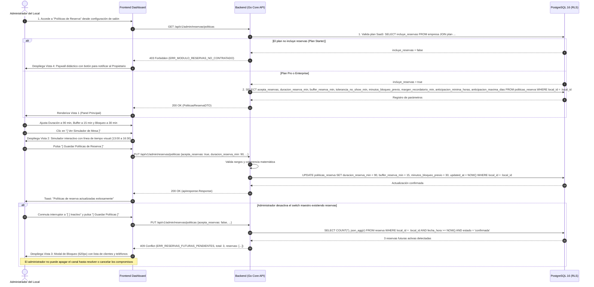
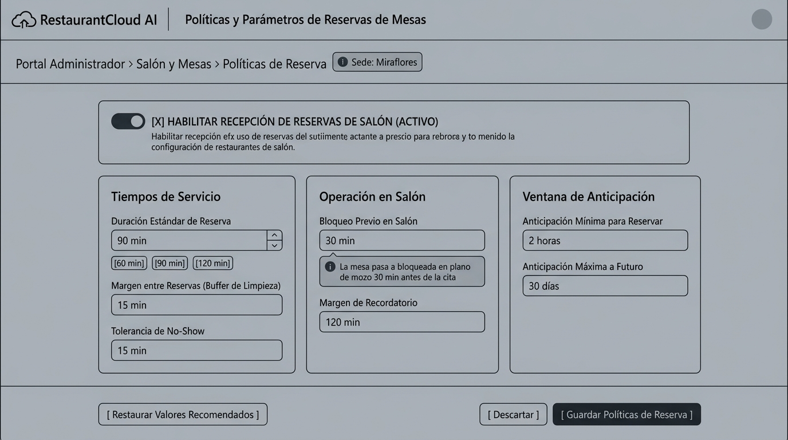
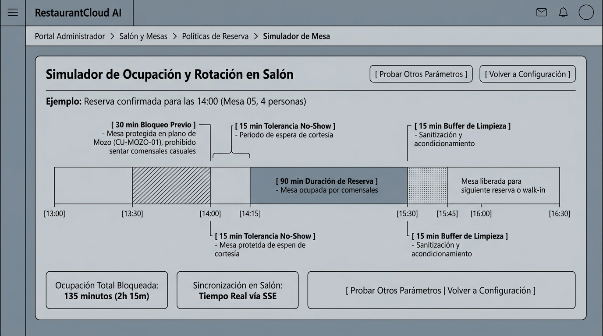
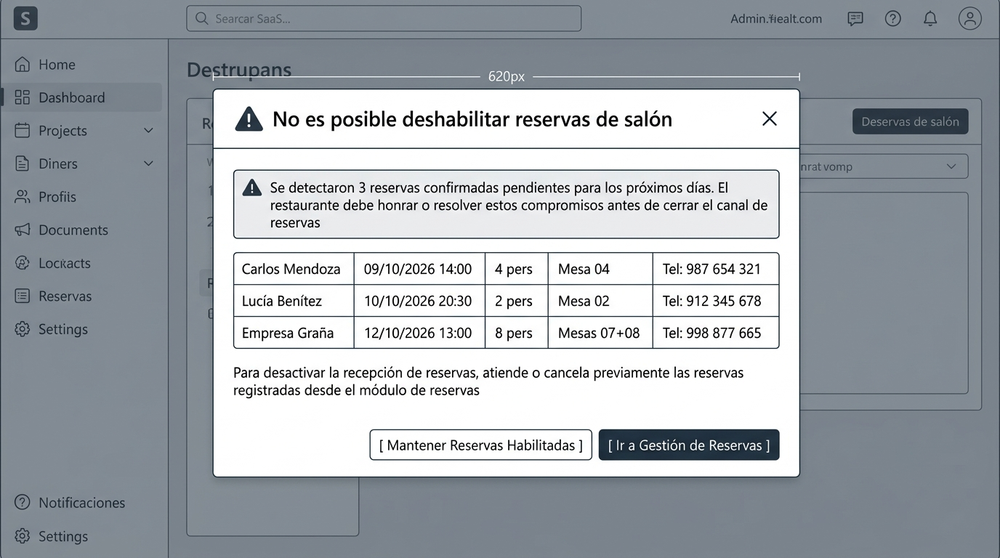
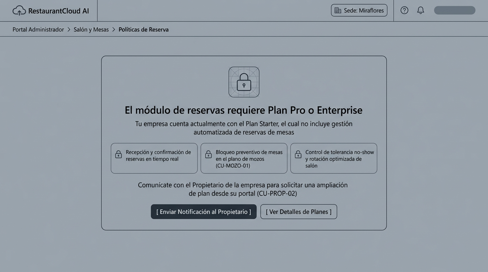

# CU-ADMIN-10: Configurar Políticas y Parámetros de Reservas de Mesas

Especificación técnica de interfaz de usuario, arquitectura de información, control de acceso basado en roles (RBAC), tiempos de servicio y rotación de salón, salvaguarda de desactivación ante reservas activas, simulador visual de línea de tiempo y contratos de API Go en **RestaurantCloud AI**.

---

## 1. Ficha Técnica del Caso de Uso

| Atributo | Detalle |
| :--- | :--- |
| **Código CU** | `CU-ADMIN-10` |
| **Nombre** | Configurar políticas y parámetros de reservas de mesas |
| **Actor(es)** | `administrador_local` (responsable operativo del local; facultad exclusiva de sede — el Propietario no gestiona estos parámetros cotidianos de salón) |
| **Dispositivo / Viewport** | Responsive Desktop (`1440x900`), Tablet (`768x1024`), Mobile (`375x812`) |
| **Precondición** | El local está activo; el plan SaaS de la empresa incluye el módulo de reservas (`plan.incluye_reservas = true`); el usuario cuenta con sesión activa y rol `administrador_local` asignado a la sede. |
| **Postcondición** | Políticas y parámetros operativos persistidos en la tabla dedicada 1:1 `politicas_reserva` (`acepta_reservas`, `duracion_reserva_min`, `buffer_reserva_min`, `tolerancia_no_show_min`, `minutos_bloqueo_previo`, `margen_recordatorio_min`, `anticipacion_minima_horas`, `anticipacion_maxima_dias`); sincronización en tiempo real vía SSE con el plano de mesas del Mozo (`CU-MOZO-01`) para el bloqueo preventivo automático. |

---

## 2. Diagrama de Flujo y Secuencia



---

## 3. Especificación de Pantallas y Wireframes Blueprint

### Vista 1: Panel de Configuración de Políticas y Parámetros (`wf_admin_10_panel_politicas.jpg`)

Panel maestro de parametrización para salón y comensales. Incluye interruptor global de recepción de reservas, 3 tarjetas de configuración agrupadas por responsabilidad operativa y botones de acción rápida.



#### Layout Estructural ASCII (Desktop 1440x900)
```text
+----------------------------------------------------------------------------------------------------+
| RESTAURANTCLOUD AI   | Políticas y Parámetros de Reservas de Mesas                [ Sede: Miraflores ]
+----------------------------------------------------------------------------------------------------+
| Portal Administrador > Salón y Mesas > Políticas de Reserva                                        |
|----------------------------------------------------------------------------------------------------|
|                                                                                                    |
| +------------------------------------------------------------------------------------------------+ |
| | [O==] [X] HABILITAR RECEPCIÓN DE RESERVAS DE SALÓN (ACTIVO)                                    | |
| | Habilita o suspende la recepción de reservas de salón en la sede. Al desactivarse, se impide  | |
| | la creación de nuevas reservas tanto en el panel como en la carta digital pública.             | |
| +------------------------------------------------------------------------------------------------+ |
|                                                                                                    |
| +-----------------------------+ +-----------------------------+ +--------------------------------+ |
| | Tiempos de Servicio         | | Operación en Salón          | | Ventana de Anticipación        | |
| |                             | |                             | |                                | |
| | Duración Estándar Reserva   | | Bloqueo Previo en Salón     | | Anticipación Mínima p/ Reservar| |
| | [ 90 min                 ^v]| | [ 30 min                 ^v]| | [ 2 horas                   ^v]| |
| | [60 min] [90 min] [120 min] | | (i) La mesa pasa a bloqueada| | Mínimo tiempo antes de la cita | |
| |                             | |     en plano de mozo 30 min | |                                | |
| | Margen Buffer Limpieza      | |     antes de la cita        | | Anticipación Máxima a Futuro   | |
| | [ 15 min                 ^v]| |                             | | [ 30 días                  ^v]| |
| | Sanitización entre reservas | | Margen de Recordatorio      | | Máximo horizonte de reserva    | |
| |                             | | [ 120 min                ^v]| |                                | |
| | Tolerancia de No-Show       | | Alerta preventiva al equipo | |                                | |
| | [ 15 min                 ^v]| |                             | |                                | |
| +-----------------------------+ +-----------------------------+ +--------------------------------+ |
|                                                                                                    |
| [ Restaurar Valores Recomendados ]                            [ Descartar ]  [ Guardar Políticas ] |
+----------------------------------------------------------------------------------------------------+
```

---

### Vista 2: Simulador Visual de Línea de Tiempo de Reserva de Mesa (`wf_admin_10_simulador_linea_tiempo.jpg`)

Gráfico interactivo de línea de tiempo que permite al administrador observar con precisión matemática cómo interactúan en una jornada real los parámetros configurados (bloqueo preventivo en plano de mozo, tolerancia de no-show, estancia del cliente y buffer de sanitización).



#### Layout Estructural ASCII (Desktop 1440x900)
```text
+----------------------------------------------------------------------------------------------------+
| RESTAURANTCLOUD AI   | Portal Administrador > Salón y Mesas > Simulador de Mesa    [ Sede: Miraflores ]
+----------------------------------------------------------------------------------------------------+
|                                                                                                    |
| Simulador de Ocupación y Rotación en Salón                  [ Probar Parámetros ] [ Volver Panel ] |
|----------------------------------------------------------------------------------------------------|
| Ejemplo: Reserva confirmada para las 14:00 (Mesa 05, 4 personas)                                   |
|                                                                                                    |
|       [ 30 min Bloqueo Previo ]      [ 15 min No-Show ]       [ 15 min Buffer Limpieza ]           |
|       Mesa protegida en mozo         Espera cortesía          Sanitización de mesa                 |
|       (prohibido walk-in)                                                                          |
|              |                             |                         |                             |
|  +-----------+-------------+---------------+-------------------------+------------+--------------+ |
|  |////// BLOQUEADA ////////|///////////////|***** OCUPADA ***********|:::: LIMPIEZA :| DISPONIBLE   | |
|  +-------------------------+---------------+-------------------------+---------------+--------------+ |
|  13:00                   13:30           14:00   14:15             15:30          15:45          16:30 |
|                                                                                                    |
|                                            [ 90 min Duración de Reserva ]                          |
|                                            Mesa ocupada por los comensales                         |
|                                                                                                    |
| +-----------------------------------+ +----------------------------------+ +---------------------+ |
| | Ocupación Total Bloqueada:        | | Sincronización en Salón:         | | Regla Operativa:    | |
| | 135 minutos (2h 15m por mesa)     | | Tiempo Real vía SSE en Mozo      | | Mesa se libera a las| |
| | (30m bloqueo + 90m cita + 15m lim)| | (CU-MOZO-01 estado='bloqueada')  | | 15:45 en punto      | |
| +-----------------------------------+ +----------------------------------+ +---------------------+ |
|                                                                                                    |
+----------------------------------------------------------------------------------------------------+
```

---

### Vista 3: Modal de Bloqueo por Reservas Futuras Confirmadas (`wf_admin_10_bloqueo_desactivacion_modal.jpg`)

Modal asistido y preventivo de 620px que se dispara automáticamente cuando el administrador intenta deshabilitar el switch maestro (`acepta_reservas = false`) mientras existen reservas futuras confirmadas en el sistema.



#### Layout Estructural ASCII (Modal 620px)
```text
+------------------------------------------------------------------------+
|  (!) No es posible deshabilitar reservas de salón                  [X] |
+------------------------------------------------------------------------+
|                                                                        |
|  [!] Se detectaron 3 reservas confirmadas pendientes para los próximos |
|      días. El restaurante debe honrar o resolver estos compromisos     |
|      antes de cerrar el canal de reservas.                             |
|                                                                        |
|  +------------------------------------------------------------------+  |
|  | CLIENTE        | FECHA / HORA     | PAX | MESA(S)    | TELÉFONO      |  |
|  |----------------+------------------+-----+------------+---------------|  |
|  | Carlos Mendoza | 09/10/2026 14:00 |  4  | Mesa 04    | 987 654 321   |  |
|  | Lucía Benítez  | 10/10/2026 20:30 |  2  | Mesa 02    | 912 345 678   |  |
|  | Empresa Graña  | 12/10/2026 13:00 |  8  | Mesas 07+08| 998 877 665   |  |
|  +------------------------------------------------------------------+  |
|                                                                        |
|  Para desactivar la recepción de reservas, atiende o cancela           |
|  previamente las reservas registradas desde el módulo de reservas.     |
|                                                                        |
|  [ Mantener Reservas Habilitadas ]       [ Ir a Gestión de Reservas ]  |
+------------------------------------------------------------------------+
```

---

### Vista 4: Estado Bloqueado por Plan Starter / Paywall SaaS (`wf_admin_10_paywall_plan_starter.jpg`)

Pantalla de bloqueo arquitectónico para sedes cuya empresa cuenta con suscripción Plan Starter (`plan.incluye_reservas = false`). Orienta pedagógicamente sobre el valor del módulo e invita a solicitar un *upgrade* con el Propietario.



#### Layout Estructural ASCII (Desktop 1440x900)
```text
+----------------------------------------------------------------------------------------------------+
| RESTAURANTCLOUD AI   | Portal Administrador > Salón y Mesas > Políticas           [ Sede: Miraflores ]
+----------------------------------------------------------------------------------------------------+
|                                                                                                    |
|                                         +------------------+                                       |
|                                         |   [ CANDADO UI ] |                                       |
|                                         +------------------+                                       |
|                                                                                                    |
|                               El módulo de reservas requiere Plan Pro o Enterprise                 |
|                    Tu empresa cuenta actualmente con el Plan Starter, el cual no incluye           |
|                                  gestión automatizada de reservas de mesas.                        |
|                                                                                                    |
|        +-------------------------+ +-------------------------+ +-------------------------+         |
|        | [Candado] Recepción y   | | [Candado] Bloqueo       | | [Candado] Control de    |         |
|        | confirmación de reservas| | preventivo en plano de  | | tolerancia no-show y    |         |
|        | en tiempo real          | | mozos (CU-MOZO-01)      | | rotación optimizada     |         |
|        +-------------------------+ +-------------------------+ +-------------------------+         |
|                                                                                                    |
|                     Comunícate con el Propietario de la empresa para solicitar                     |
|                         una ampliación de plan desde su portal (CU-PROP-02).                       |
|                                                                                                    |
|                     [ Enviar Notificación al Propietario ]     [ Ver Detalles de Planes ]          |
|                                                                                                    |
+----------------------------------------------------------------------------------------------------+
```

---

## 4. Matriz de Control de Acceso (RBAC)

| Operación | Propietario | Administrador Local | Mozo | Cocina | Cajero |
| :--- | :---: | :---: | :---: | :---: | :---: |
| **Ver Políticas de Reserva** | Solo Lectura (Informativo) | Sí (Gestor Oficial) | No | No | No |
| **Editar Políticas de Reserva** | No (Restringido) | Sí (Exclusivo) | No | No | No |
| **Desactivar Recepción de Reservas** | No (Restringido) | Sí (Con validación de reservas futuras) | No | No | No |
| **Restaurar Valores por Defecto** | No (Restringido) | Sí (Exclusivo) | No | No | No |
| **Visualizar Bloqueo en Plano** | N/A | Sí | Sí (`CU-MOZO-01`) | No | No |

> [!IMPORTANT]
> **Principio de Especialización Operativa de Sede:** La parametrización de reservas de mesas (duración, buffer de limpieza, no-show, bloqueo de salón) está **reservada exclusivamente al Administrador del Local**. Dado que el administrador de sede es quien está presente físicamente en el local y conoce el comportamiento de la clientela, la agilidad de la brigada de mozos y la dinámica de rotación de mesas, el Propietario no interviene en estas decisiones operativas cotidianas (su rol se limita a la gestión de suscripciones, sedes y designación de administradores en `CU-PROP-01..04`). Si un usuario con rol Propietario intenta invocar los endpoints de modificación (`PUT /api/v1/admin/reservas/politicas`), el sistema responde con `403 Forbidden (ERR_OPERACION_EXCLUSIVA_ADMIN_LOCAL)`.

---

## 5. Contratos de API Go (DTOs y Endpoints REST)

### 5.1 Estructuras de Datos (`internal/domain/reserva/dto.go`)

```go
package reserva

import (
	"time"

	"github.com/google/uuid"
)

// PoliticasReservaDTO contiene la configuración integral del local
type PoliticasReservaDTO struct {
	LocalID                 uuid.UUID `json:"local_id"`
	AceptaReservas          bool      `json:"acepta_reservas"`
	DuracionReservaMin      int       `json:"duracion_reserva_min"`      // Default 90, min 30, max 240
	BufferReservaMin        int       `json:"buffer_reserva_min"`        // Default 15, min 0, max 60
	ToleranciaNoShowMin     int       `json:"tolerancia_no_show_min"`     // Default 15, min 5, max 60
	MinutosBloqueoPrevio    int       `json:"minutos_bloqueo_previo"`    // Default 30, min 0, max 120
	MargenRecordatorioMin   int       `json:"margen_recordatorio_min"`   // Default 120, min 0
	AnticipacionMinimaHoras int       `json:"anticipacion_minima_horas"` // Default 2, min 0, max 48
	AnticipacionMaximaDias  int       `json:"anticipacion_maxima_dias"`  // Default 30, min 1, max 90
	UpdatedAt               time.Time `json:"updated_at"`
}

// ActualizarPoliticasReservaRequest payload de actualización
type ActualizarPoliticasReservaRequest struct {
	AceptaReservas          bool `json:"acepta_reservas"`
	DuracionReservaMin      int  `json:"duracion_reserva_min" binding:"required,min=30,max=240"`
	BufferReservaMin        int  `json:"buffer_reserva_min" binding:"min=0,max=60"`
	ToleranciaNoShowMin     int  `json:"tolerancia_no_show_min" binding:"required,min=5,max=60"`
	MinutosBloqueoPrevio    int  `json:"minutos_bloqueo_previo" binding:"min=0,max=120"`
	MargenRecordatorioMin   int  `json:"margen_recordatorio_min" binding:"min=0"`
	AnticipacionMinimaHoras int  `json:"anticipacion_minima_horas" binding:"min=0,max=48"`
	AnticipacionMaximaDias  int  `json:"anticipacion_maxima_dias" binding:"required,min=1,max=90"`
}

// ReservaResumenDTO detalle de reserva pendiente para modal de bloqueo
type ReservaResumenDTO struct {
	ID        uuid.UUID `json:"id"`
	Cliente   string    `json:"cliente"`
	Telefono  string    `json:"telefono"`
	FechaHora time.Time `json:"fecha_hora"`
	Pax       int       `json:"pax"`
	Mesas     []string  `json:"mesas"`
}

// PrecheckDesactivacionReservasResponse respuesta de advertencia si hay reservas activas
type PrecheckDesactivacionReservasResponse struct {
	PermiteDesactivar bool                `json:"permite_desactivar"`
	TotalPendientes   int                 `json:"total_pendientes"`
	Reservas          []ReservaResumenDTO `json:"reservas,omitempty"`
}
```

---

### 5.2 Catálogo de Endpoints REST

| Método | Endpoint | Descripción | Código Éxito |
| :--- | :--- | :--- | :--- |
| `GET` | `/api/v1/admin/reservas/politicas` | Retorna los parámetros de reserva vigentes del local | `200 OK` |
| `PUT` | `/api/v1/admin/reservas/politicas` | Actualiza los parámetros de reserva del local | `200 OK` / `409 Conflict` |
| `POST` | `/api/v1/admin/reservas/politicas/restaurar-default` | Restablece los valores estándar recomendados | `200 OK` |
| `GET` | `/api/v1/admin/reservas/politicas/precheck-desactivacion` | Consulta si existen reservas futuras que bloqueen el apagado | `200 OK` |

---

### 5.3 Ejemplos de Payloads JSON

#### Ejemplo 1: `GET /api/v1/admin/reservas/politicas` (Respuesta Exitosa)
```json
{
  "success": true,
  "data": {
    "local_id": "a1b2c3d4-e5f6-4a5b-8c9d-0e1f2a3b4c5d",
    "acepta_reservas": true,
    "duracion_reserva_min": 90,
    "buffer_reserva_min": 15,
    "tolerancia_no_show_min": 15,
    "minutos_bloqueo_previo": 30,
    "margen_recordatorio_min": 120,
    "anticipacion_minima_horas": 2,
    "anticipacion_maxima_dias": 30,
    "updated_at": "2026-10-08T18:20:00Z"
  },
  "error": null
}
```

#### Ejemplo 2: `PUT /api/v1/admin/reservas/politicas` (Intento de Desactivación Rechazado con 409 Conflict)
```json
// Solicitud:
{
  "acepta_reservas": false,
  "duracion_reserva_min": 90,
  "buffer_reserva_min": 15,
  "tolerancia_no_show_min": 15,
  "minutos_bloqueo_previo": 30,
  "margen_recordatorio_min": 120,
  "anticipacion_minima_horas": 2,
  "anticipacion_maxima_dias": 30
}

// Respuesta:
{
  "success": false,
  "data": {
    "permite_desactivar": false,
    "total_pendientes": 3,
    "reservas": [
      {
        "id": "c1a2b3d4-0001-4000-8000-000000000001",
        "cliente": "Carlos Mendoza",
        "telefono": "+51987654321",
        "fecha_hora": "2026-10-09T14:00:00Z",
        "pax": 4,
        "mesas": ["Mesa 04"]
      },
      {
        "id": "c1a2b3d4-0002-4000-8000-000000000002",
        "cliente": "Lucía Benítez",
        "telefono": "+51912345678",
        "fecha_hora": "2026-10-10T20:30:00Z",
        "pax": 2,
        "mesas": ["Mesa 02"]
      },
      {
        "id": "c1a2b3d4-0003-4000-8000-000000000003",
        "cliente": "Empresa Graña",
        "telefono": "+51998877665",
        "fecha_hora": "2026-10-12T13:00:00Z",
        "pax": 8,
        "mesas": ["Mesa 07", "Mesa 08"]
      }
    ]
  },
  "error": {
    "code": "ERR_RESERVAS_FUTURAS_PENDIENTES",
    "message": "No es posible deshabilitar reservas de salón porque existen 3 reservas futuras confirmadas pendientes. Atienda o cancele las reservas antes de desactivar el módulo."
  }
}
```

---

## 6. Esquema Relacional de Base de Datos (`PostgreSQL 16`)

```sql
-- 1. Tabla independiente politicas_reserva (1:1 con local, modular para planes Pro y Enterprise)
CREATE TABLE IF NOT EXISTS politicas_reserva (
    local_id UUID PRIMARY KEY REFERENCES local(id) ON DELETE CASCADE,
    acepta_reservas BOOLEAN NOT NULL DEFAULT false,
    duracion_reserva_min INT NOT NULL DEFAULT 90 CHECK (duracion_reserva_min BETWEEN 30 AND 240),
    buffer_reserva_min INT NOT NULL DEFAULT 15 CHECK (buffer_reserva_min BETWEEN 0 AND 60),
    tolerancia_no_show_min INT NOT NULL DEFAULT 15 CHECK (tolerancia_no_show_min BETWEEN 5 AND 60),
    minutos_bloqueo_previo INT NOT NULL DEFAULT 30 CHECK (minutos_bloqueo_previo BETWEEN 0 AND 120),
    margen_recordatorio_min INT NOT NULL DEFAULT 120 CHECK (margen_recordatorio_min >= 0),
    anticipacion_minima_horas INT NOT NULL DEFAULT 2 CHECK (anticipacion_minima_horas BETWEEN 0 AND 48),
    anticipacion_maxima_dias INT NOT NULL DEFAULT 30 CHECK (anticipacion_maxima_dias BETWEEN 1 AND 90),
    created_at TIMESTAMP WITH TIME ZONE DEFAULT NOW(),
    updated_at TIMESTAMP WITH TIME ZONE DEFAULT NOW()
);

-- 2. Función y Trigger de Salvaguarda contra Desactivación con Reservas Activas
CREATE OR REPLACE FUNCTION fn_validar_desactivacion_reservas()
RETURNS TRIGGER AS $$
DECLARE
    v_pendientes INT;
BEGIN
    -- Si se intenta cambiar acepta_reservas de true a false
    IF OLD.acepta_reservas = true AND NEW.acepta_reservas = false THEN
        SELECT COUNT(*) INTO v_pendientes
        FROM reserva
        WHERE local_id = NEW.local_id
          AND fecha_hora >= NOW()
          AND estado = 'confirmada';

        IF v_pendientes > 0 THEN
            RAISE EXCEPTION 'ERR_RESERVAS_FUTURAS_PENDIENTES: No se puede desactivar la recepción de reservas con % reservas confirmadas activas', v_pendientes;
        END IF;
    END IF;

    NEW.updated_at = NOW();
    RETURN NEW;
END;
$$ LANGUAGE plpgsql;

DROP TRIGGER IF EXISTS trg_validar_desactivacion_reservas ON politicas_reserva;
CREATE TRIGGER trg_validar_desactivacion_reservas
    BEFORE UPDATE OF acepta_reservas ON politicas_reserva
    FOR EACH ROW
    EXECUTE FUNCTION fn_validar_desactivacion_reservas();

-- 3. Índice para optimizar consultas de reservas futuras activas
CREATE INDEX IF NOT EXISTS idx_reserva_local_futuras 
    ON reserva (local_id, fecha_hora) 
    WHERE estado = 'confirmada';
```

---

## 7. Verificación de Accesibilidad (WCAG 2.1 AA)

- **Contraste de Color:** Ratios superiores a 15:1 en texto regular `#0F172A` sobre fondos `#FFFFFF`, y etiquetas informativas `#334155` sobre fondo atenuado `#F8FAFC`.
- **Controles con Steppers y Sliders:** Inputs numéricos cuentan con atributos `aria-valuemin`, `aria-valuemax` y `aria-valuenow`, además de ser operables con flechas del teclado `Up` / `Down`.
- **Interruptor Semántico (Switch):** El control maestro implementa `role="switch"` y `aria-checked="true|false"`, con texto visible descriptivo que actualiza su estado.
- **Atrapamiento de Foco en Modal de Bloqueo:** El modal de 620px atrapa el foco del teclado y permite cierre con tecla `Escape` o navegación secuencial accesible.
