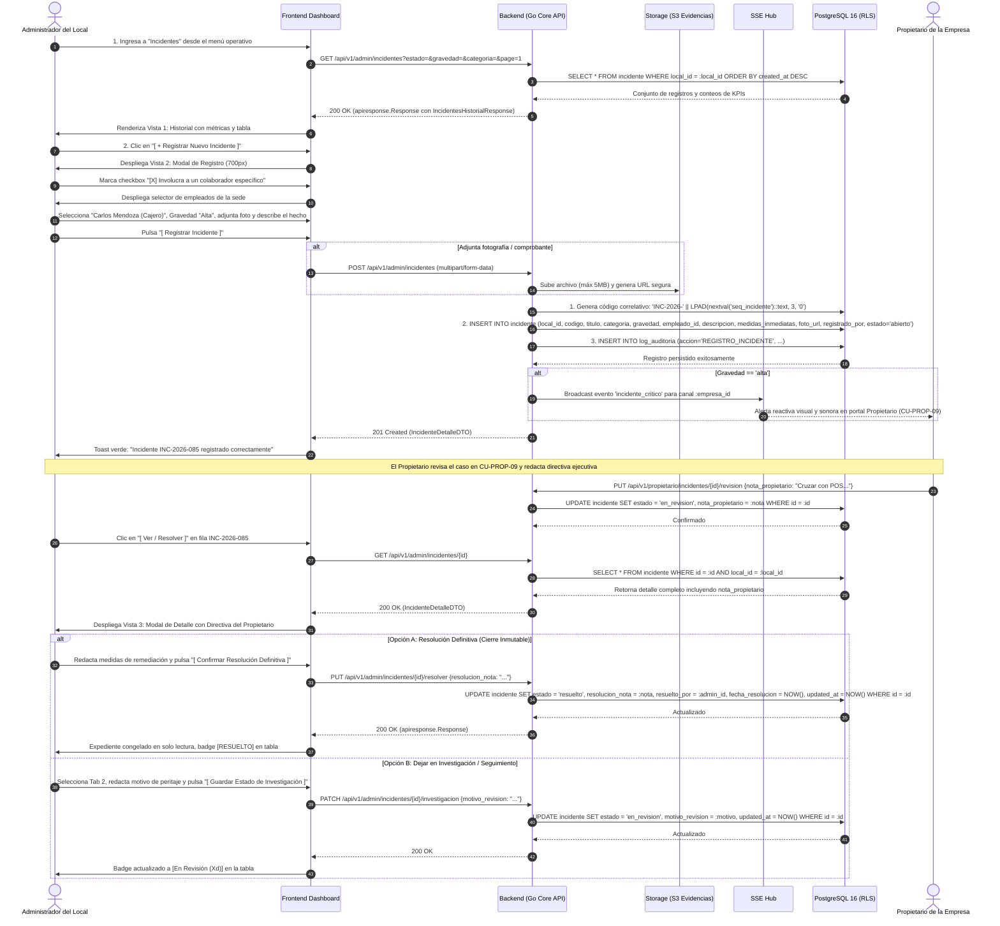
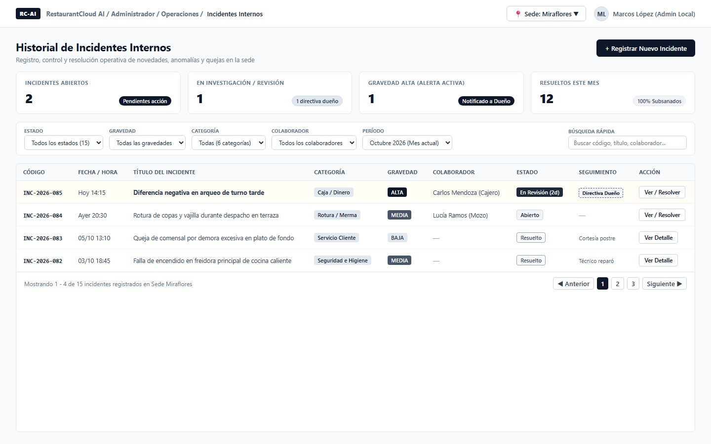
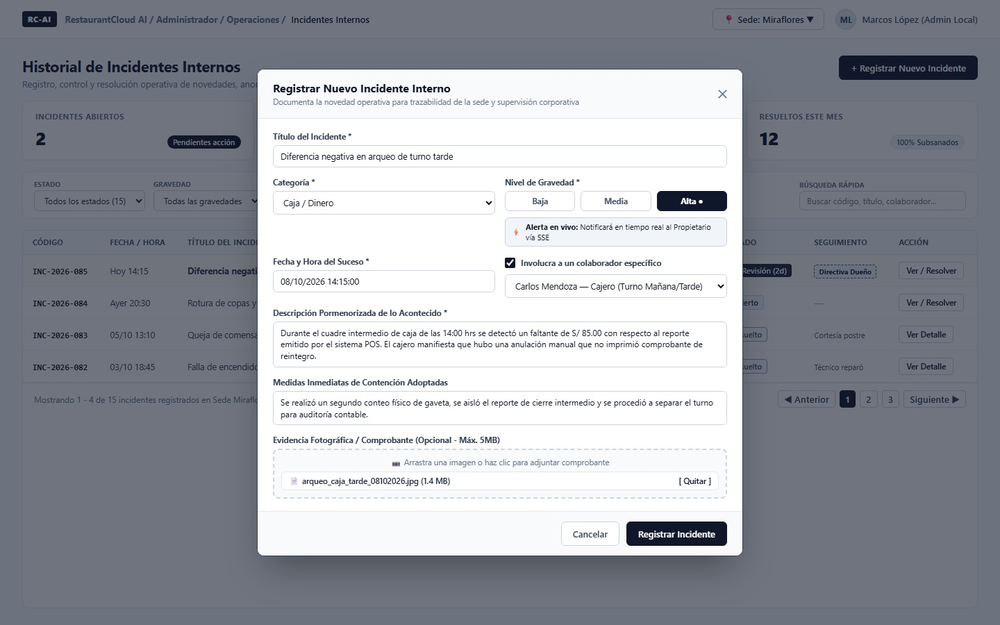
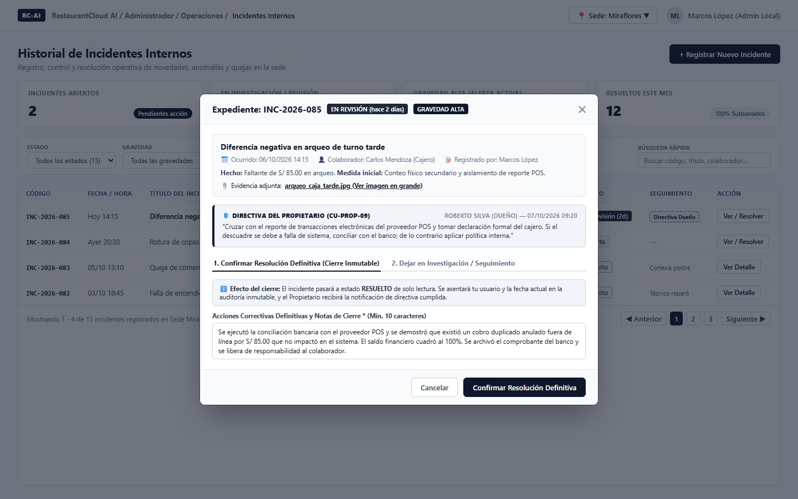
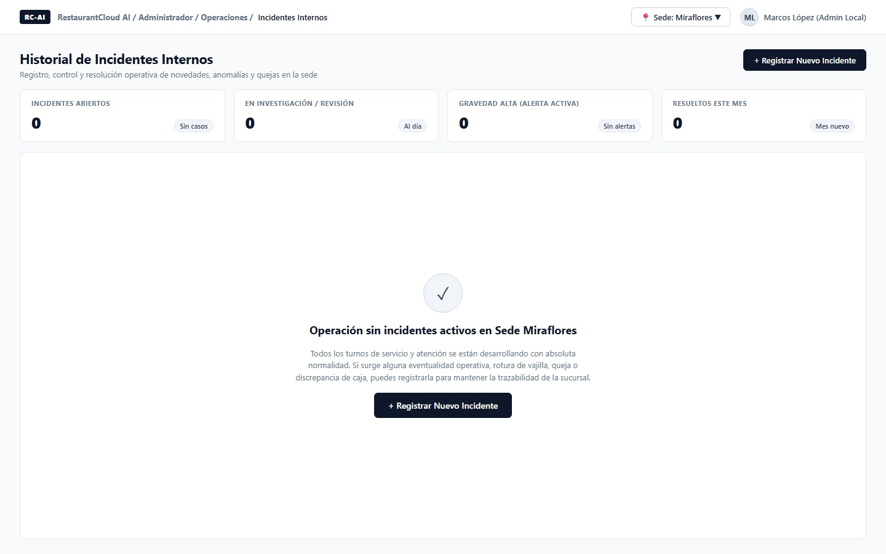

# CU-ADMIN-11: Registrar y Consultar Historial de Incidentes Internos

Especificación técnica de interfaz de usuario, arquitectura de información, control de acceso basado en roles (RBAC), ciclo de vida del incidente, alertas reactivas en tiempo real (SSE) y contratos de API Go en **RestaurantCloud AI**.

---

## 1. Ficha Técnica del Caso de Uso

| Atributo | Detalle |
| :--- | :--- |
| **Código CU** | `CU-ADMIN-11` |
| **Nombre** | Registrar y consultar historial de incidentes internos |
| **Actor(es)** | `administrador_local` (responsable operativo directo del local; facultad exclusiva de sede — el Propietario supervisa en [`CU-PROP-09`](file:///j:/proyectos_git/RestaurantCloud_AI_backend/wireframe/propietario/CU-PROP-09-incidentes-empresa/wireframe.md)) |
| **Dispositivo / Viewport** | Responsive Desktop (`1440x900`), Tablet (`768x1024`), Mobile (`375x812`) |
| **Precondición** | El local se encuentra activo; el usuario cuenta con sesión autenticada con token JWT y rol `administrador_local` asignado a dicha sede (`local_id`). |
| **Postcondición** | Incidente registrado con código correlativo anual inmutable (`INC-YYYY-###`); si la gravedad es `alta`, el backend emite una alerta reactiva vía Server-Sent Events (SSE) al panel del Propietario; el caso puede transicionar a estado `en_revision` para peritajes o resolverse de forma definitiva (`resuelto`), sellando obligatoriamente la nota de remediación, usuario responsable y marca temporal sin posibilidad de alteración ulterior. |

---

## 2. Diagrama de Flujo y Secuencia



---

## 3. Especificación de Pantallas y Wireframes Blueprint

### Vista 1: Historial y Bandeja de Incidentes de Sede (`wf_admin_11_historial_incidentes.jpg`)

Bandeja principal de gestión interna de novedades y anomalías del local. Incorpora tarjetas métricas KPI de control operativo, barra de filtros combinados y tabla interactiva con códigos de seguimiento correlativos y badges de atención.



#### Layout Estructural ASCII (Desktop 1440x900)
```text
+----------------------------------------------------------------------------------------------------+
| RESTAURANTCLOUD AI   | Operaciones > Incidentes Internos       [ Sede: Miraflores v ]  [ ML Marcos v ]|
+----------------------------------------------------------------------------------------------------+
| Historial de Incidentes Internos                                                                   |
| Registro, control y resolución operativa de novedades, anomalías y quejas en la sede               |
|                                                                    [ + Registrar Nuevo Incidente ] |
|----------------------------------------------------------------------------------------------------|
|                                                                                                    |
| +--------------------+ +--------------------+ +--------------------+ +---------------------------+ |
| | INCIDENTES ABIERTOS| | EN INVESTIGACIÓN   | | GRAVEDAD ALTA      | | RESUELTOS ESTE MES        | |
| | [ 2 ]              | | [ 1 ]              | | [ 1 ] (ALERTA SSE) | | [ 12 ]                    | |
| | Pendientes acción  | | 1 directiva dueño  | | Notificado a Dueño | | 100% Subsanados           | |
| +--------------------+ +--------------------+ +--------------------+ +---------------------------+ |
|                                                                                                    |
| +------------------------------------------------------------------------------------------------+ |
| | Estado:        Gravedad:       Categoría:      Colaborador:    Período:     Búsqueda rápida:   | |
| | [ Todos v    ] [ Todas v     ] [ Todas v     ] [ Todos v     ] [ Octubre v] [ Buscar asunto..] | |
| +------------------------------------------------------------------------------------------------+ |
|                                                                                                    |
| +------------------------------------------------------------------------------------------------+ |
| | CÓDIGO      FECHA/HORA  TÍTULO DEL INCIDENTE          CATEGORÍA    GRAVEDAD ESTADO       ACCIÓN| |
| |------------------------------------------------------------------------------------------------| |
| | INC-2026-085 Hoy 14:15   Diferencia negativa en arqueo Caja/Dinero  [ALTA]   En Rev (2d)  [Ver] | |
| |                                                                    *Directiva Dueño            | |
| | INC-2026-084 Ayer 20:30  Rotura de copas en terraza    Rotura/Merma [MEDIA]  Abierto      [Ver] | |
| | INC-2026-083 05/10 13:10 Queja de comensal por demora  Serv.Cliente [BAJA]   Resuelto     [Ver] | |
| | INC-2026-082 03/10 18:45 Falla en freidora caliente    Seg. Higiene [MEDIA]  Resuelto     [Ver] | |
| |------------------------------------------------------------------------------------------------| |
| | Mostrando 1 - 4 de 15 incidentes registrados en Sede Miraflores    [< Ant] [1] [2] [3] [Sig >] | |
| +------------------------------------------------------------------------------------------------+ |
+----------------------------------------------------------------------------------------------------+
```

#### Elementos Visuales y Funcionalidades
- **4 Tarjetas KPI Dinámicas:** Conteo en tiempo real de casos en curso, casos bajo directiva del dueño, casos con notificación SSE y porcentaje de resolución mensual.
- **Filtros Combinados de Sede:** Filtra instantáneamente por gravedad (`alta`, `media`, `baja`), categoría operativa (6 tipos), estado (`abierto`, `en_revision`, `resuelto`) y colaborador involucrado.
- **Badge de Directiva del Dueño:** Indica a simple vista cuándo el Propietario revisó el caso en `CU-PROP-09` y dejó una instrucción de cumplimiento mandatorio.

---

### Vista 2: Modal de Registro con Checkbox Condicional (`wf_admin_11_registro_incidente_modal.jpg`)

Modal centrado de 700px para el levantamiento de un nuevo evento. Incluye validaciones en tiempo real, selector condicional de colaborador para agilizar la carga en incidentes fortuitos, y advertencia reactiva de emisión SSE si la gravedad es clasificada como Alta.



#### Layout Estructural ASCII (Modal 700px)
```text
+--------------------------------------------------------------------------+
| Registrar Nuevo Incidente Interno                                    [X] |
| Documenta la novedad operativa para trazabilidad y supervisión          |
|--------------------------------------------------------------------------|
|                                                                          |
| Título del Incidente *                                                   |
| [ Diferencia negativa en arqueo de turno tarde                         ] |
|                                                                          |
| Categoría *                             Nivel de Gravedad *              |
| [ Caja / Dinero                       v] [ Baja ] [ Media ] [ ALTA ● ]   |
|                                          ⚡ Alerta en vivo: Notificará al|
|                                             Propietario vía SSE en t.real|
|                                                                          |
| Fecha y Hora del Suceso *                [X] Involucra a un colaborador  |
| [ 08/10/2026 14:15:00                  ]     específico                  |
|                                          [ Carlos Mendoza — Cajero     v]|
|                                                                          |
| Descripción Pormenorizada de lo Acontecido *                             |
| [ Durante el cuadre intermedio de caja de las 14:00 hrs se detectó un  ] |
| [ faltante de S/ 85.00 con respecto al reporte emitido por el POS...   ] |
|                                                                          |
| Medidas Inmediatas de Contención Adoptadas                               |
| [ Se realizó un segundo conteo físico de gaveta y se aisló el reporte. ] |
|                                                                          |
| Evidencia Fotográfica / Comprobante (Opcional - Máx. 5MB)                |
| + - - - - - - - - - - - - - - - - - - - - - - - - - - - - - - - - - - -+ |
| | 📷 Arrastra una imagen o haz clic para adjuntar comprobante          | |
| | [📄 arqueo_caja_tarde_08102026.jpg (1.4 MB)]                [ Quitar ]| |
| + - - - - - - - - - - - - - - - - - - - - - - - - - - - - - - - - - - -+ |
|--------------------------------------------------------------------------|
|                                        [ Cancelar ] [ Registrar Incidente]
+--------------------------------------------------------------------------+
```

#### Interacciones Clave
1. **Checkbox Condicional de Colaborador:**
   - Si está desmarcado: El selector permanece oculto y no se envía `empleado_id` (permanece `NULL`), evitando fricción visual en incidentes sin colaborador responsable (apagones, fallas de máquina, mermas accidentales).
   - Si se marca `[X] Involucra a un colaborador específico`: Se expande inmediatamente el dropdown poblado con el personal activo asignado a la sede (`CU-ADMIN-04`).
2. **Badge Reactivo de Alerta SSE:** Al seleccionar la tarjeta `Alta`, la interfaz despliega un aviso destacado informando que se emitirá un evento push inmediato a la pantalla del Propietario.
3. **Dropzone de Evidencia Blueprint:** Soporta imágenes (PNG/JPG) con previsualización, tamaño y botón de remoción previa al envío.

---

### Vista 3: Modal de Detalle, Directiva Corporativa y Resolución Definitiva (`wf_admin_11_detalle_resolucion_modal.jpg`)

Modal centrado de 720px para el seguimiento, inspección y cierre del expediente. Muestra la instrucción directiva enviada por el Propietario desde `CU-PROP-09` y proporciona dos pestañas de acción claramente delimitadas para evitar la ambigüedad de estados en el limbo.



#### Layout Estructural ASCII (Modal 720px)
```text
+------------------------------------------------------------------------------+
| Expediente: INC-2026-085   [ EN REVISIÓN (hace 2d) ]  [ GRAVEDAD ALTA ]  [X] |
|------------------------------------------------------------------------------|
|                                                                              |
| +--------------------------------------------------------------------------+ |
| | Diferencia negativa en arqueo de turno tarde                             | |
| | 📅 Ocurrido: 06/10/2026 14:15  👤 Carlos Mendoza (Cajero)  📝 Marcos L.  | |
| | Hecho: Faltante de S/ 85.00 en arqueo. Medida inicial: Conteo secundario | |
| | 📎 Evidencia: [ arqueo_caja_tarde.jpg (Ver imagen en grande) ]           | |
| +--------------------------------------------------------------------------+ |
|                                                                              |
| +--------------------------------------------------------------------------+ |
| | 🛡️ DIRECTIVA DEL PROPIETARIO (CU-PROP-09)      Roberto Silva — 07/10 09:20 | |
| | "Cruzar con el reporte de transacciones electrónicas del proveedor POS y | |
| | tomar declaración formal del cajero. Si el descuadre se debe a falla de | |
| | sistema, conciliar con el banco; de lo contrario aplicar política."     | |
| +--------------------------------------------------------------------------+ |
|                                                                              |
| [ 1. Confirmar Resolución Definitiva (Cierre) ]  [ 2. Dejar en Investigación]|
|------------------------------------------------------------------------------|
| ℹ️ Efecto del cierre: El incidente pasará a estado RESUELTO de solo lectura. |
|    Se asentará tu usuario y fecha actual en auditoría inmutable.             |
|                                                                              |
| Acciones Correctivas Definitivas y Notas de Cierre * (Mín. 10 caracteres)    |
| [ Se ejecutó la conciliación bancaria con el proveedor POS y se demostró ]  |
| [ que existió un cobro duplicado anulado fuera de línea por S/ 85.00 que   ] |
| [ no impactó en el sistema. El saldo financiero cuadró al 100%.            ] |
|------------------------------------------------------------------------------|
|                                      [ Cancelar ] [ Confirmar Resolución Def ]|
+------------------------------------------------------------------------------+
```

#### Reglas de Negocio del Ciclo de Vida
1. **Pestaña 1: Confirmar Resolución Definitiva (Cierre Inmutable):**
   - Requiere obligatoriamente completar el campo `Acciones Correctivas Definitivas y Notas de Cierre` (mínimo 10 caracteres).
   - Al confirmar, el incidente pasa irreversiblemente a `resuelto`, persistiendo `resuelto_por = :admin_id` y `fecha_resolucion = NOW()`.
   - Se notifica automáticamente al Propietario que la directiva ejecutiva ha sido subsanada satisfactoriamente.
2. **Pestaña 2: Dejar en Investigación / Seguimiento:**
   - Permite registrar el avance de la indagación (ej. *"A la espera de los videos de seguridad"*), actualizando `motivo_revision` y manteniendo el estado `en_revision`.
   - Muestra en la tabla de sede los días transcurridos para prevenir casos abandonados.
   - **Regla estricta:** Un caso en investigación únicamente se archiva mediante la Pestaña 1.

---

### Vista 4: Estado Inicial / Vacío Positivo (`wf_admin_11_onboarding_vacio.jpg`)

Estado cero o limpio cuando la sucursal no registra incidencias pendientes o históricas en el período seleccionado.



#### Layout Estructural ASCII (Desktop 1440x900)
```text
+----------------------------------------------------------------------------------------------------+
| RESTAURANTCLOUD AI   | Operaciones > Incidentes Internos       [ Sede: Miraflores v ]  [ ML Marcos v ]|
+----------------------------------------------------------------------------------------------------+
| Historial de Incidentes Internos                                                                   |
| Registro, control y resolución operativa de novedades, anomalías y quejas en la sede               |
|                                                                    [ + Registrar Nuevo Incidente ] |
|----------------------------------------------------------------------------------------------------|
|                                                                                                    |
| +--------------------+ +--------------------+ +--------------------+ +---------------------------+ |
| | INCIDENTES ABIERTOS| | EN INVESTIGACIÓN   | | GRAVEDAD ALTA      | | RESUELTOS ESTE MES        | |
| | [ 0 ]              | | [ 0 ]              | | [ 0 ]              | | [ 0 ]                     | |
| | Sin casos          | | Al día             | | Sin alertas        | | Mes nuevo                 | |
| +--------------------+ +--------------------+ +--------------------+ +---------------------------+ |
|                                                                                                    |
| +------------------------------------------------------------------------------------------------+ |
| |                                                                                                | |
| |                                              ( ✓ )                                             | |
| |                                                                                                | |
| |                      Operación sin incidentes activos en Sede Miraflores                       | |
| |                                                                                                | |
| |      Todos los turnos de servicio y atención se están desarrollando con absoluta normalidad.   | |
| |      Si surge alguna eventualidad operativa, rotura de vajilla, queja o discrepancia de caja,  | |
| |      puedes registrarla para mantener la trazabilidad de la sucursal.                          | |
| |                                                                                                | |
| |                                  [ + Registrar Nuevo Incidente ]                               | |
| |                                                                                                | |
| +------------------------------------------------------------------------------------------------+ |
+----------------------------------------------------------------------------------------------------+
```

---

## 4. Matriz de Control de Acceso (RBAC)

| Operación / Acción | Propietario (`CU-PROP-09`) | Administrador Local (`CU-ADMIN-11`) | Mozo | Cocina | Cajero |
| :--- | :---: | :---: | :---: | :---: | :---: |
| **Consultar Historial** | Todas las sedes (Multi-tenant) | Exclusivo de su sede asignada (`local_id`) | No | No | No |
| **Registrar Incidente** | No (Supervisión) | Sí (Levanta el reporte en sede) | No | No | No |
| **Adjuntar Evidencia Fotográfica**| No | Sí (Hasta 5MB en JPG/PNG) | No | No | No |
| **Emitir Directiva Ejecutiva** | Sí (`nota_propietario`) | No | No | No | No |
| **Poner en Investigación** | Sí (Vía directiva) | Sí (`motivo_revision`) | No | No | No |
| **Resolver Definitivamente** | No (Responsabilidad local) | Sí (Registra acciones correctivas) | No | No | No |
| **Reabrir Caso Resuelto** | No (Inmutable) | No (Inmutable) | No | No | No |

---

## 5. Contratos de API Go y DTOs (`internal/domain/incidente/dto.go`)

Estructuras de transferencia de datos y validaciones en la capa de dominio Go:

```go
package incidente

import (
	"time"

	"github.com/google/uuid"
)

// CategoriaIncidente enum tipado
type CategoriaIncidente string

const (
	CategoriaServicioCliente  CategoriaIncidente = "servicio_cliente"
	CategoriaDisciplinario    CategoriaIncidente = "disciplinario"
	CategoriaRoturaMerma      CategoriaIncidente = "rotura_merma"
	CategoriaSeguridadHigiene CategoriaIncidente = "seguridad_higiene"
	CategoriaCajaDinero       CategoriaIncidente = "caja_dinero"
	CategoriaOtro             CategoriaIncidente = "otro"
)

// GravedadIncidente enum tipado
type GravedadIncidente string

const (
	GravedadBaja  GravedadIncidente = "baja"
	GravedadMedia GravedadIncidente = "media"
	GravedadAlta  GravedadIncidente = "alta"
)

// EstadoIncidente enum tipado
type EstadoIncidente string

const (
	EstadoAbierto    EstadoIncidente = "abierto"
	EstadoEnRevision EstadoIncidente = "en_revision"
	EstadoResuelto   EstadoIncidente = "resuelto"
)

// IncidenteItemDTO representación simplificada para la tabla de historial
type IncidenteItemDTO struct {
	ID                  uuid.UUID          `json:"id"`
	Codigo              string             `json:"codigo"` // ej. "INC-2026-085"
	Titulo              string             `json:"titulo"`
	Categoria           CategoriaIncidente `json:"categoria"`
	Gravedad            GravedadIncidente  `json:"gravedad"`
	EmpleadoID          *uuid.UUID         `json:"empleado_id,omitempty"`
	EmpleadoNombre      *string            `json:"empleado_nombre,omitempty"`
	FechaHora           time.Time          `json:"fecha_hora"`
	Estado              EstadoIncidente    `json:"estado"`
	TieneNotaPropietario bool              `json:"tiene_nota_propietario"`
	DiasEnCurso         int                `json:"dias_en_curso"`
	CreatedAt           time.Time          `json:"created_at"`
}

// IncidentesHistorialResponse respuesta con métricas de sede y lista paginada
type IncidentesHistorialResponse struct {
	KPIs struct {
		Abiertos           int `json:"abiertos"`
		EnRevision         int `json:"en_revision"`
		GravedadAlta       int `json:"gravedad_alta"`
		ResueltosMes       int `json:"resueltos_mes"`
		ConNotaPropietario int `json:"con_nota_propietario"`
	} `json:"kpis"`
	Incidentes []IncidenteItemDTO `json:"incidentes"`
	Total      int                `json:"total"`
	Pagina     int                `json:"pagina"`
	Limite     int                `json:"limite"`
}

// IncidenteDetalleDTO vista exhaustiva de un expediente para el modal de inspección
type IncidenteDetalleDTO struct {
	ID                  uuid.UUID          `json:"id"`
	LocalID             uuid.UUID          `json:"local_id"`
	Codigo              string             `json:"codigo"`
	Titulo              string             `json:"titulo"`
	Categoria           CategoriaIncidente `json:"categoria"`
	Gravedad            GravedadIncidente  `json:"gravedad"`
	FechaHora           time.Time          `json:"fecha_hora"`
	EmpleadoID          *uuid.UUID         `json:"empleado_id,omitempty"`
	EmpleadoNombre      *string            `json:"empleado_nombre,omitempty"`
	Descripcion         string             `json:"descripcion"`
	MedidasInmediatas   *string            `json:"medidas_inmediatas,omitempty"`
	FotoURL             *string            `json:"foto_url,omitempty"`
	RegistradoPor       uuid.UUID          `json:"registrado_por"`
	RegistradorNombre   string             `json:"registrador_nombre"`
	Estado              EstadoIncidente    `json:"estado"`
	VistoPorPropietario bool               `json:"visto_por_propietario"`
	FechaVisto          *time.Time         `json:"fecha_visto,omitempty"`
	NotaPropietario     *string            `json:"nota_propietario,omitempty"`
	MotivoRevision      *string            `json:"motivo_revision,omitempty"`
	ResolucionNota      *string            `json:"resolucion_nota,omitempty"`
	ResueltoPor         *uuid.UUID         `json:"resuelto_por,omitempty"`
	ResueltoPorNombre   *string            `json:"resuelto_por_nombre,omitempty"`
	FechaResolucion     *time.Time         `json:"fecha_resolucion,omitempty"`
	CreatedAt           time.Time          `json:"created_at"`
	UpdatedAt           time.Time          `json:"updated_at"`
}

// RegistrarIncidenteRequest payload de creación enviado como multipart/form-data
type RegistrarIncidenteRequest struct {
	Titulo            string     `form:"titulo" binding:"required,min=5,max=120"`
	Categoria         string     `form:"categoria" binding:"required,oneof=servicio_cliente disciplinario rotura_merma seguridad_higiene caja_dinero otro"`
	Gravedad          string     `form:"gravedad" binding:"required,oneof=baja media alta"`
	FechaHora         time.Time  `form:"fecha_hora" binding:"required"`
	InvolucraEmpleado bool       `form:"involucra_empleado"`
	EmpleadoID        *uuid.UUID `form:"empleado_id,omitempty"`
	Descripcion       string     `form:"descripcion" binding:"required,min=15"`
	MedidasInmediatas *string    `form:"medidas_inmediatas,omitempty"`
}

// InvestigacionIncidenteRequest payload para mover o mantener en investigación
type InvestigacionIncidenteRequest struct {
	MotivoRevision string `json:"motivo_revision" binding:"required,min=10,max=500"`
}

// ResolverIncidenteRequest payload de resolución definitiva inmutable
type ResolverIncidenteRequest struct {
	ResolucionNota string `json:"resolucion_nota" binding:"required,min=10,max=1000"`
}
```

---

## 6. Catálogo de Endpoints REST

Todos los endpoints retornan el formato envoltorio unificado definido en `pkg/apiresponse.Response`:

| Método | Endpoint | Descripción | Status Exitoso | Códigos de Error |
| :--- | :--- | :--- | :---: | :--- |
| `GET` | `/api/v1/admin/incidentes` | Consulta bandeja filtrada y métricas KPI de la sede | `200 OK` | `401 Unauthorized`, `403 Forbidden` |
| `POST` | `/api/v1/admin/incidentes` | Registra nuevo incidente con subida opcional de evidencia multipart | `201 Created` | `400 Bad Request`, `422 Unprocessable` |
| `GET` | `/api/v1/admin/incidentes/{id}` | Retorna el expediente completo y directivas de supervisión | `200 OK` | `404 Not Found`, `403 Forbidden` |
| `PATCH` | `/api/v1/admin/incidentes/{id}/investigacion` | Conmuta a estado `en_revision` registrando motivo de peritaje | `200 OK` | `400 Bad Request`, `409 Conflict` |
| `PUT` | `/api/v1/admin/incidentes/{id}/resolver` | Marca como resuelto definitivamente y congela el registro | `200 OK` | `400 Bad Request`, `409 Conflict` |

### Catálogo de Errores de Negocio (`AppError`)

```go
var (
	ErrIncidenteNoEncontrado    = &apierror.AppError{Codigo: "ERR_INCIDENTE_NO_ENCONTRADO", Mensaje: "El incidente no existe o no pertenece a tu sede", HTTPStatus: 404}
	ErrIncidenteYaResuelto      = &apierror.AppError{Codigo: "ERR_INCIDENTE_YA_RESUELTO", Mensaje: "El incidente ya ha sido resuelto y no admite modificaciones ulteriores", HTTPStatus: 409}
	ErrResolucionNotaRequerida  = &apierror.AppError{Codigo: "ERR_RESOLUCION_NOTA_REQUERIDA", Mensaje: "Las acciones correctivas definitivas son obligatorias (mínimo 10 caracteres)", HTTPStatus: 400}
	ErrMotivoRevisionRequerido  = &apierror.AppError{Codigo: "ERR_MOTIVO_REVISION_REQUERIDO", Mensaje: "El motivo o avance de investigación es obligatorio (mínimo 10 caracteres)", HTTPStatus: 400}
	ErrEvidenciaFormatoInvalido = &apierror.AppError{Codigo: "ERR_EVIDENCIA_FORMATO_INVALIDO", Mensaje: "Solo se permiten comprobantes en formato JPG o PNG (máximo 5MB)", HTTPStatus: 422}
	ErrEmpleadoNoPerteneceLocal = &apierror.AppError{Codigo: "ERR_EMPLEADO_NO_PERTENECE_LOCAL", Mensaje: "El colaborador seleccionado no está asignado operativamente a esta sede", HTTPStatus: 422}
)
```

---

## 7. Modelo Relacional PostgreSQL 16 (DDL y Migración)

Definición de la entidad `incidente` enriquecida con trazabilidad de investigación y resolución definitiva:

```sql
-- 1. Secuencia correlativa de incidentes
CREATE SEQUENCE IF NOT EXISTS seq_incidente START WITH 1 INCREMENT BY 1;

-- 2. Tabla incidente consolidada
CREATE TABLE IF NOT EXISTS incidente (
    id UUID PRIMARY KEY DEFAULT gen_random_uuid(),
    local_id UUID NOT NULL REFERENCES local(id) ON DELETE RESTRICT,
    codigo VARCHAR(20) NOT NULL UNIQUE,
    titulo VARCHAR(120) NOT NULL,
    categoria VARCHAR(30) NOT NULL CHECK (categoria IN ('servicio_cliente', 'disciplinario', 'rotura_merma', 'seguridad_higiene', 'caja_dinero', 'otro')),
    gravedad VARCHAR(10) NOT NULL CHECK (gravedad IN ('baja', 'media', 'alta')),
    fecha_hora TIMESTAMP WITH TIME ZONE NOT NULL,
    empleado_id UUID REFERENCES usuario(id) ON DELETE SET NULL,
    descripcion TEXT NOT NULL,
    medidas_inmediatas TEXT,
    foto_url VARCHAR(500),
    registrado_por UUID NOT NULL REFERENCES usuario(id) ON DELETE RESTRICT,
    estado VARCHAR(20) NOT NULL DEFAULT 'abierto' CHECK (estado IN ('abierto', 'en_revision', 'resuelto')),
    visto_por_propietario BOOLEAN NOT NULL DEFAULT FALSE,
    fecha_visto TIMESTAMP WITH TIME ZONE,
    nota_propietario TEXT,
    motivo_revision TEXT,
    resolucion_nota TEXT,
    resuelto_por UUID REFERENCES usuario(id) ON DELETE RESTRICT,
    fecha_resolucion TIMESTAMP WITH TIME ZONE,
    created_at TIMESTAMP WITH TIME ZONE NOT NULL DEFAULT NOW(),
    updated_at TIMESTAMP WITH TIME ZONE NOT NULL DEFAULT NOW(),

    -- Restricción de consistencia en resolución
    CONSTRAINT chk_resolucion_consistencia CHECK (
        (estado = 'resuelto' AND resolucion_nota IS NOT NULL AND resuelto_por IS NOT NULL AND fecha_resolucion IS NOT NULL) OR
        (estado <> 'resuelto')
    )
);

-- 3. Índices de optimización operativa
CREATE INDEX IF NOT EXISTS idx_incidente_local_fecha ON incidente(local_id, created_at DESC);
CREATE INDEX IF NOT EXISTS idx_incidente_local_estado ON incidente(local_id, estado);
CREATE INDEX IF NOT EXISTS idx_incidente_gravedad_alta ON incidente(local_id, gravedad) WHERE estado <> 'resuelto';
CREATE INDEX IF NOT EXISTS idx_incidente_empleado ON incidente(empleado_id) WHERE empleado_id IS NOT NULL;

-- 4. Habilitación de Row-Level Security (RLS)
ALTER TABLE incidente ENABLE ROW LEVEL SECURITY;

CREATE POLICY policy_incidente_local_admin ON incidente
    FOR ALL
    USING (local_id = current_setting('app.current_local_id', true)::uuid);
```

---

## 8. Verificación y Checklist de Accesibilidad WCAG 2.1 AA

- [x] **Relación de Contraste:** 
  - Texto principal `#0F172A` sobre fondos `#FFFFFF` y `#F8FAFC`: contraste superior a `14.8:1` (cumple con holgura el umbral `4.5:1` de WCAG AA).
  - Badge de Gravedad Alta `#0F172A` con texto blanco `#FFFFFF`: `16.2:1`.
- [x] **Interacción por Teclado:**
  - Apertura del modal transfiere el foco al primer campo interactivo (`Título del Incidente`).
  - La tecla `Escape` cierra los modales previa confirmación si hay texto escrito.
  - Trampa de foco (*Focus Trap*) activa para evitar tabulaciones fuera del contenedor modal.
- [x] **Etiquetado Semántico y ARIA:**
  - Checkbox condicional utiliza `aria-expanded` y `aria-controls="empleado-selector-group"`.
  - Los tabs de resolución e investigación cuentan con atributos `role="tab"`, `aria-selected="true/false"` y `role="tabpanel"`.
  - Campos de entrada con etiquetas explícitas `<label for="...">` y mensajes de error asociados mediante `aria-describedby`.
- [x] **Alertas Reactivas Asíncronas (SSE):**
  - La emisión del evento de gravedad alta utiliza `aria-live="polite"` en el componente de notificaciones para lectores de pantalla.
