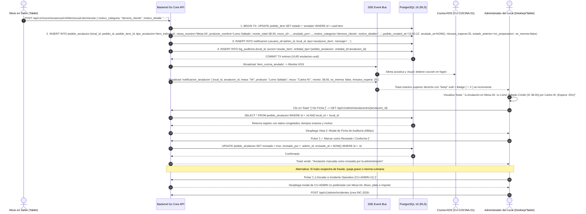
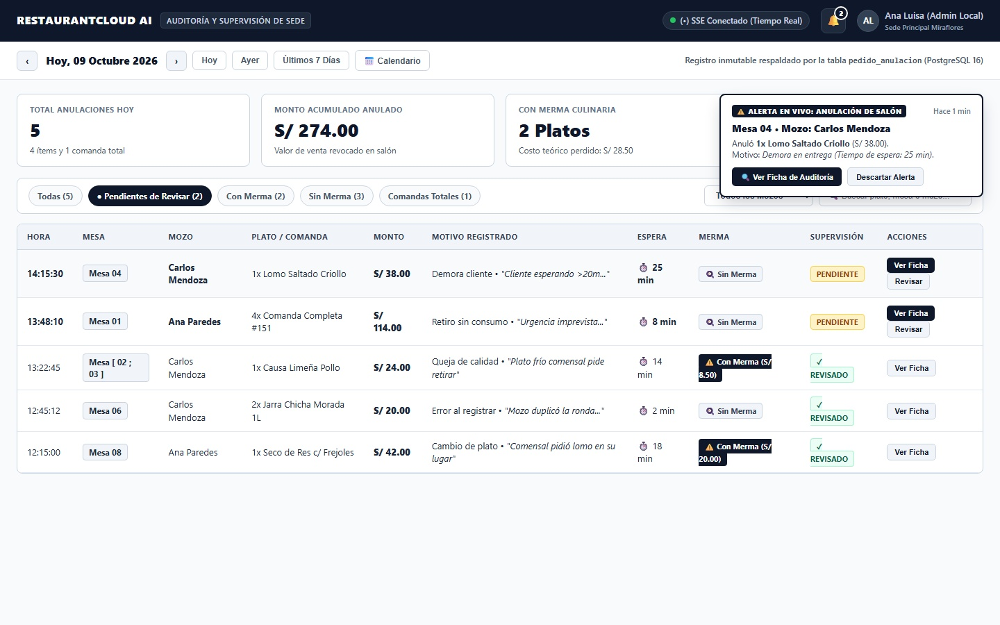
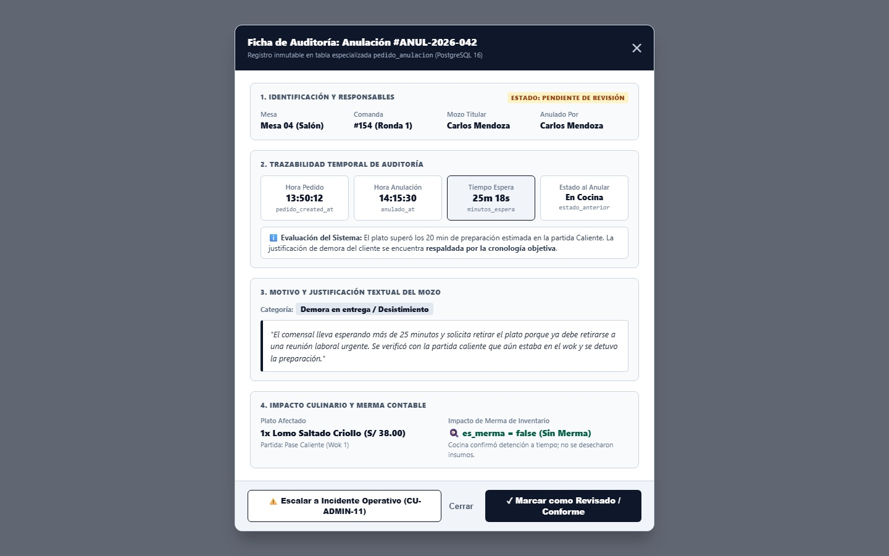
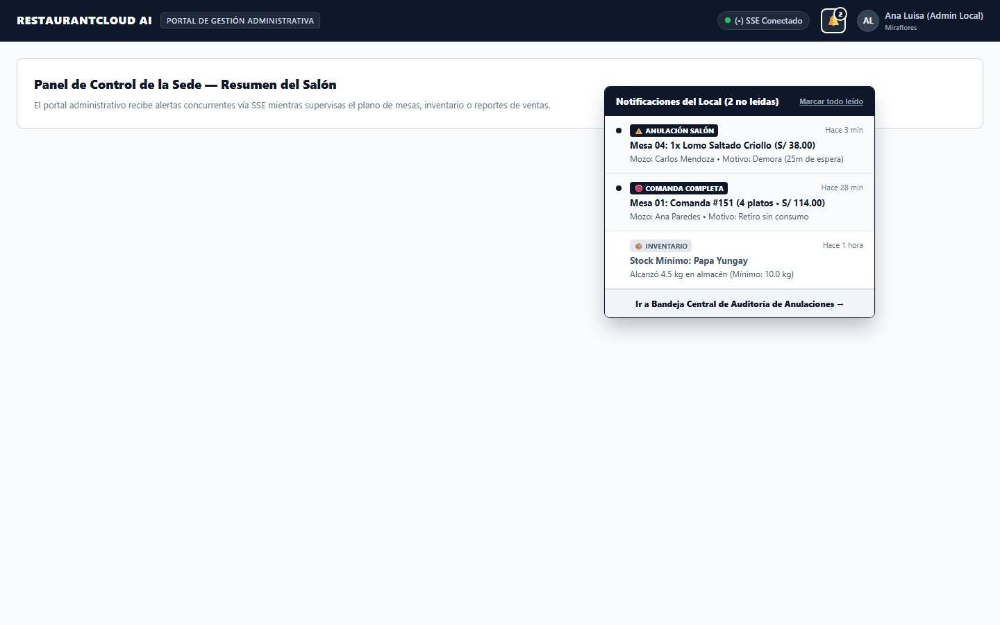
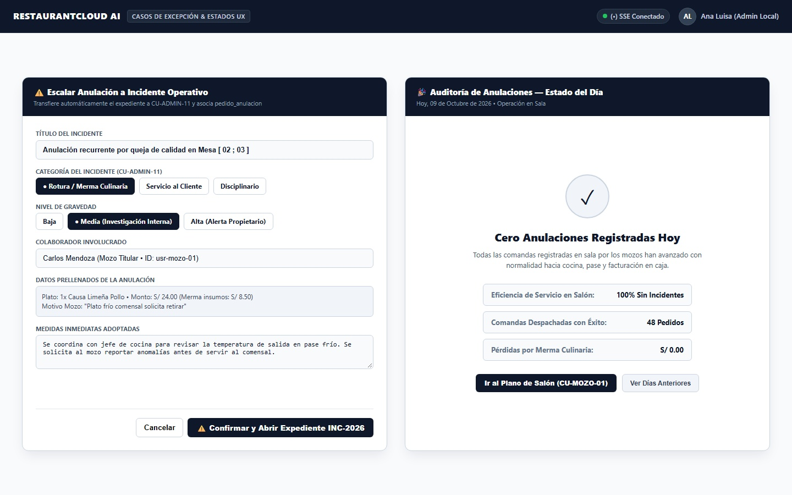

# CU-ADMIN-12: Recibir Notificación de Anulación de Pedido

Especificación técnica de interfaz de usuario, arquitectura de datos relacional para auditoría inmutable (`pedido_anulacion`), flujo reactivo de alertas en tiempo real vía Server-Sent Events (SSE), contratos de API en Go y control de mermas para **RestaurantCloud AI**.

---

## 1. Ficha Técnica del Caso de Uso

| Atributo | Detalle |
| :--- | :--- |
| **Código CU** | `CU-ADMIN-12` |
| **Nombre** | Recibir notificación de anulación de pedido y auditoría de sala |
| **Actor Principal** | `administrador_local` (responsable operativo directo del local; receptor de alertas y supervisor que audita justificaciones, tiempos de espera, mermas culinarias y marca revisiones) |
| **Actores Secundarios** | `mozo` (emisor de anulaciones en salón [`CU-MOZO-06`](file:///j:/proyectos_git/RestaurantCloud_AI_backend/wireframe/mozo/CU-MOZO-06-anular-pedido/wireframe.md)), `cajero` (emisor de cancelaciones previas a cobro [`CU-CAJA-02`](file:///j:/proyectos_git/RestaurantCloud_AI_backend/context/cu.md#L1070)), `cocina` (detención de cocción en monitor KDS [`CU-COCINA-01`](file:///j:/proyectos_git/RestaurantCloud_AI_backend/context/cu.md#L1110)), `propietario` (supervisión corporativa si escala a incidente de gravedad alta [`CU-PROP-09`](file:///j:/proyectos_git/RestaurantCloud_AI_backend/context/cu.md#L730)) |
| **Dispositivo / Viewport** | Responsive Desktop (`1440x900`), Tablet Horizontal (`1024x768` / `1280x800`), Terminal Fija POS (`1920x1080`) |
| **Precondición** | El local se encuentra activo; el usuario cuenta con sesión autenticada con token JWT y rol `administrador_local` asignado a dicha sede (`local_id`); un Mozo o Cajero ejecutó la anulación de un ítem de pedido o comanda completa con motivo obligatorio en `CU-MOZO-06`. |
| **Postcondición** | La anulación queda registrada atómicamente en la tabla especializada `pedido_anulacion`; el backend distribuye la alerta en tiempo real vía Server-Sent Events (SSE) disparando un Toast flotante y actualizando la campana `[ 🔔 ]` en el portal del administrador; el administrador puede inspeccionar la cronología temporal (`pedido_created_at` vs `anulado_at`), auditar el impacto de merma culinaria, registrar su conformidad (`revisado = true`) o escalar el caso directamente a un Incidente Operativo formal ([`CU-ADMIN-11`](file:///j:/proyectos_git/RestaurantCloud_AI_backend/wireframe/administrador/CU-ADMIN-11-incidentes-internos/wireframe.md)). |

---

## 2. Diagrama de Flujo y Secuencia en Tiempo Real



---

## 3. Especificación de Pantallas y Wireframes Blueprint

### Vista 1: Bandeja Central de Control de Anulaciones y Auditoría de Sede (`wf_admin_12_bandeja_anulaciones.jpg`)

Bandeja principal de gestión interna de novedades y anomalías del local (`1440x900` / Tablet `1024x768`):
- **Barra de Navegación y Fecha Limpia:** Selector de fecha táctil `[ < Hoy, 09 Octubre 2026 > ]` con atajos rápidos (`Hoy`, `Ayer`, `Últimos 7 Días`, `📅 Calendario`), sin divisiones artificiales de turnos. Indicador `(•) SSE Conectado` y Campana de notificaciones interactiva `[ 🔔 2 ]`.
- **Tarjetas Métricas KPI del Día:**
  - *Total Anulaciones:* 5 registradas hoy (4 ítems y 1 comanda total).
  - *Monto Acumulado Anulado:* S/ 274.00 (valor de venta revocado en salón).
  - *Con Merma Culinaria:* 2 platos (costo teórico de insumos perdido: S/ 28.50).
  - *Mesas Involucradas:* 3 mesas (`Mesa 04`, `Mesa 01`, `Mesa [ 02 ; 03 ]`).
- **Filtros Rápidos en Píldora:** `[ Todas (5) ]`, `[ ● Pendientes de Revisar (2) ]`, `[ Con Merma (2) ]`, `[ Sin Merma (3) ]`, `[ Comandas Totales (1) ]`.
- **Filtro por Mozo y Buscador:** Selector dropdown de personal (`Carlos Mendoza`, `Ana Paredes`) y campo reactivo para búsqueda rápida.
- **Tabla Operativa de Auditoría:** Columnas para Hora Anulación, Mesa asignada (con soporte para combinaciones `Mesa [ 02 ; 03 ]`), Mozo, Plato/Comanda, Monto (S/), Motivo / Justificación resumida, Tiempo de Espera (`⏱️ 25 min`), Semáforo de Merma (`🍳 Sin Merma` / `⚠️ Con Merma S/ 8.50`), Estado de Supervisión (`[ PENDIENTE ]` / `[ ✓ REVISADO ]`) y botones directos (`[ Ver Ficha ]`, `[ Revisar ]`).
- **Toast Flotante en Vivo:** En la esquina superior derecha se proyecta la alerta reactiva emergente con botón de inspección directa.



#### Layout Estructural ASCII (Desktop / Tablet 1440x900)
```text
+----------------------------------------------------------------------------------------------------+
| RESTAURANTCLOUD AI   | Auditoría y Supervisión de Sede   (•) SSE Conectado   [ 🔔 2 ]  [AL] Ana Luisa |
+----------------------------------------------------------------------------------------------------+
| [ < Hoy, 09 Octubre 2026 > ]  [ Hoy ] [ Ayer ] [ 7 Días ] [ 📅 ]      * Tabla: pedido_anulacion    |
|                                                                                                    |
| +------------------+  +------------------+  +------------------+  +------------------+             |
| | TOTAL ANULACIONES|  | MONTO ACUMULADO  |  | CON MERMA COCINA |  | MESAS AFECTADAS  |             |
| | 5 Registradas    |  | S/ 274.00        |  | 2 Platos (S/28.5)|  | 3 Mesas          |             |
| +------------------+  +------------------+  +------------------+  +------------------+             |
|                                                                                                    |
| Filtrar: [Todas (5)] [● Pendientes (2)] [Con Merma (2)] [Sin Merma (3)]  Mozo: [Todos ▾] [🔍 Buscar] |
|                                                                                                    |
| HORA    | MESA            | MOZO       | PLATO / COMANDA      | MONTO    | ESPERA  | MERMA  | ESTADO |
| --------+-----------------+------------+----------------------+----------+---------+--------+------- |
| 14:15:30| Mesa 04         | Carlos M.  | 1x Lomo Saltado      | S/ 38.00 | ⏱️ 25m  | Sin Mer|PENDIENT|
| 13:48:10| Mesa 01         | Ana P.     | Comanda Total #151   | S/ 114.00| ⏱️  8m  | Sin Mer|PENDIENT|
| 13:22:45| Mesa [ 02 ; 03 ]| Carlos M.  | 1x Causa Limeña Pollo| S/ 24.00 | ⏱️ 14m  | Con Mer|REVISADO|
| 12:45:12| Mesa 06         | Carlos M.  | 2x Chicha Morada 1L  | S/ 20.00 | ⏱️  2m  | Sin Mer|REVISADO|
| 12:15:00| Mesa 08         | Ana P.     | 1x Seco de Res       | S/ 42.00 | ⏱️ 18m  | Con Mer|REVISADO|
|                                                                                                    |
| Mostrando 5 registros de hoy. Total auditado: S/ 274.00          [ ⚠️ Toast Flotante Activo ]       |
+----------------------------------------------------------------------------------------------------+
```

---

### Vista 2: Modal de Inspección y Ficha de Auditoría de la Anulación (`wf_admin_12_modal_detalle_anulacion.jpg`)

Modal detallado de 680px que se abre al tocar una fila de la bandeja o presionar el Toast:
- **Encabezado Formal:** Identificador único `#ANUL-2026-042` y subtítulo informando el registro inmutable en `pedido_anulacion`.
- **Bloque 1 (Identificación y Responsables):** Mesa de origen (`Mesa 04 Salón Principal`), Comanda `#154 (Ronda 1)`, Mozo titular asignado y Usuario que ejecutó la anulación.
- **Bloque 2 (Trazabilidad Temporal de Auditoría):**
  - **Hora Pedido (`pedido_created_at`):** `13:50:12`.
  - **Hora Anulación (`anulado_at`):** `14:15:30`.
  - **Tiempo de Espera Total (`minutos_espera`):** `25 minutos 18 segundos`.
  - **Estado en que se encontraba el plato al anularse:** `En Preparación en Cocina` (`estado_anterior`).
  - **Evaluación del Sistema:** Alerta didáctica: *"El plato superó los 20 min de preparación estimada en la partida Caliente. La justificación de demora del cliente se encuentra respaldada por la cronología objetiva"*.
- **Bloque 3 (Motivo y Justificación Textual):** Categoría (`Demora en entrega / Desistimiento`) y la justificación obligatoria escrita por el mozo: *"El comensal lleva esperando más de 25 minutos y solicita retirar el plato porque ya debe retirarse a una reunión laboral urgente. Se verificó con cocina que aún estaba en wok"*.
- **Bloque 4 (Impacto Culinario y Merma):** Detalle del plato (`1x Lomo Saltado Criollo S/ 38.00`), partida de cocina (`Pase Caliente Wok 1`) e impacto de merma (`es_merma = false (Sin Merma Contable)`, insumos detenidos a tiempo).
- **Acciones Administrativas:**
  - `[ ⚠️ Escalar a Incidente Operativo (CU-ADMIN-11) ]` (Abre expediente formal por queja o anomalía).
  - `[ ✓ Marcar como Revisado / Conforme ]` (Registra acuse administrativo con marca temporal inmutable).
  - `[ Cerrar ]`.



#### Layout Estructural ASCII (Modal 680px)
```text
+------------------------------------------------------------------------------+
| Ficha de Auditoría: Anulación #ANUL-2026-042                             [✕] |
| Registro inmutable en tabla especializada pedido_anulacion (PostgreSQL 16)   |
+------------------------------------------------------------------------------+
| 1. IDENTIFICACIÓN Y RESPONSABLES                    [ ESTADO: PENDIENTE ]    |
|    Mesa: Mesa 04 (Salón)          Comanda: #154 (Ronda 1)                    |
|    Mozo Titular: Carlos Mendoza   Anulado Por: Carlos Mendoza (Mozo)         |
|                                                                              |
| 2. TRAZABILIDAD TEMPORAL DE AUDITORÍA:                                       |
|    +----------------+ +----------------+ +----------------+ +---------------+ |
|    | Hora Pedido    | | Hora Anulación | | Tiempo Espera  | | Estado al Cor.| |
|    | 13:50:12       | | 14:15:30       | | 25m 18s        | | En Cocina     | |
|    | pedido_created | | anulado_at     | | minutos_espera | | estado_ant.   | |
|    +----------------+ +----------------+ +----------------+ +---------------+ |
|    ℹ️ Demora confirmada: El plato excedió los 20 min de cocina caliente.     |
|                                                                              |
| 3. MOTIVO Y JUSTIFICACIÓN TEXTUAL DEL MOZO:                                  |
|    Categoría: [ Demora en entrega / Desistimiento ]                          |
|    "El comensal lleva esperando más de 25 minutos y solicita retirar el      |
|     plato porque ya debe retirarse a una reunión urgente..."                 |
|                                                                              |
| 4. IMPACTO CULINARIO Y MERMA CONTABLE:                                       |
|    Plato: 1x Lomo Saltado (S/ 38.00)      Partida: Pase Caliente (Wok 1)     |
|    Merma de Inventario: 🍳 es_merma = false (Sin Merma Contable)             |
+------------------------------------------------------------------------------+
| [ ⚠️ Escalar a Incidente (CU-ADMIN-11) ]   [ Cerrar ] [ ✓ Marcar Revisado ] |
+------------------------------------------------------------------------------+
```

---

### Vista 3: Dropdown de Campana de Notificaciones y Alerta Toast Flotante (`wf_admin_12_dropdown_campana_toast.jpg`)

Demostración de la interacción no invasiva en cualquier sección del portal del administrador:
- **Campana de Notificaciones Activa (`[ 🔔 2 ]`):** Al hacer clic sobre el icono de campana en el top bar, se despliega el menú flotante de 390px.
- **Contenido del Dropdown:**
  - Encabezado: *"Notificaciones del Local (2 no leídas)"* y enlace `[ Marcar todo leído ]`.
  - Alerta 1 (No leída, punto azul): *"⚠️ ANULACIÓN SALÓN • Hace 3 min • Mesa 04: 1x Lomo Saltado Criollo (S/ 38.00) • Mozo: Carlos Mendoza • Motivo: Demora (25m de espera)"*.
  - Alerta 2 (No leída, punto azul): *"🛑 COMANDA COMPLETA • Hace 28 min • Mesa 01: Comanda #151 (4 platos • S/ 114.00) • Mozo: Ana Paredes • Motivo: Retiro sin consumo"*.
  - Alerta 3 (Leída): *"📦 INVENTARIO • Hace 1 hora • Stock Mínimo: Papa Yungay alcanzó 4.5 kg en almacén (Mínimo: 10.0 kg)"*.
  - Pie: Enlace directo `[ Ir a Bandeja Central de Auditoría de Anulaciones → ]`.
- **Toast Emergente en Vivo:** Se visualiza simultáneamente en pantalla, mostrando cómo el administrador es advertido acústica y visualmente en el instante exacto en que un mozo anula un plato en salón.



#### Layout Estructural ASCII (Dropdown 390px)
```text
                                           +-----------------------------------+
                                           | Notificaciones del Local (2) [✓✓] |
                                           +-----------------------------------+
                                           | ● ⚠️ ANULACIÓN SALÓN    Hace 3m   |
                                           |   Mesa 04: 1x Lomo Saltado (S/ 38)|
                                           |   Mozo: Carlos M. • Demora (25m)  |
                                           | --------------------------------- |
                                           | ● 🛑 COMANDA COMPLETA   Hace 28m  |
                                           |   Mesa 01: Comanda #151 (S/ 114)  |
                                           |   Mozo: Ana P. • Retiro sin cons. |
                                           | --------------------------------- |
                                           |   📦 INVENTARIO         Hace 1h   |
                                           |   Stock Mínimo: Papa Yungay 4.5kg |
                                           +-----------------------------------+
                                           | [ Ir a Bandeja de Auditoría → ]   |
                                           +-----------------------------------+
```

---

### Vista 4: Estados de Excepción — Diálogo de Escalamiento a Incidente y Estado Vacío Positivo (`wf_admin_12_escalamiento_y_vacio.jpg`)

Composición dual de casos de frontera operativa:
- **Panel Izquierdo (Modal de Escalamiento 540px):**
  - Se abre al pulsar `[ ⚠️ Escalar a Incidente Operativo (CU-ADMIN-11) ]` desde la Ficha de Auditoría.
  - Prellena automáticamente todos los datos del suceso para evitar recaptura:
    - Título: *"Anulación recurrente por queja de calidad en Mesa [ 02 ; 03 ]"*.
    - Categoría: Seleccionada en `Rotura / Merma Culinaria` o `Servicio al Cliente`.
    - Gravedad: `Media` (Investigación Interna) o `Alta` (Alerta inmediata al Propietario en `CU-PROP-09`).
    - Colaborador involucrado: Carlos Mendoza.
    - Datos congelados: 1x Causa Limeña Pollo • S/ 24.00 (Costo merma S/ 8.50).
    - Campo editable: Medidas inmediatas adoptadas en cocina y salón.
  - Botón: `[ ⚠️ Confirmar y Abrir Expediente INC-2026 ]` (genera el correlativo anual y vincula `pedido_anulacion.incidente_id`).
- **Panel Derecho (Tarjeta de Estado Vacío 540px):**
  - Despliega el estado de normalidad y excelencia operativa del local cuando no se han registrado anulaciones en la fecha activa:
    - Gráfico e insignia: *"🎉 Cero Anulaciones Registradas Hoy"*.
    - Subtítulo: *"09 de Octubre de 2026 • Operación en Sala"*.
    - Explicación: *"Todas las comandas registradas en sala por los mozos han avanzado con normalidad hacia cocina, pase y facturación en caja"*.
    - Métricas destacadas: `100% Eficiencia Operativa`, `48 Comandas Despachadas con Éxito`, `S/ 0.00 en Pérdidas por Merma`.
    - Botones: `[ Ir al Plano de Salón (CU-MOZO-01) ]` y `[ Ver Días Anteriores ]`.



#### Layout Estructural ASCII (Composición Dual 540px)
```text
+------------------------------------+  +------------------------------------+
| ⚠️ Escalar a Incidente (CU-ADMIN-11)|  | 🎉 Cero Anulaciones Hoy            |
+------------------------------------+  +------------------------------------+
| Título: Anulación recurrente en    |  |               ( ✓ )                |
| Mesa [ 02 ; 03 ] por queja calidad |  |                                    |
|                                    |  | Todas las comandas han avanzado    |
| Categoría: [● Rotura / Merma ]     |  | con normalidad hacia cocina y      |
| Gravedad:  [● Media ] (Investig.)  |  | facturación en caja sin cortes.    |
|                                    |  |                                    |
| Colaborador: Carlos Mendoza (Mozo) |  | • Eficiencia:  100% Sin Incidentes |
| Plato: 1x Causa Limeña (S/ 24.00)  |  | • Comandas:    48 Despachadas      |
| Merma insumos: S/ 8.50             |  | • Merma Total: S/ 0.00             |
|                                    |  |                                    |
| Medidas inmediatas:                |  | [ Ir al Plano de Salón (CU-MOZO-01)]|
| [ Se coordina con jefe de cocina...]  | [ Ver Días Anteriores ]            |
+------------------------------------+  +------------------------------------+
| [ Cancelar ] [ ⚠️ Abrir INC-2026 ]  |                                      |
+------------------------------------+  +------------------------------------+
```

---

## 4. Matriz de Estados de la UI (5 Estados UX)

| Estado UX | Indicador Visual | Comportamiento del Sistema / Acciones Disponibles |
| :--- | :--- | :--- |
| **1. Ideal / Bandeja Activa** | Vista 1 con tabla de novedades, semáforo de mermas y KPIs del día | Permite filtrar por estado de revisión (`Pendiente` / `Revisado`), buscar por plato o mozo y consultar la ficha. |
| **2. Alerta en Vivo** | Vista 3 con Toast reactivo flotante y badge numérico `[ 🔔 2 ]` | Notificación visual y acústica en < 30ms vía SSE sin interrumpir la tarea que realiza el administrador. |
| **3. Inspección / Ficha** | Vista 2 con modal de 680px y desglose cronológico exacto | Muestra `pedido_created_at`, `anulado_at`, `minutos_espera`, `estado_anterior`, merma culinaria y justificación del mozo. |
| **4. Escalamiento Asistido** | Vista 4 (izq) con modal de transferencia a `CU-ADMIN-11` | Prellena datos del mozo, mesa y plato para abrir formalmente un expediente de incidente (`INC-YYYY-###`) sin recaptura. |
| **5. Vacío Positivo** | Vista 4 (der) con tarjeta de 0 anulaciones | Comunica felicitación por servicio impecable en cocina y salón; acceso rápido al plano de mesas. |

---

## 5. Control de Acceso y Matriz RBAC

| Rol | Ver Notificación SSE | Ver Bandeja Anulaciones | Marcar Revisado | Escalar a Incidente (`CU-ADMIN-11`) | Anular Platos |
| :--- | :---: | :---: | :---: | :---: | :---: |
| `admin_local` | ✅ Sí | ✅ Sí | ✅ Sí | ✅ Sí | ✅ Sí (supervisión) |
| `mozo` | ❌ No | ❌ No | ❌ No | ❌ No | ✅ Sí (`CU-MOZO-06`) |
| `cajero` | ❌ No | ❌ No | ❌ No | ❌ No | ✅ Sí (`CU-CAJA-02`) |
| `cocina` | ❌ No (KDS stop) | ❌ No | ❌ No | ❌ No | ❌ No |
| `propietario` | ✅ Sí (si escala) | ✅ Sí (monitor) | ❌ No (Sede) | ❌ No (Sede) | ❌ No |

---

## 6. Contratos de API Go y DTOs

### 6.1 DTOs (`internal/domain/administrador/dto_anulaciones.go`)

```go
package administrador

import (
	"time"
	"github.com/google/uuid"
)

// PedidoAnulacionItemDTO fila en la bandeja de auditoría
type PedidoAnulacionItemDTO struct {
	ID               uuid.UUID  `json:"id"`
	PedidoID         uuid.UUID  `json:"pedido_id"`
	PedidoItemID     *uuid.UUID `json:"pedido_item_id,omitempty"`
	TipoAnulacion    string     `json:"tipo_anulacion"` // "item_individual" o "comanda_completa"
	MesaNumero       string     `json:"mesa_numero"`    // "Mesa 04" o "Mesa [ 02 ; 03 ]"
	ProductoNombre   string     `json:"producto_nombre"`
	Cantidad         int        `json:"cantidad"`
	MontoTotal       float64    `json:"monto_total"`
	MozoNombre       string     `json:"mozo_nombre"`
	AnuladoPorNombre string     `json:"anulado_por_nombre"`
	MotivoCategoria  string     `json:"motivo_categoria"` // "demora_cliente", "error_registro", "queja_calidad", etc.
	MotivoDetalle    string     `json:"motivo_detalle"`
	MinutosEspera    int        `json:"minutos_espera"` // Diferencia fáctica entre anulado_at y pedido_created_at
	EstadoAnterior   string     `json:"estado_anterior"` // "en_cola", "en_preparacion", "listo", "servido"
	EsMerma          bool       `json:"es_merma"`
	CostoMerma       *float64   `json:"costo_merma,omitempty"`
	AnuladoAt        time.Time  `json:"anulado_at"`
	Revisado         bool       `json:"revisado"`
	RevisadoPor      *string    `json:"revisado_por,omitempty"`
	RevisadoAt       *time.Time `json:"revisado_at,omitempty"`
	IncidenteID      *uuid.UUID `json:"incidente_id,omitempty"`
}

// AnulacionesKPIsDTO métricas consolidadas del día
type AnulacionesKPIsDTO struct {
	TotalAnulaciones int     `json:"total_anulaciones"`
	MontoTotal       float64 `json:"monto_total"`
	ConMermaCantidad int     `json:"con_merma_cantidad"`
	CostoMermaTotal  float64 `json:"costo_merma_total"`
	MesasAfectadas   int     `json:"mesas_afectadas"`
}

// AnulacionesBandejaResponseDTO respuesta para la vista principal
type AnulacionesBandejaResponseDTO struct {
	Fecha        string                   `json:"fecha"` // "2026-10-09"
	KPIs         AnulacionesKPIsDTO       `json:"kpis"`
	Anulaciones  []PedidoAnulacionItemDTO `json:"anulaciones"`
}

// AnulacionDetalleDTO información exhaustiva para el modal de inspección
type AnulacionDetalleDTO struct {
	PedidoAnulacionItemDTO
	PedidoCreatedAt time.Time `json:"pedido_created_at"`
	PartidaCocina   string    `json:"partida_cocina"` // "Pase Caliente", "Horno", "Bar"
}

// MarcarRevisadoRequestDTO confirmación de lectura y auditoría
type MarcarRevisadoRequestDTO struct {
	NotasSupervision *string `json:"notas_supervision,omitempty"`
}

// EscalarIncidenteRequestDTO conversión asistida hacia CU-ADMIN-11
type EscalarIncidenteRequestDTO struct {
	Categoria        string  `json:"categoria" validate:"required"` // "rotura_merma", "servicio_cliente"
	Gravedad         string  `json:"gravedad" validate:"required"`  // "baja", "media", "alta"
	MedidasAdoptadas string  `json:"medidas_adoptadas" validate:"required,min=10"`
}
```

### 6.2 Eventos Server-Sent Events (SSE)

```json
// Evento emitido al administrador cuando se anula un plato: event: "notificacion_anulacion"
{
  "tipo": "notificacion_anulacion",
  "local_id": "8b9e6c40-...",
  "anulacion_id": "uuid-anulacion",
  "mesa_numero": "04",
  "producto_nombre": "1x Lomo Saltado Criollo",
  "monto": 38.00,
  "mozo_nombre": "Carlos Mendoza",
  "motivo_categoria": "demora_cliente",
  "minutos_espera": 25,
  "es_merma": false,
  "timestamp": "2026-10-09T14:15:30Z"
}
```

---

## 7. Catálogo de Endpoints REST

| Método | Ruta | Rol Requerido | Descripción | Códigos HTTP |
| :--- | :--- | :--- | :--- | :--- |
| `GET` | `/api/v1/admin/anulaciones` | `admin_local` | Retorna KPIs y bandeja de anulaciones por fecha | `200 OK`, `401 Unauthorized` |
| `GET` | `/api/v1/admin/anulaciones/{id}` | `admin_local` | Detalle con cronología temporal (`pedido_anulacion`) | `200 OK`, `404 Not Found` |
| `POST` | `/api/v1/admin/anulaciones/{id}/revisar` | `admin_local` | Marca la anulación como revisada por supervisión | `200 OK`, `409 Conflict` |
| `POST` | `/api/v1/admin/anulaciones/{id}/escalar-incidente` | `admin_local` | Genera incidente formal en `CU-ADMIN-11` con datos prellenados | `201 Created`, `400 Bad Request` |
| `GET` | `/api/v1/admin/notificaciones` | `admin_local` | Listado rápido de notificaciones de la campana | `200 OK` |
| `POST` | `/api/v1/admin/notificaciones/{id}/leer` | `admin_local` | Marca una notificación de campana como leída | `200 OK` |

---

## 8. Modelo Relacional PostgreSQL 16 y Migración

```sql
-- 1. Tabla especializada para auditoría, control de mermas y supervisión administrativa
CREATE TABLE IF NOT EXISTS pedido_anulacion (
    id UUID PRIMARY KEY DEFAULT gen_random_uuid(),
    local_id UUID NOT NULL REFERENCES local(id) ON DELETE CASCADE,
    pedido_id UUID NOT NULL REFERENCES pedido(id) ON DELETE CASCADE,
    pedido_item_id UUID NULL REFERENCES pedido_item(id) ON DELETE CASCADE, -- NULL si fue comanda completa
    tipo_anulacion VARCHAR(20) NOT NULL CHECK (tipo_anulacion IN ('item_individual', 'comanda_completa')),
    
    -- Contexto congelado del ítem / comanda
    mesa_id UUID NOT NULL REFERENCES mesa(id) ON DELETE RESTRICT,
    mesa_numero VARCHAR(50) NOT NULL, -- "Mesa 04" o "Mesa [ 02 ; 03 ]"
    producto_id UUID NULL REFERENCES producto(id) ON DELETE SET NULL,
    producto_nombre VARCHAR(120) NULL,
    cantidad INT NOT NULL DEFAULT 1 CHECK (cantidad > 0),
    precio_unitario DECIMAL(10, 2) NOT NULL DEFAULT 0.00,
    monto_total DECIMAL(10, 2) NOT NULL DEFAULT 0.00,
    
    -- Actores y justificación obligatoria
    mozo_id UUID NOT NULL REFERENCES usuario(id) ON DELETE RESTRICT, -- Mozo titular de la comanda
    anulado_por UUID NOT NULL REFERENCES usuario(id) ON DELETE RESTRICT, -- Mozo o Cajero que anuló
    motivo_categoria VARCHAR(30) NOT NULL 
        CHECK (motivo_categoria IN ('error_registro', 'demora_cliente', 'queja_calidad', 'cambio_plato', 'retiro_sin_consumo', 'otro')),
    motivo_detalle TEXT NOT NULL CHECK (LENGTH(TRIM(motivo_detalle)) >= 10),
    
    -- Trazabilidad temporal exacta
    pedido_created_at TIMESTAMPTZ NOT NULL, -- Momento en que se envió la comanda a cocina
    anulado_at TIMESTAMPTZ NOT NULL DEFAULT NOW(), -- Momento de la anulación
    minutos_espera INT NOT NULL, -- Calculado: (anulado_at - pedido_created_at) en minutos
    estado_anterior VARCHAR(30) NOT NULL, -- 'en_cola', 'en_preparacion', 'listo', 'servido'
    
    -- Impacto contable y merma de inventario
    es_merma BOOLEAN NOT NULL DEFAULT FALSE,
    costo_merma DECIMAL(10, 2) NULL, -- Costo teórico de receta perdido si es_merma = true
    
    -- Supervisión administrativa (CU-ADMIN-12)
    revisado BOOLEAN NOT NULL DEFAULT FALSE,
    revisado_por UUID NULL REFERENCES usuario(id) ON DELETE SET NULL,
    revisado_at TIMESTAMPTZ NULL,
    notas_supervision TEXT NULL,
    incidente_id UUID NULL REFERENCES incidente(id) ON DELETE SET NULL, -- Si escala a CU-ADMIN-11
    
    created_at TIMESTAMPTZ NOT NULL DEFAULT NOW()
);

-- 2. Índices de alto rendimiento para la bandeja y reportes analíticos
CREATE INDEX IF NOT EXISTS idx_pedido_anulacion_local_fecha 
ON pedido_anulacion(local_id, anulado_at DESC);

CREATE INDEX IF NOT EXISTS idx_pedido_anulacion_revisado 
ON pedido_anulacion(local_id, revisado) 
WHERE revisado = FALSE;

-- 3. Row-Level Security (Multi-Tenancy aislado por sede)
ALTER TABLE pedido_anulacion ENABLE ROW LEVEL SECURITY;

CREATE POLICY rls_pedido_anulacion_local ON pedido_anulacion
    FOR ALL USING (local_id = current_setting('app.current_local_id', true)::UUID);
```

---

## 9. Checklist de Accesibilidad WCAG 2.1 AA

- [x] **Contraste de Color Certificado:** Textos principales (`#0F172A` sobre `#F8FAFC` ratio 14.8:1) y etiquetas de estado (`#1E293B` sobre `#FFFFFF` ratio 12.1:1) superan holgadamente el mínimo de 4.5:1 exigido para texto estándar.
- [x] **Touch Targets Touch-First:** Botones de acción, píldoras de filtro y accesos en el dropdown de la campana cuentan con dimensiones superiores a `44x44px` en tablet y `48x48px` en mobile.
- [x] **Alerta Acústica y Visual Accesible:** El Toast en tiempo real combina una señal de audio sutil con animación visual y soporte para usuarios con discapacidad auditiva mediante región accesible `aria-live="assertive"`.
- [x] **Navegación por Teclado:** Foco secuencial completo (`Tab` / `Shift+Tab`) en la tabla de auditoría con activación de modales mediante tecla `Enter` y cierre accesible con `Escape`.
