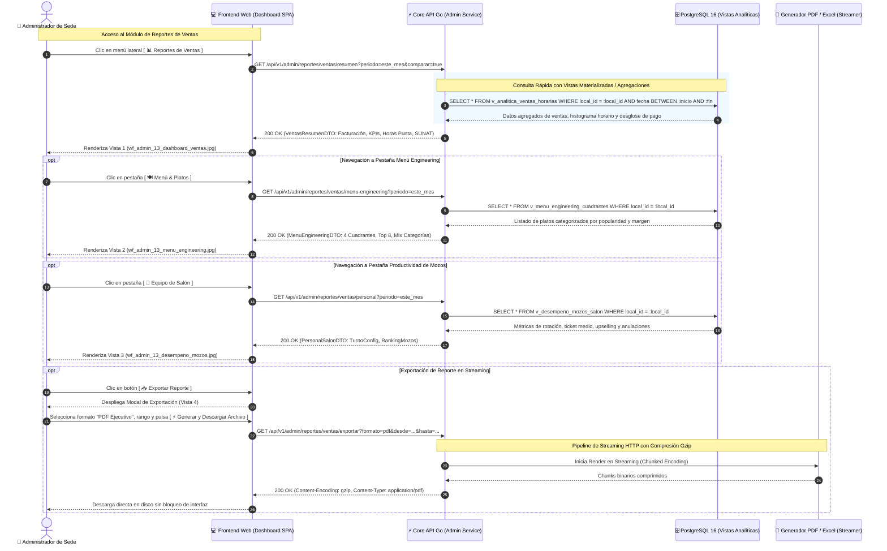

# Especificación Técnica y Wireframes: CU-ADMIN-13: Ver Reportes de Ventas y Desempeño

## 1. Ficha Técnica del Caso de Uso

| Atributo | Detalle |
| :--- | :--- |
| **Código** | `CU-ADMIN-13` |
| **Nombre** | **Ver reportes de ventas y desempeño** (Dashboard Ejecutivo de Salón, Culinario y Personal) |
| **Rol / Actor** | **Administrador del Restaurante** (Gerente de Sede / Administrador Operativo) |
| **Módulo** | Inteligencia de Negocios & Auditoría Operativa de Salón |
| **Objetivo de Negocio** | Proporcionar al administrador una interfaz unificada, modular y de alto rendimiento analítico para monitorear la facturación neta, identificar horas punta, evaluar la rentabilidad del menú mediante Menú Engineering de 4 cuadrantes, medir la productividad del personal de salón y exportar reportes ejecutivos con streaming HTTP. |
| **Precondiciones** | Administrador autenticado con JWT de rol `administrador` o `propietario` con acceso asignado al local actual (`empresa_id`, `local_id`). Existen pedidos cobrados y cerrados en [`CU-CAJA-03`](file:///j:/proyectos_git/RestaurantCloud_AI_backend/wireframe/cajero/CU-CAJA-03-cobrar-comanda/wireframe.md). |
| **Postcondiciones** | Consulta analítica de solo lectura sin alteración del estado operacional. Posibilidad de descargar reportes consolidados en PDF o Excel/CSV mediante streaming comprimido con Gzip. |
| **Tokens de Diseño** | Grayscale Blueprint: `#0F172A` (Primario / Slate Dark), `#1E293B` (Superficie Header), `#F8FAFC` (Canvas), `#FFFFFF` (Card), `#E2E8F0` (Bordes), `#0F172A` (Texto Principal), `#64748B` (Texto Muted), `#16A34A` (Verde Éxito / Incremento), `#EF4444` (Rojo Alerta / Anulaciones). |
| **Resolución Canónica** | `1440x900` px (Desktop Blueprint, JPG calidad 95). |

### Reglas de Negocio y Políticas de Inteligencia Operativa
1. **Segmentación por Pestañas Especializadas (Cero Saturación Cognitiva):**
   - Para evitar sobrecargar de datos al usuario y no transferir payloads pesados en red móvil, la interfaz se subdivide en tres submódulos estratégicos:
     - **Pestaña 1: Ventas Generales & KPIs:** Facturación neta acumulada, pedidos cobrados, ticket promedio por mesa/comensal, rotación horaria, histograma de horas punta y desglose por medios de pago/SUNAT.
     - **Pestaña 2: Menú Engineering & Mix de Platos:** Clasificación analítica de los platos en 4 cuadrantes (Estrellas, Caballitos de Batalla, Puzles y Rezagados), Top platos y distribución de ingresos por categoría.
     - **Pestaña 3: Equipo de Salón & Operatividad de Turno:** Métricas individuales de mozos (ventas, ticket promedio, velocidad de mesa, upselling de 2da ronda y tasa de anulaciones), con adaptación inteligente según el régimen de turnos del local.
2. **Resiliencia Operativa de Turnos (Turno Único vs Doble Turno):**
   - El sistema detecta automáticamente la configuración operativa de la sede:
     - Si la sede opera con **Turno Partido** (Almuerzo: 11:30 - 16:30 y Cena: 18:30 - 23:30), presenta tarjetas comparativas entre ambos bloques de servicio.
     - Si la sede opera con **Turno Único Continuo** (ej. 12:00 a 22:00 ininterrumpido), la interfaz presenta una única tarjeta consolidada del 100% de la jornada, sin forzar comparaciones artificiales ni generar errores de datos nulos.
3. **Métrica de Menú Engineering (Matriz Boston Consulting Group adaptada a Restaurantes):**
   - **Estrellas (Alta Venta / Alto Margen):** Favoritos de la clientela con margen de contribución superior al promedio. Recomendación: Proteger calidad y no modificar receta.
   - **Caballitos de Batalla (Alta Venta / Margen Medio o Bajo):** Platos populares de alto volumen pero menor ganancia unitaria. Recomendación: Rediseñar costeo, negociar insumos con proveedores o ajustar precio marginalmente.
   - **Puzles (Baja Venta / Alto Margen):** Platos de alta ganancia pero rotación lenta. Recomendación: Impulsar recomendaciones activas de salón por los mozos o armar combos promocionales ([`CU-ADMIN-17`](file:///j:/proyectos_git/RestaurantCloud_AI_backend/wireframe/administrador/CU-ADMIN-17-gestionar-promociones/wireframe.md)).
   - **Rezagados (Baja Venta / Bajo Margen):** Platos de poca demanda y baja rentabilidad. Recomendación: Evaluar retiro de carta o reemplazo en próxima actualización de menú ([`CU-ADMIN-01`](file:///j:/proyectos_git/RestaurantCloud_AI_backend/wireframe/administrador/CU-ADMIN-01-gestionar-carta/wireframe.md)).
4. **Trazabilidad de Productividad y Anulaciones de Mozos:**
   - La tabla de mozos mide la efectividad de **Upselling**: porcentaje de mesas donde el mozo logró colocar rondas adicionales (bebidas, entradas o postres después del pedido inicial de fondos).
   - Registra de forma transparente la cantidad y porcentaje de ítems anulados por mozo vinculados a [`CU-MOZO-06`](file:///j:/proyectos_git/RestaurantCloud_AI_backend/wireframe/mozo/CU-MOZO-06-anular-item/wireframe.md), permitiendo identificar si se deben a equivocaciones al comandar o problemas en cocina.
5. **Descarga Asíncrona en Streaming HTTP con Compresión Gzip:**
   - La exportación de reportes masivos no bloquea la memoria RAM del servidor ni del cliente. El backend Go transmite los registros mediante HTTP Chunked Transfer Encoding comprimido con `middleware.Gzip()`, logrando un ahorro de ancho de banda del ~80% y permitiendo descargar archivos extensos sin timeouts.

---

## 2. Diagrama de Secuencia Mermaid



---

## 3. Diagramación Wireframe ASCII y Guía de Microcopias

---

### 3.1 Vista 1: Dashboard Estratégico & KPIs de Ventas (`wf_admin_13_dashboard_ventas.jpg`)

Vista principal que consolida la salud financiera y el pulso comercial del local en el período seleccionado.

#### Distribución Estructural (Layout ASCII)
```text
+-------------------------------------------------------------------------------------------------------------------------------------+
| [VISTA 1: CU-ADMIN-13: DASHBOARD ESTRATÉGICO & KPIS DE VENTAS]  [https://app.restaurantcloud.pe/admin/reportes/ventas]  SEDE: SAN ISIDRO |
+-------------------------------------------------------------------------------------------------------------------------------------+
| [ 📈 Ventas Generales (Activo) ]  [ 🍽️ Menú & Platos ]  [ 👥 Equipo de Salón ]     [Hoy] [Ayer] [Semana] [Este Mes (Octubre) v] [✓ vs Ant.] [📥 Exportar] |
|-------------------------------------------------------------------------------------------------------------------------------------|
|  +------------------------+  +------------------------+  +------------------------+  +------------------------+                     |
|  | FACTURACIÓN TOTAL NETA |  | COMANDAS COBRADAS      |  | TICKET PROMEDIO        |  | ROTACIÓN MEDIA DE MESA |                     |
|  | S/ 28,450.00   [▲12.4%]|  | 412 Cuentas    [▲ 5.2%]|  | S/ 69.05 /mesa [▲ 6.8%]|  | 48 Minutos     [▼-4min]|                     |
|  | Base: 24,110 • IGV:4,339|  | Prom: 13.7 mesas/día   |  | Gasto comensal: S/24.30|  | Pedido hasta cobro caja|                     |
|  +------------------------+  +------------------------+  +------------------------+  +------------------------+                     |
|                                                                                                                                     |
|  +----------------------------------------------------------------+  +-----------------------------------------------------------+  |
|  | Curva Horaria de Facturación y Horas Punta (Almuerzo vs Cena)  |  | Recaudación por Medios de Pago (CU-ADMIN-19)              |  |
|  |                                      Horario continuo 11h-23h  |  |                                                           |  |
|  |           7.1k                                                 |  | 💳 Tarjeta Débito / Crédito (POS):    S/ 15,363.00 (54%)  |  |
|  |       5.8k     |                        6.1k                   |  |    [█████████████████████████████████████              ]  |  |
|  |   3.1k    |    |                    4.9k    |                  |  | 💵 Efectivo en Gaveta:                 S/  9,104.00 (32%)  |  |
|  |  |    |   |    |    2.8k         3.4k   |    |    2.2k          |  |    [███████████████████                                ]  |  |
|  | 1.2k  |   |    |   |    1.1k 1.8k   |   |    |   |               |  | 📱 Billeteras Digitales (Yape/Plin):   S/  3,983.00 (14%)  |  |
|  |  |    |   |    |   |    |  0.9k |   |   |    |   |               |  |    [█████████                                          ]  |  |
|  | 11h  12h 13h  14h 15h  16h 17h 18h 19h 20h  21h 22h             |  |-----------------------------------------------------------|  |
|  |                                                                |  | Emisión por Tipo de Comprobante (CU-CAJA-03)              |  |
|  | [ Pico Almuerzo (13:00 - 15:00): 45.6% ingresos (S/ 12,940) ] |  | Boleta de Venta Electrónica:                 280 (68.0%)  |  |
|  | [ Pico Cena (20:00 - 22:00): 38.8% ingresos (S/ 11,030)     ] |  | Factura Electrónica (RUC):                    99 (24.0%)  |  |
|  |                                                                |  | Nota de Venta Interna:                        33  (8.0%)  |  |
|  |                                                                |  | Notas de Crédito (Anulaciones):                3  (0.7%)  |  |
|  |                                                                |  |                                                           |  |
|  |                                                                |  | 💡 El 68% de transacciones son digitales (POS + Yape).    |  |
|  +----------------------------------------------------------------+  +-----------------------------------------------------------+  |
+-------------------------------------------------------------------------------------------------------------------------------------+
```

#### Guía de Elementos y Microcopias
- **Selector de Filtro Temporal:** Opciones directas `[Hoy]`, `[Ayer]`, `[Semana]`, `[Este Mes (Octubre) v]` y selector checkbox `[✓ vs. Mes anterior]` para habilitar deltas porcentuales.
- **KPI 1: Facturación Total Neta:** Exhibe monto en Soles `S/ 28,450.00`, delta de crecimiento `▲ +12.4%`, desglose de base imponible gravada (`S/ 24,110.17`) e IGV 18% (`S/ 4,339.83`).
- **KPI 2: Comandas Cobradas:** Muestra volumen total de cuentas cerradas con éxito (`412 Cuentas`), delta `▲ +5.2%` y ratio diario (`13.7 mesas / día`).
- **KPI 3: Ticket Promedio:** Monto promedio facturado por comensal y mesa (`S/ 69.05 / mesa`), junto con el promedio individual (`S/ 24.30 / comensal`).
- **KPI 4: Rotación Media de Mesa:** Tiempo promedio de permanencia desde apertura de orden hasta liquidación (`48 Minutos`), con badge verde de eficiencia `▼ -4 min`.
- **Histograma de Horas Punta:** Gráfico de barras por hora que visualiza los picos de Almuerzo (13h-15h) y Cena (20h-22h) con tarjetas de síntesis interpretativa al pie.
- **Medios de Pago & SUNAT:** Barras de progreso con porcentajes de POS, Efectivo y Billeteras Digitales, además de la cantidad emitida de Boletas, Facturas y Notas de Crédito.

---

### 3.2 Vista 2: Menú Engineering & Mix Culinario (`wf_admin_13_menu_engineering.jpg`)

Vista analítica para determinar la rentabilidad y popularidad de cada plato de la carta.

#### Distribución Estructural (Layout ASCII)
```text
+-------------------------------------------------------------------------------------------------------------------------------------+
| [VISTA 2: CU-ADMIN-13: MENÚ ENGINEERING & MIX CULINARIO]   [https://app.restaurantcloud.pe/admin/reportes/ventas?tab=menu]          |
+-------------------------------------------------------------------------------------------------------------------------------------+
| [ 📈 Ventas Generales ]  [ 🍽️ Menú & Platos (Activo) ]  [ 👥 Equipo de Salón ]             [Semana] [Este Mes (Octubre) v] [📥 Exportar] |
|-------------------------------------------------------------------------------------------------------------------------------------|
|  +----------------------------------------+  +----------------------------------------+                                             |
|  | ⭐ ESTRELLAS (Alta Venta • Alto Margen) |  | 🐎 CABALLITOS (Alta Venta • Margen Medio)  |                                             |
|  | Favoritos de comensales con máx ganancia|  | Gran volumen de salida pero menor ganancia|                                             |
|  | • 🍗 1/4 Pollo a la Brasa (148 u. • 68%)|  | • 🍚 Arroz Chaufa Especial (114 u. • 42%) |                                             |
|  | • 🥩 Lomo Saltado Criollo (92 u. • 62%) |  | • 🍟 Papas Nativas Grandes (86 u. • 39%)  |                                             |
|  | Estrategia: Mantener estándar y visib. |  | Estrategia: Calibrar receta o precio.  |                                             |
|  +----------------------------------------+  +----------------------------------------+                                             |
|  +----------------------------------------+  +----------------------------------------+                                             |
|  | 🧩 PUZLES (Baja Venta • Alto Margen)    |  | ⚠️ REZAGADOS (Baja Venta • Bajo Margen) |                                             |
|  | Alta ganancia pero poca rotación       |  | Candidatos a reformulación o retiro     |                                             |
|  | • 🥩 Parrilla Especial Lomo (28 u.• 71%)|  | • 🍲 Sopa Criolla Familiar (14 u.• 34%)|                                             |
|  | • 🐟 Tiradito de Ají Amaril. (22 u.• 66%)|  | • 🥗 Ensalada Mixta Simple (16 u.• 31%)|                                             |
|  | Estrategia: Promover en salón y combos. |  | Estrategia: Reducir insumos perecibles.|                                             |
|  +----------------------------------------+  +----------------------------------------+                                             |
|                                                                                                                                     |
|  +----------------------------------------------------------------+  +-----------------------------------------------------------+  |
|  | Top 8 Platos Más Vendidos de la Sede      Total: 28 platos     |  | Participación por Categoría                               |  |
|  | #  Plato Culinario        Categoría       Unid.   Recaudación  |  | Distribución de ingresos sobre el 100%                    |  |
|  | 1  🍗 1/4 Pollo a Brasa   Pollos & Brasas 148 u.  S/ 3,626.00  |  | 🍗 Pollos & Brasas:                   42.5% (S/ 12,091)   |  |
|  | 2  🥩 Lomo Saltado        Carnes & Brasas  92 u.  S/ 3,864.00  |  |    [████████████████████████████                          ]  |  |
|  | 3  🍚 Arroz Chaufa Esp.   Chifa & Wok     114 u.  S/ 2,280.00  |  | 🥩 Parrillas & Carnes:                26.1% (S/  7,425)   |  |
|  | 4  🥩 Parrilla Familiar   Parrillas        31 u.  S/ 3,565.00  |  |    [█████████████████                                     ]  |  |
|  | 5  🍗 1/2 Pollo Familiar  Pollos & Brasas  74 u.  S/ 2,812.00  |  | 🍹 Bebidas & Bar:                     15.4% (S/  4,381)   |  |
|  | 6  🍹 Chicha Morada 1.5L  Bebidas         138 u.  S/ 2,208.00  |  |    [██████████                                            ]  |  |
|  | 7  🍟 Papas Nativas Rúst. Guarniciones     86 u.  S/ 1,032.00  |  | 🍟 Guarniciones:                       9.2% (S/  2,617)   |  |
|  | 8  🍰 Torta Maracuyá      Postres          58 u.  S/   870.00  |  | 🍰 Postres:                            6.8% (S/  1,934)   |  |
|  | ⚠️ Torta Maracuyá estuvo en quiebre de stock el fin de semana.   |  | 💡 Brasas y Parrillas aportan el 68.6% del revenue total. |  |
|  +----------------------------------------------------------------+  +-----------------------------------------------------------+  |
+-------------------------------------------------------------------------------------------------------------------------------------+
```

#### Guía de Elementos y Microcopias
- **Matriz de 4 Cuadrantes:**
  - Card 1: `⭐ ESTRELLAS` (Borde ámbar sutil, lista con unidades vendidas y % margen de contribución, directriz estratégica de protección de estándares).
  - Card 2: `🐎 CABALLITOS` (Borde azul sutil, volumen de salida masivo, recomendación de calibración de costos/precios).
  - Card 3: `🧩 PUZLES` (Borde verde esmeralda, alto margen con baja rotación, sugerencia de venta sugerida en mesa y promociones en [`CU-ADMIN-17`](file:///j:/proyectos_git/RestaurantCloud_AI_backend/wireframe/administrador/CU-ADMIN-17-gestionar-promociones/wireframe.md)).
  - Card 4: `⚠️ REZAGADOS` (Borde anaranjado/alerta, baja demanda y margen escaso, recomendación de reformulación o retiro en [`CU-ADMIN-01`](file:///j:/proyectos_git/RestaurantCloud_AI_backend/wireframe/administrador/CU-ADMIN-01-gestionar-carta/wireframe.md)).
- **Tabla Top 8 Platos:** Columnas ordenadas `#`, `Plato Culinario`, `Categoría`, `Unidades Vendidas`, `Recaudación (S/)`, `% Mix de Venta` y `Estado Stock` (`Disponible` o `Quiebre temporal`).
- **Participación por Categoría:** Barras horizontales proporcionales mostrando la cuota de mercado culinario de la sede.

---

### 3.3 Vista 3: Productividad del Equipo de Salón & Operaciones de Turno (`wf_admin_13_desempeno_mozos.jpg`)

Vista de auditoría humana y operativa que mide el rendimiento de los mozos y consolida los turnos de atención.

#### Distribución Estructural (Layout ASCII)
```text
+-------------------------------------------------------------------------------------------------------------------------------------+
| [VISTA 3: CU-ADMIN-13: PRODUCTIVIDAD DEL EQUIPO DE SALÓN]  [https://app.restaurantcloud.pe/admin/reportes/ventas?tab=personal]     |
+-------------------------------------------------------------------------------------------------------------------------------------+
| [ 📈 Ventas Generales ]  [ 🍽️ Menú & Platos ]  [ 👥 Equipo de Salón (Activo) ]             [Semana] [Este Mes (Octubre) v] [📥 Exportar] |
|-------------------------------------------------------------------------------------------------------------------------------------|
|  +-------------------------------------------------------------------------------------------------------------------------------+  |
|  | Modalidad Operativa: Doble Turno (Almuerzo & Cena)          [☀️ Turno Mañana (11:30-16:30): 228 mesas • S/ 15,932.00]         |  |
|  | ℹ️ Adaptable: En sedes con Turno Único Continuo, el sistema  [🌙 Turno Noche (18:30-23:30):  184 mesas • S/ 12,518.00]         |  |
|  | consolida el 100% de métricas continuas sin forzar comparat.|                                                                 |  |
|  +-------------------------------------------------------------------------------------------------------------------------------+  |
|                                                                                                                                     |
|  +-------------------------------------------------------------------------------------------------------------------------------+  |
|  | Rendimiento Individual del Personal de Salón (Mozos)                                                   Total Mozos Activos: 3 |  |
|  | Métricas acumuladas en comanda móvil (CU-MOZO-02), rotación y ventas generadas                                                |  |
|  |                                                                                                                               |  |
|  | Colaborador / Mozo   Mesas Atendidas  Venta Generada  Ticket Medio  Tiempo Mesa  Upselling (2da R.)  Anulaciones  Desempeño      |  |
|  | -------------------- ---------------  --------------  ------------  -----------  ------------------  -----------  --------------|  |
|  | 👤 Marco Valdivia        142 mesas     S/ 10,480.00    S/ 73.80      44 min       38.0% (54 mesas)    1 (0.7%)    👑 LÍDER VENTAS|  |
|  |    Turno Mixto • Salón                                              (Rápido)                                                  |  |
|  | 👤 Lucía Flores          136 mesas     S/  9,520.00    S/ 70.00      47 min       34.5% (47 mesas)    2 (1.4%)    ⭐ DESTACADO   |  |
|  |    Turno Noche • Terraza                                            (Óptimo)                                                  |  |
|  | 👤 Pedro Castillo        134 mesas     S/  8,450.00    S/ 63.05      53 min       22.3% (30 mesas)    4 (2.9%)    ⚠️ POR MEJORAR |  |
|  |    Turno Mañana • Salón                                             (Lento)                                                   |  |
|  |                                                                                                                               |  |
|  | 🎯 Criterio de Upselling: Comandas con 2da o 3ra ronda de bebidas/postres. Eleva el ticket promedio en +S/ 14.50.            |  |
|  | ⏱️ Tiempo Promedio Mesa: Marco Valdivia rota 9 minutos más rápido que Pedro Castillo.                                         |  |
|  | 🚫 Control de Anulaciones: Trazabilidad con CU-MOZO-06 para detectar errores frecuentes en toma de comandas móviles.           |  |
|  +-------------------------------------------------------------------------------------------------------------------------------+  |
+-------------------------------------------------------------------------------------------------------------------------------------+
```

#### Guía de Elementos y Microcopias
- **Banner de Modalidad Operativa de Turno:**
  - Indica la configuración de la sede: `Modalidad Operativa: Doble Turno (Almuerzo & Cena)`.
  - Tarjetas de resumen de turno con cantidad de mesas atendidas, facturación total y ticket promedio.
  - Leyenda informativa de resiliencia: *"Adaptable: En sedes que operan con Turno Único Continuo, el sistema consolida el 100% de métricas continuas sin forzar comparativa."*
- **Tabla de Auditoría de Mozos:**
  - `Colaborador / Mozo`: Nombre y asignación de turno/zona de servicio.
  - `Mesas Atendidas`: Volumen de órdenes abiertas y liquidadas con éxito.
  - `Venta Generada`: Facturación directa acumulada atribuible a las órdenes atendidas.
  - `Ticket Medio Mesa`: Eficacia en el tamaño de consumo por comensal/mesa.
  - `Tiempo Promedio de Mesa`: Medición de agilidad operativa con etiquetas de estado `(Rápido)`, `(Óptimo)` o `(Lento)`.
  - `Upselling (2da Ronda)`: Porcentaje y número de mesas donde el mozo ofreció y registró recargas o postres adicionales.
  - `Anulaciones (CU-MOZO-06)`: Conteo de ítems eliminados de comanda para auditoría de mermas o errores humanos.
  - `Desempeño`: Badge de reconocimiento motivacional (`👑 LÍDER VENTAS`, `⭐ DESTACADO`, `⚠️ POR MEJORAR`).

---

### 3.4 Vista 4: Modal de Exportación Asíncrona con Streaming (`wf_admin_13_modal_exportar.jpg`)

Modal de diálogo accesible desde cualquier pestaña para generar descargas formales sin bloquear el hilo principal.

#### Distribución Estructural (Layout ASCII)
```text
+----------------------------------------------------------------------------------------------------+
|  [VISTA 4: CU-ADMIN-13: MODAL DE EXPORTACIÓN Y STREAMING ASÍNCRONO]                                |
+----------------------------------------------------------------------------------------------------+
|                                                                                                    |
|                  +---------------------------------------------------------------+                 |
|                  | 📥 Exportar Reporte de Ventas y Desempeño                 [✕] |                 |
|                  |---------------------------------------------------------------|                 |
|                  | 1. Selecciona el Formato de Salida                            |                 |
|                  | +-------------------------------+ +-------------------------+ |                 |
|                  | | 📄 Reporte Ejecutivo en PDF   | | 📊 Hoja de Cálculo      | |                 |
|                  | | (Seleccionado)                | |    Excel / CSV          | |                 |
|                  | | Documento formal con KPIs,    | | Datos tabulares por     | |                 |
|                  | | gráficos y resumen financiero.| | transacción contable.   | |                 |
|                  | +-------------------------------+ +-------------------------+ |                 |
|                  |                                                               |                 |
|                  | 2. Rango de Fechas a Exportar                                 |                 |
|                  | Desde: [ 01/10/2026        ]    Hasta: [ 31/10/2026         ] |                 |
|                  |                                                               |                 |
|                  | 3. Módulos y Secciones a Incluir                              |                 |
|                  | +-----------------------------------------------------------+ |                 |
|                  | | [✓] Resumen Financiero y KPIs    [✓] Curva Horaria Punta  | |                 |
|                  | | [✓] Mix Culinario (Top Platos)   [✓] Productividad Mozos  | |                 |
|                  | | [✓] Medios de Pago y SUNAT       [ ] Detalle por Comanda  | |                 |
|                  | +-----------------------------------------------------------+ |                 |
|                  |                                                               |                 |
|                  | +-----------------------------------------------------------+ |                 |
|                  | | ⚡ Descarga Asíncrona con Streaming HTTP:                 | |                 |
|                  | | El reporte se transmite directamente al disco comprimido  | |                 |
|                  | | con Gzip (ahorro ~80% de ancho de banda) sin sobrecargar  | |                 |
|                  | | la memoria de tu dispositivo.                             | |                 |
|                  | +-----------------------------------------------------------+ |                 |
|                  |                                                               |                 |
|                  |                [ Cancelar ]    [ ⚡ Generar y Descargar ]   |                 |
|                  +---------------------------------------------------------------+                 |
|                                                                                                    |
+----------------------------------------------------------------------------------------------------+
```

#### Guía de Elementos y Microcopias
- **Selector de Formato:** Tarjetas tipo radio button para alternar entre `Reporte Ejecutivo en PDF` (diseño formal impreso para directorio) y `Hoja de Cálculo Excel / CSV` (datos tabulares para auditoría o contabilidad).
- **Rango de Fechas:** Inputs de tipo fecha con formato `DD/MM/YYYY`.
- **Selector Modular de Secciones:** Checkboxes que permiten excluir secciones no requeridas para optimizar el tamaño final del archivo.
- **Aviso de Rendimiento y Streaming:** Callout informativo que destaca la descarga inmediata por chunks Gzip y cero retención de memoria en el navegador.
- **Acciones:** Botón secundario `[ Cancelar ]` y botón primario de alta visibilidad `[ ⚡ Generar y Descargar Archivo ]`.

---

## 4. Matriz de Estados de Interfaz y Manejo de Errores

| Estado | Evento Desencadenante | Comportamiento Visual & Microcopia | Recuperación / Acción UX |
| :--- | :--- | :--- | :--- |
| **Carga Inicial (Loading)** | Clic en reporte o cambio de pestaña. | Skeleton loaders de tarjetas de KPI y tablas con animación shimmer gris claro. Mensaje: *"Consolidando métricas de sede..."*. | El botón de exportación se deshabilita temporalmente (`disabled`). |
| **Éxito (Data Populated)** | API responde 200 OK con payload analítico. | Renderizado completo de métricas, deltas porcentuales, gráficos SVG e insignias operativas. | Controles interactivos activos, hover en barras y ordenamiento de columnas en tablas. |
| **Sin Ventas en el Período (Empty State)** | Fecha o filtro seleccionado sin órdenes cerradas (ej. sede recién inaugurada o día cerrado). | Tarjeta central con ícono neutral `📊`: *"No se registraron ventas en el período seleccionado. Verifique el rango de fechas o cambie a 'Este Mes'."* | Botón de acción rápida: `[ Ver Últimos 30 Días ]`. |
| **Sede en Turno Único Continuo** | Sede opera sin turno partido (Almuerzo y Cena unificados). | El banner de turnos en Vista 3 se transforma automáticamente en: *"Modalidad Operativa: Turno Único Continuo (100% de la actividad)"*, ocultando la división forzada de tarjetas Almuerzo/Cena. | Sin advertencias ni estados rotos; total consolidación limpia. |
| **Error de Generación de Reporte (500 / Timeout)** | Servidor de PDF o base de datos experimenta latencia excesiva. | Toast superior rojo: *"No se pudo generar el archivo de exportación. Intente reduciendo el rango de fechas o descargue en formato Excel."* | Reintento automático del request o fallback a descarga liviana CSV. |
| **Filtro de Fechas Inválido** | Usuario coloca fecha 'Desde' posterior a 'Hasta'. | Borde rojo en input de fecha y texto de error contextual: *"La fecha inicial no puede ser posterior a la fecha final."* | Botón `[ Generar ]` deshabilitado hasta corregir fechas. |

---

## 5. Especificación de Contrato API y DTOs Go

### 5.1 Endpoint Resumen de Ventas y Horas Punta
`GET /api/v1/admin/reportes/ventas/resumen`

```go
package dto

import "time"

// VentasResumenResponseDTO estructura el payload analítico de Vista 1
type VentasResumenResponseDTO struct {
	LocalID           string             `json:"local_id"`
	Periodo           string             `json:"periodo"` // "hoy", "semana", "este_mes", "personalizado"
	FechaInicio       time.Time          `json:"fecha_inicio"`
	FechaFin          time.Time          `json:"fecha_fin"`
	FacturacionTotal  float64            `json:"facturacion_total"`
	BaseImponible     float64            `json:"base_imponible"`
	IGVTotal          float64            `json:"igv_total"`
	DeltaFacturacion  float64            `json:"delta_facturacion"` // Ej: 12.4
	ComandasCobradas  int                `json:"comandas_cobradas"`
	PromedioDiario    float64            `json:"promedio_diario_mesas"`
	TicketPromedio    float64            `json:"ticket_promedio_mesa"`
	GastoComensal     float64            `json:"gasto_promedio_comensal"`
	RotacionMinutos   int                `json:"rotacion_promedio_minutos"`
	DeltaRotacion     int                `json:"delta_rotacion_minutos"` // Ej: -4
	CurvaHoraria      []CurvaHorariaDTO  `json:"curva_horaria"`
	MediosPago        []MedioPagoDTO     `json:"medios_pago"`
	ComprobantesEmit  ComprobantesEmitDTO `json:"comprobantes_emitidos"`
}

type CurvaHorariaDTO struct {
	Hora        int     `json:"hora"`         // 11 a 22
	Recaudacion float64 `json:"recaudacion"`
	Comandas    int     `json:"comandas"`
	EsPico      bool    `json:"es_pico"`
	Turno       string  `json:"turno"`        // "almuerzo", "cena", "continuo"
}

type MedioPagoDTO struct {
	Codigo     string  `json:"codigo"`       // "tarjeta_pos", "efectivo", "billetera_digital"
	Nombre     string  `json:"nombre"`
	MontoTotal float64 `json:"monto_total"`
	Porcentaje float64 `json:"porcentaje"`
}

type ComprobantesEmitDTO struct {
	Boletas        int     `json:"boletas_cantidad"`
	BoletasPct     float64 `json:"boletas_porcentaje"`
	Facturas       int     `json:"facturas_cantidad"`
	FacturasPct    float64 `json:"facturas_porcentaje"`
	NotasVenta     int     `json:"notas_venta_cantidad"`
	NotasVentaPct  float64 `json:"notas_venta_porcentaje"`
	NotasCredito   int     `json:"notas_credito_cantidad"`
	NotasCreditoPct float64 `json:"notas_credito_porcentaje"`
}
```

### 5.2 Endpoint Menú Engineering
`GET /api/v1/admin/reportes/ventas/menu-engineering`

```go
package dto

// MenuEngineeringResponseDTO estructura el payload analítico de Vista 2
type MenuEngineeringResponseDTO struct {
	LocalID         string                 `json:"local_id"`
	TotalPlatos     int                    `json:"total_platos_carta"`
	Cuadrantes      CuadrantesPlatosDTO    `json:"cuadrantes"`
	TopPlatos       []ItemPlatoRankingDTO  `json:"top_platos"`
	MixCategorias   []CategoriaMixDTO      `json:"mix_categorias"`
}

type CuadrantesPlatosDTO struct {
	Estrellas  []PlatoResumenDTO `json:"estrellas"`   // Alta venta, alto margen
	Caballitos []PlatoResumenDTO `json:"caballitos"`  // Alta venta, margen medio/bajo
	Puzles     []PlatoResumenDTO `json:"puzles"`      // Baja venta, alto margen
	Rezagados  []PlatoResumenDTO `json:"rezagados"`   // Baja venta, bajo margen
}

type PlatoResumenDTO struct {
	PlatoID          string  `json:"plato_id"`
	Nombre           string  `json:"nombre"`
	UnidadesVendidas int     `json:"unidades_vendidas"`
	MargenPct        float64 `json:"margen_porcentaje"`
	PrecioVenta      float64 `json:"precio_venta"`
}

type ItemPlatoRankingDTO struct {
	Posicion         int     `json:"posicion"`
	PlatoID          string  `json:"plato_id"`
	Nombre           string  `json:"nombre"`
	Categoria        string  `json:"categoria"`
	UnidadesVendidas int     `json:"unidades_vendidas"`
	Recaudacion      float64 `json:"recaudacion"`
	PorcentajeMix    float64 `json:"porcentaje_mix"`
	EstadoStock      string  `json:"estado_stock"` // "disponible", "quiebre_reciente"
}

type CategoriaMixDTO struct {
	CategoriaID string  `json:"categoria_id"`
	Nombre      string  `json:"nombre"`
	Recaudacion float64 `json:"recaudacion"`
	Porcentaje  float64 `json:"porcentaje"`
}
```

### 5.3 Endpoint Productividad de Mozos y Turnos
`GET /api/v1/admin/reportes/ventas/personal`

```go
package dto

// PersonalSalonResponseDTO estructura el payload analítico de Vista 3
type PersonalSalonResponseDTO struct {
	LocalID             string             `json:"local_id"`
	ModalidadOperativa  string             `json:"modalidad_operativa"` // "doble_turno" o "turno_unico"
	Turnos              []ResumenTurnoDTO  `json:"turnos"`
	Mozos               []MozoRendimientoDTO `json:"mozos"`
}

type ResumenTurnoDTO struct {
	Nombre        string  `json:"nombre"`         // "Turno Mañana (Almuerzo)", "Turno Único"
	Horario       string  `json:"horario"`        // "11:30 - 16:30"
	Mesas         int     `json:"mesas_atendidas"`
	Facturacion   float64 `json:"facturacion_total"`
	TicketPromedio float64 `json:"ticket_promedio"`
	PorcentajeDia float64 `json:"porcentaje_dia"`
}

type MozoRendimientoDTO struct {
	UsuarioID        string  `json:"usuario_id"`
	NombreCompleto   string  `json:"nombre_completo"`
	TurnoAsignado    string  `json:"turno_asignado"`
	ZonaAsignada     string  `json:"zona_asignada"`
	MesasAtendidas   int     `json:"mesas_atendidas"`
	VentaGenerada    float64 `json:"venta_generada"`
	TicketMedio      float64 `json:"ticket_medio"`
	TiempoMedioMesa  int     `json:"tiempo_medio_mesa_minutos"`
	TiempoCategoria  string  `json:"tiempo_categoria"` // "rapido", "optimo", "lento"
	UpsellingMesas   int     `json:"upselling_mesas_segunda_ronda"`
	UpsellingPct     float64 `json:"upselling_porcentaje"`
	AnulacionesCount int     `json:"anulaciones_items_count"`
	AnulacionesPct   float64 `json:"anulaciones_porcentaje"`
	Insignia         string  `json:"insignia"` // "lider_ventas", "destacado", "por_mejorar"
}
```

### 5.4 Endpoint de Exportación Asíncrona en Streaming HTTP
`GET /api/v1/admin/reportes/ventas/exportar?formato=pdf|excel&desde=2026-10-01&hasta=2026-10-31`

- **Headers de Respuesta:**
  ```http
  HTTP/1.1 200 OK
  Content-Disposition: attachment; filename="reporte_ventas_san_isidro_202610.pdf"
  Content-Type: application/pdf
  Content-Encoding: gzip
  Transfer-Encoding: chunked
  Vary: Accept-Encoding
  ```
- **Comportamiento:** El backend no genera buffers completos en RAM. Transmite fragmentos binarios comprimidos directamente al stream del cliente HTTP.

---

## 6. Matriz de Permisos RBAC y Seguridad

| Rol de Usuario | Acceso a Métricas de Ventas | Acceso a Menú Engineering | Acceso a Auditoría de Mozos | Capacidad de Exportar | Restricción de Alcance (Scope) |
| :--- | :---: | :---: | :---: | :---: | :--- |
| **Propietario (`propietario`)** | Pleno | Pleno | Pleno | Pleno | Todas las sedes de su empresa / organización. |
| **Administrador (`administrador`)** | Pleno | Pleno | Pleno | Pleno | Exclusivamente el local asignado en su JWT (`local_id`). |
| **Cajero (`cajero`)** | Denegado | Denegado | Denegado | Denegado | Solo accede al arqueo de caja de su propio turno ([`CU-CAJA-05`](file:///j:/proyectos_git/RestaurantCloud_AI_backend/wireframe/cajero/CU-CAJA-05-arqueo-cierre-caja/wireframe.md)). |
| **Mozo (`mozo`)** | Denegado | Denegado | Denegado | Denegado | No tiene acceso a métricas globales ni ranking de compañeros. |
| **Cocinero / Barman** | Denegado | Denegado | Denegado | Denegado | Restringido exclusivamente al KDS ([`CU-COCINA-01`](file:///j:/proyectos_git/RestaurantCloud_AI_backend/wireframe/cocina/CU-COCINA-01-recibir-comanda-kds/wireframe.md)). |

---

## 7. Modelo de Datos y Consultas SQL Analíticas

### Vista Analítica 1: Consolidado de Horas Punta y Ventas Horarias
```sql
CREATE OR REPLACE VIEW v_analitica_ventas_horarias AS
SELECT
    p.local_id,
    DATE(p.created_at) AS fecha,
    EXTRACT(HOUR FROM p.created_at)::INT AS hora,
    CASE 
        WHEN EXTRACT(HOUR FROM p.created_at) BETWEEN 12 AND 15 THEN 'almuerzo'
        WHEN EXTRACT(HOUR FROM p.created_at) BETWEEN 19 AND 22 THEN 'cena'
        ELSE 'resto_jornada'
    END AS franja_horaria,
    COUNT(DISTINCT p.id)::INT AS total_pedidos,
    COALESCE(SUM(c.total), 0) AS facturacion_bruta,
    COALESCE(SUM(c.base_imponible), 0) AS base_imponible,
    COALESCE(SUM(c.igv), 0) AS igv,
    ROUND(COALESCE(AVG(c.total), 0), 2) AS ticket_promedio
FROM pedido p
JOIN comprobante c ON c.pedido_id = p.id AND c.estado = 'emitido'
WHERE p.estado = 'cobrado'
GROUP BY p.local_id, DATE(p.created_at), EXTRACT(HOUR FROM p.created_at);
```

### Vista Analítica 2: Cuadrantes de Menú Engineering
```sql
CREATE OR REPLACE VIEW v_menu_engineering_cuadrantes AS
WITH metricas_plato AS (
    SELECT 
        pr.local_id,
        pr.id AS producto_id,
        pr.nombre AS producto_nombre,
        cat.nombre AS categoria_nombre,
        pr.precio,
        pr.costo_estandar,
        (pr.precio - pr.costo_estandar) AS margen_contribucion_unitario,
        COALESCE(SUM(pi.cantidad), 0)::INT AS unidades_vendidas,
        COALESCE(SUM(pi.cantidad * pr.precio), 0) AS total_facturado
    FROM producto pr
    JOIN categoria_producto cat ON cat.id = pr.categoria_id
    LEFT JOIN pedido_item pi ON pi.producto_id = pr.id AND pi.estado = 'entregado'
    LEFT JOIN pedido ped ON ped.id = pi.pedido_id AND ped.estado = 'cobrado'
    WHERE pr.activo = true
    GROUP BY pr.local_id, pr.id, pr.nombre, cat.nombre, pr.precio, pr.costo_estandar
),
umbrales_local AS (
    SELECT
        local_id,
        COALESCE(AVG(unidades_vendidas), 0) AS media_popularidad,
        COALESCE(AVG(margen_contribucion_unitario), 0) AS media_rentabilidad
    FROM metricas_plato
    GROUP BY local_id
)
SELECT 
    mp.local_id,
    mp.producto_id,
    mp.producto_nombre,
    mp.categoria_nombre,
    mp.precio,
    mp.costo_estandar,
    mp.margen_contribucion_unitario,
    mp.unidades_vendidas,
    mp.total_facturado,
    u.media_popularidad,
    u.media_rentabilidad,
    CASE 
        WHEN mp.unidades_vendidas >= u.media_popularidad AND mp.margen_contribucion_unitario >= u.media_rentabilidad THEN 'ESTRELLA'
        WHEN mp.unidades_vendidas >= u.media_popularidad AND mp.margen_contribucion_unitario < u.media_rentabilidad THEN 'CABALLITO'
        WHEN mp.unidades_vendidas < u.media_popularidad AND mp.margen_contribucion_unitario >= u.media_rentabilidad THEN 'PUZLE'
        ELSE 'REZAGADO'
    END AS cuadrante
FROM metricas_plato mp
JOIN umbrales_local u ON u.local_id = mp.local_id;
```

### Vista Analítica 3: Desempeño y Productividad del Personal de Salón
```sql
CREATE OR REPLACE VIEW v_desempeno_mozos_salon AS
SELECT 
    p.local_id,
    u.id AS mozo_id,
    u.nombre AS mozo_nombre,
    DATE(p.created_at) AS fecha,
    COUNT(DISTINCT p.id)::INT AS mesas_atendidas,
    COALESCE(SUM(c.total), 0) AS facturacion_total,
    ROUND(COALESCE(AVG(c.total), 0), 2) AS ticket_promedio,
    ROUND(COALESCE(AVG(EXTRACT(EPOCH FROM (COALESCE(p.precuenta_generada_at, p.updated_at) - p.created_at)) / 60), 0))::INT AS minutos_permanencia_promedio,
    COUNT(DISTINCT p.id) FILTER (WHERE EXISTS (SELECT 1 FROM pedido_item pi WHERE pi.pedido_id = p.id AND pi.numero_ronda > 1))::INT AS mesas_con_upselling,
    COALESCE(COUNT(pa.id), 0)::INT AS anulaciones_registradas
FROM usuario u
JOIN pedido p ON p.mozo_id = u.id AND p.estado = 'cobrado'
LEFT JOIN comprobante c ON c.pedido_id = p.id AND c.estado = 'emitido'
LEFT JOIN pedido_anulacion pa ON pa.pedido_id = p.id
WHERE u.rol = 'mozo'
GROUP BY p.local_id, u.id, u.nombre, DATE(p.created_at);
```

---

## 8. Consideraciones de Accesibilidad (WCAG 2.1 AA)

1. **Contraste de Color y Grayscale Blueprint:**
   - Textos de métricas principales `#0F172A` sobre fondos `#FFFFFF` alcanzan un ratio de contraste de `14.2:1` (superando ampliamente el estándar de `4.5:1`).
   - Los deltas verdes de incremento (`#16A34A`) y alertas rojas (`#EF4444`) van acompañados de iconografía textual explícita (`▲` y `▼`), garantizando legibilidad para usuarios con daltonismo (protanopia/deuteranopia).
2. **Navegación por Teclado:**
   - La barra de pestañas (`[ Ventas Generales ]`, `[ Menú & Platos ]`, `[ Equipo de Salón ]`) implementa el patrón ARIA `role="tablist"` y `role="tab"`, permitiendo alternar vistas utilizando las teclas `Flecha Izquierda` y `Flecha Derecha`.
   - El modal de exportación captura el foco (`focus trap`) y se cierra limpiamente al pulsar la tecla `Esc`.
3. **Semántica de Tablas de Datos:**
   - Las tablas de ranking culinario y productividad de mozos cuentan con cabeceras `<th>` asociadas mediante `scope="col"`, permitiendo que los lectores de pantalla (NVDA, JAWS, VoiceOver) anuncien el nombre del mozo o plato junto al valor numérico correspondiente.
4. **Resguardo de Ancho de Banda y Desempeño:**
   - Cero recarga total de página en navegaciones de pestañas (SPA hidratada por sub-endpoints JSON).
   - Respuestas de streaming HTTP con compresión nativa Gzip que protegen la cuota de datos de los administradores que acceden desde redes móviles.
