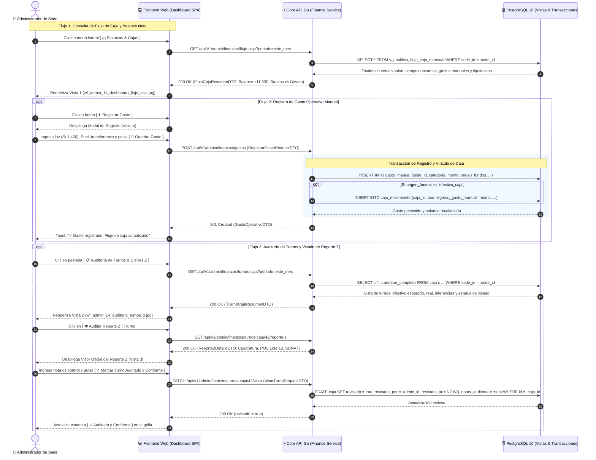

# Especificación Técnica y Wireframes: CU-ADMIN-14: Gestión de Flujo de Caja, Gastos Operativos y Auditoría de Cierres Z

## 1. Ficha Técnica del Caso de Uso

| Atributo | Detalle |
| :--- | :--- |
| **Código** | `CU-ADMIN-14` (Integra y unifica formalmente las facultades de `CU-ADMIN-15`) |
| **Nombre** | **Gestión de flujo de caja, gastos operativos y auditoría de cierres Z** (Módulo Unificado de Tesorería y Supervisión de Cajas) |
| **Rol / Actor** | **Administrador del Restaurante** (Gerente de Sede / Administrador Operativo) y **Propietario** (`propietario`) |
| **Módulo** | Finanzas, Tesorería & Auditoría de Control Interno |
| **Objetivo de Negocio** | Proporcionar al administrador un centro de control financiero integral para: (1) monitorear el flujo de caja operativo y el balance neto (ingresos 100% de salón vs egresos por insumos culinarios y gastos de sede), (2) registrar salidas de dinero manuales de operación o caja chica, y (3) auditar el historial de turnos de caja, supervisar los Reportes Z digitales, estampar visados de conformidad y ejecutar el cierre administrativo forzado ante emergencias. |
| **Precondiciones** | Administrador o Propietario con sesión activa (`rol: administrador` o `rol: propietario`) con sede asignada (`restaurante_id`, `sede_id`). Existen órdenes cobradas en [`CU-CAJA-03`](file:///j:/proyectos_git/RestaurantCloud_AI_backend/wireframe/cajero/CU-CAJA-03-cobrar-comanda/wireframe.md) y/o turnos de caja registrados en [`CU-CAJA-05`](file:///j:/proyectos_git/RestaurantCloud_AI_backend/wireframe/cajero/CU-CAJA-05-cerrar-caja/wireframe.md). |
| **Postcondiciones** | Consulta analítica de balance financiero en tiempo real; registro inmutable de gastos operativos en `gasto_manual`; visado gerencial registrado en `caja` (`revisado = true`); o liberación de terminal mediante cierre forzado administrativo. Posibilidad de exportar reportes en PDF y Excel vía streaming HTTP con Gzip. |
| **Tokens de Diseño** | Grayscale Blueprint: `#0F172A` (Primario / Slate Dark), `#1E293B` (Superficie), `#F8FAFC` (Canvas), `#FFFFFF` (Card), `#E2E8F0` (Bordes), `#0F172A` (Texto Principal), `#64748B` (Texto Muted), `#15803D` (Verde Cuadratura / Margen Positivo), `#B91C1C` (Rojo Descuadre / Faltante). |
| **Resolución Canónica** | `1440x900` px (Desktop Blueprint, JPG calidad 95). |

### Reglas de Negocio y Políticas de Tesorería Operativa
1. **Ingresos Exclusivos de Salón (100% Salón):**
   - El 100% de los ingresos operativos proviene de comandas cobradas en mesas de salón (`comanda.tipo = 'salon'` en [`CU-CAJA-03`](file:///j:/proyectos_git/RestaurantCloud_AI_backend/wireframe/cajero/CU-CAJA-03-cobrar-comanda/wireframe.md)).
   - Los ingresos se clasifican por **Destino de Liquidez**:
     - *Efectivo en Gavetas:* Dinero tangible contado y recaudado en el local.
     - *Bancos / Pasarelas:* Dinero acreditado en cuentas bancarias por Tarjetas POS (Débito/Crédito) y Billeteras Digitales (Yape/Plin).
2. **Determinación Fáctica de Egresos: Insumos Directos vs. Gastos de Sede:**
   - **Compras de Insumos Culinarios (`ficha_compra` en `CU-ADMIN-06` / `CU-ADMIN-07`):** No se utilizan categorías abstractas; el sistema desglosa los insumos culinarios directamente adquiridos para las recetas de carta (Pollo Entero, Lomo Fino, Papas Nativas, Carbón/Leña, Arroz, Aceite, Bebidas de Bar).
   - **Gastos Operativos de Sede (`gasto_manual`):** Los artículos de aseo, desengrasantes, bolsas, papel higiénico y servilletas son insumos de operación interna y no de cocina; se gestionan formalmente como gastos manuales junto con el Alquiler del Local, Servicios Básicos (Luz, Agua, Gas), Mantenimiento y Caja Chica.
3. **Cuadratura Milimétrica de Caja Chica (`gasto_manual` $\rightarrow$ `caja_movimiento`):**
   - Si al registrar un gasto manual el administrador selecciona origen `efectivo_caja` (Caja Chica / Gaveta Activa), el sistema inserta automáticamente un movimiento en `caja_movimiento` (`tipo = 'egreso_gasto_manual'`) vinculado al turno abierto. Esto descuenta el efectivo esperado en gaveta, blindando al cajero en [`CU-CAJA-05`](file:///j:/proyectos_git/RestaurantCloud_AI_backend/wireframe/cajero/CU-CAJA-05-cerrar-caja/wireframe.md) contra falsos faltantes.
4. **Visado y Conformidad Gerencial de Reportes Z:**
   - Los turnos cerrados por cajeros nacen como `⏳ Pendiente de Auditoría`.
   - Tras inspeccionar el Reporte Z Digital inmutable (Vista 3), el administrador puede registrar una nota de control y pulsar `[ ✓ Marcar Turno Auditado y Conforme ]`, persistiendo `revisado = true`, `revisado_por` y `revisado_at`. Si el turno cerró con faltante o sobrante, la nota justifica formalmente la diferencia (ej. propina en voucher de tarjeta o redondeo).
5. **Cierre Administrativo Forzado (Rescate de Terminal):**
   - Si un cajero abandonó la sede o se enfermó sin ejecutar su cierre formal de turno en [`CU-CAJA-05`](file:///j:/proyectos_git/RestaurantCloud_AI_backend/wireframe/cajero/CU-CAJA-05-cerrar-caja/wireframe.md), la restricción `uq_caja_abierta_local` bloquea al cajero del siguiente turno. El administrador puede ejecutar desde la Pestaña 2 un "Cierre Forzado Supervisado", declarando el efectivo contado físicamente y liberando la terminal para el siguiente colaborador (`CU-CAJA-01`).

---

## 2. Diagrama de Secuencia Mermaid



---

## 3. Diagramación Wireframe ASCII y Guía de Microcopias

---

### 3.1 Vista 1: Dashboard de Flujo de Caja & Balance Neto (`wf_admin_14_dashboard_flujo_caja.jpg`)

Vista estratégica que consolida la liquidez real del negocio y el balance operativo del período.

#### Distribución Estructural (Layout ASCII)
```text
+-------------------------------------------------------------------------------------------------------------------------------------+
| [VISTA 1: CU-ADMIN-14: GESTIÓN DE FLUJO DE CAJA & BALANCE NETO]   [https://app.restaurantcloud.pe/admin/finanzas/flujo-caja]        |
+-------------------------------------------------------------------------------------------------------------------------------------+
| [ 💵 Flujo de Caja & Balance (Activo) ]  [ 📋 Auditoría de Turnos & Cierres Z ]  [ 🧾 Egresos & Gastos Sede ]                       |
|   [Hoy] [Semana] [Este Mes (Octubre)] [📅 Rango: 01/10/2026 — 31/10/2026 (Personalizado)]    [➕ Registrar Gasto] [📥 Exportar Flujo] |
|-------------------------------------------------------------------------------------------------------------------------------------|
|  +------------------------+  +------------------------+  +------------------------+  +------------------------+                     |
|  | INGRESOS SALÓN (COBRADO|  | EGRESOS TOTALES OPERAT |  | BALANCE NETO OPERATIVO |  | CONCILIACIÓN LIQUIDEZ  |                     |
|  | S/ 28,450.00   [▲12.4%]|  | S/ 16,820.00   [▼-3.1%]|  | + S/ 11,630.00 [40.8%] |  | S/ 28,450.00           |                     |
|  | 100% Salón: POS/Eft/Yap|  | Insumos: 67% • Gasto:33%|  | Flujo Libre = In - Eg  |  | Bancos: 68% • Eft: 32% |                     |
|  +------------------------+  +------------------------+  +------------------------+  +------------------------+                     |
|                                                                                                                                     |
|  +----------------------------------------------------------------+  +-----------------------------------------------------------+  |
|  | Evolución Diaria de Entradas vs Salidas (Octubre 2026)         |  | Composición Fáctica de Egresos (S/ 16,820.00)             |  |
|  | Flujo monetario por día con curva de liquidez acumulada        |  | Insumos culinarios directos vs Gastos manuales de sede    |  |
|  |                                                                |  |                                                           |  |
|  |  [Entradas: ■ Slate Dark]        [Salidas: ■ Slate Light]      |  | 🥩 Insumos Culinarios Comprados (ficha_compra): S/ 11,250 |  |
|  |                                                                |  | • Pollo Entero Eviscerado (180 kg):   S/ 3,240.00 (28.8%) |  |
|  |    ■■           ■■           ■■                                |  | • Lomo Fino de Res (75 kg):           S/ 2,850.00 (25.3%) |  |
|  |    ■■   ■■      ■■   ■■      ■■   ■■                           |  | • Papa Nativa y Amarilla (240 kg):    S/ 1,200.00 (10.7%) |  |
|  |    ■■   ■■      ■■   ■■      ■■   ■■                           |  | • Carbón Vegetal / Leña (30 sacos):   S/ 1,350.00 (12.0%) |  |
|  |    ■■   ■■      ■■   ■■      ■■   ■■                           |  | • Abarrotes y Bebidas de Carta:       S/ 2,610.00 (23.2%) |  |
|  |    S1 (01-05)   S2 (06-10)   S3 (11-15)                        |  |-----------------------------------------------------------|  |
|  |                                                                |  | 🏢 Gastos Operativos de Sede (gasto_manual): S/ 5,570.00  |  |
|  | 💡 Ratio de Cobertura: Por cada S/ 1.00 de egreso operativo,   |  | • Alquiler de Local Comercial:        S/ 2,800.00 (50.3%) |  |
|  | la sede generó S/ 1.69 en ventas de salón. Cero déficit diario.|  | • Servicios Básicos (Luz/Agua/Gas):   S/ 1,420.00 (25.5%) |  |
|  | Promedio ingresos: S/ 917.74/día • Egresos: S/ 542.58/día      |  | • Limpieza, Aseo y Menaje Interno:    S/   580.00 (10.4%) |  |
|  |                                                                |  | • Mantenimiento Equipos & Campana:    S/   450.00  (8.1%) |  |
|  |                                                                |  | • Caja Chica / Compras Emergencia:    S/   320.00  (5.7%) |  |
|  +----------------------------------------------------------------+  +-----------------------------------------------------------+  |
+-------------------------------------------------------------------------------------------------------------------------------------+
```

#### Guía de Elementos y Microcopias
- **Filtro de Período y Rango Personalizado:** Selector directo `[Hoy]`, `[Semana]`, `[Este Mes]`, y badge con selector de rango `[📅 Rango: 01/10/2026 — 31/10/2026 (Personalizado)]`.
- **KPI 1: Ingresos Salón (Cobrados):** Exhibe el total facturado `S/ 28,450.00`, con nota explícita `100% Salón` y desglose: POS S/ 15,363.00 (54%), Efectivo S/ 9,104.00 (32%) y Yape/Plin S/ 3,983.00 (14%).
- **KPI 2: Egresos Totales Operativos:** Exhibe `S/ 16,820.00` con desglose porcentual: Insumos 66.9% y Gastos Sede 33.1%.
- **KPI 3: Balance Neto Operativo:** Margen en verde `+ S/ 11,630.00` indicando `Margen de liquidez libre: 40.8%`.
- **KPI 4: Conciliación de Liquidez:** Muestra la disponibilidad real: en Bancos/Pasarelas `S/ 19,346.00` vs Efectivo en Gavetas `S/ 9,104.00`.
- **Gráfico de Entradas vs Salidas:** Barras pareadas mostrando la solvencia de cada tramo de la semana.
- **Desglose de Egresos:** División limpia entre Insumos culinarios directos comprados (`ficha_compra`) y Gastos operativos de sede (`gasto_manual`).

---

### 3.2 Vista 2: Auditoría de Turnos de Caja & Reportes Z (`wf_admin_14_auditoria_turnos_z.jpg`)

Vista de supervisión de control interno que fiscaliza la exactitud de gaveta y los cierres Z de los cajeros.

#### Distribución Estructural (Layout ASCII)
```text
+-------------------------------------------------------------------------------------------------------------------------------------+
| [VISTA 2: CU-ADMIN-14: AUDITORÍA DE TURNOS DE CAJA & REPORTES Z]   [https://app.restaurantcloud.pe/admin/finanzas/flujo-caja?tab=z] |
+-------------------------------------------------------------------------------------------------------------------------------------+
| [ 💵 Flujo de Caja & Balance ]  [ 📋 Auditoría de Turnos & Cierres Z (Activo) ]  [ 🧾 Egresos & Gastos Sede ]                       |
|   [Hoy] [Semana] [Este Mes (Octubre)] [📅 01/10/2026 — 31/10/2026]                                        [📥 Exportar Auditoría]   |
|-------------------------------------------------------------------------------------------------------------------------------------|
|  [Turnos Mes: 42] | [● Conformes / Cuadrados: 40 (95.2%)] | [● Con Discrepancia Menor: 2 (-S/14.50)] | [✓ Auditados: 41 de 42]       |
|-------------------------------------------------------------------------------------------------------------------------------------|
|  +-------------------------------------------------------------------------------------------------------------------------------+  |
|  | ℹ️ Monitor de Terminal: Actualmente la sede opera con Turno #043 ABIERTO (Marco Valdivia).   [⚠️ Cierre Administrativo        |  |
|  | Si un cajero abandona la terminal, el administrador puede realizar un cierre de rescate.     |    Forzado (Turno #043) ]     |  |
|  +-------------------------------------------------------------------------------------------------------------------------------+  |
|                                                                                                                                     |
|  Directorio Histórico de Turnos y Supervisión de Arqueos Z                                                                          |
|  +-------------------------------------------------------------------------------------------------------------------------------+  |
|  | # Turno     Fecha & Horario         Cajero      Apertura  Esperado  Real      Diferencia  Estado     Visado Gerencial Acciones    |  |
|  | ----------- ----------------------- ----------- --------- --------- --------- ----------- ---------- ---------------- -----------|  |
|  | Turno #042  10/10/26 18:30-23:30 C. Lucía F.    S/ 200.00 S/1,000.0 S/1,000.0 S/ 0.00     [✓ Cuad.]  [⏳ Pendiente]   [👁️ Auditar]|  |
|  | Turno #041  10/10/26 11:30-16:30 A. Pedro C.    S/ 200.00 S/1,120.0 S/1,110.0 - S/ 10.00  [⚠️ Falt.] [✓ Subsanado]    [📄 Ver Z]  |  |
|  | Turno #040  09/10/26 18:30-23:30 C. Lucía F.    S/ 200.00 S/  980.0 S/  980.0 S/ 0.00     [✓ Cuad.]  [✓ Conforme]     [📄 Ver Z]  |  |
|  | Turno #039  09/10/26 11:30-16:30 A. Pedro C.    S/ 200.00 S/1,050.0 S/1,050.0 S/ 0.00     [✓ Cuad.]  [✓ Conforme]     [📄 Ver Z]  |  |
|  | Turno #038  08/10/26 18:30-23:30 C. Marco V.    S/ 200.00 S/  890.0 S/  885.5 - S/ 4.50   [⚠️ Falt.] [✓ Redondeo]     [📄 Ver Z]  |  |
|  +-------------------------------------------------------------------------------------------------------------------------------+  |
|  💡 Criterio de Visado: El administrador revisa el Reporte Z y confirma conciliación. Ante faltantes, asienta nota aclaratoria.     |
+-------------------------------------------------------------------------------------------------------------------------------------+
```

#### Guía de Elementos y Microcopias
- **Barra de Indicadores de Control Interno:** Muestra cantidad total de turnos, tasa de cuadratura perfecta (95.2%), conteo de discrepancias y ratio de turnos visados (41 de 42).
- **Banner de Terminal y Cierre Forzado:** Informa el cajero y turno que actualmente ocupa la terminal de caja (`uq_caja_abierta_local`). Si el cajero se fue sin cerrar, el botón `[ ⚠️ Cierre Administrativo Forzado (Turno #043) ]` abre el diálogo de rescate para contar el dinero y liberar la terminal.
- **Grilla de Turnos:**
  - `Diferencia`: Destacada en verde `S/ 0.00` o en rojo `- S/ 10.00`.
  - `Visado Gerencial`: Chips informativos `⏳ Pendiente de Auditoría` (ámbar), `✓ Auditado y Conforme` (verde) o `✓ Auditado: Subsanado` (azul).
  - `Acciones`: Botón oscuro prioritario `[ 👁️ Auditar Reporte Z ]` para turnos pendientes y botón secundario `[ 📄 Ver Reporte Z ]` para turnos ya revisados.

---

### 3.3 Vista 3: Modal de Inspección Oficial del Reporte Z Digital (`wf_admin_14_modal_visor_reporte_z.jpg`)

Modal de diálogo formal (900px de ancho) que exhibe la ficha inmutable del Reporte Z emitido al cierre de caja.

#### Distribución Estructural (Layout ASCII)
```text
+----------------------------------------------------------------------------------------------------+
|  [VISTA 3: CU-ADMIN-14: VISOR OFICIAL DEL REPORTE Z DIGITAL & VISADO ADMINISTRATIVO]              |
+----------------------------------------------------------------------------------------------------+
|                                                                                                    |
|                  +---------------------------------------------------------------+                 |
|                  | 📄 Reporte Z Oficial de Cierre de Caja • Turno #042       [✕] |                 |
|                  |---------------------------------------------------------------|                 |
|                  | 🔥 EL CARBÓN & LEÑA S.A.C.           [ ✓ ARQUEO CUADRADO ]    |                 |
|                  | Sede San Isidro • RUC 20601234567 • Terminal POS #01          |                 |
|                  | Cajero Titular: Lucía Flores • Cierre: 10/10/2026 23:32:15    |                 |
|                  |                                                               |                 |
|                  | +-------------------------------+ +-------------------------+ |                 |
|                  | | 💵 Cuadratura Gaveta Efectivo | | 💳 Medios de Pago & SUNAT | |                 |
|                  | | Fondo Inicial:       S/ 200.00| | Tarjeta POS (Lote 12):  | |                 |
|                  | | (+) Cobros Efectivo: S/ 885.00| |  S/ 1,540.00 (18)       | |                 |
|                  | | (-) Devolución NC:  - S/ 85.00| | Yape / Plin:            | |                 |
|                  | | (-) Egresos Menores:   S/ 0.00| |  S/ 420.00 (12)         | |                 |
|                  | | (=) Efectivo Esper: S/1,000.00| | Efectivo Físico:        | |                 |
|                  | | (✓) Efectivo Real:  S/1,000.00| |  S/ 885.00 (14)         | |                 |
|                  | | DIFERENCIA:            S/ 0.00| | Total Facturado:        | |                 |
|                  | | [✓ ARQUEO CUADRADO EXACTO]    | |  S/ 2,845.00 (44 ctas)  | |                 |
|                  | +-------------------------------+ +-------------------------+ |                 |
|                  |                                                               |                 |
|                  | +-----------------------------------------------------------+ |                 |
|                  | | 🛡️ Visado y Supervisión de Auditoría Gerencial            | |                 |
|                  | | Estado: [ ⏳ Pendiente de Visado ]                        | |                 |
|                  | | [ Arqueo verificado conforme contra lote POS #012...   ]  | |                 |
|                  | |                 [ ✓ Marcar Turno Auditado y Conforme ]    | |                 |
|                  | +-----------------------------------------------------------+ |                 |
|                  |                                                               |                 |
|                  | [ 📥 Descargar Reporte Z en PDF ]                   [ Cerrar ]|                 |
|                  +---------------------------------------------------------------+                 |
|                                                                                                    |
+----------------------------------------------------------------------------------------------------+
```

#### Guía de Elementos y Microcopias
- **Membrete Fiscal y Legal:** Nombre de empresa, RUC, sede, correlativo oficial de turno (`#Z001-000042`) y badge verde `[ ✓ ARQUEO CUADRADO EXACTO ]`.
- **Desglose de Gaveta Física:** Ecuación clara de arqueo: Fondo inicial + Cobros en efectivo - Devolución por Notas de Crédito (`CU-CAJA-04`) - Egresos de caja chica = Efectivo Esperado vs Efectivo Real Contado.
- **Desglose de Medios de Pago y Tributario:** Conciliación de lotes de POS (Lote #012), transferencias Yape/Plin, base imponible gravada, IGV 18% y correlativos de Boletas (`B001-12880 a 12894`), Facturas y Notas de Crédito.
- **Bloque de Visado Gerencial:** Campo para anotar constancia de auditoría y botón verde `[ ✓ Marcar Turno Auditado y Conforme ]`, registrando la firma digital del administrador.

---

### 3.4 Vista 4: Modal de Registro de Gasto Operativo Manual (`wf_admin_14_modal_registro_gasto.jpg`)

Modal de captura ágil (700px de ancho) para egresos corrientes y gastos de operación interna.

#### Distribución Estructural (Layout ASCII)
```text
+----------------------------------------------------------------------------------------------------+
|  [VISTA 4: CU-ADMIN-14: REGISTRO DE GASTO OPERATIVO Y EGRESO MANUAL]                               |
+----------------------------------------------------------------------------------------------------+
|                                                                                                    |
|                  +---------------------------------------------------------------+                 |
|                  | 🧾 Registrar Nuevo Gasto Operativo de Sede                [✕] |                 |
|                  |---------------------------------------------------------------|                 |
|                  | Ingresa los egresos corrientes de la sede para reflejarlos    |                 |
|                  | con exactitud en el flujo de caja.                            |                 |
|                  |                                                               |                 |
|                  | Categoría del Gasto *           Fecha del Gasto *             |                 |
|                  | [ Servicios Básicos (Luz/Gas) v][ 11/10/2026                ] |                 |
|                  |                                                               |                 |
|                  | Monto Total del Egreso (S/) *   Origen de Fondos / Pago *     |                 |
|                  | [ S/ 1,420.00                 ] [ 🏦 Transferencia Bancaria v]|                 |
|                  |                                                               |                 |
|                  | +-----------------------------------------------------------+ |                 |
|                  | | 💡 Cuadratura Automática: Si seleccionas 'Efectivo de     | |                 |
|                  | | Caja Chica / Gaveta', el sistema lo descontará del turno  | |                 |
|                  | | activo para no generar falsos faltantes al cajero.        | |                 |
|                  | +-----------------------------------------------------------+ |                 |
|                  |                                                               |                 |
|                  | Proveedor / Beneficiario *      Tipo de Comprobante           |                 |
|                  | [ Enel Distribución Perú      ] [ Recibo Servicios Públicos v]|                 |
|                  |                                                               |                 |
|                  | Número de Comprobante / Recibo                                |                 |
|                  | [ S001-0982312 (Suministro #2419081)                        ] |                 |
|                  |                                                               |                 |
|                  | Descripción / Justificación *                                 |                 |
|                  | [ Pago del suministro eléctrico del salón y cocina...       ] |                 |
|                  |                                                               |                 |
|                  |                [ Cancelar ]    [ 💾 Guardar Gasto y Flujo ]  |                 |
|                  +---------------------------------------------------------------+                 |
|                                                                                                    |
+----------------------------------------------------------------------------------------------------+
```

#### Guía de Elementos y Microcopias
- **Categorías Claras y Sin Insumos Mezclados:** Select con opciones limpias: `Servicios Básicos (Luz/Agua/Gas)`, `Alquiler de Local`, `Limpieza, Aseo y Menaje Interno`, `Mantenimiento & Equipamiento`, `Caja Chica / Compras Menores de Emergencia`, `Otros Egresos Administrativos`.
- **Selector de Origen de Fondos:** Permite elegir entre `Transferencia Bancaria` (descuenta cuenta bancaria) o `Efectivo de Caja Chica / Gaveta Activa` (descuenta la gaveta del cajero).
- **Callout de Cuadratura Automática:** Advierte pedagógicamente que el efectivo de caja descuenta el arqueo esperado de `CU-CAJA-05` de forma transparente.
- **Glosa y Comprobante:** Registro de número de recibo y detalle textual para auditoría contable.

---

## 4. Matriz de Estados de Interfaz y Manejo de Errores

| Estado | Evento Desencadenante | Comportamiento Visual & Microcopia | Recuperación / Acción UX |
| :--- | :--- | :--- | :--- |
| **Carga Inicial (Loading)** | Clic en menú Finanzas o cambio de fecha. | Shimmer gris claro en los 4 KPIs de balance y skeleton de barras. Texto: *"Calculando balance y conciliando gavetas..."*. | Controles de exportación temporalmente deshabilitados. |
| **Flujo Positivo (Superávit)** | Ingresos por ventas superan egresos operativos ($Balance > 0$). | Indicador de Balance Neto en verde `#15803D`: `+ S/ 11,630.00` con badge `Margen 40.8% [▲ Rentable]`. | Muestra recomendaciones de reinversión o reserva de caja. |
| **Flujo Negativo (Déficit Temporal)** | Período con compras masivas o pago de alquiler ($Balance < 0$). | Indicador de Balance Neto en rojo ámbar `- S/ 1,250.00` con badge `[ ⚠️ Déficit Operativo en Período ]`. | Callout explicativo indicando qué gasto puntual (ej. alquiler) causó el desfase temporal. |
| **Turno con Discrepancia no Justificada** | Cajero cerró con faltante y el turno aún no ha sido visado. | Fila resaltada en ámbar con badge rojo en diferencia `- S/ 10.00 [ ⚠️ Faltante ]` y badge `⏳ Pendiente de Auditoría`. | Botón prioritario `[ 👁️ Auditar Reporte Z ]` para que el administrador investigue y vise. |
| **Terminal de Caja Abandonada (Bloqueo)** | Cajero del turno anterior se retiró sin cerrar caja (`CU-CAJA-05`). | Banner azul en Pestaña 2: *"Caja en estado ABIERTO por más de 12 horas. Próximo cajero bloqueado."* | Botón activo `[ ⚠️ Cierre Administrativo Forzado ]` para contar efectivo y desbloquear la sede. |
| **Gasto Manual sin Justificación** | Administrador intenta guardar gasto con descripción vacía. | Borde rojo en textarea: *"La justificación del gasto es obligatoria (mínimo 10 caracteres)."* | Botón guardar deshabilitado hasta ingresar texto. |

---

## 5. Especificación de Contrato API y DTOs Go

### 5.1 Endpoint Resumen de Flujo de Caja y Balance
`GET /api/v1/admin/finanzas/flujo-caja?periodo=este_mes&desde=2026-10-01&hasta=2026-10-31`

```go
package dto

import "time"

// FlujoCajaResumenDTO estructura el payload analítico de Vista 1
type FlujoCajaResumenDTO struct {
	SedeID              string                 `json:"sede_id"`
	Periodo             string                 `json:"periodo"` // "hoy", "semana", "este_mes", "personalizado"
	FechaInicio         time.Time              `json:"fecha_inicio"`
	FechaFin            time.Time              `json:"fecha_fin"`
	IngresosTotales     float64                `json:"ingresos_totales"` // S/ 28,450.00 (100% Salon)
	DeltaIngresos       float64                `json:"delta_ingresos"`
	IngresosDesglose    IngresosDesgloseDTO    `json:"ingresos_desglose"`
	EgresosTotales      float64                `json:"egresos_totales"` // S/ 16,820.00
	DeltaEgresos        float64                `json:"delta_egresos"`
	ComprasInsumosTotal float64                `json:"compras_insumos_total"` // S/ 11,250.00
	GastosManualesTotal float64                `json:"gastos_manuales_total"` // S/ 5,570.00
	BalanceNeto         float64                `json:"balance_neto"` // + S/ 11,630.00
	MargenNetoPct       float64                `json:"margen_neto_porcentaje"` // 40.8%
	RatioCobertura      float64                `json:"ratio_cobertura"` // 1.69
	ConciliacionLiquidez LiquidezDTO           `json:"conciliacion_liquidez"`
	CurvaDiaria         []FlujoDiarioDTO       `json:"curva_diaria"`
	TopInsumosComprados []InsumoCompradoDTO    `json:"top_insumos_comprados"`
	GastosPorCategoria  []GastoCategoriaDTO    `json:"gastos_por_categoria"`
}

type IngresosDesgloseDTO struct {
	EfectivoMonto     float64 `json:"efectivo_monto"`
	EfectivoPct       float64 `json:"efectivo_porcentaje"`
	TarjetaPOSMonto   float64 `json:"tarjeta_pos_monto"`
	TarjetaPOSPct     float64 `json:"tarjeta_pos_porcentaje"`
	BilleterasMonto   float64 `json:"billeteras_monto"`
	BilleterasPct     float64 `json:"billeteras_porcentaje"`
}

type LiquidezDTO struct {
	TotalDisponible float64 `json:"total_disponible"`
	EnBancosMonto   float64 `json:"en_bancos_monto"`
	EnBancosPct     float64 `json:"en_bancos_porcentaje"`
	EnGavetasMonto  float64 `json:"en_gavetas_monto"`
	EnGavetasPct    float64 `json:"en_gavetas_porcentaje"`
}

type InsumoCompradoDTO struct {
	InsumoID     string  `json:"insumo_id"`
	NombreInsumo string  `json:"nombre_insumo"`
	Cantidad     float64 `json:"cantidad_comprada"`
	UnidadMedida string  `json:"unidad_medida"`
	MontoTotal   float64 `json:"monto_total"`
	Porcentaje   float64 `json:"porcentaje_de_compras"`
}

type GastoCategoriaDTO struct {
	Categoria  string  `json:"categoria"`
	MontoTotal float64 `json:"monto_total"`
	Porcentaje float64 `json:"porcentaje_de_gastos"`
}

type FlujoDiarioDTO struct {
	Fecha        string  `json:"fecha"`
	IngresosDia  float64 `json:"ingresos_dia"`
	EgresosDia   float64 `json:"egresos_dia"`
	SaldoNetoDia float64 `json:"saldo_neto_dia"`
}
```

### 5.2 Endpoint Registro de Gasto Operativo Manual
`POST /api/v1/admin/finanzas/gastos`

```go
package dto

import "time"

type RegistrarGastoRequestDTO struct {
	SedeID           string    `json:"sede_id" binding:"required,uuid"`
	Categoria        string    `json:"categoria" binding:"required"` // "servicios_basicos", "alquiler", "limpieza_aseo", "mantenimiento", "caja_chica", "otros"
	Fecha            time.Time `json:"fecha" binding:"required"`
	Monto            float64   `json:"monto" binding:"required,gt=0"`
	OrigenFondos     string    `json:"origen_fondos" binding:"required"` // "transferencia_bancaria" o "efectivo_caja"
	ProveedorNombre  string    `json:"proveedor_nombre" binding:"required"`
	TipoComprobante  string    `json:"tipo_comprobante"` // "recibo_servicios", "factura", "boleta", "recibo_honorarios", "recibo_interno"
	NumeroDocumento  string    `json:"numero_documento"`
	Descripcion      string    `json:"descripcion" binding:"required,min=10"`
}
```

### 5.3 Endpoint Auditoría y Visado de Turnos Z
`PATCH /api/v1/admin/finanzas/turnos-caja/:id/visar`

```go
package dto

type VisarTurnoRequestDTO struct {
	TurnoID         string `json:"turno_id" binding:"required,uuid"`
	Conforme        bool   `json:"conforme"`
	NotasAuditoria  string `json:"notas_auditoria"`
}
```

### 5.4 Endpoint Cierre Forzado Administrativo
`POST /api/v1/admin/finanzas/turnos-caja/:id/cierre-forzado`

```go
package dto

type CierreForzadoRequestDTO struct {
	TurnoID         string  `json:"turno_id" binding:"required,uuid"`
	EfectivoContado float64 `json:"efectivo_contado" binding:"gte=0"`
	Justificacion   string  `json:"justificacion" binding:"required,min=15"`
}
```

---

## 6. Matriz de Permisos RBAC y Seguridad

| Rol de Usuario | Ver Flujo de Caja & Balance | Registrar Gasto Manual | Ver Reportes Z | Visar Turnos de Caja | Ejecutar Cierre Forzado |
| :--- | :---: | :---: | :---: | :---: | :---: |
| **Propietario (`propietario`)** | Pleno (Multisede) | Pleno | Pleno | Pleno | Pleno |
| **Administrador (`administrador`)** | Pleno (Su Sede) | Pleno | Pleno | Pleno | Pleno |
| **Cajero (`cajero`)** | Denegado | Denegado | Solo su turno Z | Denegado | Denegado |
| **Mozo (`mozo`)** | Denegado | Denegado | Denegado | Denegado | Denegado |
| **Cocina (`cocina`)** | Denegado | Denegado | Denegado | Denegado | Denegado |

---

## 7. Modelo de Datos y Consultas SQL Analíticas

### 7.1 Esquema de la Tabla `gasto_manual` Ampliada
```sql
CREATE TABLE IF NOT EXISTS gasto_manual (
    id UUID PRIMARY KEY DEFAULT gen_random_uuid(),
    local_id UUID NOT NULL REFERENCES local(id) ON DELETE CASCADE,
    categoria VARCHAR(60) NOT NULL, -- 'alquiler', 'servicios_basicos', 'limpieza_aseo', 'mantenimiento', 'caja_chica', 'otros'
    monto DECIMAL(12, 2) NOT NULL CHECK (monto > 0),
    origen_fondos VARCHAR(30) NOT NULL DEFAULT 'transferencia_bancaria', -- 'transferencia_bancaria', 'efectivo_caja'
    caja_id UUID NULL REFERENCES caja(id) ON DELETE SET NULL, -- Si se pago con efectivo de caja chica del turno
    proveedor_nombre VARCHAR(120) NOT NULL,
    tipo_comprobante VARCHAR(50) DEFAULT 'recibo_interno',
    numero_documento VARCHAR(80),
    descripcion TEXT NOT NULL,
    fecha DATE NOT NULL DEFAULT CURRENT_DATE,
    registrado_por UUID NOT NULL REFERENCES usuario(id),
    created_at TIMESTAMP WITH TIME ZONE DEFAULT NOW()
);

CREATE INDEX IF NOT EXISTS idx_gasto_manual_local_fecha ON gasto_manual(local_id, fecha);
CREATE INDEX IF NOT EXISTS idx_gasto_manual_caja ON gasto_manual(caja_id);
```

### 7.2 Modificación de la Tabla `caja` para Visado de Auditoría
```sql
ALTER TABLE caja ADD COLUMN IF NOT EXISTS revisado BOOLEAN NOT NULL DEFAULT false;
ALTER TABLE caja ADD COLUMN IF NOT EXISTS revisado_por UUID REFERENCES usuario(id);
ALTER TABLE caja ADD COLUMN IF NOT EXISTS revisado_at TIMESTAMP WITH TIME ZONE;
ALTER TABLE caja ADD COLUMN IF NOT EXISTS notas_auditoria TEXT;

CREATE INDEX IF NOT EXISTS idx_caja_revisado ON caja(local_id, revisado, fecha_cierre);
```

### 7.3 Vista Analítica de Flujo de Caja
```sql
CREATE OR REPLACE VIEW v_analitica_flujo_caja_mensual AS
WITH ventas AS (
    SELECT 
        c.sede_id,
        DATE(c.created_at) AS fecha,
        SUM(c.total) AS total_ingresos,
        SUM(CASE WHEN c.metodo_pago_codigo = 'efectivo' THEN c.total ELSE 0 END) AS ingresos_efectivo,
        SUM(CASE WHEN c.metodo_pago_codigo IN ('tarjeta', 'billetera_digital') THEN c.total ELSE 0 END) AS ingresos_banco
    FROM comanda c
    WHERE c.estado = 'cobrada'
    GROUP BY c.sede_id, DATE(c.created_at)
),
compras AS (
    SELECT 
        fc.local_id AS sede_id,
        DATE(fc.created_at) AS fecha,
        SUM(fc.total) AS total_compras
    FROM ficha_compra fc
    WHERE fc.estado = 'registrada'
    GROUP BY fc.local_id, DATE(fc.created_at)
),
gastos AS (
    SELECT 
        gm.local_id AS sede_id,
        gm.fecha,
        SUM(gm.monto) AS total_gastos,
        SUM(CASE WHEN gm.origen_fondos = 'efectivo_caja' THEN gm.monto ELSE 0 END) AS gastos_efectivo,
        SUM(CASE WHEN gm.origen_fondos = 'transferencia_bancaria' THEN gm.monto ELSE 0 END) AS gastos_banco
    FROM gasto_manual gm
    GROUP BY gm.local_id, gm.fecha
)
SELECT 
    COALESCE(v.sede_id, c.sede_id, g.sede_id) AS sede_id,
    COALESCE(v.fecha, c.fecha, g.fecha) AS fecha,
    COALESCE(v.total_ingresos, 0.00) AS ingresos_salon,
    COALESCE(c.total_compras, 0.00) AS compras_insumos,
    COALESCE(g.total_gastos, 0.00) AS gastos_operativos,
    (COALESCE(c.total_compras, 0.00) + COALESCE(g.total_gastos, 0.00)) AS total_egresos,
    (COALESCE(v.total_ingresos, 0.00) - (COALESCE(c.total_compras, 0.00) + COALESCE(g.total_gastos, 0.00))) AS balance_neto_dia
FROM ventas v
FULL OUTER JOIN compras c ON v.sede_id = c.sede_id AND v.fecha = c.fecha
FULL OUTER JOIN gastos g ON COALESCE(v.sede_id, c.sede_id) = g.sede_id AND COALESCE(v.fecha, c.fecha) = g.fecha;
```

---

## 8. Consideraciones de Accesibilidad (WCAG 2.1 AA)

1. **Ratios de Contraste y Significado Semántico:**
   - Montos de Balance Neto en verde `#15803D` o rojo `#B91C1C` van acompañados de iconografía y símbolos matemáticos explícitos (`+` y `-`), permitiendo su interpretación a usuarios con daltonismo.
   - Contrastes de tipografía principal `#0F172A` sobre `#FFFFFF` superan el ratio 14:1.
2. **Navegación por Teclado:**
   - Pestañas `[ Flujo de Caja ]`, `[ Auditoría de Turnos ]` y `[ Egresos ]` implementan `role="tablist"` operable con flechas de dirección.
   - Modales (Reporte Z y Nuevo Gasto) contienen trampa de foco (`focus trap`) y admiten cierre directo con la tecla `Esc`.
3. **Formularios Accesibles:**
   - Todos los inputs del modal de gasto poseen etiquetas `<label>` con atributos semánticos `for` asociados.
