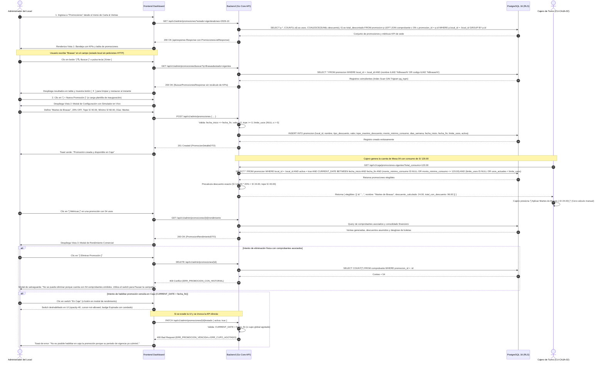
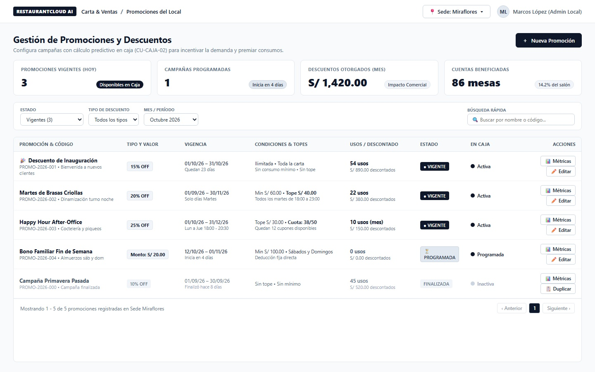
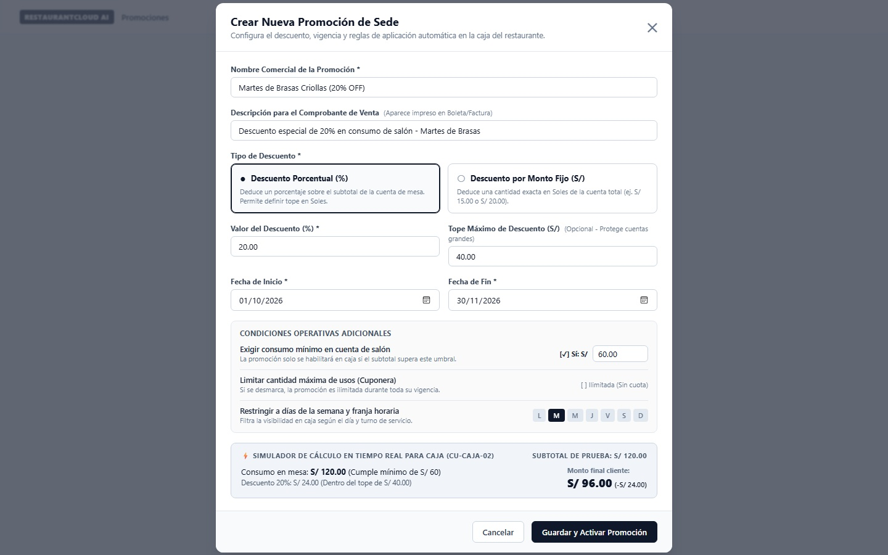
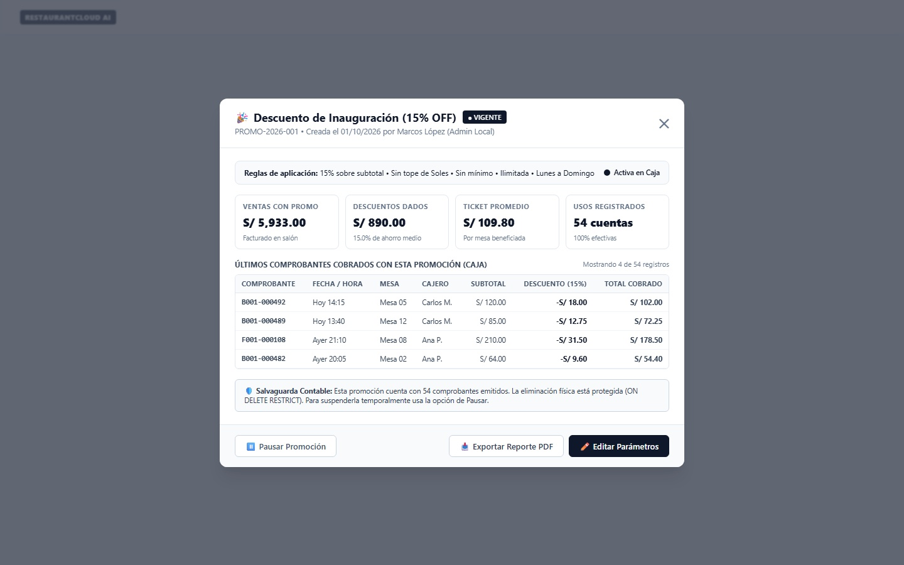
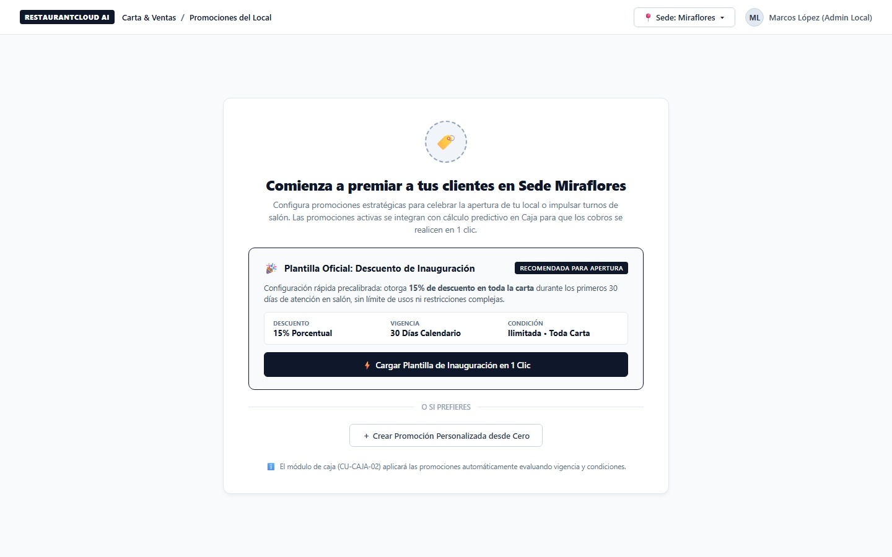

# CU-ADMIN-17: Gestionar Promociones del Local

Especificación técnica de interfaz de usuario, arquitectura de información, control de acceso basado en roles (RBAC), cálculo predictivo en tiempo real para Caja (`CU-CAJA-02`), salvaguardas contables y contratos de API Go en **RestaurantCloud AI**.

---

## 1. Ficha Técnica del Caso de Uso

| Atributo | Detalle |
| :--- | :--- |
| **Código CU** | `CU-ADMIN-17` |
| **Nombre** | Gestionar promociones del local |
| **Actor(es)** | `administrador_local` (responsable operativo del restaurante; potestad de dinamización comercial de su sede física) |
| **Dispositivo / Viewport** | Responsive Desktop (`1440x900`), Tablet (`768x1024`) |
| **Precondición** | El local se encuentra activo; el usuario cuenta con sesión autenticada con token JWT y rol `administrador_local` asignado a dicha sede (`local_id`). |
| **Postcondición** | Promoción persistida en PostgreSQL (`promocion`); disponible de manera reactiva y filtrada en la pantalla de cobro de los cajeros ([`CU-CAJA-02`](file:///j:/proyectos_git/RestaurantCloud_AI_backend/context/cu.md#L1094)) exclusivamente durante su vigencia y cumpliendo sus condiciones; pre-cálculo automático del descuento en tiempo real; registro de uso auditado e inmutable al cobrarse en comprobantes ([`CU-CAJA-03`](file:///j:/proyectos_git/RestaurantCloud_AI_backend/context/cu.md#L1109)). |

---

## 2. Diagrama de Flujo y Secuencia



---

## 3. Especificación de Pantallas y Wireframes Blueprint

### Vista 1: Bandeja Principal de Promociones (`wf_admin_17_bandeja_promociones.jpg`)

Bandeja de control administrativo en desktop (`1440x900`). Incorpora tarjetas KPI de rendimiento de sede, filtros multifactoriales de estado y tipo, y tabla de promociones con switches de activación inmediata en caja.



#### Layout Estructural ASCII (Desktop 1440x900)
```text
+----------------------------------------------------------------------------------------------------+
| RESTAURANTCLOUD AI   | Carta & Ventas > Promociones del Local   [ Sede: Miraflores v ]  [ ML Marcos v ]|
+----------------------------------------------------------------------------------------------------+
| Gestión de Promociones y Descuentos                                                                |
| Configura campañas con cálculo predictivo en caja (CU-CAJA-02) para incentivar la demanda          |
|                                                                              [ ＋ Nueva Promoción ]|
|----------------------------------------------------------------------------------------------------|
|                                                                                                    |
| +--------------------+ +--------------------+ +--------------------+ +---------------------------+ |
| | VIGENTES (HOY)     | | PROGRAMADAS        | | DESCUENTOS DEL MES | | CUENTAS BENEFICIADAS      | |
| | [ 3 ]              | | [ 1 ]              | | [ S/ 1,420.00 ]    | | [ 86 mesas ]              | |
| | Disponibles en Caja| | Inicia en 4 días   | | Impacto Comercial  | | 14.2% del salón           | |
| +--------------------+ +--------------------+ +--------------------+ +---------------------------+ |
|                                                                                                    |
| +------------------------------------------------------------------------------------------------+ |
| | Estado:            Tipo Descuento:         Mes / Período:         Búsqueda optimizada:         | |
| | [ Vigentes (3) v ] [ Todos los tipos v   ] [ Octubre 2026 v     ] [ 🔍 Buscar nombre.. [✕] ] [🔍]| |
| +------------------------------------------------------------------------------------------------+ |
|                                                                                                    |
| +------------------------------------------------------------------------------------------------+ |
| | PROMOCIÓN & CÓDIGO     TIPO/VALOR  VIGENCIA        CONDICIONES/TOPES USOS/DESCUENTO  ESTADO    EN CAJA |
| |------------------------------------------------------------------------------------------------| |
| | 🎉 Descuento Inaugural  15% OFF     01/10 - 31/10   Ilimitada/Toda    54 / S/ 890   [VIGENTE]  (•) Act |
| | Martes de Brasas       20% OFF     01/09 - 30/11   Min S/60/Tope S/40 22 / S/ 380   [VIGENTE]  (•) Act |
| | Happy Hour After-Office 25% OFF     01/10 - 31/12   Tope S/30/Cupo 50 10 / S/ 150   [VIGENTE]  (•) Act |
| | Bono Familiar Fin Sem  S/ 20.00    12/10 - 01/11   Min S/100/Sáb-Dom  0 / S/ 0      [PROG]     (•) Prg |
| | Campaña Primavera      10% OFF     01/09 - 30/09   Sin tope          45 / S/ 520   [VENCIDA]  ( ) Inac|
| |------------------------------------------------------------------------------------------------| |
| | Mostrando 1 - 5 de 5 promociones registradas en Sede Miraflores             [< Ant] [1] [Sig >]| |
| +------------------------------------------------------------------------------------------------+ |
+----------------------------------------------------------------------------------------------------+
```

#### Elementos Visuales y Funcionalidades
- **4 Tarjetas KPI Dinámicas:** Conteo instantáneo de promociones disponibles en caja, campañas programadas, monto total acumulado en descuentos en Soles y porcentaje de mesas beneficiadas.
- **Barra de Filtrado y Buscador Optimizado:** Filtros por estado operativo (`Vigente`, `Programada`, `Pausada`, `Vencida`), tipo (`Porcentaje`, `Monto Fijo`) y buscador bajo demanda con botón explícito `[ 🔍 Buscar ]`, soporte para tecla `Enter` y botón de limpieza `[ ✕ ]` (cero saturación de peticiones por pulsación de tecla).
- **Switch Reactivo de Activación en Caja:** Permite al administrador suspender de inmediato una campaña sin eliminarla, con salvaguarda dura de bloqueo si la fecha de vigencia ya expiró.

---

### Vista 2: Modal de Configuración con Simulador en Vivo (`wf_admin_17_formulario_modal.jpg`)

Modal centrado (740px) para el alta o modificación de una promoción. Diseñado sin sobreingeniería: emplea semántica `NULL` para límites opcionales y toggles interactivos limpios, con un simulador interactivo en tiempo real del cálculo para caja.



#### Layout Estructural ASCII (Modal 740px)
```text
+---------------------------------------------------------------------------------+
| Crear Nueva Promoción de Sede                                               [X] |
| Configura el descuento, vigencia y reglas de aplicación automática en caja       |
|---------------------------------------------------------------------------------|
| Nombre Comercial: [ Martes de Brasas Criollas (20% OFF)                       ] |
| Descripción Ticket: [ Descuento especial de 20% en consumo de salón           ] |
|                                                                                 |
| Tipo de Descuento:                                                              |
| +--------------------------------------+ +------------------------------------+ |
| | (•) Descuento Porcentual (%)         | | ( ) Descuento Monto Fijo (S/)      | |
| | Deduce un % sobre el subtotal cuenta | | Deduce cantidad fija en Soles      | |
| +--------------------------------------+ +------------------------------------+ |
|                                                                                 |
| Valor Descuento (%): [ 20.00 ]         Tope Máximo Descuento: [ S/ 40.00      ] |
| Fecha Inicio:        [ 01/10/2026 ]    Fecha Fin:             [ 30/11/2026    ] |
|                                                                                 |
| CONDICIONES OPERATIVAS ADICIONALES (TOGGLES LIMPIOS):                           |
| +-----------------------------------------------------------------------------+ |
| | [X] Exigir consumo mínimo en cuenta de salón:   [ S/ 60.00                ] | |
| | [ ] Limitar cantidad máxima de usos (Cuponera): [ Ilimitada (Sin cuota)   ] | |
| | [X] Restringir a días de semana y horario:      [L] [●M] [M] [J] [V] [S] [D]| |
| +-----------------------------------------------------------------------------+ |
|                                                                                 |
| ⚡ SIMULADOR EN TIEMPO REAL PARA CAJA (CU-CAJA-02)                              |
| +-----------------------------------------------------------------------------+ |
| | Consumo mesa prueba: S/ 120.00 (Cumple mínimo S/ 60)                        | |
| | Descuento 20%: S/ 24.00 (Dentro del tope de S/ 40.00)                       | |
| | MONTO FINAL CLIENTE: S/ 96.00 (-S/ 24.00 ahorro)                            | |
| +-----------------------------------------------------------------------------+ |
|---------------------------------------------------------------------------------|
|                                    [ Cancelar ] [ Guardar y Activar Promoción ] |
+---------------------------------------------------------------------------------+
```

#### Elementos Visuales y Funcionalidades
- **Selector de Tarjetas de Tipo:** Distinción clara entre Porcentaje y Monto Fijo.
- **Tope Máximo Protector:** Previene que descuentos porcentuales causen pérdidas desproporcionadas en mesas grandes.
- **Toggles Opcionales Limpios (Cero Sobreingeniería):** Si el toggle de cuponera está desmarcado, el campo numérico permanece oculto y persiste como `limite_usos = NULL` (ilimitada).
- **Simulador Interactivo:** Permite verificar al instante cómo se liquidará una cuenta en caja, brindando total certeza al administrador.

---

### Vista 3: Modal de Rendimiento Comercial y Auditoría (`wf_admin_17_detalle_metricas_modal.jpg`)

Modal / Drawer centrado (740px) que presenta el consolidado de ventas impulsadas por la campaña, el ticket promedio y la tabla de auditoría con los últimos comprobantes emitidos.



#### Layout Estructural ASCII (Modal 740px)
```text
+---------------------------------------------------------------------------------+
| 🎉 Descuento de Inauguración (15% OFF)     [● VIGENTE]                      [X] |
| PROMO-2026-001 • Creada el 01/10/2026 por Marcos López (Admin Local)            |
|---------------------------------------------------------------------------------|
| Reglas: 15% sobre subtotal • Sin tope • Sin mínimo • Ilimitada • Lun a Dom      |
|                                                                                 |
| +-------------------+ +-------------------+ +-----------------+ +-------------+ |
| | VENTAS CON PROMO  | | DESCUENTOS DADOS  | | TICKET PROMEDIO | | USOS TOTALES| |
| | S/ 5,933.00       | | S/ 890.00         | | S/ 109.80       | | 54 cuentas  | |
| +-------------------+ +-------------------+ +-----------------+ +-------------+ |
|                                                                                 |
| ÚLTIMOS COMPROBANTES COBRADOS CON ESTA PROMOCIÓN (CAJA):                        |
| +-----------------------------------------------------------------------------+ |
| | COMPROBANTE   FECHA/HORA   MESA     CAJERO     SUBTOTAL   DESCUENTO   TOTAL | |
| | B001-000492   Hoy 14:15    Mesa 05  Carlos M.  S/ 120.00  -S/ 18.00  S/ 102 | |
| | B001-000489   Hoy 13:40    Mesa 12  Carlos M.  S/  85.00  -S/ 12.75  S/  72 | |
| | F001-000108   Ayer 21:10   Mesa 08  Ana P.     S/ 210.00  -S/ 31.50  S/ 178 | |
| | B001-000482   Ayer 20:05   Mesa 02  Ana P.     S/  64.00  -S/  9.60  S/  54 | |
| +-----------------------------------------------------------------------------+ |
|                                                                                 |
| 🛡️ SALVAGUARDA CONTABLE: 54 comprobantes emitidos. DELETE protegido             |
| (ON DELETE RESTRICT). Usa la opción Pausar para suspender temporalmente.        |
|---------------------------------------------------------------------------------|
| [ ⏸️ Pausar Promoción ]                 [ 📥 Exportar PDF ] [ ✏️ Editar Promo ] |
+---------------------------------------------------------------------------------+
```

#### Elementos Visuales y Funcionalidades
- **Métricas de Impacto Financiero:** Demuestra el retorno de la promoción contrastando ventas brutas generadas vs descuentos asumidos.
- **Trazabilidad en Caja:** Cada comprobante muestra la mesa, el cajero de turno, la fecha/hora y el desglose de subtotal y descuento.
- **Aviso de Salvaguarda Contable:** Informa transparentemente por qué el borrado físico está deshabilitado cuando existen ventas pasadas vinculadas.

---

### Vista 4: Estado Inicial / Onboarding con Plantilla de Inauguración (`wf_admin_17_onboarding_vacio.jpg`)

Pantalla de bienvenida y orientación en desktop (`1440x900`) cuando una sede recién inicia operaciones y carece de promociones. Presenta una tarjeta destacada con la plantilla oficial recomendada para aperturas: *"🎉 Descuento de Inauguración (15% OFF durante los primeros 30 días)"*.



#### Layout Estructural ASCII (Desktop 1440x900)
```text
+----------------------------------------------------------------------------------------------------+
| RESTAURANTCLOUD AI   | Carta & Ventas > Promociones del Local   [ Sede: Miraflores v ]  [ ML Marcos v ]|
+----------------------------------------------------------------------------------------------------+
|                                                                                                    |
|                             +--------------------------------------------+                         |
|                             |                    [🏷️]                    |                         |
|                             | Comienza a premiar a tus clientes en sede  |                         |
|                             | Configura promociones para aperturas o     |                         |
|                             | dinamizar turnos. Integradas con Caja.     |                         |
|                             |                                            |                         |
|                             | +----------------------------------------+ |                         |
|                             | | 🎉 PLANTILLA: DESCUENTO DE INAUGURACIÓN| |                         |
|                             | | [ RECOMENDADA PARA APERTURA DE LOCAL ] | |                         |
|                             | | 15% de descuento en toda la carta por  | |                         |
|                             | | 30 días, sin límite de usos ni topes.  | |                         |
|                             | | Descuento: 15% | Vigencia: 30 Días     | |                         |
|                             | |                                        | |                         |
|                             | | [ ⚡ Cargar Plantilla en 1 Clic ]      | |                         |
|                             | +----------------------------------------+ |                         |
|                             |                                            |                         |
|                             | ---------- O SI PREFIERES ----------       |                         |
|                             | [ ＋ Crear Promoción desde Cero ]          |                         |
|                             +--------------------------------------------+                         |
|                                                                                                    |
+----------------------------------------------------------------------------------------------------+
```

#### Elementos Visuales y Funcionalidades
- **Plantilla Oficial de Apertura:** Precarga en un solo clic la configuración recomendada para la marcha blanca de un restaurante.
- **Cero Parálisis por Decisión:** En lugar de saturar con múltiples configuraciones abstractas, provee un camino rápido y probado, manteniendo la opción de personalización avanzada para administradores expertos.

---

## 4. Matriz de Estados de la UI

| Estado UX | Indicador Visual | Comportamiento del Sistema / Acciones Disponibles |
| :--- | :--- | :--- |
| **1. Skeleton / Loading** | Celdas y tarjetas KPI con pulso neutro (`#E2E8F0`) | Bloqueo temporal de botones; carga en paralelo de la lista de promociones y métricas consolidadas del mes. |
| **2. Empty / Onboarding** | Vista 4 centrada con tarjeta de Plantilla de Inauguración | Despliega botón de 1 clic para cargar la plantilla o botón para crear desde cero. No muestra tabla vacía desolada. |
| **3. Loaded / Success** | Vista 1 con tabla completa y badges dinámicos | Switches de activación interactivos; apertura de modales de creación, edición o métricas en menos de 100ms. |
| **4. Error / Validación** | Tooltips rojos en formulario modal o toast de conflicto | Resalta errores específicos: `fecha_fin < fecha_inicio`, `valor <= 0`, porcentaje mayor a 100 o nombre duplicado en la sede (`ERR_PROMOCION_DUPLICADA`). |
| **5. Conflicto Contable** | Modal de advertencia con badge de salvaguarda contable | Si se intenta borrar (`DELETE`) una promoción con comprobantes históricos, el sistema bloquea la acción (`409 Conflict: ERR_PROMOCION_CON_HISTORIAL`) y ofrece pausarla. |

---

## 5. Control de Acceso y Matriz RBAC

| Rol | Ver Listado y Métricas | Crear / Editar Promo | Pausar / Reactivar | Eliminar (0 usos) | Aplicar en Caja (`CU-CAJA-02`) |
| :--- | :---: | :---: | :---: | :---: | :---: |
| `administrador_local` | ✅ Sí (su local) | ✅ Sí | ✅ Sí | ✅ Sí | ❌ No (función de caja) |
| `propietario` | ✅ Sí (solo lectura) | ❌ No (operativo) | ❌ No | ❌ No | ❌ No |
| `cajero` | ❌ No | ❌ No | ❌ No | ❌ No | ✅ Sí (consumo automático) |
| `mozo` | ❌ No | ❌ No | ❌ No | ❌ No | ❌ No |
| `cocina` | ❌ No | ❌ No | ❌ No | ❌ No | ❌ No |
| `admin_saas` | ❌ No (RLS tenant) | ❌ No | ❌ No | ❌ No | ❌ No |

---

## 6. Contratos de API REST (Go DTOs & Endpoints)

Todos los endpoints se estructuran de forma homogénea bajo el wrapper estándar del proyecto `pkg/apiresponse.Response`.

### 6.1 DTOs en Go (`internal/domain/promocion/dto.go`)

```go
package promocion

import (
	"time"
	"github.com/google/uuid"
)

// TipoDescuento define el algoritmo de descuento
type TipoDescuento string

const (
	TipoDescuentoPorcentaje TipoDescuento = "porcentaje"
	TipoDescuentoMontoFijo  TipoDescuento = "monto_fijo"
)

// TipoLimiteUsos define la periodicidad del cupo de canjes (Opción C Zero-Cron)
type TipoLimiteUsos string

const (
	TipoLimiteUsosSinLimite TipoLimiteUsos = "sin_limite"
	TipoLimiteUsosDiario    TipoLimiteUsos = "diario"
	TipoLimiteUsosGlobal    TipoLimiteUsos = "global"
)

// PromocionResumenDTO representa la fila de la tabla principal
type PromocionResumenDTO struct {
	ID                  uuid.UUID      `json:"id"`
	Codigo              string         `json:"codigo"`
	Nombre              string         `json:"nombre"`
	Descripcion         *string        `json:"descripcion,omitempty"`
	TipoDescuento       TipoDescuento  `json:"tipo_descuento"`
	Valor               float64        `json:"valor"`
	TopeMaximoDescuento *float64       `json:"tope_maximo_descuento,omitempty"` // Tope en S/ por comanda
	MontoMinimoConsumo  float64        `json:"monto_minimo_consumo"`
	DiasSemana          []int16        `json:"dias_semana,omitempty"`
	HoraInicio          *string        `json:"hora_inicio,omitempty"` // "18:00"
	HoraFin             *string        `json:"hora_fin,omitempty"`    // "21:00"
	FechaInicio         string         `json:"fecha_inicio"`          // "2026-10-01"
	FechaFin            string         `json:"fecha_fin"`             // "2026-10-31"
	TipoLimiteUsos      TipoLimiteUsos `json:"tipo_limite_usos"`
	LimiteUsos          *int           `json:"limite_usos,omitempty"` // nil = ilimitada
	UsosActuales        int            `json:"usos_actuales"`
	UsosHoy             int            `json:"usos_hoy"`
	FechaUltimoUso      *string        `json:"fecha_ultimo_uso,omitempty"`
	TotalDescontado     float64        `json:"total_descontado"`
	TotalVentasAsoc     float64        `json:"total_ventas_asociadas"`
	Activa              bool           `json:"activa"`
	EstadoVisual        string         `json:"estado_visual"` // "vigente", "programada", "pausada", "vencida", "agotada", "agotada_hoy"
}

// PromocionKPIsDTO consolida las tarjetas métricas superiores
type PromocionKPIsDTO struct {
	VigentesHoy         int     `json:"vigentes_hoy"`
	CampanasProgramadas int     `json:"campanas_programadas"`
	DescuentosMes       float64 `json:"descuentos_mes"`
	CuentasBeneficiadas int     `json:"cuentas_beneficiadas"`
}

// PromocionesListResponse envuelve la lista y métricas
type PromocionesListResponse struct {
	KPIs        PromocionKPIsDTO      `json:"kpis"`
	Promociones []PromocionResumenDTO `json:"promociones"`
	Total       int                   `json:"total"`
}

// CrearPromocionRequest DTO para alta
type CrearPromocionRequest struct {
	Nombre              string         `json:"nombre" binding:"required,min=3,max=100"`
	Descripcion         *string        `json:"descripcion,omitempty" binding:"omitempty,max=255"`
	TipoDescuento       TipoDescuento  `json:"tipo_descuento" binding:"required,oneof=porcentaje monto_fijo"`
	Valor               float64        `json:"valor" binding:"required,gt=0"`
	TopeMaximoDescuento *float64       `json:"tope_maximo_descuento,omitempty" binding:"omitempty,gt=0"`
	MontoMinimoConsumo  *float64       `json:"monto_minimo_consumo,omitempty" binding:"omitempty,gte=0"`
	DiasSemana          []int16        `json:"dias_semana,omitempty"` // [1..7]
	HoraInicio          *string        `json:"hora_inicio,omitempty"`
	HoraFin             *string        `json:"hora_fin,omitempty"`
	FechaInicio         string         `json:"fecha_inicio" binding:"required"`
	FechaFin            string         `json:"fecha_fin" binding:"required"`
	TipoLimiteUsos      TipoLimiteUsos `json:"tipo_limite_usos" binding:"required,oneof=sin_limite diario global"`
	LimiteUsos          *int           `json:"limite_usos,omitempty" binding:"omitempty,gt=0"`
	Activa              bool           `json:"activa"`
}

// PromocionCajaElegibleDTO DTO predictivo para el Cajero (CU-CAJA-02)
type PromocionCajaElegibleDTO struct {
	ID                 uuid.UUID     `json:"id"`
	Nombre             string        `json:"nombre"`
	TipoDescuento      TipoDescuento `json:"tipo_descuento"`
	Valor              float64       `json:"valor"`
	DescuentoCalculado float64       `json:"descuento_calculado"`
	TotalConDescuento  float64       `json:"total_con_descuento"`
}

// PromocionesCajaResponse retorno optimizado sub-milisegundo para Caja
type PromocionesCajaResponse struct {
	SubtotalCuenta float64                    `json:"subtotal_cuenta"`
	Elegibles      []PromocionCajaElegibleDTO `json:"elegibles"`
	NoElegibles    []struct {
		ID     uuid.UUID `json:"id"`
		Nombre string    `json:"nombre"`
		Motivo string    `json:"motivo"`
	} `json:"no_elegibles"`
}

// BuscarPromocionesRequest DTO para búsqueda optimizada bajo demanda
type BuscarPromocionesRequest struct {
	Q      string         `form:"q" binding:"required,min=1,max=100"`
	Estado *string        `form:"estado,omitempty"`
	Tipo   *TipoDescuento `form:"tipo,omitempty"`
}

// BuscarPromocionesResponse respuesta ligera sin recálculo de KPIs de sede
type BuscarPromocionesResponse struct {
	Termino    string                `json:"termino"`
	Resultados []PromocionResumenDTO `json:"resultados"`
	Total      int                   `json:"total"`
}
```

### 6.2 Endpoints del Módulo

| Método | Ruta | Rol Requerido | Descripción | Códigos HTTP |
| :--- | :--- | :--- | :--- | :--- |
| `GET` | `/api/v1/admin/promociones` | `admin_local` | Listado paginado, filtrable y KPIs de sede | `200`, `401`, `403` |
| `GET` | `/api/v1/admin/promociones/buscar` | `admin_local` | Búsqueda optimizada por demanda (botón `[ Buscar ]` o `Enter`). Indexada por trigram sin recálculo de KPIs | `200`, `400`, `401`, `403` |
| `POST` | `/api/v1/admin/promociones` | `admin_local` | Crear nueva promoción con validaciones | `201`, `400`, `409` (duplicado) |
| `GET` | `/api/v1/admin/promociones/{id}` | `admin_local` | Detalle completo y métricas de rendimiento | `200`, `404` |
| `PUT` | `/api/v1/admin/promociones/{id}` | `admin_local` | Modificar parámetros de una promoción | `200`, `400`, `404` |
| `PATCH` | `/api/v1/admin/promociones/{id}/estado` | `admin_local` | Switch para pausar o reactivar en caja | `200`, `404` |
| `DELETE` | `/api/v1/admin/promociones/{id}` | `admin_local` | Borrado físico (solo si `usos == 0`) | `204`, `409` (con historial) |
| `GET` | `/api/v1/caja/promociones-vigentes` | `cajero`, `admin_local` | Endpoint de cálculo predictivo para la comanda de mesa | `200`, `400` |

---

## 7. Esquema Relacional de Base de Datos (DDL PostgreSQL 16)

-- 1. Tipos enumerados para algoritmos de deducción y periodicidad de cupo
DO $$ BEGIN
    CREATE TYPE tipo_descuento_enum AS ENUM ('porcentaje', 'monto_fijo');
    CREATE TYPE tipo_limite_usos_enum AS ENUM ('sin_limite', 'diario', 'global');
EXCEPTION
    WHEN duplicate_object THEN null;
END $$;

-- 2. Tabla promocion optimizada (Opción C: Evaluación Atómica Zero-Cron O(1))
CREATE TABLE IF NOT EXISTS promocion (
    id UUID PRIMARY KEY DEFAULT gen_random_uuid(),
    local_id UUID NOT NULL REFERENCES local(id) ON DELETE CASCADE,
    codigo VARCHAR(20) NOT NULL,
    nombre VARCHAR(100) NOT NULL,
    descripcion TEXT,
    tipo_descuento tipo_descuento_enum NOT NULL,
    valor NUMERIC(10, 2) NOT NULL CHECK (valor > 0),
    tope_maximo_descuento NUMERIC(10, 2) CHECK (tope_maximo_descuento > 0), -- NULL si no tiene tope por cuenta
    monto_minimo_consumo NUMERIC(10, 2) DEFAULT 0.00 CHECK (monto_minimo_consumo >= 0),
    dias_semana SMALLINT[] DEFAULT '{1,2,3,4,5,6,7}', -- 1=Lunes..7=Domingo
    hora_inicio TIME,                                   -- Happy Hour
    hora_fin TIME,
    fecha_inicio DATE NOT NULL,
    fecha_fin DATE NOT NULL,
    tipo_limite_usos tipo_limite_usos_enum NOT NULL DEFAULT 'sin_limite',
    limite_usos INT CHECK (limite_usos > 0),            -- NULL si tipo_limite_usos = 'sin_limite'
    usos_actuales INT NOT NULL DEFAULT 0 CHECK (usos_actuales >= 0),
    usos_hoy INT NOT NULL DEFAULT 0 CHECK (usos_hoy >= 0),
    fecha_ultimo_uso DATE,                              -- Marca para reseteo virtual Zero-Cron
    total_descontado NUMERIC(12, 2) NOT NULL DEFAULT 0.00,
    total_ventas_asociadas NUMERIC(12, 2) NOT NULL DEFAULT 0.00,
    activa BOOLEAN NOT NULL DEFAULT true,
    created_at TIMESTAMP WITH TIME ZONE NOT NULL DEFAULT NOW(),
    updated_at TIMESTAMP WITH TIME ZONE NOT NULL DEFAULT NOW(),
    
    CONSTRAINT chk_rango_fechas CHECK (fecha_inicio <= fecha_fin),
    CONSTRAINT chk_porcentaje_max CHECK (
        tipo_descuento != 'porcentaje' OR (valor > 0 AND valor <= 100)
    ),
    CONSTRAINT chk_horario_valido CHECK (
        (hora_inicio IS NULL AND hora_fin IS NULL) OR 
        (hora_inicio IS NOT NULL AND hora_fin IS NOT NULL)
    ),
    CONSTRAINT uq_local_promocion_nombre UNIQUE (local_id, LOWER(nombre))
);

-- 3. Índice parcial de ultra alto rendimiento para el Punto de Venta (Caja CU-CAJA-02)
CREATE INDEX IF NOT EXISTS idx_promocion_caja_vigencia 
ON promocion(local_id, fecha_inicio, fecha_fin) 
WHERE activa = true;

-- 4. Protección contable: clave foránea con ON DELETE RESTRICT en comprobante
-- (Garantiza que una promoción con comprobantes históricos no pueda eliminarse físicamente)
ALTER TABLE comprobante 
DROP CONSTRAINT IF EXISTS fk_comprobante_promocion,
ADD CONSTRAINT fk_comprobante_promocion 
FOREIGN KEY (promocion_id) REFERENCES promocion(id) ON DELETE RESTRICT;

-- 5. Índice de texto de ultra alto rendimiento para búsqueda rápida bajo demanda (GIN Trigram)
CREATE EXTENSION IF NOT EXISTS pg_trgm;
CREATE INDEX IF NOT EXISTS idx_promocion_busqueda_trgm 
ON promocion USING gin (nombre gin_trgm_ops, codigo gin_trgm_ops);
```

---

## 8. Accesibilidad y Cumplimiento WCAG 2.1 AA

1. **Contraste Cromático:** Todos los textos principales sobre fondo blanco cumplen contrastes superiores a `12:1` (`#0F172A` sobre `#FFFFFF`), y los textos secundarios superan `4.8:1` (`#64748B` sobre `#FFFFFF`).
2. **Navegación por Teclado:** Los modales capturan el foco (`focus-trap`); la tecla `Escape` cierra el diálogo; el switch interactivo se opera mediante la barra espaciadora (`Spacebar`) o `Enter`.
3. **Semántica ARIA:** Los switches implementan `role="switch"` y `aria-checked="true/false"`; los badges de estado cuentan con etiquetas accesibles (`aria-label="Promoción Vigente"`).
4. **Retroalimentación en Tiempo Real:** El simulador en vivo de descuentos cuenta con `aria-live="polite"`, permitiendo que usuarios con lectores de pantalla (NVDA / VoiceOver) escuchen el recálculo dinámico al cambiar los valores de prueba.

---

## 9. Reglas de Negocio Específicas (RN-PROM)

### RN-PROM-01: Exclusividad y Descuento No Acumulable en Comanda
- En una misma cuenta o comprobante fiscal emitido en caja (`CU-CAJA-02` / `CU-CAJA-03`), solo es aplicable **una única promoción** comercial.
- Las promociones no son acumulables con otros convenios corporativos o códigos de descuento simultáneos.
- El sistema de Caja precalcula automáticamente el beneficio óptimo para el cliente y permite al cajero seleccionar la promoción elegible en un solo toque.

### RN-PROM-02: Salvaguarda Contable e Integridad Tributaria SUNAT (`ON DELETE RESTRICT`)
- Queda terminantemente prohibido el borrado físico (`DELETE`) de una promoción en la base de datos si cuenta con al menos 1 comprobante de pago emitido (`usos_actuales > 0`).
- La base de datos impone `FOREIGN KEY (promocion_id) REFERENCES promocion(id) ON DELETE RESTRICT`.
- En el frontend, el botón de eliminar se reemplaza por un icono de candado deshabilitado (`Lock`) con tooltip explicativo. Si se invoca la API directa, el backend responde `409 Conflict` (`ERR_PROMOCION_CON_HISTORIAL`), instruyendo al usuario a utilizar la opción **Pausar**.

### RN-PROM-03: Validación Numérica Estricta de Fórmulas y Porcentajes
- Descuentos Porcentuales (`porcentaje`): El valor debe encontrarse estrictamente en el intervalo $]0, 100]$. Valores $\le 0$ o $> 100$ son rechazados con código `ERR_VALOR_PORCENTAJE`.
- Descuentos Fijos (`monto_fijo`): El valor en Soles debe ser estrictamente mayor a 0 (`valor > 0`).
- Si se define `tope_maximo_descuento`, este debe ser estrictamente positivo (`> 0`).
- Si se define `monto_minimo_consumo`, este debe ser mayor o igual a 0 (`>= 0`).

### RN-PROM-04: Coherencia Temporal y Unificación de Horarios
- La fecha de inicio no puede ser posterior a la fecha de fin (`fecha_inicio <= fecha_fin`). En caso contrario, se rechaza con `ERR_FECHAS_INVALIDAS`.
- Los campos de horario Happy Hour (`hora_inicio` y `hora_fin`) deben especificarse ambos o ninguno (`chk_horario_valido`). No se admiten configuraciones parciales.

### RN-PROM-05: Unicidad de Nombre Comercial por Sede
- No pueden coexistir dos promociones con el mismo nombre comercial dentro del mismo local (`local_id, LOWER(nombre)` único).
- Evita ambigüedades operativas en salón y caja cuando mozos y cajeros seleccionan promociones vigentes.

### RN-PROM-06: Bloqueo Estricto de Reactivación por Vigencia Expirada o Cupo Agotado
- **Restricción Frontend:** Si la fecha actual supera la fecha de fin de la promoción (`CURRENT_DATE > fecha_fin`), el switch "En Caja" en la bandeja principal y el botón "Reactivar en Caja" en el modal de rendimiento quedan **bloqueados y deshabilitados** (`disabled={true}`, `opacity-40`, `cursor-not-allowed`, badge rojo "Expirada" con icono de candado).
- **Salvaguarda Backend:** Si un cliente malicioso o script intenta enviar `PATCH /api/v1/admin/promociones/{id}/estado` con `{ activa: true }` para una promoción vencida, el servidor rechaza la transacción con `400 Bad Request` y código `ERR_PROMOCION_VENCIDA`, impidiendo su habilitación en el salón.
- De igual forma, si la promoción es de cupo global y agotó sus canjes (`usos_actuales >= limite_usos`), queda bloqueada con código `ERR_CUPO_AGOTADO`.
- Para reactivar una campaña expirada o agotada, el administrador debe modificar previamente su fecha de vigencia o ampliar su cupo mediante el modal de edición (`PUT /api/v1/admin/promociones/{id}`).

### RN-PROM-07: Distinción Conceptual: Tope por Ticket vs Cupo de Canjes
- **`tope_maximo_descuento` (Tope por Cuenta/Mesa):** Límite monetario en Soles aplicable a una sola cuenta. Protege al restaurante frente a cuentas masivas (e.g. 20% con tope de S/ 40.00 en una comanda de S/ 500.00 descuenta S/ 40.00, no S/ 100.00).
- **`limite_usos` (Cupo de Canjes de la Promoción):** Cantidad máxima de comprobantes o transacciones que pueden beneficiarse de la promoción antes de agotarse.

### RN-PROM-08: Frecuencia de Cupo y Algoritmo Atómico Zero-Cron $O(1)$
- Para evitar sobrecarga en la base de datos y eliminar dependencias de cron jobs nocturnos vulnerables a caídas o desincronizaciones horarias, la frecuencia de cupo se administra con el algoritmo atómico Zero-Cron $O(1)$:
  1. Si `tipo_limite_usos == 'diario'`:
     - El conteo de canjes de hoy se evalúa en caliente:
       $$\text{usos\_hoy\_efectivos} = \begin{cases} \text{usos\_hoy} & \text{si } \text{fecha\_ultimo\_uso} = \text{CURRENT\_DATE} \\ 0 & \text{si } \text{fecha\_ultimo\_uso} \neq \text{CURRENT\_DATE} \end{cases}$$
     - Al agotarse el cupo del día, la promoción pasa al estado visual `agotada_hoy` y no aparece disponible en Caja para el resto de la jornada, pero **no requiere intervención manual**: en la primera comanda del día siguiente se renueva de forma atómica a 1 uso con `fecha_ultimo_uso = CURRENT_DATE`.
  2. Si `tipo_limite_usos == 'global'`:
     - El tope aplica a lo largo de toda la campaña. Al alcanzar `usos_actuales >= limite_usos`, pasa a `agotada` definitiva.

### RN-PROM-09: Paginación Condicional Limpia y Sobriedad Visual
- **Paginación estándar:** Las tablas del módulo (`PromocionesTabla` y la tabla de comprobantes cobrados en `ModalRendimientoPromocion`) implementan paginación local de **5 registros por página**.
- **Regla estricta de renderizado condicional:** Si la lista se encuentra vacía o cuenta con menos de 2 páginas (`totalPaginas <= 1`), los controles de paginación (`< Anterior`, `Página X de Y`, `Siguiente >`) **NO se renderizan en el DOM**. Solo se muestran cuando existan 2 o más páginas (`totalPaginas >= 2`).
- **Sobriedad en comprobantes:** En el modal de rendimiento, la tabla de comprobantes se presenta limpia y concisa, sin etiquetas fiscales intrusivas ni totalizadores contables redundantes al pie, garantizando una lectura ágil y enfocada.

### RN-PROM-10: Búsqueda Optimizada por Demanda (Cero Sobrecarga de Keystrokes)
- **Eliminación de Búsqueda Reactiva por Keystroke:** La caja de texto de búsqueda no dispara consultas HTTP ni escaneos en base de datos al tipear (`onChange`). El texto se conserva en el estado local del componente (`inputBusqueda`).
- **Disparo Explícito:** La consulta al servidor se produce única y exclusivamente cuando el usuario:
  1. Pulsa el botón **`[ 🔍 Buscar ]`** adyacente al input.
  2. Presiona la tecla **`Enter`** mientras el foco se encuentra en el campo de texto.
- **Botón de Limpieza Inmediata `[ ✕ ]`:** Al hacer clic en el botón de limpieza, el input se vacía y se reejecuta la consulta estándar para restaurar el catálogo completo de la sede al instante.
- **Endpoint Especializado Ligero:** Consume `GET /api/v1/admin/promociones/buscar?q={termino}&estado={estado}&tipo={tipo}`, el cual aprovecha el índice `gin_trgm_ops` para búsquedas en sub-milisegundos y retorna una estructura ligera `BuscarPromocionesResponse` sin recalcular los KPIs globales del local.


