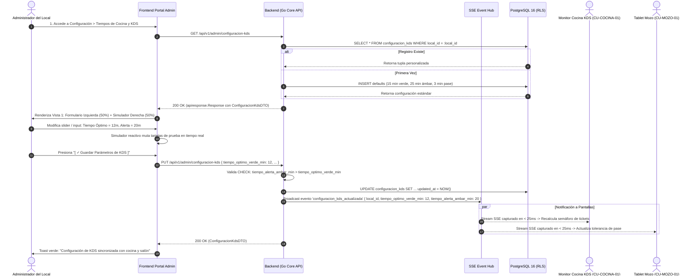
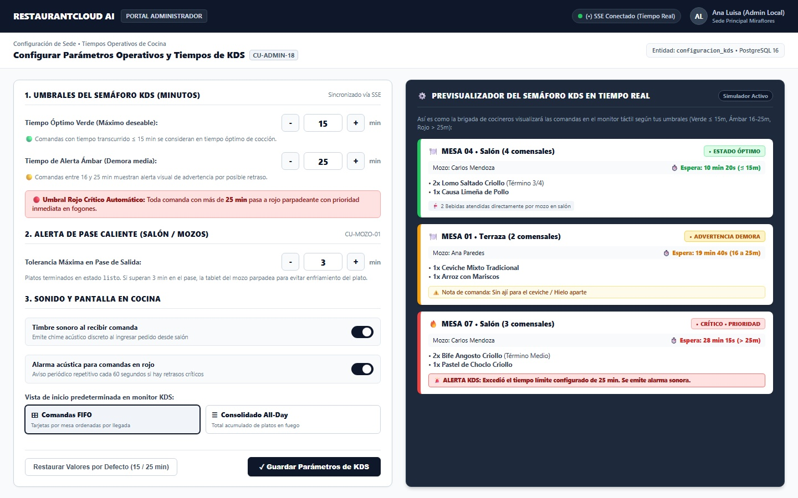

# CU-ADMIN-18: Configurar Parámetros Operativos de Comanda y Tiempos de KDS

Especificación técnica de interfaz de usuario, arquitectura de información, control de acceso basado en roles (RBAC), sincronización reactiva en tiempo real (Server-Sent Events) y contratos de API Go en **RestaurantCloud AI**.

---

## 1. Ficha Técnica del Caso de Uso

| Atributo | Detalle |
| :--- | :--- |
| **Código CU** | `CU-ADMIN-18` |
| **Nombre** | Configurar parámetros operativos de comanda y tiempos de KDS |
| **Actor(es)** | `admin_local` (Administrador del local; facultad exclusiva de parametrización de sede) |
| **Dispositivo / Viewport** | Desktop POS / Laptop Administrador (`1440x900` estándar corporativo) |
| **Precondición** | El local está activo; el usuario cuenta con sesión autenticada con rol `admin_local` asignado a la sede (`local_id`). |
| **Postcondición** | La sede cuenta con políticas y umbrales de tiempos de espera registrados en la tabla dedicada `configuracion_kds`; se emite el evento SSE `configuracion_kds_actualizada` en < 30ms para que los monitores KDS de cocina (`CU-COCINA-01`) y tablets de mozo (`CU-MOZO-01`) actualicen dinámicamente sus semáforos cromáticos y alertas sonoras sin requerir reinicio de sesión. |

---

## 2. Diagrama de Flujo y Secuencia en Tiempo Real (SSE)



---

## 3. Especificación de Pantallas y Wireframes Blueprint

### Vista 1: Panel de Configuración de KDS y Simulador en Tiempo Real (`wf_admin_18_configuracion_kds.jpg`)

Pantalla principal en formato horizontal (`1440x900`). Estructurada en **2 columnas complementarias**: el formulario de parámetros a la izquierda (50% del ancho) y el simulador interactivo del semáforo a la derecha (50% del ancho).



#### Layout Estructural ASCII (Desktop 1440x900)
```text
+----------------------------------------------------------------------------------------------------+
| RESTAURANTCLOUD AI   | Portal Administrador > Configuración > Tiempos de Cocina y KDS [ Sede: ]    |
+----------------------------------------------------------------------------------------------------+
| Configuración de Parámetros Operativos y Tiempos de KDS (CU-ADMIN-18)                              |
| Entidad: configuracion_kds • PostgreSQL 16                                                         |
|----------------------------------------------------------------------------------------------------|
| PANEL IZQUIERDO: FORMULARIO (50%)                   | PANEL DERECHO: SIMULADOR SEMÁFORO KDS (50%)  |
|                                                     |                                              |
| 1. UMBRALES DEL SEMÁFORO KDS (MINUTOS)              | ⚙️ PREVISUALIZADOR DEL SEMÁFORO EN TIEMPO REAL|
| • Tiempo Óptimo Verde:    [ - ] [ 15 ] [ + ] min    | Así es como la brigada visualizará los tick: |
|   🟢 Comandas <= 15 min en estado óptimo.           |                                              |
| • Tiempo Alerta Ámbar:    [ - ] [ 25 ] [ + ] min    | +------------------------------------------+ |
|   🟡 Comandas entre 16 y 25 min muestran alerta.    | | 🍽️ MESA 04 • Salón (4 com.) [• ESTADO ÓPTIMO|
|                                                     | | Mozo: Carlos M. • ⏱️ 10 min 20s (<= 15m)   | |
| +-------------------------------------------------+ | | • 2x Lomo Saltado Criollo (Término 3/4)  | |
| | 🔴 Umbral Rojo Crítico Automático:              | | | • 1x Causa Limeña de Pollo               | |
| | Toda comanda > 25 min pasa a rojo prioritario.  | | | [ 🥤 2 Bebidas atendidas por mozo ]      | |
| +-------------------------------------------------+ | +------------------------------------------+ |
|                                                     |                                              |
| 2. ALERTA DE PASE CALIENTE (SALÓN / MOZOS)          | +------------------------------------------+ |
| • Tolerancia Máxima en Pase: [ - ] [ 3 ] [ + ] min  | | 🍽️ MESA 01 • Terraza (2 com) [• ADVERTENCIA]|
|   Platos en 'listo' esperando recojo (CU-MOZO-01).  | | Mozo: Ana P. • ⏱️ 19 min 40s (16 a 25m)    | |
|                                                     | | • 1x Ceviche Mixto Tradicional           | |
| 3. SONIDO Y PANTALLA EN COCINA                      | | • 1x Arroz con Mariscos                  | |
| [✓] Timbre sonoro al recibir comanda (chime)   [ ●] | | ⚠️ Nota: Sin ají para el ceviche         | |
| [✓] Alarma acústica para comandas en rojo      [ ●] | +------------------------------------------+ |
| • Vista de inicio en monitor KDS:                   |                                              |
|   (●) [⊞ Comandas FIFO]  ( ) [☰ Consolidado All-Day]| +------------------------------------------+ |
|                                                     | | 🔥 MESA 07 • Salón (3 com) [• CRÍTICO 🚨] | |
|-----------------------------------------------------| | Mozo: Carlos M. • ⏱️ 28 min 15s (> 25m)   | |
| [ Restaurar Valores por Defecto ]                   | | • 2x Bife Angosto Criollo                | |
| [ ✓ Guardar Parámetros de KDS ]                     | | 🚨 ALERTA KDS: Excedió el tiempo límite  | |
+----------------------------------------------------------------------------------------------------+
```

#### Elementos Visuales y Funcionalidades
1. **Steppers Numéricos Táctiles:** Controles numéricos con botones `[ - ]` y `[ + ]` para ajuste ágil de minutos con una sola mano.
2. **Validación Visual de Coherencia:** El input de alerta ámbar impide fijar valores menores o iguales al umbral verde.
3. **Simulador de Semáforo Dinámico en Vivo:** Panel oscuro estilo KDS (`#1E293B`) que muta sus tres tarjetas instantáneamente ante cualquier pulsación en el formulario, brindando feedback visual antes de comprometer la base de datos.
4. **Restauración a Valores Recomendados:** Botón en 1 toque que restablece la tríada estándar de la industria gastronómica (15 min / 25 min / 3 min).

---

## 4. Matriz de Estados de la UI

| Estado UX | Indicador Visual | Comportamiento del Sistema |
| :--- | :--- | :--- |
| **1. Skeleton / Loading** | Celdas y sliders en pulso neutro (`#E2E8F0`) | Bloqueo momentáneo de inputs; carga de `configuracion_kds` vía REST. |
| **2. Loaded / Sincronizado** | Vista 1 con valores actuales de sede y botón guardar deshabilitado si no hay cambios | Visualización de parámetros y simulador sincronizado. |
| **3. Dirty / Modificado** | Botón `[ ✓ Guardar Parámetros de KDS ]` habilitado en azul/negro destacado | El usuario ha alterado valores; el simulador refleja los cambios en tiempo real. |
| **4. Error de Validación** | Borde rojo en input de alerta y banner: *"El umbral de alerta debe superar al umbral óptimo"* | Bloqueo estricto del botón de guardado. |
| **5. Guardado Exitoso** | Toast verde flotante: *"Parámetros actualizados y transmitidos a cocina en < 30ms"* | Persistencia en PostgreSQL 16 y emisión de evento SSE. |

---

## 5. Control de Acceso y Matriz RBAC

| Rol | Consultar Configuración | Modificar Umbrales | Restaurar Defaults | Ver KDS (`CU-COCINA-01`) |
| :--- | :---: | :---: | :---: | :---: |
| `admin_local` | ✅ Sí | ✅ Sí | ✅ Sí | ✅ Sí (supervisión) |
| `propietario` | ✅ Sí (monitor) | ❌ No (exclusivo sede) | ❌ No | ✅ Sí (monitor) |
| `cocina` | ❌ No (solo lectura interna) | ❌ No | ❌ No | ✅ Sí (operativo) |
| `mozo` | ❌ No | ❌ No | ❌ No | ❌ No |
| `cajero` | ❌ No | ❌ No | ❌ No | ❌ No |

---

## 6. Contratos de API REST y SSE (Go DTOs & Endpoints)

### 6.1 DTOs en Go (`internal/domain/cocina/dto_configuracion.go`)

```go
package cocina

import (
	"time"
	"github.com/google/uuid"
)

// ConfiguracionKdsDTO respuesta de configuración para frontend y KDS
type ConfiguracionKdsDTO struct {
	ID                         uuid.UUID `json:"id"`
	LocalID                    uuid.UUID `json:"local_id"`
	TiempoOptimoVerdeMin       int       `json:"tiempo_optimo_verde_min"`
	TiempoAlertaAmbarMin       int       `json:"tiempo_alerta_ambar_min"`
	TiempoMaximoPaseMin        int       `json:"tiempo_maximo_pase_min"`
	AlertaSonoraNuevaComanda   bool      `json:"alerta_sonora_nueva_comanda"`
	AlertaSonoraComandaRoja    bool      `json:"alerta_sonora_comanda_roja"`
	IntervaloSonidoRojoSeg     int       `json:"intervalo_sonido_rojo_seg"`
	VistaPredeterminada        string    `json:"vista_predeterminada"` // "fifo" o "all_day"
	UpdatedAt                  time.Time `json:"updated_at"`
}

// ActualizarConfiguracionKdsRequest payload para modificar parámetros
type ActualizarConfiguracionKdsRequest struct {
	TiempoOptimoVerdeMin       int    `json:"tiempo_optimo_verde_min" binding:"required,min=3,max=60"`
	TiempoAlertaAmbarMin       int    `json:"tiempo_alerta_ambar_min" binding:"required,min=5,max=120"`
	TiempoMaximoPaseMin        int    `json:"tiempo_maximo_pase_min" binding:"required,min=1,max=30"`
	AlertaSonoraNuevaComanda   bool   `json:"alerta_sonora_nueva_comanda"`
	AlertaSonoraComandaRoja    bool   `json:"alerta_sonora_comanda_roja"`
	IntervaloSonidoRojoSeg     int    `json:"intervalo_sonido_rojo_seg" binding:"required,min=15,max=300"`
	VistaPredeterminada        string `json:"vista_predeterminada" binding:"required,oneof=fifo all_day"`
}

// EventoConfiguracionKdsActualizada payload para broadcast SSE
type EventoConfiguracionKdsActualizada struct {
	LocalID              uuid.UUID `json:"local_id"`
	TiempoOptimoVerdeMin int       `json:"tiempo_optimo_verde_min"`
	TiempoAlertaAmbarMin int       `json:"tiempo_alerta_ambar_min"`
	TiempoMaximoPaseMin  int       `json:"tiempo_maximo_pase_min"`
	Timestamp            time.Time `json:"timestamp"`
}
```

### 6.2 Endpoints del Módulo

| Método | Ruta | Rol Requerido | Descripción | Códigos HTTP |
| :--- | :--- | :--- | :--- | :--- |
| `GET` | `/api/v1/admin/configuracion-kds` | `admin_local` | Obtiene los parámetros vigentes de la sede | `200`, `401`, `403` |
| `PUT` | `/api/v1/admin/configuracion-kds` | `admin_local` | Actualiza umbrales y emite evento SSE | `200`, `400`, `422` |
| `POST`| `/api/v1/admin/configuracion-kds/restaurar-defaults` | `admin_local` | Restablece los valores estándar recomendados | `200`, `403` |

---

## 7. Esquema Relacional de Base de Datos y Optimización

```sql
-- 1. Tabla de configuración operativa de KDS
CREATE TABLE IF NOT EXISTS configuracion_kds (
    id UUID PRIMARY KEY DEFAULT gen_random_uuid(),
    local_id UUID NOT NULL REFERENCES local(id) ON DELETE CASCADE,
    
    tiempo_optimo_verde_min INT NOT NULL DEFAULT 15 CHECK (tiempo_optimo_verde_min BETWEEN 3 AND 60),
    tiempo_alerta_ambar_min INT NOT NULL DEFAULT 25 CHECK (tiempo_alerta_ambar_min BETWEEN 5 AND 120),
    tiempo_maximo_pase_min INT NOT NULL DEFAULT 3 CHECK (tiempo_maximo_pase_min BETWEEN 1 AND 30),
    
    alerta_sonora_nueva_comanda BOOLEAN NOT NULL DEFAULT true,
    alerta_sonora_comanda_roja BOOLEAN NOT NULL DEFAULT true,
    intervalo_sonido_rojo_seg INT NOT NULL DEFAULT 60 CHECK (intervalo_sonido_rojo_seg BETWEEN 15 AND 300),
    vista_predeterminada VARCHAR(20) NOT NULL DEFAULT 'fifo' CHECK (vista_predeterminada IN ('fifo', 'all_day')),
    
    created_at TIMESTAMPTZ NOT NULL DEFAULT NOW(),
    updated_at TIMESTAMPTZ NOT NULL DEFAULT NOW(),
    
    CONSTRAINT uq_configuracion_kds_local UNIQUE (local_id),
    CONSTRAINT chk_kds_umbrales_coherentes CHECK (tiempo_alerta_ambar_min > tiempo_optimo_verde_min)
);

-- 2. Índice para consulta sub-milisegundo al cargar KDS o comanda de mozo
CREATE INDEX IF NOT EXISTS idx_configuracion_kds_local 
ON configuracion_kds(local_id);
```

---

## 8. Accesibilidad y Ergonomía WCAG 2.1 AA

1. **Touch Targets Amplios (> 48x48px):** Los botones de incremento y decremento de minutos (`[ - ]` y `[ + ]`) miden `48x48px` reales en dispositivos táctiles.
2. **Contraste Multimodal:** Los estados del semáforo utilizan triple indicación: color cromático, icono de apoyo (`🟢`, `🟡`, `🔴`) y texto explícito (`Óptimo`, `Atención`, `Crítico`), garantizando accesibilidad total a personas con daltonismo.
3. **Persistencia y Feedback Inmediato:** Cada modificación en los umbrales recalcula el simulador de semáforo en < 16ms (60 FPS) mediante variables reactivas en el cliente.
