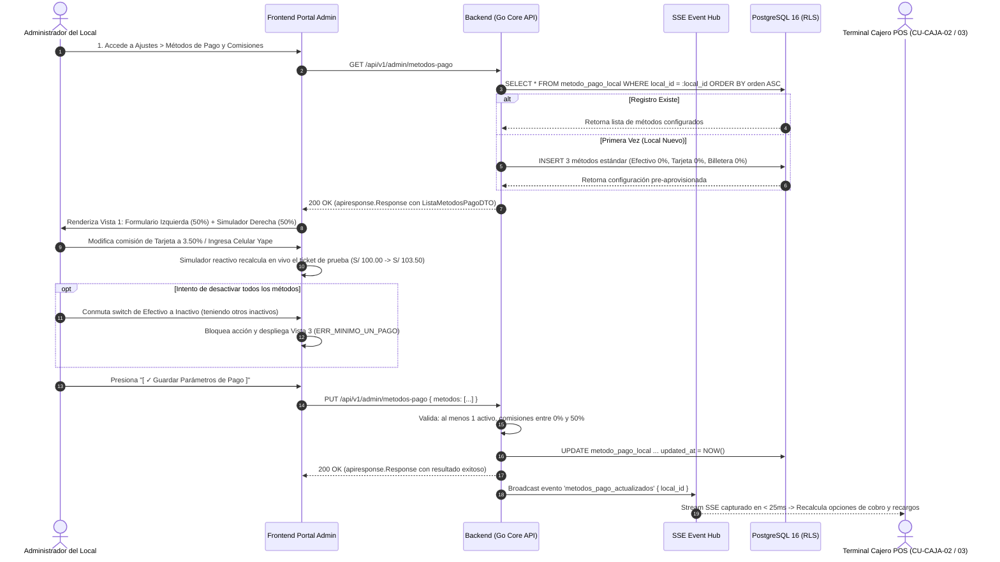
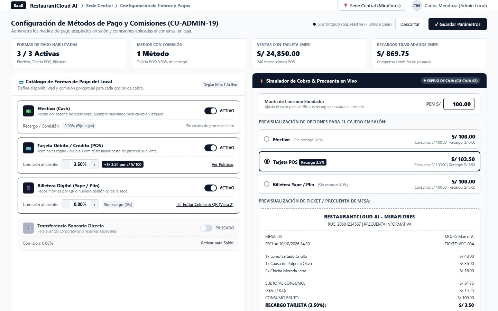
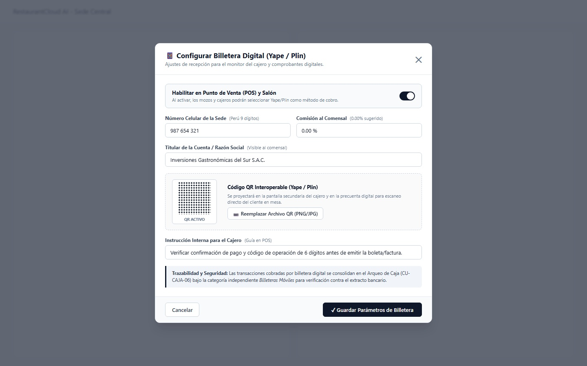
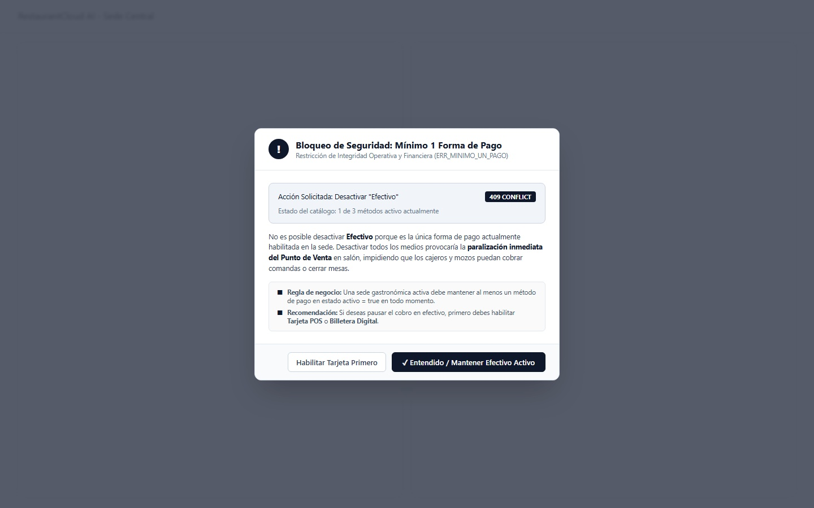
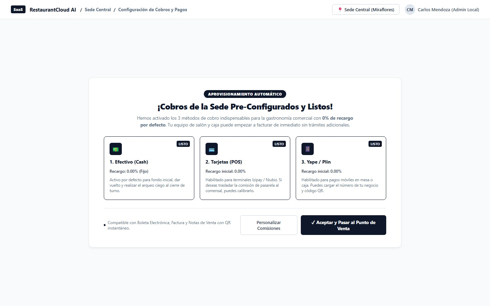

# CU-ADMIN-19: Configurar Métodos de Pago y Comisiones de Cobro del Local

Especificación técnica de interfaz de usuario, arquitectura de información, control de acceso basado en roles (RBAC), sincronización reactiva en tiempo real (Server-Sent Events) y contratos de API Go en **RestaurantCloud AI**.

---

## 1. Ficha Técnica del Caso de Uso

| Atributo | Detalle |
| :--- | :--- |
| **Código CU** | `CU-ADMIN-19` |
| **Nombre** | Configurar métodos de pago y comisiones de cobro del local |
| **Actor(es)** | `admin_local` (Administrador del local; facultad exclusiva de parametrización financiera de sede) |
| **Dispositivo / Viewport** | Desktop POS / Laptop Administrador (`1440x900` estándar corporativo Grayscale Blueprint) |
| **Precondición** | El local está activo; el usuario cuenta con sesión autenticada con rol `admin_local` asignado a la sede (`local_id`). |
| **Postcondición** | La sede cuenta con el catálogo de métodos de pago registrado y activo en la tabla `metodo_pago_local`; comisiones porcentuales y datos de recepción configurados; se emite el evento SSE `metodos_pago_actualizados` en < 30ms para que las pantallas del Cajero (`CU-CAJA-02`, `CU-CAJA-03`) y tablets de mozo actualicen dinámicamente sus medios de cobro y recargos sin requerir recarga de página. |

---

## 2. Diagrama de Flujo y Secuencia en Tiempo Real (SSE)



---

## 3. Especificación de Pantallas y Wireframes Blueprint (4 Vistas)

### Vista 1: Panel Principal de Configuración y Simulador Reactivo (Split 50/50)



#### Layout Estructural (Arte ASCII 1440x900):
```text
+----------------------------------------------------------------------------------------------------+
| [SaaS] RestaurantCloud AI  /  Sede Central (Miraflores)  /  Cobros y Pagos   [📍 Sede] [CM Admin] |
+----------------------------------------------------------------------------------------------------+
| Configuración de Métodos de Pago y Comisiones (CU-ADMIN-19)           ⚡ SSE < 30ms [Descartar] [Guardar] |
| Administra medios aceptados en salón y recargos aplicados al comensal en caja                      |
+----------------------------------------------------------------------------------------------------+
| [ 3 / 3 Activas ]          | [ 1 con Comisión ]        | [ S/ 24,850.00 ]          | [ S/ 869.75 ]         |
| Formas Habilitadas         | Tarjeta POS (3.50%)       | Ventas Tarjeta (Mes)      | Recargos Percibidos   |
+----------------------------------------------------------------------------------------------------+
| COLUMNA IZQUIERDA (50%): CATÁLOGO DE MÉTODOS     | COLUMNA DERECHA (50%): SIMULADOR DE COBRO EN VIVO|
|                                                  |                                                  |
| 💳 Catálogo de Formas de Pago  [Regla: Min 1]    | ⚡ Simulador de Cobro & Precuenta  [ESPEJO CAJA] |
|                                                  |                                                  |
| 💵 Efectivo (Cash)                [● ACTIVO]     | Monto de Consumo Simulación: [ PEN S/ ] [ 100.00]|
|    Medio obligatorio legal. No admite recargo.   |                                                  |
|    Recargo: [ 0.00% (Fijo) ]   Sin costo pasarela| Previsualización de Opciones para el Cajero:    |
| ------------------------------------------------ |                                                  |
| 💳 Tarjeta Débito / Crédito (POS) [● ACTIVO]     | ( ) Efectivo (0.0%):        S/ 100.00            |
|    Terminales Izipay / Niubiz. Traslada costo.   |     Consumo: S/ 100.00 | Recargo: S/ 0.00        |
|    Comisión al cliente: [-] [ 3.50% ] [+]        |                                                  |
|    [+S/ 3.50 por c/ S/ 100]  [Ver Políticas]     | (●) Tarjeta POS [Recargo 3.5%]: S/ 103.50        |
| ------------------------------------------------ |     Consumo: S/ 100.00 | Recargo: S/ 3.50        |
| 📱 Billetera Digital (Yape/Plin)  [● ACTIVO]     |                                                  |
|    Pagos móviles por QR o celular de sede.       | ( ) Billetera Yape/Plin (0.0%): S/ 100.00        |
|    Comisión al cliente: [-] [ 0.00% ] [+]        |     Consumo: S/ 100.00 | Recargo: S/ 0.00        |
|    [Sin recargo (0%)]    [⚙️ Editar Celular & QR] | ------------------------------------------------ |
| ------------------------------------------------ | PRECUENTA DE SALÓN SIMULADA:                     |
| 🏦 Transferencia Bancaria         [○ PAUSADO]    | RESTAURANTCLOUD AI - MIRAFLORES  | MESA: 04      |
|    Eventos y reservas.     [Activar para Salón]  | 1x Lomo Saltado Criollo               S/ 48.00    |
|                                                  | 1x Causa de Pulpo al Olivo            S/ 36.00    |
| Políticas bajo RLS por local_id en PostgreSQL 16 | 2x Chicha Morada Jarra                S/ 16.00    |
| [+ Agregar Medio Personalizado]                  | SUBTOTAL: S/ 84.75 | IGV (18%): S/ 15.25        |
|                                                  | CONSUMO BRUTO:                        S/ 100.00    |
|                                                  | RECARGO TARJETA (3.50%):              S/   3.50    |
|                                                  | >>> TOTAL A PAGAR:                    S/ 103.50    |
+----------------------------------------------------------------------------------------------------+
```

---

### Vista 2: Modal de Configuración Detallada / Datos de Billetera Digital



#### Layout Estructural (Arte ASCII 680px):
```text
+------------------------------------------------------------------------+
| 📱 Configurar Billetera Digital (Yape / Plin)                      [✕] |
| Ajustes de recepción para el monitor del cajero y comprobantes digitales|
+------------------------------------------------------------------------+
| Número Celular de la Sede (9 dígitos):   Razón Social del Titular:     |
| [ 987 654 321                       ]   [ RESTAURANTE ÁUREA S.A.C.    ]|
|                                                                        |
| +---------------------+  Código QR Dinámico Autogenerado               |
| |  [QR INTEROPERABLE] |  Se autogenera directamente del celular 9 dig. |
| |  [ YAPE • PLIN    ] |  Sin necesidad de URLs ni subida de archivos.  |
| +---------------------+  Visible en pantalla secundaria y precuenta.   |
|                                                                        |
| ℹ️ Activación: Para habilitar Yape/Plin, es obligatorio registrar      |
|    primero el número celular receptor de la sede (RN-PAGO-04).         |
+------------------------------------------------------------------------+
| [ Cancelar ]                             [ ✓ Guardar Configuración ]   |
+------------------------------------------------------------------------+
```

---

### Vista 3: Diálogo de Advertencia / Bloqueo de Regla de Negocio (Mínimo 1 Método Activo)



#### Layout Estructural (Arte ASCII 540px):
```text
+------------------------------------------------------------------+
| [ ! ] Bloqueo de Seguridad: Mínimo 1 Forma de Pago                |
|       Restricción de Integridad Operativa (ERR_MINIMO_UN_PAGO)   |
+------------------------------------------------------------------+
| Acción Solicitada: Desactivar "Efectivo"        [ 409 CONFLICT ] |
| Estado del catálogo: 1 de 4 métodos activo actualmente           |
|                                                                  |
| No es posible desactivar Efectivo porque es la única forma de    |
| pago actualmente habilitada en la sede. Desactivar todos los     |
| medios provocaría la paralización inmediata del Punto de Venta   |
| en salón, impidiendo que cajeros y mozos cobren comandas.        |
|                                                                  |
| ■ Regla de negocio: La sede debe mantener al menos un método en  |
|   estado activo = true en todo momento.                          |
| ■ Solución: Si deseas pausar efectivo, primero habilita          |
|   Tarjeta POS, Billetera Digital o Transferencia Bancaria.       |
+------------------------------------------------------------------+
|                  [ ✓ Entendido / Mantener Efectivo Activo ]      |
+------------------------------------------------------------------+
```

---

### Vista 4: Estado Inicial / Local Nuevo (Onboarding Pre-Aprovisionado)



#### Layout Estructural (Arte ASCII 920px):
```text
+------------------------------------------------------------------------------+
|                    [ APROVISIONAMIENTO AUTOMÁTICO ]                          |
|             ¡Cobros de la Sede Pre-Configurados y Listos!                    |
| Activamos los 3 métodos de cobro indispensables para gastronomía comercial   |
| con 0% de recargo por defecto. Tu equipo puede operar de inmediato.         |
+------------------------------------------------------------------------------+
| [1. Efectivo (Cash)]       | [2. Tarjetas (POS)]       | [3. Yape / Plin]    |
| [LISTO]                    | [LISTO]                   | [LISTO]             |
| 💵                         | 💳                         | 📱                   |
| Recargo: 0.00% (Fijo)      | Recargo inicial: 0.00%    | Recargo: 0.00%      |
| Activo para fondo inicial, | Habilitado para Izipay/   | Habilitado para pago|
| cambio y arqueo de turno.  | Niubiz. Traslado opcional.| móvil. Configura QR.|
+------------------------------------------------------------------------------+
| ● Compatible con Boleta, Factura y Notas de Venta con QR instantáneo.        |
|                                                                              |
| [ Personalizar Comisiones ]             [ ✓ Aceptar y Pasar al Punto de Venta]|
+------------------------------------------------------------------------------+
```

---

## 4. Matriz de Control de Acceso Basado en Roles (RBAC)

| Acción / Capacidad | `admin_local` | `propietario` | `cajero` | `mozo` | `cocina` |
| :--- | :---: | :---: | :---: | :---: | :---: |
| Ver configuración de cobros y comisiones (`GET`) | ✅ Permitido | ✅ Permitido | ❌ Bloqueado | ❌ Bloqueado | ❌ Bloqueado |
| Modificar comisiones porcentuales (`PUT`) | ✅ Permitido | ✅ Permitido | ❌ Bloqueado | ❌ Bloqueado | ❌ Bloqueado |
| Habilitar o pausar métodos de pago (`PUT`) | ✅ Permitido | ✅ Permitido | ❌ Bloqueado | ❌ Bloqueado | ❌ Bloqueado |
| Consultar métodos activos para cobrar (`GET /caja`) | ✅ Permitido | ✅ Permitido | ✅ Permitido | ✅ Permitido | ❌ Bloqueado |
| Cargar imagen de QR de Yape/Plin (`POST /upload`) | ✅ Permitido | ✅ Permitido | ❌ Bloqueado | ❌ Bloqueado | ❌ Bloqueado |

---

## 5. Contratos de API Go y DTOs (`internal/domain/pago/dto.go`)

```go
package pago

import (
	"time"
	"github.com/google/uuid"
)

// MetodoPagoLocalDTO representa la configuración de un método de pago por sede
type MetodoPagoLocalDTO struct {
	ID                 uuid.UUID              `json:"id"`
	LocalID            uuid.UUID              `json:"local_id"`
	Codigo             string                 `json:"codigo" example:"tarjeta"` // efectivo, tarjeta, billetera_digital, transferencia
	Nombre             string                 `json:"nombre" example:"Tarjeta Débito / Crédito (POS)"`
	Activo             bool                   `json:"activo" example:"true"`
	ComisionPorcentaje float64                `json:"comision_porcentaje" example:"3.50"`
	DatosAdicionales   map[string]interface{} `json:"datos_adicionales,omitempty"` // {"telefono": "987654321", "titular": "Restaurant SAC"}
	Icono              string                 `json:"icono" example:"credit-card"`
	Orden              int                    `json:"orden" example:"2"`
	UpdatedAt          time.Time              `json:"updated_at"`
}

// ActualizarMetodoPagoRequest payload enviado por el Administrador
type ActualizarMetodoPagoRequest struct {
	Activo             bool                   `json:"activo"`
	ComisionPorcentaje float64                `json:"comision_porcentaje" binding:"gte=0,lte=50"`
	DatosAdicionales   map[string]interface{} `json:"datos_adicionales,omitempty"`
}

// ActualizarCatalogoMetodosRequest actualización masiva de la sede
type ActualizarCatalogoMetodosRequest struct {
	Metodos []struct {
		Codigo             string                 `json:"codigo" binding:"required"`
		Activo             bool                   `json:"activo"`
		ComisionPorcentaje float64                `json:"comision_porcentaje" binding:"gte=0,lte=50"`
		DatosAdicionales   map[string]interface{} `json:"datos_adicionales,omitempty"`
	} `json:"metodos" binding:"required,min=1"`
}

// SimulacionCobroRequest DTO para el cálculo en tiempo real del simulador
type SimulacionCobroRequest struct {
	MontoConsumo float64 `json:"monto_consumo" binding:"required,gt=0"`
}

// OpcionCobroSimulada resultado por cada método de pago
type OpcionCobroSimulada struct {
	Codigo             string  `json:"codigo"`
	Nombre             string  `json:"nombre"`
	Activo             bool    `json:"activo"`
	ConsumoBase        float64 `json:"consumo_base"`
	ComisionPorcentaje float64 `json:"comision_porcentaje"`
	MontoRecargo       float64 `json:"monto_recargo"`
	TotalFinal         float64 `json:"total_final"`
}

// SimulacionCobroResponse salida para el simulador y la precuenta de salón
type SimulacionCobroResponse struct {
	MontoConsumo float64               `json:"monto_consumo"`
	Opciones     []OpcionCobroSimulada `json:"opciones"`
}
```

---

## 6. Catálogo de Endpoints REST

| Método | Endpoint | Rol Mínimo | Código Éxito | Descripción |
| :--- | :--- | :---: | :---: | :--- |
| `GET` | `/api/v1/admin/metodos-pago` | `admin_local` | `200 OK` | Obtiene el catálogo completo de métodos de pago y comisiones de la sede |
| `PUT` | `/api/v1/admin/metodos-pago` | `admin_local` | `200 OK` | Actualiza masivamente los métodos de pago, recargos y switches de la sede |
| `PUT` | `/api/v1/admin/metodos-pago/{codigo}` | `admin_local` | `200 OK` | Actualiza individualmente un método (ej. datos de Yape o porcentaje de Tarjeta) |
| `POST` | `/api/v1/admin/metodos-pago/simular` | `admin_local` | `200 OK` | Simula en vivo el cálculo de recargos sobre un monto de consumo de prueba |
| `GET` | `/api/v1/caja/metodos-pago-activos` | `cajero`, `mozo` | `200 OK` | Endpoint público para el POS que lista únicamente métodos `activo = true` |

### Catálogo de Errores de Negocio (`AppError`):

| Código Error | HTTP Status | Causa y Mensaje |
| :--- | :---: | :--- |
| `ERR_MINIMO_UN_PAGO` | `409 Conflict` | Intento de desactivar todos los métodos. *"La sede debe mantener al menos un método de pago activo en todo momento."* |
| `ERR_COMISION_INVALIDA` | `422 Unprocessable` | Porcentaje de comisión negativo o superior al tope máximo del 50%. |
| `ERR_METODO_NO_ENCONTRADO` | `404 Not Found` | Código de método no registrado en el local especificado. |
| `ERR_DATOS_BILLETERA_INCOMPLETOS` | `422 Unprocessable` | Billetera digital marcada como activa sin número celular de contacto de 9 dígitos. |

---

## 7. Modelo Relacional PostgreSQL 16 y RLS

Alineado de forma **100% estricta** con [`restaurantcloud/infra/sql/02_schema_ddl.sql`](file:///d:/Proyecto/RestaurantCloud_AI_backend/restaurantcloud/infra/sql/02_schema_ddl.sql#L453-L467) y [`03_indexes.sql`](file:///d:/Proyecto/RestaurantCloud_AI_backend/restaurantcloud/infra/sql/03_indexes.sql#L74-L77):

```sql
-- 5.4 Formas de Pago y Comisiones de Pasarela por Sede (CU-ADMIN-19)
CREATE TABLE IF NOT EXISTS metodo_pago_local (
    id UUID PRIMARY KEY DEFAULT fn_uuid_v8(),
    local_id UUID NOT NULL REFERENCES local(id) ON DELETE CASCADE,
    codigo VARCHAR(30) NOT NULL, -- efectivo, tarjeta, billetera_digital, transferencia
    nombre VARCHAR(60) NOT NULL,
    activo BOOL NOT NULL DEFAULT true,
    comision_porcentaje DECIMAL(5, 2) NOT NULL DEFAULT 0.00 CHECK (comision_porcentaje >= 0 AND comision_porcentaje <= 50.00),
    datos_adicionales JSONB DEFAULT '{}'::jsonb, -- {"telefono": "987654321", "titular": "ÁUREA S.A.C.", "qr_url": "..."}
    icono VARCHAR(30) NOT NULL DEFAULT 'wallet',
    orden INT NOT NULL DEFAULT 1 CHECK (orden >= 1),
    created_at TIMESTAMPTZ NOT NULL DEFAULT NOW(),
    updated_at TIMESTAMPTZ NOT NULL DEFAULT NOW(),
    CONSTRAINT uq_metodo_pago_local UNIQUE (local_id, codigo)
);

-- Índice parcial de alto rendimiento para el Punto de Venta (< 0.5ms)
CREATE INDEX IF NOT EXISTS idx_metodo_pago_local_pos 
    ON metodo_pago_local(local_id, orden) 
    WHERE activo = true;

-- Restricción Poka-Yoke: Billetera activa requiere obligatoriamente celular de 9 dígitos
ALTER TABLE metodo_pago_local ADD CONSTRAINT chk_billetera_digital_valida 
    CHECK (codigo != 'billetera_digital' OR activo = false OR (
        datos_adicionales ? 'telefono' AND length(datos_adicionales->>'telefono') >= 9
    ));
```

> [!NOTE]
> Las columnas de recargo y comisiones ya se encuentran incorporadas nativamente en la tabla `comprobante` ([`02_schema_ddl.sql`](file:///d:/Proyecto/RestaurantCloud_AI_backend/restaurantcloud/infra/sql/02_schema_ddl.sql#L573-L578)) y `pedido_subcuenta`:
> `metodo_pago_id UUID REFERENCES metodo_pago_local(id) ON DELETE SET NULL`, `subtotal_consumo DECIMAL(10,2)`, `porcentaje_recargo DECIMAL(5,2)` y `monto_recargo DECIMAL(10,2)`.

---

## 8. Reglas de Negocio Operativas (RN-PAGO)

- **RN-PAGO-01 (Mínimo 1 Método Activo):** La sede debe mantener al menos un método de pago en estado `activo = true` en todo momento. Toda acción o petición que intente desactivar la totalidad de medios será bloqueada con error `409 Conflict` (`ERR_MINIMO_UN_PAGO`) y abrirá el **Modal de Bloqueo de Seguridad (Vista 3)**.
- **RN-PAGO-02 (Rango Válido de Comisiones):** El porcentaje de recargo o comisión debe estar comprendido estrictamente entre `0.00%` y `50.00%` (`CHECK (comision_porcentaje >= 0 AND comision_porcentaje <= 50.00)`). Cualquier valor fuera de este rango genera error `422 Unprocessable Entity` (`ERR_COMISION_INVALIDA`).
- **RN-PAGO-03 (Efectivo sin Recargo):** Por mandato legal en Perú, el efectivo es el medio oficial incondicional y no admite recargo alguno (`comision_porcentaje = 0.00%` constante e inmutable).
- **RN-PAGO-04 (Activación Condicionada de Billetera Digital):** Para activar `billetera_digital`, es obligatorio registrar previamente un número telefónico celular válido de 9 dígitos peruanos y el titular receptor (`chk_billetera_digital_valida`). El código QR se autogenera dinámicamente a partir del celular. Si el administrador intenta activar el switch sin haber configurado el número, el switch permanece apagado, se emite un toast informativo y la interfaz abre automáticamente la **Vista 2 (Modal de Configuración)**. Al guardar datos válidos, el método se habilita automáticamente.
- **RN-PAGO-05 (Fórmulas Financieras SUNAT):**
  $$\text{Monto Recargo} = \text{Monto Consumo} \times \left(\frac{\text{comision\_porcentaje}}{100}\right)$$
  $$\text{Total a Pagar} = \text{Monto Consumo} + \text{Monto Recargo}$$
  $$\text{Base Imponible} = \frac{\text{Total a Pagar}}{1.18}, \quad \text{IGV (18\%)} = \text{Total a Pagar} - \text{Base Imponible}$$
- **RN-PAGO-06 (Sincronización Reactiva SSE < 30ms):** Al guardar los cambios, el servidor emite el evento SSE `metodos_pago_actualizados`. La pantalla de cobro del Cajero (`CU-CAJA-02`, `CU-CAJA-03`) y la precuenta del mozo (`CU-MOZO-08`) actualizan instantáneamente sus botones y recargos sin requerir recargar la sesión.
- **RN-PAGO-07 (Onboarding Pre-Aprovisionado para Sedes Nuevas):** Si una sede física recién creada no cuenta con métodos de cobro, el sistema despliega la **Vista 4 (Onboarding Inicial)** con el paquete estándar completo (Efectivo 0%, Tarjeta POS 0%, Yape/Plin 0% y Transferencia inactiva) para confirmar en 1 clic o personalizar manualmente desde la plantilla canónica sin estados nulos.
- **RN-PAGO-08 (Protección de Borrado / Inmutabilidad):** Los métodos de pago que ya poseen transacciones históricas en `comprobante` (`metodo_pago_id`) no pueden eliminarse físicamente de la base de datos (`ON DELETE RESTRICT / SET NULL`), permitiéndose únicamente su desactivación (`activo = false`).
- **RN-PAGO-09 (Activación Condicionada de Transferencias Bancarias):** Para activar `transferencia`, es obligatorio registrar previamente la entidad financiera y el número de cuenta o CCI de la empresa. Si el administrador intenta activar el switch sin estos datos, el switch permanece apagado, se emite un toast informativo y se abre automáticamente el modal de transferencias. Al guardar datos bancarios válidos, el método se habilita automáticamente.

---

## 9. Checklist de Accesibilidad WCAG 2.1 AA

- [x] **Contraste de Color:** Ratios superiores a `4.8:1` para texto regular `#334155` sobre fondo blanco `#FFFFFF` y `14:1` para títulos dark `#0F172A`.
- [x] **Navegación por Teclado:** Steppers numéricos de comisión con soporte para teclas `ArrowUp` y `ArrowDown`; switches operables con tecla `Espacio`.
- [x] **Regiones Vivas ARIA:** `aria-live="polite"` en el contenedor del Simulador de Precuenta para anunciar cambios de recargo a lectores de pantalla.
- [x] **Touch Targets:** Botones de stepper de 28x28px agrupados y switches con área táctil accesible de 44x44px.
- [x] **Feedback de Error Claro:** Alerta modal de `ERR_MINIMO_UN_PAGO` con foco forzado accesible y escape mediante tecla `Esc`.
