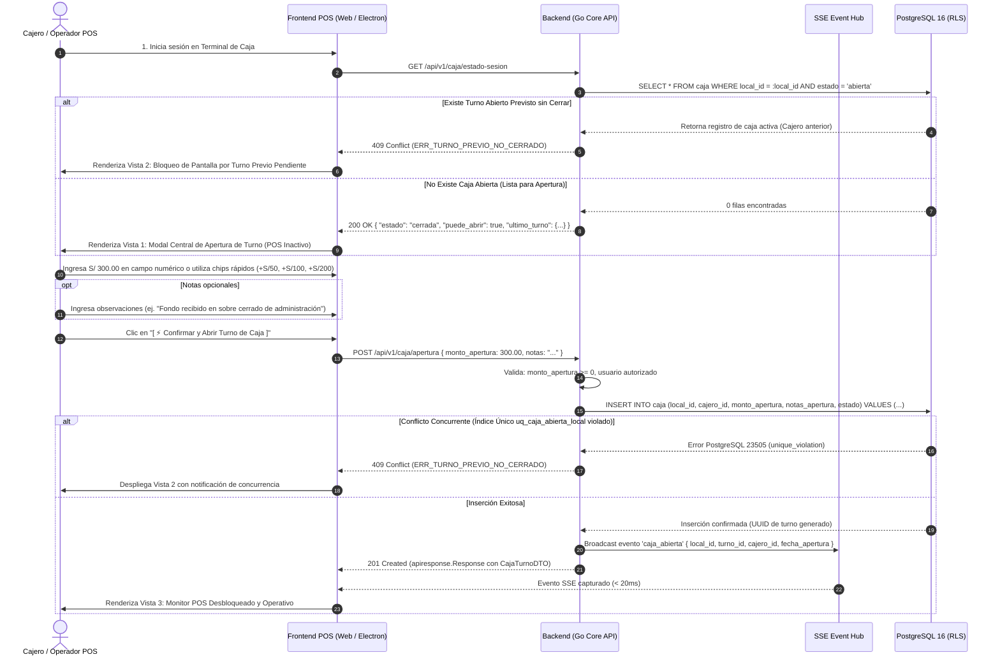
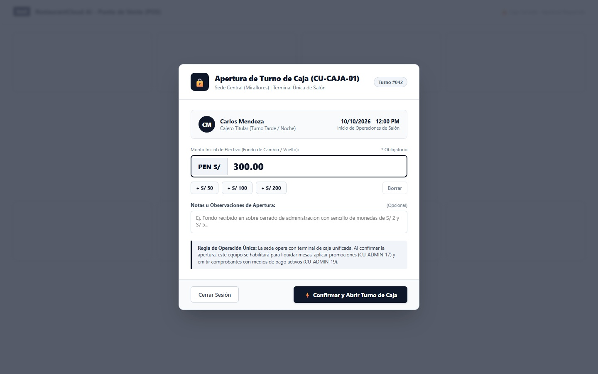
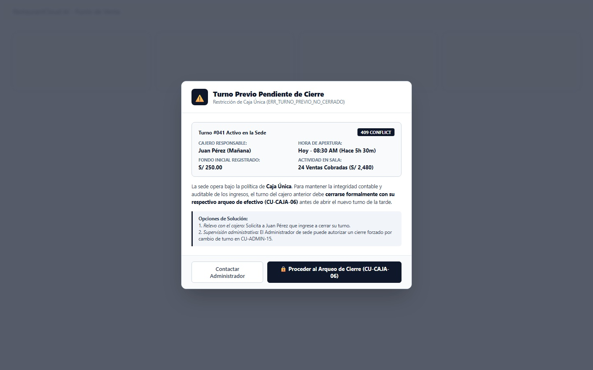
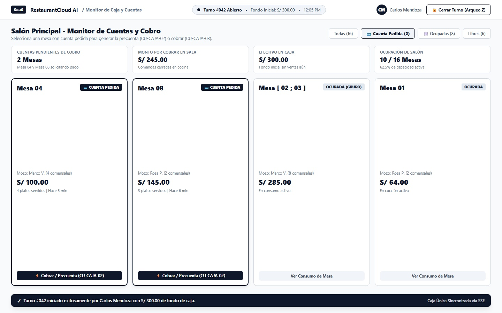

# CU-CAJA-01: Apertura de Turno de Caja

Especificación técnica de interfaz de usuario, arquitectura de información, control de acceso basado en roles (RBAC), sincronización reactiva en tiempo real (Server-Sent Events) y contratos de API Go en **RestaurantCloud AI**.

---

## 1. Ficha Técnica del Caso de Uso

| Atributo | Detalle |
| :--- | :--- |
| **Código CU** | `CU-CAJA-01` |
| **Nombre** | Apertura de turno de caja |
| **Actor(es)** | `cajero` (Titular o relevo de caja), `admin_local` (Administrador de sede facultado para operar o supervisar caja) |
| **Dispositivo / Viewport** | Terminal POS Desktop / Monitor Táctil de Caja (`1440x900` estándar corporativo Grayscale Blueprint) |
| **Precondición** | La sede está activa; el usuario cuenta con sesión autenticada con rol `cajero` o `admin_local`; el turno anterior de la sede debe encontrarse cerrado formalmente (`estado = 'cerrada'`). No existe otra caja abierta en la sede (**Política de Terminal Única de Caja**). |
| **Postcondición** | Se crea un registro en la tabla `caja` con estado `'abierta'`, registrando `monto_apertura` (fondo de sencillo/cambio en Soles `PEN`), `notas_apertura` y marca temporal `fecha_apertura = NOW()`. La interfaz de Punto de Venta se desbloquea en tiempo real, permitiendo liquidar mesas, emitir precuentas (`CU-CAJA-02`) y cobrar comprobantes (`CU-CAJA-03`). Se transmite el evento SSE `caja_abierta` al hub local. |

---

## 2. Diagrama de Flujo y Secuencia en Tiempo Real (SSE)



---

## 3. Especificación de Pantallas y Wireframes Blueprint (3 Vistas Canónicas)

### Vista 1: Modal Central de Apertura de Turno (POS Bloqueado)

El Punto de Venta permanece cubierto por una cortina modal semi-transparente de alto contraste (`background: rgba(15, 23, 42, 0.72)`) impidiendo cualquier interacción con pedidos, mesas o facturación hasta que el operador declare formalmente el fondo inicial de efectivo de la gaveta.



#### Layout Estructural (Arte ASCII 1440x900):
```text
+----------------------------------------------------------------------------------------------------+
| [SaaS] RestaurantCloud AI  /  Punto de Venta (POS)                           [CM Carlos Mendoza]  |
| ============================== FONDO BLOQUEADO (OVERLAY OSCURO) ================================== |
|                                                                                                    |
|                             +------------------------------------------------+                     |
|                             | [🔒] Apertura de Turno de Caja (CU-CAJA-01)    |                     |
|                             | Sede Central (Miraflores) | Terminal Única     | [Turno #042]        |
|                             +------------------------------------------------+                     |
|                             | [CM] Carlos Mendoza             10/10/2026     |                     |
|                             |      Cajero Titular (Tarde)     12:00 PM       |                     |
|                             +------------------------------------------------+                     |
|                             | Monto Inicial de Efectivo (Fondo / Vuelto): *  |                     |
|                             | +--------+-----------------------------------+ |                     |
|                             | | PEN S/ |   300.00                          | |                     |
|                             | +--------+-----------------------------------+ |                     |
|                             | [ + S/ 50 ]  [ + S/ 100 ]  [ + S/ 200 ] [Borrar|                     |
|                             |                                                |                     |
|                             | Notas u Observaciones de Apertura: (Opcional)  |                     |
|                             | [ Ej. Fondo recibido en sobre cerrado...     ] |                     |
|                             +------------------------------------------------+                     |
|                             | | Regla de Operación Única: La sede opera con  |                     |
|                             | | terminal unificada. Al confirmar la apertura |                     |
|                             | | este equipo habilitará cobros y comprobantes.|                     |
|                             +------------------------------------------------+                     |
|                             | [ Cerrar Sesión ]   [ ⚡ Confirmar y Abrir ]   |                     |
|                             +------------------------------------------------+                     |
|                                                                                                    |
+----------------------------------------------------------------------------------------------------+
```

- **Componentes Clave**:
  - **Badge de Turno Proyectado**: Identificador correlativo incremental (`Turno #042`) para trazabilidad de auditoría.
  - **Ficha de Identidad del Cajero**: Nombre, avatar con iniciales, rol y hora de inicio de jornada.
  - **Input Directo de Monto Inicial**: Campo monetario `PEN S/` con tipografía de alto contraste (22px bold).
  - **Chips de Incremento Rápido Táctil**: Botones `[ + S/ 50 ]`, `[ + S/ 100 ]`, `[ + S/ 200 ]` y `[ Borrar ]` para agilizar la carga en terminales táctiles.
  - **Banner de Política Operativa Poka-Yoke**: Clarificación explícita de la política de terminal única por sede.

---

### Vista 2: Bloqueo de Pantalla por Turno Previo Pendiente (`409 Conflict: ERR_TURNO_PREVIO_NO_CERRADO`)

Cuando un cajero intenta abrir un turno pero el turno del cajero anterior sigue con `estado = 'abierta'`, el sistema deniega la operación con código `409 Conflict`, impidiendo la sobreescritura de fondos o la mezcla de recaudaciones entre operadores.



#### Layout Estructural (Arte ASCII 1440x900):
```text
+----------------------------------------------------------------------------------------------------+
|                             +---------------------------------------------------------+            |
|                             | [⚠️] Turno Previo Pendiente de Cierre                   |            |
|                             | Restricción de Caja Única (ERR_TURNO_PREVIO_NO_CERRADO) |            |
|                             +---------------------------------------------------------+            |
|                             | Turno #041 Activo en la Sede             [ 409 CONFLICT ]|            |
|                             | CAJERO RESPONSABLE:             HORA DE APERTURA:       |            |
|                             | Juan Pérez (Mañana)             Hoy 08:30 AM (Hace 5h)  |            |
|                             | FONDO INICIAL:                  ACTIVIDAD EN SALA:      |            |
|                             | S/ 250.00                       24 Ventas (S/ 2,480.00) |            |
|                             +---------------------------------------------------------+            |
|                             | La sede opera bajo la política de Caja Única. Para      |            |
|                             | mantener la integridad contable, el turno previo debe   |            |
|                             | cerrarse formalmente con su respectivo arqueo           |            |
|                             | (CU-CAJA-06) antes de aperturar el nuevo turno.         |            |
|                             +---------------------------------------------------------+            |
|                             | Opciones de Solución:                                   |            |
|                             | 1. Relevo: Juan Pérez ingresa y realiza el arqueo.      |            |
|                             | 2. Supervisión: Admin de sede autoriza cierre forzado.  |            |
|                             +---------------------------------------------------------+            |
|                             | [ Contactar Administrador ] [ 🔒 Proceder al Arqueo ]   |            |
|                             +---------------------------------------------------------+            |
+----------------------------------------------------------------------------------------------------+
```

- **Manejo de Flexibilidad Horaria**:
  - Si un cajero permanece en su puesto 30 o 45 minutos después del fin formal de su turno programado, **el sistema NO bloquea artificialmente la venta**. Los turnos se rigen por eventos de apertura y cierre explícitos, garantizando que el restaurante siga atendiendo mesas sin caídas de servicio.
  - El bloqueo solo ocurre cuando un **nuevo cajero** intenta tomar la posta sin que el titular saliente haya culminado su balance de arqueo (`CU-CAJA-06`).

---

### Vista 3: Monitor POS Desbloqueado y Operativo en Salón

Una vez confirmada la apertura, la capa modal se disuelve y el cajero obtiene control total del salón. En el header persistente se visualiza el identificador de turno activo, el monto de apertura y la sincronización reactiva en tiempo real.



#### Layout Estructural (Arte ASCII 1440x900):
```text
+----------------------------------------------------------------------------------------------------+
| [SaaS] RestaurantCloud AI / Monitor de Caja y Cuentas  [● Turno #042 Abierto • S/ 300.00] [CM] [🔒]|
+----------------------------------------------------------------------------------------------------+
| Salón Principal - Monitor de Cuentas y Cobro           [Todas (16)] [💳 Cta Pedida (2)] [Libres]   |
| Selecciona una mesa con cuenta pedida para generar la precuenta (CU-CAJA-02) o cobrar (CU-CAJA-03)|
+----------------------------------------------------------------------------------------------------+
| [ 2 Mesas ]                | [ S/ 245.00 ]             | [ S/ 300.00 ]             | [ 10 / 16 ]   |
| Cuentas Pendientes Cobro   | Monto por Cobrar en Sala  | Efectivo Actual en Caja   | Ocupación     |
+----------------------------------------------------------------------------------------------------+
| +------------------------+ +-------------------------+ +-------------------------+ +-------------+ |
| | Mesa 04 [CTA PEDIDA]   | | Mesa 08 [CTA PEDIDA]    | | Mesa [02;03] [OCUPADA]  | | Mesa 01     | |
| | Mozo: Marco V. (4 com) | | Mozo: Rosa P. (2 com)   | | Mozo: Marco V. (8 com)  | | Rosa P.     | |
| | S/ 100.00              | | S/ 145.00               | | S/ 285.00               | | S/ 64.00    | |
| | [ ⚡ Cobrar / Precta ] | | [ ⚡ Cobrar / Precta ]  | | [ Ver Consumo Mesa ]    | | [ Consumo ] | |
| +------------------------+ +-------------------------+ +-------------------------+ +-------------+ |
| ================================================================================================== |
| [ ✓ Turno #042 iniciado exitosamente por Carlos Mendoza con S/ 300.00 ]   [Caja Única Sincro SSE]  |
+----------------------------------------------------------------------------------------------------+
```

- **Indicadores Clave en Pantalla Desbloqueada**:
  - **Métricas Operativas Superiores**: Mesas con cuenta solicitada por el mozo, monto total en mesa, efectivo disponible en gaveta y porcentaje de ocupación.
  - **Tarjetas de Mesa con Estados en Tiempo Real**: Mesas con badge azul marino `CUENTA PEDIDA` priorizadas en primera fila para emisión de precuenta (`CU-CAJA-02`) y cobro inmediato (`CU-CAJA-03`).
  - **Toast Informativo de Apertura**: Confirmación accesible que certifica la persistencia del turno en PostgreSQL y la suscripción SSE activa.

---

## 4. Matriz de Control de Acceso Basado en Roles (RBAC)

| Acción / Capacidad | `cajero` | `admin_local` | `propietario` | `mozo` | `cocina` |
| :--- | :---: | :---: | :---: | :---: | :---: |
| Consultar estado de sesión de caja (`GET /caja/estado-sesion`) | ✅ Permitido | ✅ Permitido | ✅ Permitido | ❌ Bloqueado | ❌ Bloqueado |
| Aperturar nuevo turno con monto inicial directo (`POST /caja/apertura`) | ✅ Permitido | ✅ Permitido | ✅ Permitido | ❌ Bloqueado | ❌ Bloqueado |
| Ver montos acumulados y ventas del turno (`GET /caja/metricas`) | ✅ Permitido | ✅ Permitido | ✅ Permitido | ❌ Bloqueado | ❌ Bloqueado |
| Ejecutar arqueo y cierre formal de caja (`CU-CAJA-06`) | ✅ Permitido | ✅ Permitido | ✅ Permitido | ❌ Bloqueado | ❌ Bloqueado |
| Forzar cierre de turno de otro cajero (`POST /admin/caja/cierre-forzado`)| ❌ Bloqueado | ✅ Permitido | ✅ Permitido | ❌ Bloqueado | ❌ Bloqueado |

---

## 5. Contratos de API Go y DTOs (`internal/domain/caja/dto.go`)

```go
package caja

import (
	"time"
	"github.com/google/uuid"
)

// AbrirCajaRequest payload enviado por el cajero para aperturar el turno
type AbrirCajaRequest struct {
	MontoApertura float64 `json:"monto_apertura" binding:"required,gte=0" example:"300.00"`
	Notas         string  `json:"notas,omitempty" example:"Fondo recibido en sobre sellado de administración"`
}

// CajaTurnoDTO información del turno abierto retornado por la API
type CajaTurnoDTO struct {
	ID            uuid.UUID  `json:"id"`
	LocalID       uuid.UUID  `json:"local_id"`
	CajeroID      uuid.UUID  `json:"cajero_id"`
	CajeroNombre  string     `json:"cajero_nombre" example:"Carlos Mendoza"`
	Correlativo   int        `json:"correlativo" example:"42"`
	MontoApertura float64    `json:"monto_apertura" example:"300.00"`
	NotasApertura string     `json:"notas_apertura,omitempty"`
	Estado        string     `json:"estado" example:"abierta"`
	FechaApertura time.Time  `json:"fecha_apertura"`
	FechaCierre   *time.Time `json:"fecha_cierre,omitempty"`
}

// EstadoCajaSesionDTO respuesta de validación previa para el POS
type EstadoCajaSesionDTO struct {
	EstadoCaja   string        `json:"estado_caja" example:"abierta"` // 'abierta', 'cerrada'
	PuedeAbrir   bool          `json:"puede_abrir" example:"false"`
	TurnoActivo  *CajaTurnoDTO `json:"turno_activo,omitempty"`
	UltimoTurno  *CajaTurnoDTO `json:"ultimo_turno,omitempty"`
	TotalVentas  int           `json:"total_ventas_actual,omitempty"`
	MontoVentas  float64       `json:"monto_ventas_actual,omitempty"`
}
```

---

## 6. Catálogo de Endpoints REST

| Método | Endpoint | Rol Mínimo | Código Éxito | Descripción |
| :--- | :--- | :---: | :---: | :--- |
| `GET` | `/api/v1/caja/estado-sesion` | `cajero`, `admin_local` | `200 OK` | Consulta el estado operativo de la caja en la sede; determina si se despliega el modal de apertura o el monitor |
| `POST` | `/api/v1/caja/apertura` | `cajero`, `admin_local` | `201 Created` | Registra la apertura del turno, valida unicidad y bloquea concurrencias |
| `GET` | `/api/v1/caja/turno-activo` | `cajero`, `admin_local` | `200 OK` | Obtiene los datos detallados del turno actualmente en curso |

### Catálogo de Errores de Negocio (`AppError`):

| Código Error | HTTP Status | Causa y Mensaje |
| :--- | :---: | :--- |
| `ERR_TURNO_PREVIO_NO_CERRADO` | `409 Conflict` | Existe un turno con `estado = 'abierta'` en la sede. *"No es posible abrir un nuevo turno: la caja de la sede se encuentra abierta bajo la responsabilidad de {cajero_nombre}. Debe efectuarse el cierre formal previo."* |
| `ERR_MONTO_APERTURA_INVALIDO` | `422 Unprocessable` | El monto de apertura no puede ser negativo (`monto_apertura < 0`). |
| `ERR_SESION_NO_AUTORIZADA` | `403 Forbidden` | Usuario sin rol `cajero` ni `admin_local` intentando abrir turno de caja. |

---

## 7. Modelo Relacional PostgreSQL 16 y RLS

```sql
-- 1. Definición limpia de la tabla caja (Modo Directo)
CREATE TABLE IF NOT EXISTS caja (
    id UUID PRIMARY KEY DEFAULT gen_random_uuid(),
    local_id UUID NOT NULL REFERENCES local(id) ON DELETE CASCADE,
    cajero_id UUID NOT NULL REFERENCES usuario(id) ON DELETE RESTRICT,
    correlativo serial NOT NULL,
    monto_apertura decimal(10, 2) NOT NULL CHECK (monto_apertura >= 0.00),
    monto_cierre decimal(10, 2) CHECK (monto_cierre >= 0.00),
    notas_apertura text DEFAULT NULL,
    notas_cierre text DEFAULT NULL,
    estado varchar(20) NOT NULL DEFAULT 'abierta' CHECK (estado IN ('abierta', 'cerrada')),
    fecha_apertura timestamp with time zone NOT NULL DEFAULT NOW(),
    fecha_cierre timestamp with time zone DEFAULT NULL,
    created_at timestamp with time zone NOT NULL DEFAULT NOW(),
    updated_at timestamp with time zone NOT NULL DEFAULT NOW()
);

-- 2. Restricción Poka-Yoke: EXACTAMENTE 1 CAJA ABIERTA POR SEDE (Terminal Única)
CREATE UNIQUE INDEX IF NOT EXISTS uq_caja_abierta_local 
    ON caja(local_id) 
    WHERE estado = 'abierta';

-- 3. Índices de optimización para consultas del Punto de Venta (< 1ms)
CREATE INDEX IF NOT EXISTS idx_caja_local_estado 
    ON caja(local_id, estado);

CREATE INDEX IF NOT EXISTS idx_caja_cajero_historial 
    ON caja(cajero_id, fecha_apertura DESC);

-- 4. Row-Level Security (Aislamiento Multi-Tenant estricto)
ALTER TABLE caja ENABLE ROW LEVEL SECURITY;

CREATE POLICY rls_caja_tenant_isolation ON caja
    FOR ALL
    USING (local_id = NULLIF(current_setting('app.current_local_id', true), '')::uuid);
```

### 7.1 Reglas de Negocio Clave:
1. **Política de Caja Única por Sede**: Para optimizar tiempos de implementación y garantizar simplicidad contable, el sistema opera con 1 única terminal de caja por restaurante. El índice parcial `uq_caja_abierta_local` garantiza a nivel de motor de base de datos la imposibilidad de solapar turnos, aun frente a solicitudes HTTP concurrentes.
2. **Registro Directo y Ágil de Efectivo**: El fondo inicial se captura como un monto escalar único en Soles (`monto_apertura decimal(10,2)`), acelerando la apertura del local y eliminando discrepancias entre formas de registro.
3. **Independencia de Turnos vs. Horarios de Salida (Event-Driven)**: El sistema no impone temporizadores punitivos ni expulsiones automáticas si un cajero culmina su turno con 30 o 45 minutos de retraso. Las operaciones de cierre se registran cuando ocurren, guardando marcas de tiempo exactas para auditoría gerencial sin interrumpir el flujo del salón.

---

## 8. Checklist de Accesibilidad WCAG 2.1 AA

- [x] **Contraste de Color:** Títulos y etiquetas en `#0F172A` sobre fondos `#FFFFFF` y `#F8FAFC` superan un ratio de `12:1`. Textos secundarios `#64748B` mantienen ratio `4.6:1`.
- [x] **Focus Trap en Modales:** Al renderizarse el modal de apertura (Vista 1) o la alerta de bloqueo (Vista 2), el foco del teclado queda atrapado dentro del diálogo (`role="dialog"` y `aria-modal="true"`).
- [x] **Touch Targets para Pantallas POS:** Chips de incremento rápido `[ + S/ 50 ]`, `[ + S/ 100 ]` y botón de confirmación cuentan con altura mínima de 44px y espaciado de 8px.
- [x] **Escape y Cancelación:** El botón `[ Cerrar Sesión ]` y la tecla `Escape` permiten salir de la vista sin generar estados huérfanos en la base de datos.
