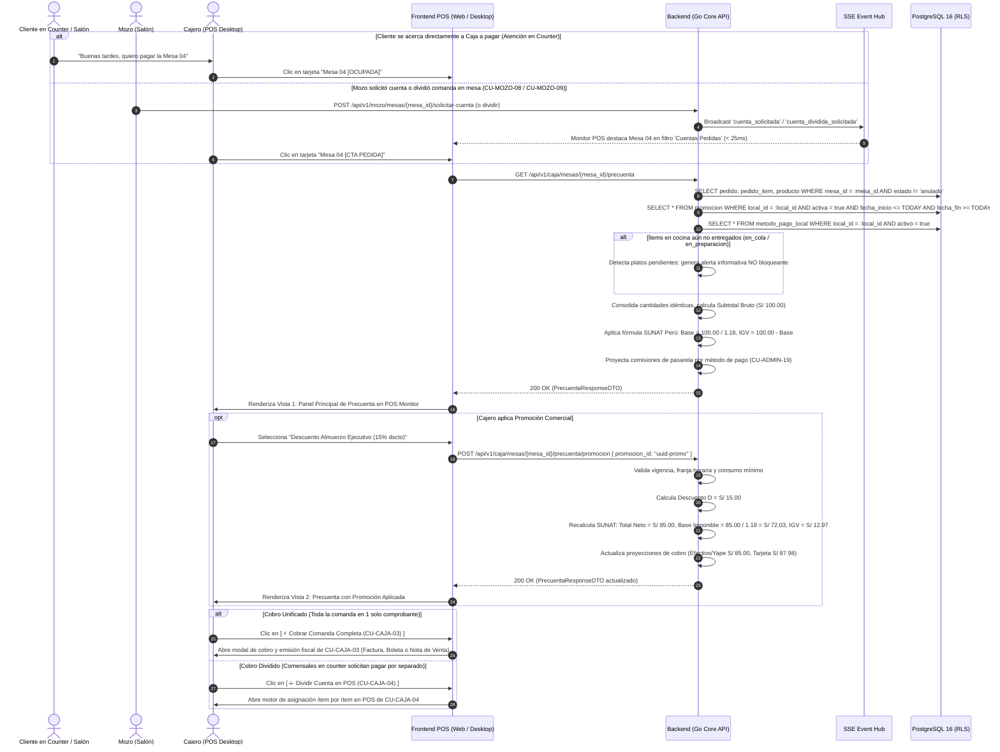
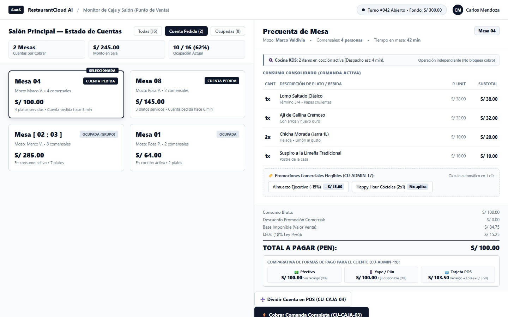
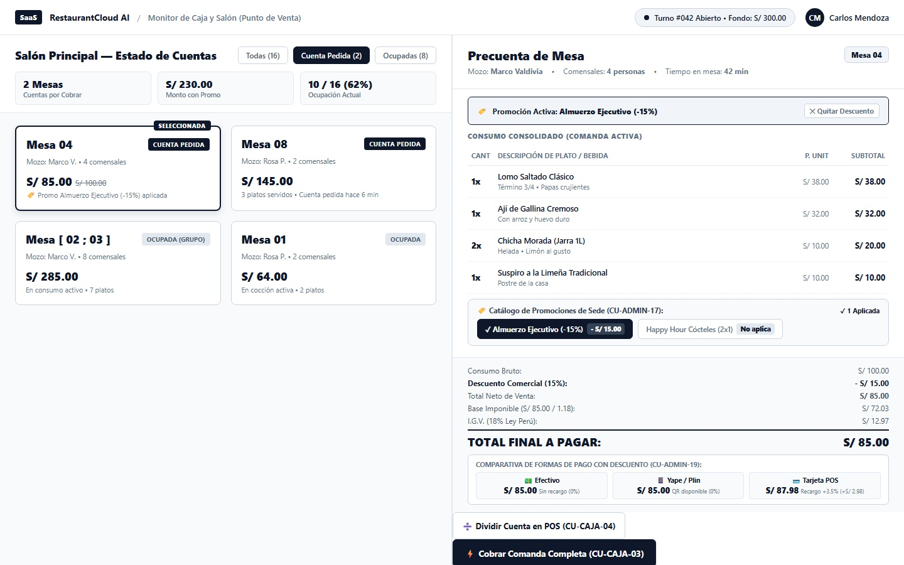

# CU-CAJA-02: Generar Cuenta a partir de Pedidos de una Mesa (Precuenta Digital)

Especificación técnica de interfaz de usuario, arquitectura de información, control de acceso basado en roles (RBAC), sincronización reactiva en tiempo real (Server-Sent Events), cálculo tributario según normativa SUNAT Perú y contratos de API Go en **RestaurantCloud AI**.

---

## 1. Ficha Técnica del Caso de Uso

| Atributo | Detalle |
| :--- | :--- |
| **Código CU** | `CU-CAJA-02` |
| **Nombre** | Generar cuenta a partir de pedidos de una mesa (Precuenta digital) |
| **Actor(es)** | `cajero` (Operador POS de turno), `admin_local` (Administrador de sede facultado para operar caja) |
| **Dispositivo / Viewport** | Terminal POS Desktop / Monitor Táctil de Caja (`1440x900` estándar corporativo Grayscale Blueprint) |
| **Precondición** | La sede cuenta con turno de caja abierto (`CU-CAJA-01`, `caja.estado = 'abierta'`); la mesa se encuentra en estado `ocupada` o con `cuenta_pedida` emitida previamente por el mozo; existen pedidos activos asociados a la mesa en `pedido` y `pedido_item` (con ítems en estado `listo`, `entregado`, o incluso `en_cola`/`en_preparacion` con advertencia no bloqueante). |
| **Postcondición** | El sistema consolida y valoriza los consumos de la mesa (incluyendo mesas unificadas `Mesa [ 02 ; 03 ]`); calcula el desglose tributario según la normativa SUNAT (Venta Bruta, Descuento Comercial de `CU-ADMIN-17`, Base Imponible gravada e IGV 18%); proyecta los importes comparativos según los métodos de pago habilitados (`CU-ADMIN-19`); y proporciona al cajero el punto de inicio de cobro en POS con dos rutas de resolución inmediata: `[ ⚡ Cobrar Comanda Completa (CU-CAJA-03) ]` o `[ ➗ Dividir Cuenta en POS (CU-CAJA-04) ]`. Flujo **100% Desacoplado, Paralelo y Cero Papel** (sin dependencia de impresoras térmicas ni envíos redundantes al mozo). |

---

## 2. Diagrama de Flujo y Secuencia en Tiempo Real (SSE)



---

## 3. Especificación de Pantallas y Wireframes Blueprint (2 Vistas Canónicas)

### Vista 1: Panel Principal de Precuenta en POS Monitor (Mesa 04 Seleccionada)

Pantalla táctil de alta densidad visual para terminal de caja (`1440x900`). Integra a la izquierda el plano del salón en vista condensada con filtros rápidos, y a la derecha el panel de liquidación de precuenta con ítems consolidados, banner informativo de cocina sin bloqueo, selector de promociones de `CU-ADMIN-17`, desglose tributario SUNAT y comparativa de medios de pago configurados en `CU-ADMIN-19`.



#### Layout Estructural (Arte ASCII 1440x900):
```text
+------------------------------------------------------------------------------------------------------------------------------------+
| [SaaS] RestaurantCloud AI  /  Monitor de Caja y Precuentas                     [● Turno #042 Abierto • S/ 300.00]   [CM Carlos M.]  |
+------------------------------------------------------------------------------------------------------------------------------------+
| PANEL DE MESAS EN SALÓN                                           | DETALLE DE PRECUENTA DIGITAL — MESA 04                         |
| Filtros: [Todas (16)] [💳 Cta Pedida (2)] [Ocupadas (8)] [Libres]  | Mozo: Marco Valdivia | 4 Comensales | Comanda #108 (12:45 PM)  |
|                                                                   +----------------------------------------------------------------+
| +-------------------------+ +-------------------------+           | [ ⚠️ Aviso Informativo: 1 plato 'Lomo Saltado' en preparación  |
| | Mesa 04 [CTA PEDIDA]    | | Mesa 08 [CTA PEDIDA]    |           |   en cocina. No bloquea la emisión ni el cobro de la cuenta. ] |
| | Mozo: Marco V. (4 com)  | | Mozo: Rosa P. (2 com)   |           +----------------------------------------------------------------+
| | Total Consumo: S/ 100.00| | Total Consumo: S/ 145.00|           | ÍTEMS DE LA COMANDA CONSOLIDADOS                   CANT   TOTAL|
| | [ Seleccionada Activa ] | | [ Ver Detalle Precta ]  |           | 1. Lomo Saltado Criollo (Término 3/4, con papas)     1   S/ 38.00|
| +-------------------------+ +-------------------------+           | 2. Arroz con Mariscos Especial                       1   S/ 34.00|
| +-------------------------+ +-------------------------+           | 3. Chicha Morada Jarra 1L                            1   S/ 16.00|
| | Mesa [02;03] [OCUPADA]  | | Mesa 01 [OCUPADA]       |           | 4. Causa Limeña Clásica (Entrada compartida)         1   S/ 12.00|
| | Mozo: Marco V. (8 com)  | | Mozo: Rosa P. (2 com)   |           +----------------------------------------------------------------+
| | Total Consumo: S/ 285.00| | Total Consumo: S/ 64.00 |           | PROMOCIONES COMERCIALES DISPONIBLES (CU-ADMIN-17)              |
| | [ Ver Consumo Mesa ]    | | [ Ver Consumo Mesa ]    |           | [ Seleccionar Promoción Vigente...                          v ]|
| +-------------------------+ +-------------------------+           | * Opciones: Descuento Almuerzo Ejecutivo (15%), 2x1 Chilcanos  |
|                                                                   +----------------------------------------------------------------+
| Métricas Rápidas:                                                 | DESGLOSE TRIBUTARIO SUNAT (PERÚ)                               |
| • 2 Cuentas Solicitadas   • S/ 245.00 Pendiente Cobro             | Consumo Bruto:                                        S/ 100.00|
| • Efectivo en Gaveta: S/ 300.00   • Ocupación Salón: 62%          | Descuento Promoción:                                    S/ 0.00|
|                                                                   | -------------------------------------------------------------- |
|                                                                   | TOTAL A PAGAR (NETO):                                 S/ 100.00|
|                                                                   | Base Imponible (Operación Gravada):                    S/ 84.75|
|                                                                   | I.G.V. (18.00% Incluido):                              S/ 15.25|
|                                                                   +----------------------------------------------------------------+
|                                                                   | PROYECCIÓN POR MÉTODO DE PAGO (CU-ADMIN-19)                    |
|                                                                   | [ Efectivo: S/ 100.00 ] [ Yape/Plin: S/ 100.00 ] [ Tarjeta: S/ 103.50 ]|
|                                                                   +----------------------------------------------------------------+
|                                                                   | [ ➗ Dividir Cuenta en POS (CU-CAJA-04) ] [ ⚡ Cobrar Comanda Completa (CU-CAJA-03) ] |
+------------------------------------------------------------------------------------------------------------------------------------+
```

- **Componentes Clave y Microcopias**:
  - **Selector Lateral de Mesas con Badges de Estado**: Mesas con cuenta pedida por el mozo destacadas con borde prioritario y badge `[ CTA PEDIDA ]`. Soporta sin distorsión las mesas unificadas (`Mesa [ 02 ; 03 ]`).
  - **Banner de Desacoplamiento de Cocina**: Alerta no bloqueante que previene fricciones en restaurantes de comida rápida o locales que cobran por adelantado: *"Aviso Informativo: 1 plato en preparación en cocina. No bloquea la emisión ni el cobro de la cuenta"*.
  - **Tabla de Ítems Consolidados**: Agrupa automáticamente productos idénticos pedidos en rondas sucesivas, mostrando notas de cocina, cantidades, precio unitario y subtotal.
  - **Selector de Promociones (`CU-ADMIN-17`)**: Dropdown reactivo que lista promociones activas y validadas contra la fecha y hora del sistema.
  - **Desglose Fiscal SUNAT**: Separación rigurosa de Consumo Bruto, Descuento, Total Neto, Base Imponible gravada ($T_{neto} / 1.18$) e IGV ($T_{neto} - \text{Base}$).
  - **Tarjetas Comparativas de Pasarela (`CU-ADMIN-19`)**: Proyección instantánea del total según el medio de pago, alertando al cajero y comensal sobre recargos configurados en terminales POS bancarias (ej. +3.5% = S/ 103.50).
  - **Botones de Resolución Inmediata en POS**:
    - `[ ➗ Dividir Cuenta en POS (CU-CAJA-04) ]`: Abre el motor de división para fragmentar ítems si los clientes en el mostrador deciden pagar por separado.
    - `[ ⚡ Cobrar Comanda Completa (CU-CAJA-03) ]`: Conduce directamente a la liquidación fiscal completa (Factura, Boleta o Nota de Venta) y liberación de la mesa.

---

### Vista 2: Precuenta con Promoción Comercial Aplicada (`CU-ADMIN-17`)

Reflejo en pantalla del recálculo instantáneo (< 10ms) tras seleccionar la promoción *"Descuento Almuerzo Ejecutivo (15% dscto)"*. El sistema aplica la deducción comercial antes de derivar la Base Imponible y el IGV según la legislación tributaria peruana, y ajusta en caliente los montos proyectados en todas las pasarelas de pago.



#### Layout Estructural (Arte ASCII 1440x900):
```text
+------------------------------------------------------------------------------------------------------------------------------------+
| [SaaS] RestaurantCloud AI  /  Monitor de Caja y Precuentas                     [● Turno #042 Abierto • S/ 300.00]   [CM Carlos M.]  |
+------------------------------------------------------------------------------------------------------------------------------------+
| PANEL DE MESAS EN SALÓN                                           | DETALLE DE PRECUENTA DIGITAL — MESA 04                         |
| Filtros: [Todas (16)] [💳 Cta Pedida (2)] [Ocupadas (8)] [Libres]  | Mozo: Marco Valdivia | 4 Comensales | Comanda #108 (12:45 PM)  |
|                                                                   +----------------------------------------------------------------+
| +-------------------------+ +-------------------------+           | [ ⚠️ Aviso Informativo: 1 plato 'Lomo Saltado' en preparación  |
| | Mesa 04 [CTA PEDIDA]    | | Mesa 08 [CTA PEDIDA]    |           |   en cocina. No bloquea la emisión ni el cobro de la cuenta. ] |
| | Mozo: Marco V. (4 com)  | | Mozo: Rosa P. (2 com)   |           +----------------------------------------------------------------+
| | Total Consumo: S/ 85.00 | | Total Consumo: S/ 145.00|           | ÍTEMS DE LA COMANDA CONSOLIDADOS                   CANT   TOTAL|
| | [ Seleccionada Activa ] | | [ Ver Detalle Precta ]  |           | 1. Lomo Saltado Criollo (Término 3/4, con papas)     1   S/ 38.00|
| +-------------------------+ +-------------------------+           | 2. Arroz con Mariscos Especial                       1   S/ 34.00|
| +-------------------------+ +-------------------------+           | 3. Chicha Morada Jarra 1L                            1   S/ 16.00|
| | Mesa [02;03] [OCUPADA]  | | Mesa 01 [OCUPADA]       |           | 4. Causa Limeña Clásica (Entrada compartida)         1   S/ 12.00|
| | Mozo: Marco V. (8 com)  | | Mozo: Rosa P. (2 com)   |           +----------------------------------------------------------------+
| | Total Consumo: S/ 285.00| | Total Consumo: S/ 64.00 |           | PROMOCIÓN COMERCIAL ACTIVA (CU-ADMIN-17)                       |
| | [ Ver Consumo Mesa ]    | | [ Ver Consumo Mesa ]    |           | [✓] Descuento Almuerzo Ejecutivo (15% dscto)    [✕ Quitar Dscto]|
| +-------------------------+ +-------------------------+           |     Ahorro aplicado: - S/ 15.00 (Lunes a Viernes 12pm - 4pm)   |
|                                                                   +----------------------------------------------------------------+
| Métricas Rápidas:                                                 | DESGLOSE TRIBUTARIO SUNAT (PERÚ)                               |
| • 2 Cuentas Solicitadas   • S/ 230.00 Pendiente Cobro             | Consumo Bruto:                                        S/ 100.00|
| • Efectivo en Gaveta: S/ 300.00   • Ocupación Salón: 62%          | Descuento Comercial (15%):                          - S/  15.00|
|                                                                   | -------------------------------------------------------------- |
|                                                                   | TOTAL A PAGAR (NETO):                                 S/  85.00|
|                                                                   | Base Imponible (Operación Gravada):                    S/  72.03|
|                                                                   | I.G.V. (18.00% Incluido):                              S/  12.97|
|                                                                   +----------------------------------------------------------------+
|                                                                   | PROYECCIÓN POR MÉTODO DE PAGO (CU-ADMIN-19)                    |
|                                                                   | [ Efectivo: S/ 85.00 ]   [ Yape/Plin: S/ 85.00 ]   [ Tarjeta POS: S/ 87.98 ]|
|                                                                   |   Comisión: S/ 0.00        Comisión: S/ 0.00         +3.5% pasarela (S/ 2.98)|
|                                                                   +----------------------------------------------------------------+
|                                                                   | [ ➗ Dividir Cuenta en POS (CU-CAJA-04) ] [ ⚡ Cobrar Comanda Completa (CU-CAJA-03) ] |
+------------------------------------------------------------------------------------------------------------------------------------+
```

- **Mecanismos de Interacción y Poka-Yoke**:
  - **Chip de Promoción Aplicada con Deshacer en 1 Clic**: Reemplaza el selector desplegable por un contenedor de estado activo que incluye el botón `[ ✕ Quitar Dscto ]` para revertir la bonificación inmediatamente si el comensal no califica.
  - **Recálculo SUNAT Transparente**: El total neto se reduce a S/ 85.00, recalculando la Base Imponible gravada a S/ 72.03 ($85.00 / 1.18$) y el IGV a S/ 12.97 ($85.00 - 72.03$), impidiendo que el restaurante tribute sobre el monto bonificado.
  - **Ajuste Proyectado de Pasarelas**: La tarjeta de pago con Tarjeta POS actualiza en vivo el recargo del 3.5% sobre la nueva base neta ($85.00 \times 1.035 = \text{S/ } 87.98$).

---

## 4. Matriz de Control de Acceso Basado en Roles (RBAC)

| Acción / Capacidad | `cajero` | `admin_local` | `propietario` | `mozo` | `cocina` |
| :--- | :---: | :---: | :---: | :---: | :---: |
| Consultar consolidado de precuenta de mesa (`GET /caja/mesas/{id}/precuenta`) | ✅ Permitido | ✅ Permitido | ✅ Permitido | ✅ Permitido (`CU-MOZO-08`) | ❌ Bloqueado |
| Aplicar o remover promociones comerciales (`POST /precuenta/promocion`) | ✅ Permitido | ✅ Permitido | ✅ Permitido | ❌ Bloqueado | ❌ Bloqueado |
| Enrutar a Cobro Completo (`CU-CAJA-03`) o División en POS (`CU-CAJA-04`)| ✅ Permitido | ✅ Permitido | ✅ Permitido | ❌ Bloqueado | ❌ Bloqueado |
| Solicitar cuenta o dividir desde tablet móvil (`CU-MOZO-08` / `CU-MOZO-09`)| ❌ Bloqueado | ✅ Permitido | ✅ Permitido | ✅ Permitido | ❌ Bloqueado |
| Cobrar y emitir comprobante oficial Boleta/Factura/Nota Venta (`CU-CAJA-03`) | ✅ Permitido | ✅ Permitido | ✅ Permitido | ❌ Bloqueado | ❌ Bloqueado |

---

## 5. Contratos de API Go y DTOs (`internal/domain/caja/precuenta_dto.go`)

```go
package caja

import (
	"time"
	"github.com/google/uuid"
)

// PrecuentaItemDTO representa un producto consolidado en la precuenta
type PrecuentaItemDTO struct {
	ProductoID     uuid.UUID `json:"producto_id"`
	Nombre         string    `json:"nombre" example:"Lomo Saltado Criollo"`
	NotaCocina     string    `json:"nota_cocina,omitempty" example:"Término 3/4, con papas"`
	Cantidad       int       `json:"cantidad" example:"1"`
	PrecioUnitario float64   `json:"precio_unitario" example:"38.00"`
	Subtotal       float64   `json:"subtotal" example:"38.00"`
	EstadoCocina   string    `json:"estado_cocina" example:"en_preparacion"` // 'en_cola', 'en_preparacion', 'listo', 'entregado'
}

// DesgloseTributarioSUNATDTO estructura oficial de cálculo fiscal peruano
type DesgloseTributarioSUNATDTO struct {
	ConsumoBruto      float64 `json:"consumo_bruto" example:"100.00"`
	DescuentoAplicado float64 `json:"descuento_aplicado" example:"15.00"`
	TotalNeto         float64 `json:"total_neto" example:"85.00"`
	BaseImponible     float64 `json:"base_imponible" example:"72.03"` // TotalNeto / 1.18
	IGV               float64 `json:"igv" example:"12.97"`            // TotalNeto - BaseImponible
	TasaIGV           float64 `json:"tasa_igv" example:"0.18"`
}

// OpcionCobroPrecuentaDTO proyección de montos según método de pago configurado (CU-ADMIN-19)
type OpcionCobroPrecuentaDTO struct {
	MetodoPagoCodigo   string  `json:"metodo_pago_codigo" example:"tarjeta"`
	MetodoPagoNombre   string  `json:"metodo_pago_nombre" example:"Tarjeta POS"`
	ComisionPorcentaje float64 `json:"comision_porcentaje" example:"3.50"`
	MontoComision      float64 `json:"monto_comision" example:"2.98"`
	TotalEstimado      float64 `json:"total_estimado" example:"87.98"`
}

// PromocionAplicableDTO promoción disponible para la fecha y consumo actual (CU-ADMIN-17)
type PromocionAplicableDTO struct {
	ID            uuid.UUID `json:"id"`
	Nombre        string    `json:"nombre" example:"Descuento Almuerzo Ejecutivo (15%)"`
	TipoDescuento string    `json:"tipo_descuento" example:"porcentaje"` // 'porcentaje', 'monto_fijo'
	Valor         float64   `json:"valor" example:"15.00"`
	AhorroCalculado float64 `json:"ahorro_calculado" example:"15.00"`
	Aplicada      bool      `json:"aplicada" example:"false"`
}

// PrecuentaResponseDTO respuesta completa de precuenta consolidada
type PrecuentaResponseDTO struct {
	MesaID             uuid.UUID                  `json:"mesa_id"`
	MesaNumero         string                     `json:"mesa_numero" example:"04"` // Puede ser "Mesa [ 02 ; 03 ]"
	EsMesaUnida        bool                       `json:"es_mesa_unida" example:"false"`
	MozoNombre         string                     `json:"mozo_nombre" example:"Marco Valdivia"`
	Comensales         int                        `json:"comensales" example:"4"`
	Items              []PrecuentaItemDTO         `json:"items"`
	TieneCocinaPendiente bool                     `json:"tiene_cocina_pendiente" example:"true"`
	AlertaCocina       string                     `json:"alerta_cocina,omitempty" example:"1 plato en preparación en cocina. No bloquea cobro."`
	Promociones        []PromocionAplicableDTO    `json:"promociones_disponibles"`
	PromocionActivaID  *uuid.UUID                 `json:"promocion_activa_id,omitempty"`
	TributacionSUNAT   DesgloseTributarioSUNATDTO `json:"tributacion_sunat"`
	OpcionesCobro      []OpcionCobroPrecuentaDTO  `json:"opciones_cobro"`
	GeneradaAt         time.Time                  `json:"generada_at"`
}

// AplicarPromocionPrecuentaRequest payload para asociar promoción a la precuenta
type AplicarPromocionPrecuentaRequest struct {
	PromocionID uuid.UUID `json:"promocion_id" binding:"required"`
}
```

---

## 6. Catálogo de Endpoints REST

| Método | Endpoint | Rol Mínimo | Código Éxito | Descripción |
| :--- | :--- | :---: | :---: | :--- |
| `GET` | `/api/v1/caja/mesas/{mesa_id}/precuenta` | `cajero`, `admin_local` | `200 OK` | Obtiene la precuenta consolidada de la mesa con desglose SUNAT y métodos de pago |
| `POST` | `/api/v1/caja/mesas/{mesa_id}/precuenta/promocion` | `cajero`, `admin_local` | `200 OK` | Aplica una promoción comercial (`CU-ADMIN-17`) y recalcula la Base Imponible e IGV en vivo |
| `POST` | `/api/v1/caja/pedidos/{pedido_id}/cobrar` | `cajero`, `admin_local` | `200 OK` | Enruta y procesa el cobro unificado con emisión de comprobante fiscal (`CU-CAJA-03`) |
| `POST` | `/api/v1/caja/mesas/{mesa_id}/dividir-cuenta` | `cajero`, `admin_local` | `200 OK` | Abre el motor de división de comanda en el POS para cobro por partes (`CU-CAJA-04`) |

### Catálogo de Errores de Negocio (`AppError`):

| Código Error | HTTP Status | Causa y Mensaje |
| :--- | :---: | :--- |
| `ERR_CAJA_NO_ABIERTA` | `409 Conflict` | No existe un turno de caja abierto en la sede. *"Operación no permitida: debe aperturar turno de caja (CU-CAJA-01) antes de liquidar precuentas."* |
| `ERR_MESA_SIN_PEDIDOS` | `404 Not Found` | La mesa seleccionada no tiene pedidos activos o todos sus ítems fueron anulados previamente. |
| `ERR_PROMOCION_NO_VIGENTE` | `422 Unprocessable` | La promoción seleccionada caducó, no corresponde al día de la semana o está fuera de la franja horaria. |
| `ERR_PROMOCION_MONTO_MINIMO` | `422 Unprocessable` | El consumo de la mesa no alcanza el `monto_minimo_consumo` exigido por la campaña comercial. |

---

## 7. Modelo Relacional PostgreSQL 16 y Fórmulas SUNAT

### 7.1 Fórmulas Matemáticas Oficiales SUNAT Perú

En el sistema tributario peruano (TUO del Impuesto General a las Ventas e Impuesto Selectivo al Consumo - D.S. 055-99-EF):
1. **Consumo Bruto ($C_{bruto}$):** Sumatoria de los precios de venta al público (los cuales ya incluyen IGV según la práctica comercial nacional).
   $$C_{bruto} = \sum_{i=1}^{n} (\text{precio\_unitario}_i \times \text{cantidad}_i)$$
2. **Descuento Comercial ($D$):** Bonificación otorgada antes de impuestos (`CU-ADMIN-17`).
   $$D = \begin{cases} C_{bruto} \times \left(\frac{\text{valor}}{100}\right) & \text{si tipo = 'porcentaje'} \\ \min(C_{bruto}, \text{valor}) & \text{si tipo = 'monto\_fijo'} \end{cases}$$
3. **Total Neto a Cobrar ($T_{neto}$):**
   $$T_{neto} = C_{bruto} - D$$
4. **Base Imponible / Operación Gravada ($B$):**
   $$B = \frac{T_{neto}}{1.18}$$
5. **Impuesto General a las Ventas (IGV 18%):**
   $$\text{IGV} = T_{neto} - B = T_{neto} \times \left(1 - \frac{1}{1.18}\right)$$

### 7.2 Soporte de Base de Datos y Persistencia

```sql
-- 1. Transición de estado en tabla pedido para soportar la precuenta digital
ALTER TABLE pedido 
    DROP CONSTRAINT IF EXISTS chk_pedido_estado;

ALTER TABLE pedido 
    ADD CONSTRAINT chk_pedido_estado 
    CHECK (estado IN ('borrador', 'enviado', 'cuenta_pedida', 'cobrado', 'anulado'));

-- 2. Trazabilidad de emisión de precuenta digital y vinculación a promoción comercial
ALTER TABLE pedido
    ADD COLUMN IF NOT EXISTS precuenta_generada_at timestamp with time zone DEFAULT NULL,
    ADD COLUMN IF NOT EXISTS promocion_id UUID REFERENCES promocion(id) ON DELETE RESTRICT;

-- 3. Índice para consulta ultra rápida de precuenta por mesa (< 0.5ms)
CREATE INDEX IF NOT EXISTS idx_pedido_mesa_precuenta 
    ON pedido(mesa_id, estado) 
    WHERE estado IN ('enviado', 'cuenta_pedida');
```

### 7.3 Reglas de Negocio Clave:
1. **Flujo Desacoplado y 100% Digital (Cero Papel):** No se exige ni se simula hardware de impresión térmica para la precuenta. La caja no depende de esperas del mozo ni le reenvía precuentas a salón; el cajero en su monitor POS accede a cualquier mesa en consumo o con cuenta pedida, evalúa promociones y enruta directamente hacia el cobro íntegro (`[ ⚡ Cobrar Comanda Completa (CU-CAJA-03) ]`) o la partición en mostrador (`[ ➗ Dividir Cuenta en POS (CU-CAJA-04) ]`). El mozo en salón opera con total autonomía en su tablet (`CU-MOZO-08` / `CU-MOZO-09`), dejando la comanda en `cuenta_pedida` lista para ser cobrada por el cajero.
2. **Independencia Operativa Respecto a Cocina:** El Punto de Venta permite generar la precuenta y liquidar el cobro incluso si hay platos marcados como `en_cola` o `en_preparacion`. Esto soporta modelos de negocio gastronómicos donde los clientes pagan al momento de ordenar o antes del despacho final, mostrando una advertencia informativa clara sin bloquear el flujo.
3. **Consolidación Transparente de Mesas Unidas:** Cuando una mesa forma parte de una agrupación física (`mesa_principal_id IS NOT NULL`), el sistema consolida automáticamente los pedidos de todas las mesas del grupo bajo la etiqueta oficial `Mesa [ 02 ; 03 ]`, evitando duplicidad de cuentas.

---

## 8. Checklist de Accesibilidad WCAG 2.1 AA

- [x] **Contraste de Color:** Todos los textos clave (`#0F172A`) y cifras monetarias en tarjetas sobre fondo blanco superan el ratio de `12:1`. Textos informativos de advertencia de cocina en `#92400E` sobre fondo ámbar claro `#FEF3C7` mantienen ratio superior a `4.8:1`.
- [x] **Información no Transmitida Exclusivamente por Color:** El banner de cocina incluye icono semántico `[ ⚠️ ]` y texto explícito. Los estados de las mesas se identifican con etiquetas textuales (`[CTA PEDIDA]`, `[OCUPADA]`).
- [x] **Áreas de Toque Táctil (Touch Targets):** Tarjetas de mesa, selector de promociones y botones de acción primaria superan el estándar mínimo de `44x44px` con espaciado de `8px`.
- [x] **Navegación por Teclado:** Se puede alternar entre mesas con las flechas de dirección y confirmar la precuenta con `Enter` o tecla rápida `F9`.
