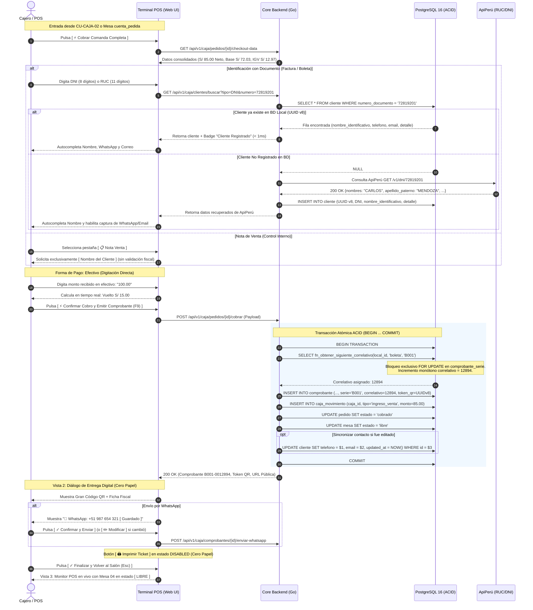

# Especificación Técnica de Wireframe: CU-CAJA-03

## Caso de Uso: CU-CAJA-03: Cobro de Comanda y Emisión de Comprobantes Oficiales (Factura, Boleta y Nota de Venta)

---

## 1. Identificación del Caso de Uso, Actores y Condiciones

- **Código:** `CU-CAJA-03`
- **Nombre:** Cobro de comanda y emisión de comprobantes oficiales (Factura, Boleta y Nota de Venta)
- **Módulo:** Caja, Punto de Venta (POS) y Facturación Electrónica
- **Actor Principal:** `cajero` (Titular o relevo de caja con sesión activa y turno abierto)
- **Actores Secundarios:** `admin_local` (con permisos de supervisión de caja), `comensal` (receptor del comprobante digital)
- **Precondiciones:**
  1. La sede cuenta con un turno de caja abierto en estado `abierta` (`CU-CAJA-01`).
  2. La comanda se encuentra en estado `enviado` o `cuenta_pedida` con pedidos no cobrados asociados a una mesa o salón (originada desde `CU-CAJA-02`, o solicitada desde salón en `CU-MOZO-08` / `CU-MOZO-09` vía Server-Sent Events).
  3. Existen series electrónicas activas registradas en la tabla `comprobante_serie` para el local (`F001`, `B001`, `NV01`).

- **Postcondiciones:**
  1. `pedido.estado` conmuta atómicamente a `'cobrado'`.
  2. `mesa.estado` conmuta atómicamente a `'libre'`, liberando el espacio en salón para nuevos clientes en tiempo real.
  3. Se genera un registro oficial inmutable en la tabla `comprobante` con serie, correlativo correlativo monótono asignado bajo bloqueo ACID (`fn_obtener_siguiente_correlativo`), desglose fiscal oficial SUNAT Perú (Base Imponible e IGV 18%) y token criptográfico único impredecible (UUID v8).
  4. Se inserta un asiento contable en `caja_movimiento` (`tipo = 'ingreso_venta'`) vinculado a la caja activa, actualizando el efectivo en gaveta y el total recaudado.
  5. Se almacena o actualiza la información del comensal en la tabla relacional `cliente` (asociando datos de ApiPerú, teléfono/WhatsApp y correo electrónico en `detalle JSONB`).
  6. Se despliega en pantalla el código QR dinámico de alta resolución para escaneo por el comensal (arquitectura *Cero Papel*), con opciones asistidas de confirmación/modificación para despacho por WhatsApp y Correo Electrónico.

---

## 2. Diagrama de Secuencia Mermaid y Flujo de Interacción



---

## 3. Diagramación Wireframe ASCII y Guía de Microcopias

### 3.1 Vista 1: Modal Principal de Cobro POS (`wf_caja_03_modal_cobro.jpg`)

```text
+------------------------------------------------------------------------------------------------------------------------------------+
| Cobro y Emisión de Comprobante  [ Mesa 04 ]                                                                  TOTAL NETO A COBRAR   |
| 👥 4 Comensales  📋 Comanda #108  👤 Mozo: Marco Valdivia  🏷️ Descuento: Almuerzo Ejecutivo (15%)                      S/ 85.00    |
+------------------------------------------------------------------+-----------------------------------------------------------------+
| 1. TIPO DE COMPROBANTE OFICIAL                 NORMA SUNAT PERÚ  | 2. FORMA DE PAGO Y LIQUIDACIÓN                      CU-ADMIN-19 |
| [ 🏢 Factura (RUC 11) ] [ 👤 Boleta (DNI 8) ]* [ 📋 Nota Venta ] | [ 💵 Efectivo (0%) ]*   [ 💳 Tarjeta POS (+3.5%) ]   [ 📱 Yape ]|
|                                                                  |                                                                 |
| Número de Documento (DNI)                 Obligatorio si ≥ S/700 | Monto Recibido en Efectivo (Digitar cantidad)  Total: S/ 85.00  |
| [ 72819201                       ] [ 🔍 ApiPerú ]                | +-------------------------------------------------------------+ |
|                                                                  | | S/ 100.00                                                   | |
| Nombre Identificativo (Comensal / Titular)                       | +-------------------------------------------------------------+ |
| [ CARLOS MENDOZA QUISPE                                        ] |                                                                 |
|                                                                  | +-------------------------------------------------------------+ |
| [ • Cliente registrado en base de datos local (UUID v8) ]        | | VUELTO A ENTREGAR                                 S/ 15.00  | |
|                                                                  | | S/ 100.00 recibido - S/ 85.00 consumo                       | |
| 📱 Celular / WhatsApp            ✉️ Correo Electrónico          | +-------------------------------------------------------------+ |
| [ 987 654 321                ]   [ carlos.mendoza@gmail.com    ] |                                                                 |
|                                                                  | DESGLOSE TRIBUTARIO OFICIAL (SUNAT)           SERIE: B001 (ACID)|
| 💡 Poka-Yoke: Datos de contacto se sincronizan con tabla cliente | Consumo Bruto en Salón:                               S/ 100.00 |
|                                                                  | Descuento Comercial (15%):                            - S/ 15.00|
|                                                                  | Base Imponible (Operación Gravada):                   S/  72.03 |
|                                                                  | I.G.V. (18.00% Incluido):                             S/  12.97 |
|                                                                  | TOTAL LIQUIDADO EN CAJA:                              S/  85.00 |
+------------------------------------------------------------------+-----------------------------------------------------------------+
| 🔒 Transacción Atómica ACID: Conmuta pedido a 'cobrado', libera mesa y caja. | [ ✕ Cancelar (Esc) ] [ ⚡ Confirmar Cobro (F9) ]     |
+------------------------------------------------------------------------------------------------------------------------------------+
```

### 3.2 Vista 2: Diálogo de Comprobante Emitido y Token Digital QR (`wf_caja_03_comprobante_qr_exito.jpg`)

```text
+---------------------------------------------------------------------------------------------------------+
| [ ✓ ] Cobro Confirmado con Éxito                                                    [ Mesa 04 LIBERADA ]|
|       Comanda #108 cobrada • Movimiento de S/ 85.00 registrado en caja                                  |
+---------------------------------------------------------------------------------------------------------+
| 📄 Boleta de Venta Electrónica B001-0012894                                  10/10/2026 18:35:12 • T#042|
|                                                                                                         |
| COMENSAL / TITULAR:                           MEDIO DE PAGO:                                            |
| Carlos Mendoza Quispe (DNI 72819201)          Efectivo • Recibido S/ 100.00 • Vuelto S/ 15.00           |
| DESGLOSE FISCAL SUNAT:                        TOTAL LIQUIDADO:                                          |
| Base: S/ 72.03 • IGV (18%): S/ 12.97          S/ 85.00 NETO                                             |
+---------------------------------------------------------------------------------------------------------+
| +--------------+  TOKEN DIGITAL QR • CERO PAPEL                                                         |
| |  [QR CODE]   |  Escaneo Directo por el Comensal                                                       |
| |  DINÁMICO    |  El cliente puede escanear este código con su smartphone para ver y descargar el PDF.  |
| |  ALTA RES.   |  https://app.restaurantcloud.pe/c/0192d2f4-e7b8...                       [ UUID v8 ]   |
| +--------------+                                                                                        |
+---------------------------------------------------------------------------------------------------------+
| ENTREGA DIGITAL DIRECTA (OPCIONES ASISTIDAS)                                                            |
| 📱 WhatsApp:  +51 987 654 321  [ Guardado ]                  [ ✓ Confirmar y Enviar ] [ ✏️ Modificar ]   |
| ✉️ Correo:    carlos.mendoza@gmail.com  [ Guardado ]         [ ✓ Confirmar y Enviar ] [ ✏️ Modificar ]   |
+---------------------------------------------------------------------------------------------------------+
| [ 📄 Ver Comprobante PDF en Nueva Pestaña ]  [ 🖨️ Imprimir Ticket (DESHABILITADO • CERO PAPEL) ]        |
+---------------------------------------------------------------------------------------------------------+
| Presione Esc o pulse finalizar para retornar a la grilla de monitoreo.      [ ✓ Finalizar y Volver (Esc)]|
+---------------------------------------------------------------------------------------------------------+
```

### 3.3 Vista 3: Monitor POS en Vivo con Mesa Liberada (`wf_caja_03_pos_mesa_liberada.jpg`)

```text
+------------------------------------------------------------------------------------------------------------------------------------+
| POS RestaurantCloud AI / Monitor Principal de Caja y Facturación         • Turno #042: S/ 385.00 en Gaveta     RA Rosa Aguirre     |
| [ ✓ ] Cobro Exitoso: Comanda #108 liquidada con Boleta B001-0012894 (S/ 85.00). Mesa 04 liberada.          Broadcast SSE en 18ms  |
+------------------------------------------------------------------+-----------------------------------------------------------------+
| Salón Principal (16 Mesas)   [Todas] [💳 Cta Pedida (1)]* [Libres]|                                                                 |
| S/ 385.00 en Gaveta          1 Mesa Cta. Pedida   56.2% Ocupación|                                                                 |
| +-------------------------+  +-------------------------+         |                      [ ⚡ ]                                     |
| | Mesa 04         [LIBRE] |  | Mesa 08    [CTA PEDIDA] |         |          Terminal POS Listo para Operar                         |
| | 0 Comensales • 4 pax    |  | 4 Comensales • J. Salas |         | La Mesa 04 fue liquidada y liberada con éxito.                  |
| | Disponible Asignación   |  | S/ 145.00               |         | Seleccione otra mesa para proceder con el cobro.                |
| | Liberada tras cobro     |  | Esperando cobro en caja |         |                                                                 |
| +-------------------------+  +-------------------------+         | +-------------------------------------------------------------+ |
| +-------------------------+  +-------------------------+         | | SIGUIENTE CUENTA EN ESPERA               1 MESA PENDIENTE   | |
| | Mesa 01        [OCUPADA]|  | Mesa [ 02 ; 03 ] [OCUP] |         | | Mesa 08 (Jorge Salas) • Consumo: S/ 145.00  [ ⚡ Cobrar POS ]| |
| | 2 Comensales • S/ 68.00 |  | 8 Comensales • S/ 210.00|         | +-------------------------------------------------------------+ |
+------------------------------------------------------------------+-----------------------------------------------------------------+
```

---

## 4. Matriz de Control de Acceso Basado en Roles (RBAC)

| Capacidad / Endpoint | `cajero` | `admin_local` | `propietario` | `mozo` | `cocina` |
| :--- | :---: | :---: | :---: | :---: | :---: |
| Consultar datos de cobro (`GET /caja/pedidos/{id}/checkout-data`) | ✅ Permitido | ✅ Permitido | ✅ Permitido | ❌ Bloqueado | ❌ Bloqueado |
| Consultar o registrar cliente (`GET /caja/clientes/buscar`) | ✅ Permitido | ✅ Permitido | ✅ Permitido | ❌ Bloqueado | ❌ Bloqueado |
| Ejecutar cobro y emitir comprobante (`POST /caja/pedidos/{id}/cobrar`)| ✅ Permitido | ✅ Permitido | ✅ Permitido | ❌ Bloqueado | ❌ Bloqueado |
| Enviar comprobante por WhatsApp/Email (`POST /caja/comprobantes/...`)| ✅ Permitido | ✅ Permitido | ✅ Permitido | ❌ Bloqueado | ❌ Bloqueado |
| Solicitar cuenta desde mesa (`CU-MOZO-08` / `CU-MOZO-09`) | ❌ Bloqueado | ✅ Permitido | ✅ Permitido | ✅ Permitido | ❌ Bloqueado |

---

## 5. Contratos de API Go y DTOs (`internal/domain/caja/cobro_dto.go`)

```go
package caja

import (
	"encoding/json"
	"time"
	"github.com/google/uuid"
)

// BuscarClienteResponseDTO datos devueltos por el backend (desde BD o ApiPerú)
type BuscarClienteResponseDTO struct {
	ID                   *uuid.UUID      `json:"id,omitempty"` // UUID v8 si ya existe en BD
	TipoDocumento        string          `json:"tipo_documento"` // 'DNI', 'RUC'
	NumeroDocumento      string          `json:"numero_documento"`
	NombreIdentificativo string          `json:"nombre_identificativo"`
	Telefono             *string         `json:"telefono,omitempty"`
	Email                *string         `json:"email,omitempty"`
	Detalle              json.RawMessage `json:"detalle,omitempty"` // Datos de ApiPerú (dirección, ubigeo, estado)
	ExisteEnBD           bool            `json:"existe_en_bd"`
}

// ProcesarCobroRequest payload enviado por el POS para ejecutar el cobro
type ProcesarCobroRequest struct {
	PedidoID         uuid.UUID `json:"pedido_id" binding:"required"`
	TipoComprobante  string    `json:"tipo_comprobante" binding:"required"` // 'factura', 'boleta', 'nota_venta'
	Serie            string    `json:"serie" binding:"required"`            // 'F001', 'B001', 'NV01'
	
	// Datos de cliente
	ClienteTipoDoc   *string   `json:"cliente_tipo_doc,omitempty"`          // 'DNI', 'RUC' (NULL para nota_venta o consumidor final)
	ClienteNumDoc    *string   `json:"cliente_num_doc,omitempty"`
	ClienteNombre    string    `json:"cliente_nombre" binding:"required"`   // Nombre identificativo
	TelefonoEnvio    *string   `json:"telefono_envio,omitempty"`
	EmailEnvio       *string   `json:"email_envio,omitempty"`
	
	// Datos de pago
	MetodoPagoCodigo string    `json:"metodo_pago_codigo" binding:"required"` // 'efectivo', 'tarjeta', 'billetera_digital'
	MontoRecibido    *float64  `json:"monto_recibido,omitempty"`              // Digitado en efectivo
	ReferenciaPago   *string   `json:"referencia_pago,omitempty"`             // Voucher POS o código Yape
}

// ProcesarCobroResponseDTO respuesta tras la emisión fiscal y liberación
type ProcesarCobroResponseDTO struct {
	ComprobanteID      uuid.UUID `json:"comprobante_id"` // UUID v8
	TipoComprobante    string    `json:"tipo_comprobante"`
	Serie              string    `json:"serie"`
	Correlativo        int       `json:"correlativo"`
	SerieNumero        string    `json:"serie_numero"`   // ej: 'B001-0012894'
	TotalCobrado       float64   `json:"total_cobrado"`
	MontoRecibido      *float64  `json:"monto_recibido,omitempty"`
	Vuelto             *float64  `json:"vuelto,omitempty"`
	TelefonoRegistrado *string   `json:"telefono_registrado,omitempty"`
	EmailRegistrado    *string   `json:"email_registrado,omitempty"`
	TokenDigital       uuid.UUID `json:"token_digital"`  // UUID v8
	URLPublicaQR       string    `json:"url_publica_qr"` // https://app.restaurantcloud.pe/c/{token}
	MesaID             uuid.UUID `json:"mesa_id"`
	MesaLiberada       bool      `json:"mesa_liberada"`
	EmitidoAt          time.Time `json:"emitido_at"`
}
```

---

## 6. Catálogo de Endpoints REST y Códigos de Error (`AppError`)

| Método | Endpoint | Rol Mínimo | Código Éxito | Descripción |
| :--- | :--- | :---: | :---: | :--- |
| `GET` | `/api/v1/caja/pedidos/{pedido_id}/checkout-data` | `cajero`, `admin_local` | `200 OK` | Carga el consolidado de consumo, promociones y desglose para el cobro |
| `GET` | `/api/v1/caja/clientes/buscar` | `cajero`, `admin_local` | `200 OK` | Busca cliente en BD local o consulta ApiPerú (RUC/DNI) y persiste |
| `POST` | `/api/v1/caja/pedidos/{pedido_id}/cobrar` | `cajero`, `admin_local` | `200 OK` | Ejecuta transacción atómica ACID: correlativo, comprobante, caja y liberación de mesa |
| `POST` | `/api/v1/caja/comprobantes/{id}/enviar-whatsapp` | `cajero`, `admin_local` | `200 OK` | Despacha enlace de comprobante por WhatsApp y sincroniza teléfono en cliente si cambió |
| `POST` | `/api/v1/caja/comprobantes/{id}/enviar-email` | `cajero`, `admin_local` | `200 OK` | Despacha comprobante en PDF por correo y sincroniza email en cliente si cambió |

### Catálogo de Errores de Negocio (`AppError`):

| Código Error | HTTP Status | Causa y Mensaje |
| :--- | :---: | :--- |
| `ERR_CAJA_NO_ABIERTA` | `409 Conflict` | La sede no cuenta con un turno de caja abierto (`CU-CAJA-01`). |
| `ERR_MONTO_RECIBIDO_INSUFICIENTE`| `422 Unprocessable` | El monto recibido en efectivo es menor al total neto a liquidar. |
| `ERR_SERIE_NO_ENCONTRADA` | `404 Not Found` | No existe una serie activa configurada en `comprobante_serie` para el local y tipo de comprobante. |
| `ERR_DOCUMENTO_INVALIDO_SUNAT` | `422 Unprocessable` | El RUC ingresado no tiene 11 dígitos o el DNI no tiene 8 dígitos válidos. |
| `ERR_BOLETA_REQUIERE_DNI_700` | `422 Unprocessable` | Por normativa SUNAT, ventas mayores o iguales a S/ 700.00 exigen DNI obligatorio (prohibido emitir a Consumidor Final). |

---

## 7. Modelo Relacional PostgreSQL 16, Función ACID y Fórmulas SUNAT

### 7.1 Fórmulas Tributarias Oficiales SUNAT Perú
1. **Total Neto ($T_{neto}$):** $T_{neto} = C_{bruto} - D + M_{recargo}$
2. **Base Imponible ($B$):** $B = \frac{T_{neto}}{1.18}$
3. **IGV (18% Incluido):** $\text{IGV} = T_{neto} - B$
4. **Vuelto en Efectivo ($V$):** $V = M_{recibido} - T_{neto}$

### 7.2 Tablas Relacionales y Función ACID de Correlativos

```sql
-- 1. Directorio de Clientes con soporte JSONB
CREATE TABLE IF NOT EXISTS cliente (
    id UUID PRIMARY KEY DEFAULT fn_uuid_v8(),
    empresa_id UUID NOT NULL REFERENCES empresa(id) ON DELETE RESTRICT,
    tipo_documento VARCHAR(10) NOT NULL CHECK (tipo_documento IN ('DNI', 'RUC')),
    numero_documento VARCHAR(20) NOT NULL,
    nombre_identificativo VARCHAR(255) NOT NULL,
    telefono VARCHAR(20) NULL,
    email VARCHAR(100) NULL,
    detalle JSONB NOT NULL DEFAULT '{}'::jsonb,
    created_at TIMESTAMP WITH TIME ZONE NOT NULL DEFAULT NOW(),
    updated_at TIMESTAMP WITH TIME ZONE NOT NULL DEFAULT NOW(),
    CONSTRAINT uq_cliente_empresa_documento UNIQUE (empresa_id, tipo_documento, numero_documento)
);

-- 2. Series de Comprobantes para Control ACID
CREATE TABLE IF NOT EXISTS comprobante_serie (
    id UUID PRIMARY KEY DEFAULT fn_uuid_v8(),
    local_id UUID NOT NULL REFERENCES local(id) ON DELETE RESTRICT,
    tipo_comprobante VARCHAR(20) NOT NULL CHECK (tipo_comprobante IN ('factura', 'boleta', 'nota_venta', 'nota_credito')),
    serie VARCHAR(10) NOT NULL,
    correlativo_actual INT NOT NULL DEFAULT 0 CHECK (correlativo_actual >= 0),
    activo BOOLEAN NOT NULL DEFAULT true,
    created_at TIMESTAMP WITH TIME ZONE NOT NULL DEFAULT NOW(),
    updated_at TIMESTAMP WITH TIME ZONE NOT NULL DEFAULT NOW(),
    CONSTRAINT uq_serie_local_tipo UNIQUE (local_id, tipo_comprobante, serie)
);

-- 3. Función Transaccional de Correlativos con Row-Level Lock
CREATE OR REPLACE FUNCTION fn_obtener_siguiente_correlativo(
    p_local_id UUID,
    p_tipo_comprobante VARCHAR,
    p_serie VARCHAR
) RETURNS INT AS $$
DECLARE
    v_siguiente INT;
BEGIN
    UPDATE comprobante_serie
    SET correlativo_actual = correlativo_actual + 1,
        updated_at = NOW()
    WHERE local_id = p_local_id 
      AND tipo_comprobante = p_tipo_comprobante 
      AND serie = p_serie
      AND activo = true
    RETURNING correlativo_actual INTO v_siguiente;

    IF v_siguiente IS NULL THEN
        RAISE EXCEPTION 'ERR_SERIE_NO_ENCONTRADA: No existe serie activa % para el local % y tipo %', 
            p_serie, p_local_id, p_tipo_comprobante;
    END IF;

    RETURN v_siguiente;
END;
$$ LANGUAGE plpgsql;
```

---

## 8. Checklist de Accesibilidad WCAG 2.1 AA

- [x] **Contraste de Color:** Todos los textos principales (`#0F172A`) sobre fondos claros (`#FFFFFF`, `#F8FAFC`) superan el ratio de `12:1`. Las alertas de éxito (`#166534` sobre `#F0FDF4`) superan `6:1`.
- [x] **Información Multimodal:** Ningún estado se comunica exclusivamente por color; el badge de cobro incluye un icono explícito `[ ✓ ]` y texto `Mesa 04 LIBERADA`.
- [x] **Áreas Táctiles Mínimas (Touch Targets):** Inputs de texto, botones de envío, tabs de medios de pago y botones de acción principal cumplen con `44x44px` con espaciado de `8px`.
- [x] **Navegación por Teclado:** Se puede confirmar el cobro con la tecla rápida `F9` y cancelar o salir con `Esc`.
- [x] **Poka-Yoke Visual:** El botón `[ 🖨️ Imprimir Ticket ]` se visualiza con estilo atenuado y tooltip explicativo informando la política Cero Papel sin causar confusión operativa.
