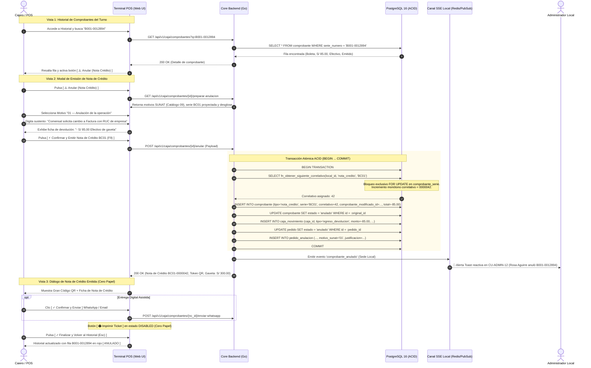

# Especificación Técnica de Wireframe: CU-CAJA-04

## Caso de Uso: CU-CAJA-04: Anular Comprobante / Pedido ya Cobrado y Emisión de Nota de Crédito Electrónica

---

## 1. Identificación del Caso de Uso, Actores y Condiciones

- **Código:** `CU-CAJA-04`
- **Nombre:** Anular comprobante / pedido ya cobrado y emisión de Nota de Crédito Electrónica
- **Módulo:** Caja, Punto de Venta (POS) y Facturación Electrónica (SUNAT)
- **Actor Principal:** `cajero` (Titular o relevo de caja con sesión activa y turno abierto)
- **Actores Secundarios:** `admin_local` (Supervisión administrativa y auditoría), `comensal` (Receptor de fondos restituidos y constancia digital)
- **Precondiciones:**
  1. La sede cuenta con un turno de caja abierto en estado `abierta` (`CU-CAJA-01`).
  2. Existe un comprobante oficial previamente emitido en estado `emitido` en la tabla `comprobante` (Factura, Boleta o Nota de Venta) con su respectivo pedido en estado `cobrado` (`CU-CAJA-03`).
  3. Existen series electrónicas activas de Notas de Crédito registradas en `comprobante_serie` para la sede:
     - Factura Electrónica: serie `FC01`.
     - Boleta Electrónica: serie `BC01`.
     - Nota de Venta: serie interna de anulación `NVC01` (o anulación de control directo).

- **Postcondiciones:**
  1. Se genera un registro oficial inmutable en la tabla `comprobante` con `tipo = 'nota_credito'`, serie (`BC01` o `FC01`), correlativo asignado bajo bloqueo transaccional ACID (`fn_obtener_siguiente_correlativo`), referencia foránea `comprobante_modificado_id` al documento original, código de motivo oficial SUNAT y sustento textual obligatorio.
  2. El comprobante original conmuta su estado a `'anulado'` (`comprobante.estado = 'anulado'`).
  3. Si la anulación abarca el pedido completo, `pedido.estado` conmuta a `'anulado'`.
  4. Se inserta un asiento contable de egreso en `caja_movimiento` (`tipo = 'egreso_devolucion'`) por el importe total restituido, descontando el efectivo en gaveta del turno si el cobro original fue en metálico, garantizando la cuadratura del Arqueo de Caja (`CU-CAJA-05`).
  5. Se emite un broadcast reactivo Server-Sent Events (SSE) al panel del Administrador del Local (`CU-ADMIN-12`) notificando la anulación para fines de control interno y prevención de fraude.
  6. Se genera un código QR dinámico público con token criptográfico (UUID v8) para que el comensal descargue la constancia oficial de la Nota de Crédito en PDF (política *Cero Papel*).

---

## 2. Diagrama de Secuencia Mermaid y Flujo de Interacción



---

## 3. Diagramación Wireframe ASCII y Guía de Microcopias

### 3.1 Vista 1: Historial de Comprobantes Emitidos en Turno (`wf_caja_04_historial_comprobantes.jpg`)

```text
+------------------------------------------------------------------------------------------------------------------------------------+
| POS RestaurantCloud AI / Módulo de Facturación y Comprobantes Emitidos    • Turno #042 Abierto: S/ 385.00 Gaveta  RA Rosa Aguirre  |
+------------------------------------------------------------------------------------------------------------------------------------+
| Comprobantes Emitidos en Turno #042                                            [ 14 Vigentes ]     [ S/ 1,485.00 ]   [ S/ 385.00 ] |
| Gestión de ventas, trazabilidad de comprobantes y emisión de Notas de Crédito.  1 ANULADO (15 TOT) TOTAL FACTURADO   EFECTIVO CAJA |
+------------------------------------------------------------------------------------------------------------------------------------+
| ESTADO:             [ ● Vigentes / Emitidos (14) ]*   [ 🚫 Anulados (1) ]   [ Todos (15) ]        🔍 [ B001-0012894              ] |
| TIPO DE DOCUMENTO:  [ Todos (15) ]  [ Boletas (11) ]  [ Facturas (3) ]  [ Notas de Venta (1) ]  [ NC (1) ]                         |
+------------------------------------------------------------------------------------------------------------------------------------+
| LISTADO DE COMPROBANTES OFICIALES (ORDEN CRONOLÓGICO)                                  Mostrando 4 registros representativos       |
| COMPROBANTE/SERIE  HORA      MESA/COMANDA   CLIENTE / DOCUMENTO       MEDIO PAGO       TOTAL         ESTADO FISCAL  ACCIONES CAJA  |
| +--------------------------------------------------------------------------------------------------------------------------------+ |
| | B001-0012894*    18:35:12  Mesa 04        CARLOS MENDOZA QUISPE     💵 Efectivo      S/ 85.00      [✓ EMITIDO]    [📄QR] [⚠️Anular NC]
| | Boleta Electr.             Comanda #108   DNI 72819201                                                                         | |
| +--------------------------------------------------------------------------------------------------------------------------------+ |
| | F001-0004520     18:14:05  Mesa 07        INVERSIONES GASTRONÓMICAS 💳 Tarjeta POS    S/ 245.00     [✓ EMITIDO]    [📄QR] [Detalle]|
| | Factura Electr.            Comanda #106   RUC 20601234567                                                                       | |
| | ~B001-0012890~   16:42:10  Mesa 01        JORGE ALBERTO SÁNCHEZ     💵 Efectivo Dev. ~S/ 45.00~    [🚫 ANULADO]   [📄Ver NC BC01] |
| | Boleta Electr.             Comanda #099   DNI 10293847                                             Por NC BC01-41 [🚫 Anulado]  | |
| | B001-0012893     17:50:33  Mesa 02        MARÍA FERNANDA ROJAS      📱 Yape           S/  54.00     [✓ EMITIDO]    [📄QR] [Detalle]|
| +--------------------------------------------------------------------------------------------------------------------------------+ |
| 🔒 Salvaguarda: Cada NC asienta egreso_devolucion en caja_movimiento garantizando arqueo exacto (CU-CAJA-05). Poka-Yoke: Sin re-anulación|
+------------------------------------------------------------------------------------------------------------------------------------+
| Norma SUNAT: Los comprobantes emitidos no pueden borrarse; requieren Nota de Crédito.         Atajo: F4 buscador • F2 filtro estado|
+------------------------------------------------------------------------------------------------------------------------------------+
```

### 3.2 Vista 2: Modal de Emisión de Nota de Crédito (`wf_caja_04_modal_nota_credito.jpg`)

```text
+------------------------------------------------------------------------------------------------------------------------------------+
| Emisión de Nota de Crédito Electrónica  [ SUNAT Catálogo 09 ]                                        ⚠️ OPERACIÓN IRREVERSIBLE     |
| Rectificación tributaria formal de comprobante emitido • Anulación contable con reversión en flujo de caja.                        |
+------------------------------------------------------------------+-----------------------------------------------------------------+
| 1. COMPROBANTE DE ORIGEN MODIFICADO                DOC. AFECTADO | 2. PARÁMETROS DE ANULACIÓN Y DEVOLUCIÓN         REQUISITOS SUNAT|
| Tipo y Serie:             B001-0012894                           | Motivo Oficial SUNAT (Catálogo de Tablas N° 09):                |
| Documento Oficial:        Boleta de Venta Electrónica            | (•) 01 — Anulación de la operación                              |
| Titular / Pagador:        Carlos Mendoza Quispe (DNI 72819201)   |     Reemisión por cambio de tipo de comprobante o error global. |
| Mesa / Comanda:           Mesa 04 • Comanda #108                 | ( ) 02 — Anulación por error en el RUC / Documento              |
| Medio de Pago:            💵 Efectivo (Recibido S/ 100 - Vuelto 15) ( ) 06 — Devolución total del consumo                       |
|                                                                  |                                                                 |
| Consumo Bruto en Salón:                                S/ 100.00 | Sustento / Motivo Detallado (Obligatorio para Auditoría):       |
| Descuento Comercial Aplicado (15%):                    - S/ 15.00| [ Comensal solicita cambio a Factura con RUC de empresa       ] |
| Base Imponible Gravada:                                S/  72.03 |                                                                 |
| I.G.V. (18.00% Incluido):                              S/  12.97 | +-------------------------------------------------------------+ |
| IMPORTE TOTAL A RECTIFICAR:                            S/  85.00 | | 💵 DEVOLUCIÓN DE EFECTIVO DE GAVETA               - S/ 85.00| |
|                                                                  | | Asiento de egreso: efectivo disminuirá de S/ 385 a S/ 300   | |
| [ Serie Electrónica Asignada: BC01 (Boleta Crédito) ]            | +-------------------------------------------------------------+ |
|                                                                  | 🔔 Se emitirá broadcast reactivo SSE a Supervisión (CU-ADMIN-12)|
+------------------------------------------------------------------+-----------------------------------------------------------------+
| 🔒 Transacción Atómica ACID: Genera 'nota_credito', conmuta original a 'anulado' y cuadra caja. | [✕Cancelar] [⚡Emitir NC BC01 F9]|
+------------------------------------------------------------------------------------------------------------------------------------+
```

### 3.3 Vista 3: Nota de Crédito Emitida y Token QR (`wf_caja_04_nota_credito_emitida.jpg`)

```text
+---------------------------------------------------------------------------------------------------------+
| [ ✓ ] Nota de Crédito BC01-0000042 Emitida                                          [ Gaveta: S/ 300.00]|
|       Comprobante B001-0012894 anulado • Egreso de S/ 85.00 registrado en caja                          |
+---------------------------------------------------------------------------------------------------------+
| 📄 Nota de Crédito Electrónica BC01-0000042                                  10/10/2026 18:42:01 • T#042|
|                                                                                                         |
| COMPROBANTE MODIFICADO:                       MOTIVO OFICIAL SUNAT:                                     |
| Boleta B001-0012894 [ ANULADA ]               01 — Anulación de la operación                            |
| SUSTENTO DECLARADO:                           IMPORTE RECTIFICADO:                                      |
| Cambio a Factura con RUC de empresa           - S/ 85.00 (Devolución Efectivo)                          |
+---------------------------------------------------------------------------------------------------------+
| +--------------+  TOKEN NOTA DE CRÉDITO • CERO PAPEL                                                    |
| |  [QR CODE]   |  Constancia Digital para el Comensal                                                   |
| |  DINÁMICO    |  El cliente puede escanear este código con su smartphone para descargar el PDF oficial |
| |  ALTA RES.   |  https://app.restaurantcloud.pe/c/0192d2f8-b3a1...                       [ UUID v8 ]   |
| +--------------+                                                                                        |
+---------------------------------------------------------------------------------------------------------+
| ENTREGA DIGITAL DIRECTA AL COMENSAL                                                                     |
| 📱 WhatsApp:  +51 987 654 321                                [ ✓ Confirmar y Enviar ] [ ✏️ Modificar ]   |
| ✉️ Correo:    carlos.mendoza@gmail.com                       [ ✓ Confirmar y Enviar ] [ ✏️ Modificar ]   |
+---------------------------------------------------------------------------------------------------------+
| [ 📄 Ver PDF Oficial de Nota de Crédito ]    [ 🖨️ Imprimir Ticket Físico (DESHABILITADO • CERO PAPEL) ] |
+---------------------------------------------------------------------------------------------------------+
| 🔔 Evento de auditoría transmitido a Administración (CU-ADMIN-12).          [ ✓ Finalizar y Volver (Esc)]|
+---------------------------------------------------------------------------------------------------------+
```

---

## 4. Matriz de Control de Acceso Basado en Roles (RBAC)

| Capacidad / Endpoint | `cajero` | `admin_local` | `propietario` | `mozo` | `cocina` |
| :--- | :---: | :---: | :---: | :---: | :---: |
| Consultar comprobantes emitidos en el turno (`GET /caja/comprobantes`) | ✅ Permitido | ✅ Permitido | ✅ Permitido | ❌ Bloqueado | ❌ Bloqueado |
| Preparar emisión de Nota de Crédito (`GET /caja/comprobantes/{id}/preparar-anulacion`)| ✅ Permitido | ✅ Permitido | ✅ Permitido | ❌ Bloqueado | ❌ Bloqueado |
| Emitir Nota de Crédito y anular comprobante (`POST /caja/comprobantes/{id}/anular`)   | ✅ Permitido | ✅ Permitido | ✅ Permitido | ❌ Bloqueado | ❌ Bloqueado |
| Recibir alerta reactiva de auditoría por SSE (`CU-ADMIN-12`)                          | ❌ Bloqueado | ✅ Permitido | ✅ Permitido | ❌ Bloqueado | ❌ Bloqueado |
| Enviar constancia de Nota de Crédito por WhatsApp/Email                               | ✅ Permitido | ✅ Permitido | ✅ Permitido | ❌ Bloqueado | ❌ Bloqueado |

---

## 5. Contratos de API Go y DTOs (`internal/domain/caja/anulacion_dto.go`)

```go
package caja

import (
	"time"
	"github.com/google/uuid"
)

// PrepararAnulacionResponseDTO datos para poblar el modal de anulación
type PrepararAnulacionResponseDTO struct {
	ComprobanteID            uuid.UUID `json:"comprobante_id"`
	TipoComprobanteOriginal  string    `json:"tipo_comprobante_original"` // 'factura', 'boleta', 'nota_venta'
	SerieOriginal            string    `json:"serie_original"`            // 'B001', 'F001', 'NV01'
	CorrelativoOriginal      int       `json:"correlativo_original"`      // 12894
	SerieNumeroOriginal      string    `json:"serie_numero_original"`     // 'B001-0012894'
	ClienteNombre            string    `json:"cliente_nombre"`
	ClienteNumeroDoc         *string   `json:"cliente_numero_doc,omitempty"`
	MedioPagoCodigo          string    `json:"medio_pago_codigo"`          // 'efectivo', 'tarjeta', 'billetera_digital'
	TotalOriginal            float64   `json:"total_original"`
	BaseImponible            float64   `json:"base_imponible"`
	IGV                      float64   `json:"igv"`
	SerieNotaCreditoSugerida string    `json:"serie_nota_credito_sugerida"` // 'BC01', 'FC01', 'NVC01'
	EfectivoGavetaActual     float64   `json:"efectivo_gaveta_actual"`
	EfectivoGavetaProyectado float64   `json:"efectivo_gaveta_proyectado"`
}

// EmitirNotaCreditoRequest payload enviado para confirmar la anulación
type EmitirNotaCreditoRequest struct {
	MotivoCodigoSUNAT string  `json:"motivo_codigo_sunat" binding:"required"` // '01', '02', '06'
	SustentoMotivo    string  `json:"sustento_motivo" binding:"required,min=5,max=255"`
	DevolucionMetodo  string  `json:"devolucion_metodo" binding:"required"`  // 'efectivo', 'extorno_tarjeta', 'transferencia'
	ReferenciaExtorno *string `json:"referencia_extorno,omitempty"`          // Código de transacción de extorno si aplica
}

// EmitirNotaCreditoResponseDTO respuesta oficial tras la emisión de la Nota de Crédito
type EmitirNotaCreditoResponseDTO struct {
	NotaCreditoID       uuid.UUID `json:"nota_credito_id"`        // UUID v8
	TipoComprobante     string    `json:"tipo_comprobante"`       // 'nota_credito'
	Serie               string    `json:"serie"`                  // 'BC01' o 'FC01'
	Correlativo         int       `json:"correlativo"`            // 42
	SerieNumero         string    `json:"serie_numero"`           // 'BC01-0000042'
	DocumentoModificado string    `json:"documento_modificado"`   // 'B001-0012894'
	MotivoCodigoSUNAT   string    `json:"motivo_codigo_sunat"`
	ImporteRectificado  float64   `json:"importe_rectificado"`    // -85.00
	EfectivoGavetaNuevo float64   `json:"efectivo_gaveta_nuevo"`  // 300.00
	TokenDigital        uuid.UUID `json:"token_digital"`          // UUID v8
	URLPublicaQR        string    `json:"url_publica_qr"`
	EmitidoAt           time.Time `json:"emitido_at"`
}
```

---

## 6. Catálogo de Endpoints REST y Códigos de Error (`AppError`)

| Método | Endpoint | Rol Mínimo | Código Éxito | Descripción |
| :--- | :--- | :---: | :---: | :--- |
| `GET` | `/api/v1/caja/comprobantes?estado=vigente&tipo=todos&q=` | `cajero`, `admin_local` | `200 OK` | Consulta comprobantes del turno con filtros segmentados (`estado`: `vigente`, `anulado`, `todos`; `tipo`: `boleta`, `factura`, etc.) y búsqueda rápida con debounce |
| `GET` | `/api/v1/caja/comprobantes/{id}/preparar-anulacion` | `cajero`, `admin_local` | `200 OK` | Prepara datos del comprobante original, motivos y balance para el modal |
| `POST` | `/api/v1/caja/comprobantes/{id}/anular` | `cajero`, `admin_local` | `200 OK` | Transacción atómica ACID: correlativo NC (`FOR UPDATE`), anulación, egreso de gaveta en `caja_movimiento` y broadcast SSE |
| `POST` | `/api/v1/caja/comprobantes/{id}/enviar-whatsapp` | `cajero`, `admin_local` | `200 OK` | Despacha enlace de la Nota de Crédito por WhatsApp |
| `POST` | `/api/v1/caja/comprobantes/{id}/enviar-email` | `cajero`, `admin_local` | `200 OK` | Despacha la Nota de Crédito en PDF por correo electrónico |

### Catálogo de Errores de Negocio (`AppError`):

| Código Error | HTTP Status | Causa y Mensaje |
| :--- | :---: | :--- |
| `ERR_COMPROBANTE_YA_ANULADO` | `409 Conflict` | El comprobante ya fue anulado previamente mediante una Nota de Crédito. |
| `ERR_SERIE_NC_NO_ENCONTRADA` | `404 Not Found` | No existe serie activa de Nota de Crédito (`BC01` o `FC01`) configurada en `comprobante_serie`. |
| `ERR_MOTIVO_SUNAT_INVALIDO`  | `422 Unprocessable` | El código de motivo no corresponde al Catálogo N° 09 oficial de SUNAT. |
| `ERR_SUSTENTO_OBLIGATORIO`   | `422 Unprocessable` | La justificación textual de la anulación es obligatoria y debe tener al menos 5 caracteres. |
| `ERR_EFECTIVO_GAVETA_INSUFICIENTE`| `422 Unprocessable` | El efectivo disponible en la gaveta es menor al importe a devolver al cliente. |

---

## 7. Modelo Relacional PostgreSQL 16, Función ACID y Fórmulas SUNAT

### 7.1 Fórmulas Tributarias de Rectificación SUNAT Perú
1. **Importe Rectificado ($T_{NC}$):** Representa el valor negativo que extorna la venta original:
   $$T_{NC} = - T_{original} = -85.00$$
2. **Base Imponible Rectificada ($B_{NC}$):**
   $$B_{NC} = \frac{T_{NC}}{1.18} = -72.03$$
3. **IGV Rectificado ($\text{IGV}_{NC}$):**
   $$\text{IGV}_{NC} = T_{NC} - B_{NC} = -12.97$$
4. **Impacto en Flujo de Caja:**
   $$\text{Efectivo Gaveta Final} = \text{Efectivo Previo} - |T_{original}| = 385.00 - 85.00 = 300.00$$

### 7.2 Soporte de Tablas Relacionales en PostgreSQL 16

```sql
-- 1. Enlace de comprobante modificado y tipo 'nota_credito' en comprobante
ALTER TABLE comprobante
    ADD COLUMN IF NOT EXISTS comprobante_modificado_id UUID REFERENCES comprobante(id) ON DELETE RESTRICT,
    ADD COLUMN IF NOT EXISTS motivo_codigo_sunat VARCHAR(10) NULL,
    ADD COLUMN IF NOT EXISTS sustento_motivo TEXT NULL;

-- 2. Series oficiales para Notas de Crédito en comprobante_serie
-- Inserción canónica de series de notas de crédito por sede
INSERT INTO comprobante_serie (local_id, tipo_comprobante, serie, correlativo_actual, activo)
VALUES 
    ('0192d2f4-e7b8-8a3c-b391-45a892b10aef', 'nota_credito', 'BC01', 0, true),
    ('0192d2f4-e7b8-8a3c-b391-45a892b10aef', 'nota_credito', 'FC01', 0, true)
ON CONFLICT (local_id, tipo_comprobante, serie) DO NOTHING;

-- 3. Asiento de Egreso en caja_movimiento
-- El enum o check de tipo admite 'egreso_devolucion'
ALTER TABLE caja_movimiento
    DROP CONSTRAINT IF EXISTS chk_caja_movimiento_tipo;

ALTER TABLE caja_movimiento
    ADD CONSTRAINT chk_caja_movimiento_tipo
    CHECK (tipo IN ('apertura', 'ingreso_venta', 'egreso_devolucion', 'egreso_gasto_manual', 'egreso_compra', 'ingreso_reversion_compra', 'ajuste_sobrante', 'ajuste_faltante', 'cierre'));
```

---

## 8. Checklist de Accesibilidad WCAG 2.1 AA

- [x] **Contraste de Color:** Títulos y textos de advertencia en ámbar (`#92400E` sobre fondo `#FFFBEB`) superan el ratio de contraste `7:1`. Textos estándar en `#0F172A` sobre blanco superan `12:1`.
- [x] **Información Multimodal:** El badge de advertencia incorpora el icono `⚠️` junto al texto explícito `OPERACIÓN IRREVERSIBLE`. Los estados de comprobante se distinguen mediante texto claro (`✓ EMITIDO` vs `ANULADO`).
- [x] **Áreas Táctiles Mínimas (Touch Targets):** Opciones de radio de motivos, inputs de búsqueda y botones de acción principal cumplen con un mínimo de `44x44px` con espaciado de `8px`.
- [x] **Navegación por Teclado:** Se puede abrir el buscador rápido con `F4`, confirmar la Nota de Crédito con `F9` y cancelar con `Esc`.
- [x] **Poka-Yoke Visual:** El botón `[ 🖨️ Imprimir Ticket Físico ]` aparece en estado `disabled` reforzando la política Cero Papel y evitando impresiones innecesarias.
