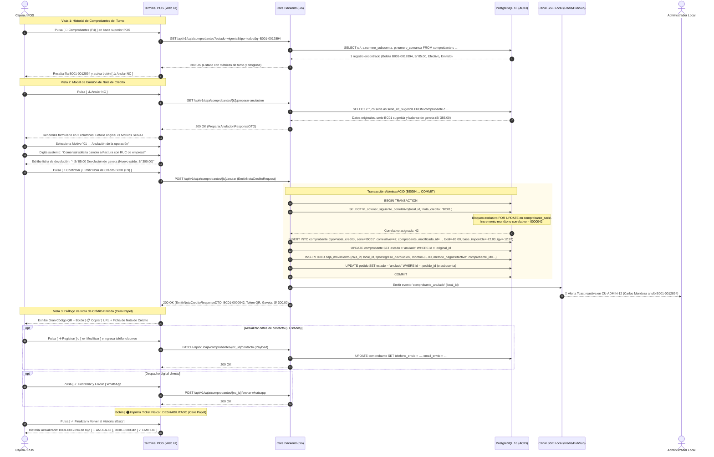

# Especificación Técnica de Wireframe: CU-CAJA-04

## Caso de Uso: CU-CAJA-04: Anular Comprobante / Pedido ya Cobrado y Emisión de Nota de Crédito Electrónica

---

## 1. Identificación del Caso de Uso, Actores y Condiciones

- **Código:** `CU-CAJA-04`
- **Nombre:** Anular comprobante / pedido ya cobrado y emisión de Nota de Crédito Electrónica
- **Módulo:** Caja, Punto de Venta (POS) y Facturación Electrónica (SUNAT)
- **Actor Principal:** `cajero` (Titular o relevo de caja con sesión activa y turno abierto)
- **Actores Secundarios:** `admin_local` (Supervisión administrativa, auditoría y control de mermas/fraude), `comensal` (Receptor de fondos restituidos y constancia digital)
- **Precondiciones:**
  1. La sede cuenta con un turno de caja abierto en estado `abierta` (`CU-CAJA-01`).
  2. Existe al menos un comprobante oficial previamente emitido en estado `emitido` en la tabla `comprobante` (Boleta `B001`, Factura `F001` o Nota de Venta `NV01`), perteneciente a un pedido ya liquidado (`CU-CAJA-03`), ya sea de comanda unificada (`pedido`) o de subcuenta fraccionada (`pedido_subcuenta` vía `CU-MOZO-09`).
  3. Existen series electrónicas activas de Notas de Crédito registradas en `comprobante_serie` para la sede:
     - Factura Electrónica (`F001`): Serie **`FC01`** (`tipo_comprobante = 'nota_credito'`).
     - Boleta de Venta Electrónica (`B001`): Serie **`BC01`** (`tipo_comprobante = 'nota_credito'`).
     - Nota de Venta interna (`NV01`): Serie interna **`NVC01`** (o anulación de control directo).

- **Postcondiciones:**
  1. **Generación de Nota de Crédito Oficial Inmutable:** Se inserta un registro oficial en la tabla `comprobante` con `tipo = 'nota_credito'`, serie (`BC01` o `FC01`), correlativo monótono asignado bajo bloqueo transaccional ACID (`fn_obtener_siguiente_correlativo` con `FOR UPDATE`), referencia foránea inmutable `comprobante_modificado_id` al documento original, código de motivo oficial SUNAT (Catálogo 09) y justificación textual obligatoria (`sustento_motivo`).
  2. **Conmutación del Comprobante Original:** El comprobante rectificado conmuta su estado a `'anulado'` (`comprobante.estado = 'anulado'`), impidiendo re-anulaciones o cobros duplicados (*Poka-Yoke*).
  3. **Conclusión Formal de la Operación / Subcuenta:**
     - Si el comprobante correspondía a una **comanda unificada**, `pedido.estado` conmuta formalmente a `'anulado'`.
     - Si el comprobante correspondía a una **subcuenta fraccionada** (`pedido_subcuenta`), dicha subcuenta conmuta su estado a `'anulado'`, manteniendo el resto de subcuentas intactas.
  4. **Asiento Contable de Restitución en Flujo de Caja (`caja_movimiento`):** Se inserta un asiento contable con `tipo = 'egreso_devolucion'` con importe negativo (`monto = -total_original`) referenciando `comprobante_id`. Si el medio de pago original fue `efectivo`, se deduce automáticamente del efectivo disponible en gaveta (`efectivo_actual`), garantizando la cuadratura exacta en el Arqueo y Cierre Z (`CU-CAJA-05`).
  5. **Auditoría Reactiva y Prevención de Fraude:** Se emite un broadcast reactivo Server-Sent Events (SSE) `comprobante_anulado` a la consola de Administración (`CU-ADMIN-12` / `CU-ADMIN-14`) para registro inmediato en la bitácora de auditoría.
  6. **Constancia Digital Cero Papel:** Se genera un código QR dinámico público con token criptográfico (UUID v8) y URL canónica provista de botón `[ 📋 Copiar ]` y entrega asistida directa (WhatsApp y Correo Electrónico con 3 estados interactivos). La impresión térmica permanece deshabilitada (*Zero Paper*).

---

## 2. Diagrama de Secuencia Mermaid y Flujo de Interacción



---

## 3. Diagramación Wireframe ASCII y Guía de Microcopias

### 3.1 Vista 1: Historial de Comprobantes Emitidos en Turno (`wf_caja_04_historial_comprobantes.jpg`)

```text
+------------------------------------------------------------------------------------------------------------------------------------+
| POS RestaurantCloud AI / Módulo de Facturación y Comprobantes Emitidos    • Turno #042 Abierto: S/ 385.00 Gaveta  CM Carlos Mendoza|
+------------------------------------------------------------------------------------------------------------------------------------+
| Comprobantes Emitidos en Turno #042                                            [ 14 Vigentes ]     [ S/ 1,485.00 ]   [ S/ 385.00 ] |
| Gestión de ventas, trazabilidad de comprobantes y emisión de Notas de Crédito.  1 ANULADO (15 TOT) TOTAL FACTURADO   EFECTIVO CAJA |
+------------------------------------------------------------------------------------------------------------------------------------+
| ESTADO:             [ ● Vigentes / Emitidos (14) ]*   [ 🚫 Anulados (1) ]   [ Todos (15) ] 🔍 [ B001-0012894       ] [ 🔍 Buscar ] |
| TIPO DE DOCUMENTO:  [ Todos (15) ]  [ Boletas (11) ]  [ Facturas (3) ]  [ Notas de Venta (1) ]  [ NC (1) ]                         |
+------------------------------------------------------------------------------------------------------------------------------------+
| LISTADO DE COMPROBANTES OFICIALES (ORDEN CRONOLÓGICO)                                                                              |
| COMPROBANTE/SERIE  HORA      MESA / SUBCUENTA CLIENTE / DOCUMENTO       MEDIO PAGO       TOTAL         ESTADO FISCAL  ACCIONES CAJA  |
| +--------------------------------------------------------------------------------------------------------------------------------+ |
| | B001-0012894*    18:35:12  Mesa 04          CARLOS MENDOZA QUISPE     💵 Efectivo      S/ 85.00      [✓ EMITIDO]    [📄QR] [⚠️Anular NC]
| | Boleta Electr.             Comanda #108     DNI 72819201                                                                         | |
| +--------------------------------------------------------------------------------------------------------------------------------+ |
| | F001-0004520     18:14:05  Mesa 07 (Sub #1) INVERSIONES GASTRONÓMICAS 💳 Tarjeta POS    S/ 245.00     [✓ EMITIDO]    [📄QR] [⚠️Anular NC]
| | Factura Electr.            Comanda #106     RUC 20601234567                                                                       | |
| | ~B001-0012890~   16:42:10  Mesa 01          JORGE ALBERTO SÁNCHEZ     💵 Efectivo Dev. ~S/ 45.00~    [🚫 ANULADO]   [📄Ver NC BC01] |
| | Boleta Electr.             Comanda #099     DNI 10293847                                             Por NC BC01-41 [🚫 Anulado]  | |
| | B001-0012893     17:50:33  Mesa 02          MARÍA FERNANDA ROJAS      📱 Yape           S/  54.00     [✓ EMITIDO]    [📄QR] [⚠️Anular NC]
| | Boleta Electr.             Comanda #105     DNI 45892301                                                                         | |
| +--------------------------------------------------------------------------------------------------------------------------------+ |
| PAGINACIÓN: Mostrando 1 - 4 de 15 comprobantes                           [ ‹ Anterior ] [ 1 ]* [ 2 ] [ 3 ] [ 4 ] [ Siguiente › ]   |
| 🔒 Salvaguarda: Cada NC asienta egreso_devolucion en caja_movimiento garantizando arqueo exacto (CU-CAJA-05). Poka-Yoke: Sin re-anulación|
+------------------------------------------------------------------------------------------------------------------------------------+
| Norma SUNAT: Los comprobantes emitidos no pueden borrarse; requieren Nota de Crédito.         Atajo: F4 buscador • Esc cerrar panel |
+------------------------------------------------------------------------------------------------------------------------------------+
```

### 3.2 Vista 2: Modal de Emisión de Nota de Crédito (`wf_caja_04_modal_nota_credito.jpg`)

```text
+------------------------------------------------------------------------------------------------------------------------------------+
| Emisión de Nota de Crédito Electrónica  [ SUNAT Catálogo 09 ]                                        ⚠️ OPERACIÓN IRREVERSIBLE     |
| Rectificación tributaria formal de comprobante emitido • Anulación contable con reversión en flujo de caja.                        |
+------------------------------------------------------------------+-----------------------------------------------------------------+
| 1. COMPROBANTE DE ORIGEN MODIFICADO                DOC. AFECTADO | 2. PARÁMETROS DE ANULACIÓN Y DEVOLUCIÓN         REQUISITOS SUNAT|
| Tipo y Serie:             B001-0012894                           | Motivo Oficial SUNAT (Catálogo de Tablas N° 09):                |
| Documento Oficial:        Boleta de Venta Electrónica            | (•) 01 — Anulación de la operación                              |
| Titular / Pagador:        CARLOS MENDOZA QUISPE (DNI 72819201)   |     Reemisión por cambio de tipo de comprobante o error global. |
| Mesa / Comanda:           Mesa 04 • Comanda #108                 | ( ) 02 — Anulación por error en el RUC / Documento              |
| Medio de Pago:            💵 Efectivo (Cobrado: S/ 85.00)        | ( ) 06 — Devolución total del consumo                           |
|                                                                  |                                                                 |
| Consumo Bruto en Salón:                                S/ 100.00 | Sustento / Motivo Detallado (Obligatorio para Auditoría):       |
| Descuento Comercial Aplicado (15%):                    - S/ 15.00| [ Comensal solicita cambio a Factura con RUC de empresa       ] |
| Base Imponible Gravada:                                S/  72.03 | Mínimo 5 caracteres. Obligatorio por normativa tributaria.     |
| I.G.V. (18.00% Incluido):                              S/  12.97 | +-------------------------------------------------------------+ |
| IMPORTE TOTAL A RECTIFICAR:                            S/  85.00 | | 💵 DEVOLUCIÓN DE EFECTIVO DE GAVETA               - S/ 85.00| |
|                                                                  | | Asiento de egreso: efectivo disminuirá de S/ 385 a S/ 300   | |
| [ Serie Electrónica Asignada: BC01 (Boleta Crédito) ]            | +-------------------------------------------------------------+ |
|                                                                  | 🔔 Se emitirá broadcast reactivo SSE a Supervisión (CU-ADMIN-12)|
+------------------------------------------------------------------+-----------------------------------------------------------------+
| 🔒 Transacción Atómica ACID: Genera 'nota_credito', conmuta original a 'anulado' y cuadra caja. | [✕Cancelar] [⚡Emitir NC BC01 F9]|
+------------------------------------------------------------------------------------------------------------------------------------+
```

### 3.3 Vista 3: Nota de Crédito Emitida y Token Digital QR (`wf_caja_04_nota_credito_emitida.jpg`)

```text
+------------------------------------------------------------------------------------------------------------------+
| [ ✓ ] Nota de Crédito BC01-0000042 Emitida                                                   [ Gaveta: S/ 300.00]|
|       Comprobante B001-0012894 anulado • Egreso de S/ 85.00 registrado en caja • Transacción contable asentada  |
+------------------------------------------------------------------------------------------------------------------+
| 📄 Nota de Crédito Electrónica BC01-0000042                                           10/10/2026 18:42:01 • Turno #042 |
|                                                                                                                  |
| COMPROBANTE MODIFICADO:                                MOTIVO OFICIAL SUNAT:                                     |
| Boleta B001-0012894 [ 🚫 ANULADA ]                     01 — Anulación de la operación                            |
| SUSTENTO DECLARADO:                                    IMPORTE RECTIFICADO:                                      |
| Cambio a Factura con RUC de empresa                    - S/ 85.00 (Devolución Efectivo de Gaveta)                |
+------------------------------------------------------------------------------------------------------------------+
| +--------------+  TOKEN DIGITAL NOTA DE CRÉDITO • POLÍTICA CERO PAPEL                                            |
| |  [QR CODE]   |  Constancia Digital Oficial para el Cliente                                                     |
| |  DINÁMICO    |  El cliente puede escanear este código con su smartphone para descargar el PDF de la NC        |
| |  ALTA RES.   |  [ 📋 Copiar ] https://app.restaurantcloud.pe/c/0192d2f8-b3a1-7c9e-9102-120938475610           |
| +--------------+                                                                                                 |
+------------------------------------------------------------------------------------------------------------------+
| ENTREGA DIGITAL ASISTIDA DIRECTA                                                                                 |
| 📱 WhatsApp:  +51 987 654 321                  [ Guardado ]  [ ✏️ Modificar ]        [ ✓ Confirmar y Enviar ]     |
| ✉️ Correo:    (No registrado)                  [ ＋ Registrar ]                                                   |
+------------------------------------------------------------------------------------------------------------------+
| [ 📄 Ver PDF Oficial de Nota de Crédito ]             [ 🖨️ Imprimir Ticket Físico (DESHABILITADO • CERO PAPEL) ] |
+------------------------------------------------------------------------------------------------------------------+
| 🔔 Evento de auditoría transmitido a Administración (CU-ADMIN-12).                   [ ✓ Finalizar y Volver (Esc)]|
+------------------------------------------------------------------------------------------------------------------+
```

---

## 4. Matriz de Control de Acceso Basado en Roles (RBAC)

| Capacidad / Endpoint | `cajero` | `admin_local` | `propietario` | `mozo` | `cocina` |
| :--- | :---: | :---: | :---: | :---: | :---: |
| Consultar comprobantes emitidos en el turno (`GET /caja/comprobantes`) | ✅ Permitido | ✅ Permitido | ✅ Permitido | ❌ Bloqueado | ❌ Bloqueado |
| Preparar emisión de Nota de Crédito (`GET /caja/comprobantes/{id}/preparar-anulacion`)| ✅ Permitido | ✅ Permitido | ✅ Permitido | ❌ Bloqueado | ❌ Bloqueado |
| Emitir Nota de Crédito y anular comprobante (`POST /caja/comprobantes/{id}/anular`)   | ✅ Permitido | ✅ Permitido | ✅ Permitido | ❌ Bloqueado | ❌ Bloqueado |
| Actualizar datos de contacto de envío (`PATCH /caja/comprobantes/{id}/contacto`)     | ✅ Permitido | ✅ Permitido | ✅ Permitido | ❌ Bloqueado | ❌ Bloqueado |
| Recibir alerta reactiva de auditoría por SSE (`CU-ADMIN-12`)                          | ❌ Bloqueado | ✅ Permitido | ✅ Permitido | ❌ Bloqueado | ❌ Bloqueado |
| Enviar constancia de Nota de Crédito por WhatsApp/Email                               | ✅ Permitido | ✅ Permitido | ✅ Permitido | ❌ Bloqueado | ❌ Bloqueado |

---

## 5. Contratos de API Go y DTOs (`internal/domain/caja/anulacion_dto.go`)

```go
package caja

import (
	"time"
	"github.com/google/uuid"
)

// ComprobanteHistorialItemDTO representa una fila en el listado de comprobantes del turno (Vista 1)
type ComprobanteHistorialItemDTO struct {
	ID                     uuid.UUID  `json:"id"`
	TipoComprobante        string     `json:"tipo_comprobante"` // 'boleta', 'factura', 'nota_venta', 'nota_credito'
	Serie                  string     `json:"serie"`
	Correlativo            int        `json:"correlativo"`
	SerieNumero            string     `json:"serie_numero"` // ej: 'B001-0012894'
	Hora                   string     `json:"hora"`         // ej: '18:35:12'
	FechaEmision           time.Time  `json:"fecha_emision"`
	MesaID                 *uuid.UUID `json:"mesa_id,omitempty"`
	MesaNumero             string     `json:"mesa_numero"`
	SubcuentaID            *uuid.UUID `json:"subcuenta_id,omitempty"`
	SubcuentaNumero        *int       `json:"subcuenta_numero,omitempty"`
	ComandaNumero          int        `json:"comanda_numero"`
	ClienteNombre          string     `json:"cliente_nombre"`
	ClienteDocumento       *string    `json:"cliente_documento,omitempty"`
	MedioPago              string     `json:"medio_pago"` // 'efectivo', 'tarjeta', 'billetera_digital'
	Total                  float64    `json:"total"`
	BaseImponible          float64    `json:"base_imponible"`
	IGV                    float64    `json:"igv"`
	Estado                 string     `json:"estado"` // 'emitido', 'anulado'
	TokenDigital           uuid.UUID  `json:"token_digital"`
	URLPublicaQR           string     `json:"url_publica_qr"`
	TelefonoEnvio          *string    `json:"telefono_envio,omitempty"`
	EmailEnvio             *string    `json:"email_envio,omitempty"`
	NotaCreditoID          *uuid.UUID `json:"nota_credito_id,omitempty"`
	NotaCreditoSerieNumero *string    `json:"nota_credito_serie_numero,omitempty"`
	MotivoCodigoSUNAT      *string    `json:"motivo_codigo_sunat,omitempty"`
	SustentoMotivo         *string    `json:"sustento_motivo,omitempty"`
	ComprobanteModificadoID *uuid.UUID `json:"comprobante_modificado_id,omitempty"`
	DocumentoModificado    *string    `json:"documento_modificado,omitempty"`
}

// PrepararAnulacionResponseDTO datos para poblar el modal de anulación (Vista 2)
type PrepararAnulacionResponseDTO struct {
	ComprobanteID            uuid.UUID  `json:"comprobante_id"`
	TipoComprobanteOriginal  string     `json:"tipo_comprobante_original"` // 'factura', 'boleta', 'nota_venta'
	SerieOriginal            string     `json:"serie_original"`            // 'B001', 'F001', 'NV01'
	CorrelativoOriginal      int        `json:"correlativo_original"`      // 12894
	SerieNumeroOriginal      string     `json:"serie_numero_original"`     // 'B001-0012894'
	MesaNumero               string     `json:"mesa_numero"`
	ComandaNumero            int        `json:"comanda_numero"`
	SubcuentaID              *uuid.UUID `json:"subcuenta_id,omitempty"`
	SubcuentaNumero          *int       `json:"subcuenta_numero,omitempty"`
	ClienteNombre            string     `json:"cliente_nombre"`
	ClienteNumeroDoc         *string    `json:"cliente_numero_doc,omitempty"`
	MedioPagoCodigo          string     `json:"medio_pago_codigo"`          // 'efectivo', 'tarjeta', 'billetera_digital'
	TotalOriginal            float64    `json:"total_original"`
	BaseImponible            float64    `json:"base_imponible"`
	IGV                      float64    `json:"igv"`
	SerieNotaCreditoSugerida string     `json:"serie_nota_credito_sugerida"` // 'BC01', 'FC01', 'NVC01'
	EfectivoGavetaActual     float64    `json:"efectivo_gaveta_actual"`
	EfectivoGavetaProyectado float64    `json:"efectivo_gaveta_proyectado"`
	TelefonoEnvio            *string    `json:"telefono_envio,omitempty"`
	EmailEnvio               *string    `json:"email_envio,omitempty"`
}

// EmitirNotaCreditoRequest payload enviado para confirmar la anulación
type EmitirNotaCreditoRequest struct {
	MotivoCodigoSUNAT string  `json:"motivo_codigo_sunat" binding:"required"` // '01', '02', '06'
	SustentoMotivo    string  `json:"sustento_motivo" binding:"required,min=5,max=255"`
	DevolucionMetodo  string  `json:"devolucion_metodo" binding:"required"`  // 'efectivo', 'extorno_tarjeta', 'transferencia'
	ReferenciaExtorno *string `json:"referencia_extorno,omitempty"`          // Código de transacción si aplica
	TelefonoEnvio     *string `json:"telefono_envio,omitempty"`
	EmailEnvio        *string `json:"email_envio,omitempty"`
}

// EmitirNotaCreditoResponseDTO respuesta oficial tras la emisión de la Nota de Crédito (Vista 3)
type EmitirNotaCreditoResponseDTO struct {
	NotaCreditoID           uuid.UUID  `json:"nota_credito_id"`        // UUID v8
	TipoComprobante         string     `json:"tipo_comprobante"`       // 'nota_credito'
	Serie                   string     `json:"serie"`                  // 'BC01' o 'FC01'
	Correlativo             int        `json:"correlativo"`            // 42
	SerieNumero             string     `json:"serie_numero"`           // 'BC01-0000042'
	DocumentoModificado     string     `json:"documento_modificado"`   // 'B001-0012894'
	ComprobanteModificadoID uuid.UUID  `json:"comprobante_modificado_id"`
	MotivoCodigoSUNAT       string     `json:"motivo_codigo_sunat"`
	SustentoMotivo          string     `json:"sustento_motivo"`
	ImporteRectificado      float64    `json:"importe_rectificado"`    // -85.00
	EfectivoGavetaNuevo     float64    `json:"efectivo_gaveta_nuevo"`  // 300.00
	TokenDigital            uuid.UUID  `json:"token_digital"`          // UUID v8
	URLPublicaQR            string     `json:"url_publica_qr"`
	MesaNumero              string     `json:"mesa_numero"`
	SubcuentaNumero         *int       `json:"subcuenta_numero,omitempty"`
	TelefonoRegistrado      *string    `json:"telefono_registrado,omitempty"`
	EmailRegistrado         *string    `json:"email_registrado,omitempty"`
	EmitidoAt               time.Time  `json:"emitido_at"`
}

// ActualizarContactoComprobanteRequest para actualización inline antes del envío asistido
type ActualizarContactoComprobanteRequest struct {
	TelefonoEnvio *string `json:"telefono_envio,omitempty"`
	EmailEnvio    *string `json:"email_envio,omitempty"`
}
```

---

## 6. Catálogo de Endpoints REST y Códigos de Error (`AppError`)

| Método | Endpoint | Rol Mínimo | Código Éxito | Descripción |
| :--- | :--- | :---: | :---: | :--- |
| `GET` | `/api/v1/caja/comprobantes?estado=vigente&tipo=todos&q=&page=1&limit=50` | `cajero`, `admin_local` | `200 OK` | Consulta comprobantes del turno actual con filtros segmentados (`estado`: `vigente`, `anulado`, `todos`; `tipo`: `boleta`, `factura`, etc.) y búsqueda rápida con debounce |
| `GET` | `/api/v1/caja/comprobantes/{id}/preparar-anulacion` | `cajero`, `admin_local` | `200 OK` | Prepara datos del comprobante original, serie de NC asignada (`BC01`/`FC01`) y cálculo de egreso de gaveta |
| `POST` | `/api/v1/caja/comprobantes/{id}/anular` | `cajero`, `admin_local` | `200 OK` | Transacción atómica ACID: correlativo NC (`FOR UPDATE`), inserción de NC, conmutación del original a `anulado`, asiento contable de egreso en `caja_movimiento` y broadcast SSE |
| `PATCH`| `/api/v1/caja/comprobantes/{id}/contacto` | `cajero`, `admin_local` | `200 OK` | Actualiza inline los datos de teléfono y correo de entrega asistida antes o después del despacho |
| `POST` | `/api/v1/caja/comprobantes/{id}/enviar-whatsapp` | `cajero`, `admin_local` | `200 OK` | Despacha enlace de la Nota de Crédito por WhatsApp |
| `POST` | `/api/v1/caja/comprobantes/{id}/enviar-email` | `cajero`, `admin_local` | `200 OK` | Despacha la Nota de Crédito en PDF oficial por correo electrónico |

### Catálogo de Errores de Negocio (`AppError`):

| Código Error | HTTP Status | Causa y Mensaje |
| :--- | :---: | :--- |
| `ERR_COMPROBANTE_YA_ANULADO` | `409 Conflict` | El comprobante ya fue anulado previamente mediante una Nota de Crédito. No se permite re-anulación. |
| `ERR_SERIE_NC_NO_ENCONTRADA` | `404 Not Found` | No existe serie activa de Nota de Crédito (`BC01` o `FC01`) configurada en `comprobante_serie`. |
| `ERR_MOTIVO_SUNAT_INVALIDO`  | `422 Unprocessable` | El código de motivo no corresponde al Catálogo N° 09 oficial de SUNAT (`01`, `02`, `06`). |
| `ERR_SUSTENTO_OBLIGATORIO`   | `422 Unprocessable` | La justificación textual de la anulación es obligatoria y debe tener al menos 5 caracteres. |
| `ERR_EFECTIVO_GAVETA_INSUFICIENTE`| `422 Unprocessable` | El efectivo físico disponible en la gaveta del turno es menor al importe a devolver al comensal. |

---

## 7. Modelo Relacional PostgreSQL 16 y Fórmulas Tributarias SUNAT

### 7.1 Fórmulas Tributarias de Rectificación SUNAT Perú
1. **Importe Rectificado ($T_{NC}$):** Representa el valor negativo que extorna la venta original:
   $$T_{NC} = - T_{original} = -85.00$$
2. **Base Imponible Rectificada ($B_{NC}$):**
   $$B_{NC} = \frac{T_{NC}}{1.18} = -72.03$$
3. **IGV Rectificado ($\text{IGV}_{NC}$):**
   $$\text{IGV}_{NC} = T_{NC} - B_{NC} = -12.97$$
4. **Impacto en Flujo de Caja y Gaveta:**
   $$\text{Efectivo Gaveta Final} = \text{Efectivo Previo} - |T_{original}| = 385.00 - 85.00 = 300.00$$

### 7.2 Soporte de Tablas Nativas en PostgreSQL 16 (`02_schema_ddl.sql`)

El esquema DDL ya incorpora de manera nativa los campos requeridos para la emisión y trazabilidad de Notas de Crédito:

```sql
-- Tabla comprobante (02_schema_ddl.sql:564-599):
-- Columnas nativas para Notas de Crédito y anulación formal:
--   tipo VARCHAR(20) NOT NULL CHECK (tipo IN ('boleta', 'factura', 'nota_venta', 'nota_credito'))
--   comprobante_modificado_id UUID REFERENCES comprobante(id) ON DELETE RESTRICT
--   motivo_codigo_sunat VARCHAR(10) -- Catálogo 09 SUNAT (01, 02, 06)
--   sustento_motivo TEXT
--   estado VARCHAR(20) NOT NULL DEFAULT 'emitido' CHECK (estado IN ('emitido', 'anulado'))
--   token_qr UUID NOT NULL UNIQUE DEFAULT fn_uuid_v8()

-- Tabla comprobante_serie (02_schema_ddl.sql:551-561):
-- Series canónicas activas por sede en comprobante_serie:
--   tipo_comprobante: 'nota_credito', serie: 'BC01' (Para Boletas B001)
--   tipo_comprobante: 'nota_credito', serie: 'FC01' (Para Facturas F001)

-- Tabla caja_movimiento (02_schema_ddl.sql:653-664):
-- Asiento contable de restitución de fondos:
--   tipo VARCHAR(30) NOT NULL CHECK (tipo IN ('apertura', 'ingreso_venta', 'egreso_devolucion', 'egreso_gasto_manual', 'cierre'))
--   monto DECIMAL(12, 2) NOT NULL -- Negativo = salida (-85.00)
--   comprobante_id UUID REFERENCES comprobante(id) ON DELETE SET NULL
```

---

## 8. Checklist de Accesibilidad WCAG 2.1 AA

- [x] **Contraste de Color:** Títulos y textos de advertencia en ámbar (`#92400E` sobre fondo `#FFFBEB`) superan el ratio de contraste `7:1`. Textos estándar en `#0F172A` sobre blanco superan `12:1`.
- [x] **Información Multimodal:** El badge de advertencia incorpora el icono `⚠️` junto al texto explícito `OPERACIÓN IRREVERSIBLE`. Los estados de comprobante se distinguen mediante texto claro (`[✓ EMITIDO]` vs `[🚫 ANULADO]`).
- [x] **Áreas Táctiles Mínimas (Touch Targets):** Opciones de radio de motivos, inputs de búsqueda y botones de acción principal cumplen con un mínimo de `44x44px` con espaciado de `8px`.
- [x] **Navegación por Teclado:** Se puede abrir el Historial desde el POS con `F4`, confirmar la Nota de Crédito con `F9` y cancelar o cerrar con `Esc`.
- [x] **Poka-Yoke Visual:** El botón `[ 🖨️ Imprimir Ticket Físico ]` aparece en estado `disabled` reforzando la política Cero Papel y evitando consumibles innecesarios.
