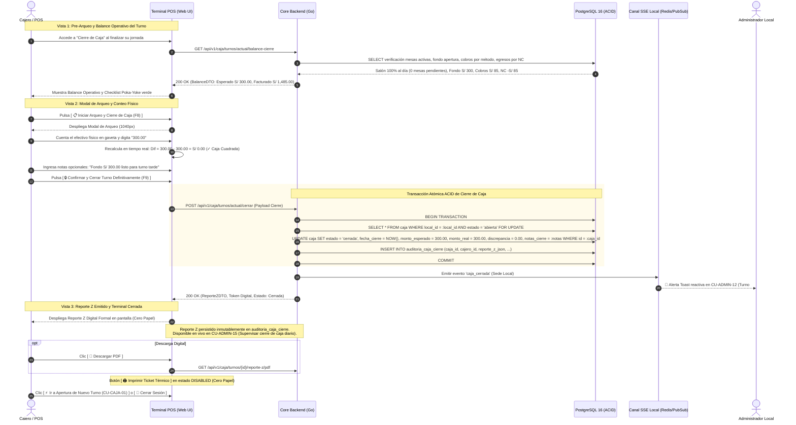

# Especificación Técnica de Wireframe: CU-CAJA-05

## Caso de Uso: CU-CAJA-05: Cerrar Caja (Arqueo Z) y Rendición de Cuentas del Turno

---

## 1. Identificación del Caso de Uso, Actores y Condiciones

- **Código:** `CU-CAJA-05`
- **Nombre:** Cerrar caja (arqueo Z) y rendición de cuentas del turno
- **Módulo:** Caja, Punto de Venta (POS) y Facturación Electrónica (SUNAT)
- **Actor Principal:** `cajero` (Titular responsable del turno de caja activo con sesión abierta)
- **Actores Secundarios:** `admin_local` (Receptor del reporte gerencial de cierre y supervisor de discrepancias), `sistema` (Procesador contable y emisor de broadcast reactivo SSE)
- **Precondiciones:**
  1. La sede cuenta con un turno de caja abierto en estado `abierta` (`CU-CAJA-01`).
  2. El cajero ha finalizado o verificado la atención de mesas en el salón (0 mesas en comanda activa, o confirmación explícita de cuentas liquidadas).
  3. Todas las transacciones del turno (cobros con boletas, facturas, notas de venta y egresos por notas de crédito emitidas en `CU-CAJA-04`) se encuentran registradas en la base de datos.
- **Postcondiciones:**
  1. El registro del turno en la tabla `caja` se actualiza atómicamente: `estado = 'cerrada'`, `fecha_cierre = NOW()`, `monto_esperado`, `monto_real`, `discrepancia`, `comentario_discrepancia` y `notas_cierre`.
  2. Se libera el índice de unicidad parcial `uq_caja_abierta_local`, permitiendo que el siguiente cajero pueda aperturar un nuevo turno (`CU-CAJA-01`).
  3. Se genera el **Reporte Z Digital** oficial con consolidación fiscal SUNAT (Base Imponible, IGV, Exonerados), resumen por método de pago y arqueo físico de efectivo.
  4. Se emite un broadcast reactivo Server-Sent Events (SSE) `caja_cerrada` al Administrador del Local (`CU-ADMIN-12`) para supervisión inmediata.
  5. La terminal POS queda bloqueada para nuevas transacciones comerciales hasta la apertura del próximo turno.

---

## 2. Diagrama de Secuencia Mermaid y Flujo de Interacción



---

## 3. Diagramación Wireframe ASCII y Guía de Microcopias

### 3.1 Vista 1: Pre-Arqueo y Balance Operativo del Turno (`wf_caja_05_balance_turno.jpg`)

```text
+------------------------------------------------------------------------------------------------------------------------------------+
| POS RestaurantCloud AI / Módulo de Cierre de Caja y Arqueo Z de Turno       • Turno #042 Abierto: 11:30 AM  RA Rosa Aguirre (Cajera)|
+------------------------------------------------------------------------------------------------------------------------------------+
| Pre-Arqueo y Balance Operativo del Turno #042                                 [ S/ 300.00 ]     [ S/ 1,485.00 ]     [ S/ 300.00 ]  |
| Corte de operaciones, conciliación de pagos y verificación de gaveta previa.  FONDO APERTURA    TOTAL FACTURADO     EFECTIVO GAVETA|
+------------------------------------------------------------------------------------------------------------------------------------+
| [✓ SALÓN 100% AL DÍA]  0 Mesas con comanda activa • Cero pedidos en cola de cocina                    Sede: Miraflores • 10/10/2026|
+------------------------------------------------------------------+-----------------------------------------------------------------+
| 1. RECAUDACIÓN Y FLUJO POR MÉTODO DE PAGO   15 TRANSACCIONES     | 3. VERIFICACIÓN PREVIA AL CIERRE (POKA-YOKE)                    |
| MÉTODO PAGO          OPERAC.   INGRESOS    DEVOLUCIONES   NETO   | [✓] Salón sin comandas abiertas: Mesas 100% liquidadas.         |
| 💵 Efectivo Gaveta   1 Cob/1NC + S/ 85.00  - S/ 85.00(NC) S/ 300 | [✓] Auditoría Comprobantes: 14 Vigentes / 1 Anulado por BC01.   |
| 💳 Tarjetas POS      1 Cobro   + S/ 245.00       S/  0.00 S/ 245 | [✓] Flujo Gaveta: Fondo 300 + Ing 85 - NC 85 = S/ 300.00.       |
| 📱 Billeteras Yape   1 Cobro   + S/  54.00       S/  0.00 S/  54 |                                                                 |
| ⚡ Otros Cobros      12 Cobros + S/1,186.00      S/  0.00 S/1186 | +-------------------------------------------------------------+ |
| TOTAL FACTURADO      15 Docs   + S/1,570.00- S/ 85.00     S/1485 | | Paso Siguiente: Conteo y Arqueo Físico                      | |
|                                                                  | | Digite el importe contado en gaveta para calcular diferencia| |
| 2. DESGLOSE FISCAL OFICIAL SUNAT PERÚ                            | | [ 📋 Iniciar Arqueo y Cierre de Caja (F8) ]                 | |
| Base Imponible: S/ 1,258.47 | IGV (18%): S/ 226.53 | Tot: S/ 1485| | [ Volver al Monitor POS de Salón (Esc) ]                    | |
+------------------------------------------------------------------+-----------------------------------------------------------------+
| Seguridad: El cierre conmuta a 'cerrada' y libera el turno.                                     Atajos: F8 Arqueo • Esc Volver POS |
+------------------------------------------------------------------------------------------------------------------------------------+
```

### 3.2 Vista 2: Modal de Arqueo y Conteo Físico (`wf_caja_05_modal_arqueo_conteo.jpg`)

```text
+------------------------------------------------------------------------------------------------------------------------------------+
| Arqueo Físico de Efectivo y Cierre de Turno #042  [ Cierre Formal Z ]                                    Cajera: Rosa Aguirre      |
| Rendición de cuentas contable, verificación de gaveta y emisión del Reporte Z oficial (SUNAT).           Terminal: POS-01          |
+------------------------------------------------------------------+-----------------------------------------------------------------+
| 1. RESUMEN DE FLUJO DE EFECTIVO DEL SISTEMA                      | 3. CONTEO FÍSICO REAL EN GAVETA                                 |
| Fondo de Apertura (Cambio Inicial):                    S/ 300.00 | EFECTIVO FÍSICO CONTADO:                      Digitación directa|
| (+) Ingresos Brutos en Efectivo (Ventas):            + S/  85.00 | +-------------------------------------------------------------+ |
| (-) Devoluciones / Notas de Crédito (BC01-0000042):  - S/  85.00 | | S/ [ 300.00                                               ] | |
| Total Esperado en Efectivo:                            S/ 300.00 | +-------------------------------------------------------------+ |
|                                                                  |                                                                 |
| +--------------------------------------------------------------+ | +-------------------------------------------------------------+ |
| | EFECTIVO OBJETIVO EN GAVETA                    S/ 300.00     | | | [✓ CAJA CUADRADA CON ÉXITO]                   DIF: S/ 0.00 | |
| | Calculado automáticamente por el backend                     | | | Esperado: S/ 300.00 vs Contado: S/ 300.00                   | |
| +--------------------------------------------------------------+ | +-------------------------------------------------------------+ |
|                                                                  |                                                                 |
| 2. CONCILIACIÓN DE MEDIOS ELECTRÓNICOS                           | Notas de Entrega de Turno (Opcional):                           |
| 💳 Tarjetas POS (Lote #012 Niubiz): S/ 245.00 [✓ Lote Conciliado]| [ Turno entregado sin novedades. Fondo S/ 300 en gaveta.     ] |
| 📱 Billeteras (Yape / Plin):        S/  54.00 [✓ Verificado]     | 🔔 Broadcast reactivo SSE se emitirá al Administrador (CU-ADMIN)|
+------------------------------------------------------------------+-----------------------------------------------------------------+
| [ Cancelar y Volver al Balance ]                                       [ 🔒 Confirmar y Cerrar Turno Definitivamente (F9) ]        |
+------------------------------------------------------------------------------------------------------------------------------------+
```

### 3.3 Vista 3: Reporte Z Digital Emitido y Terminal Cerrada (`wf_caja_05_reporte_z_cerrado.jpg`)

```text
+------------------------------------------------------------------------------------------------------------------------------------+
| POS RestaurantCloud AI / Reporte Z Oficial y Cierre de Caja                  • Turno #042 CERRADO • 19:45 PM    RA Rosa Aguirre    |
+------------------------------------------------------------------------------------------------------------------------------------+
| [✓ Cierre Confirmado: Turno #042 cerrado con éxito • Reporte Z emitido • Broadcast enviado a CU-ADMIN-12 • Terminal Bloqueada]     |
+------------------------------------------------------------------------------------------------------------------------------------+
| REPORTE Z — CIERRE FORMAL DE TURNO #042                        Apertura: 10/10/2026 11:30:15    Cierre: 10/10/2026 19:45:22        |
| RESTAURANTCLOUD AI • SEDE MIRAFLORES CENTRO • RUC: 20609876543 Cajera:   Rosa Aguirre           Durac:  8h 15m 07s                 |
| - - - - - - - - - - - - - - - - - - - - - - - - - - - - - - - - - - - - - - - - - - - - - - - - - - - - - - - - - - - - - - - - - |
| 1. MOVIMIENTO Y ARQUEO FÍSICO DE EFECTIVO EN GAVETA                                                                                |
|    [ Fondo Apertura: S/ 300.00 ]     [ Efectivo Real: S/ 300.00 ]     [ Discrepancia: S/ 0.00 (CUADRADA) ]                         |
|    Fondo S/ 300 + Ventas Efectivo S/ 85 - NC Devolución BC01 S/ 85 = S/ 300.00 esperado en gaveta.                                 |
| 2. TOTAL RECAUDADO POR MÉTODO DE PAGO                                                                                              |
|    💵 Efectivo Gaveta (Neto turno): S/ 0.00 (+ S/ 300 fondo) | 💳 Tarjetas POS: S/ 245.00 | 📱 Billeteras: S/ 54.00 | Otros: S/ 1186|
|    TOTAL FACTURADO NETO EN EL TURNO: S/ 1,485.00                                                                                   |
| 3. RESUMEN TRIBUTARIO OFICIAL SUNAT PERÚ                                                                                           |
|    Base Imponible Gravada: S/ 1,258.47  |  IGV (18.00%): S/ 226.53  |  Inafecto: S/ 0.00  |  Total Facturado: S/ 1,485.00           |
| 4. AUDITORÍA DE DOCUMENTOS Y SERIES EMITIDAS                                                                                       |
|    [ 11 Boletas B001 ]       [ 3 Facturas F001 ]       [ 1 Nota de Venta NV01 ]       [ 1 Nota de Crédito BC01 ]                   |
| 5. NOTAS DE CIERRE Y TRASPASO: "Turno entregado sin novedades. Gaveta cuadrada con fondo S/ 300 listo para turno tarde."          |
+------------------------------------------------------------------------------------------------------------------------------------+
| [ 📄 Descargar PDF ]   [ 🖨️ Ticket (DISABLED CERO PAPEL) ]   [ 🔔 Archivado en Supervisión CU-ADMIN-15 ]   [ 🚪 Salir ] [ ⚡ Nuevo Turno ] |
+------------------------------------------------------------------------------------------------------------------------------------+
```

---

## 4. Matriz de Estados de Interfaz UX (5 Estados Canónicos)

| Estado | Contexto de Activación | Comportamiento en Pantalla y Microcopia | Acciones Disponibles |
| :--- | :--- | :--- | :--- |
| **1. Ideal / Cuadrada** | Efectivo contado coincide exactamente con lo esperado (`monto_real == monto_esperado`). | Badge verde brillante `[ ✓ CAJA CUADRADA CON ÉXITO • DIF: S/ 0.00 ]`. Justificación opcional. | `[ 🔒 Confirmar y Cerrar (F9) ]` habilitado. |
| **2. Con Discrepancia (Sobrante/Faltante)** | Efectivo contado difiere del cálculo (`monto_real != monto_esperado`). | Card ámbar o roja destacada: `[ ⚠️ DISCREPANCIA: Faltante de - S/ 15.00 ]`. El campo `comentario_discrepancia` se vuelve **obligatorio** (mínimo 10 caracteres). | Botón `Confirmar` bloqueado hasta redactar justificación. |
| **3. Bloqueo por Mesas Activas (Poka-Yoke)** | Existen mesas con pedidos abiertos en salón (`ocupada`, `cuenta_pedida`). | Banner de alerta preventiva: `[ ⚠️ Mesas Pendientes de Cobro: Mesa 08 (S/ 145.00) ]`. Prohíbe el cierre hasta liquidar o transferir las cuentas. | `[ Ir a Cobrar Mesa 08 ]` / Bloquea arqueo. |
| **4. Cargando / Transacción ACID** | El cajero confirma el cierre; el backend ejecuta el bloqueo y auditoría. | Spinner de alta fidelidad: *"Consolidando Reporte Z y cerrando turno en base de datos..."*. | Botones deshabilitados (previene doble click). |
| **5. Turno Cerrado / Terminal Bloqueada** | Transacción confirmada; `caja.estado = 'cerrada'`. | Vista 3 desplegada con Reporte Z. Terminal deshabilitada para nuevas ventas. | `[ 📄 Descargar PDF ]`, `[ ⚡ Aperturar Turno ]`. |

---

## 5. Matriz de Seguridad y Roles (RBAC)

| Operación | Rol `cajero` | Rol `admin_local` | Rol `propietario` | Validación de Integridad |
| :--- | :---: | :---: | :---: | :--- |
| Consultar Balance Pre-Arqueo | ✅ Permitido | ✅ Permitido | ✅ Permitido | Sesión activa en la sede con turno abierto. |
| Confirmar Arqueo y Cierre Z | ✅ Permitido | ✅ Permitido | 🚫 Denegado | Requiere ser el titular de la caja o administrador con clave de anulación. |
| Justificar Discrepancia | ✅ Obligatorio | ✅ Obligatorio | 🚫 N/A | Exige mínimo 10 caracteres si `discrepancia != 0.00`. |
| Reabrir Turno Cerrado | 🚫 Prohibido | 🚫 Prohibido | 🚫 Prohibido | **Inmutabilidad contable**: Un turno cerrado jamás se reabre; se apertura uno nuevo (`CU-CAJA-01`). |

---

## 6. Estructuras de Datos y DTOs en Go (`internal/domain/caja/cierre_dto.go`)

```go
package caja

import (
	"time"
	"github.com/google/uuid"
)

// BalancePreArqueoResponseDTO datos para la pantalla de pre-arqueo
type BalancePreArqueoResponseDTO struct {
	CajaID                uuid.UUID `json:"caja_id"`
	TurnoCorrelativo      int       `json:"turno_correlativo"`
	FechaApertura         time.Time `json:"fecha_apertura"`
	MontoApertura         float64   `json:"monto_apertura"`
	IngresosEfectivo      float64   `json:"ingresos_efectivo"`
	EgresosDevolucionNC   float64   `json:"egresos_devolucion_nc"`
	EfectivoEsperado      float64   `json:"efectivo_esperado"`
	TarjetasPOSTotal      float64   `json:"tarjetas_pos_total"`
	TarjetasOperaciones   int       `json:"tarjetas_operaciones"`
	BilleterasTotal       float64   `json:"billeteras_total"`
	TotalFacturadoNeto    float64   `json:"total_facturado_neto"`
	TotalComprobantes     int       `json:"total_comprobantes"`
	MesasActivasPendientes int      `json:"mesas_activas_pendientes"`
	SalonAlDia            bool      `json:"salon_al_dia"`
}

// CerrarCajaRequest payload enviado por el cajero para cerrar el turno
type CerrarCajaRequest struct {
	MontoRealFisico        float64 `json:"monto_real_fisico" binding:"required,min=0"`
	ComentarioDiscrepancia *string `json:"comentario_discrepancia,omitempty"` // Obligatorio si dif != 0
	NotasCierre            *string `json:"notas_cierre,omitempty"`
}

// ReporteZResponseDTO documento formal emitido al cerrar la caja
type ReporteZResponseDTO struct {
	CajaID                 uuid.UUID `json:"caja_id"`
	TurnoCorrelativo       int       `json:"turno_correlativo"`
	LocalNombre            string    `json:"local_nombre"`
	EmpresaRUC             string    `json:"empresa_ruc"`
	CajeroNombre           string    `json:"cajero_nombre"`
	FechaApertura          time.Time `json:"fecha_apertura"`
	FechaCierre            time.Time `json:"fecha_cierre"`
	DuracionTurno          string    `json:"duracion_turno"`
	MontoApertura          float64   `json:"monto_apertura"`
	EfectivoEsperado       float64   `json:"efectivo_esperado"`
	EfectivoRealContado    float64   `json:"efectivo_real_contado"`
	Discrepancia           float64   `json:"discrepancia"`
	TotalVentasEfectivo    float64   `json:"total_ventas_efectivo"`
	TotalTarjetasPOS       float64   `json:"total_tarjetas_pos"`
	TotalBilleterasDigital float64   `json:"total_billeteras_digital"`
	TotalNetoFacturado     float64   `json:"total_neto_facturado"`
	BaseImponibleGravada   float64   `json:"base_imponible_gravada"`
	IGV18                  float64   `json:"igv_18"`
	BoletasEmitidas        int       `json:"boletas_emitidas"`
	FacturasEmitidas       int       `json:"facturas_emitidas"`
	NotasVentaEmitidas     int       `json:"notas_venta_emitidas"`
	NotasCreditoEmitidas   int       `json:"notas_credito_emitidas"`
	ComprobantesAnulados   int       `json:"comprobantes_anulados"`
	NotasCierre            *string   `json:"notas_cierre,omitempty"`
	URLDescargaPDF         string    `json:"url_descarga_pdf"`
}
```

---

## 7. Catálogo de Endpoints REST y Códigos de Error (`AppError`)

| Método | Endpoint | Rol Mínimo | Código Éxito | Descripción |
| :--- | :--- | :---: | :---: | :--- |
| `GET` | `/api/v1/caja/turnos/actual/balance-cierre` | `cajero`, `admin_local` | `200 OK` | Consulta el consolidado de ventas, flujo de efectivo y validación de mesas previas |
| `POST` | `/api/v1/caja/turnos/actual/cerrar` | `cajero`, `admin_local` | `200 OK` | Ejecuta la transacción atómica de cierre, calcula discrepancia y emite Reporte Z |
| `GET` | `/api/v1/caja/turnos/{id}/reporte-z` | `cajero`, `admin_local` | `200 OK` | Obtiene el Reporte Z oficial del turno en formato JSON |
| `GET` | `/api/v1/caja/turnos/{id}/reporte-z/pdf` | `cajero`, `admin_local` | `200 OK` | Descarga el PDF formal del Reporte Z |
| `GET` | `/api/v1/admin/caja/cierres/{id}` | `admin_local` | `200 OK` | Consulta y auditoría histórica del Reporte Z desde el panel de supervisión (`CU-ADMIN-15`) |

### Catálogo de Errores de Negocio (`AppError`):

| Código Error | HTTP Status | Causa y Mensaje |
| :--- | :---: | :--- |
| `ERR_CAJA_YA_CERRADA` | `409 Conflict` | El turno de caja ya se encuentra cerrado en el sistema. |
| `ERR_SALON_CON_MESAS_ACTIVAS` | `422 Unprocessable` | No se puede cerrar caja mientras existan mesas con comandas activas pendientes de pago en salón. |
| `ERR_DISCREPANCIA_SIN_JUSTIFICAR` | `422 Unprocessable` | Existe una diferencia entre el efectivo real y el esperado; el comentario justificativo es obligatorio (mínimo 10 caracteres). |
| `ERR_MONTO_REAL_INVALIDO` | `400 Bad Request` | El importe físico contado no puede ser negativo ni contener caracteres inválidos. |

---

## 8. Modelo Relacional PostgreSQL 16 y Verificaciones WCAG 2.1 AA

### 8.1 Transacción SQL de Cierre Formal de Caja
```sql
-- Ejecución atómica de cierre de turno
BEGIN TRANSACTION;

-- 1. Bloqueo exclusivo de fila de caja abierta
SELECT id, monto_apertura FROM caja
WHERE local_id = :local_id AND estado = 'abierta'
FOR UPDATE;

-- 2. Actualización de cierre formal
UPDATE caja
SET
    estado = 'cerrada',
    fecha_cierre = NOW(),
    monto_esperado = :monto_esperado,
    monto_real = :monto_real,
    discrepancia = (:monto_real - :monto_esperado),
    comentario_discrepancia = :comentario_discrepancia,
    notas_cierre = :notas_cierre,
    updated_at = NOW()
WHERE id = :caja_id;

-- 3. Registro inmutable de auditoría del Reporte Z
INSERT INTO auditoria_caja_cierre (
    id, caja_id, local_id, cajero_id, reporte_z_json, created_at
) VALUES (
    gen_random_uuid(), :caja_id, :local_id, :cajero_id, :reporte_z_json::jsonb, NOW()
);

COMMIT;
```

### 8.2 Checklist de Accesibilidad WCAG 2.1 AA
- [x] **Contraste de Color:** Encabezados y valores clave (`#0F172A` sobre `#FFFFFF`) superan el ratio 14:1; textos secundarios (`#475569` sobre `#F8FAFC`) superan el ratio 4.8:1.
- [x] **Entrada Numérica Directa:** Campo amplio con cursor visible y fuente monospace de 24px (`input-amount`), previniendo errores de digitación.
- [x] **Navegación por Teclado:** Atajos explícitos: `F8` para iniciar arqueo, `F9` para confirmar cierre y `Esc` para retornar al balance sin ratón.
- [x] **Poka-Yoke Operativo:** Validación obligatoria de justificativo si la discrepancia es distinta de cero, bloqueando el envío erróneo.
