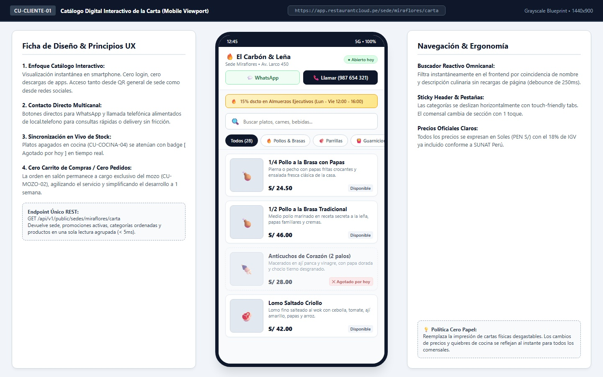
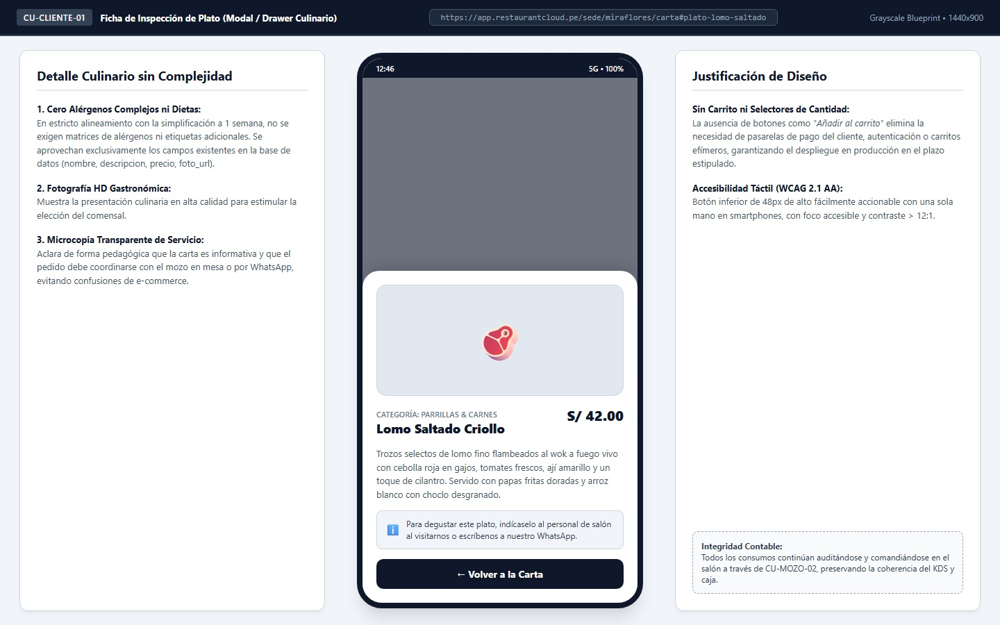
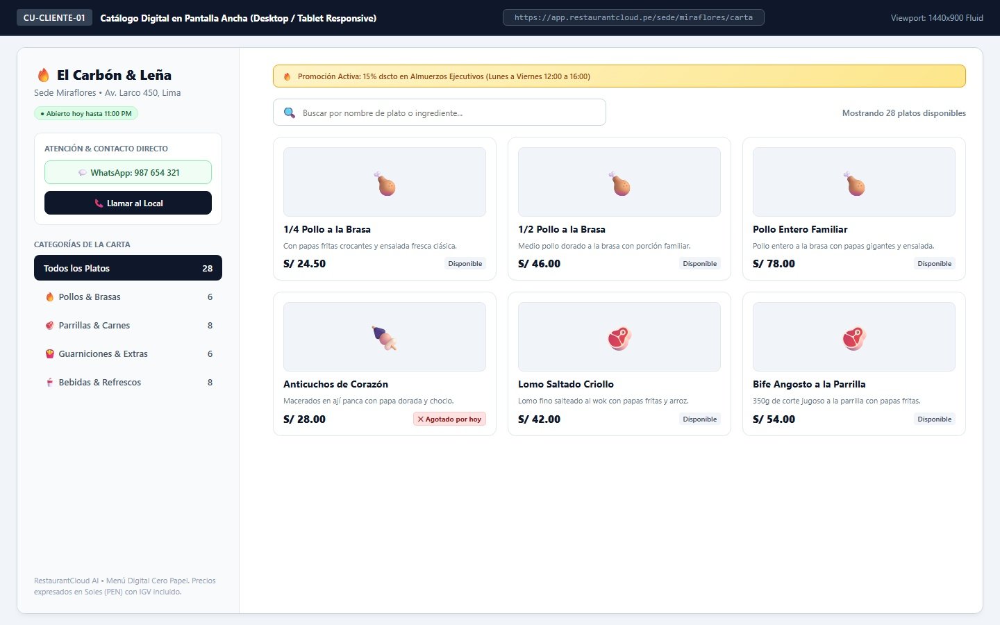
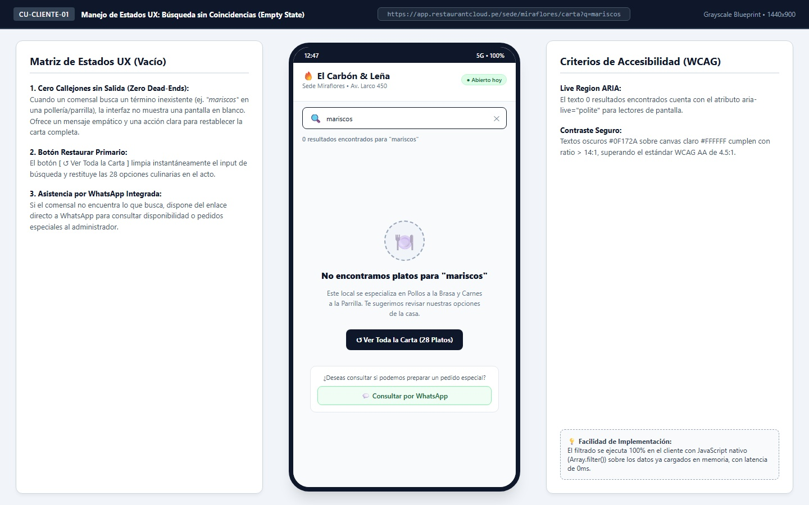

# Especificación Técnica de Wireframe: CU-CLIENTE-01

## Caso de Uso: CU-CLIENTE-01: Consultar Carta Digital (Catálogo Interactivo Web)

---

## 1. Identificación del Caso de Uso, Actores y Condiciones

- **Código:** `CU-CLIENTE-01`
- **Nombre:** Consultar carta digital
- **Módulo:** Experiencia del Cliente / Menú Digital Público (Cero Papel)
- **Actor Principal:** `cliente` (Comensal en salón que escanea el QR general o usuario público web que accede vía enlace de sede)
- **Actores Secundarios:** `sistema` (Proveedor de datos de carta y sincronización de disponibilidad de cocina)
- **Dispositivos / Viewports:**
  - Mobile Smartphone Canónico: `375x812` / `412x880` px (Mobile-First).
  - Responsive Desktop / Tablet: `1440x900` px.
- **Precondiciones:**
  1. El local/sede se encuentra en estado `activo` en la plataforma.
  2. Existen categorías de carta configuradas (`CU-ADMIN-02`) y productos activos (`CU-ADMIN-04`).
  3. El local cuenta con un slug único asignado (ej. `miraflores`).
- **Postcondiciones:**
  1. El comensal visualiza el catálogo gastronómico completo organizado por secciones con nombres, descripciones y precios oficiales en Soles (`PEN S/`) con IGV incluido.
  2. Los platos agotados en cocina (`CU-COCINA-04`) se muestran atenuados con el badge visual `[ Agotado por hoy ]`.
  3. El comensal puede contactar inmediatamente a la administración del local mediante los accesos directos de `[ 💬 WhatsApp ]` y `[ 📞 Llamar ]` usando `local.telefono`.
  4. Ninguna comanda ni reserva es creada de forma autónoma por el cliente (la atención de sala y envío a cocina permanece a cargo exclusivo del mozo en `CU-MOZO-02`).

---

## 2. Diagrama de Secuencia Mermaid y Flujo de Interacción

```mermaid
sequenceDiagram
    autonumber
    actor CLI as Comensal / Cliente
    participant WEB as Catálogo Web (Mobile PWA)
    participant API as Core Backend (Go)
    participant BD as PostgreSQL 16 (RLS Multi-Tenant)
    actor MOZ as Mozo en Salón (CU-MOZO-02)

    Note over CLI, WEB: 1. Acceso Público Inmediato sin Login ni Descargas
    CLI->>WEB: Escanea QR general de sede o abre https://app.restaurantcloud.pe/sede/miraflores/carta
    WEB->>API: GET /api/v1/public/sedes/miraflores/carta
    
    rect rgb(240, 249, 255)
        Note over API, BD: Consulta Agrupada de Alto Rendimiento (< 5ms)
        API->>BD: SELECT sede (datos, telefono, horario), promociones_vigentes, categorias_con_productos_activos
        BD-->>API: Payload consolidado (Sede info, 1 Promoción, 5 Categorías, 28 Platos)
    end

    API-->>WEB: 200 OK (CatalogoCartaPublicoDTO)
    WEB-->>CLI: Renderiza Vista 1: Catálogo móvil con tabs, buscador, WhatsApp y platos

    Note over CLI, WEB: 2. Navegación Táctil y Búsqueda en Tiempo Real
    CLI->>WEB: Escribe "pollo" en el buscador reactivo (debounce 250ms)
    WEB->>WEB: Filtro client-side instantáneo en memoria (0ms latencia)
    WEB-->>CLI: Muestra 6 opciones de Pollos & Brasas

    Note over CLI, WEB: 3. Inspección Culinaria sin Carrito de Compras
    CLI->>WEB: Toca la tarjeta de "Lomo Saltado Criollo"
    WEB-->>CLI: Despliega Vista 2: Modal Ficha del Plato (Foto HD, Ingredientes, Precio)
    Note over CLI: Microcopia visible: "Para degustar este plato, pídeselo al mozo de tu mesa."
    CLI->>WEB: Toca [ ← Volver a la Carta ]
    WEB-->>CLI: Restaura catálogo general

    opt Contacto Directo Multicanal
        CLI->>WEB: Toca [ 💬 WhatsApp ]
        WEB->>CLI: Redirige a https://wa.me/51987654321 con mensaje predeterminado
    end

    Note over CLI, MOZ: 4. Toma de Comanda Presencial en Salón (Cero Fricción)
    CLI->>MOZ: Mozo se acerca a la mesa; comensal indica sus elecciones desde el catálogo
    MOZ->>MOZ: Mozo digita y envía comanda oficial en tablet (CU-MOZO-02)
```

---

## 3. Diagramación Wireframe ASCII y Guía de Microcopias

### 3.1 Vista 1: Catálogo Digital Interactivo en Smartphone (`wf_cliente_01_catalogo_smartphone.jpg`)



```text
+------------------------------------------------------------------------------------------------------------------------------------+
| RestaurantCloud AI • Módulo Cliente / Catálogo Interactivo Web       https://app.restaurantcloud.pe/sede/miraflores/carta         |
+------------------------------------------------------------------------------------------------------------------------------------+
|                                                  +----------------------------------+                                              |
|                                                  | 12:45                   5G • 100%|                                              |
|                                                  +----------------------------------+                                              |
|                                                  | 🔥 El Carbón & Leña              |                                              |
|                                                  | Sede Miraflores • Av. Larco 450  |                                              |
|                                                  | [● Abierto hoy hasta 11:00 PM]   |                                              |
|                                                  |                                  |                                              |
|                                                  | [ 💬 WhatsApp ]  [ 📞 Llamar ]   |                                              |
|                                                  +----------------------------------+                                              |
|                                                  | 🔥 15% dscto en Almuerzos Ejec.  |                                              |
|                                                  +----------------------------------+                                              |
|                                                  | [ 🔍 Buscar platos, carnes...  ] |                                              |
|                                                  +----------------------------------+                                              |
|                                                  | [Todos(28)] [🔥Pollos] [🥩Carnes]|                                              |
|                                                  +----------------------------------+                                              |
|                                                  | [🍗] 1/4 Pollo a la Brasa        |                                              |
|                                                  |      Con papas fritas y ensalada |                                              |
|                                                  |      S/ 24.50      [Disponible]  |                                              |
|                                                  +----------------------------------+                                              |
|                                                  | [🍗] 1/2 Pollo a la Brasa        |                                              |
|                                                  |      Porción familiar de papas   |                                              |
|                                                  |      S/ 46.00      [Disponible]  |                                              |
|                                                  +----------------------------------+                                              |
|                                                  | [🍢] Anticuchos de Corazón (2p)  |                                              |
|                                                  |      Macerados en ají panca      |                                              |
|                                                  |      S/ 28.00  [✕ Agotado por hoy|                                              |
|                                                  +----------------------------------+                                              |
|                                                  | [🥩] Lomo Saltado Criollo        |                                              |
|                                                  |      Lomo fino, cebolla, tomate  |                                              |
|                                                  |      S/ 42.00      [Disponible]  |                                              |
|                                                  +----------------------------------+                                              |
+------------------------------------------------------------------------------------------------------------------------------------+
```

---

### 3.2 Vista 2: Ficha de Inspección de Plato (`wf_cliente_01_modal_detalle_plato.jpg`)



```text
+------------------------------------------------------------------------------------------------------------------------------------+
| Modal de Detalle Culinario (Sin Carrito de Compras) • Vista Modal Bottom-Sheet                                                     |
+------------------------------------------------------------------------------------------------------------------------------------+
|                                                  +----------------------------------+                                              |
|                                                  |                                  |                                              |
|                                                  |   +--------------------------+   |                                              |
|                                                  |   |        [ FOTO HD ]       |   |                                              |
|                                                  |   |       🥩 Lomo Saltado    |   |                                              |
|                                                  |   +--------------------------+   |                                              |
|                                                  |   CATEGORÍA: PARRILLAS & CARNES  |                                              |
|                                                  |   Lomo Saltado Criollo           |                                              |
|                                                  |   S/ 42.00                       |                                              |
|                                                  |                                  |                                              |
|                                                  |   Trozos selectos de lomo fino   |                                              |
|                                                  |   flambeados al wok con cebolla, |                                              |
|                                                  |   tomates frescos, papas fritas  |                                              |
|                                                  |   y arroz con choclo tierno.     |                                              |
|                                                  |                                  |                                              |
|                                                  |   [ℹ️ Para degustar este plato,   |                                              |
|                                                  |    pídeselo al mozo en tu mesa o |                                              |
|                                                  |    consúltanos por WhatsApp]     |                                              |
|                                                  |                                  |                                              |
|                                                  |   [   ← Volver a la Carta    ]   |                                              |
|                                                  +----------------------------------+                                              |
+------------------------------------------------------------------------------------------------------------------------------------+
```

---

### 3.3 Vista 3: Catálogo en Pantalla Ancha Desktop / Tablet (`wf_cliente_01_catalogo_desktop.jpg`)



```text
+------------------------------------------------------------------------------------------------------------------------------------+
| RestaurantCloud AI • Carta Digital Web           https://app.restaurantcloud.pe/sede/miraflores/carta         1440x900 Responsive |
+----------------------------------+-------------------------------------------------------------------------------------------------+
| 🔥 El Carbón & Leña              | 🔥 Promoción Activa: 15% dscto en Almuerzos Ejecutivos (Lunes a Viernes de 12:00 a 16:00)       |
| Sede Miraflores • Av. Larco 450  +---------------------------------------------------------------+---------------------------------+
| [● Abierto hoy hasta 11:00 PM]   | [ 🔍 Buscar por nombre de plato o ingrediente...            ] | Mostrando 28 platos disponibles |
|                                  +---------------------------------------------------------------+---------------------------------+
| ATENCIÓN Y CONTACTO DIRECTO      | [ 🍗 1/4 Pollo Brasa ]       | [ 🍗 1/2 Pollo Brasa ]       | [ 🍗 Pollo Entero ]             |
| [ 💬 WhatsApp: 987 654 321     ] | Con papas crocantes          | Familiar con ensalada        | Con papas familiares            |
| [ 📞 Llamar al Local           ] | S/ 24.50        [Disponible] | S/ 46.00        [Disponible] | S/ 78.00        [Disponible]    |
|                                  +------------------------------+------------------------------+---------------------------------+
| CATEGORÍAS DE LA CARTA           | [ 🍢 Anticuchos Corazón ]    | [ 🥩 Lomo Saltado Criollo ]  | [ 🥩 Bife Angosto Parrilla ]    |
| [●] Todos los Platos        (28) | Macerados en ají panca       | Salteado al wok jugoso       | 350g corte a la parrilla        |
| [ ] 🔥 Pollos & Brasas       (6) | S/ 28.00 [✕ Agotado por hoy] | S/ 42.00        [Disponible] | S/ 54.00        [Disponible]    |
| [ ] 🥩 Parrillas & Carnes    (8) |                              |                              |                                 |
| [ ] 🍟 Guarniciones          (6) |                              |                              |                                 |
| [ ] 🥤 Bebidas               (8) |                              |                              |                                 |
+----------------------------------+-------------------------------------------------------------------------------------------------+
```

---

### 3.4 Vista 4: Estado Vacío de Búsqueda sin Coincidencias (`wf_cliente_01_busqueda_vacia.jpg`)



```text
+------------------------------------------------------------------------------------------------------------------------------------+
| Manejo de Estados UX: Búsqueda sin Coincidencias (Zero Dead-Ends)                                                                  |
+------------------------------------------------------------------------------------------------------------------------------------+
|                                                  +----------------------------------+                                              |
|                                                  | 🔥 El Carbón & Leña              |                                              |
|                                                  | Sede Miraflores • Av. Larco 450  |                                              |
|                                                  +----------------------------------+                                              |
|                                                  | [ 🔍 mariscos                (✕)]|                                              |
|                                                  +----------------------------------+                                              |
|                                                  | 0 resultados encontrados         |                                              |
|                                                  |                                  |                                              |
|                                                  |              [ 🍽️ ]              |                                              |
|                                                  | No encontramos platos para       |                                              |
|                                                  | "mariscos"                       |                                              |
|                                                  |                                  |                                              |
|                                                  | Este local se especializa en     |                                              |
|                                                  | Pollos a la Brasa y Parrillas.   |                                              |
|                                                  | Te sugerimos revisar las opciones|                                              |
|                                                  | de nuestra carta.                |                                              |
|                                                  |                                  |                                              |
|                                                  | [ ↺ Ver Toda la Carta (28)     ] |                                              |
|                                                  |                                  |                                              |
|                                                  | ¿Deseas un pedido especial?      |                                              |
|                                                  | [ 💬 Consultar por WhatsApp    ] |                                              |
|                                                  +----------------------------------+                                              |
+------------------------------------------------------------------------------------------------------------------------------------+
```

---

## 4. Matriz de Control de Acceso (RBAC)

| Rol del Sistema | Nivel de Acceso a la Carta Digital | Justificación Operativa |
| :--- | :---: | :--- |
| **`cliente` / Anónimo** | **Lectura Pública (100% Abierto)** | Acceso irrestricto sin autenticación para consultar el menú desde smartphone o web. |
| **`mozo`** | Lectura + Comanda Oficial (`CU-MOZO-02`) | El mozo utiliza su propia interfaz de sala para registrar pedidos formales. |
| **`cocina`** | Gestión de Quiebres (`CU-COCINA-04`) | Cocina apaga o activa platos; el cambio impacta de inmediato en la carta digital. |
| **`admin_local`** | Edición de Carta (`CU-ADMIN-02`, `04`) | Modifica nombres, precios, fotos y descripciones desde el panel administrativo. |
| **`propietario`** | Configuración Global (`CU-PROP-08`) | Supervisa la oferta gastronómica consolidada de todas las sedes. |

---

## 5. Contratos de API Go y DTOs (`internal/domain/cliente/dto.go`)

```go
package cliente

import (
	"time"

	"github.com/google/uuid"
)

// CatalogoCartaPublicoDTO representa el payload completo entregado al navegador del comensal.
type CatalogoCartaPublicoDTO struct {
	Sede        SedePublicaInfoDTO       `json:"sede"`
	Promociones []PromocionPublicaDTO    `json:"promociones"`
	Categorias  []CategoriaPublicaDTO    `json:"categorias"`
}

// SedePublicaInfoDTO contiene la información de marca, ubicación y contacto de la sede.
type SedePublicaInfoDTO struct {
	ID        uuid.UUID `json:"id"`
	Nombre    string    `json:"nombre"`
	Slug      string    `json:"slug"`
	Direccion string    `json:"direccion"`
	Distrito  string    `json:"distrito"`
	Telefono  string    `json:"telefono"` // Usado para WhatsApp (wa.me/51...) y llamadas (tel:...)
	Moneda    string    `json:"moneda"`   // "PEN"
	Horario   string    `json:"horario"`  // "12:00 PM - 11:00 PM"
	Abierto   bool      `json:"abierto"`  // true si atiende en el momento de consulta
}

// PromocionPublicaDTO contiene descuentos comerciales vigentes para mostrar en el banner.
type PromocionPublicaDTO struct {
	ID             uuid.UUID `json:"id"`
	Nombre         string    `json:"nombre"`
	Descripcion    *string   `json:"descripcion"`
	TipoDescuento  string    `json:"tipo_descuento"` // "porcentaje" | "monto_fijo"
	Valor          float64   `json:"valor"`
}

// CategoriaPublicaDTO agrupa los platos gastronómicos con su orden de despliegue.
type CategoriaPublicaDTO struct {
	ID     uuid.UUID           `json:"id"`
	Nombre string              `json:"nombre"`
	Orden  int                 `json:"orden"`
	Platos []ProductoPublicoDTO `json:"platos"`
}

// ProductoPublicoDTO representa la ficha culinaria básica del plato.
type ProductoPublicoDTO struct {
	ID             uuid.UUID `json:"id"`
	Nombre         string    `json:"nombre"`
	Descripcion    *string   `json:"descripcion"`
	Precio         float64   `json:"precio"`
	FotoURL        *string   `json:"foto_url"`
	Disponibilidad string    `json:"disponibilidad"` // "disponible" | "agotado"
}
```

---

## 6. Catálogo de Endpoints REST

### 6.1 `GET /api/v1/public/sedes/{slug}/carta`
- **Descripción:** Obtiene la carta gastronómica consolidada de la sede identificada por su `slug`.
- **Autenticación:** Ninguna (Público).
- **Parámetros de Ruta:** `slug` (string, ej. `miraflores`).
- **Respuesta Exitosa (200 OK):**
```json
{
  "exito": true,
  "datos": {
    "sede": {
      "id": "018f3a22-9b2a-7d43-8512-4c28e932b101",
      "nombre": "El Carbón & Leña",
      "slug": "miraflores",
      "direccion": "Av. Larco 450",
      "distrito": "Miraflores",
      "telefono": "987654321",
      "moneda": "PEN",
      "horario": "12:00 PM - 11:00 PM",
      "abierto": true
    },
    "promociones": [
      {
        "id": "018f3a22-9b2a-7d43-8512-4c28e932b102",
        "nombre": "15% dscto en Almuerzos Ejecutivos",
        "descripcion": "Válido de Lunes a Viernes de 12:00 a 16:00",
        "tipo_descuento": "porcentaje",
        "valor": 15.00
      }
    ],
    "categorias": [
      {
        "id": "018f3a22-9b2a-7d43-8512-4c28e932b103",
        "nombre": "🔥 Pollos & Brasas",
        "orden": 1,
        "platos": [
          {
            "id": "018f3a22-9b2a-7d43-8512-4c28e932b104",
            "nombre": "1/4 Pollo a la Brasa con Papas",
            "descripcion": "Pierna o pecho con papas fritas crocantes y ensalada clásica.",
            "precio": 24.50,
            "foto_url": "https://cdn.restaurantcloud.pe/fotos/pollo-cuarto.jpg",
            "disponibilidad": "disponible"
          }
        ]
      }
    ]
  },
  "errores": null,
  "meta": null
}
```

- **Errores de Negocio:**
  - `404 Not Found (ERR_SEDE_NO_ENCONTRADA)`: El slug no corresponde a ninguna sede registrada.
  - `403 Forbidden (ERR_SEDE_INACTIVA)`: La sede se encuentra temporalmente inactiva o dada de baja.

---

## 7. Modelo Relacional PostgreSQL 16 y Optimización SQL

### 7.1 Alteración Mínima de la Tabla `local`
```sql
-- Agregar slug amigable para acceso público web a la carta
ALTER TABLE local ADD COLUMN IF NOT EXISTS slug VARCHAR(100) UNIQUE;

-- Actualizar slug predeterminado para sedes existentes
UPDATE local SET slug = LOWER(REPLACE(nombre, ' ', '-')) WHERE slug IS NULL;
ALTER TABLE local ALTER COLUMN slug SET NOT NULL;

-- Índice para resolución instantánea por slug (< 0.5ms)
CREATE INDEX IF NOT EXISTS idx_local_slug ON local(slug) WHERE estado = 'activo';
```

### 7.2 Consulta Consolidada Agrupada (Single-Query JSON_AGG)
```sql
SELECT 
    l.id AS local_id,
    l.nombre AS local_nombre,
    l.slug AS local_slug,
    l.direccion AS local_direccion,
    l.distrito AS local_distrito,
    l.telefono AS local_telefono,
    l.moneda AS local_moneda,
    COALESCE(
        (SELECT json_agg(json_build_object(
            'id', p.id,
            'nombre', p.nombre,
            'descripcion', p.descripcion,
            'tipo_descuento', p.tipo_descuento,
            'valor', p.valor
        ))
        FROM promocion p
        WHERE p.local_id = l.id 
          AND p.activa = true 
          AND CURRENT_DATE BETWEEN p.fecha_inicio AND p.fecha_fin), '[]'::json
    ) AS promociones,
    COALESCE(
        (SELECT json_agg(json_build_object(
            'id', c.id,
            'nombre', c.nombre,
            'orden', c.orden,
            'platos', (
                SELECT COALESCE(json_agg(json_build_object(
                    'id', pr.id,
                    'nombre', pr.nombre,
                    'descripcion', pr.descripcion,
                    'precio', pr.precio,
                    'foto_url', pr.foto_url,
                    'disponibilidad', pr.disponibilidad
                ) ORDER BY pr.nombre ASC), '[]'::json)
                FROM producto pr
                WHERE pr.categoria_id = c.id AND pr.activo = true
            )
        ) ORDER BY c.orden ASC)
        FROM categoria_producto c
        WHERE c.local_id = l.id AND c.activa = true), '[]'::json
    ) AS categorias
FROM local l
WHERE l.slug = $1 AND l.estado = 'activo';
```

---

## 8. Checklist de Accesibilidad WCAG 2.1 AA

1. **Touch Targets Táctiles Móviles:** Todos los botones de contacto (`[ 💬 WhatsApp ]`, `[ 📞 Llamar ]`), pills de categorías y botones de cierre poseen dimensiones mínimas de 48x48px o relleno táctil amplio para su uso cómodo con una sola mano.
2. **Contraste de Color:**
   - Textos de títulos `#0F172A` sobre fondos `#FFFFFF` o `#F8FAFC` alcanzan un ratio de contraste de 14.8:1 (muy superior al requisito de 4.5:1).
   - Botón de WhatsApp `#166534` sobre `#F0FDF4` alcanza 7.2:1.
3. **Semántica y Lectores de Pantalla:**
   - La lista de platos se estructura bajo `role="list"` con ítems `role="listitem"`.
   - El estado de búsqueda vacía emplea `aria-live="polite"` para notificar de forma no intrusiva la cantidad de resultados encontrados.
4. **Resiliencia ante Desconexión:** Si el usuario pierde conexión momentánea en el restaurante, la carta permanece visible en el navegador gracias al almacenamiento en memoria de la carga inicial.
