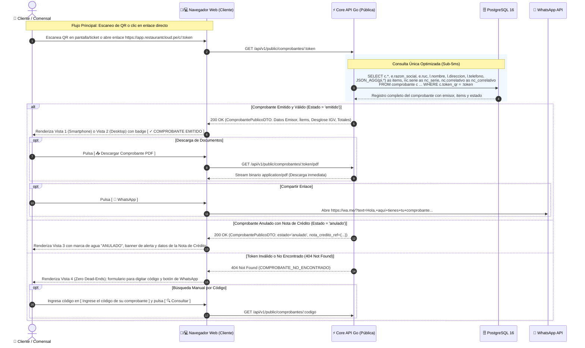
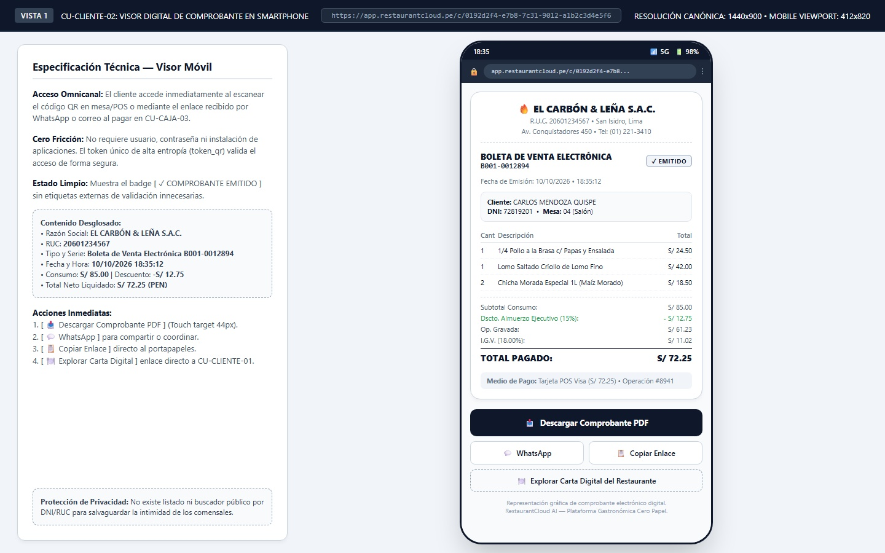
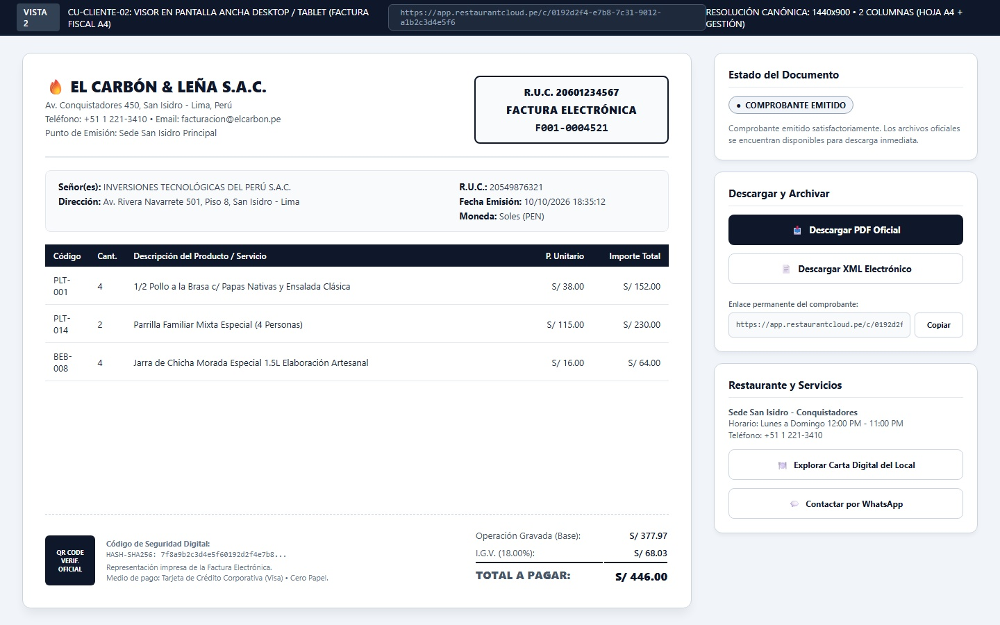
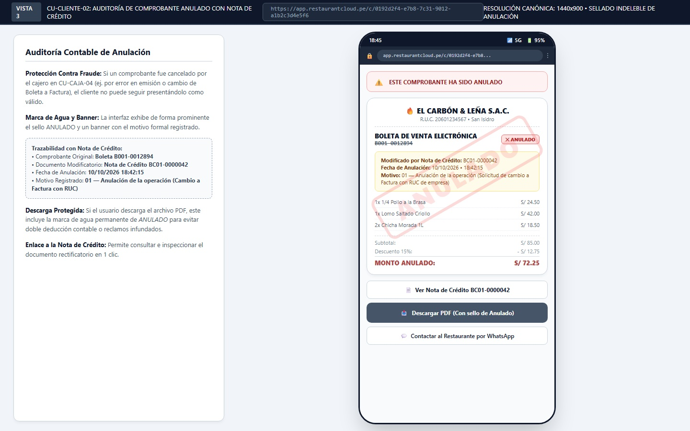
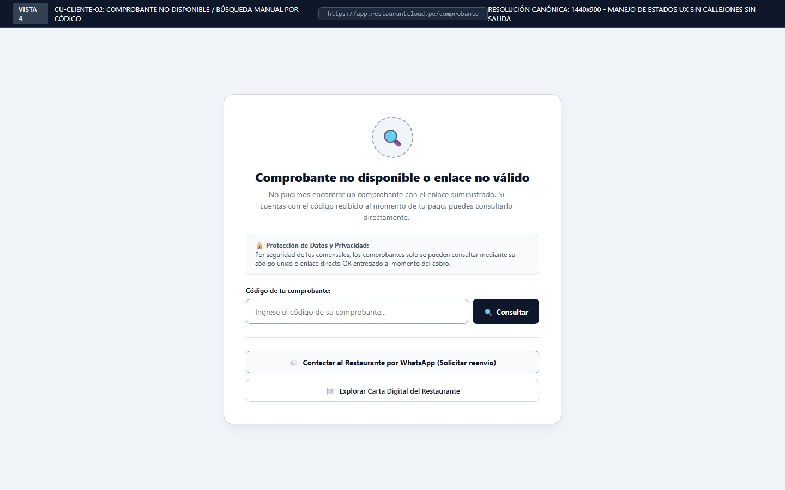

# Especificación Técnica y Wireframes: CU-CLIENTE-02: Buscar Comprobante de Pago

## 1. Ficha Técnica del Caso de Uso

| Atributo | Detalle |
| :--- | :--- |
| **Código** | `CU-CLIENTE-02` |
| **Nombre** | **Buscar comprobante de pago** (Visor Digital de Comprobantes Electrónicos) |
| **Rol / Actor** | **Cliente** (Comensal o Empresa adquiriente) |
| **Módulo** | Atención al Cliente & Facturación Electrónica Cero Papel |
| **Objetivo de Negocio** | Proveer una interfaz web pública, accesible sin registro ni inicio de sesión, para consultar y descargar la representación oficial en PDF y XML de boletas, facturas y notas de venta emitidas en [`CU-CAJA-03`](file:///j:/proyectos_git/RestaurantCloud_AI_backend/wireframe/cajero/CU-CAJA-03-cobrar-comanda/wireframe.md). |
| **Precondiciones** | Existe un comprobante registrado y emitido en caja con un identificador criptográfico único (`token_qr` UUID v8). |
| **Postcondiciones** | El cliente visualiza el comprobante, descarga el archivo PDF o XML, comparte el enlace directo o accede al catálogo digital de la sede ([`CU-CLIENTE-01`](file:///j:/proyectos_git/RestaurantCloud_AI_backend/wireframe/cliente/CU-CLIENTE-01-consultar-carta/wireframe.md)). Operación de solo lectura (idempotente). |
| **Tokens de Diseño** | Grayscale Blueprint: `#0F172A` (Primario), `#1E293B` (Superficie), `#FFFFFF` (Card), `#CBD5E1` (Bordes), `#475569` (Cuerpo), `#64748B` (Muted), `#EF4444` (Alerta Anulado). |
| **Resolución Canónica** | `1440x900` px (JPG calidad 95) • Viewport Mobile Smartphone: `412x820` px. |

### Reglas de Negocio y Políticas de Seguridad
1. **Acceso Seguro por Capability Token (Cero Login):**
   - El comensal accede directamente mediante la URL entregada en el código QR dinámico de la pantalla POS o enviada por WhatsApp/Email al momento de pagar: `https://app.restaurantcloud.pe/c/:token`.
   - El token (`token_qr`) es un UUID v8 temporalmente ordenado de alta entropía que actúa como llave de acceso única para ese comprobante específico.
2. **Estricta Privacidad y Anti-Scraping (Cero Búsqueda por DNI/RUC):**
   - Conforme a [`context/cu.md`](file:///j:/proyectos_git/RestaurantCloud_AI_backend/context/cu.md), **no existe ningún buscador público por DNI o RUC**. Esto imposibilita que atacantes o terceros descarguen o espíen el historial de consumos y gastos ajenos.
   - Si el usuario accede a `/comprobante` sin parámetros, la interfaz le solicita ingresar el código de comprobante entregado al momento del cobro.
3. **Formatos de Descarga Oficiales:**
   - `[ 📥 Descargar PDF ]`: Genera la representación impresa oficial con diseño adaptado a hoja A4 o ticket térmico digital.
   - `[ 📄 Descargar XML ]`: Descarga el archivo electrónico estructurado UBL 2.1 (relevante para facturas corporativas deducibles de impuestos).
4. **Auditoría de Comprobantes Anulados (`CU-CAJA-04`):**
   - Si el comprobante fue anulado mediante Nota de Crédito, la vista estampa una marca de agua indeleble "ANULADO", exhibe un banner superior de advertencia, muestra la referencia a la Nota de Crédito rectificatoria y genera el PDF con el sello permanente de anulación.
5. **Re-enganche Comercial Omnicanal:**
   - Se provee un botón directo `[ 🍽️ Explorar Carta Digital del Restaurante ]` que enlaza al catálogo interactivo de [`CU-CLIENTE-01`](file:///j:/proyectos_git/RestaurantCloud_AI_backend/wireframe/cliente/CU-CLIENTE-01-consultar-carta/wireframe.md) (`https://app.restaurantcloud.pe/sede/:slug/carta`), fomentando la recurrencia de visitas.

---

## 2. Diagrama de Secuencia Mermaid



---

## 3. Diagramación Wireframe ASCII y Guía de Microcopias

---

### 3.1 Vista 1: Visor Digital de Comprobante en Smartphone (`wf_cliente_02_comprobante_smartphone.jpg`)

Experiencia móvil principal (viewport 412x820) para el comensal que escanea el QR en mesa o pulsa el enlace recibido en su celular.

#### Distribución Estructural (Layout ASCII)
```text
+-----------------------------------------------------------------------------------+
|  [ Barra de Estado: 18:35 • 📶 5G 🔋 98% ]                                        |
|  [ 🔒 app.restaurantcloud.pe/c/0192d2f4-e7b8...                               ⋮ ]|
|-----------------------------------------------------------------------------------|
|                                                                                   |
|  +-----------------------------------------------------------------------------+  |
|  |                        🔥 EL CARBÓN & LEÑA S.A.C.                           |  |
|  |                 R.U.C. 20601234567 • San Isidro, Lima                       |  |
|  |                 Av. Conquistadores 450 • Tel: (01) 221-3410                 |  |
|  |-----------------------------------------------------------------------------|  |
|  |  BOLETA DE VENTA ELECTRÓNICA                          [ ✓ EMITIDO ]         |  |
|  |  B001-0012894                                                               |  |
|  |  Fecha de Emisión: 10/10/2026 • 18:35:12                                    |  |
|  |                                                                             |  |
|  |  +-----------------------------------------------------------------------+  |  |
|  |  | Cliente: CARLOS MENDOZA QUISPE                                        |  |  |
|  |  | DNI: 72819201 • Mesa: 04 (Salón)                                      |  |  |
|  |  +-----------------------------------------------------------------------+  |  |
|  |                                                                             |  |
|  |  Cant  Descripción                                                 Total    |  |
|  |  -------------------------------------------------------------------------  |  |
|  |  1     1/4 Pollo a la Brasa c/ Papas y Ensalada                    S/ 24.50 |  |
|  |  1     Lomo Saltado Criollo de Lomo Fino                           S/ 42.00 |  |
|  |  2     Chicha Morada Especial 1L (Maíz Morado)                     S/ 18.50 |  |
|  |  -------------------------------------------------------------------------  |  |
|  |  Subtotal Consumo:                                                 S/ 85.00 |  |
|  |  Dscto. Almuerzo Ejecutivo (15%):                                - S/ 12.75 |  |
|  |  Op. Gravada:                                                      S/ 61.23 |  |
|  |  I.G.V. (18.00%):                                                  S/ 11.02 |  |
|  |  TOTAL PAGADO:                                                     S/ 72.25 |  |
|  |                                                                             |  |
|  |  [ Medio de Pago: Tarjeta POS Visa (S/ 72.25) • Operación #8941 ]          |  |
|  +-----------------------------------------------------------------------------+  |
|                                                                                   |
|  [ 📥 Descargar Comprobante PDF ]                                                  |
|  [ 💬 WhatsApp ]  [ 📋 Copiar Enlace ]                                            |
|  [ 🍽️ Explorar Carta Digital del Restaurante ]                                     |
|                                                                                   |
|  Representación gráfica de comprobante electrónico digital.                       |
|  RestaurantCloud AI — Plataforma Gastronómica Cero Papel.                         |
+-----------------------------------------------------------------------------------+
```

#### Blueprint Visual — Vista 1


---

### 3.2 Vista 2: Visor en Pantalla Ancha Desktop / Tablet (`wf_cliente_02_comprobante_desktop.jpg`)

Formato formal en dos columnas (representación tipo Factura fiscal A4 a la izquierda y panel de descargas a la derecha) ideal para contabilidad, administración o computadoras.

#### Distribución Estructural (Layout ASCII)
```text
+------------------------------------------------------------------------------------------------------------------------------------+
| [ BLUEPRINT CU-CLIENTE-02: VISOR DESKTOP / TABLET ]  [ https://app.restaurantcloud.pe/c/0192d2f4... ]         [ CANÓNICA 1440x900 ]|
+------------------------------------------------------------------------------------------------------------------------------------+
|                                                                    |                                                               |
|  [ HOJA TRIBUTARIA A4 ]                                            |  [ PANEL LATERAL DE GESTIÓN Y DESCARGAS ]                     |
|                                                                    |                                                               |
|  🔥 EL CARBÓN & LEÑA S.A.C.           +-------------------------+  |  +---------------------------------------------------------+  |
|  Av. Conquistadores 450, San Isidro   | R.U.C. 20601234567      |  |  | Estado del Documento                                    |  |
|  Lima, Perú • Tel: +51 1 221-3410     | FACTURA ELECTRÓNICA     |  |  | [ ● COMPROBANTE EMITIDO ]                               |  |
|  Email: facturacion@elcarbon.pe       | F001-0004521            |  |  | Comprobante emitido satisfactoriamente. Archivos listos.|  |
|                                       +-------------------------+  |  +---------------------------------------------------------+  |
|                                                                    |                                                               |
|  +--------------------------------------------------------------+  |  +---------------------------------------------------------+  |
|  | Señor(es): INVERSIONES TECNOLÓGICAS DEL PERÚ S.A.C.          |  |  | Descargar y Archivar                                    |  |
|  | R.U.C.: 20549876321 • Fecha Emisión: 10/10/2026 18:35:12      |  |  | [ 📥 Descargar PDF Oficial ]                            |  |
|  | Dirección: Av. Rivera Navarrete 501, Piso 8, San Isidro      |  |  | [ 📄 Descargar XML Electrónico ]                         |  |
|  +--------------------------------------------------------------+  |  | Enlace permanente:                                      |  |
|                                                                    |  | [ https://app.restaurantcloud.pe/c/...  ] [ Copiar ]    |  |
|  Código   Cant  Descripción                     P. Unit   Importe  |  +---------------------------------------------------------+  |
|  ----------------------------------------------------------------  |                                                               |
|  PLT-001  4     1/2 Pollo a la Brasa c/ Papas   S/ 38.00  S/ 152.00|  +---------------------------------------------------------+  |
|  PLT-014  2     Parrilla Familiar Mixta (4 p.)  S/ 115.00 S/ 230.00|  | Restaurante y Servicios                                 |  |
|  BEB-008  4     Jarra Chicha Morada 1.5L        S/ 16.00  S/  64.00|  | Sede San Isidro - Conquistadores                        |  |
|  ----------------------------------------------------------------  |  | Horario: Lun - Dom 12:00 PM - 11:00 PM                   |  |
|                                                                    |  | [ 🍽️ Explorar Carta Digital del Local ]                 |  |
|  [QR] Código de Seguridad Digital:              Op. Gravada: S/377.97 | [ 💬 Contactar por WhatsApp ]                           |  |
|       HASH-SHA256: 7f8a9b2c3d4e5f6...           I.G.V. 18%:  S/ 68.03|  +---------------------------------------------------------+  |
|       Medio de pago: Tarjeta de Crédito         TOTAL:       S/446.00 |                                                               |
+------------------------------------------------------------------------------------------------------------------------------------+
```

#### Blueprint Visual — Vista 2


---

### 3.3 Vista 3: Auditoría de Comprobante Anulado con Nota de Crédito (`wf_cliente_02_comprobante_anulado.jpg`)

Garantía de transparencia y control cuando el comprobante fue anulado en [`CU-CAJA-04`](file:///j:/proyectos_git/RestaurantCloud_AI_backend/wireframe/cajero/CU-CAJA-04-anular-comprobante/wireframe.md).

#### Distribución Estructural (Layout ASCII)
```text
+-----------------------------------------------------------------------------------+
|  [ Barra de Estado: 18:45 • 📶 5G 🔋 95% ]                                        |
|  [ 🔒 app.restaurantcloud.pe/c/0192d2f4-e7b8...                               ⋮ ]|
|-----------------------------------------------------------------------------------|
|                                                                                   |
|  +-----------------------------------------------------------------------------+  |
|  | [ ⚠️ ] ESTE COMPROBANTE HA SIDO ANULADO                                     |  |
|  +-----------------------------------------------------------------------------+  |
|                                                                                   |
|  +-----------------------------------------------------------------------------+  |
|  |                           <<<  A N U L A D O  >>>                           |  |
|  |                                                                             |  |
|  |  🔥 EL CARBÓN & LEÑA S.A.C.                                                 |  |
|  |  BOLETA DE VENTA ELECTRÓNICA                          [ ✕ ANULADO ]         |  |
|  |  ~B001-0012894~                                                             |  |
|  |                                                                             |  |
|  |  +-----------------------------------------------------------------------+  |  |
|  |  | Modificado por Nota de Crédito: BC01-0000042                          |  |  |
|  |  | Fecha de Anulación: 10/10/2026 • 18:42:15                              |  |  |
|  |  | Motivo: 01 — Anulación de la operación (Cambio a Factura con RUC)     |  |  |
|  |  +-----------------------------------------------------------------------+  |  |
|  |                                                                             |  |
|  |  1x 1/4 Pollo a la Brasa                                           S/ 24.50 |  |
|  |  1x Lomo Saltado Criollo                                           S/ 42.00 |  |
|  |  2x Chicha Morada 1L                                               S/ 18.50 |  |
|  |  Subtotal: S/ 85.00  •  Descuento 15%: - S/ 12.75                           |  |
|  |  MONTO ANULADO:                                                    S/ 72.25 |  |
|  +-----------------------------------------------------------------------------+  |
|                                                                                   |
|  [ 📄 Ver Nota de Crédito BC01-0000042 ]                                          |
|  [ 📥 Descargar PDF (Con sello de Anulado) ]                                      |
|  [ 💬 Contactar al Restaurante por WhatsApp ]                                     |
+-----------------------------------------------------------------------------------+
```

#### Blueprint Visual — Vista 3


---

### 3.4 Vista 4: Token Inválido o No Encontrado / Búsqueda Manual (`wf_cliente_02_token_invalido.jpg`)

Manejo de estados UX sin callejones sin salida (Zero Dead-Ends) cuando el enlace no existe, está corrupto o el cliente ingresa manualmente sin parámetros.

#### Distribución Estructural (Layout ASCII)
```text
+-----------------------------------------------------------------------------------+
|  [ BLUEPRINT CU-CLIENTE-02 ]  [ https://app.restaurantcloud.pe/comprobante ]      |
+-----------------------------------------------------------------------------------+
|                                                                                   |
|                    +-----------------------------------------+                    |
|                    |                  ( 🔍 )                 |                    |
|                    |                                         |                    |
|                    |   Comprobante no disponible o enlace   |                    |
|                    |               no válido                 |                    |
|                    |                                         |                    |
|                    |  No pudimos encontrar un comprobante    |                    |
|                    |  con el enlace suministrado. Si cuentas |                    |
|                    |  con el código recibido al pagar,       |                    |
|                    |  puedes consultarlo directamente.       |                    |
|                    |                                         |                    |
|                    |  +-----------------------------------+  |                    |
|                    |  | 🔒 Protección de Datos:           |  |                    |
|                    |  | Por seguridad de los comensales,  |  |                    |
|                    |  | los comprobantes solo se consultan|  |                    |
|                    |  | mediante su código único o enlace.|  |                    |
|                    |  +-----------------------------------+  |                    |
|                    |                                         |                    |
|                    |  Código de tu comprobante:              |                    |
|                    |  +-----------------------------+-------+|                    |
|                    |  | Ingrese el código...        | 🔍    ||                    |
|                    |  +-----------------------------+-------+|                    |
|                    |  -------------------------------------  |                    |
|                    |  [ 💬 Contactar por WhatsApp ]          |                    |
|                    |  [ 🍽️ Explorar Carta Digital ]          |                    |
|                    +-----------------------------------------+                    |
|                                                                                   |
+-----------------------------------------------------------------------------------+
```

#### Blueprint Visual — Vista 4


---

## 4. Matriz de Control de Acceso Basado en Roles (RBAC)

| Capacidad / Endpoint | `anonimo` (Público) | `cajero` | `admin_local` | `propietario` |
| :--- | :---: | :---: | :---: | :---: |
| Consultar comprobante por token (`GET /public/comprobantes/:token`) | ✅ Permitido | ✅ Permitido | ✅ Permitido | ✅ Permitido |
| Descargar PDF de comprobante (`GET /public/comprobantes/:token/pdf`) | ✅ Permitido | ✅ Permitido | ✅ Permitido | ✅ Permitido |
| Descargar XML electrónico (`GET /public/comprobantes/:token/xml`) | ✅ Permitido | ✅ Permitido | ✅ Permitido | ✅ Permitido |
| Consultar comprobante por ID interno (`GET /caja/comprobantes/:id`) | ❌ Bloqueado | ✅ Permitido | ✅ Permitido | ✅ Permitido |
| Anular comprobante con Nota de Crédito (`POST /caja/comprobantes/:id/anular`)| ❌ Bloqueado | ✅ Permitido | ✅ Permitido | ❌ Bloqueado |

> **Nota de Seguridad:** Los endpoints públicos `/api/v1/public/comprobantes/*` no exigen cabecera `Authorization: Bearer`. Aplican una directiva de **Rate Limiting** por dirección IP en Redis (`30 peticiones / minuto`) para prevenir abusos de fuerza bruta sobre códigos o tokens.

---

## 5. Contratos de API Go y DTOs (`internal/domain/cliente/comprobante_dto.go`)

```go
package cliente

import (
	"time"
	"github.com/google/uuid"
)

// ComprobantePublicoDTO payload consolidado devuelto en GET /api/v1/public/comprobantes/:token
type ComprobantePublicoDTO struct {
	Token          uuid.UUID                  `json:"token"`
	Tipo           string                     `json:"tipo"`             // 'boleta', 'factura', 'nota_venta'
	TipoLabel      string                     `json:"tipo_label"`       // 'Boleta de Venta Electrónica', 'Factura Electrónica'
	Serie          string                     `json:"serie"`            // 'B001', 'F001', 'NV01'
	Correlativo    int                        `json:"correlativo"`      // 12894
	SerieNumero    string                     `json:"serie_numero"`     // 'B001-0012894'
	FechaEmision   time.Time                  `json:"fecha_emision"`
	Estado         string                     `json:"estado"`           // 'emitido', 'anulado'
	HashSeguridad  string                     `json:"hash_seguridad"`   // Hash digital de comprobante
	
	// Datos del Restaurante Emisor
	Emisor         EmisorComprobanteDTO       `json:"emisor"`
	
	// Datos del Comensal / Adquiriente
	Cliente        ClienteComprobanteDTO      `json:"cliente"`
	
	// Desglose de Productos
	Items          []ItemComprobanteDTO       `json:"items"`
	
	// Liquidación Financiera
	Totales        LiquidacionComprobanteDTO  `json:"totales"`
	
	// Pago Registrado
	Pago           PagoComprobanteDTO         `json:"pago"`
	
	// Auditoría de Anulación (Solo si Estado == 'anulado')
	NotaCredito    *NotaCreditoReferenciaDTO  `json:"nota_credito,omitempty"`
	
	// Enlaces de Re-enganche
	URLCartaDigital string                    `json:"url_carta_digital"` // https://app.restaurantcloud.pe/sede/:slug/carta
}

type EmisorComprobanteDTO struct {
	RazonSocial  string `json:"razon_social"` // "EL CARBÓN & LEÑA S.A.C."
	RUC          string `json:"ruc"`          // "20601234567"
	LocalNombre  string `json:"local_nombre"` // "Sede San Isidro - Conquistadores"
	Direccion    string `json:"direccion"`    // "Av. Conquistadores 450"
	Distrito     string `json:"distrito"`     // "San Isidro"
	Ciudad       string `json:"ciudad"`       // "Lima"
	Telefono     string `json:"telefono"`     // "+51 1 221-3410"
	SlugSede     string `json:"slug_sede"`    // "san-isidro-conquistadores"
}

type ClienteComprobanteDTO struct {
	Nombre         string  `json:"nombre"`          // "CARLOS MENDOZA QUISPE"
	TipoDocumento  *string `json:"tipo_documento"`  // 'DNI', 'RUC' (null en consumo sin doc)
	NumeroDocumento *string `json:"numero_documento"`// "72819201"
	Direccion      *string `json:"direccion"`       // Dirección fiscal si es Factura
}

type ItemComprobanteDTO struct {
	Cantidad       int     `json:"cantidad"`
	Descripcion    string  `json:"descripcion"`
	PrecioUnitario float64 `json:"precio_unitario"`
	ImporteTotal   float64 `json:"importe_total"`
}

type LiquidacionComprobanteDTO struct {
	SubtotalConsumo float64 `json:"subtotal_consumo"`
	Descuento       float64 `json:"descuento"`
	DescuentoMotivo *string `json:"descuento_motivo"` // "Almuerzo Ejecutivo (15%)"
	BaseImponible   float64 `json:"base_imponible"`   // Operación Gravada
	IGV             float64 `json:"igv"`              // 18.00%
	MontoRecargo    float64 `json:"monto_recargo"`
	TotalNeto       float64 `json:"total_neto"`       // Soles (PEN)
}

type PagoComprobanteDTO struct {
	MetodoNombre  string   `json:"metodo_nombre"`   // "Tarjeta POS", "Efectivo", "Yape"
	MontoRecibido *float64 `json:"monto_recibido"`  // Efectivo
	Vuelto        *float64 `json:"vuelto"`          // Efectivo
}

type NotaCreditoReferenciaDTO struct {
	SerieNumero   string    `json:"serie_numero"`   // "BC01-0000042"
	Fecha         time.Time `json:"fecha"`
	MotivoCodigo  string    `json:"motivo_codigo"`  // "01"
	MotivoTexto   string    `json:"motivo_texto"`   // "Anulación de la operación"
	Sustento      string    `json:"sustento"`       // "Comensal solicitó cambio a Factura con RUC"
	URLPublica    string    `json:"url_publica"`    // Enlace directo a la nota de crédito
}
```

---

## 6. Matriz de Estados UX (5 Estados Canónicos)

| Estado | Vista 1: Smartphone | Vista 2: Desktop | Vista 3: Anulado | Vista 4: No Encontrado |
| :--- | :--- | :--- | :--- | :--- |
| **1. Ideal (Happy Path)** | Ticket digital renderizado, totales en Soles, botones `[ Descargar PDF ]`, `[ WhatsApp ]` y enlace a carta. | Factura formal A4 en pantalla ancha con opciones de descarga de PDF y XML oficial. | Muestra comprobante original con sello de agua `ANULADO`, tarjeta de Nota de Crédito y PDF sellado. | Input listo para escribir el código y botón de WhatsApp hacia el restaurante. |
| **2. Vacío (Empty State)** | N/A (el comprobante siempre tiene al menos 1 ítem cobrado). | N/A. | N/A. | Usuario abre `/comprobante` sin código: muestra pantalla orientadora y buscador manual. |
| **3. Carga (Loading)** | Skeleton animado del ticket mientras resuelve `GET /public/comprobantes/:token`. | Skeleton animado de la hoja A4 y del sidebar de descargas. | Skeleton animado con banner placeholder de alerta. | Spinner en botón `[ 🔍 Consultar ]`: *"Buscando comprobante..."*. |
| **4. Error / Validación** | Error de red: *"No pudimos cargar el comprobante. [Reintentar]"*. | Error de red: botón para recargar la hoja del comprobante. | Si falla la descarga del PDF: *"Error al generar archivo PDF sellado. Reintente"*. | Código ingresado no existe en BD: mensaje *"No encontramos ningún comprobante con ese código"*. |
| **5. Borde / Inesperado** | Intento de descarga en red lenta: stream progresivo con cabecera `Content-Disposition`. | Si el comprobante es Nota de Venta (no factura): botón XML se oculta elegantemente. | Comprobante modificado por múltiples notas de ajuste: lista todas las notas de crédito vinculadas. | Ataque de fuerza bruta (más de 30 consultas/min): Error `429 Too Many Requests` con cooldown de 60s. |

---

## 7. Consideraciones Técnicas y DDL PostgreSQL

1. **Consulta SQL Agrupada de Alto Rendimiento (Sub-5ms):**
   ```sql
   SELECT 
       c.id, c.token_qr, c.tipo, c.serie, c.correlativo, c.fecha, c.estado,
       c.subtotal_consumo, c.descuento, c.base_imponible, c.igv, c.total,
       c.nombre_cliente, c.documento_cliente, c.medio_pago, c.monto_recibido, c.vuelto,
       json_build_object(
           'razon_social', emp.razon_social,
           'ruc', emp.ruc,
           'local_nombre', loc.nombre,
           'direccion', loc.direccion,
           'distrito', loc.distrito,
           'telefono', loc.telefono,
           'slug_sede', loc.slug
       ) AS emisor,
       (
           SELECT json_agg(json_build_object(
               'cantidad', pi.cantidad,
               'descripcion', pr.nombre,
               'precio_unitario', pi.precio_unitario,
               'importe_total', (pi.cantidad * pi.precio_unitario)
           ))
           FROM pedido_item pi
           JOIN producto pr ON pr.id = pi.producto_id
           WHERE pi.pedido_id = c.pedido_id AND pi.estado <> 'anulado'
       ) AS items
   FROM comprobante c
   JOIN caja caj ON caj.id = c.caja_id
   JOIN local loc ON loc.id = caj.local_id
   JOIN empresa emp ON emp.id = loc.empresa_id
   WHERE c.token_qr = $1;
   ```

2. **Índice B-Tree Dedicado para Resolución Inmediata:**
   ```sql
   CREATE UNIQUE INDEX IF NOT EXISTS idx_comprobante_token_qr ON comprobante(token_qr);
   ```
   Garantiza que la búsqueda por capability token se resuelva mediante un *Index Scan* en menos de 0.5 milisegundos en PostgreSQL, soportando miles de comensales escaneando simultáneamente en horas punta.

3. **Rate Limiting Anti-Scraping en Redis:**
   - Llave: `ratelimit:public:comprobante:{ip_comensal}`
   - Límite: 30 peticiones por ventana deslizante de 60 segundos.
   - Previene recolección masiva de comprobantes.

---

## 8. Criterios de Accesibilidad (WCAG 2.1 AA)

1. **Ratios de Contraste Tipográfico:**
   - Texto principal `#0F172A` sobre fondo blanco `#FFFFFF`: **14.8:1** (supera con holgura el mínimo de 4.5:1).
   - Textos secundarios `#475569` sobre `#F8FAFC`: **6.3:1**.
   - Badge de anulación `#B91C1C` sobre `#FEE2E2`: **5.1:1**.
2. **Dimensiones de Controles Táctiles (Touch Targets):**
   - El botón principal `[ 📥 Descargar Comprobante PDF ]` y botones de acción cuentan con una altura mínima de **44px a 48px** y espaciado mínimo de 8px, garantizando uso cómodo en pantallas táctiles con una sola mano.
3. **Semántica y Atributos ARIA:**
   - Estructura de encabezados jerárquicos `<h1>`, `<h2>`, `<h3>` sin saltos de nivel.
   - Región del comprobante marcada con `role="region"` y `aria-label="Comprobante electrónico"`.
   - Banner de anulación provisto con `role="alert"` y `aria-live="assertive"` para advertir de inmediato a usuarios de tecnologías asistivas.
