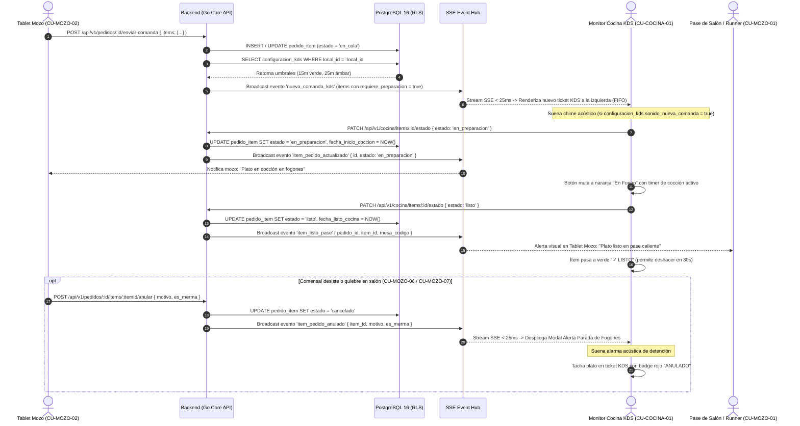
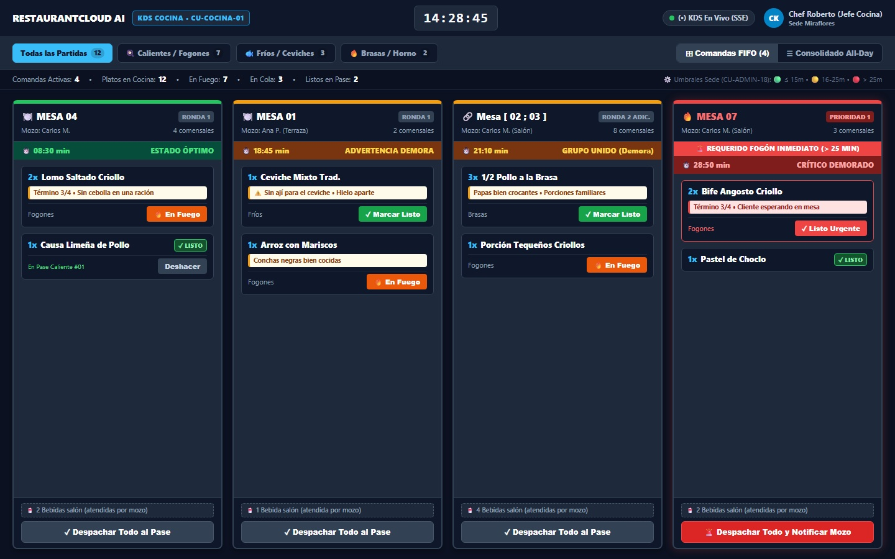
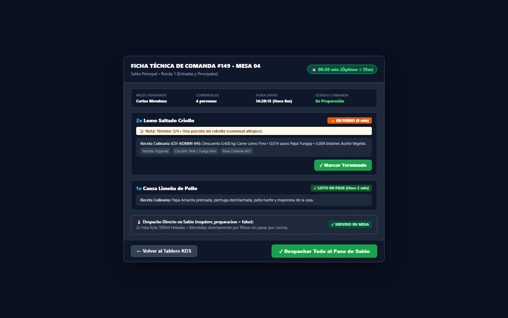
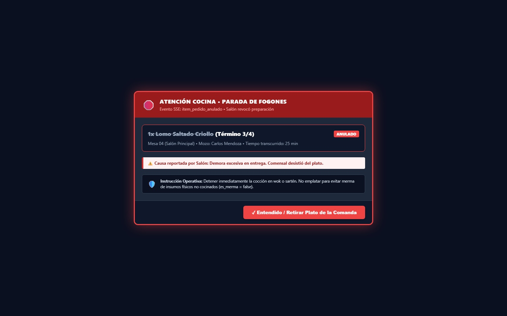
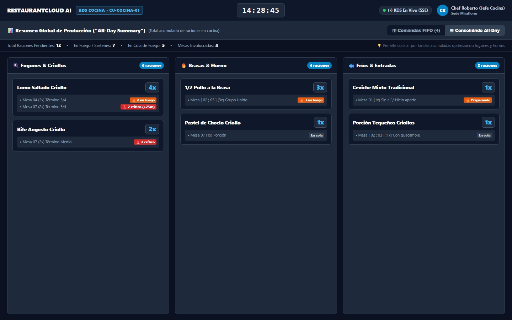

# CU-COCINA-01: Ver Cola de Pedidos Entrantes (KDS)

Especificación técnica de interfaz de usuario, arquitectura de información, control de acceso basado en roles (RBAC), sincronización reactiva en tiempo real (Server-Sent Events) y contratos de API Go en **RestaurantCloud AI**.

---

## 1. Ficha Técnica del Caso de Uso

| Atributo | Detalle |
| :--- | :--- |
| **Código CU** | `CU-COCINA-01` |
| **Nombre** | Ver cola de pedidos entrantes (Kitchen Display System - KDS) |
| **Actor(es)** | `cocina` (Cocinero, Jefe de Cocina, Maestro Parrillero, Chef de Partida) |
| **Dispositivo / Viewport** | Monitor táctil industrial de cocina / Pantalla KDS de pared (`1440x900` horizontal oscuro) |
| **Precondición** | El local está activo; el usuario cuenta con sesión autenticada con rol `cocina` asignado a la sede (`local_id`); existen pedidos enviados desde salón (`CU-MOZO-02`) con ítems culinarios pendientes de preparación. |
| **Postcondición** | La brigada de cocina visualiza y gestiona las órdenes de comanda en estricto orden cronológico (FIFO); cada comanda refleja su semáforo cromático dinámico basado en los umbrales configurados por el administrador (`CU-ADMIN-18`); las bebidas y productos directos de salón son filtrados automáticamente de los fogones (`pr.requiere_preparacion = true`); los cambios de estado en cocina ("En Fuego", "Listo") se sincronizan en tiempo real con salón (`CU-MOZO-01`) y caja vía Server-Sent Events (SSE). |

---

## 2. Diagrama de Flujo y Secuencia en Tiempo Real (SSE)



---

## 3. Especificación de Pantallas y Wireframes Blueprint

### Vista 1: Tablero KDS de Comandas en Vivo (`wf_cocina_01_tablero_kds_comandas.jpg`)

Pantalla principal en formato horizontal (`1440x900`). Estructurada con cabecera oscura KDS (`#0B1120`), barra de métricas operativas y una rejilla fluida de 4 columnas de tickets FIFO con semáforo cromático dinámico adaptado a la configuración de la sede (`CU-ADMIN-18`).



#### Layout Estructural ASCII (Desktop / KDS Industrial 1440x900)
```text
+------------------------------------------------------------------------------------------------------------------------------------------------------+
| RESTAURANTCLOUD AI   [ KDS COCINA • CU-COCINA-01 ]          [ 14:28:45 ]             (•) KDS En Vivo (SSE)   [ CK ] Chef Roberto (Jefe Cocina)       |
+------------------------------------------------------------------------------------------------------------------------------------------------------+
| [ Todas las Partidas (12) ]  [ 🍳 Calientes/Fogones (7) ]  [ 🐟 Fríos/Ceviches (3) ]  [ 🔥 Brasas/Horno (2) ]     [ ⊞ Comandas FIFO (4) ] [ ☰ Consolidado]|
|------------------------------------------------------------------------------------------------------------------------------------------------------|
| Comandas Activas: 4  •  Platos en Cocina: 12  •  En Fuego: 7  •  En Cola: 3  •  Listos en Pase: 2      ⚙️ Umbrales Sede (CU-ADMIN-18): 🟢 <=15m 🟡16-25m 🔴>25m|
+------------------------------------------------------------------------------------------------------------------------------------------------------+
| COLUMNA 1 (ÓPTIMO <=15m)       | COLUMNA 2 (ALERTA 16-25m)      | COLUMNA 3 (GRUPO UNIDO 16-25m) | COLUMNA 4 (CRÍTICO > 25m)                            |
| +----------------------------+ | +----------------------------+ | +----------------------------+ | +----------------------------+                       |
| | 🍽️ MESA 04        [RONDA 1]| | | 🍽️ MESA 01        [RONDA 1]| | | 🔗 Mesa [ 02 ; 03 ][RONDA 2 ADIC]| | 🔥 MESA 07         [PRIORIDAD 1]|                     |
| | Mozo: Carlos M.  4 comens. | | | Mozo: Ana P.     2 comens. | | | Mozo: Carlos M.  8 comens. | | | Mozo: Carlos M.   3 comens.  |                     |
| | ⏱️ 08:30 min  ESTADO ÓPTIMO | | | ⏱️ 18:45 min  ADVERTENCIA   | | | ⏱️ 21:10 min  GRUPO UNIDO   | | | 🚨 REQUERIDO FOGÓN INMEDIATO (>25m)              |
| |----------------------------| | |----------------------------| | |----------------------------| | | ⏱️ 28:50 min CRÍTICO DEMORADO |                      |
| | 2x Lomo Saltado Criollo    | | | 1x Ceviche Mixto Trad.     | | | 3x 1/2 Pollo a la Brasa    | | |----------------------------|                      |
| | [Término 3/4 • Sin cebolla]| | | [⚠️ Sin ají • Hielo aparte]| | | [Papas crocantes • Fami...]| | | 2x Bife Angosto Criollo    |                      |
| | Fogones         [🔥En Fuego]| | | Fríos        [✓Marcar Listo]| | | Brasas       [✓Marcar Listo]| | | [Término 3/4 • Cliente esp]|                      |
| |                            | | |                            | | |                            | | | Fogones       [✓Listo Urg.]|                      |
| | 1x Causa Limeña de Pollo   | | | 1x Arroz con Mariscos      | | | 1x Porción Tequeños Crioll.| | |                            |                      |
| | Pase Caliente #01 [✓LISTO] | | | [Conchas negras cocidas]   | | | Fogones        [🔥En Fuego]| | | 1x Pastel de Choclo [✓LISTO]|                      |
| | [ Deshacer ]               | | | Fogones        [🔥En Fuego]| | |                            | | |                            |                      |
| |----------------------------| | |----------------------------| | |----------------------------| | |----------------------------|                      |
| | 🥤 2 Bebidas (atend. mozo) | | | 🥤 1 Bebida (atend. mozo)  | | | 🥤 4 Bebidas (atend. mozo) | | | 🥤 2 Bebidas (atend. mozo) |                      |
| | [ ✓ Despachar Todo al Pase]| | | [ ✓ Despachar Todo al Pase]| | | [ ✓ Despachar Todo al Pase]| | | [ 🚨 Despachar y Notificar Mozo ]                   |
| +----------------------------+ | +----------------------------+ | +----------------------------+ | +----------------------------+                       |
+------------------------------------------------------------------------------------------------------------------------------------------------------+
```

#### Elementos Visuales y Funcionalidades
1. **Reloj Digital y Conexión SSE en Vivo:** Header persistente con hora en formato `HH:MM:SS` sincronizada con NTP y estado de conexión SSE (`(•) KDS En Vivo`).
2. **Filtrado por Partida Culinaria en 1 Toque:** Pestañas superiores para filtrar la pantalla por especialidad (`Todas`, `Calientes/Fogones`, `Fríos/Cevichería`, `Brasas/Horno`), permitiendo ubicar monitores dedicados en distintas zonas de la cocina.
3. **Semáforo Cromático Basado en `configuracion_kds` (`CU-ADMIN-18`):**
   - 🟢 **Verde (<= 15 min):** Borde y cabecera verde esmeralda (`#22C55E`), tiempo en ritmo estándar de despacho.
   - 🟡 **Ámbar (16 a 25 min):** Borde y cabecera ámbar (`#F59E0B`), comanda con demora moderada.
   - 🔴 **Rojo Crítico (> 25 min):** Borde y cabecera rojo fuego (`#EF4444`), comanda demorada con botón prioritario rojo y alerta visual de requerimiento inmediato.
4. **Tratamiento de Mesas Agrupadas (`CU-MOZO-04`):** Presentación unificada `Mesa [ 02 ; 03 ]` con icono de enlace `🔗`, permitiendo a cocina emplatar en simultáneo todas las raciones del grupo.
5. **Indicador de Rondas de Salón:** Diferenciación entre `Ronda 1` y `Ronda 2 (Adicionales)`, garantizando que entradas y principales se secuencien adecuadamente.
6. **Chip de Bebidas de Salón:** Chip informativo inferior (`🥤 X Bebidas atendidas por mozo`) que visibiliza si los comensales ya tienen bebidas servidas sin contaminar la lista de sartenes de cocina.
7. **Acciones Táctiles en Fogón:** Botón `[ 🔥 En Fuego ]` para iniciar cocción y `[ ✓ Marcar Listo ]` para mover el plato al pase caliente, con opción de `[ Deshacer ]` en 30 segundos ante toques accidentales.

---

### Vista 2: Modal de Detalle Ampliado de Comanda (`wf_cocina_01_modal_detalle_comanda.jpg`)

Diálogo modal de inspección técnica profunda (`680px`), desplegado al tocar cualquier parte de una tarjeta de comanda en el tablero. Permite revisar recetas de insumos asociados, notas de alérgenos y despachar la comanda íntegra en un solo toque.



#### Layout Estructural ASCII (Modal 680px)
```text
+-----------------------------------------------------------------------------------------+
| FICHA TÉCNICA DE COMANDA #149 • MESA 04                         [ ⏱️ 08:30 min (Óptimo) ]|
| Salón Principal • Ronda 1 (Entradas y Principales)                                      |
|-----------------------------------------------------------------------------------------|
| MOZO ASIGNADO        COMENSALES            HORA ENVÍO               ESTADO COMANDA      |
| Carlos Mendoza       4 personas            14:20:15 (Hace 8m)       En Preparación      |
|-----------------------------------------------------------------------------------------|
| [ 2x Lomo Saltado Criollo ]                                         [ 🔥 EN FUEGO (6m) ]|
| 📝 Nota: Término 3/4 • Una porción sin cebolla (comensal alérgico).                     |
| --------------------------------------------------------------------------------------- |
| Receta Culinaria (CU-ADMIN-04): Descuenta 0.400 kg Carne Lomo Fino • 0.014 sacos Papa   |
| Yungay • 0.004 bidones Aceite Vegetal.                                                  |
| Partida: Fogones  |  Cocción: Wok / Fuego Alto  |  Pase: Caliente #01                   |
|                                                                 [ ✓ Marcar Terminado ]  |
|-----------------------------------------------------------------------------------------|
| [ 1x Causa Limeña de Pollo ]                                    [ ✓ LISTO EN PASE (2m) ]|
| Receta Culinaria: Papa Amarilla prensada, pechuga deshilachada, palta y mayonesa casa. |
|-----------------------------------------------------------------------------------------|
| 🥤 Despacho Directo en Salón (requiere_preparacion = false):                            |
| 2x Inka Kola 500ml Heladas • Atendidas directamente por Mozo sin pasar por cocina.      |
|                                                                     [ ✓ SERVIDO EN MESA]|
|-----------------------------------------------------------------------------------------|
| [ ← Volver al Tablero KDS ]                       [ ✓ Despachar Todo al Pase de Salón ] |
+-----------------------------------------------------------------------------------------+
```

#### Funcionalidades Clave
1. **Trazabilidad de Receta e Inventario (`CU-ADMIN-04`):** Muestra los insumos reales descontados de inventario (`insumo.unidad_medida` limpia) para verificación de porciones ante dudas del cocinero.
2. **Resaltado de Alérgenos y Notas Críticas:** Caja de nota en fondo crema claro (`#FEF3C7`) con tipografía bold contrastada para prevenir errores en comensales alérgicos o intolerantes.
3. **Despacho Masivo en 1 Toque:** Botón verde esmeralda `[ ✓ Despachar Todo al Pase de Salón ]` que marca todos los platos pendientes como listos y notifica simultáneamente al runner de salón.

---

### Vista 3: Alerta Reactiva de Parada de Fogones (`wf_cocina_01_alerta_anulacion_kds.jpg`)

Modal de alta prioridad con borde rojo pulsante y efecto backdrop oscuro, disparado automáticamente vía SSE cuando un mozo o administrador cancela un plato en salón (`CU-MOZO-06` / `CU-MOZO-07`).



#### Layout Estructural ASCII (Modal Alerta 620px)
```text
+-----------------------------------------------------------------------------------------+
| 🛑 ATENCIÓN COCINA • PARADA DE FOGONES                                                  |
| Evento SSE: item_pedido_anulado • Salón revocó preparación                              |
|-----------------------------------------------------------------------------------------|
| ~~1x Lomo Saltado Criollo~~ (Término 3/4)                                    [ ANULADO ]|
| Mesa 04 (Salón Principal) • Mozo: Carlos Mendoza • Tiempo transcurrido: 25 min          |
|-----------------------------------------------------------------------------------------|
| ⚠️ Causa reportada por Salón: Demora excesiva en entrega. Comensal desistió del plato.  |
|-----------------------------------------------------------------------------------------|
| 🛡️ Instrucción Operativa: Detener inmediatamente la cocción en wok o sartén. No emplatar|
| para evitar merma de insumos físicos no cocinados (es_merma = false).                   |
|-----------------------------------------------------------------------------------------|
|                                     [ ✓ Entendido / Retirar Plato de la Comanda ]       |
+-----------------------------------------------------------------------------------------+
```

#### Funcionalidades Clave
1. **Freno Inmediato de Merma:** Previene que la cocina culmine la cocción o emplate un pedido ya rechazado por el cliente en mesa.
2. **Claridad de Causa Operativa:** Explica al cocinero por qué se retiró el plato (demora, equivocación de mesa o insumo agotado).
3. **Acuse Táctil Obligatorio:** Requiere tocar `[ ✓ Entendido / Retirar Plato de la Comanda ]` para desbloquear la pantalla y silenciar el timbre de alerta.

---

### Vista 4: Consolidado de Producción en Vivo ("All-Day Summary" - `wf_cocina_01_consolidado_produccion_all_day.jpg`)

Vista alternativa especializada para el Jefe de Cocina o fogonero principal, activada desde la pestaña superior `[ ☰ Consolidado All-Day ]`. Agrupa y suma la cantidad total de raciones pendientes por plato en todo el restaurante.



#### Layout Estructural ASCII (Desktop 1440x900)
```text
+------------------------------------------------------------------------------------------------------------------------------------------------------+
| RESTAURANTCLOUD AI   [ KDS COCINA • CU-COCINA-01 ]          [ 14:28:45 ]             (•) KDS En Vivo (SSE)   [ CK ] Chef Roberto (Jefe Cocina)       |
+------------------------------------------------------------------------------------------------------------------------------------------------------+
| 📊 Resumen Global de Producción ("All-Day Summary") (Total acumulado de raciones en cocina)     [ ⊞ Comandas FIFO (4) ] [ ☰ Consolidado All-Day (Activo)]|
|------------------------------------------------------------------------------------------------------------------------------------------------------|
| Total Raciones Pendientes: 12  •  En Fuego / Sartenes: 7  •  En Cola de Fuego: 5  •  Mesas Involucradas: 4   💡 Permite cocinar por tandas acumuladas|
+------------------------------------------------------------------------------------------------------------------------------------------------------+
| PARTIDA 1: FOGONES & CRIOLLOS (6 raciones)     | PARTIDA 2: BRASAS & HORNO (4 raciones)       | PARTIDA 3: FRÍOS & ENTRADAS (2 raciones)             |
| +--------------------------------------------+ | +------------------------------------------+ | +--------------------------------------------------+ |
| | Lomo Saltado Criollo                 [ 4x ]| | | 1/2 Pollo a la Brasa               [ 3x ]| | | Ceviche Mixto Tradicional                 [ 1x ]| |
| | • Mesa 04 (2x) Término 3/4       [2 fuego] | | | • Mesa [ 02 ; 03 ] (3x) Grupo    [3 fuego]| | | • Mesa 01 (1x) Sin ají / Hielo aparte [Preparando]| |
| | • Mesa 07 (2x) Término 3/4      [2 crítico]| | |                                          | | +--------------------------------------------------+ |
| +--------------------------------------------+ | +------------------------------------------+ |                                                      |
| | Bife Angosto Criollo                 [ 2x ]| | | Pastel de Choclo Criollo           [ 1x ]| | +--------------------------------------------------+ |
| | • Mesa 07 (2x) Término Medio    [2 crítico]| | | • Mesa 07 (1x) Porción           [En cola]| | | Porción Tequeños Criollos                [ 1x ]| |
| +--------------------------------------------+ | +------------------------------------------+ | | • Mesa [ 02 ; 03 ] (1x) Con guacamole     [En cola]| |
|                                                |                                              | +--------------------------------------------------+ |
+------------------------------------------------------------------------------------------------------------------------------------------------------+
```

#### Funcionalidades Clave
1. **Cocción Masiva por Tandas:** Si entran 4 Lomo Saltado repartidos entre la Mesa 04 y la Mesa 07, el salteador puede calentar el wok para 4 porciones en paralelo sin tener que abrir dos comandas distintas.
2. **Desglose de Mesas y Términos:** Cada plato consolidado lista las mesas a las que pertenece y sus especificaciones particulares (ej. "Término 3/4").
3. **Distribución por Estaciones de Trabajo:** Organizado en 3 columnas maestras según la partida física del restaurante: Fogones, Horno/Brasas y Estación Fría.

---

## 4. Matriz de Estados de Interfaz (5 Estados UX)

| Estado UX | Indicador Visual | Comportamiento del Sistema |
| :--- | :--- | :--- |
| **1. Loading State** | Esqueletos oscuros pulsantes (`animate-pulse`) en 4 tarjetas de comanda simulando ancho de ticket. | Se activa al abrir el monitor KDS mientras se completa la consulta inicial `GET /api/v1/cocina/comandas` (< 200ms). |
| **2. Empty State** | Pantalla central despejada con icono de campana culinaria `🛎️`, texto *"¡Fogones al día! No hay pedidos pendientes"* y reloj digital activo. | Se despliega cuando todas las comandas de cocina han sido despachadas al pase. No reproduce alertas audibles. |
| **3. Loaded State** | Rejilla fluida de tarjetas FIFO con semáforo dinámico según `configuracion_kds`, timers en segundos y botones táctiles funcionales. | Modo de trabajo estándar. Mantiene suscripción SSE abierta para inyectar nuevas comandas o actualizar estados. |
| **4. Alert State (Parada)** | Modal oscuro centrado con borde rojo pulsante `#EF4444`, sonido acústico de stop y plato tachado con badge `ANULADO`. | Se dispara al recibir evento SSE `item_pedido_anulado` originado en salón (`CU-MOZO-06` / `CU-MOZO-07`). Bloquea la interacción hasta acuse táctil. |
| **5. Offline / Reconnecting** | Banner superior ámbar persistente: *"⚠️ Conexión SSE interrumpida. Reintentando reconexión en 3s..."*. | La UI conserva el último estado en memoria local y ejecuta reconexión automática con backoff exponencial (1s, 2s, 4s). Al reconectar, ejecuta reconciliación vía `GET /api/v1/cocina/comandas`. |

---

## 5. Matriz de Control de Acceso (RBAC)

| Rol | Ver Tablero KDS (`GET`) | Iniciar Cocción (`PATCH`) | Marcar Listo / Pase (`PATCH`) | Despachar Todo (`POST`) | Ver Consolidado All-Day | Modificar Tiempos KDS (`CU-ADMIN-18`) |
| :--- | :---: | :---: | :---: | :---: | :---: | :---: |
| `cocina` | ✅ Permitido | ✅ Permitido | ✅ Permitido | ✅ Permitido | ✅ Permitido | ❌ Denegado (Solo lectura) |
| `admin_local` | ✅ Permitido | ✅ Permitido | ✅ Permitido | ✅ Permitido | ✅ Permitido | ✅ Permitido (Acceso total) |
| `mozo` | ❌ Denegado | ❌ Denegado | ❌ Denegado | ❌ Denegado | ❌ Denegado | ❌ Denegado |
| `cajero` | ❌ Denegado | ❌ Denegado | ❌ Denegado | ❌ Denegado | ❌ Denegado | ❌ Denegado |
| `propietario` | ✅ Auditoría | ❌ Denegado | ❌ Denegado | ❌ Denegado | ✅ Auditoría | ✅ Configuración global |

---

## 6. Contratos de API Go DTOs

### 6.1 DTO de Comanda KDS (`KDSComandaDTO`)
```go
package dto

import (
	"time"
	"github.com/google/uuid"
)

// KDSComandaDTO representa una orden activa en la cola de cocina
type KDSComandaDTO struct {
	PedidoID           uuid.UUID        `json:"pedido_id"`
	NumeroComanda      int              `json:"numero_comanda"`
	MesaCodigo         string           `json:"mesa_codigo"`          // Ej: "04" o "[ 02 ; 03 ]"
	EsMesaAgrupada     bool             `json:"es_mesa_agrupada"`
	MozoNombre         string           `json:"mozo_nombre"`
	PisoNombre         string           `json:"piso_nombre"`
	RondaNumero        int              `json:"ronda_numero"`
	RondaTipo          string           `json:"ronda_tipo"`           // "inicial", "adicional"
	Comensales         int              `json:"comensales"`
	FechaEnvio         time.Time        `json:"fecha_envio"`
	MinutosEspera      int              `json:"minutos_espera"`
	SemaforoColor      string           `json:"semaforo_color"`       // "verde", "ambar", "rojo"
	BebidasSalonCount  int              `json:"bebidas_salon_count"`  // Ítems con requiere_preparacion = false
	Items              []KDSItemDTO     `json:"items"`
}

// KDSItemDTO representa una ración o plato culinario en cocina
type KDSItemDTO struct {
	ItemID             uuid.UUID `json:"item_id"`
	ProductoID         uuid.UUID `json:"producto_id"`
	NombreProducto     string    `json:"nombre_producto"`
	Cantidad           int       `json:"cantidad"`
	Estado             string    `json:"estado"` // "en_cola", "en_preparacion", "listo", "cancelado"
	PartidaCulinaria   string    `json:"partida_culinaria"` // "fogones", "frios", "brasas"
	NotasCocina        *string   `json:"notas_cocina,omitempty"`
	PaseDestino        string    `json:"pase_destino"` // Ej: "Pase Caliente #01"
	FechaInicioCoccion *time.Time `json:"fecha_inicio_coccion,omitempty"`
	FechaListo         *time.Time `json:"fecha_listo,omitempty"`
	RecetaResumen      string    `json:"receta_resumen"`
}
```

### 6.2 DTO de Consolidado Global All-Day (`ConsolidadoAllDayDTO`)
```go
package dto

import "github.com/google/uuid"

// ConsolidadoAllDayDTO agrupa platos por partida y nombre para cocción masiva
type ConsolidadoAllDayDTO struct {
	PartidaCulinaria string               `json:"partida_culinaria"`
	TotalRaciones    int                  `json:"total_raciones"`
	Platos           []ConsolidadoPlatoDTO `json:"platos"`
}

type ConsolidadoPlatoDTO struct {
	ProductoID       uuid.UUID           `json:"producto_id"`
	NombreProducto   string              `json:"nombre_producto"`
	CantidadTotal    int                 `json:"cantidad_total"`
	CantidadEnFuego  int                 `json:"cantidad_en_fuego"`
	CantidadCritica  int                 `json:"cantidad_critica"` // Platos con espera > tiempo_alerta_ambar_min
	DetalleMesas     []PlatoMesaDetalleDTO `json:"detalle_mesas"`
}

type PlatoMesaDetalleDTO struct {
	MesaCodigo    string  `json:"mesa_codigo"`
	Cantidad      int     `json:"cantidad"`
	Notas         *string `json:"notas,omitempty"`
	MinutosEspera int     `json:"minutos_espera"`
}
```

### 6.3 Petición de Mutación de Estado de Ítem
```go
package dto

import "github.com/google/uuid"

type KDSCambiarEstadoItemRequest struct {
	Estado string `json:"estado" binding:"required,oneof=en_preparacion listo"`
}
```

---

## 7. Endpoints de la API REST y Canal SSE

| Método | Endpoint | Rol Mínimo | Descripción |
| :--- | :--- | :--- | :--- |
| `GET` | `/api/v1/cocina/comandas` | `cocina` | Retorna la lista FIFO de comandas activas (`pr.requiere_preparacion = true`). |
| `GET` | `/api/v1/cocina/stream` | `cocina` | Canal persistente SSE que emite eventos de comandas, cambios de estado y cancelaciones. |
| `PATCH` | `/api/v1/cocina/items/:id/estado` | `cocina` | Cambia el estado de un plato (`en_cola` → `en_preparacion` → `listo`). |
| `POST` | `/api/v1/cocina/comandas/:id/despachar-todo`| `cocina` | Marca simultáneamente todos los platos culinarios de la comanda en estado `listo`. |
| `GET` | `/api/v1/cocina/consolidado-all-day` | `cocina` | Retorna el consolidado acumulado de raciones agrupado por partida culinaria. |

---

## 8. Consultas SQL Optimizadas (PostgreSQL 16)

### 8.1 Consulta Principal de Comandas KDS con Semáforo Dinámico
```sql
-- Obtiene comandas activas para KDS filtrando productos que requieren preparación
-- y calculando dinámicamente el color del semáforo según configuracion_kds de la sede
WITH config AS (
    SELECT 
        tiempo_optimo_verde_min,
        tiempo_alerta_ambar_min
    FROM configuracion_kds
    WHERE local_id = $1
)
SELECT 
    p.id AS pedido_id,
    p.numero_comanda,
    m.codigo AS mesa_codigo,
    p.es_mesa_agrupada,
    u.nombre_completo AS mozo_nombre,
    pis.nombre AS piso_nombre,
    p.ronda_numero,
    p.fecha_apertura AS fecha_envio,
    ROUND(EXTRACT(EPOCH FROM (NOW() - p.fecha_apertura)) / 60)::INT AS minutos_espera,
    CASE 
        WHEN ROUND(EXTRACT(EPOCH FROM (NOW() - p.fecha_apertura)) / 60) <= cfg.tiempo_optimo_verde_min THEN 'verde'
        WHEN ROUND(EXTRACT(EPOCH FROM (NOW() - p.fecha_apertura)) / 60) <= cfg.tiempo_alerta_ambar_min THEN 'ambar'
        ELSE 'rojo'
    END AS semaforo_color,
    -- Conteo de bebidas despachadas por salón (requiere_preparacion = false)
    COALESCE(SUM(CASE WHEN pr.requiere_preparacion = false THEN pi.cantidad ELSE 0 END), 0)::INT AS bebidas_salon_count,
    -- Ítems culinarios agregados en formato JSONB
    JSONB_AGG(
        JSONB_BUILD_OBJECT(
            'item_id', pi.id,
            'producto_id', pr.id,
            'nombre_producto', pr.nombre,
            'cantidad', pi.cantidad,
            'estado', pi.estado,
            'partida_culinaria', pr.categoria_plato,
            'notas_cocina', pi.notas,
            'pase_destino', pr.estacion_cocina
        ) ORDER BY pi.created_at ASC
    ) FILTER (WHERE pr.requiere_preparacion = true) AS items_cocina
FROM pedido p
CROSS JOIN config cfg
JOIN mesa m ON m.id = p.mesa_id
JOIN piso pis ON pis.id = m.piso_id
JOIN usuario u ON u.id = p.mozo_id
JOIN pedido_item pi ON pi.pedido_id = p.id
JOIN producto pr ON pr.id = pi.producto_id
WHERE p.local_id = $1
  AND p.estado IN ('abierto', 'en_espera_pago')
  AND pi.estado IN ('en_cola', 'en_preparacion', 'listo')
GROUP BY p.id, p.numero_comanda, m.codigo, p.es_mesa_agrupada, u.nombre_completo, pis.nombre, p.ronda_numero, p.fecha_apertura, cfg.tiempo_optimo_verde_min, cfg.tiempo_alerta_ambar_min
HAVING COUNT(pi.id) FILTER (WHERE pr.requiere_preparacion = true AND pi.estado IN ('en_cola', 'en_preparacion')) > 0
ORDER BY p.fecha_apertura ASC;
```

### 8.2 Consulta para el Consolidado All-Day de Producción
```sql
-- Suma de raciones acumuladas por plato y partida culinaria
SELECT 
    pr.categoria_plato AS partida_culinaria,
    pr.id AS producto_id,
    pr.nombre AS nombre_producto,
    SUM(pi.cantidad)::INT AS cantidad_total,
    SUM(CASE WHEN pi.estado = 'en_preparacion' THEN pi.cantidad ELSE 0 END)::INT AS cantidad_en_fuego,
    SUM(CASE WHEN EXTRACT(EPOCH FROM (NOW() - p.fecha_apertura)) / 60 > cfg.tiempo_alerta_ambar_min THEN pi.cantidad ELSE 0 END)::INT AS cantidad_critica,
    JSONB_AGG(
        JSONB_BUILD_OBJECT(
            'mesa_codigo', m.codigo,
            'cantidad', pi.cantidad,
            'notas', pi.notas,
            'minutos_espera', ROUND(EXTRACT(EPOCH FROM (NOW() - p.fecha_apertura)) / 60)::INT
        ) ORDER BY p.fecha_apertura ASC
    ) AS detalle_mesas
FROM pedido_item pi
JOIN pedido p ON p.id = pi.pedido_id
JOIN mesa m ON m.id = p.mesa_id
JOIN producto pr ON pr.id = pi.producto_id
CROSS JOIN (
    SELECT tiempo_alerta_ambar_min FROM configuracion_kds WHERE local_id = $1
) cfg
WHERE p.local_id = $1
  AND pr.requiere_preparacion = true
  AND pi.estado IN ('en_cola', 'en_preparacion')
GROUP BY pr.categoria_plato, pr.id, pr.nombre, cfg.tiempo_alerta_ambar_min
ORDER BY pr.categoria_plato ASC, cantidad_total DESC;
```

---

## 9. Ergonomía Táctil y Accesibilidad Industrial (WCAG 2.1 AA)

1. **Touch Targets de Gran Superficie:** Todos los botones de acción en pantalla KDS (`[ En Fuego ]`, `[ Marcar Listo ]`, `[ Despachar ]`) poseen una altura mínima de **48px** (con paddings táctiles de **56px**), permitiendo una activación infalible con dedos enguantados, manos húmedas o stylus de cocina.
2. **Paleta Oscura de Alto Contraste:** Fondo base `#0B1120` y tarjetas `#0F172A` con bordes de 2px de espesor. Cumple un ratio de contraste de **12.5:1** contra texto blanco `#FFFFFF`, garantizando legibilidad total bajo reflectores halógenos o vapor de cocina.
3. **Mecanismo de Deshacer Anti-Error:** Al marcar un plato como "Listo", el botón muta a `[ Deshacer ]` durante **30 segundos**, permitiendo revertir un toque accidental sin necesidad de pedir soporte al supervisor.
4. **Protección Auditiva y Acústica:** Los sonidos de chime y alarma se configuran desde la sede (`configuracion_kds`) para adaptarse al nivel de decibelios del local sin saturar el ambiente de trabajo.
