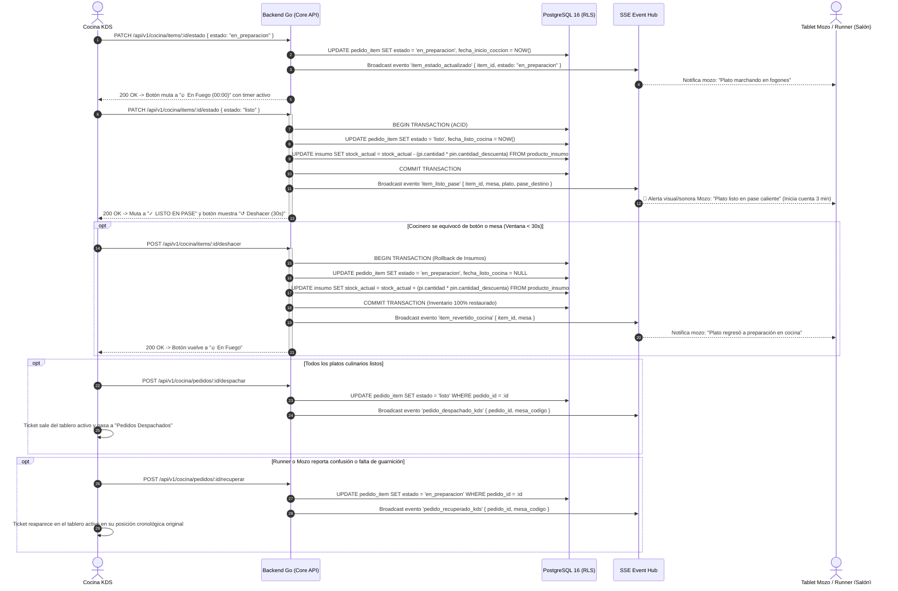
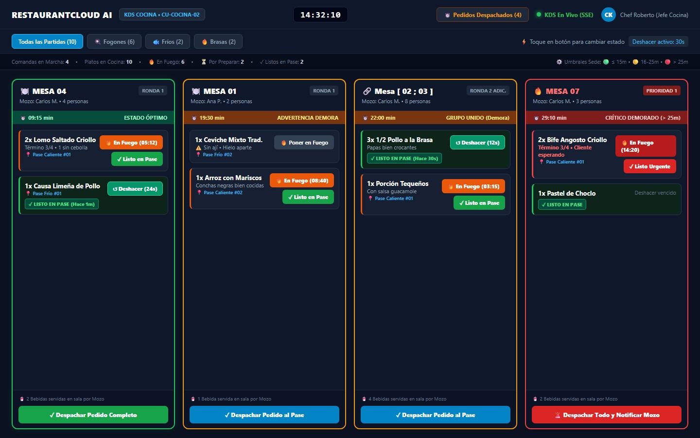
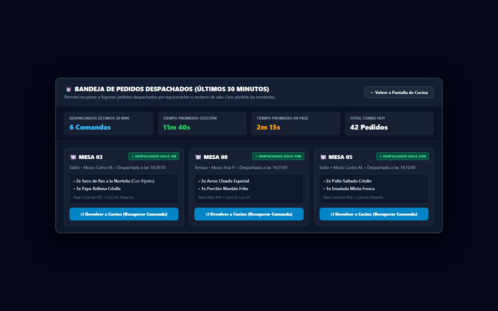
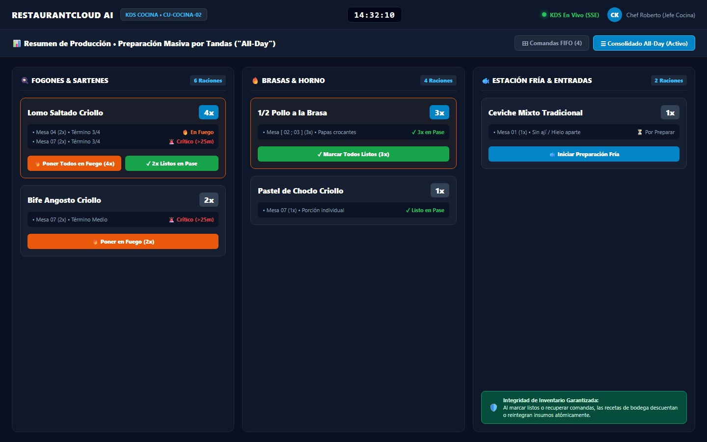
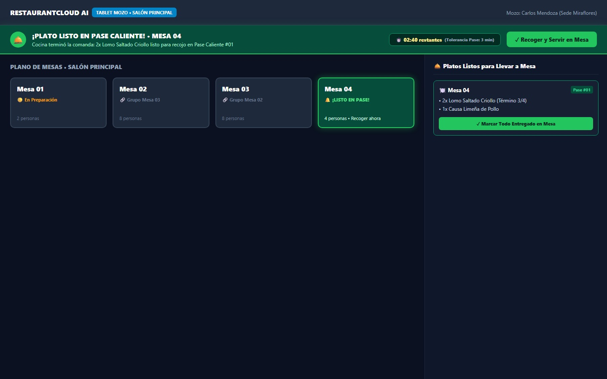

# CU-COCINA-02: Actualizar Estado de Preparación

Especificación técnica de interfaz de usuario, arquitectura de información, control de acceso basado en roles (RBAC), sincronización reactiva en tiempo real (Server-Sent Events), transaccionalidad ACID con rollback de inventario y contratos de API Go en **RestaurantCloud AI**.

---

## 1. Ficha Técnica del Caso de Uso

| Atributo | Detalle |
| :--- | :--- |
| **Código CU** | `CU-COCINA-02` |
| **Nombre** | Actualizar estado de preparación (Pase Caliente, Deshacer y Despacho) |
| **Actor(es)** | `cocina` (Cocinero, Jefe de Cocina, Maestro Parrillero, Chef de Partida) y `mozo` (Recepción en sala) |
| **Dispositivo / Viewport** | Monitor táctil industrial de cocina / Pantalla KDS de pared (`1440x900` horizontal oscuro) |
| **Precondición** | El local está activo; existen ítems de comanda culinarios en estado `en_cola` o `en_preparacion` en el KDS de la sede (`CU-COCINA-01`). |
| **Postcondición** | Los platos transicionan ágilmente entre estados operativos (`en_cola` → `en_preparacion` → `listo`); al marcar listo se descuentan automáticamente los insumos de bodega ([`CU-COCINA-03`](file:///j:/proyectos_git/RestaurantCloud_AI_backend/context/cu.md#cu-cocina-03-descuento-automático-de-insumos-por-consumo)); se activa la ventana de seguridad de **30 segundos** con botón `[ ↺ Deshacer ]` que, de ser activada, ejecuta el **rollback atómico del inventario**; el runner o mozo de sala recibe la alerta reactiva SSE del pase caliente en **< 25ms** con temporizador de tolerancia configurado en `CU-ADMIN-18`; las comandas despachadas permanecen recuperables en la bandeja de **30 minutos** ("Devolver a Cocina"). |

---

## 2. Diagrama de Flujo y Secuencia en Tiempo Real (SSE) con Rollback ACID



---

## 3. Especificación de Pantallas y Wireframes Blueprint

### Vista 1: Interacción de Pase y Estados en el Tablero de Cocina (`wf_cocina_02_pase_estados_kds.jpg`)

Tablero KDS en formato horizontal (`1440x900`). Utiliza terminología directa de cocina para evitar fricciones bajo calor o presión. Muestra los platos en sus 3 estados de preparación y las opciones de deshacer en 30 segundos.



#### Layout Estructural ASCII (Desktop / KDS Industrial 1440x900)
```text
+------------------------------------------------------------------------------------------------------------------------------------------------------+
| RESTAURANTCLOUD AI   [ KDS COCINA • CU-COCINA-02 ]          [ 14:32:10 ]     [ ⏱️ Pedidos Despachados (4) ]   (•) KDS En Vivo (SSE)  [ CK ] Chef Roberto|
+------------------------------------------------------------------------------------------------------------------------------------------------------+
| [ Todas las Partidas (10) ]  [ 🍳 Fogones (6) ]  [ 🐟 Fríos (2) ]  [ 🔥 Brasas (2) ]          ⚡ Toque en botón para cambiar estado  [Deshacer activo: 30s]|
|------------------------------------------------------------------------------------------------------------------------------------------------------|
| Comandas en Marcha: 4  •  Platos en Cocina: 10  •  🔥 En Fuego: 6  •  ⏳ Por Preparar: 2  •  ✓ Listos en Pase: 2        ⚙️ Umbrales Sede: 🟢<=15m 🟡16-25m 🔴>25m|
+------------------------------------------------------------------------------------------------------------------------------------------------------+
| MESA 04 (09:15 min • Óptimo)   | MESA 01 (19:30 min • Demora)   | Mesa [ 02 ; 03 ] (22m • Grupo) | MESA 07 (29:10 min • CRÍTICO)                         |
| +----------------------------+ | +----------------------------+ | +----------------------------+ | +----------------------------+                       |
| | 🍽️ MESA 04        [RONDA 1]| | | 🍽️ MESA 01        [RONDA 1]| | | 🔗 Mesa [ 02 ; 03 ][RONDA 2 ADIC]| | 🔥 MESA 07         [PRIORIDAD 1]|                     |
| | Mozo: Carlos M.  4 personas| | | Mozo: Ana P.     2 personas| | | Mozo: Carlos M.  8 personas| | | Mozo: Carlos M.   3 personas |                     |
| | ⏱️ 09:15 min  ESTADO ÓPTIMO | | | ⏱️ 19:30 min  ADVERTENCIA   | | | ⏱️ 22:00 min  GRUPO UNIDO   | | | ⏱️ 29:10 min CRÍTICO DEMORADO |                      |
| |----------------------------| | |----------------------------| | |----------------------------| | |----------------------------|                      |
| | 2x Lomo Saltado Criollo    | | | 1x Ceviche Mixto Trad.     | | | 3x 1/2 Pollo a la Brasa    | | | 2x Bife Angosto Criollo    |                      |
| | Término 3/4 • 1 sin cebolla| | | ⚠️ Sin ají • Hielo aparte  | | | Papas bien crocantes       | | | Término 3/4 • Esperando    |                      |
| | 📍 Pase Caliente #01       | | | 📍 Pase Frío #02           | | | [✓ LISTO EN PASE (Hace 30s]| | | 📍 Pase Caliente #01       |                      |
| | [🔥 En Fuego (05:12)]      | | | [ 🔥 Poner en Fuego ]      | | | [ ↺ Deshacer (12s) ]       | | | [🔥 En Fuego (14:20)]      |                      |
| | [ ✓ Listo en Pase ]        | | |                            | | |                            | | | [ ✓ Listo Urgente ] (Rojo) |                      |
| |                            | | | 1x Arroz con Mariscos      | | | 1x Porción Tequeños        | | |                            |                      |
| | 1x Causa Limeña de Pollo   | | | Conchas negras bien cocidas| | | Con salsa guacamole        | | | 1x Pastel de Choclo Criollo|                      |
| | 📍 Pase Frío #01           | | | 📍 Pase Caliente #02       | | | 📍 Pase Caliente #01       | | | [✓ LISTO EN PASE]          |                      |
| | [✓ LISTO EN PASE (Hace 1m)]| | | [🔥 En Fuego (08:40)]      | | | [🔥 En Fuego (03:15)]      | | | (Deshacer vencido)         |                      |
| | [ ↺ Deshacer (24s) ]       | | | [ ✓ Listo en Pase ]        | | | [ ✓ Listo en Pase ]        | | |                            |                      |
| |----------------------------| | |----------------------------| | |----------------------------| | |----------------------------|                      |
| | 🥤 2 Bebidas servidas sala | | | 🥤 1 Bebida servida sala   | | | 🥤 4 Bebidas servidas sala | | | 🥤 2 Bebidas servidas sala |                      |
| | [✓ Despachar Pedido Compl.]| | | [✓ Despachar Pedido al Pase| | | [✓ Despachar Pedido al Pase| | | [🚨 Despachar Todo y Notificar]|                      |
| +----------------------------+ | +----------------------------+ | +----------------------------+ | +----------------------------+                       |
+------------------------------------------------------------------------------------------------------------------------------------------------------+
```

#### Elementos Visuales y Funcionalidades
1. **Poner en Fuego:** Botón gris `[ 🔥 Poner en Fuego ]` cuando el plato está en cola; al tocarlo, inicia inmediatamente el reloj de sartén y muta a botón naranja `#EA580C` `[ 🔥 En Fuego (MM:SS) ]`.
2. **Listo en Pase:** Botón verde `[ ✓ Listo en Pase ]` que transiciona el plato a terminado, descuenta insumos según receta ([`CU-COCINA-03`](file:///j:/proyectos_git/RestaurantCloud_AI_backend/context/cu.md#cu-cocina-03-descuento-automático-de-insumos-por-consumo)) y emite el evento SSE al salón.
3. **Botón Temporal de Deshacer (Undo 30s):** Contador regresivo en tiempo real `[ ↺ Deshacer (24s) ]`. Al tocarlo, revierte la comanda y ejecuta el rollback de existencias de insumos en bodega sin discrepancias.
4. **Despachar Pedido Completo:** Botón grande al pie del ticket para liberar la comanda íntegra en un solo toque cuando todos los platos fueron emplatados.
5. **Acceso al Historial de Despachados:** Botón ámbar en la cabecera `[ ⏱️ Pedidos Despachados (4) ]` con el conteo de órdenes terminadas en los últimos 30 minutos.

---

### Vista 2: Bandeja de Pedidos Despachados y Recuperación / Devolver a Cocina (`wf_cocina_02_historial_despachados_recall.jpg`)

Modal o panel superpuesto (`1120px` centrado) que almacena de forma no destructiva las órdenes despachadas durante los últimos **30 minutos** (búfer de seguridad).



#### Layout Estructural ASCII (Modal 1120px)
```text
+---------------------------------------------------------------------------------------------------------------+
| ⏱️ BANDEJA DE PEDIDOS DESPACHADOS (ÚLTIMOS 30 MINUTOS)                       [ ← Volver a Pantalla de Cocina ]|
| Permite recuperar a fogones pedidos despachados por equivocación o reclamo de sala. Cero pérdida de comandas. |
|---------------------------------------------------------------------------------------------------------------|
| DESPACHADOS ÚLTIMOS 30M    TIEMPO PROMEDIO COCCIÓN       TIEMPO PROMEDIO EN PASE       TOTAL TURNO HOY        |
| 6 Comandas                 11m 40s                       2m 15s                        42 Pedidos             |
|---------------------------------------------------------------------------------------------------------------|
| +-----------------------------+ +-----------------------------+ +-----------------------------+               |
| | [✓ Despachado Hace 3m]      | | [✓ Despachado Hace 11m]     | | [✓ Despachado Hace 22m]     |               |
| | 🍽️ MESA 03                   | | 🍽️ MESA 08                   | | 🍽️ MESA 05                   |               |
| | Salón • Mozo: Carlos M.     | | Terraza • Mozo: Ana P.      | | Salón • Mozo: Carlos M.     |               |
| | Despachado a las 14:29:10   | | Despachado a las 14:21:05   | | Despachado a las 14:10:00   |               |
| |                             | |                             | |                             |               |
| | • 2x Seco de Res Norteña    | | • 3x Arroz Chaufa Especial  | | • 2x Pollo Saltado Criollo  |               |
| | • 1x Papa Rellena Criolla   | | • 1x Porción Wantán Frito   | | • 1x Ensalada Mixta Fresca  |               |
| | Pase Caliente #01 • Roberto | | Pase Wok #01 • Luis M.      | | Pase Caliente #02 • Roberto |               |
| |                             | |                             | |                             |               |
| | [↺ Devolver a Cocina]       | | [↺ Devolver a Cocina]       | | [↺ Devolver a Cocina]       |               |
| +-----------------------------+ +-----------------------------+ +-----------------------------+               |
+---------------------------------------------------------------------------------------------------------------+
```

#### Funcionalidades Clave
1. **Recuperación Inmediata ("Devolver a Cocina"):** Al presionar el botón azul celeste `[ ↺ Devolver a Cocina ]`, el pedido regresa instantáneamente a la pantalla activa del KDS en su posición cronológica original.
2. **Auditoría de Quién Despachó:** Muestra la hora exacta de salida y el nombre del cocinero responsable del pase.
3. **Cero Pérdida de Órdenes:** Resuelve el clásico incidente de cocina donde un cocinero presiona "Despachar" antes de servir la última porción.

---

### Vista 3: Preparación Masiva por Tandas en Consolidado All-Day (`wf_cocina_02_consolidado_accion_tandas.jpg`)

Vista especializada para cocción por lotes en horas pico, permitiendo poner en fuego o marcar listos múltiples platos del mismo tipo pertenecientes a distintas mesas.



#### Layout Estructural ASCII (Desktop 1440x900)
```text
+------------------------------------------------------------------------------------------------------------------------------------------------------+
| RESTAURANTCLOUD AI   [ KDS COCINA • CU-COCINA-02 ]          [ 14:32:10 ]             (•) KDS En Vivo (SSE)   [ CK ] Chef Roberto (Jefe Cocina)       |
+------------------------------------------------------------------------------------------------------------------------------------------------------+
| 📊 Resumen de Producción • Preparación Masiva por Tandas ("All-Day")                     [ ⊞ Comandas FIFO (4) ] [ ☰ Consolidado All-Day (Activo) ]   |
|------------------------------------------------------------------------------------------------------------------------------------------------------|
| ESTACIÓN 1: FOGONES & SARTENES (6 Raciones)  | ESTACIÓN 2: BRASAS & HORNO (4 Raciones)      | ESTACIÓN 3: ESTACIÓN FRÍA (2 Raciones)                 |
| +------------------------------------------+ | +------------------------------------------+ | +----------------------------------------------------+ |
| | Lomo Saltado Criollo               [ 4x ]| | | 1/2 Pollo a la Brasa               [ 3x ]| | | Ceviche Mixto Tradicional                   [ 1x ]| |
| | • Mesa 04 (2x) Término 3/4      [🔥En Fuego| | | • Mesa [ 02 ; 03 ] (3x)     [✓ 3x en Pase]| | | • Mesa 01 (1x) Sin ají           [⏳ Por Preparar]| |
| | • Mesa 07 (2x) Término 3/4    [🚨 Crítico] | | +------------------------------------------+ | +----------------------------------------------------+ |
| |                                          | | | [ ✓ Marcar Todos Listos (3x) ]           | | | [ 🐟 Iniciar Preparación Fría ]                    | |
| | [🔥 Poner Todos en Fuego (4x)]           | | +------------------------------------------+ | +----------------------------------------------------+ |
| | [ ✓ 2x Listos en Pase ]                  | | | Pastel de Choclo Criollo           [ 1x ]| |                                                        |
| +------------------------------------------+ | | • Mesa 07 (1x)            [✓Listo en Pase] | | 🛡️ Integridad de Inventario Garantizada:              |
| | Bife Angosto Criollo               [ 2x ]| | +------------------------------------------+ | Al marcar listos o recuperar comandas, las recetas de  |
| | • Mesa 07 (2x) Término Medio  [🚨 Crítico] | |                                              | bodega descuentan o reintegran insumos atómicamente.   |
| | [🔥 Poner en Fuego (2x)]                 | |                                              |                                                        |
| +------------------------------------------+ |                                              |                                                        |
+------------------------------------------------------------------------------------------------------------------------------------------------------+
```

#### Funcionalidades Clave
1. **Acción por Tandas:** Un salteador en wok puede pulsar `[ 🔥 Poner Todos en Fuego (4x) ]` para iniciar 4 Lomo Saltado repartidos entre la Mesa 04 y Mesa 07.
2. **Despacho Parcial por FIFO:** Al tocar `[ ✓ 2x Listos en Pase ]`, el sistema asigna automáticamente las 2 primeras porciones a la Mesa 04 (la más antigua en cola).
3. **Garantía Transaccional:** Cada ración despachada descuenta sus insumos de bodega de forma segura.

---

### Vista 4: Notificación Reactiva en Salón — Plato Listo en Pase Caliente (`wf_cocina_02_notificacion_pase_salon.jpg`)

Vista complementaria en la tablet del Mozo (`CU-MOZO-01`), demostrando la sincronización reactiva en menos de 25 milisegundos cuando la cocina marca un plato listo.



#### Layout Estructural ASCII (Tablet Mozo 1440x900)
```text
+------------------------------------------------------------------------------------------------------------------------------------------------------+
| RESTAURANTCLOUD AI   [ TABLET MOZO • SALÓN PRINCIPAL ]                                                    Mozo: Carlos Mendoza (Sede Miraflores)     |
+------------------------------------------------------------------------------------------------------------------------------------------------------+
| 🔔 ¡PLATO LISTO EN PASE CALIENTE! • MESA 04                         [ ⏱️ 02:40 restantes (Tolerancia Pase: 3 min) ]   [ ✓ Recoger y Servir en Mesa ] |
| Cocina terminó la comanda: 2x Lomo Saltado Criollo listo para recojo en Pase Caliente #01                                                            |
+------------------------------------------------------------------------------------------------------------------------------------------------------+
| PLANO DE MESAS • SALÓN PRINCIPAL                                             | 🛎️ Platos Listos para Llevar a Mesa (Pase Salón)                     |
| +--------------+ +--------------+ +--------------+ +-----------------------+ | +-------------------------------------------------------------------+ |
| | Mesa 01      | | Mesa 02      | | Mesa 03      | | Mesa 04 (PARPADEA)    | | | 🍽️ Mesa 04                                        [Pase #01]   | |
| | 🟡 En Fuego  | | 🔗 Grupo M-03| | 🔗 Grupo M-02| | 🔔 ¡LISTO EN PASE!   | | | • 2x Lomo Saltado Criollo (Término 3/4)                         | |
| | 2 personas   | | 8 personas   | | 8 personas   | | 4 personas • Recoger  | | | • 1x Causa Limeña de Pollo                                      | |
| +--------------+ +--------------+ +--------------+ +-----------------------+ | | [ ✓ Marcar Todo Entregado en Mesa ]                              | |
|                                                                              | +-------------------------------------------------------------------+ |
+------------------------------------------------------------------------------------------------------------------------------------------------------+
```

#### Funcionalidades Clave
1. **Banner Flotante Reactivo:** Aparece en la cabecera del mozo responsable inmediatamente cuando el cocinero pulsa `[ Listo en Pase ]`.
2. **Cuenta Regresiva de Tolerancia de Pase:** Descuenta segundos a partir de los 3 minutos fijados en `CU-ADMIN-18` (`tiempo_maximo_pase_min`). Si el mozo no recoge el plato a tiempo, emite alerta de enfriamiento de comida.
3. **Botón en 1 Toque:** Al presionar `[ ✓ Recoger y Servir en Mesa ]`, conmuta el ítem a `entregado`, cerrando el ciclo de servicio.

---

## 4. Matriz de Estados de Interfaz (5 Estados UX)

| Estado UX | Indicador Visual | Comportamiento del Sistema |
| :--- | :--- | :--- |
| **1. Por Preparar (`en_cola`)** | Botón gris carbón `[ 🔥 Poner en Fuego ]`, sin temporizador activo. | Plato esperando en comanda FIFO. La receta de insumos aún no se descuenta. |
| **2. En Marcha (`en_preparacion`)** | Botón naranja vibrante `[ 🔥 En Fuego (MM:SS) ]` con timer en segundos y botón verde `[ ✓ Listo en Pase ]`. | Plato en cocción en fogón/wok. Salón visualiza estado "En Preparación". Se registra `fecha_inicio_coccion = NOW()`. |
| **3. Terminado / En Pase (`listo`)** | Badge verde `[ ✓ LISTO EN PASE ]` y botón con cuenta regresiva `[ ↺ Deshacer (30s) ]`. | Plato emplatado. Se descuentan insumos de bodega ([`CU-COCINA-03`](file:///j:/proyectos_git/RestaurantCloud_AI_backend/context/cu.md#cu-cocina-03-descuento-automático-de-insumos-por-consumo)). Se emite evento SSE al runner en < 25ms. |
| **4. Deshacer Activo (Undo 30s)** | Botón parpadeante verde esmeralda con segundos restantes decreciendo en vivo. | Si se pulsa, se ejecuta **rollback atómico de insumos** y el plato regresa a `en_preparacion`. Al expirar los 30s, el botón de deshacer desaparece permanentemente. |
| **5. Despachado (Historial 30m)** | Comanda desaparece del KDS activo y se archiva en la bandeja `[ ⏱️ Pedidos Despachados ]`. | Permite pulsar `[ ↺ Devolver a Cocina ]` durante 30 minutos para revertir despachos accidentales. |

---

## 5. Matriz de Control de Acceso (RBAC)

| Rol | Poner en Fuego (`PATCH`) | Listo en Pase (`PATCH`) | Deshacer (30s) (`POST`) | Despachar Pedido (`POST`) | Devolver a Cocina (`POST`) | Marcar Servido en Mesa (`PATCH`) |
| :--- | :---: | :---: | :---: | :---: | :---: | :---: |
| `cocina` | ✅ Permitido | ✅ Permitido | ✅ Permitido | ✅ Permitido | ✅ Permitido | ❌ Denegado (Exclusivo sala) |
| `admin_local` | ✅ Permitido | ✅ Permitido | ✅ Permitido | ✅ Permitido | ✅ Permitido | ✅ Permitido (Supervisión) |
| `mozo` | ❌ Denegado | ❌ Denegado | ❌ Denegado | ❌ Denegado | ❌ Denegado | ✅ Permitido (`entregado`) |
| `cajero` | ❌ Denegado | ❌ Denegado | ❌ Denegado | ❌ Denegado | ❌ Denegado | ❌ Denegado |
| `propietario` | ❌ Denegado | ❌ Denegado | ❌ Denegado | ❌ Denegado | ❌ Denegado | ❌ Denegado |

---

## 6. Contratos de API Go DTOs

### 6.1 Petición de Cambio de Estado de Ítem
```go
package dto

import (
	"time"
	"github.com/google/uuid"
)

type KDSActualizarEstadoItemRequest struct {
	Estado string `json:"estado" binding:"required,oneof=en_preparacion listo"`
}

type KDSItemActualizadoDTO struct {
	ItemID             uuid.UUID  `json:"item_id"`
	PedidoID           uuid.UUID  `json:"pedido_id"`
	Estado             string     `json:"estado"`
	FechaInicioCoccion *time.Time `json:"fecha_inicio_coccion,omitempty"`
	FechaListoCocina   *time.Time `json:"fecha_listo_cocina,omitempty"`
	PuedeDeshacer      bool       `json:"puede_deshacer"`
	SegundosDeshacer   int        `json:"segundos_deshacer"` // 30 por defecto
}
```

### 6.2 Petición de Deshacer / Rollback
```go
package dto

import "github.com/google/uuid"

type KDSDeshacerItemRequest struct {
	Motivo string `json:"motivo,omitempty"` // Opcional, ej: "toque_accidental"
}

type KDSDeshacerResponse struct {
	ItemID            uuid.UUID `json:"item_id"`
	EstadoRestaurado  string    `json:"estado_restaurado"` // "en_preparacion"
	InsumosRestaurados int      `json:"insumos_restaurados"`
	Mensaje           string    `json:"mensaje"`
}
```

### 6.3 Petición de Despacho y Recuperación de Comanda
```go
package dto

import (
	"time"
	"github.com/google/uuid"
)

type KDSPedidoDespachadoDTO struct {
	PedidoID        uuid.UUID `json:"pedido_id"`
	NumeroComanda   int       `json:"numero_comanda"`
	MesaCodigo      string    `json:"mesa_codigo"`
	MozoNombre      string    `json:"mozo_nombre"`
	PisoNombre      string    `json:"piso_nombre"`
	TotalItems      int       `json:"total_items"`
	FechaDespacho   time.Time `json:"fecha_despacho"`
	MinutosDesdeDespacho int  `json:"minutos_desde_despacho"`
	PuedeRecuperar  bool      `json:"puede_recuperar"` // true si <= 30 minutos
}
```

---

## 7. Endpoints de la API REST y Eventos SSE

| Método | Endpoint | Rol Mínimo | Descripción |
| :--- | :--- | :--- | :--- |
| `PATCH` | `/api/v1/cocina/items/:id/estado` | `cocina` | Inicia cocción (`en_preparacion`) o marca terminado (`listo`) con descuento de receta. |
| `POST` | `/api/v1/cocina/items/:id/deshacer` | `cocina` | Revierte a `en_preparacion` y ejecuta rollback de insumos si se solicita dentro de los 30 segundos. |
| `POST` | `/api/v1/cocina/pedidos/:id/despachar` | `cocina` | Despacha todos los platos culinarios de la comanda y la traslada a despachados recientes. |
| `GET` | `/api/v1/cocina/pedidos/despachados-recientes` | `cocina` | Consulta las órdenes terminadas en los últimos 30 minutos para posible recuperación. |
| `POST` | `/api/v1/cocina/pedidos/:id/recuperar` | `cocina` | Recupera la comanda despachada devolviéndola al tablero activo del KDS (Recall). |

---

## 8. Consultas SQL Optimizadas (PostgreSQL 16)

### 8.1 Transacción Atómica de Plato a Listo con Descuento de Receta
```sql
-- Ejecutado en transacción atómica al marcar un plato como 'listo'
BEGIN;

-- 1. Actualizar estado y timestamp de término de cocción
UPDATE pedido_item
SET estado = 'listo',
    fecha_listo_cocina = NOW(),
    updated_at = NOW()
WHERE id = $1
  AND estado = 'en_preparacion';

-- 2. Descuento automático de insumos en bodega según receta de CU-ADMIN-04
UPDATE insumo i
SET stock_actual = GREATEST(0, i.stock_actual - (pi.cantidad * pin.cantidad_descuenta)),
    estado = CASE WHEN (i.stock_actual - (pi.cantidad * pin.cantidad_descuenta)) <= 0 THEN 'agotado' ELSE i.estado END,
    updated_at = NOW()
FROM producto_insumo pin
JOIN pedido_item pi ON pi.producto_id = pin.producto_id
WHERE pi.id = $1
  AND i.id = pin.insumo_id;

COMMIT;
```

### 8.2 Transacción de Deshacer (Rollback Atómico de Insumos al Inventario)
```sql
-- Ejecutado en transacción atómica si el cocinero pulsa [ ↺ Deshacer ] en < 30 segundos
BEGIN;

-- 1. Validar que no hayan transcurrido más de 30 segundos y revertir estado
UPDATE pedido_item
SET estado = 'en_preparacion',
    fecha_listo_cocina = NULL,
    updated_at = NOW()
WHERE id = $1
  AND estado = 'listo'
  AND fecha_listo_cocina >= NOW() - INTERVAL '30 seconds';

-- 2. Rollback exacto de insumos de bodega (reposición de existencias)
UPDATE insumo i
SET stock_actual = i.stock_actual + (pi.cantidad * pin.cantidad_descuenta),
    estado = CASE WHEN (i.stock_actual + (pi.cantidad * pin.cantidad_descuenta)) > 0 THEN 'disponible' ELSE i.estado END,
    updated_at = NOW()
FROM producto_insumo pin
JOIN pedido_item pi ON pi.producto_id = pin.producto_id
WHERE pi.id = $1
  AND i.id = pin.insumo_id;

COMMIT;
```

### 8.3 Consulta Rápida de Pedidos Despachados Recientes (Últimos 30 Minutos)
```sql
-- Consulta ultrarrápida usando el índice parcial idx_pedido_item_despachados_recientes
SELECT 
    p.id AS pedido_id,
    p.numero_comanda,
    m.codigo AS mesa_codigo,
    u.nombre_completo AS mozo_nombre,
    pis.nombre AS piso_nombre,
    COUNT(pi.id)::INT AS total_items,
    MAX(pi.fecha_listo_cocina) AS fecha_despacho,
    ROUND(EXTRACT(EPOCH FROM (NOW() - MAX(pi.fecha_listo_cocina))) / 60)::INT AS minutos_desde_despacho,
    JSONB_AGG(
        JSONB_BUILD_OBJECT(
            'producto_nombre', pr.nombre,
            'cantidad', pi.cantidad,
            'nota_cocina', pi.nota_cocina
        ) ORDER BY pi.created_at ASC
    ) AS items_resumen
FROM pedido p
JOIN mesa m ON m.id = p.mesa_id
JOIN piso pis ON pis.id = m.piso_id
JOIN usuario u ON u.id = p.mozo_id
JOIN pedido_item pi ON pi.pedido_id = p.id
JOIN producto pr ON pr.id = pi.producto_id
WHERE p.local_id = $1
  AND pi.estado = 'listo'
  AND pi.fecha_listo_cocina >= NOW() - INTERVAL '30 minutes'
GROUP BY p.id, p.numero_comanda, m.codigo, u.nombre_completo, pis.nombre
ORDER BY MAX(pi.fecha_listo_cocina) DESC;
```

---

## 9. Ergonomía Táctil y Accesibilidad Industrial (WCAG 2.1 AA)

1. **Vocabulario Cotidiano y Directo:** Términos universales de cocina (`Por Preparar`, `En Fuego`, `Listo en Pase`, `Deshacer`, `Despachar Pedido`, `Devolver a Cocina`), reduciendo la curva de aprendizaje a cero minutos.
2. **Superficies Táctiles Amplias:** Botones principales con altura mínima de **48px** y margen táctil de **56px**, facilitando pulsaciones firmes con manos mojadas o guantes térmicos.
3. **Contrastes en Modo Oscuro:** Borde de tarjetas y botones con contraste de **12:1** sobre fondo oscuro `#0B1120`, garantizando lectura impecable bajo campanas extractoras con iluminación variable.
4. **Protección Auditiva de Sala:** El aviso de plato listo para el mozo incluye un chime discreto y cuenta regresiva de 3 minutos, evitando ruidos invasivos en el salón del restaurante.
