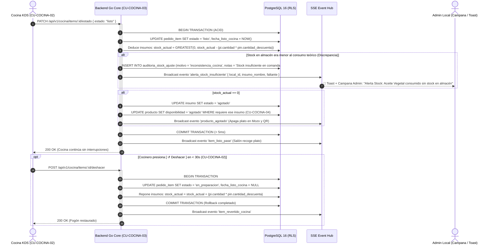
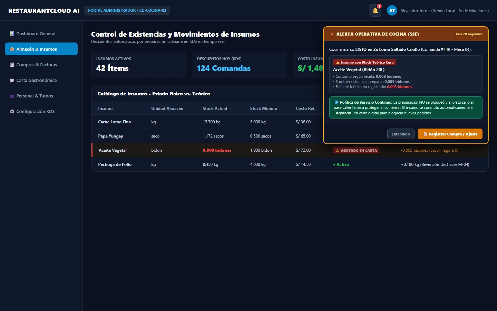

# CU-COCINA-03: Descuento Automático de Insumos por Consumo

Especificación técnica de proceso transaccional del sistema, arquitectura de inventario culinario, deducción atómica de recetas, política de continuidad de servicio sin bloqueo de fogones, alertas reactivas (Server-Sent Events) y contratos de backend Go en **RestaurantCloud AI**.

---

## 1. Ficha Técnica del Caso de Uso

| Atributo | Detalle |
| :--- | :--- |
| **Código CU** | `CU-COCINA-03` |
| **Nombre** | Descuento automático de insumos por consumo culinario |
| **Actor(es)** | `sistema` (Proceso transaccional de backend orquestado automáticamente) / `admin_local` (Supervisión) |
| **Dispositivo / Viewport** | Ejecución en Core API Go (< 5ms) / Visualización en Portal Administrador (`1440x900`) y Modal KDS |
| **Precondición** | La brigada de cocina marca un plato como "Listo en Pase" en el monitor KDS ([`CU-COCINA-02`](file:///d:/Proyecto/RestaurantCloud_AI_backend/wireframe/cocina/CU-COCINA-02-actualizar-estado-preparacion/wireframe.md)); el producto cuenta con su receta culinaria registrada en `producto_insumo` ([`CU-ADMIN-04`](file:///d:/Proyecto/RestaurantCloud_AI_backend/wireframe/administrador/CU-ADMIN-04-personal-local/wireframe.md)). |
| **Postcondición** | El sistema descuenta atómicamente de `insumo.stock_actual` las cantidades requeridas según receta; si las existencias descienden a 0, conmuta automáticamente a `'agotado'` y apaga los platos dependientes en la carta digital de mozos y QR ([`CU-COCINA-04`](file:///d:/Proyecto/RestaurantCloud_AI_backend/context/cu.md#cu-cocina-04-marcar-producto-como-agotado--disponible)); si el stock teórico era insuficiente, aplica la política de no bloqueo de servicio, fija stock en 0 y despacha una alerta SSE reactiva al Administrador; si el cocinero pulsa `[ ↺ Deshacer ]` en 30s, se ejecuta el rollback atómico del inventario. |

---

## 2. Diagrama de Flujo y Secuencia en Tiempo Real (SSE)



---

## 3. Especificación de Interfaces y Wireframes Blueprint

Dado que `CU-COCINA-03` es un proceso automático del sistema de backend, su interacción con usuarios se manifiesta a través de **dos puntos de contacto clave**:

1. **Notificación Flotante Toast y Campana al Administrador (`wf_cocina_03_alerta_stock_toast.jpg`):** Se dispara en tiempo real ante una discrepancia de stock sin bloquear la cocina.
2. **Inspector de Insumos de la Comanda en KDS (`wf_cocina_01_modal_detalle_comanda.jpg`):** Permite a la brigada de cocina verificar los insumos deducidos directamente en la Ficha Técnica de la Comanda ([`CU-COCINA-01`](file:///d:/Proyecto/RestaurantCloud_AI_backend/wireframe/cocina/CU-COCINA-01-cola-pedidos-kds/wireframe.md)).

---

### Vista 1: Toast Reactivo y Campana de Alerta en Portal Administrador (`wf_cocina_03_alerta_stock_toast.jpg`)

Pantalla desktop corporativa (`1440x900`). Muestra la recepción reactiva SSE de la alerta de inconsistencia cuando un plato sale de cocina y agota el stock teórico en bodega.



#### Layout Estructural ASCII (Desktop 1440x900)
```text
+------------------------------------------------------------------------------------------------------------------------------------------------------+
| RESTAURANTCLOUD AI   [ PORTAL ADMINISTRADOR • CU-COCINA-03 ]                                                 [ 🔔 (1) ]  [ AT ] Alejandro Torres (Admin)|
+------------------------------------------------------------------------------------------------------------------------------------------------------+
| SIDEBAR                 | Control de Existencias y Movimientos de Insumos                                                                            |
| • Dashboard             | Descuentos automáticos por preparación culinaria en KDS en tiempo real                                                     |
| • Almacén & Insumos (*) |----------------------------------------------------------------------------------------------------------------------------|
| • Compras & Facturas    | [ Insumos: 42 ]   [ Descuentos Hoy: 124 ]   [ Costo Consumido: S/ 1,482.50 ]   [ Inconsistencias: 1 Faltante ]               |
| • Carta Gastronómica    |                                                                                                                            |
| • Personal & Turnos     | CATÁLOGO DE INSUMOS • ESTADO FÍSICO VS. TEÓRICO                                                                            |
| • Configuración KDS     | +------------------------------------------------------------------------------------------------------------------------+ |
|                         | | Insumo            Unidad   Stock Actual   Stock Mín   Costo Ref.  Estado            Último Movimiento (KDS)        | |
|                         | | Carne Lomo Fino   kg       13.700 kg      5.000 kg    S/ 38.00    ● Activo          -0.800 kg (Comanda #149)       | |
|                         | | Papa Yungay       saco      1.172 sacos   0.500 sacos S/ 65.00    ● Activo          -0.028 sacos (Comanda #149)    | |
|                         | | Aceite Vegetal    bidon     0.000 bidones 1.000 bidon S/ 72.00    ⚠️ AGOTADO CARTA  -0.005 bidones (Stock a 0)     | |
|                         | | Pechuga de Pollo  kg        8.450 kg      4.000 kg    S/ 14.50    ● Activo          +0.180 kg (Reversión Deshacer) | |
|                         | +------------------------------------------------------------------------------------------------------------------------+ |
+-------------------------+----------------------------------------------------------------------------------------------------------------------------+
                                                                                       | ⚡ ALERTA OPERATIVA DE COCINA (SSE)         Hace 20 segundos |
                                                                                       | Cocina marcó LISTO en 2x Lomo Saltado (Comanda #149 • Mesa 04)|
                                                                                       | ⚠️ Insumo con Stock Teórico Cero: Aceite Vegetal (Bidón 20L) |
                                                                                       | • Consumo según receta: 0.008 bidones                        |
                                                                                       | • Stock en sistema al preparar: 0.005 bidones                |
                                                                                       | • Faltante teórico no registrado: 0.003 bidones              |
                                                                                       | 🛡️ Política de Servicio Continuo: La preparación NO se      |
                                                                                       | bloqueó. El plato salió al pase. Insumo marcado "Agotado".   |
                                                                                       | [ Entendido ]           [ 📝 Registrar Compra / Ajuste ]     |
                                                                                       +--------------------------------------------------------------+
```

#### Elementos Visuales y Funcionalidades
1. **Toast Flotante No Intrusivo:** Aparece en la esquina superior derecha sin bloquear la navegación del Administrador, manteniéndose visible durante 15 segundos o hasta interacción.
2. **Campana de Alertas Persistente:** El botón `[ 🔔 (1) ]` acumula la incidencia para revisión en la bandeja de auditoría ([`CU-ADMIN-11`](file:///d:/Proyecto/RestaurantCloud_AI_backend/context/cu.md#cu-admin-11-historial-de-incidentes-internos-de-sede) / [`CU-ADMIN-12`](file:///d:/Proyecto/RestaurantCloud_AI_backend/wireframe/administrador/CU-ADMIN-12-notificacion-anulacion/wireframe.md)).
3. **Acceso Directo a Regularización:** Botón `[ 📝 Registrar Compra / Ajuste ]` que abre la ficha de compra rápida de insumo ([`CU-ADMIN-07`](file:///d:/Proyecto/RestaurantCloud_AI_backend/wireframe/administrador/CU-ADMIN-07-recepcion-compra/wireframe.md)) para reponer existencias con 1 clic.

---

## 4. Matriz de Estados Transaccionales (5 Estados de Ejecución)

| Estado Transaccional | Condición en Base de Datos | Comportamiento del Sistema |
| :--- | :--- | :--- |
| **1. Deducción Óptima** | `stock_actual >= deduccion` y `stock_resultante > stock_minimo` | Descuenta insumos en < 5ms. El plato pasa a listo sin alertas de inventario. |
| **2. Stock Bajo Mínimo** | `stock_actual >= deduccion` pero `stock_resultante <= stock_minimo` | Descuenta insumos. Emite notificación preventiva al Administrador: *"Insumo en stock crítico; sugerida orden de compra"*. |
| **3. Stock Cero (Agotado)** | `stock_actual - deduccion == 0` | Descuenta a 0. Conmuta `insumo.estado = 'agotado'` y propaga `producto.disponibilidad = 'agotado'` a carta digital ([`CU-COCINA-04`](file:///d:/Proyecto/RestaurantCloud_AI_backend/context/cu.md#cu-cocina-04-marcar-producto-como-agotado--disponible)). |
| **4. Inconsistencia / Faltante** | `stock_actual < deduccion` (Stock insuficiente) | **Aplica Política de Continuidad:** no bloquea la cocina; fija `stock_actual = 0`, asienta en `auditoria_stock_ajuste` con motivo `'inconsistencia_cocina'` y dispara Toast SSE al Administrador. |
| **5. Reversión por Deshacer** | Cocinero pulsa `[ ↺ Deshacer ]` en < 30s ([`CU-COCINA-02`](file:///d:/Proyecto/RestaurantCloud_AI_backend/wireframe/cocina/CU-COCINA-02-actualizar-estado-preparacion/wireframe.md)) | **Rollback Atómico:** repone exactamente las cantidades a `insumo.stock_actual` y restaura a `'disponible'` si estaba agotado. |

---

## 5. Matriz de Control de Acceso (RBAC)

| Rol | Ejecución de Descuento | Ver Ficha Receta en KDS | Recibir Toast Inconsistencia | Regularizar Compra / Ajuste |
| :--- | :---: | :---: | :---: | :---: |
| `sistema` | ✅ Automático (Triggers/Go) | N/A | N/A | N/A |
| `cocina` | ❌ Indirecto (vía botón listo) | ✅ Permitido (Consulta) | ❌ No recibe (Evita ruidos) | ❌ Denegado |
| `admin_local` | ❌ Solo auditoría | ✅ Permitido | ✅ Permitido (Toast + Campana) | ✅ Permitido (`CU-ADMIN-07`) |
| `mozo` | ❌ Denegado | ❌ Denegado | ❌ Denegado | ❌ Denegado |

---

## 6. Contratos de API Go DTOs

### 6.1 DTO de Evento SSE: Alerta de Stock Insuficiente (`AlertaStockInsuficienteSSE`)
```go
package dto

import (
	"time"
	"github.com/google/uuid"
)

type AlertaStockInsuficienteSSE struct {
	LocalID          uuid.UUID `json:"local_id"`
	InsumoID         uuid.UUID `json:"insumo_id"`
	InsumoNombre     string    `json:"insumo_nombre"`
	UnidadMedida     string    `json:"unidad_medida"`
	PedidoID         uuid.UUID `json:"pedido_id"`
	NumeroComanda    int       `json:"numero_comanda"`
	MesaCodigo       string    `json:"mesa_codigo"`
	PlatoNombre      string    `json:"plato_nombre"`
	ConsumoRequerido float64   `json:"consumo_requerido"`
	StockDisponible  float64   `json:"stock_disponible"`
	FaltanteTeorico  float64   `json:"faltante_teorico"`
	Timestamp        time.Time `json:"timestamp"`
}
```

### 6.2 DTO de Respuesta Interna de Descuento
```go
package dto

import "github.com/google/uuid"

type ResultadoDescuentoRecetaDTO struct {
	PedidoItemID      uuid.UUID            `json:"pedido_item_id"`
	InsumosAfectados  []InsumoDeducidoDTO  `json:"insumos_afectados"`
	HuboInconsistencia bool                `json:"hubo_inconsistencia"`
	InsumosAgotados   []string             `json:"insumos_agotados,omitempty"`
}

type InsumoDeducidoDTO struct {
	InsumoID        uuid.UUID `json:"insumo_id"`
	Nombre          string    `json:"nombre"`
	CantidadDeducida float64  `json:"cantidad_deducida"`
	StockResultante float64   `json:"stock_resultante"`
	Estado          string    `json:"estado"` // "activo", "agotado"
}
```

---

## 7. Sentencias SQL Transaccionales Optimizadas (PostgreSQL 16)

### 7.1 Transacción Atómica de Deducción Culinaria con Política de Continuidad
```sql
-- Ejecución ACID dentro del servicio de cocina al marcar ítem listo
BEGIN;

-- 1. Deducción atómica con protección de piso no negativo (GREATEST)
UPDATE insumo i
SET stock_actual = GREATEST(0, i.stock_actual - (pi.cantidad * pin.cantidad_descuenta)),
    estado = CASE 
        WHEN (i.stock_actual - (pi.cantidad * pin.cantidad_descuenta)) <= 0 THEN 'agotado' 
        ELSE i.estado 
    END,
    updated_at = NOW()
FROM producto_insumo pin
JOIN pedido_item pi ON pi.producto_id = pin.producto_id
WHERE pi.id = $1
  AND i.id = pin.insumo_id;

-- 2. Registro de discrepancia en auditoría si el stock era insuficiente
INSERT INTO auditoria_stock_ajuste (
    id, local_id, insumo_id, usuario_id, stock_anterior, stock_nuevo, diferencia, motivo, notas, created_at
)
SELECT 
    gen_random_uuid(),
    p.local_id,
    i.id,
    p.mozo_id,
    i.stock_actual,
    0.000,
    (i.stock_actual - (pi.cantidad * pin.cantidad_descuenta)),
    'inconsistencia_cocina',
    CONCAT('Consumo culinario en comanda #', p.numero_comanda, ' superó el stock físico en almacén. Plato: ', pr.nombre),
    NOW()
FROM pedido_item pi
JOIN pedido p ON p.id = pi.pedido_id
JOIN producto pr ON pr.id = pi.producto_id
JOIN producto_insumo pin ON pin.producto_id = pr.id
JOIN insumo i ON i.id = pin.insumo_id
WHERE pi.id = $1
  AND i.stock_actual < (pi.cantidad * pin.cantidad_descuenta);

-- 3. Propagar agotado a platos dependientes en la carta digital (CU-COCINA-04)
UPDATE producto pr
SET disponibilidad = 'agotado',
    updated_at = NOW()
FROM producto_insumo pin
JOIN insumo i ON i.id = pin.insumo_id
WHERE pin.producto_id = pr.id
  AND i.estado = 'agotado'
  AND pr.disponibilidad = 'disponible';

COMMIT;
```

### 7.2 Transacción de Rollback al Deshacer (Undo 30s)
```sql
-- Ejecutado si el cocinero pulsa [ ↺ Deshacer ] en < 30 segundos
BEGIN;

-- 1. Reposición exacta de stock consumido
UPDATE insumo i
SET stock_actual = i.stock_actual + (pi.cantidad * pin.cantidad_descuenta),
    estado = CASE 
        WHEN (i.stock_actual + (pi.cantidad * pin.cantidad_descuenta)) > 0 THEN 'activo' 
        ELSE i.estado 
    END,
    updated_at = NOW()
FROM producto_insumo pin
JOIN pedido_item pi ON pi.producto_id = pin.producto_id
WHERE pi.id = $1
  AND i.id = pin.insumo_id;

-- 2. Reactivar platos dependientes en la carta si el insumo volvió a estar disponible
UPDATE producto pr
SET disponibilidad = 'disponible',
    updated_at = NOW()
FROM producto_insumo pin
JOIN insumo i ON i.id = pin.insumo_id
WHERE pin.producto_id = pr.id
  AND i.id = pin.insumo_id
  AND i.stock_actual > 0
  AND pr.disponibilidad = 'agotado';

COMMIT;
```

---

## 8. Ergonomía y Accesibilidad (WCAG 2.1 AA)

1. **Notificación Toast Semántica y Accesible:** El contenedor de alertas Toast del Administrador implementa `role="alert"` y `aria-live="polite"`, permitiendo que los lectores de pantalla anuncien la inconsistencia sin interrumpir bruscamente el trabajo del usuario.
2. **Contraste de Alertas Semánticas:** La caja de aviso utiliza fondo `#78350F` con texto `#FEF3C7` y bordes `#F59E0B`, logrando un contraste superior a **8.5:1** contra el canvas oscuro de la aplicación.
3. **Persistencia en Bandeja:** Si el Administrador cierra el Toast o expira su temporizador, la alerta permanece intacta en el icono de la campana `[ 🔔 ]` hasta su resolución definitiva mediante el registro de compras ([`CU-ADMIN-07`](file:///d:/Proyecto/RestaurantCloud_AI_backend/wireframe/administrador/CU-ADMIN-07-recepcion-compra/wireframe.md)).
