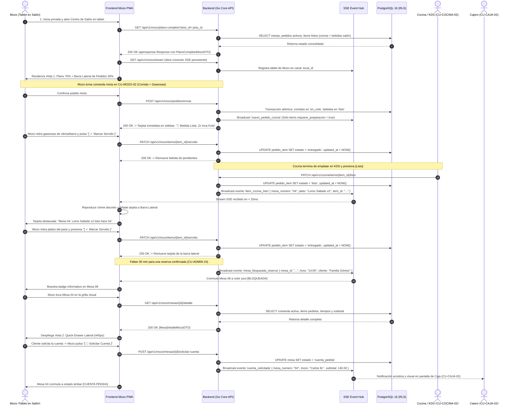
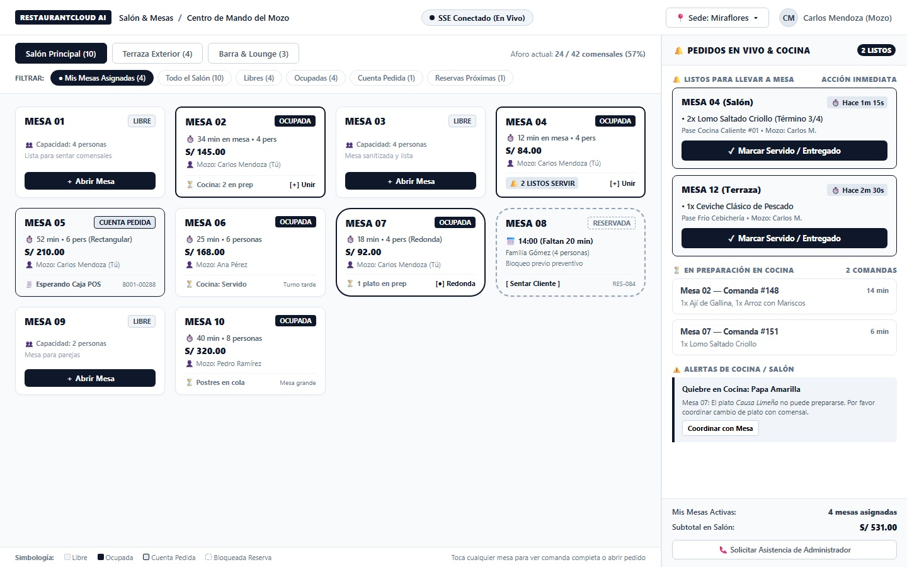
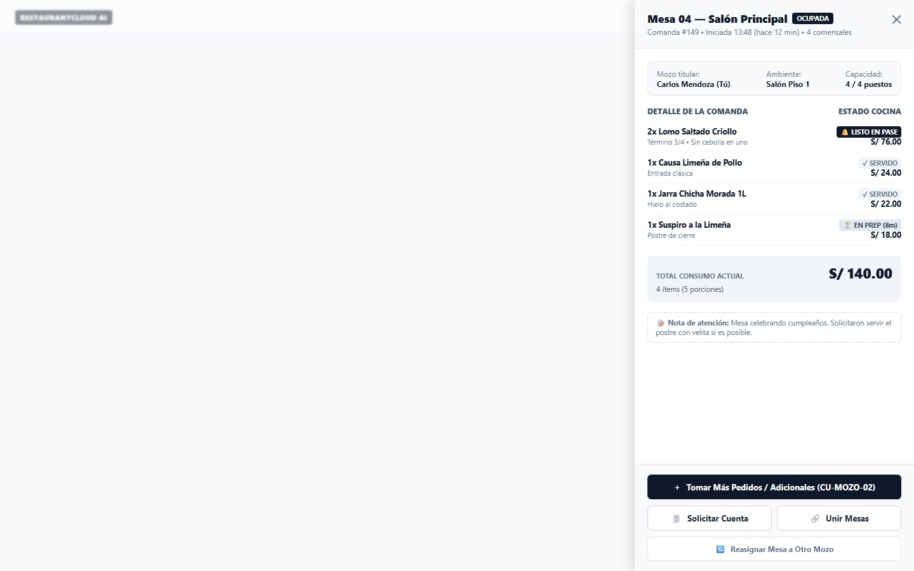
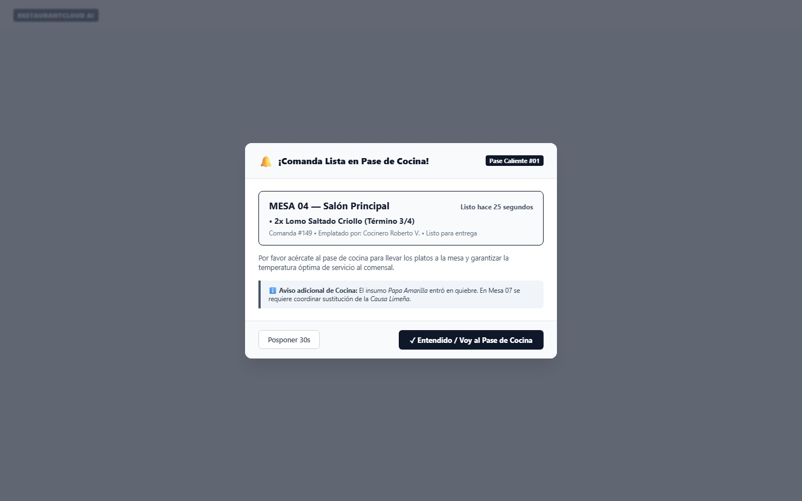
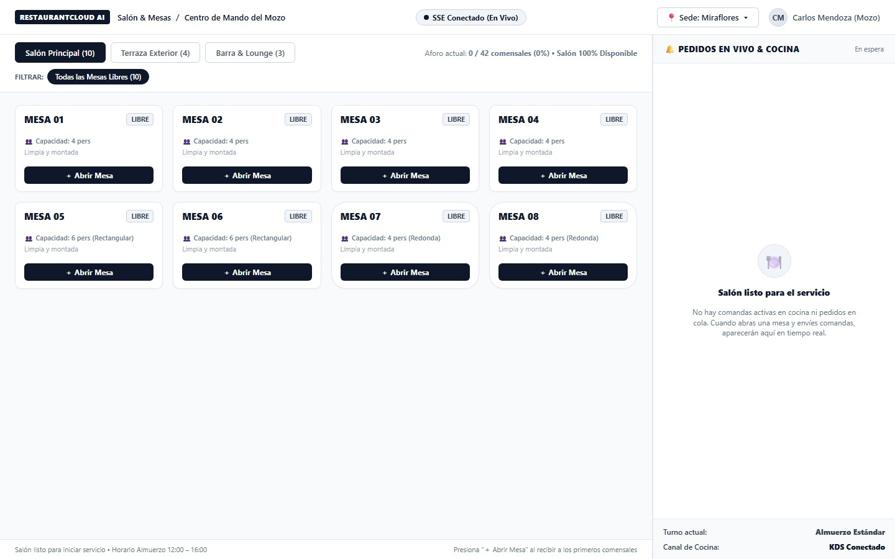

# CU-MOZO-01: Ver Estado de Mesas y Centro de Comandas en Vivo

Especificación técnica de interfaz de usuario, arquitectura de información, control de acceso basado en roles (RBAC), ergonomía táctil en salón, sincronización reactiva en tiempo real (Server-Sent Events) y contratos de API Go en **RestaurantCloud AI**.

---

## 1. Ficha Técnica del Caso de Uso

| Atributo | Detalle |
| :--- | :--- |
| **Código CU** | `CU-MOZO-01` |
| **Nombre** | Ver estado de mesas y centro de comandas en vivo |
| **Actor(es)** | `mozo` (personal de atención en salón; titular operativo de comandas móviles) |
| **Dispositivo / Viewport** | Responsive Tablet (`1024x768` / `1280x800`), Desktop POS (`1440x900`), Mobile Smartphone (`375x812` / `412x915`) |
| **Precondición** | El local se encuentra activo y dentro de su horario de atención (`CU-ADMIN-09`); existen ambientes y mesas configurados (`CU-ADMIN-01`); el usuario cuenta con sesión activa y rol `mozo` asignado a la sede. |
| **Postcondición** | El mozo visualiza la distribución física de mesas con estados cromáticos en tiempo real (`Libre`, `Ocupada`, `Cuenta Pedida`, `Bloqueada por Reserva`); dispone de una barra lateral persistente con avisos de platos listos en cocina (`CU-COCINA-02`) y bebidas de despacho directo listas en salón (`requiere_preparacion = false`), ambas con botón en 1 toque para marcar servido; recibe alertas de quiebre de insumos (`CU-COCINA-04`) y bloqueos preventivos por reservas confirmadas (`CU-ADMIN-10`) vía Server-Sent Events (SSE) sin refresco manual. |

---

## 2. Diagrama de Flujo y Secuencia en Tiempo Real (SSE)



---

## 3. Especificación de Pantallas y Wireframes Blueprint

### Vista 1: Centro de Mando de Salón y Comandas en Vivo (`wf_mozo_01_plano_pedidos.jpg`)

Pantalla principal táctil en formato horizontal (`1440x900` / Tablet `1024x768`). Estructurada en **2 áreas complementarias**: el plano físico de mesas (70% del ancho) y la barra lateral de pedidos y alertas de cocina en vivo (30% del ancho, ~390px).



#### Layout Estructural ASCII (Desktop / Tablet 1440x900)
```text
+----------------------------------------------------------------------------------------------------+
| RESTAURANTCLOUD AI   | Salón & Mesas > Centro de Mando   (•) SSE En Vivo   [ Sede: Miraflores v ]  |
+------------------------------------------------------------------+---------------------------------+
| ÁREA PRINCIPAL: PLANO VISUAL DE MESAS (70% ancho)                | BARRA LATERAL: PEDIDOS EN VIVO  |
|                                                                  | (30% ancho ~390px)              |
| [ Salón Principal (10) ] [ Terraza (4) ] [ Barra (3) ]           | 🥤 SALÓN & COCINA EN VIVO       |
| Aforo actual: 24 / 42 comensales (57%)                           | [ 3 LISTOS PARA SERVIR ]        |
|                                                                  |---------------------------------|
| Filtrar: [● Mis Mesas (4)] [ Todo Salón ] [ Libres ] [ Ocupadas] | 🥤 BEBIDAS & DESPACHO DIRECTO   |
|                                                                  | +-----------------------------+ |
| +------------+ +------------+ +------------+ +------------+      | | MESA 04 (Salón)  ⏱️ Hace 30s | |
| | MESA 01    | | MESA 02    | | MESA 03    | | MESA 04    |      | | • 2x Inca Kola 500ml Helada | |
| | LIBRE      | | OCUPADA    | | LIBRE      | | OCUPADA    |      | | Salón / Barra • Despacho Inm| |
| | Cap: 4     | | ⏱️ 34 min  | | Cap: 4     | | ⏱️ 12 min  |      | | [ ✓ Marcar Servido ]        | |
| | [ Abrir ]  | | S/ 145.00  | | [ Abrir ]  | | S/ 94.00   |      | +-----------------------------+ |
| |            | | Carlos M.  | |            | | 🔔 2 LISTOS|      |---------------------------------|
| +------------+ +------------+ +------------+ +------------+      | 🔔 LISTOS EN PASE DE COCINA     |
|                                                                  | +-----------------------------+ |
| +------------+ +------------+ +------------+ +------------+      | | MESA 04 (Salón)  ⏱️ Hace 1m  | |
| | MESA 05    | | MESA 06    | | MESA 07    | | MESA 08    |      | | • 2x Lomo Saltado Criollo   | |
| | CUENTA     | | OCUPADA    | | OCUPADA    | | RESERVA    |      | | Pase Caliente #01 • Carlos M| |
| | ⏱️ 52 min  | | ⏱️ 25 min  | | ⏱️ 18 min  | | 14:00 (20m)|      | | [ ✓ Marcar Servido ]        | |
| | S/ 210.00  | | S/ 168.00  | | S/ 92.00   | | Fam. Gómez |      | +-----------------------------+ |
| | Espera POS | | Ana P.     | | [● Redonda]| | [ Sentar ] |      | +-----------------------------+ |
| +------------+ +------------+ +------------+ +------------+      | | MESA 12 (Terraza) ⏱️ Hace 2m| |
|                                                                  | | • 1x Ceviche Clásico        | |
| Simbología: (Verde) Libre | (Negro) Ocupada | (Ámbar) Cuenta     | | [ ✓ Marcar Servido ]        | |
|             (Punteado) Bloqueada Reserva | [+] Permite Unión     | +-----------------------------+ |
|                                                                  |                                 |
|                                                                  | ⏳ EN PREPARACIÓN COCINA KDS    |
|                                                                  | • Mesa 02 — Comanda #148 (14m)  |
|                                                                  | • Mesa 07 — Comanda #151 (6m)   |
|                                                                  |                                 |
|                                                                  | ⚠️ ALERTAS OPERATIVAS (1)       |
|                                                                  | • Mesa 07: Quiebre Papa Amarilla|
|                                                                  | [ Mis Mesas: 4 | S/ 541.00 ]    |
+------------------------------------------------------------------+---------------------------------+
```

#### Elementos Visuales y Funcionalidades
- **Selector de Ambientes y Medidor de Aforo:** Conmuta entre pisos físicos del restaurante (`Salón Principal`, `Terraza`, `Barra`) mostrando el aforo en vivo.
- **Filtro de Foco Operativo:** Píldora destacada `[● Mis Mesas Asignadas (4)]` para que el mozo supervise exclusivamente sus comandas, con opción de un toque para ver `[Todo el Salón (10)]`.
- **Tarjetas de Mesa Touch-First:** Muestran número, tiempo de ocupación, comensales, monto consumido, nombre del mozo y badge de platos listos o en preparación.
- **Barra Lateral de Despacho Dual en Vivo:** 
  - **`🥤 BEBIDAS & DESPACHO DIRECTO`**: Lista bebidas embotelladas e infusiones que no requieren cocina y nacen inmediatamente listas para servir al comensal.
  - **`🔔 LISTOS EN PASE DE COCINA`**: Prioriza los platos calientes finalizados en KDS con cronómetro y botón en 1 toque `[ ✓ Marcar Servido ]`.

---

### Vista 2: Quick-Drawer de Inspección de Mesa Ocupada (`wf_mozo_01_inspeccion_mesa_drawer.jpg`)

Panel lateral táctil de 440px que se sobrepone suavemente al tocar una mesa ocupada, evitando cambiar de pantalla y permitiendo gestionar la cuenta en pocos segundos.



#### Layout Estructural ASCII (Drawer 440px)
```text
+-----------------------------------------------------------+
| Mesa 04 — Salón Principal                     [ OCUPADA ] |
| Comanda #149 • Iniciada 13:48 (hace 12 min) • 4 comensales|
|-----------------------------------------------------------|
| Mozo: Carlos Mendoza (Tú) | Salón Piso 1 | 4 / 4 puestos  |
|                                                           |
| DETALLE DE LA COMANDA:                      ESTADO / ACCIÓN|
| -- PLATOS EN COCINA KDS (Requiere Preparación) --         |
| • 2x Lomo Saltado Criollo (Término 3/4)     [🔔 LISTO] S/76|
| • 1x Suspiro a la Limeña                    [⏳ PREP 8m]S/18|
| • 1x Causa Limeña de Pollo                  [✓ SERVIDO]S/24|
|                                                           |
| -- BEBIDAS Y DESPACHO DIRECTO SALÓN --                    |
| • 2x Inca Kola 500ml (Helada)               [🥤 LISTO] S/18|
|   ↳ [ ✓ Marcar Bebida Servida ]                           |
| • 1x Jarra Chicha Morada 1L (Hielo aparte)  [✓ SERVIDO]S/22|
|                                                           |
| TOTAL CONSUMO ACTUAL:                          S/ 158.00  |
|                                                           |
| 📝 Nota: Mesa celebrando cumpleaños. Servir postre velita.|
|-----------------------------------------------------------|
| [ ＋ Tomar Más Pedidos / Adicionales (CU-MOZO-02)        ] |
| [ 🧾 Solicitar Cuenta a Caja ]  [ 🔗 Unir Mesas ]         |
| [ 🔄 Reasignar Mesa a Otro Mozo                          ] |
+-----------------------------------------------------------+
```

#### Elementos Visuales y Funcionalidades
- **Trazabilidad Plato por Plato con Split Operativo:** Distingue con claridad los platos elaborados en fogones (`requiere_preparacion = true`) de las bebidas despachadas directamente por el mozo desde la vitrina o barra (`requiere_preparacion = false`).
- **Botón Directo para Servir Bebidas:** Permite marcar como entregada una gaseosa o agua mineral en 1 toque sin esperar la cocina.
- **Botón Primario de Adicionales:** Acceso directo en 1 toque a la carta para añadir bebidas o postres ([`CU-MOZO-02`](file:///j:/proyectos_git/RestaurantCloud_AI_backend/context/cu.md#L911)).
- **Solicitud de Cuenta en 1 Clic:** Conmuta la mesa a `cuenta_pedida` y dispara una alerta instantánea a Caja ([`CU-CAJA-02`](file:///j:/proyectos_git/RestaurantCloud_AI_backend/context/cu.md#L1094)) para llevar la cuenta o el POS.

---

### Vista 3: Modal de Alerta Prioritaria: Platos Listos / Quiebre en Cocina (`wf_mozo_01_alerta_cocina_modal.jpg`)

Alerta flotante centrada (560px) que emerge cuando la cocina finaliza una preparación crítica o reporta un insumo en quiebre que afecta a un plato pedido.



#### Layout Estructural ASCII (Modal 560px)
```text
+-------------------------------------------------------------+
| 🔔 ¡Comanda Lista en Pase de Cocina!      Pase Caliente #01 |
|-------------------------------------------------------------|
| MESA 04 — Salón Principal           Listo hace 25 segundos  |
| • 2x Lomo Saltado Criollo (Término 3/4)                     |
| Comanda #149 • Emplatado por Cocinero Roberto V.            |
|                                                             |
| El pase de cocina solicita entrega inmediata para           |
| garantizar la temperatura óptima de servicio al comensal.   |
|                                                             |
| ℹ️ Aviso adicional: Insumo Papa Amarilla agotado en cocina. |
| Mesa 07 requiere coordinar sustitución de Causa Limeña.     |
|-------------------------------------------------------------|
| [ Posponer 30s ]         [ ✓ Entendido / Voy al Pase Cocina]|
+-------------------------------------------------------------+
```

---

### Vista 4: Estado Inicial / Salón Listo al Inicio de Turno (`wf_mozo_01_inicio_turno_vacio.jpg`)

Vista del salón al 100% disponible al iniciar el servicio (ej. 12:00 hrs para almuerzo o 19:00 hrs para cena).



#### Layout Estructural ASCII (Desktop / Tablet 1440x900)
```text
+----------------------------------------------------------------------------------------------------+
| RESTAURANTCLOUD AI   | Salón & Mesas > Centro de Mando   (•) SSE En Vivo   [ Sede: Miraflores v ]  |
+------------------------------------------------------------------+---------------------------------+
| ÁREA PRINCIPAL: PLANO VISUAL DE MESAS (70%)                      | BARRA LATERAL: PEDIDOS (30%)    |
| Aforo actual: 0 / 42 comensales (0%) • Salón 100% Disponible     |                                 |
|                                                                  | [🍽️]                            |
| +------------+ +------------+ +------------+ +------------+      | Salón listo para el servicio    |
| | MESA 01    | | MESA 02    | | MESA 03    | | MESA 04    |      | No hay comandas activas en      |
| | LIBRE      | | LIBRE      | | LIBRE      | | LIBRE      |      | cocina ni pedidos en cola.      |
| | [ Abrir ]  | | [ Abrir ]  | | [ Abrir ]  | | [ Abrir ]  |      | Cuando abras una mesa y envíes  |
| +------------+ +------------+ +------------+ +------------+      | pedidos, aparecerán aquí.       |
|                                                                  |                                 |
| +------------+ +------------+ +------------+ +------------+      | Turno: Almuerzo Estándar        |
| | MESA 05    | | MESA 06    | | MESA 07    | | MESA 08    |      | Canal Cocina: KDS Conectado     |
| | LIBRE      | | LIBRE      | | LIBRE      | | LIBRE      |      +---------------------------------+
| | [ Abrir ]  | | [ Abrir ]  | | [ Abrir ]  | | [ Abrir ]  |                                        |
| +------------+ +------------+ +------------+ +------------+                                        |
+----------------------------------------------------------------------------------------------------+
```

---

## 4. Matriz de Estados de la UI

| Estado UX | Indicador Visual | Comportamiento del Sistema / Acciones Disponibles |
| :--- | :--- | :--- |
| **1. Skeleton / Loading** | Celdas de mesas y cards laterales en pulso neutro (`#E2E8F0`) | Bloqueo momentáneo de taps; carga inicial de mesas y comandas activas vía REST; apertura de stream SSE. |
| **2. Empty / Turno Nuevo** | Vista 4 con mesas verdes al 100% libre y sidebar en reposo | Mensaje de servicio listo; botón directo en cada mesa para sentar a los primeros comensales. |
| **3. Loaded / En Servicio** | Vista 1 con mesas multicolores y cards dinámicas | Recepción fluida de eventos SSE; actualización instantánea de tarjetas sin parpadeos ni repintado total. |
| **4. Alerta Prioritaria** | Modal emergente Vista 3 con sonido suave de cortesía | Notifica plato listo urgente en el pase de cocina o quiebre de insumo que impide preparar un ítem en cola. |
| **5. Desconexión / Offline** | Badge ámbar en top bar: `[ ⚠️ Reconectando... Modo Lectura ]` | Intento de reconexión automático con retroceso exponencial (1s, 2s, 5s); los datos permanecen legibles en caché local. |

---

## 5. Control de Acceso y Matriz RBAC

| Rol | Ver Plano y Estados | Ver Barra de Cocina | Abrir Mesa (`CU-MOZO-02`) | Marcar Servido | Solicitar Cuenta | Modificar Plano (`CU-ADMIN-01`) |
| :--- | :---: | :---: | :---: | :---: | :---: | :---: |
| `mozo` | ✅ Sí | ✅ Sí | ✅ Sí | ✅ Sí | ✅ Sí | ❌ No (solo Admin) |
| `admin_local` | ✅ Sí | ✅ Sí | ✅ Sí | ✅ Sí | ✅ Sí | ✅ Sí |
| `cocina` | ❌ No | ❌ No (KDS) | ❌ No | ❌ No | ❌ No | ❌ No |
| `cajero` | ✅ Sí (consulta) | ❌ No | ❌ No | ❌ No | ❌ No | ❌ No |
| `propietario` | ✅ Sí (monitor) | ❌ No | ❌ No | ❌ No | ❌ No | ❌ No |

---

## 6. Contratos de API REST y SSE (Go DTOs & Endpoints)

### 6.1 DTOs en Go (`internal/domain/salon/dto.go`)

```go
package salon

import (
	"time"
	"github.com/google/uuid"
)

// EstadoMesaOperativo enum para el frontend del Mozo
type EstadoMesaOperativo string

const (
	MesaLibre         EstadoMesaOperativo = "libre"
	MesaOcupada       EstadoMesaOperativo = "ocupada"
	MesaCuentaPedida  EstadoMesaOperativo = "cuenta_pedida"
	MesaBloqueada     EstadoMesaOperativo = "bloqueada"
)

// MesaCardDTO representa la tarjeta de mesa en el plano visual
type MesaCardDTO struct {
	ID                 uuid.UUID           `json:"id"`
	PisoID             uuid.UUID           `json:"piso_id"`
	Numero             string              `json:"numero"`
	Capacidad          int                 `json:"capacidad"`
	Forma              string              `json:"forma"` // "cuadrada", "redonda", "rectangular"
	PosicionX          int                 `json:"posicion_x"`
	PosicionY          int                 `json:"posicion_y"`
	PermiteUnion       bool                `json:"permite_union"`
	Estado             EstadoMesaOperativo `json:"estado"`
	
	// Datos operativos si está ocupada
	PedidoID           *uuid.UUID          `json:"pedido_id,omitempty"`
	ComensalesSentados *int                `json:"comensales_sentados,omitempty"`
	MinutosOcupada     *int                `json:"minutos_ocupada,omitempty"`
	TotalConsumo       *float64            `json:"total_consumo,omitempty"`
	MozoID             *uuid.UUID          `json:"mozo_id,omitempty"`
	MozoNombre         *string             `json:"mozo_nombre,omitempty"`
	EsMiMesa           bool                `json:"es_mi_mesa"`
	PlatosListos       int                 `json:"platos_listos"`
	PlatosEnCocina     int                 `json:"platos_en_cocina"`
	BebidasPendientes  int                 `json:"bebidas_pendientes"`
	
	// Datos si está bloqueada por reserva
	ReservaCliente     *string             `json:"reserva_cliente,omitempty"`
	ReservaHora        *string             `json:"reserva_hora,omitempty"`
}

// ItemDespachoListoDTO tarjeta para la barra lateral (cocina KDS o bebidas de salón)
type ItemDespachoListoDTO struct {
	ItemID              uuid.UUID `json:"item_id"`
	PedidoID            uuid.UUID `json:"pedido_id"`
	MesaNumero          string    `json:"mesa_numero"`
	Ambiente            string    `json:"ambiente"`
	ProductoNombre      string    `json:"producto_nombre"`
	Cantidad            int       `json:"cantidad"`
	NotaEspecial        *string   `json:"nota_especial,omitempty"`
	RequierePreparacion bool      `json:"requiere_preparacion"` // true = Cocina KDS; false = Salón / Barra
	TipoDespacho        string    `json:"tipo_despacho"`        // "cocina" o "directo_salon"
	PaseCocina          *string   `json:"pase_cocina,omitempty"`// "Pase Caliente #01", "Pase Frío" (solo si requiere cocina)
	SegundosListo       int       `json:"segundos_listo"`
}

// PlanoCompletoMozoDTO payload de carga inicial del salón
type PlanoCompletoMozoDTO struct {
	PisoID              uuid.UUID              `json:"piso_id"`
	PisoNombre          string                 `json:"piso_nombre"`
	Mesas               []MesaCardDTO          `json:"mesas"`
	ItemsListos         []ItemDespachoListoDTO `json:"items_listos"`
	AforoOcupado        int                    `json:"aforo_ocupado"`
	AforoTotal          int                    `json:"aforo_total"`
	MisMesasActivas     int                    `json:"mis_mesas_activas"`
	TotalVentaTurno     float64                `json:"total_venta_turno"`
}

// MesaDetalleMozoDTO payload para el Quick-Drawer al tocar mesa
type MesaDetalleMozoDTO struct {
	MesaID         uuid.UUID `json:"mesa_id"`
	Numero         string    `json:"numero"`
	Ambiente       string    `json:"ambiente"`
	Estado         string    `json:"estado"`
	ComandaID      uuid.UUID `json:"comanda_id"`
	MozoNombre     string    `json:"mozo_nombre"`
	MinutosEnMesa  int       `json:"minutos_en_mesa"`
	Comensales     int       `json:"comensales"`
	Items          []struct {
		ID                  uuid.UUID `json:"id"`
		ProductoNombre      string    `json:"producto_nombre"`
		Cantidad            int       `json:"cantidad"`
		PrecioUnitario      float64   `json:"precio_unitario"`
		Subtotal            float64   `json:"subtotal"`
		Nota                *string   `json:"nota,omitempty"`
		RequierePreparacion bool      `json:"requiere_preparacion"`
		TipoDespacho        string    `json:"tipo_despacho"` // "cocina", "directo_salon"
		Estado              string    `json:"estado"`        // "en_cola", "en_preparacion", "listo", "entregado"
	} `json:"items"`
	TotalSubtotal  float64   `json:"total_subtotal"`
}
```

### 6.2 Endpoints del Módulo

| Método | Ruta | Rol Requerido | Descripción | Códigos HTTP |
| :--- | :--- | :--- | :--- | :--- |
| `GET` | `/api/v1/mozo/plano-completo` | `mozo`, `admin_local` | Carga integral de mesas, platos/bebidas listos y KPIs de salón | `200`, `401`, `403` |
| `GET` | `/api/v1/mozo/stream` | `mozo`, `admin_local` | Conexión persistente Server-Sent Events (SSE) | `200 (text/event-stream)` |
| `GET` | `/api/v1/mozo/mesas/{id}/detalle` | `mozo`, `admin_local` | Detalle de comanda activa para el Quick-Drawer | `200`, `404` |
| `PATCH`| `/api/v1/mozo/items/{id}/servido` | `mozo` | Marca plato o bebida como entregado en salón (limpia tarjeta) | `200`, `404` |
| `POST` | `/api/v1/mozo/mesas/{id}/solicitar-cuenta` | `mozo` | Conmuta mesa a `cuenta_pedida` y alerta a Caja | `200`, `409` |
| `PATCH`| `/api/v1/mozo/mesas/{id}/reasignar` | `mozo`, `admin_local` | Transfiere comanda a otro mozo compañero de turno | `200`, `400` |

---

## 7. Esquema Relacional de Base de Datos y Optimización

```sql
-- 1. Índices compuestos para consulta sub-milisegundo (< 2ms) del plano del mozo
CREATE INDEX IF NOT EXISTS idx_pedido_mozo_activo 
ON pedido(local_id, mozo_id, mesa_id) 
WHERE estado IN ('borrador', 'enviado');

CREATE INDEX IF NOT EXISTS idx_pedido_item_estado_entrega 
ON pedido_item(pedido_id, estado) 
WHERE estado IN ('listo', 'en_preparacion');

-- 2. Índice para acelerar el bloqueo por reservas inminentes (CU-ADMIN-10)
CREATE INDEX IF NOT EXISTS idx_reserva_bloqueo_inminente 
ON reserva(local_id, estado, fecha_hora) 
WHERE estado = 'confirmada';
```

---

## 8. Accesibilidad y Ergonomía Táctil WCAG 2.1 AA

1. **Objetivos Táctiles Grandes (Touch Targets > 48x48px):** Todas las tarjetas de mesas miden como mínimo `140x120px` y los botones de acción lateral superan `48px` de altura, permitiendo operación con una sola mano.
2. **Contrastes Visuales:** Contraste superior a `12:1` para textos oscuros (`#0F172A`) y superior a `4.8:1` para badges operativos.
3. **Señales Multimodales:** Las alertas de platos listos emiten una señal visual en tarjeta, un pulso auditivo suave de cortesía (chime) y vibración háptica en tablets compatibles.
4. **Semántica ARIA y Live Regions:** La barra lateral de platos listos implementa `aria-live="polite"` y `role="log"` para que los asistentes de accesibilidad anuncien nuevas comandas sin interrumpir la navegación.
