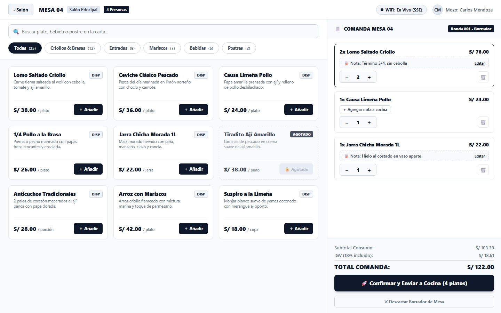
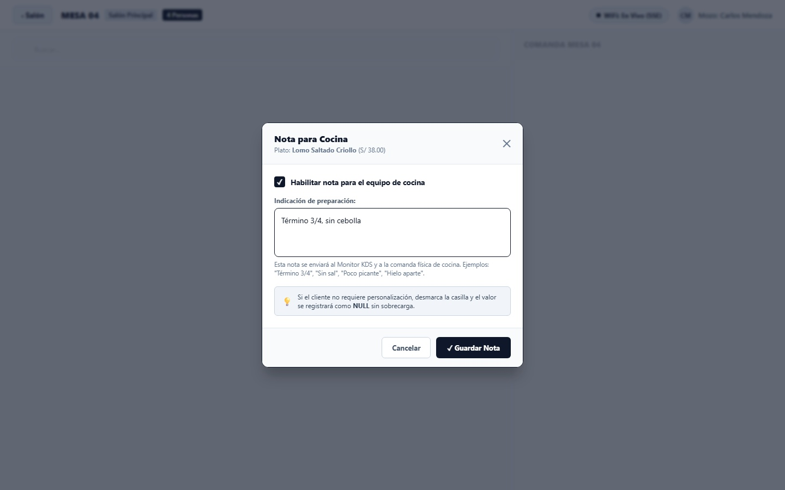
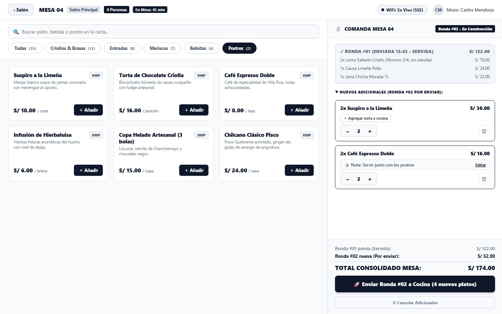
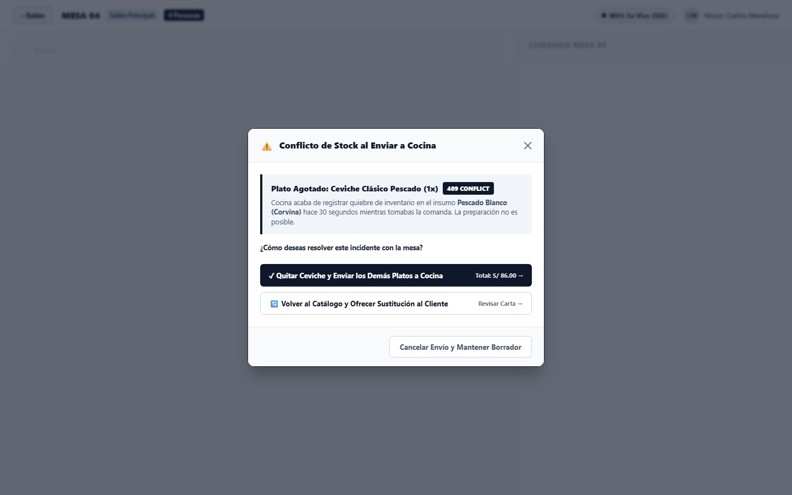

# CU-MOZO-02: Tomar Pedido y Comanda Móvil en Salón
*(Unifica funcionalmente `CU-MOZO-02: Tomar pedido`, `CU-MOZO-03: Modificar pedido antes de enviarlo` y `CU-MOZO-07: Consultar disponibilidad de productos`)*

Especificación técnica de interfaz de usuario, arquitectura de información táctil (Mobile POS / Tablet), enrutamiento en tiempo real a cocina vía Server-Sent Events, gestión de rondas múltiples, contratos de API en Go y persistencia en PostgreSQL 16 para **RestaurantCloud AI**.

---

## 1. Ficha Técnica del Caso de Uso

| Atributo | Detalle |
| :--- | :--- |
| **Código CU** | `CU-MOZO-02` (Consolidado con `CU-MOZO-03` y `CU-MOZO-07`) |
| **Nombre** | Tomar pedido y comanda móvil en salón |
| **Actor Principal** | `mozo` (personal de atención en sala; operador titular de la comanda en tablet/móvil) |
| **Actores Secundarios** | `cocina` (receptor pasivo inmediato en monitores KDS `CU-COCINA-01`), `cajero` (receptor del pedido activo para preconteo `CU-CAJA-02`) |
| **Dispositivo / Viewport** | Responsive Tablet en Salón (`1024x768` / `1280x800` / `1440x900`), Mobile POS (`375x812` / `412x915`), Terminal Fija POS (`1920x1080`) |
| **Precondición** | La mesa se encuentra en estado `libre` o `ocupada` (para rondas adicionales de la misma comanda); existen categorías y productos registrados en el local (`CU-ADMIN-02`, `CU-ADMIN-04`); el mozo cuenta con sesión activa y turno abierto (`CU-MOZO-01`). |
| **Postcondición** | La comanda se persiste atómicamente en PostgreSQL 16; se crean los registros en `pedido` (estado `enviado`) y `pedido_item` (estado `en_cola`); la mesa pasa a estado `ocupada`; el sistema emite el evento en tiempo real `nueva_comanda_cocina` (< 30ms) enrutado a las pantallas KDS correspondientes; el mozo retorna al plano de mesas con confirmación háptica y visual. |

---

## 2. Diagrama de Flujo y Secuencia en Tiempo Real (KDS & SSE)

```mermaid
sequenceDiagram
    autonumber
    actor M as Mozo en Salón (Tablet)
    participant FE as Frontend Mobile POS
    participant BE as Backend Go Core API
    participant SSE as SSE Event Bus
    participant DB as PostgreSQL 16 (RLS)
    actor K as Cocina KDS (CU-COCINA-01)
    actor C as Cajero (CU-CAJA-02)

    %% 1. Consulta Reactiva de Carta y Armado de Borrador (CU-MOZO-07)
    M->>FE: 1. Selecciona Mesa 04 en plano y pulsa "[ + Tomar Pedido ]"
    FE->>BE: GET /api/v1/mozo/mesas/{mesa_id}/carta
    BE->>DB: SELECT productos activos con disponibilidad y categorías
    DB-->>BE: Retorna catálogo con estados ('disponible' / 'agotado')
    BE-->>FE: 200 OK (apiresponse.Response con CatalogoProductosMozoDTO)
    FE->>M: Despliega Vista 1: Catálogo 65% + Ticket borrador 35%

    %% 2. Selección de Platos y Nota a Cocina Simplificada (CU-MOZO-03)
    M->>FE: 2. Toca "[ ＋ Añadir ]" en Lomo Saltado Criollo
    FE->>FE: Inserta ítem en borrador local (1x S/ 38.00)
    M->>FE: 3. Toca "[ + Agregar nota a cocina ]"
    FE->>M: Abre Vista 2: Modal Nota Cocina (checkbox activable + texto)
    M->>FE: 4. Marca [✓ Habilitar nota], escribe "Término 3/4, sin cebolla" y [ Guardar ]
    FE->>FE: Actualiza ítem con nota_cocina (o NULL si se desmarca)
    M->>FE: 5. Presiona stepper "[ + ]" -> Cantidad conmuta a 2x (S/ 76.00)

    %% 3. Confirmación y Despacho Atómico a Cocina
    M->>FE: 6. Presiona "[ 🚀 Confirmar y Enviar a Cocina (4 platos) ]"
    FE->>BE: POST /api/v1/mozo/mesas/{mesa_id}/pedidos { items: [...] }
    
    BE->>DB: 7. BEGIN TX: Valida disponibilidad concurrente de productos
    alt Algún producto fue marcado agotado durante la toma
        DB-->>BE: Producto agotado por cocina (disponibilidad = 'agotado')
        BE->>DB: ROLLBACK TX
        BE-->>FE: 409 Conflict (ERR_PRODUCTO_AGOTADO, { producto_id: "...", nombre: "..." })
        FE->>M: Despliega Vista 4: Modal Asistido de Conflicto de Stock
    else Todos los productos disponibles
        BE->>DB: 8. INSERT INTO pedido (local_id, mesa_id, mozo_id, estado='enviado')
        BE->>DB: 9. INSERT INTO pedido_item (pedido_id, producto_id, cantidad, nota_cocina, estado='en_cola', numero_ronda=1)
        BE->>DB: 10. UPDATE mesa SET estado='ocupada' WHERE id=:mesa_id
        DB-->>BE: COMMIT TX exitoso
        BE->>SSE: Broadcast evento 'nueva_comanda_cocina' { mesa: "04", comanda_id: "...", items: [...] }
        SSE-->>K: Suena campana en monitor KDS; orden entra en cola de cocina
        BE->>SSE: Broadcast evento 'mesa_estado_cambiado' { mesa_id: "...", estado: "ocupada" }
        SSE-->>C: Sincroniza estado de mesa en panel de caja
        BE-->>FE: 201 Created (PedidoConfirmadoDTO)
        FE->>M: Toast de éxito + Vibración háptica -> Redirecciona a Salón (CU-MOZO-01)
    end
```

---

## 3. Especificación de Pantallas y Wireframes Blueprint

### Vista 1: Pantalla Táctil de Toma de Pedido y Comanda Móvil (`wf_mozo_02_toma_pedido.jpg`)

Pantalla principal de venta táctil en tablet (`1440x900` / `1024x768`). Divide el viewport en **Catálogo de la Carta en Vivo (65%)** a la izquierda y el **Ticket Interactivo de Comanda (35% ~500px)** a la derecha, garantizando visibilidad total de los consumos acumulados mientras se recorren los platos.



#### Layout Estructural ASCII (Desktop / Tablet 1440x900)
```text
+----------------------------------------------------------------------------------------------------+
| ‹ Salón | MESA 04  [Salón Principal] [4 Personas]           (•) WiFi: En Vivo (SSE)  [CM] Carlos M.|
+------------------------------------------------------------------+---------------------------------+
| CATÁLOGO EN TIEMPO REAL (65% del ancho - integra CU-MOZO-07)     | TICKET DE COMANDA (35% ~500px)  |
|                                                                  |                                 |
| [ 🔍 Buscar plato, bebida o postre en la carta...              ] | 🧾 COMANDA MESA 04  [Ronda #01] |
|                                                                  | ------------------------------- |
| [ Todas (35) ] [ Criollos & Brasas ] [ Entradas ] [ Bebidas ]    | +-----------------------------+ |
|                                                                  | | 2x Lomo Saltado Criollo     | |
| +-----------------------------+ +-----------------------------+  | | S/ 76.00                    | |
| | Lomo Saltado Criollo  [DISP]| | Ceviche Clásico       [DISP]|  | | 📝 Nota: Término 3/4, s/ceb | |
| | Carne salteada al wok...    | | Pesca del día en limón...   |  | | [ - ] [ 2 ] [ + ]     [ 🗑️ ]| |
| | S/ 38.00         [ + Añadir]| | S/ 36.00         [ + Añadir]|  | +-----------------------------+ |
| +-----------------------------+ +-----------------------------+  | +-----------------------------+ |
| +-----------------------------+ +-----------------------------+  | | 1x Causa Limeña Pollo       | |
| | 1/4 Pollo a Brasa     [DISP]| | Jarra Chicha 1L       [DISP]|  | | S/ 24.00                    | |
| | Papas fritas y ensalada...  | | Maíz morado con especias... |  | | [ + Agregar nota a cocina ] | |
| | S/ 26.00         [ + Añadir]| | S/ 22.00         [ + Añadir]|  | | [ - ] [ 1 ] [ + ]     [ 🗑️ ]| |
| +-----------------------------+ +-----------------------------+  | +-----------------------------+ |
| +-----------------------------+ +-----------------------------+  | +-----------------------------+ |
| | Tiradito Ají Amar  [AGOTADO]| | Anticuchos Tradic     [DISP]|  | | 1x Jarra Chicha Morada 1L   | |
| | Láminas en crema de ají...  | | Corazón con papa dorada...  |  | | S/ 22.00                    | |
| | S/ 38.00        [🔒 Agotado]| | S/ 28.00         [ + Añadir]|  | | 📝 Nota: Hielo en vaso apar | |
| +-----------------------------+ +-----------------------------+  | | [ - ] [ 1 ] [ + ]     [ 🗑️ ]| |
|                                                                  | +-----------------------------+ |
|                                                                  | ------------------------------- |
|                                                                  | Subtotal Consumo:     S/ 103.39 |
|                                                                  | IGV (18% incluido):   S/  18.61 |
|                                                                  | TOTAL COMANDA:        S/ 122.00 |
|                                                                  | ------------------------------- |
|                                                                  | [ 🚀 Enviar a Cocina (4 platos)]|
|                                                                  | [ ✕ Descartar Borrador        ] |
+------------------------------------------------------------------+---------------------------------+
```

---

### Vista 2: Modal Rápido de Nota Corta para Cocina (`wf_mozo_02_modal_nota_cocina.jpg`)

Modal táctil de 480px que se superpone al presionar `[ + Agregar nota a cocina ]` o `[ 📝 Editar ]`. Aplica una política limpia y directa: **sin selectores complejos de modificadores culinarios**. Una casilla de verificación permite habilitar o deshabilitar la nota (semántica `NULL` nativa) y un campo de texto directo captura la indicación del cliente.



#### Layout Estructural ASCII (Modal Centrado 480px)
```text
+------------------------------------------------------------+
| Nota para Cocina                                       [✕] |
| Plato: Lomo Saltado Criollo (S/ 38.00)                     |
+------------------------------------------------------------+
|                                                            |
|  [✓] Habilitar nota para el equipo de cocina               |
|                                                            |
|  Indicación de preparación:                                |
|  +------------------------------------------------------+  |
|  | Término 3/4, sin cebolla                             |  |
|  +------------------------------------------------------+  |
|  Esta nota se enviará al Monitor KDS y a la comanda física.|
|                                                            |
|  💡 Si el cliente no requiere personalización, desmarca la |
|     casilla y el valor se registrará como NULL en la base. |
|                                                            |
+------------------------------------------------------------+
|                          [ Cancelar ]  [ ✓ Guardar Nota ]  |
+------------------------------------------------------------+
```

---

### Vista 3: Toma de Pedido Adicional / Segunda Ronda (`wf_mozo_02_ronda_adicional.jpg`)

Vista utilizada cuando los comensales ya fueron servidos y solicitan una **segunda ronda** (postres, bajativos o platos adicionales). El ticket divide claramente los consumos históricos de la **Ronda #01 (Enviada • Servida)** en un contenedor informativo colapsado para referencia contable, y resalta en blanco los nuevos ítems de la **Ronda #02** listos para ser despachados a cocina.



#### Layout Estructural ASCII (Desktop / Tablet 1440x900)
```text
+----------------------------------------------------------------------------------------------------+
| ‹ Salón | MESA 04  [Salón Principal] [4 Personas] [En Mesa: 45m]   (•) WiFi: En Vivo   [CM] Carlos |
+------------------------------------------------------------------+---------------------------------+
| CATÁLOGO FILTRADO EN POSTRES & BEBIDAS                           | TICKET DE COMANDA CONSOLIDADA   |
|                                                                  |                                 |
| [ Todas ] [ Entradas ] [ Brasas ] [ Bebidas ] [● Postres (2)]    | 🧾 COMANDA MESA 04  [Ronda #02] |
|                                                                  | ------------------------------- |
| +-----------------------------+ +-----------------------------+  | +-----------------------------+ |
| | Suspiro a la Limeña   [DISP]| | Torta Chocolate       [DISP]|  | | ✓ RONDA #01 (Servida) S/ 122| |
| | Manjar blanco de yemas...   | | Bizcochuelo de cacao...     |  | | 2x Lomo Saltado (Término 3/4)| |
| | S/ 18.00         [ + Añadir]| | S/ 16.00         [ + Añadir]|  | | 1x Causa Limeña Pollo       | |
| +-----------------------------+ +-----------------------------+  | | 1x Jarra Chicha Morada 1L   | |
| +-----------------------------+ +-----------------------------+  | +-----------------------------+ |
| | Café Espresso Doble   [DISP]| | Infusión Hierbaluisa  [DISP]|  |                                 |
| | Café de especialidad...     | | Hierbas con miel...         |  | ▼ NUEVOS ADICIONALES (Ronda #2):|
| | S/ 8.00          [ + Añadir]| | S/ 6.00          [ + Añadir]|  | +-----------------------------+ |
| +-----------------------------+ +-----------------------------+  | | 2x Suspiro a la Limeña      | |
|                                                                  | | S/ 36.00  [ - ] [ 2 ] [ + ] | |
|                                                                  | +-----------------------------+ |
|                                                                  | +-----------------------------+ |
|                                                                  | | 2x Café Espresso Doble      | |
|                                                                  | | S/ 16.00  [ - ] [ 2 ] [ + ] | |
|                                                                  | | 📝 Nota: Servir con postres | |
|                                                                  | +-----------------------------+ |
|                                                                  | ------------------------------- |
|                                                                  | Ronda #01 previa:     S/ 122.00 |
|                                                                  | Ronda #02 nueva:      S/  52.00 |
|                                                                  | TOTAL CONSOLIDADO:    S/ 174.00 |
|                                                                  | ------------------------------- |
|                                                                  | [ 🚀 Enviar Ronda #02 a Cocina] |
|                                                                  | [ ✕ Cancelar Adicionales      ] |
+------------------------------------------------------------------+---------------------------------+
```

---

### Vista 4: Modal de Conflicto por Quiebre de Stock al Enviar (`wf_mozo_02_conflicto_agotado_modal.jpg`)

Modal asistido de 540px que intercepta la transacción si Cocina o Administración actualizó un plato a `agotado` mientras el mozo armaba la orden en mesa. Provee opciones de resolución inmediata en un solo toque, evitando que el mozo pierda el resto del pedido de la mesa.



#### Layout Estructural ASCII (Modal Centrado 540px)
```text
+------------------------------------------------------------+
| ⚠️ Conflicto de Stock al Enviar a Cocina               [✕] |
+------------------------------------------------------------+
|                                                            |
|  +------------------------------------------------------+  |
|  | Plato Agotado: Ceviche Clásico Pescado (1x)  [409]   |  |
|  | Cocina acaba de registrar quiebre de inventario en   |  |
|  | el insumo Pescado Blanco (Corvina) hace 30 segundos. |  |
|  | La preparación no es posible.                        |  |
|  +------------------------------------------------------+  |
|                                                            |
|  ¿Cómo deseas resolver este incidente con la mesa?         |
|                                                            |
|  [✓ Quitar Ceviche y Enviar los Demás Platos a Cocina    ] |
|  (Despacha la comanda con subtotal actualizado S/ 86.00)   |
|                                                            |
|  [🔄 Volver al Catálogo y Ofrecer Sustitución al Cliente ] |
|  (Mantiene el borrador y permite agregar otro plato)       |
|                                                            |
+------------------------------------------------------------+
|            [ Cancelar Envío y Mantener Borrador ]          |
+------------------------------------------------------------+
```

---

## 4. Matriz de 5 Estados de la Experiencia de Usuario (UX)

| Estado | Evento Desencadenante | Comportamiento de Interfaz | Elementos Visuales Clave |
| :--- | :--- | :--- | :--- |
| **1. Skeleton / Carga** | Mozo selecciona una mesa y abre la comanda. | Animación pulsante suave (`#E2E8F0` a `#F1F5F9`) en la grilla del catálogo (6 tarjetas) y en el panel lateral de comanda. | Placeholders de texto y botones deshabilitados por < 120ms. |
| **2. Borrador Vacío** | Mesa recién sentada sin ningún plato añadido. | Catálogo 100% interactivo. Panel derecho muestra ilustración técnica con mensaje: *"Mesa lista. Selecciona platos del catálogo para iniciar la comanda"*. | Botón `[ 🚀 Enviar a Cocina ]` deshabilitado (gris `#CBD5E1`) hasta añadir al menos 1 ítem. |
| **3. Comanda en Construcción** | Mozo añade platos al ticket. | Lista viva con steppers `[ - ] [ n ] [ + ]`, cálculo en tiempo real de subtotales, IGV y total general. Posibilidad de agregar o editar nota rápida. | Botón `[ 🚀 Confirmar y Enviar a Cocina ]` activo en color `#0F172A` con conteo dinámico de platos. |
| **4. Modal Nota Cocina** | Toque en `[ + Agregar nota ]` o `[ 📝 Editar ]`. | Backdrop desenfocado (`rgba(15,23,42,0.65)`). Foco automático en el textarea. Checkbox interactivo para activar o anular la nota (`NULL`). | Botones `[ Cancelar ]` y `[ ✓ Guardar Nota ]`. |
| **5. Conflicto de Stock (409)** | Intento de envío de un plato cuyo insumo se agotó en cocina. | Detección atómica en backend. Modal asistido (Vista 4) que ofrece despachar los demás platos o sustituir en catálogo. | Badges `409 Conflict`, sugerencias automáticas de reemplazo. |

---

## 5. Control de Acceso y Matriz RBAC

| Acción / Operación | Mozo | Administrador Local | Cocina | Cajero | Propietario |
| :--- | :---: | :---: | :---: | :---: | :---: |
| **Abrir mesa y crear comanda (`POST /pedidos`)** | ✅ Permitido | ✅ Permitido | ❌ Denegado | ❌ Denegado | ❌ Denegado |
| **Consultar carta y disponibilidad (`GET /carta`)** | ✅ Permitido | ✅ Permitido | ✅ Permitido | ✅ Permitido | ✅ Permitido |
| **Modificar borrador antes de enviar** | ✅ Permitido | ✅ Permitido | ❌ Denegado | ❌ Denegado | ❌ Denegado |
| **Enviar ronda adicional a cocina** | ✅ Permitido | ✅ Permitido | ❌ Denegado | ❌ Denegado | ❌ Denegado |
| **Marcar plato como agotado (`CU-COCINA-04`)** | ❌ Solo lectura | ✅ Permitido | ✅ Permitido | ❌ Denegado | ✅ Permitido |
| **Descartar borrador no enviado** | ✅ Permitido | ✅ Permitido | ❌ Denegado | ❌ Denegado | ❌ Denegado |

---

## 6. Contratos de API REST y Modelos en Go

### 6.1 DTOs de Entrada y Salida (`internal/mozo/dto/pedido_dto.go`)

```go
package dto

import (
	"time"

	"github.com/google/uuid"
)

// ItemPedidoInputDTO representa cada plato o bebida enviado por el mozo a cocina
type ItemPedidoInputDTO struct {
	ProductoID uuid.UUID `json:"producto_id" binding:"required"`
	Cantidad   int       `json:"cantidad" binding:"required,min=1,max=99"`
	NotaCocina *string   `json:"nota_cocina,omitempty" binding:"omitempty,max=200"` // NULL si no requiere nota
}

// CrearPedidoRequest payload para registrar comanda y despachar a cocina KDS
type CrearPedidoRequest struct {
	MesaID      uuid.UUID            `json:"mesa_id" binding:"required"`
	Comensales  int                  `json:"comensales" binding:"required,min=1,max=50"`
	NumeroRonda int                  `json:"numero_ronda" binding:"required,min=1"` // 1 = inicial, 2+ = adicional
	Items       []ItemPedidoInputDTO `json:"items" binding:"required,min=1,dive"`
}

// ItemPedidoDetalleDTO respuesta enriquecida de cada ítem de comanda
type ItemPedidoDetalleDTO struct {
	ID             uuid.UUID `json:"id"`
	ProductoID     uuid.UUID `json:"producto_id"`
	ProductoNombre string    `json:"producto_nombre"`
	Cantidad       int       `json:"cantidad"`
	PrecioUnitario float64   `json:"precio_unitario"`
	Subtotal       float64   `json:"subtotal"`
	NotaCocina     *string   `json:"nota_cocina"` // NULL o string
	Estado         string    `json:"estado"`      // en_cola, en_preparacion, listo, entregado
	NumeroRonda    int       `json:"numero_ronda"`
	CreatedAt      time.Time `json:"created_at"`
}

// PedidoConfirmadoDTO respuesta exitosa tras transacción de envío
type PedidoConfirmadoDTO struct {
	PedidoID       uuid.UUID              `json:"pedido_id"`
	MesaID         uuid.UUID              `json:"mesa_id"`
	MesaNumero     string                 `json:"mesa_numero"`
	NumeroRonda    int                    `json:"numero_ronda"`
	Estado         string                 `json:"estado"` // enviado
	TotalComanda   float64                `json:"total_comanda"`
	ItemsEnviados  []ItemPedidoDetalleDTO `json:"items_enviados"`
	Mensaje        string                 `json:"mensaje"`
}

// ProductoCatalogoMozoDTO producto de la carta con indicador de disponibilidad en vivo
type ProductoCatalogoMozoDTO struct {
	ID             uuid.UUID `json:"id"`
	CategoriaID    uuid.UUID `json:"categoria_id"`
	CategoriaNombre string   `json:"categoria_nombre"`
	Nombre         string    `json:"nombre"`
	Descripcion    *string   `json:"descripcion"`
	Precio         float64   `json:"precio"`
	Disponibilidad string    `json:"disponibilidad"` // disponible, agotado
	Activo         bool      `json:"activo"`
}

// CatalogoProductosMozoDTO listado completo de la carta agrupado
type CatalogoProductosMozoDTO struct {
	Categorias []struct {
		ID     uuid.UUID `json:"id"`
		Nombre string    `json:"nombre"`
		Total  int       `json:"total"`
	} `json:"categorias"`
	Productos []ProductoCatalogoMozoDTO `json:"productos"`
}
```

### 6.2 Endpoints REST

#### A. Consultar Carta y Disponibilidad en Vivo
- **Ruta:** `GET /api/v1/mozo/mesas/{mesa_id}/carta`
- **Respuesta Exitosa (`200 OK`):**
```json
{
  "success": true,
  "data": {
    "categorias": [
      { "id": "b1a2c3d4-...", "nombre": "Criollos & Brasas", "total": 12 },
      { "id": "e5f6a7b8-...", "nombre": "Entradas", "total": 8 },
      { "id": "c9d0e1f2-...", "nombre": "Bebidas", "total": 6 }
    ],
    "productos": [
      {
        "id": "7f8a9b0c-...",
        "categoria_id": "b1a2c3d4-...",
        "categoria_nombre": "Criollos & Brasas",
        "nombre": "Lomo Saltado Criollo",
        "descripcion": "Carne tierna salteada al wok con cebolla, tomate y ají amarillo.",
        "precio": 38.00,
        "disponibilidad": "disponible",
        "activo": true
      },
      {
        "id": "3e4f5a6b-...",
        "categoria_id": "b1a2c3d4-...",
        "categoria_nombre": "Criollos & Brasas",
        "nombre": "Tiradito Ají Amarillo",
        "descripcion": "Láminas de pescado en crema suave de ají amarillo.",
        "precio": 38.00,
        "disponibilidad": "agotado",
        "activo": true
      }
    ]
  },
  "message": "Catálogo de carta obtenido exitosamente"
}
```

#### B. Registrar Comanda y Despachar a Cocina
- **Ruta:** `POST /api/v1/mozo/mesas/{mesa_id}/pedidos`
- **Request Body:**
```json
{
  "mesa_id": "a1b2c3d4-e5f6-7a8b-9c0d-1e2f3a4b5c6d",
  "comensales": 4,
  "numero_ronda": 1,
  "items": [
    {
      "producto_id": "7f8a9b0c-1111-2222-3333-444455556666",
      "cantidad": 2,
      "nota_cocina": "Término 3/4, sin cebolla"
    },
    {
      "producto_id": "8a9b0c1d-2222-3333-4444-555566667777",
      "cantidad": 1,
      "nota_cocina": null
    },
    {
      "producto_id": "9b0c1d2e-3333-4444-5555-666677778888",
      "cantidad": 1,
      "nota_cocina": "Hielo al costado en vaso aparte"
    }
  ]
}
```
- **Respuesta Exitosa (`201 Created`):**
```json
{
  "success": true,
  "data": {
    "pedido_id": "98765432-aaaa-bbbb-cccc-1234567890ab",
    "mesa_id": "a1b2c3d4-e5f6-7a8b-9c0d-1e2f3a4b5c6d",
    "mesa_numero": "04",
    "numero_ronda": 1,
    "estado": "enviado",
    "total_comanda": 122.00,
    "items_enviados": [
      {
        "id": "item-001-...",
        "producto_id": "7f8a9b0c-1111-2222-3333-444455556666",
        "producto_nombre": "Lomo Saltado Criollo",
        "cantidad": 2,
        "precio_unitario": 38.00,
        "subtotal": 76.00,
        "nota_cocina": "Término 3/4, sin cebolla",
        "estado": "en_cola",
        "numero_ronda": 1,
        "created_at": "2026-10-09T13:45:00Z"
      }
    ],
    "mensaje": "Comanda despachada a cocina exitosamente"
  },
  "message": "Comanda registrada con éxito"
}
```

- **Respuesta de Conflicto de Stock (`409 Conflict`):**
```json
{
  "success": false,
  "error": {
    "code": "ERR_PRODUCTO_AGOTADO",
    "message": "El producto 'Ceviche Clásico Pescado' se encuentra agotado en cocina.",
    "details": {
      "producto_id": "9b0c1d2e-3333-4444-5555-666677778888",
      "producto_nombre": "Ceviche Clásico Pescado",
      "insumo_critico": "Pescado Blanco (Corvina)"
    }
  }
}
```

---

## 7. Esquema Relacional de Base de Datos y DDL PostgreSQL 16

```sql
-- PostgreSQL 16 DDL: Esquema de Pedidos y Comandas con Optimización de Rondas y Notas

-- 1. Enum de Estados de Pedido
DO $$ BEGIN
    CREATE TYPE estado_pedido AS ENUM ('borrador', 'enviado', 'cobrado', 'anulado');
EXCEPTION
    WHEN duplicate_object THEN NULL;
END $$;

-- 2. Enum de Estados de Item de Comanda
DO $$ BEGIN
    CREATE TYPE estado_pedido_item AS ENUM ('en_cola', 'en_preparacion', 'listo', 'entregado', 'anulado');
EXCEPTION
    WHEN duplicate_object THEN NULL;
END $$;

-- 3. Tabla Pedido (Cabecera de Cuenta de Mesa)
CREATE TABLE IF NOT EXISTS pedido (
    id UUID PRIMARY KEY DEFAULT gen_random_uuid(),
    local_id UUID NOT NULL REFERENCES local(id) ON DELETE CASCADE,
    mesa_id UUID NOT NULL REFERENCES mesa(id) ON DELETE RESTRICT,
    mozo_id UUID NOT NULL REFERENCES usuario(id) ON DELETE RESTRICT,
    estado estado_pedido NOT NULL DEFAULT 'enviado',
    comensales INT NOT NULL DEFAULT 1 CHECK (comensales > 0),
    created_at TIMESTAMPTZ NOT NULL DEFAULT NOW(),
    updated_at TIMESTAMPTZ NOT NULL DEFAULT NOW()
);

-- 4. Tabla Pedido Item (Detalle de Platos Despachados a Cocina)
CREATE TABLE IF NOT EXISTS pedido_item (
    id UUID PRIMARY KEY DEFAULT gen_random_uuid(),
    pedido_id UUID NOT NULL REFERENCES pedido(id) ON DELETE CASCADE,
    producto_id UUID NOT NULL REFERENCES producto(id) ON DELETE RESTRICT,
    cantidad INT NOT NULL CHECK (cantidad > 0),
    precio_unitario DECIMAL(10, 2) NOT NULL CHECK (precio_unitario >= 0),
    nota_cocina VARCHAR(200) NULL, -- Semántica NULL limpia (NULL = sin requerimientos especiales)
    estado estado_pedido_item NOT NULL DEFAULT 'en_cola',
    numero_ronda INT NOT NULL DEFAULT 1 CHECK (numero_ronda >= 1),
    created_at TIMESTAMPTZ NOT NULL DEFAULT NOW(),
    updated_at TIMESTAMPTZ NOT NULL DEFAULT NOW()
);

-- 5. Índices de Alto Rendimiento para Toma de Comanda y Sincronización
CREATE INDEX IF NOT EXISTS idx_producto_local_disponible 
ON producto(local_id, categoria_id, disponibilidad, activo) 
WHERE activo = true;

CREATE INDEX IF NOT EXISTS idx_pedido_mesa_activa 
ON pedido(mesa_id, estado) 
WHERE estado IN ('borrador', 'enviado');

CREATE INDEX IF NOT EXISTS idx_pedido_items_ronda 
ON pedido_item(pedido_id, numero_ronda, estado);

-- 6. Políticas de Row-Level Security (RLS)
ALTER TABLE pedido ENABLE ROW LEVEL SECURITY;
ALTER TABLE pedido_item ENABLE ROW LEVEL SECURITY;

CREATE POLICY rls_pedido_tenant ON pedido
    USING (local_id = current_setting('app.current_local_id', true)::uuid);

CREATE POLICY rls_pedido_item_tenant ON pedido_item
    USING (EXISTS (
        SELECT 1 FROM pedido p
        WHERE p.id = pedido_item.pedido_id 
          AND p.local_id = current_setting('app.current_local_id', true)::uuid
    ));
```

---

## 8. Ergonomía Táctil y Accesibilidad WCAG 2.1 AA

1. **Touch Targets de Alta Densidad Operativa (> 48x48px):**
   - Los botones del stepper numérico (`[ - ]` y `[ + ]`) tienen dimensiones mínimas de 32x32px dentro de contenedores con margen táctil de 48px, permitiendo ajustes rápidos sin fallos de pulsación con dedos enguantados o húmedos.
   - El botón principal `[ 🚀 Confirmar y Enviar a Cocina ]` ocupa todo el ancho del panel derecho con altura de 52px y texto en 14.5px negrita (contraste `#FFFFFF` sobre `#0F172A`, ratio 15.2:1).
2. **Semántica `NULL` sin Sobrecarga Cognitiva:**
   - Si el comensal no tiene restricciones ni peticiones especiales, el mozo simplemente añade el plato. No se le obliga a abrir diálogos innecesarios.
   - Si desea personalizar, un solo toque abre el modal y el checkbox permite alternar limpiamente entre `NULL` y texto directo.
3. **Contraste Tipográfico Estricto (WCAG AA):**
   - Títulos y nombres de platos en `#0F172A` sobre fondos `#FFFFFF` (ratio 15.2:1, supera ampliamente el mínimo de 4.5:1).
   - Precios destacados en `#0F172A` con tamaño 16px font-weight 800.
   - Descripciones secundarias en `#64748B` sobre `#F8FAFC` (ratio 4.8:1).
4. **Retroalimentación Multisensorial:**
   - Confirmación auditiva ("ding" suave) y vibración háptica en la tablet al concretar el envío de la orden.
   - Alerta visual en badge ámbar con animación suave ante eventos concurrentes de quiebre de stock.
