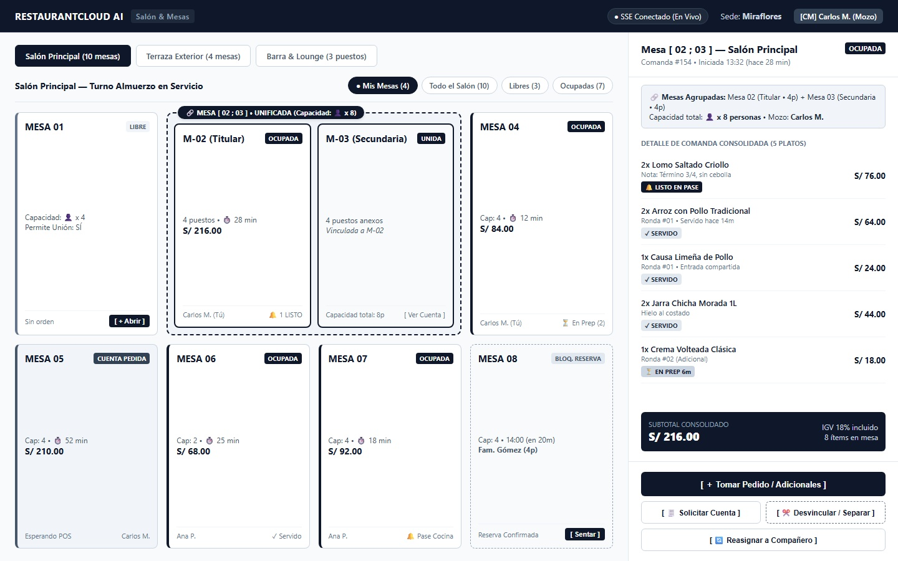
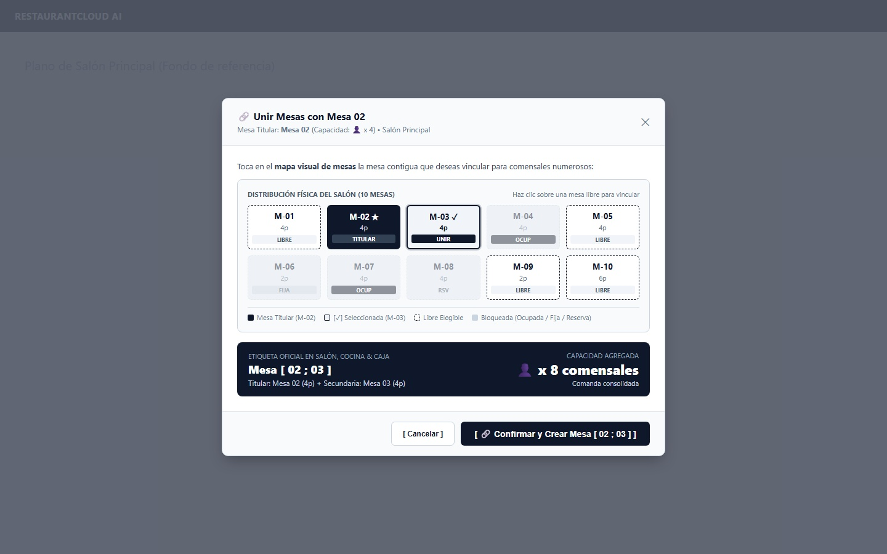
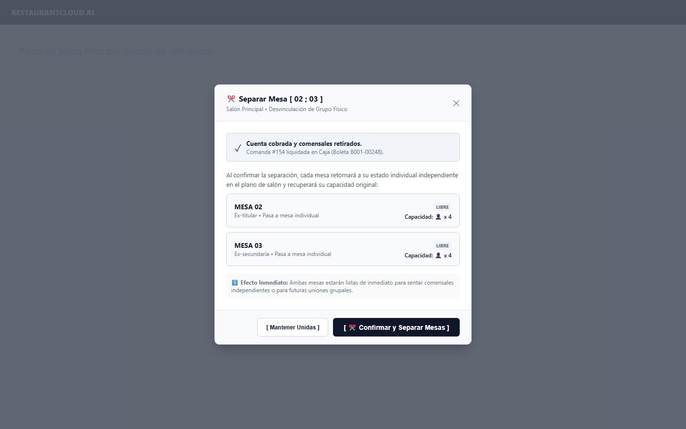
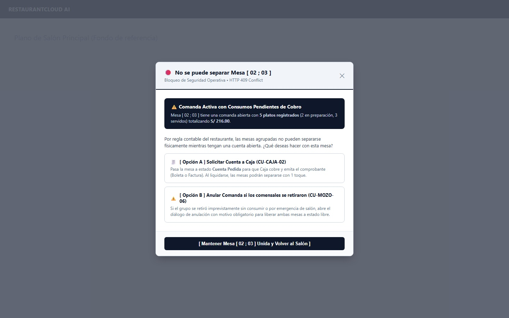

# CU-MOZO-04: Unir o Dividir Mesas

Especificación técnica de interfaz táctil para salón, arquitectura de datos transaccional en PostgreSQL 16, modelo relacional sin sobreingeniería (`mesa_principal_id`), sincronización en tiempo real vía Server-Sent Events (SSE), contratos de API en Go y ergonomía táctil en tablet para **RestaurantCloud AI**.

---

## 1. Ficha Técnica del Caso de Uso

| Atributo | Detalle |
| :--- | :--- |
| **Código CU** | `CU-MOZO-04` |
| **Nombre** | Unir o dividir mesas en salón |
| **Actor Principal** | `mozo` (personal de atención en sala; operador que coordina la acomodación física y apertura de comandas grupales) |
| **Actores Secundarios** | `admin_local` (supervisión de ocupación y plano `CU-ADMIN-01`), `cocina` (recepción de comanda unificada en KDS con etiqueta `Mesa [ 02 ; 03 ]` `CU-COCINA-01`), `cajero` (liquidación de cuenta unificada en Caja `CU-CAJA-02`) |
| **Dispositivo / Viewport** | Responsive Tablet en Salón (`1024x768` / `1280x800` / `1440x900`), Mobile POS (`375x812` / `412x915`), Terminal Fija POS (`1920x1080`) |
| **Precondición** | El local está activo; las mesas involucradas pertenecen al mismo piso/ambiente (`piso_id`) y tienen configurado `permite_union = true`; la mesa secundaria está desocupada (`libre`) y sin reserva inminente; el mozo cuenta con sesión activa en la sede. *(Disponible para todos los planes SaaS: Starter, Pro y Enterprise)*. |
| **Postcondición** | Si se unen: las mesas quedan vinculadas contable y físicamente bajo la mesa titular; se proyecta la etiqueta oficial `Mesa [ 02 ; 03 ]`; los mozos visualizan el conector en < 25ms vía SSE; la comanda se centraliza bajo la mesa titular. Si se dividen: las mesas desocupadas vuelven a su estado individual independiente (`LIBRE`) con su capacidad original recuperada. |

---

## 2. Diagrama de Flujo y Secuencia en Tiempo Real (SSE, Cocina & Caja)

```mermaid
sequenceDiagram
    autonumber
    actor M as Mozo en Salón (Tablet)
    participant FE as Frontend Mozo PWA (Salón / Drawer)
    participant BE as Backend Go Core API
    participant SSE as SSE Event Bus
    participant DB as PostgreSQL 16 (RLS)
    actor K as Cocina KDS (CU-COCINA-01)
    actor C as Cajero (CU-CAJA-02)

    %% 1. Proceso de Unión de Mesas
    M->>FE: 1. Abre Quick-Drawer de Mesa 02 y presiona "[ 🔗 Unir con Otra Mesa ]"
    FE->>BE: GET /api/v1/mozo/mesas/uuid-02/candidatas-union
    BE->>DB: SELECT * FROM mesa WHERE piso_id = :p_id AND permite_union = true AND id != :id
    DB-->>BE: Lista de mesas (M-03 libre, M-04 ocupada, M-06 permite_union=false)
    BE-->>FE: 200 OK (CandidatasUnionResponseDTO)
    FE->>M: Despliega Vista 2: Modal interactivo con candidatas del salón
    M->>FE: 2. Selecciona Mesa 03 (Calculadora proyecta: Mesa [ 02 ; 03 ] • Cap: 8) y confirma
    FE->>BE: POST /api/v1/mozo/mesas/uuid-02/unir { mesas_secundarias_ids: ["uuid-03"] }
    
    %% 2. Transacción Atómica de Unión
    BE->>DB: 1. BEGIN TX: Lock Mesa 02 y Mesa 03 FOR UPDATE
    BE->>DB: 2. UPDATE mesa SET mesa_principal_id = uuid-02 WHERE id = uuid-03
    BE->>DB: 3. INSERT INTO log_auditoria (local_id, usuario_id, accion='unir_mesas', detalle='...')
    DB-->>BE: COMMIT TX exitoso
    BE->>SSE: Broadcast 'mesas_unidas' { titular_id: "02", secundaria_id: "03", label: "Mesa [ 02 ; 03 ]", cap: 8 }
    SSE-->>FE: Actualiza plano de mesas en < 25ms
    FE->>M: Salón muestra conector perimetral y badge [🔗 Mesa [ 02 ; 03 ]]

    %% 3. Flujo Operativo de Comanda y Cocina
    M->>FE: 3. Toma pedido y confirma envío a cocina (CU-MOZO-02)
    FE->>BE: POST /api/v1/mozo/mesas/uuid-02/pedidos { items: [...] }
    BE->>SSE: Broadcast 'nueva_comanda_cocina' { mesa_label: "Mesa [ 02 ; 03 ]", items: [...] }
    SSE-->>K: Monitor KDS muestra comanda bajo "Mesa [ 02 ; 03 ]"

    %% 4. Flujo de División: Intento Fallido con Comanda Activa
    M->>FE: 4. Toca Mesa [ 02 ; 03 ] y presiona "[ ✂️ Desvincular / Separar Mesas ]"
    FE->>BE: POST /api/v1/mozo/mesas/uuid-02/dividir
    BE->>DB: SELECT COUNT(*) FROM pedido_item WHERE pedido.mesa_id = uuid-02 AND estado NOT IN ('anulado')
    DB-->>BE: 5 platos activos pendientes de cobro
    BE-->>FE: 409 Conflict (ERR_MESAS_CON_CONSUMO_ACTIVO)
    FE->>M: Despliega Vista 4: Bloqueo Asistido (Opciones: Solicitar cuenta a Caja o Anular pedido)

    %% 5. Flujo de División Exitoso tras Cobro en Caja
    C->>BE: POST /api/v1/caja/cobrar (CU-CAJA-03: Comanda cobrada con Boleta B001-00248)
    BE->>DB: UPDATE pedido SET estado = 'cobrado' WHERE mesa_id = uuid-02
    BE->>SSE: Broadcast 'comanda_cobrada' { mesa_id: uuid-02 }
    M->>FE: 5. Mesas desocupadas: presiona "[ ✂️ Desvincular / Separar Mesas ]"
    FE->>BE: POST /api/v1/mozo/mesas/uuid-02/dividir
    BE->>DB: 1. BEGIN TX: UPDATE mesa SET mesa_principal_id = NULL WHERE mesa_principal_id = uuid-02
    BE->>DB: 2. INSERT INTO log_auditoria (local_id, accion='dividir_mesas')
    DB-->>BE: COMMIT TX exitoso
    BE->>SSE: Broadcast 'mesas_divididas' { mesa_ids: ["02", "03"] }
    SSE-->>FE: Restaura tarjetas individuales independientes
    FE->>M: Mesas 02 y 03 retornan a estado LIBRE (Cap: 4 c/u)
```

---

## 3. Especificación de Pantallas y Wireframes Blueprint

### Vista 1: Salón con Mesas Unidas Activas y Quick-Drawer Unificado (`wf_mozo_04_salon_mesas_unidas.jpg`)

Pantalla principal táctil en formato horizontal (`1440x900` / Tablet `1024x768`), alineada 100% con el layout de `CU-MOZO-01` (70% Salón / 30% Drawer lateral):
- **En el Salón (70%):** Barra de herramientas limpia y enfocada en el servicio (`Salón Principal — Turno Almuerzo en Servicio`) sin sobrecarga de métricas de aforo imprecisas. Mesa 02 y Mesa 03 se encuentran conectadas mediante un marco perimetral con línea continua y el badge de enlace superior **`🔗 MESA [ 02 ; 03 ] • UNIFICADA (Capacidad: 👤 x 8)`**. La tarjeta titular exhibe el tiempo de permanencia (`⏱️ 28 min`), mozo asignado (`Carlos M.`), subtotal consolidado (`S/ 216.00`) y el badge de despacho de cocina (`🔔 1 LISTO`). La mesa secundaria muestra su rol anexo y enlace directo a la cuenta.
- **En el Quick-Drawer Lateral (30% / 440px):** Al tocar cualquier mesa del grupo, el drawer se abre sin cambiar de pantalla. Exhibe el resumen de la comanda unificada (`Comanda #154`), la alerta informativa de mesas agrupadas, el desglose plato por plato con su estado de cocina y la botonera de acciones rápidas de salón con el botón contextual **`[ ✂️ Desvincular / Separar Mesas ]`**.



#### Layout Estructural ASCII (Desktop / Tablet 1440x900)
```text
+----------------------------------------------------------------------------------------------------+
| RESTAURANTCLOUD AI   | Salón & Mesas > Salón Principal   (•) SSE Conectado   [CM] Carlos M. (Mozo) |
+------------------------------------------------------------------+---------------------------------+
| ÁREA PRINCIPAL: PLANO VISUAL DE MESAS (70% ancho)                | QUICK-DRAWER MESA [ 02 ; 03 ]   |
| [ Salón Principal (10) ] [ Terraza (4) ] [ Barra (3) ]           | (30% ancho ~440px)              |
| Salón Principal — Turno Almuerzo en Servicio                     |                                 |
| Filtrar: [● Mis Mesas (4)] [ Todo Salón (10) ] [ Libres ]        | Mesa [ 02 ; 03 ] — Salón  [OCUP]|
|                                                                  | Comanda #154 • 28 min           |
| +------------+ +--------------------------------+ +------------+ | ------------------------------- |
| | MESA 01    | | 🔗 MESA [ 02 ; 03 ] (Cap: 👤x8)| | MESA 04    | | 🔗 Mesas Agrupadas:             |
| | LIBRE      | | +------------+  +------------+ | | OCUPADA    | | Mesa 02 (Titular • 4p) +        |
| | Cap: 4     | | | M-02 (Tit) |  | M-03 (Sec) | | | Cap: 4     | | Mesa 03 (Secundaria • 4p)       |
| | [ + Abrir] | | | S/ 216.00  |  | Vinculada  | | | S/ 84.00   | | ------------------------------- |
| +------------+ | +------------+  +------------+ | +------------+ | DETALLE DE COMANDA (5 platos)   |
|                +--------------------------------+                | • 2x Lomo Saltado   [🔔 LISTO]  |
|                                                                  | • 2x Arroz c/ Pollo [✓ SERVIDO] |
| +------------+ +------------+ +------------+ +------------+      | • 1x Causa Limeña   [✓ SERVIDO] |
| | MESA 05    | | MESA 06    | | MESA 07    | | MESA 08    |      | • 2x Jarra Chicha 1L[✓ SERVIDO] |
| | CUENTA     | | OCUPADA    | | OCUPADA    | | RESERVA    |      | • 1x Crema Volteada [⏳ PREP 6m]|
| | S/ 210.00  | | S/ 68.00   | | S/ 92.00   | | 14:00 (20m)|      | ------------------------------- |
| | Espera POS | | Ana P.     | | Ana P.     | | Fam. Gómez |      | TOTAL CONSOLIDADO     S/ 216.00 |
| +------------+ +------------+ +------------+ +------------+      | ------------------------------- |
|                                                                  | [ ＋ Tomar Pedido / Adicionales]|
| Simbología: (Verde) Libre | (Negro) Ocupada | (Ámbar) Cuenta     | [ 🧾 Solicitar Cuenta a Caja ]  |
|             (Punteado) Bloqueada Reserva | [🔗] Mesas Unidas     | [ ✂️ Desvincular / Separar    ]  |
+------------------------------------------------------------------+---------------------------------+
```

---

### Vista 2: Modal Interactivo con Mini-Mapa Espacial de Salón (`wf_mozo_04_modal_unir_mesas.jpg`)

Modal táctil optimizado de 720px que se abre al pulsar `[ 🔗 Unir Mesa ]`. Para maximizar la intuición y la ergonomía táctil (Screen-First), incorpora un **Mini-Plano de Salón interactivo (cuadrícula de 5 columnas x 2 filas)** que refleja la distribución física real del local:
- **Mesa Titular Destacada:** `Mesa 02 ★` resaltada en tono oscuro (`TITULAR`).
- **Selección Espacial Directa:** El mozo visualiza las mesas adyacentes; al tocar `Mesa 03`, esta se resalta con borde continuo y badge `[✓ UNIR]`.
- **Identificación Inmediata de Candidatas:** Mesas libres elegibles (`M-01`, `M-05`, `M-09`, `M-10`) con borde punteado; mesas no elegibles (`M-04` y `M-07` ocupadas, `M-06` fija, `M-08` reserva inminente) opacas y bloqueadas para prevenir errores de selección.
- **Calculadora Proyectiva en Vivo:** Tarjeta oscura inferior que exhibe de inmediato la etiqueta oficial resultante **`Mesa [ 02 ; 03 ]`** y la capacidad sumada (**`👤 x 8 comensales`**).
- **Botón Primario Touch-First (48px):** `[ 🔗 Confirmar y Crear Mesa [ 02 ; 03 ] ]`.



#### Layout Estructural ASCII (Modal 720px con Mini-Mapa)
```text
+-------------------------------------------------------------------------+
| 🔗 Unir Mesas con Mesa 02                                           [✕] |
| Mesa Titular: Mesa 02 (Capacidad: 👤 x 4) • Salón Principal             |
+-------------------------------------------------------------------------+
| Toca en el mapa visual de mesas la mesa contigua que deseas vincular:   |
|                                                                         |
| DISTRIBUCIÓN FÍSICA DEL SALÓN (10 MESAS)        Toca una mesa para unir |
| +---------+ +---------+ +---------+ +---------+ +---------+             |
| |  M-01   | | M-02 ★  | | M-03 ✓  | |  M-04   | |  M-05   |             |
| |   4p    | |   4p    | |   4p    | |   4p    | |   4p    |             |
| | [LIBRE] | |[TITULAR]| | [UNIR]  | | [OCUP]  | | [LIBRE] |             |
| +---------+ +---------+ +---------+ +---------+ +---------+             |
|                                                                         |
| +---------+ +---------+ +---------+ +---------+ +---------+             |
| |  M-06   | |  M-07   | |  M-08   | |  M-09   | |  M-10   |             |
| |   2p    | |   4p    | |   4p    | |   2p    | |   6p    |             |
| | [FIJA]  | | [OCUP]  | |  [RSV]  | | [LIBRE] | | [LIBRE] |             |
| +---------+ +---------+ +---------+ +---------+ +---------+             |
|                                                                         |
| Leyenda: [■] Mesa Titular  [✓] Seleccionada  [:] Libre  [ ] Bloqueada   |
|                                                                         |
| +---------------------------------------------------------------------+ |
| | ETIQUETA OFICIAL EN SALÓN, COCINA & CAJA: Mesa [ 02 ; 03 ]          | |
| | Titular: Mesa 02 (4p) + Secundaria: Mesa 03 (4p) | CAPACIDAD: 👤x8  | |
| +---------------------------------------------------------------------+ |
+-------------------------------------------------------------------------+
|               [ Cancelar ]   [ 🔗 Confirmar y Crear Mesa [ 02 ; 03 ] ]  |
+-------------------------------------------------------------------------+
```

---

### Vista 3: Modal de Separación / Desvinculación de Mesas (`wf_mozo_04_modal_dividir_mesas.jpg`)

Modal táctil de 540px desplegado cuando el mozo pulsa `[ ✂️ Desvincular / Separar ]` sobre una mesa desocupada o recién cobrada:
- **Validación Positiva:** Certifica que la comanda fue pagada en Caja (`Boleta B001-00248`) y los clientes se retiraron.
- **Detalle de Mesas a Restaurar:** Muestra tarjetas comparativas transparentes:
  - *Mesa 02:* Pasa a estado `LIBRE` individual con capacidad para 4 comensales.
  - *Mesa 03:* Pasa a estado `LIBRE` individual con capacidad para 4 comensales.
- **Confirmación en 1 Toque:** `[ ✂️ Confirmar y Separar Mesas ]`. Al confirmarse, emite el evento SSE y actualiza el salón sin recarga.



#### Layout Estructural ASCII (Modal 540px)
```text
+------------------------------------------------------------+
| ✂️ Separar Mesa [ 02 ; 03 ]                            [✕] |
| Salón Principal • Desvinculación de Grupo Físico           |
+------------------------------------------------------------+
|  ✓ Cuenta cobrada y comensales retirados.                  |
|    Comanda #154 liquidada en Caja (Boleta B001-00248).     |
|                                                            |
|  Al confirmar, cada mesa retornará a su estado individual  |
|  en el plano de salón recuperando su capacidad original:   |
|                                                            |
|  +------------------------------------------------------+  |
|  | MESA 02                                     [ LIBRE ]|  |
|  | Ex-titular • Mesa individual activa      Cap: 👤 x 4 |  |
|  +------------------------------------------------------+  |
|  +------------------------------------------------------+  |
|  | MESA 03                                     [ LIBRE ]|  |
|  | Ex-secundaria • Mesa individual activa   Cap: 👤 x 4 |  |
|  +------------------------------------------------------+  |
|                                                            |
|  ℹ️ Ambas mesas quedarán disponibles de inmediato para     |
|     nuevos comensales o nuevas uniones grupales.           |
+------------------------------------------------------------+
|            [ Mantener Unidas ]  [ ✂️ Confirmar Separación ]|
+------------------------------------------------------------+
```

---

### Vista 4: Diálogo de Bloqueo Asistido por Consumo Activo (`wf_mozo_04_bloqueo_validacion.jpg`)

Modal asistido de 560px que intercepta intentos de separación indebida cuando aún existen consumos activos sin liquidar:
- **Identificación Clara de Conflicto (HTTP 409 Conflict):** Informa que `Mesa [ 02 ; 03 ]` tiene 5 platos registrados (2 en cocina, 3 servidos) totalizando `S/ 216.00`.
- **Explicación Operativa:** Por consistencia contable del restaurante, no se permite separar muebles físicamente mientras la cuenta permanezca abierta.
- **Acciones Asistidas en 1 Toque:**
  - *Opción A (Flujo Regular):* `[ 🧾 Solicitar Cuenta a Caja (CU-CAJA-02) ]` conmuta a cuenta pedida para emisión de comprobante.
  - *Opción B (Contingencia):* `[ ⚠️ Anular Comanda si los clientes se retiraron (CU-MOZO-06) ]` abre el diálogo de anulación auditada para liberar las mesas.
- **Retorno Rápido:** `[ Mantener Mesa [ 02 ; 03 ] Unida y Volver al Salón ]`.



#### Layout Estructural ASCII (Modal 560px)
```text
+------------------------------------------------------------+
| 🛑 No se puede separar Mesa [ 02 ; 03 ]                [✕] |
| Bloqueo de Seguridad Operativa • HTTP 409 Conflict         |
+------------------------------------------------------------+
|  ⚠️ Comanda Activa con Consumos Pendientes de Cobro        |
|     Mesa [ 02 ; 03 ] registra actualmente 5 platos         |
|     (S/ 216.00) con preparación en cocina y servidos.      |
|                                                            |
|  Por regla contable, las mesas no pueden dividirse         |
|  mientras mantengan una comanda abierta.                   |
|                                                            |
|  ¿Qué deseas hacer con esta mesa?                          |
|                                                            |
|  +------------------------------------------------------+  |
|  | 🧾 [ Opción A ] Solicitar Cuenta a Caja (CU-CAJA-02) |  |
|  | Conmuta la mesa a 'cuenta_pedida' para que Caja      |  |
|  | liquide la orden consolidada.                        |  |
|  +------------------------------------------------------+  |
|                                                            |
|  +------------------------------------------------------+  |
|  | ⚠️ [ Opción B ] Anular Comanda si se retiraron       |  |
|  | Abre el diálogo de anulación auditada (CU-MOZO-06)   |  |
|  | para cancelar los pedidos y liberar ambas mesas.     |  |
|  +------------------------------------------------------+  |
+------------------------------------------------------------+
|    [ Mantener Mesa [ 02 ; 03 ] Unida y Volver al Salón ]   |
+------------------------------------------------------------+
```

---

## 4. Matriz de Estados de la UI (5 Estados UX)

| Estado UX | Indicador Visual | Comportamiento del Sistema / Acciones Disponibles |
| :--- | :--- | :--- |
| **1. Ideal / Unida** | Vista 1 con contorno perimetral continuo y badge `🔗 MESA [ 02 ; 03 ]` | Tocar cualquier mesa abre el Quick-Drawer unificado; la comanda se despacha consolidada a KDS. |
| **2. Selección / Modal** | Vista 2 con tabla de candidatas y calculadora en tiempo real | Muestra checkboxes táctiles (> 48x48px); deshabilita mesas ocupadas o sin permiso con mensajes explicativos. |
| **3. Separación Libre** | Vista 3 con tarjetas de mesas restauradas | Transición instantánea: las mesas retornan a tarjetas individuales verdes `LIBRE` con capacidad original (4p). |
| **4. Conflicto / Bloqueo** | Vista 4 con diálogo asistido `409 Conflict` | Impide fragmentación contable en sala; provee accesos directos en 1 toque hacia Caja (`CU-CAJA-02`) o Anulación (`CU-MOZO-06`). |
| **5. Reconexión / Offline** | Badge ámbar en top bar: `[ ⚠️ Reconectando... Modo Lectura ]` | Mantiene visualización de agrupaciones en caché local; reconexión automática mediante retroceso exponencial. |

---

## 5. Control de Acceso y Matriz RBAC

| Rol | Consultar Candidatas | Unir Mesas | Desvincular / Separar | Tomar Pedido en Mesa Unida | Cobrar Mesa Unida | Modificar Flag `permite_union` |
| :--- | :---: | :---: | :---: | :---: | :---: | :---: |
| `mozo` | ✅ Sí | ✅ Sí | ✅ Sí | ✅ Sí | ❌ No (Caja) | ❌ No (Admin) |
| `admin_local` | ✅ Sí | ✅ Sí | ✅ Sí | ✅ Sí | ✅ Sí | ✅ Sí (`CU-ADMIN-01`) |
| `cocina` | ❌ No | ❌ No | ❌ No | ❌ No | ❌ No | ❌ No |
| `cajero` | ❌ No | ❌ No | ❌ No | ❌ No | ✅ Sí (`CU-CAJA-02`) | ❌ No |
| `propietario` | ✅ Sí (monitor) | ❌ No | ❌ No | ❌ No | ❌ No | ❌ No |

---

## 6. Contratos de API Go y DTOs

### 6.1 DTOs (`internal/domain/salon/dto_union.go`)

```go
package salon

import (
	"time"
	"github.com/google/uuid"
)

// UnirMesasRequestDTO payload enviado por el mozo para agrupar mesas
type UnirMesasRequestDTO struct {
	MesasSecundariasIDs []uuid.UUID `json:"mesas_secundarias_ids" validate:"required,min=1"`
}

// MesaGrupoItemDTO detalle de una mesa individual que integra la agrupación
type MesaGrupoItemDTO struct {
	ID          uuid.UUID `json:"id"`
	Numero      string    `json:"numero"`
	EsPrincipal bool      `json:"es_principal"`
	Capacidad   int       `json:"capacidad"`
}

// UnirMesasResponseDTO payload de respuesta tras confirmar la unión
type UnirMesasResponseDTO struct {
	MesaPrincipalID uuid.UUID          `json:"mesa_principal_id"`
	LabelUnificado  string             `json:"label_unificado"` // Formato oficial: "Mesa [ 02 ; 03 ]"
	CapacidadTotal  int                `json:"capacidad_total"`
	Mesas           []MesaGrupoItemDTO `json:"mesas"`
	CreatedAt       time.Time          `json:"created_at"`
}

// CandidataUnionDTO mesa evaluada para su posible agrupamiento
type CandidataUnionDTO struct {
	ID            uuid.UUID `json:"id"`
	Numero        string    `json:"numero"`
	Capacidad     int       `json:"capacidad"`
	Elegible      bool      `json:"elegible"`
	MotivoBloqueo *string   `json:"motivo_bloqueo,omitempty"` // "Ocupada", "No permite unión", "Bloqueada por reserva"
}

// CandidatasUnionResponseDTO lista de mesas contiguas disponibles en el mismo piso
type CandidatasUnionResponseDTO struct {
	MesaOrigenID uuid.UUID           `json:"mesa_origen_id"`
	NumeroOrigen string              `json:"numero_origen"`
	Candidatas   []CandidataUnionDTO `json:"candidatas"`
}

// DividirMesasRequestDTO opcionalmente divide una secundaria o todo el grupo
type DividirMesasRequestDTO struct {
	MesaSecundariaID *uuid.UUID `json:"mesa_secundaria_id,omitempty"` // null = separar todas
}

// DividirMesasResponseDTO confirmación de separación exitosa
type DividirMesasResponseDTO struct {
	MesaPrincipalID uuid.UUID   `json:"mesa_principal_id"`
	MesasSeparadas  []uuid.UUID `json:"mesas_separadas"`
	Mensaje         string      `json:"mensaje"`
}
```

### 6.2 Eventos Server-Sent Events (SSE)

```json
// Evento emitido al unir mesas: event: "mesas_unidas"
{
  "tipo": "mesas_unidas",
  "local_id": "8b9e6c40-...",
  "piso_id": "7a8b9c0d-...",
  "mesa_principal_id": "uuid-02",
  "mesas_secundarias_ids": ["uuid-03"],
  "label_unificado": "Mesa [ 02 ; 03 ]",
  "capacidad_total": 8,
  "timestamp": "2026-10-09T13:30:00Z"
}

// Evento emitido al separar mesas: event: "mesas_divididas"
{
  "tipo": "mesas_divididas",
  "local_id": "8b9e6c40-...",
  "piso_id": "7a8b9c0d-...",
  "mesas_separadas": ["uuid-02", "uuid-03"],
  "timestamp": "2026-10-09T14:15:00Z"
}
```

---

## 7. Catálogo de Endpoints REST

| Método | Ruta | Rol Requerido | Descripción | Códigos HTTP |
| :--- | :--- | :--- | :--- | :--- |
| `GET` | `/api/v1/mozo/mesas/{id}/candidatas-union` | `mozo`, `admin_local` | Retorna mesas contiguas del mismo piso evaluando elegibilidad | `200 OK`, `404 Not Found` |
| `POST` | `/api/v1/mozo/mesas/{id}/unir` | `mozo`, `admin_local` | Asigna `mesa_principal_id` y emite evento SSE `mesas_unidas` | `200 OK`, `400 Bad Request`, `409 Conflict` |
| `POST` | `/api/v1/mozo/mesas/{id}/dividir` | `mozo`, `admin_local` | Separa mesas desocupadas o recién cobradas (`mesa_principal_id = NULL`) | `200 OK`, `409 Conflict` (Consumo activo) |

### Errores de Negocio Tipados (`pkg/apierror`)
- `ERR_MESA_NO_PERMITE_UNION`: Mesa configurada con `permite_union = false`.
- `ERR_MESA_DISTINTO_PISO`: Intento de agrupar mesas ubicadas en diferentes ambientes físicos.
- `ERR_MESA_SECUNDARIA_OCUPADA`: La mesa a unir tiene una comanda activa o comensales sentados.
- `ERR_MESA_BLOQUEADA_RESERVA`: La mesa tiene un bloqueo preventivo de reserva inminente.
- `ERR_MESAS_CON_CONSUMO_ACTIVO`: Intento de separar mesas cuando aún existen pedidos sin liquidar en Caja.

---

## 8. Modelo Relacional PostgreSQL 16 y Migración

```sql
-- 1. Autorreferencia limpia en la entidad mesa
ALTER TABLE mesa 
ADD COLUMN IF NOT EXISTS mesa_principal_id UUID NULL REFERENCES mesa(id) ON DELETE SET NULL;

-- 2. Restricción para evitar autorreferencia simple circular
ALTER TABLE mesa 
ADD CONSTRAINT chk_mesa_no_auto_referencia 
CHECK (mesa_principal_id IS NULL OR mesa_principal_id != id);

-- 3. Índice parcial optimizado para resolución sub-milisegundo en salón
CREATE INDEX IF NOT EXISTS idx_mesa_uniones 
ON mesa(local_id, piso_id, mesa_principal_id) 
WHERE mesa_principal_id IS NOT NULL;

-- 4. Comentarios de arquitectura para documentación de base de datos
COMMENT ON COLUMN mesa.mesa_principal_id IS 'ID de la mesa titular si esta mesa está anexada a un grupo. NULL si es independiente o titular.';
```

---

## 9. Checklist de Accesibilidad WCAG 2.1 AA

- [x] **Contraste de Color:** Títulos principales (`#0F172A` sobre `#F8FAFC` ratio 14.8:1) y textos secundarios (`#475569` ratio 5.6:1) superan holgadamente el mínimo de 4.5:1.
- [x] **Touch Targets Touch-First:** Checkboxes y botones de selección táctil cuentan con dimensiones mínimas de `48x48px` para manejo ergonómico con una sola mano en tablet.
- [x] **Feedback Multisensorial y Live Regions:** La confirmación de unión y división emite vibración háptica suave (`navigator.vibrate(50)`) y actualiza la región accesible `aria-live="polite"` notificando: *"Mesa [ 02 ; 03 ] creada exitosamente con capacidad para 8 personas"*.
- [x] **Navegación por Teclado:** Secuencia lógica de tabulación (`Tab` / `Shift+Tab`) en la lista de candidatas, con selección mediante barra espaciadora y confirmación con `Enter`.
