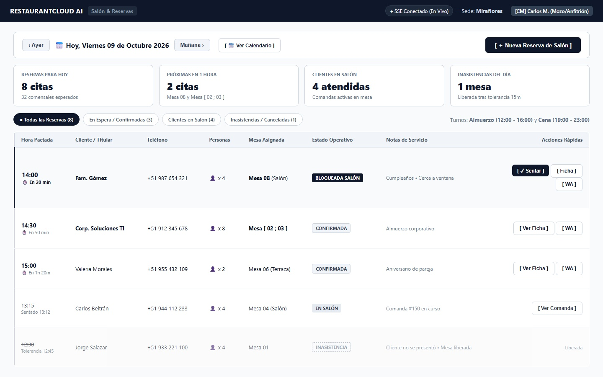
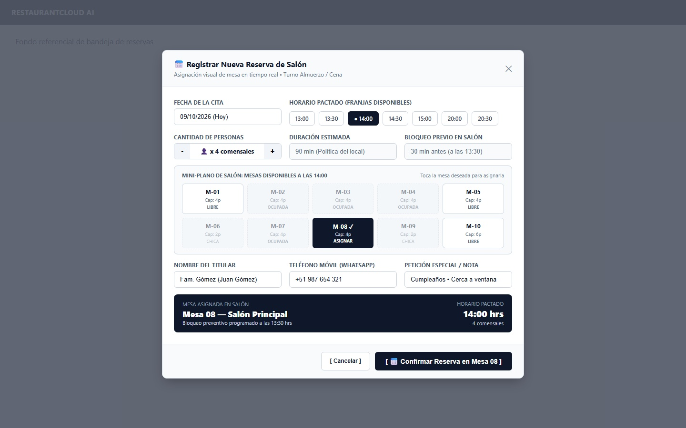
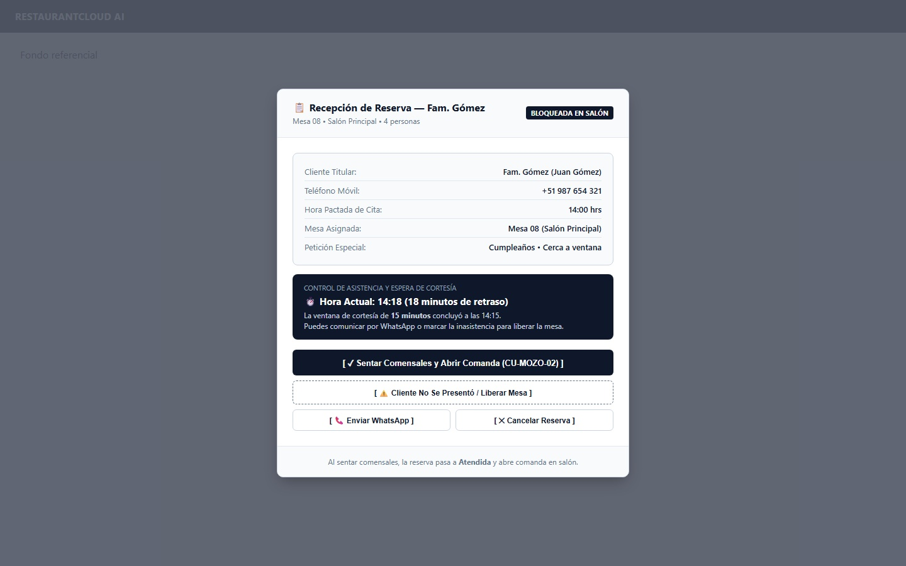
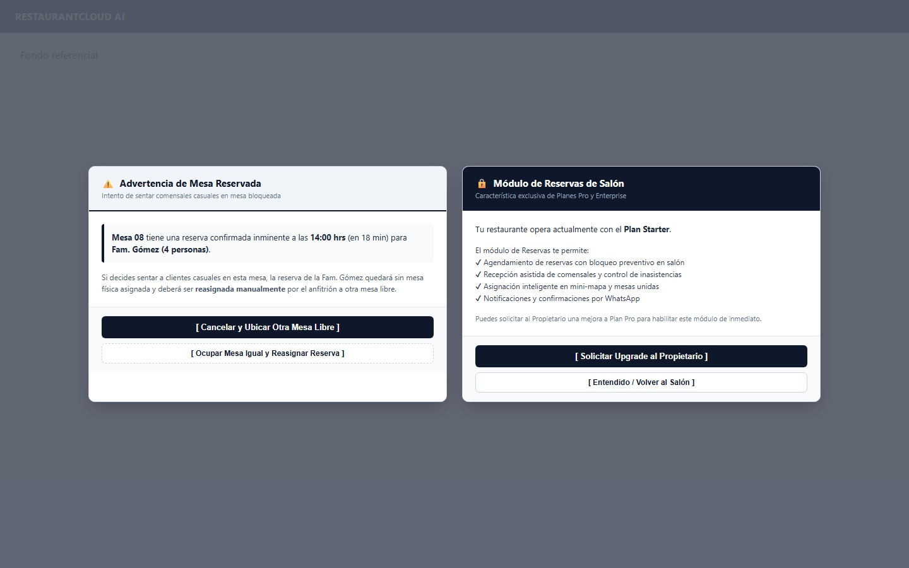

# CU-MOZO-05: Gestionar Reservas

Especificación técnica de interfaz táctil para salón, gestión visual de reservas mediante Mini-Mapa de ocupación espacial, arquitectura de datos transaccional en PostgreSQL 16, sincronización en tiempo real vía Server-Sent Events (SSE), contratos de API en Go y ergonomía táctil en tablet para **RestaurantCloud AI**.

---

## 1. Ficha Técnica del Caso de Uso

| Atributo | Detalle |
| :--- | :--- |
| **Código CU** | `CU-MOZO-05` |
| **Nombre** | Gestionar reservas y recepción en salón |
| **Actor Principal** | `mozo` (personal de atención y recepción en sala; anfitrión que agenda reservas, ubica espacialmente a los clientes y abre la comanda al recibirlos) |
| **Actores Secundarios** | `admin_local` (configuración de políticas de reserva, tiempos y aforos `CU-ADMIN-10`), `cajero` (emisión de comprobantes posteriores `CU-CAJA-02`), `propietario` (acceso comercial según plan contratado `CU-PROP-03`) |
| **Dispositivo / Viewport** | Responsive Tablet en Salón (`1024x768` / `1280x800` / `1440x900`), Mobile POS (`375x812` / `412x915`), Terminal Fija POS (`1920x1080`) |
| **Precondición** | El local opera bajo suscripción activa en planes **Pro o Enterprise** (`plan.incluye_reservas = true`); las políticas operativas (`duracion_reserva_min`, `buffer_reserva_min`, `minutos_bloqueo_previo`, `tolerancia_no_show_min`) han sido configuradas en `politicas_reserva`; el mozo cuenta con sesión activa en la sede. *(Locales en plan Starter visualizan diálogo asistido de paywall informativo)*. |
| **Postcondición** | Al registrar: la mesa queda agendada y asignada desde el origen (soporta combinaciones `Mesa [ 02 ; 03 ]`); al aproximarse la hora pactada (`minutos_bloqueo_previo`), la mesa conmuta a `bloqueada` en salón vía SSE; al presentarse los clientes (`Sentar`), la reserva pasa a `atendida` y se abre automáticamente la comanda en `CU-MOZO-02`; si se supera la cortesía (`tolerancia_no_show_min`), el mozo puede registrar la inasistencia (`no_show`) y liberar la mesa inmediatamente. |

---

## 2. Diagrama de Flujo y Secuencia en Tiempo Real (SSE, Salón & Comandas)

```mermaid
sequenceDiagram
    autonumber
    actor M as Mozo / Hostess en Salón (Tablet)
    participant FE as Frontend Mozo PWA (Bandeja & Salón)
    participant BE as Backend Go Core API
    participant SSE as SSE Event Bus
    participant DB as PostgreSQL 16 (RLS)
    actor C as Comensal / Cliente
    actor K as Cocina KDS (CU-COCINA-01)

    %% 1. Consulta y Creación de Reserva con Mini-Mapa
    M->>FE: 1. Presiona "[ + Nueva Reserva ]" e ingresa: Hoy 14:00, 4 comensales
    FE->>BE: GET /api/v1/mozo/reservas/mesas-disponibles?fecha=2026-10-09&hora=14:00&personas=4
    BE->>DB: Evalúa solapamiento (duración 90m + buffer 15m) vs reservas activas y horario
    DB-->>BE: Retorna disponibilidad de salón (Mesa 08 disponible, M-02 ocupada, M-01 libre)
    BE-->>FE: 200 OK (MesasDisponiblesDTO)
    FE->>M: Despliega Vista 2: Mini-Mapa interactivo de salón 5x2
    M->>FE: 2. Toca Mesa 08 en mini-mapa, ingresa "Fam. Gómez" (+51 987 654 321) y confirma
    FE->>BE: POST /api/v1/mozo/reservas { mesa_ids: ["uuid-08"], cliente_nombre: "Fam. Gómez", ... }
    BE->>DB: 1. BEGIN TX: INSERT INTO reserva ...; INSERT INTO reserva_mesa ...
    DB-->>BE: COMMIT TX exitoso (UUID reserva-gomez)
    BE->>SSE: Broadcast 'reserva_creada' { mesa_id: "uuid-08", hora: "14:00", cliente: "Fam. Gómez" }
    BE-->>FE: 201 Created (ReservaCardDTO)
    FE->>M: Toast éxito: "Reserva confirmada para Fam. Gómez a las 14:00 en Mesa 08"
    Note over FE,M: Mesa 08 en plano muestra chip informativo '14:00 Fam. Gómez' permitiendo atención casual previa.

    %% 2. Transición a Bloqueo Preventivo Automático
    Note over BE,DB: 13:30 (Faltan 30 min = minutos_bloqueo_previo configurado):
    BE->>DB: UPDATE reserva SET estado = 'bloqueada' WHERE id = 'reserva-gomez'
    BE->>SSE: Broadcast 'mesa_bloqueada_reserva' { mesa_id: "uuid-08", label: "Mesa 08", hora: "14:00", cliente: "Fam. Gómez" }
    SSE-->>FE: Actualiza plano de mesas en < 25ms
    FE->>M: Mesa 08 conmuta a contorno ámbar punteado [ BLOQUEADA RESERVA • Fam. Gómez ]

    %% 3. Flujo A: Recepción del Cliente y Apertura de Comanda
    C->>M: 3A. 14:05: Llega la Fam. Gómez a sala
    M->>FE: Toca Mesa 08 en salón y abre Ficha (Vista 3)
    M->>FE: Presiona "[ ✓ Sentar Comensales y Abrir Pedido ]"
    FE->>BE: POST /api/v1/mozo/reservas/reserva-gomez/sentar
    BE->>DB: 1. BEGIN TX: UPDATE reserva SET estado = 'atendida'
    BE->>DB: 2. INSERT INTO pedido (mesa_id, estado='borrador', cliente_nombre='Fam. Gómez')
    BE->>DB: 3. UPDATE mesa SET estado = 'ocupada' WHERE id = 'uuid-08'
    DB-->>BE: COMMIT TX exitoso
    BE->>SSE: Broadcast 'mesa_estado_cambiado' { mesa_id: "uuid-08", estado: "ocupada", comanda_id: "uuid-cmd" }
    BE-->>FE: 200 OK (Redirección a toma de pedido CU-MOZO-02)
    FE->>M: Abre pantalla de toma de pedido activa para Mesa 08

    %% 4. Flujo B: Inasistencia (No-Show) tras Tolerancia
    Note over M,FE: Alternativa: Si fueran las 14:16 y el cliente no llegó (tolerancia 15m expiró):
    M->>FE: 3B. Abre Ficha de Reserva (Vista 3)
    Note over FE: Botón "[ ⚠️ Cliente No Se Presentó / Liberar Mesa ]" se habilita en rojo
    M->>FE: Presiona botón y confirma inasistencia
    FE->>BE: POST /api/v1/mozo/reservas/reserva-gomez/no-show { motivo: "Cliente no respondió llamadas" }
    BE->>DB: 1. BEGIN TX: UPDATE reserva SET estado = 'no_show', notas = notas || ' | Inasistencia registrada'
    BE->>DB: 2. UPDATE mesa SET estado = 'libre' WHERE id = 'uuid-08'
    DB-->>BE: COMMIT TX exitoso
    BE->>SSE: Broadcast 'reserva_no_show' { mesa_id: "uuid-08", reserva_id: "reserva-gomez" }
    SSE-->>FE: Mesa 08 vuelve a verde [ LIBRE ] inmediatamente
    FE->>M: Notifica: "Mesa 08 liberada por inasistencia de comensales"
```

---

## 3. Especificación de Pantallas y Wireframes Blueprint

### Vista 1: Bandeja y Centro de Mando de Reservas de Salón (`wf_mozo_05_bandeja_reservas.jpg`)

Pantalla principal de gestión operativa de reservas en formato horizontal (`1440x900` / Tablet `1024x768`):
- **Barra de Contexto y Fecha Reactiva:** Selector de fecha diario táctil `[ < Hoy, 09 Octubre 2026 > ]` con conmutador rápido de turno (`Almuerzo` / `Cena`), indicador SSE en vivo `(•) SSE Conectado` y avatar de mozo activo.
- **KPIs Resumen de Turno (Métricas Claras en Español):**
  - *Reservas de Hoy:* 8 agendadas.
  - *Próximas en 1 Hora:* 2 clientes por llegar.
  - *Comensales Atendidos:* 4 mesas sentadas.
  - *Inasistencias del Día:* 1 mesa liberada por ausencia.
- **Filtros Rápidos en Píldora:** `[ Todas (8) ]`, `[ Confirmadas / En Espera (3) ]`, `[ Atendidas (4) ]`, `[ Inasistencia / Canceladas (1) ]`.
- **Tabla Operativa de Reservas:** Lista cronológica con hora de cita, badge de anticipación en vivo (`⏱️ En 20 min`, `⏱️ En 1h 15m`), nombre del comensal, teléfono de contacto con acceso WhatsApp directo, comensales, mesa(s) asignada(s) (soporta mesas individuales `Mesa 08` y agrupadas `Mesa [ 02 ; 03 ]`), estado operativo y botones directos (`[ Sentar ]`, `[ Ficha ]`, `[ WhatsApp ]`).
- **Botón Primario de Acción:** `[ + Nueva Reserva ]` (Touch target 48px).



#### Layout Estructural ASCII (Desktop / Tablet 1440x900)
```text
+----------------------------------------------------------------------------------------------------+
| RESTAURANTCLOUD AI   | Reservas > Bandeja de Salón      (•) SSE Conectado    [CM] Carlos M. (Mozo) |
+----------------------------------------------------------------------------------------------------+
| [ < Hoy, 09 Octubre 2026 > ]  Turno: [● Almuerzo] [ Cena ]          [ 📅 Calendario ] [ + Nueva ]  |
|                                                                                                    |
| +------------------+  +------------------+  +------------------+  +------------------+             |
| | RESERVAS DE HOY  |  | PRÓXIMAS EN 1 H  |  | ATENDIDAS HOY    |  | INASISTENCIAS    |             |
| | 8 Agendadas      |  | 2 Por llegar     |  | 4 En mesa        |  | 1 Liberada       |             |
| +------------------+  +------------------+  +------------------+  +------------------+             |
|                                                                                                    |
| Filtrar: [● Todas (8)] [ Confirmadas / En Espera (3) ] [ Atendidas (4) ] [ Inasistencia (1) ]       |
|                                                                                                    |
| HORA   | CLIENTE         | TELÉFONO       | PAX | MESA ASIGNADA   | ESTADO      | ACCIONES             |
| -------+-----------------+----------------+-----+-----------------+-------------+--------------------- |
| 13:00  | Dr. Alva        | +51 912 345 678| 2p  | Mesa 04         | [ ATENDIDA ]| [ Ver Comanda #152 ] |
| 13:15  | Sra. Mendoza    | +51 945 678 123| 4p  | Mesa 06         | [ ATENDIDA ]| [ Ver Comanda #153 ] |
| 13:30  | Carlos R. (Grp) | +51 988 112 233| 8p  | Mesa [ 02 ; 03 ]| [ ATENDIDA ]| [ Ver Comanda #154 ] |
| 13:45  | Ing. Paredes    | +51 977 443 322| 2p  | Mesa 01         | [ INASIST. ]| [ ⚠️ No se presentó ]|
| 14:00  | Fam. Gómez      | +51 987 654 321| 4p  | Mesa 08         | [ BLOQUEADA]| [✓ Sentar] [💬 WA]   |
| 14:15  | Lucía Benítez   | +51 933 221 144| 3p  | Mesa 05         | [ CONFIRM. ]| [ Ficha ]  [💬 WA]   |
| 14:30  | Roberto Chang   | +51 966 554 433| 6p  | Mesa [ 09 ; 10 ]| [ CONFIRM. ]| [ Ficha ]  [💬 WA]   |
| 15:00  | Patricia Vega   | +51 955 778 899| 2p  | Mesa 07         | [ CONFIRM. ]| [ Ficha ]  [💬 WA]   |
|                                                                                                    |
| Página 1 de 1 (8 registros)                  * Exclusivo para Planes Pro y Enterprise SaaS         |
+----------------------------------------------------------------------------------------------------+
```

---

### Vista 2: Modal Interactivo de Nueva Reserva con Mini-Mapa de Salón (`wf_mozo_05_modal_nueva_reserva.jpg`)

Modal táctil de 760px que permite agendar y asignar la mesa espacialmente en una sola interacción fluida:
- **Paso 1: Parámetros del Turno:** Fecha (con atajos `Hoy`, `Mañana`), selector de franjas horarias touch-first (`13:00`, `13:30`, `14:00`, `14:30`, `15:00`, `20:00`) y stepper táctil de comensales (`[ - ] [ 4 ] [ + ]`).
- **Paso 2: Mini-Mapa Espacial de Salón (5x2):**
  - Reproduce fielmente la topología del Salón Principal.
  - Las mesas ocupadas o reservadas en esa franja horaria aparecen atenuadas con motivo claro (`Ocupada 13:30-15:00`).
  - Las mesas disponibles y con aforo suficiente se destacan con botón de selección táctil.
  - La mesa elegida (ej. `M-08`) se marca en azul con badge **`[✓ SELECCIONADA]`**.
  - Soporte de selección combinada para mesas contiguas con `permite_union = true` (`Mesa [ 02 ; 03 ]`).
- **Paso 3: Ficha del Comensal:** Nombre completo (`Fam. Gómez`), teléfono móvil (+51 con prefijo numérico automático) y campo opcional para notas de cortesía (*"Vienen con niño pequeño, requiere silla alta"*).
- **Acción Touch-First:** `[ 📅 Confirmar y Asignar Mesa ]` (48px de altura).



#### Layout Estructural ASCII (Modal 760px)
```text
+------------------------------------------------------------------------------+
| 📅 Registrar Nueva Reserva de Salón                                      [✕] |
| Asignación espacial táctil de mesa en Salón Principal                        |
+------------------------------------------------------------------------------+
| 1. FECHA, HORA Y PERSONAS:                                                   |
|    Fecha: [ Hoy, 09 Oct 2026 ]      Comensales: [ - ] [  4  ] [ + ]          |
|    Hora:  (13:00) (13:30) [● 14:00] (14:30) (15:00) (20:00)                  |
|                                                                              |
| 2. MINI-MAPA DE SALÓN — SELECCIONA LA MESA:                                  |
|    +----------+ +----------+ +----------+ +----------+ +----------+          |
|    | MESA 01  | | MESA 02  | | MESA 03  | | MESA 04  | | MESA 05  |          |
|    | Cap: 4   | | Cap: 4   | | Cap: 4   | | Cap: 4   | | Cap: 4   |          |
|    | (Libre)  | | (Ocupada)| | (Ocupada)| | (Ocupada)| | (Libre)  |          |
|    +----------+ +----------+ +----------+ +----------+ +----------+          |
|    +----------+ +----------+ +----------+ +----------+ +----------+          |
|    | MESA 06  | | MESA 07  | | MESA 08  | | MESA 09  | | MESA 10  |          |
|    | Cap: 4   | | Cap: 4   | | Cap: 4   | | Cap: 4   | | Cap: 4   |          |
|    | (Ocupada)| | (Libre)  | | [✓ ELEGIR] | (Libre)  | | (Libre)  |          |
|    +----------+ +----------+ +----------+ +----------+ +----------+          |
|    Mesa seleccionada: [ Mesa 08 • Capacidad: 4 personas ]                    |
|                                                                              |
| 3. DATOS DEL CLIENTE:                                                        |
|    Nombre Completo: [ Fam. Gómez                                          ]  |
|    Teléfono Móvil:  [ +51 987 654 321                                     ]  |
|    Notas Especiales:[ Viene con niño pequeño, requiere silla alta         ]  |
+------------------------------------------------------------------------------+
|                  [ Cancelar ]     [ 📅 Confirmar y Asignar Mesa ]            |
+------------------------------------------------------------------------------+
```

---

### Vista 3: Modal de Ficha de Reserva, Recepción y Tolerancia por Inasistencia (`wf_mozo_05_modal_detalle_recepcion.jpg`)

Modal táctil de inspección rápida (560px) invocado al pulsar una mesa bloqueada en el plano o una fila de la bandeja:
- **Resumen Completo del Comensal:** Nombre (`Fam. Gómez`), teléfono de contacto con enlace para llamada y WhatsApp, número de comensales (`4 personas`), mesa asignada (`Mesa 08`) y observaciones de sala.
- **Reloj de Tolerancia y Cortesía en Vivo:**
  - *"Hora pactada: 14:00 • Espera de cortesía: 15 min (hasta 14:15)"*.
  - Indicador dinámico: Si el reloj está antes de las 14:15, muestra aviso informativo: *"En ventana de cortesía de espera (faltan X min)"*. Si el reloj supera las 14:15, conmuta a: *"Tolerancia expirada (16 min de retraso)"*.
- **Acciones Táctiles en Español Claro:**
  - `[ ✓ Sentar Comensales y Abrir Pedido (CU-MOZO-02) ]` (Acción primaria destacada; pasa la mesa a ocupada e inicia comanda).
  - `[ ⚠️ Cliente No Se Presentó / Liberar Mesa ]` (Registra la inasistencia `no_show` de forma clara y libera la mesa a verde `LIBRE` en < 25ms vía SSE).
  - `[ 💬 Enviar WhatsApp de Recordatorio ]` (Abre WhatsApp Web/App con mensaje preformateado).
  - `[ ✕ Cancelar Reserva ]` (Permite cancelación anticipada exigiendo motivo auditado).



#### Layout Estructural ASCII (Modal 560px)
```text
+------------------------------------------------------------+
| 👤 Ficha de Reserva: Fam. Gómez                        [✕] |
| Mesa Asignada: MESA 08 • Capacidad: 4 personas             |
+------------------------------------------------------------+
|  DATOS DEL CLIENTE:                                        |
|  • Cliente:  Fam. Gómez                                    |
|  • Teléfono: +51 987 654 321    [ 📞 Llamar ] [ 💬 WA ]    |
|  • Personas: 4 comensales                                  |
|  • Nota:     Viene con niño pequeño, requiere silla alta   |
|                                                            |
|  TIEMPO Y CORTESÍA:                                        |
|  • Hora Pactada: 14:00 (Turno Almuerzo)                    |
|  • Cortesía:     15 minutos de tolerancia (hasta 14:15)    |
|  • Estado:       ⏱️ Tolerancia expirada (16 min retraso)   |
|                                                            |
|  ACCIONES DE RECEPCIÓN:                                    |
|  +------------------------------------------------------+  |
|  | [ ✓ Sentar Comensales y Abrir Pedido (CU-MOZO-02) ]  |  |
|  +------------------------------------------------------+  |
|                                                            |
|  +------------------------------------------------------+  |
|  | [ ⚠️ Cliente No Se Presentó / Liberar Mesa ]          |  |
|  | Libera la mesa inmediatamente para clientes en sala  |  |
|  +------------------------------------------------------+  |
|                                                            |
|  [ 💬 Enviar WhatsApp ]       [ ✕ Cancelar Reserva ]       |
+------------------------------------------------------------+
|                   [ Cerrar Ficha ]                         |
+------------------------------------------------------------+
```

---

### Vista 4: Estados de Frontera — Forzar Sobreasignación y Paywall Starter (`wf_mozo_05_estados_excepcion.jpg`)

Ilustración compositiva de las dos excepciones operativas críticas del sistema:
- **Panel Izquierdo: Diálogo de Sobreasignación Preventiva (Modal 540px):**
  - Se activa cuando un mozo intenta sentar comensales espontáneos en una mesa que tiene una reserva programada en menos de `minutos_bloqueo_previo` (ej. 20 min).
  - Mensaje: *"Mesa 08 tiene una reserva confirmada para Fam. Gómez a las 14:00 (en 20 min). Ocuparla ahora podría generar retrasos y reclamos"*.
  - Alternativas asistidas:
    - `[ Reasignar Reserva a Mesa 05 y Continuar ]`: Mueve la reserva pendiente a otra mesa libre equivalente y ocupa Mesa 08.
    - `[ Ocupar Solo para Consumo Rápido (< 20 min) ]`: Fuerza la ocupación registrando alerta temporal.
    - `[ Cancelar y Elegir Otra Mesa Libre ]`: Cierra el diálogo y retorna al salón.
- **Panel Derecho: Paywall Didáctico para Plan Starter (Modal 540px):**
  - Se presenta cuando un usuario con rol mozo o admin en plan Starter intenta ingresar a `/reservas` o configurar reservas.
  - Mensaje claro y pedagógico: *"El módulo de Gestión de Reservas y Bloqueo Espacial está disponible exclusivamente en los planes Pro y Enterprise de RestaurantCloud AI"*.
  - Beneficios destacados: Mini-mapa de salón interactivo, prevención de solapamientos, bloqueo preventivo automático y confirmaciones por WhatsApp.
  - Botón: `[ Contactar al Propietario / Administrador ]` y `[ Volver al Salón Principal ]`.



#### Layout Estructural ASCII (Modales 540px)
```text
+------------------------------------+  +------------------------------------+
| ⚠️ Mesa con Reserva Inminente  [✕] |  | 🔒 Módulo Exclusivo Pro/Ent    [✕] |
+------------------------------------+  +------------------------------------+
| Mesa 08 tiene reserva a las 14:00  |  | Gestión de Reservas de Salón       |
| (en 20 min) para Fam. Gómez (4p).  |  |                                    |
|                                    |  | Esta funcionalidad está reservada  |
| Ocuparla con comensales casuales   |  | para los planes Pro y Enterprise   |
| podría generar conflicto de mesa.  |  | de RestaurantCloud AI.             |
|                                    |  |                                    |
| Opciones sugeridas:                |  | Beneficios incluidos:              |
| [ 🔄 Mover Reserva a Mesa 05 ]     |  | • Mini-mapa interactivo de salón   |
| [ ⚠️ Forzar Ocupación Rápida ]     |  | • Bloqueo preventivo automático    |
| [ ✕ Cancelar y Elegir Otra Mesa ]  |  | • Avisos a clientes por WhatsApp   |
|                                    |  |                                    |
+------------------------------------+  +------------------------------------+
|   [ Volver al Salón Principal ]    |  | [ Entendido, Volver al Salón ]    |
+------------------------------------+  +------------------------------------+
```

---

## 4. Matriz de Estados de la UI (5 Estados UX)

| Estado UX | Indicador Visual | Comportamiento del Sistema / Acciones Disponibles |
| :--- | :--- | :--- |
| **1. Ideal / Bandeja Activa** | Vista 1 con tabla de citas, cronómetro de cuenta regresiva y KPIs del turno | Permite filtrar por estado, registrar nuevas reservas en 1 toque, abrir fichas y disparar mensajes WhatsApp. |
| **2. Selección / Mini-Mapa** | Vista 2 con plano táctil 5x2 interactivo | Resalta mesas libres; atenúa mesas ocupadas con franjas de bloqueo; valida capacidad mínima; soporta unión `Mesa [ 02 ; 03 ]`. |
| **3. Ficha / Tolerancia** | Vista 3 con reloj de cortesía (15m) | Antes de expirar: muestra tiempo restante de cortesía. Al expirar: habilita botón rojo `[ ⚠️ Cliente No Se Presentó / Liberar Mesa ]`. |
| **4. Conflicto / Sobreasignación** | Vista 4 (izq) con advertencia táctil | Intercepta ocupación accidental de mesas bloqueadas; ofrece reubicación automática a mesas equivalentes libres. |
| **5. Paywall / Plan Starter** | Vista 4 (der) con modal informativo Pro/Enterprise | Bloquea la ruta si `plan.incluye_reservas = false`; orienta al operador a contactar al propietario sin romper la experiencia. |

---

## 5. Control de Acceso y Matriz RBAC

| Rol | Ver Bandeja Reservas | Crear Reserva | Sentar Cliente (Atender) | Registrar Inasistencia | Cancelar con Motivo | Configurar Políticas (`politicas_reserva`) |
| :--- | :---: | :---: | :---: | :---: | :---: | :---: |
| `mozo` | ✅ Sí | ✅ Sí | ✅ Sí | ✅ Sí | ✅ Sí | ❌ No (Admin) |
| `admin_local` | ✅ Sí | ✅ Sí | ✅ Sí | ✅ Sí | ✅ Sí | ✅ Sí (`CU-ADMIN-10`) |
| `cocina` | ❌ No | ❌ No | ❌ No | ❌ No | ❌ No | ❌ No |
| `cajero` | ✅ Sí (consulta) | ❌ No | ❌ No | ❌ No | ❌ No | ❌ No |
| `propietario` | ✅ Sí (monitor) | ❌ No | ❌ No | ❌ No | ❌ No | ✅ Sí (`CU-PROP-03`) |

---

## 6. Contratos de API Go y DTOs

### 6.1 DTOs (`internal/domain/reservas/dto.go`)

```go
package reservas

import (
	"time"
	"github.com/google/uuid"
)

// EstadoReserva enum de estados del ciclo de vida en base de datos
type EstadoReserva string

const (
	ReservaConfirmada EstadoReserva = "confirmada"
	ReservaBloqueada  EstadoReserva = "bloqueada"
	ReservaAtendida   EstadoReserva = "atendida"
	ReservaCancelada  EstadoReserva = "cancelada"
	ReservaNoShow     EstadoReserva = "no_show" // Base de datos y API interna; en UI: "Inasistencia"
)

// CrearReservaRequestDTO payload enviado por el mozo para agendar una reserva
type CrearReservaRequestDTO struct {
	ClienteNombre   string      `json:"cliente_nombre" validate:"required,min=3,max=120"`
	ClienteTelefono string      `json:"cliente_telefono" validate:"required,min=8,max=20"`
	FechaHora       time.Time   `json:"fecha_hora" validate:"required"`
	NumPersonas     int         `json:"num_personas" validate:"required,min=1,max=50"`
	MesaIDs         []uuid.UUID `json:"mesa_ids" validate:"required,min=1"`
	Notas           *string     `json:"notas,omitempty" validate:"omitempty,max=255"`
}

// ReservaCardDTO representación individual en la bandeja de reservas
type ReservaCardDTO struct {
	ID               uuid.UUID     `json:"id"`
	ClienteNombre    string        `json:"cliente_nombre"`
	ClienteTelefono  string        `json:"cliente_telefono"`
	FechaHora        time.Time     `json:"fecha_hora"`
	HoraTexto        string        `json:"hora_texto"`        // Formato amigable "14:00"
	MinutosRestantes int           `json:"minutos_restantes"` // Negativo si hay retraso
	NumPersonas      int           `json:"num_personas"`
	MesasEtiqueta    string        `json:"mesas_etiqueta"`    // "Mesa 08" o "Mesa [ 02 ; 03 ]"
	MesaIDs          []uuid.UUID   `json:"mesa_ids"`
	Estado           EstadoReserva `json:"estado"`
	Notas            *string       `json:"notas,omitempty"`
	EnTolerancia     bool          `json:"en_tolerancia"`
	ToleranciaExpiro bool          `json:"tolerancia_expiro"`
	CreatedAt        time.Time     `json:"created_at"`
}

// MesaDisponibleReservaDTO representación de cada celda del Mini-Mapa
type MesaDisponibleReservaDTO struct {
	MesaID        uuid.UUID `json:"mesa_id"`
	Numero        string    `json:"numero"`
	Capacidad     int       `json:"capacidad"`
	Disponible    bool      `json:"disponible"`
	PermiteUnion  bool      `json:"permite_union"`
	MotivoBloqueo *string   `json:"motivo_bloqueo,omitempty"` // "Ocupada 13:30-15:00", "Capacidad insuficiente"
}

// MesasDisponiblesResponseDTO respuesta para el renderizado del Mini-Mapa táctil
type MesasDisponiblesResponseDTO struct {
	FechaHoraSolicitada time.Time                  `json:"fecha_hora_solicitada"`
	NumPersonas         int                        `json:"num_personas"`
	Mesas               []MesaDisponibleReservaDTO `json:"mesas"`
}

// SentarReservaResponseDTO respuesta tras recibir comensales e iniciar comanda
type SentarReservaResponseDTO struct {
	ReservaID uuid.UUID `json:"reserva_id"`
	MesaID    uuid.UUID `json:"mesa_id"`
	PedidoID  uuid.UUID `json:"pedido_id"` // Comanda abierta en CU-MOZO-02
	Mensaje   string    `json:"mensaje"`
}

// RegistrarNoShowRequestDTO registro de inasistencia tras expirar la cortesía
type RegistrarNoShowRequestDTO struct {
	MotivoInasistencia *string `json:"motivo_inasistencia,omitempty"`
}

// CancelarReservaRequestDTO payload de cancelación voluntaria anticipada
type CancelarReservaRequestDTO struct {
	MotivoCancelacion string `json:"motivo_cancelacion" validate:"required,min=5,max=255"`
}
```

### 6.2 Eventos Server-Sent Events (SSE)

```json
// Evento emitido al agendar una nueva reserva: event: "reserva_creada"
{
  "tipo": "reserva_creada",
  "local_id": "8b9e6c40-...",
  "reserva_id": "9c1a2b3c-...",
  "mesa_ids": ["uuid-08"],
  "mesa_etiqueta": "Mesa 08",
  "cliente_nombre": "Fam. Gómez",
  "fecha_hora": "2026-10-09T14:00:00Z",
  "num_personas": 4,
  "timestamp": "2026-10-09T12:00:00Z"
}

// Evento emitido al activarse el bloqueo preventivo (30m antes): event: "mesa_bloqueada_reserva"
{
  "tipo": "mesa_bloqueada_reserva",
  "local_id": "8b9e6c40-...",
  "mesa_id": "uuid-08",
  "reserva_id": "9c1a2b3c-...",
  "cliente_nombre": "Fam. Gómez",
  "hora_reserva": "14:00",
  "timestamp": "2026-10-09T13:30:00Z"
}

// Evento emitido al registrar inasistencia y liberar mesa: event: "reserva_no_show"
{
  "tipo": "reserva_no_show",
  "local_id": "8b9e6c40-...",
  "reserva_id": "9c1a2b3c-...",
  "mesa_ids": ["uuid-08"],
  "mesas_liberadas": true,
  "timestamp": "2026-10-09T14:16:00Z"
}
```

---

## 7. Catálogo de Endpoints REST

| Método | Ruta | Rol Requerido | Descripción | Códigos HTTP |
| :--- | :--- | :--- | :--- | :--- |
| `GET` | `/api/v1/mozo/reservas` | `mozo`, `admin_local` | Retorna la bandeja de reservas del turno/fecha activa | `200 OK`, `403 Forbidden` (Plan Starter) |
| `GET` | `/api/v1/mozo/reservas/mesas-disponibles` | `mozo`, `admin_local` | Consulta disponibilidad espacial de mesas para el Mini-Mapa | `200 OK`, `400 Bad Request` |
| `POST` | `/api/v1/mozo/reservas` | `mozo`, `admin_local` | Registra nueva reserva con mesa(s) asignada(s) | `201 Created`, `409 Conflict` (Solapamiento) |
| `POST` | `/api/v1/mozo/reservas/{id}/sentar` | `mozo`, `admin_local` | Recepciona comensales, pasa a `atendida` y crea comanda | `200 OK`, `409 Conflict` (Mesa ya ocupada) |
| `POST` | `/api/v1/mozo/reservas/{id}/no-show` | `mozo`, `admin_local` | Registra inasistencia y libera mesa(s) a verde `LIBRE` | `200 OK`, `409 Conflict` (Aún en cortesía) |
| `POST` | `/api/v1/mozo/reservas/{id}/cancelar` | `mozo`, `admin_local` | Cancela reserva anticipadamente con motivo obligatorio | `200 OK`, `400 Bad Request` |

### Errores de Negocio Tipados (`pkg/apierror`)
- `ERR_PLAN_NO_INCLUYE_RESERVAS`: El tenant opera bajo plan Starter; requiere Pro o Enterprise.
- `ERR_MESA_SOLAPAMIENTO_RESERVA`: La mesa seleccionada ya cuenta con una reserva activa en la franja horaria (duración + buffer).
- `ERR_TOLERANCIA_NO_EXPIRADA`: Intento de registrar inasistencia (`no_show`) antes de cumplirse la ventana de cortesía de `tolerancia_no_show_min`.
- `ERR_MESA_OCUPADA_POR_OTRO_CLIENTE`: Conflicto al intentar sentar una reserva si la mesa fue ocupada previamente por clientes casuales.

---

## 8. Modelo Relacional PostgreSQL 16 y Migración

Las tablas maestras se encuentran normalizadas en [`context/modelo_datos.md`](file:///d:/Proyecto/RestaurantCloud_AI_backend/context/modelo_datos.md#L397-L428):

```sql
-- 1. Tabla de Políticas Operativas de Reserva (Gobernadas por CU-ADMIN-10)
CREATE TABLE IF NOT EXISTS politicas_reserva (
    id UUID PRIMARY KEY DEFAULT gen_random_uuid(),
    local_id UUID NOT NULL REFERENCES local(id) ON DELETE CASCADE,
    duracion_reserva_min INT NOT NULL DEFAULT 90,
    buffer_reserva_min INT NOT NULL DEFAULT 15,
    minutos_bloqueo_previo INT NOT NULL DEFAULT 30,
    tolerancia_no_show_min INT NOT NULL DEFAULT 15,
    permite_reservas_online BOOLEAN NOT NULL DEFAULT FALSE,
    max_dias_anticipacion INT NOT NULL DEFAULT 30,
    created_at TIMESTAMPTZ NOT NULL DEFAULT NOW(),
    updated_at TIMESTAMPTZ NOT NULL DEFAULT NOW(),
    CONSTRAINT uq_politicas_reserva_local UNIQUE (local_id)
);

-- 2. Tabla de Reservas
CREATE TABLE IF NOT EXISTS reserva (
    id UUID PRIMARY KEY DEFAULT gen_random_uuid(),
    local_id UUID NOT NULL REFERENCES local(id) ON DELETE CASCADE,
    cliente_nombre VARCHAR(120) NOT NULL,
    cliente_telefono VARCHAR(20) NOT NULL,
    fecha_hora TIMESTAMPTZ NOT NULL,
    num_personas INT NOT NULL CHECK (num_personas > 0),
    estado VARCHAR(20) NOT NULL DEFAULT 'confirmada'
        CHECK (estado IN ('confirmada', 'bloqueada', 'atendida', 'cancelada', 'no_show')),
    notas TEXT NULL,
    usuario_id UUID NOT NULL REFERENCES usuario(id),
    created_at TIMESTAMPTZ NOT NULL DEFAULT NOW(),
    updated_at TIMESTAMPTZ NOT NULL DEFAULT NOW()
);

-- 3. Tabla Relacional de Mesas Asignadas (Soporta Mesas Agrupadas)
CREATE TABLE IF NOT EXISTS reserva_mesa (
    reserva_id UUID NOT NULL REFERENCES reserva(id) ON DELETE CASCADE,
    mesa_id UUID NOT NULL REFERENCES mesa(id) ON DELETE RESTRICT,
    PRIMARY KEY (reserva_id, mesa_id)
);

-- 4. Índices de Alto Rendimiento para Detección de Solapamientos
CREATE INDEX IF NOT EXISTS idx_reserva_local_fecha 
ON reserva(local_id, fecha_hora, estado) 
WHERE estado IN ('confirmada', 'bloqueada');

CREATE INDEX IF NOT EXISTS idx_reserva_mesa_lookup 
ON reserva_mesa(mesa_id, reserva_id);

-- 5. Row Level Security (Multi-Tenancy Aislado)
ALTER TABLE politicas_reserva ENABLE ROW LEVEL SECURITY;
ALTER TABLE reserva ENABLE ROW LEVEL SECURITY;

CREATE POLICY rls_reserva_local ON reserva
    FOR ALL USING (local_id = current_setting('app.current_local_id', true)::UUID);

CREATE POLICY rls_politicas_local ON politicas_reserva
    FOR ALL USING (local_id = current_setting('app.current_local_id', true)::UUID);
```

---

## 9. Checklist de Accesibilidad WCAG 2.1 AA

- [x] **Contraste de Color:** Títulos principales (`#0F172A` sobre `#F8FAFC` ratio 14.8:1) y etiquetas de estado (`#1E293B` sobre `#FFFFFF` ratio 12.1:1) superan holgadamente el mínimo de 4.5:1 exigido para texto estándar.
- [x] **Touch Targets Touch-First:** Todas las celdas del Mini-Mapa, píldoras de filtro, botones de hora y acciones rápidas superan `48x48px` para interacción táctil confiable con una sola mano en tablet.
- [x] **Terminología Intuitiva en UI:** Se reemplazaron términos técnicos en inglés por conceptos diáfanos en español (*"Inasistencia"*, *"Cliente No Se Presentó / Liberar Mesa"*), facilitando la rápida adopción por el personal de sala.
- [x] **Live Regions y Retroalimentación Auditiva / Háptica:** La confirmación de reserva y liberación de mesa emite vibración corta (`navigator.vibrate(50)`) y actualiza la región accesible `aria-live="polite"` notificando: *"Mesa 08 liberada exitosamente por inasistencia"*.
- [x] **Navegación por Teclado:** Soporte integral de foco secuencial (`Tab` / `Shift+Tab`) en el Mini-Mapa con selección de celda mediante tecla `Espacio` o `Enter`.
