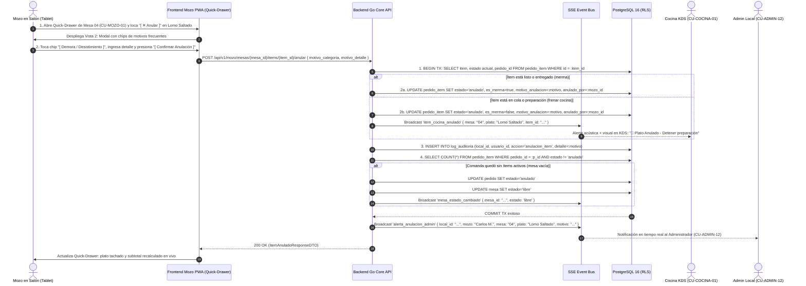
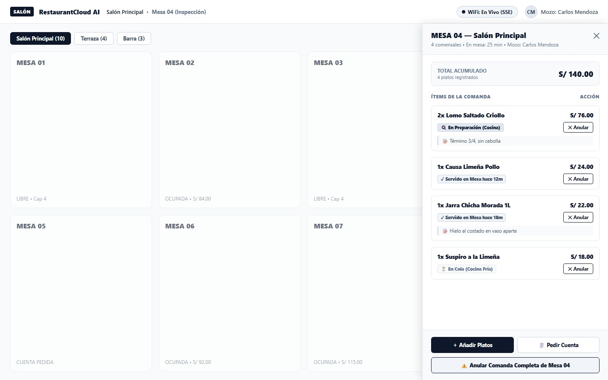
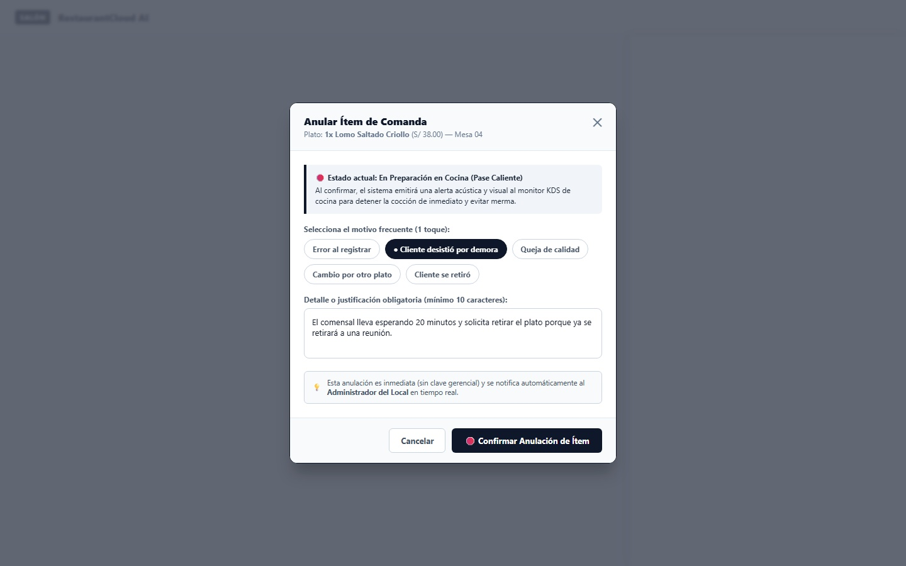
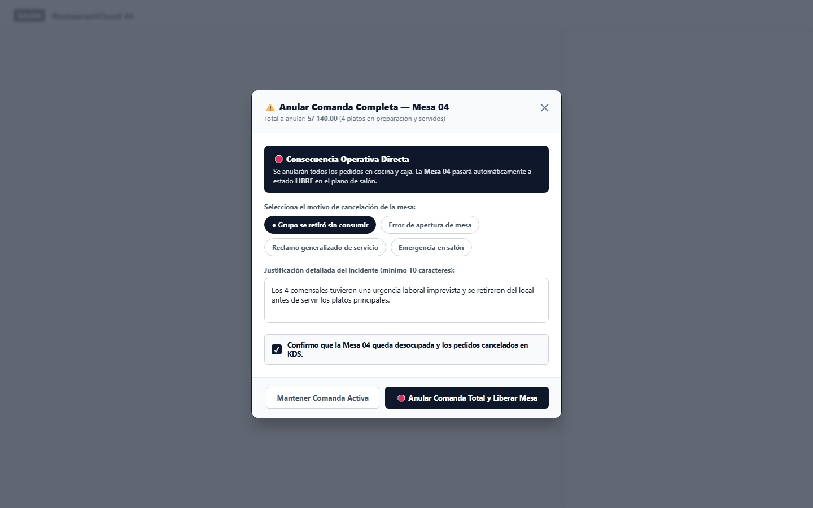
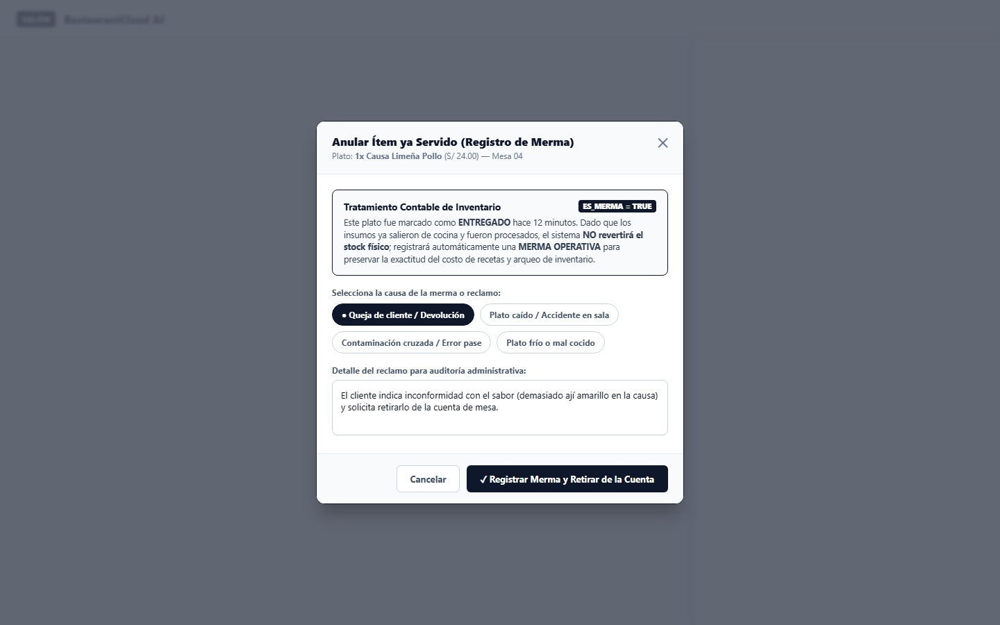

# CU-MOZO-06: Anular Pedido (o Ítem de Pedido) con Motivo

Especificación técnica de interfaz de usuario táctil, arquitectura de datos transaccional, control de mermas de inventario, auditoría inmutable, enrutamiento de parada inmediata a cocina (KDS) vía Server-Sent Events (SSE), contratos de API en Go y persistencia en PostgreSQL 16 para **RestaurantCloud AI**.

---

## 1. Ficha Técnica del Caso de Uso

| Atributo | Detalle |
| :--- | :--- |
| **Código CU** | `CU-MOZO-06` |
| **Nombre** | Anular pedido (o ítem de pedido) con motivo |
| **Actor Principal** | `mozo` (personal de atención en sala; operador que ejecuta la anulación táctica en salón) |
| **Actores Secundarios** | `cocina` (receptor de alerta sonora y visual inmediata para detener preparación `CU-COCINA-01`), `admin_local` (receptor de notificación push/SSE de auditoría `CU-ADMIN-12`), `cajero` (reajuste automático del pre-conteo de mesa `CU-CAJA-02`) |
| **Dispositivo / Viewport** | Responsive Tablet en Salón (`1024x768` / `1280x800` / `1440x900`), Mobile POS (`375x812` / `412x915`), Terminal Fija POS (`1920x1080`) |
| **Precondición** | Existe un pedido registrado y enviado a Cocina (`pedido.estado = 'enviado'`), aún no cobrado en caja; el mozo cuenta con sesión activa asignada a la sede. |
| **Postcondición** | El ítem o pedido conmuta a estado `anulado`; si el ítem estaba en preparación, Cocina es alertada en < 30ms para suspender la cocción; si el ítem ya estaba servido, se califica automáticamente como Merma (`es_merma = true`) sin revertir stock; el Administrador del Local recibe notificación reactiva en tiempo real; si se anula la comanda completa, la mesa se libera automáticamente (`mesa.estado = 'libre'`). |

---

## 2. Diagrama de Flujo y Secuencia en Tiempo Real (KDS & Auditoría)



---

## 3. Especificación de Pantallas y Wireframes Blueprint

### Vista 1: Inspección de Mesa con Acciones de Anulación Integradas (`wf_mozo_06_inspeccion_anulacion.jpg`)

Extensión y complementariedad directa del **Quick-Drawer de Inspección de Mesa Ocupada (Vista 2 de `CU-MOZO-01`)**. Al consultar el estado de la Mesa 04 (440px de ancho sobre el plano atenuado), cada tarjeta de plato incluye un botón táctil dedicado `[ ✕ Anular ]` con su respectivo badge de estado en cocina. Al pie del drawer, se incorpora el botón destructivo de advertencia `[ ⚠️ Anular Comanda Completa de Mesa 04 ]`.



#### Layout Estructural ASCII (Desktop / Tablet 1440x900)
```text
+----------------------------------------------------------------------------------------------------+
| SALÓN RestaurantCloud AI | Salón Principal > Mesa 04 (Inspección)   (•) WiFi: En Vivo   [CM] Carlos|
+------------------------------------------------------------------+---------------------------------+
| PLANO DE SALÓN (FONDO ATENUADO CON OVERLAY SUTIL)                | QUICK-DRAWER MESA 04 (440px)    |
|                                                                  |                                 |
| [ Salón Principal (10) ] [ Terraza (4) ] [ Barra (3) ]           | MESA 04 — Salón Principal   [✕] |
| Aforo: 24 / 42 comensales (57%)                                  | 4 comensales • 25m • Carlos M.  |
|                                                                  | ------------------------------- |
| +------------+ +------------+ +------------+ +------------+      | TOTAL ACUMULADO       S/ 140.00 |
| | MESA 01    | | MESA 02    | | MESA 03    | | MESA 04    |      | 4 platos registrados            |
| | LIBRE      | | OCUPADA    | | LIBRE      | | OCUPADA    |      | ------------------------------- |
| | Cap 4      | | S/ 84.00   | | Cap 4      | | S/ 140.00  |      | ÍTEMS DE LA COMANDA      ACCIÓN |
| +------------+ +------------+ +------------+ +------------+      | +-----------------------------+ |
|                                                                  | | 2x Lomo Saltado Criollo     | |
| +------------+ +------------+ +------------+ +------------+      | | S/ 76.00                    | |
| | MESA 05    | | MESA 06    | | MESA 07    | | MESA 08    |      | | [🍳 En Preparación Cocina]  | |
| | CUENTA     | | OCUPADA    | | OCUPADA    | | RESERVA    |      | | [ ✕ Anular ]                | |
| +------------+ +------------+ +------------+ +------------+      | +-----------------------------+ |
|                                                                  | +-----------------------------+ |
|                                                                  | | 1x Causa Limeña Pollo       | |
|                                                                  | | S/ 24.00                    | |
|                                                                  | | [✓ Servido en Mesa hace 12m]| |
|                                                                  | | [ ✕ Anular ]                | |
|                                                                  | +-----------------------------+ |
|                                                                  | ------------------------------- |
|                                                                  | [ ＋ Añadir Platos ] [🧾 Cuenta]|
|                                                                  | [ ⚠️ Anular Comanda Completa  ] |
+------------------------------------------------------------------+---------------------------------+
```

---

### Vista 2: Modal Rápido de Anulación de Ítem con Motivos Frecuentes (`wf_mozo_06_modal_anular_item.jpg`)

Modal táctil de 520px optimizado para dedos. Si el ítem está en preparación, alerta sobre el envío acústico inmediato al KDS de cocina para suspender la cocción. Provee chips de selección rápida en 1 toque (`Error al registrar`, `Cliente desistió por demora`, etc.) y valida un detalle descriptivo obligatorio de mínimo 10 caracteres para garantizar rigurosa auditoría posterior.



#### Layout Estructural ASCII (Modal Centrado 520px)
```text
+------------------------------------------------------------+
| Anular Ítem de Comanda                                 [✕] |
| Plato: 1x Lomo Saltado Criollo (S/ 38.00) — Mesa 04        |
+------------------------------------------------------------+
|                                                            |
|  🛑 Estado actual: En Preparación en Cocina (Pase Caliente)|
|     Al confirmar, el sistema emitirá una alerta acústica y |
|     visual al monitor KDS para detener la cocción.         |
|                                                            |
|  Selecciona el motivo frecuente (1 toque):                 |
|  [ Error al registrar ]  [● Cliente desistió por demora  ] |
|  [ Queja de calidad   ]  [ Cambio de plato ] [ Se retiró ] |
|                                                            |
|  Detalle o justificación obligatoria (mínimo 10 carac):    |
|  +------------------------------------------------------+  |
|  | El comensal lleva esperando 20 minutos y solicita    |  |
|  | retirar el plato porque ya se retirará a una reunión.|  |
|  +------------------------------------------------------+  |
|                                                            |
|  💡 Esta anulación es inmediata (sin clave gerencial) y se |
|     notifica automáticamente al Administrador del Local.   |
|                                                            |
+------------------------------------------------------------+
|                   [ Cancelar ]  [ 🛑 Confirmar Anulación ] |
+------------------------------------------------------------+
```

---

### Vista 3: Modal de Anulación de Comanda Completa y Liberación de Mesa (`wf_mozo_06_modal_anular_comanda_total.jpg`)

Modal de alta advertencia de 550px utilizado ante situaciones extraordinarias (abandono del local, error en apertura de mesa o emergencias). Explica con contundencia la repercusión directa: se cancelan todos los pedidos de la mesa y esta pasa automáticamente a estado `LIBRE`. Requiere casilla de confirmación explícita para prevenir pulsaciones accidentales.



#### Layout Estructural ASCII (Modal Centrado 550px)
```text
+------------------------------------------------------------+
| ⚠️ Anular Comanda Completa — Mesa 04                   [✕] |
| Total a anular: S/ 140.00 (4 platos en cocina y servidos)  |
+------------------------------------------------------------+
|                                                            |
|  🛑 CONSECUENCIA OPERATIVA DIRECTA                         |
|     Se anularán todos los pedidos en cocina y caja. La     |
|     Mesa 04 pasará automáticamente a estado LIBRE.         |
|                                                            |
|  Selecciona el motivo de cancelación de la mesa:           |
|  [● Grupo se retiró sin consumir ] [ Error de apertura ]   |
|  [ Reclamo generalizado          ] [ Emergencia salón  ]   |
|                                                            |
|  Justificación detallada del incidente (mínimo 10 carac):  |
|  +------------------------------------------------------+  |
|  | Los 4 comensales tuvieron una urgencia laboral       |  |
|  | imprevista y se retiraron antes de salir los platos. |  |
|  +------------------------------------------------------+  |
|                                                            |
|  [✓] Confirmo que la Mesa 04 queda desocupada y los        |
|      pedidos cancelados en KDS.                            |
|                                                            |
+------------------------------------------------------------+
|       [ Mantener Comanda ]  [ 🛑 Anular y Liberar Mesa ]   |
+------------------------------------------------------------+
```

---

### Vista 4: Modal de Tratamiento Especial por Merma de Inventario (`wf_mozo_06_alerta_merma.jpg`)

Modal de 530px disparado cuando el mozo anula un plato cuyo estado es `entregado` (servido en mesa). Explica de forma pedagógica que, al haber salido los insumos de los fogones, el sistema **no revertirá el stock físico** para no falsear los inventarios ni los costos de recetas (`CU-ADMIN-05`), marcando internamente el registro con `es_merma = true`.



#### Layout Estructural ASCII (Modal Centrado 530px)
```text
+------------------------------------------------------------+
| Anular Ítem ya Servido (Registro de Merma)             [✕] |
| Plato: 1x Causa Limeña Pollo (S/ 24.00) — Mesa 04          |
+------------------------------------------------------------+
|                                                            |
|  TRATAMIENTO CONTABLE DE INVENTARIO    [es_merma = true]   |
|  Este plato fue marcado como ENTREGADO hace 12 min. Dado   |
|  que los insumos ya salieron de cocina, el sistema NO      |
|  revertirá el stock físico; registrará una MERMA OPERATIVA |
|  para preservar la exactitud del costo de recetas.         |
|                                                            |
|  Selecciona la causa de la merma o reclamo:                |
|  [● Queja de cliente / Devolución ] [ Plato caído / sala ] |
|  [ Contaminación / Error pase     ] [ Plato frío / cocción]|
|                                                            |
|  Detalle del reclamo para auditoría administrativa:        |
|  +------------------------------------------------------+  |
|  | El cliente indica inconformidad con el sabor         |  |
|  | (demasiado ají amarillo en la causa) y pide retiro.  |  |
|  +------------------------------------------------------+  |
|                                                            |
+------------------------------------------------------------+
|              [ Cancelar ]  [ ✓ Registrar Merma y Retirar ] |
+------------------------------------------------------------+
```

---

## 4. Matriz de 5 Estados de la Experiencia de Usuario (UX)

| Estado | Evento Desencadenante | Comportamiento de Interfaz | Elementos Visuales Clave |
| :--- | :--- | :--- | :--- |
| **1. Carga / Skeleton** | Mozo toca Mesa 04 en plano para abrir el Quick-Drawer. | Drawer se despliega suavemente desde la derecha (300ms) con animaciones pulsantes en tarjetas de platos. | Placeholders de texto e iconos de estado cargando. |
| **2. Mesa en Servicio (Normal)** | Drawer abierto con consumos normales. | Lista detallada de platos con badges de estado (`En Preparación`, `Servido`). Botón `[ ✕ Anular ]` disponible en cada tarjeta. | Botones de adición de platos y solicitud de cuenta. |
| **3. Modal Anular Ítem** | Mozo presiona `[ ✕ Anular ]` en un plato en preparación. | Backdrop oscurecido al 65%. Chips de motivos frecuentes y textarea con autofocus. Botón de confirmación destructivo. | Badge `🛑 Estado: En Preparación`, botón `[ Confirmar Anulación ]`. |
| **4. Modal Merma (Servido)** | Mozo presiona `[ ✕ Anular ]` en un plato ya entregado. | Alerta técnica de costeo de inventario. Selección de causa de merma y captura de reclamo. | Badge `es_merma = true`, botón `[ Registrar Merma y Retirar ]`. |
| **5. Anulación Total Comanda** | Mozo presiona `[ ⚠️ Anular Comanda Completa ]`. | Modal de peligro de 550px con checkbox obligatorio de confirmación. Conmuta la mesa a `libre`. | Banner `🛑 Consecuencia Operativa`, botón `[ Anular y Liberar Mesa ]`. |

---

## 5. Control de Acceso y Matriz RBAC

| Acción / Operación | Mozo | Administrador Local | Cocina | Cajero | Propietario |
| :--- | :---: | :---: | :---: | :---: | :---: |
| **Anular ítem en cola o preparación** | ✅ Permitido | ✅ Permitido | ❌ Denegado | ❌ Denegado | ✅ Permitido |
| **Anular ítem servido (Merma)** | ✅ Permitido | ✅ Permitido | ❌ Denegado | ❌ Denegado | ✅ Permitido |
| **Anular comanda completa y liberar mesa** | ✅ Permitido | ✅ Permitido | ❌ Denegado | ❌ Denegado | ✅ Permitido |
| **Recibir alerta SSE en monitor KDS** | ❌ Solo emite | ❌ No aplica | ✅ Receptor | ❌ No aplica | ❌ No aplica |
| **Recibir notificación push de anulación (`CU-ADMIN-12`)** | ❌ Emisor | ✅ Receptor | ❌ No aplica | ❌ No aplica | ✅ Auditoría |
| **Consultar reporte histórico de mermas y anulaciones** | ❌ Denegado | ✅ Permitido | ❌ Denegado | ❌ Denegado | ✅ Permitido |

---

## 6. Contratos de API REST y Modelos en Go

### 6.1 DTOs de Entrada y Salida (`internal/mozo/dto/anulacion_dto.go`)

```go
package dto

import (
	"time"

	"github.com/google/uuid"
)

// AnularItemRequest payload para anular un ítem específico de la comanda
type AnularItemRequest struct {
	MotivoCategoria string `json:"motivo_categoria" binding:"required,oneof=error_toma demora_cliente queja_calidad cambio_plato otro"`
	MotivoDetalle   string `json:"motivo_detalle" binding:"required,min=10,max=255"`
}

// AnularPedidoCompletoRequest payload para anular toda la cuenta y liberar la mesa
type AnularPedidoCompletoRequest struct {
	MotivoCategoria string `json:"motivo_categoria" binding:"required,oneof=retiro_sin_consumo error_apertura reclamo_general emergencia otro"`
	MotivoDetalle   string `json:"motivo_detalle" binding:"required,min=10,max=255"`
	ConfirmarVacio  bool   `json:"confirmar_vacio" binding:"required"`
}

// ItemAnuladoResponseDTO respuesta tras anular exitosamente un ítem
type ItemAnuladoResponseDTO struct {
	ItemID         uuid.UUID `json:"item_id"`
	PedidoID       uuid.UUID `json:"pedido_id"`
	MesaID         uuid.UUID `json:"mesa_id"`
	MesaNumero     string    `json:"mesa_numero"`
	ProductoNombre string    `json:"producto_nombre"`
	Cantidad       int       `json:"cantidad"`
	EstadoAnterior string    `json:"estado_anterior"`
	EsMerma        bool      `json:"es_merma"`
	NuevoSubtotal  float64   `json:"nuevo_subtotal"`
	MesaLiberada   bool      `json:"mesa_liberada"`
	Mensaje        string    `json:"mensaje"`
	AnuladoAt      time.Time `json:"anulado_at"`
}

// PedidoAnuladoResponseDTO respuesta tras cancelar toda la comanda
type PedidoAnuladoResponseDTO struct {
	PedidoID     uuid.UUID `json:"pedido_id"`
	MesaID       uuid.UUID `json:"mesa_id"`
	MesaNumero   string    `json:"mesa_numero"`
	MesaEstado   string    `json:"mesa_estado"` // 'libre'
	TotalAnulado float64   `json:"total_anulado"`
	ItemsTotal   int       `json:"items_total"`
	Mensaje      string    `json:"mensaje"`
	AnuladoAt    time.Time `json:"anulado_at"`
}
```

### 6.2 Endpoints REST

#### A. Anular Ítem Específico de Comanda
- **Ruta:** `POST /api/v1/mozo/mesas/{mesa_id}/items/{item_id}/anular`
- **Request Body:**
```json
{
  "motivo_categoria": "demora_cliente",
  "motivo_detalle": "El comensal lleva esperando 20 minutos y solicita retirar el plato porque ya se retirará a una reunión."
}
```
- **Respuesta Exitosa (`200 OK`):**
```json
{
  "success": true,
  "data": {
    "item_id": "8a9b0c1d-2222-3333-4444-555566667777",
    "pedido_id": "98765432-aaaa-bbbb-cccc-1234567890ab",
    "mesa_id": "a1b2c3d4-e5f6-7a8b-9c0d-1e2f3a4b5c6d",
    "mesa_numero": "04",
    "producto_nombre": "Lomo Saltado Criollo",
    "cantidad": 1,
    "estado_anterior": "en_preparacion",
    "es_merma": false,
    "nuevo_subtotal": 102.00,
    "mesa_liberada": false,
    "mensaje": "Ítem anulado exitosamente; alerta de parada enviada a cocina",
    "anulado_at": "2026-10-09T14:15:30Z"
  },
  "message": "Ítem de comanda anulado"
}
```

#### B. Anular Comanda Completa y Liberar Mesa
- **Ruta:** `POST /api/v1/mozo/mesas/{mesa_id}/anular-comanda`
- **Request Body:**
```json
{
  "motivo_categoria": "retiro_sin_consumo",
  "motivo_detalle": "Los 4 comensales tuvieron una urgencia laboral imprevista y se retiraron antes de salir los platos.",
  "confirmar_vacio": true
}
```
- **Respuesta Exitosa (`200 OK`):**
```json
{
  "success": true,
  "data": {
    "pedido_id": "98765432-aaaa-bbbb-cccc-1234567890ab",
    "mesa_id": "a1b2c3d4-e5f6-7a8b-9c0d-1e2f3a4b5c6d",
    "mesa_numero": "04",
    "mesa_estado": "libre",
    "total_anulado": 140.00,
    "items_total": 4,
    "mensaje": "Comanda anulada por completo y Mesa 04 liberada",
    "anulado_at": "2026-10-09T14:18:10Z"
  },
  "message": "Comanda completa anulada con éxito"
}
```

---

## 7. Esquema Relacional de Base de Datos y DDL PostgreSQL 16

```sql
-- PostgreSQL 16: Campos e Índices para Anulaciones y Control de Mermas

-- 1. Asegurar columnas de auditoría y merma en pedido_item
ALTER TABLE pedido_item 
ADD COLUMN IF NOT EXISTS motivo_anulacion VARCHAR(255) NULL,
ADD COLUMN IF NOT EXISTS anulado_por UUID NULL REFERENCES usuario(id) ON DELETE SET NULL,
ADD COLUMN IF NOT EXISTS es_merma BOOLEAN NOT NULL DEFAULT false;

-- 2. Índice parcial para reportes de mermas y auditorías de anulación
CREATE INDEX IF NOT EXISTS idx_pedido_item_anulados 
ON pedido_item(pedido_id, estado, es_merma) 
WHERE estado = 'anulado';

-- 3. Índice para log de auditoría por local y fecha
CREATE INDEX IF NOT EXISTS idx_auditoria_anulaciones 
ON log_auditoria(local_id, accion, created_at) 
WHERE accion IN ('anulacion_item', 'anulacion_comanda');

-- 4. Constraint de consistencia: si es merma, el estado debe ser 'anulado'
DO $$ BEGIN
    ALTER TABLE pedido_item 
    ADD CONSTRAINT chk_merma_solo_anulado 
    CHECK (NOT es_merma OR estado = 'anulado');
EXCEPTION
    WHEN duplicate_object THEN NULL;
END $$;
```

---

## 8. Ergonomía Táctil y Accesibilidad WCAG 2.1 AA

1. **Touch Targets de Seguridad Operativa (> 48x48px):**
   - El botón `[ ✕ Anular ]` en cada tarjeta de plato cuenta con un padding táctil de 34x32px dentro de un margen circundante de 48px, permitiendo pulsación precisa sin errores con la mano izquierda o derecha.
   - Los chips de motivos frecuentes tienen dimensiones de 38px de altura con espaciado de 8px, facilitando la selección con un solo toque del pulgar.
2. **Prevención de Errores Críticos (Confirmación Guiada):**
   - Ninguna anulación se efectúa en un solo clic por accidente: requiere siempre el modal de confirmación con selección de motivo y justificación obligatoria.
   - En anulaciones totales de mesa, se exige además la marcación de la casilla de confirmación `[✓]`.
3. **Contraste Tipográfico WCAG 2.1 AA:**
   - Textos de advertencia en `#0F172A` sobre fondos de alerta `#F1F5F9` (ratio 14.8:1).
   - Botón destructivo en `#0F172A` con texto blanco `#FFFFFF` (ratio 15.2:1).
4. **Soporte Multisensorial:**
   - La cocina recibe un sonido de advertencia ("beep-beep" de alta frecuencia) acompañado de un flash visual en la cabecera del monitor KDS para que los cocineros detengan los sartenes de inmediato.
