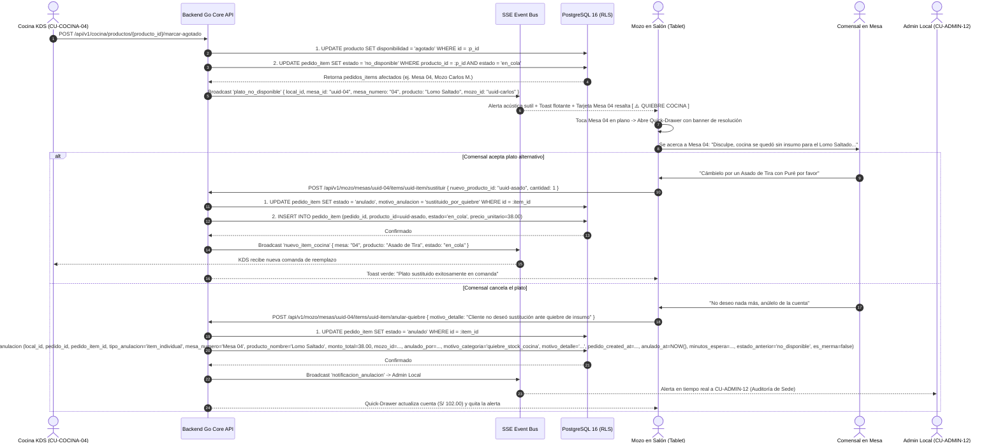
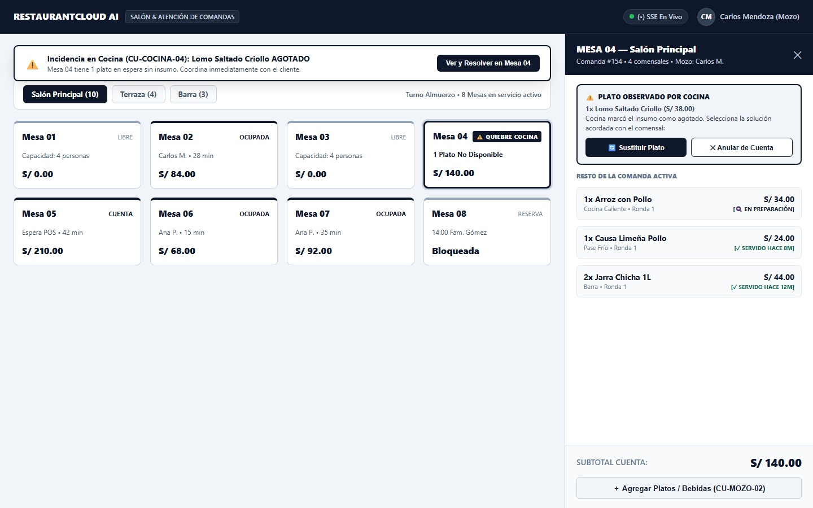
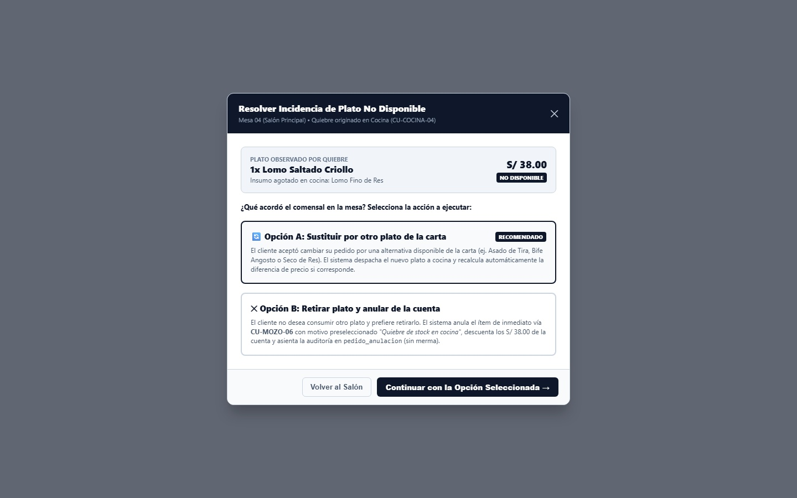
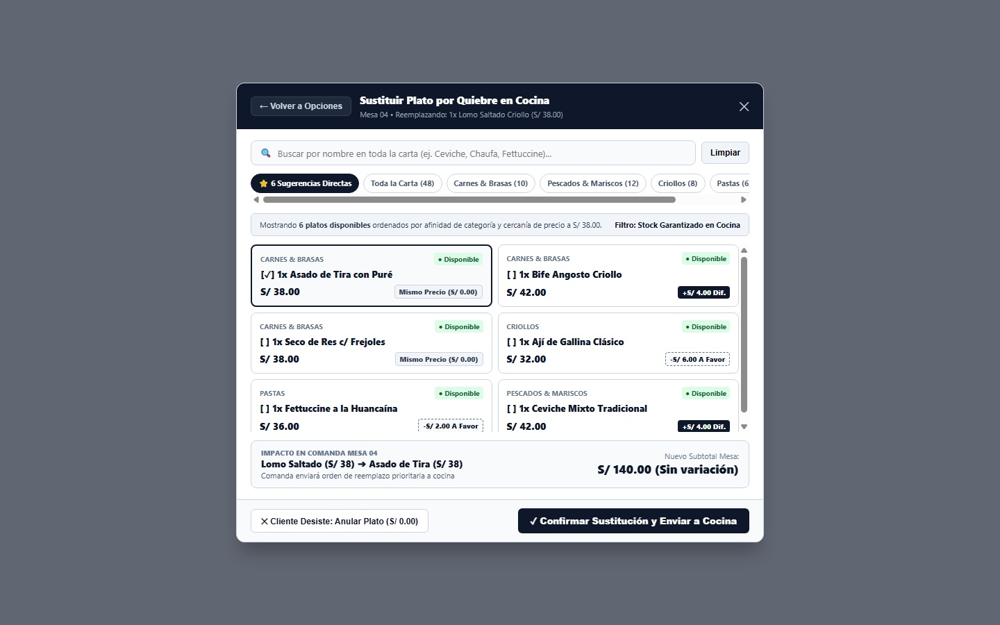
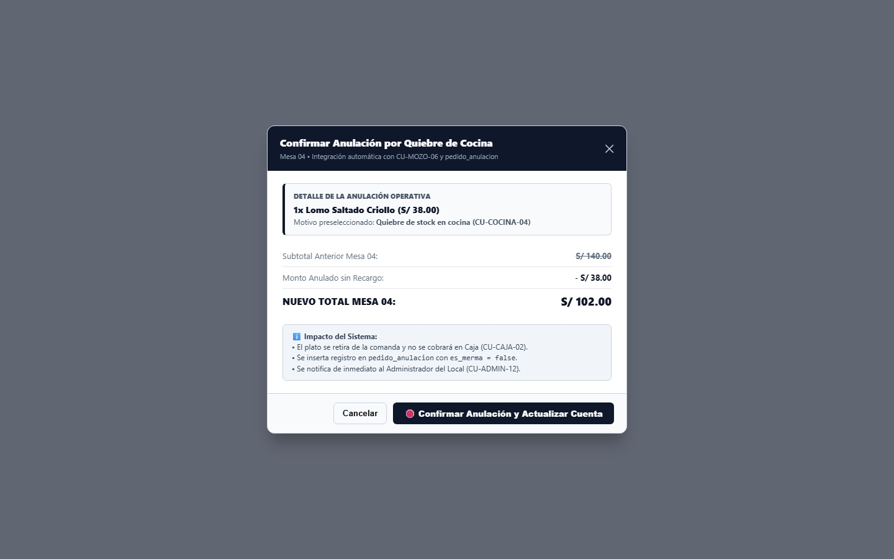

# CU-MOZO-07: Atender Incidencia de Plato No Disponible y Resolver en Mesa

Especificación técnica de interfaz de usuario táctil para tablet, arquitectura de datos transaccional, flujo reactivo de resolución de quiebres de cocina vía Server-Sent Events (SSE), integración con `pedido_anulacion`, contratos de API en Go y persistencia en PostgreSQL 16 para **RestaurantCloud AI**.

---

## 1. Ficha Técnica del Caso de Uso

| Atributo | Detalle |
| :--- | :--- |
| **Código CU** | `CU-MOZO-07` |
| **Nombre** | Atender incidencia de plato no disponible y resolver en mesa |
| **Actor Principal** | `mozo` (personal de atención en sala; receptor de la alerta reactiva que coordina con el comensal en mesa la sustitución o anulación del plato sin insumos) |
| **Actores Secundarios** | `cocina` (emisor del quiebre de stock en monitor KDS [`CU-COCINA-04`](file:///j:/proyectos_git/RestaurantCloud_AI_backend/context/cu.md#L1148)), `admin_local` (receptor de notificación de anulación por quiebre [`CU-ADMIN-12`](file:///j:/proyectos_git/RestaurantCloud_AI_backend/wireframe/administrador/CU-ADMIN-12-notificacion-anulacion/wireframe.md)), `cajero` (actualización de precuenta en caja [`CU-CAJA-02`](file:///j:/proyectos_git/RestaurantCloud_AI_backend/context/cu.md#L1070)) |
| **Dispositivo / Viewport** | Responsive Tablet en Salón (`1024x768` / `1280x800` / `1440x900`), Mobile POS (`375x812` / `412x915`), Terminal Fija POS (`1920x1080`) |
| **Precondición** | Existe un pedido en curso con al menos un ítem en estado `en_cola` o `en_preparacion`; Cocina o Administración marca un plato como `agotado` por quiebre de insumos (`CU-COCINA-04` o `CU-ADMIN-03`); el sistema conmuta automáticamente el ítem a `estado = 'no_disponible'`; el mozo cuenta con sesión activa asignada a la sede. |
| **Postcondición** | La tablet del mozo recibe alerta reactiva prioritaria en tiempo real; el mozo coordina la resolución frente al cliente en mesa: **(A) Si sustituye:** se selecciona un plato disponible de la carta, se envía a cocina y se ajusta la comanda; **(B) Si anula:** se retira el plato sin costo, se recalcula la cuenta de mesa, se inserta la auditoría en `pedido_anulacion` con motivo `quiebre_stock_cocina` (`es_merma = false`) y se notifica al Administrador del Local en `CU-ADMIN-12`. |

---

## 2. Diagrama de Flujo y Secuencia en Tiempo Real



---

## 3. Especificación de Pantallas y Wireframes Blueprint

### Vista 1: Plano de Salón con Alerta de Quiebre y Quick-Drawer (`wf_mozo_07_salon_alerta_quiebre.jpg`)

Pantalla principal táctil para tablet (`1440x900` / `1024x768`):
- **Barra Superior y Toast en Vivo:** Header oscuro con indicador de conexión `(•) SSE En Vivo` y avatar del mozo (`Carlos Mendoza`). En la parte superior de la pantalla emerge la barra reactiva: **`⚠️ Incidencia en Cocina (CU-COCINA-04): Lomo Saltado Criollo AGOTADO • Mesa 04 requiere atención inmediata`** con botón táctil directo `[ Ver y Resolver en Mesa 04 ]`.
- **Plano de Salón (70% ancho):** La cuadrícula de mesas exhibe a `Mesa 04` en contorno de advertencia reforzado con el badge destacado **`[ ⚠️ QUIEBRE COCINA ]`** y la indicación: `1 Plato No Disponible • S/ 140.00`.
- **Quick-Drawer Lateral de Mesa 04 (30% / 440px):**
  - Despliega en la parte superior el recuadro de acción prioritaria: **`⚠️ PLATO OBSERVADO POR COCINA — 1x Lomo Saltado Criollo (S/ 38.00)`**, informando que cocina marcó el insumo como agotado.
  - Ofrece los dos botones táctiles inmediatos:
    - **`[ 🔄 Sustituir Plato ]`** (Abre el catálogo asistido de reemplazo).
    - **`[ ✕ Anular de Cuenta ]`** (Abre la confirmación de retiro sin costo).
  - Exhibe el resto de platos activos de la mesa (*1x Arroz con Pollo en preparación, 1x Causa servida, 2x Chicha servida*) y el subtotal acumulado.



#### Layout Estructural ASCII (Desktop / Tablet 1440x900)
```text
+----------------------------------------------------------------------------------------------------+
| RESTAURANTCLOUD AI   | Salón & Atención de Comandas      (•) SSE En Vivo     [CM] Carlos Mendoza   |
+----------------------------------------------------------------------------------------------------+
| [ ⚠️ Incidencia Cocina: Lomo Saltado AGOTADO • Mesa 04 requiere atención ]  [ Ver y Resolver ]     |
|                                                                                                    |
| PLANO DE SALÓN (70% ANCHO)                                       | QUICK-DRAWER MESA 04 (440px)    |
| [ Salón Principal (10) ] [ Terraza (4) ] [ Barra (3) ]           | MESA 04 — Salón Principal   [✕] |
|                                                                  | Comanda #154 • 4p • Carlos M.   |
| +------------+ +------------+ +------------+ +------------+      | ------------------------------- |
| | MESA 01    | | MESA 02    | | MESA 03    | | MESA 04    |      | ⚠️ PLATO OBSERVADO POR COCINA   |
| | LIBRE      | | OCUPADA    | | LIBRE      | | ⚠️ QUIEBRE |      | 1x Lomo Saltado Criollo (S/ 38) |
| | Cap: 4     | | S/ 84.00   | | Cap: 4     | | S/ 140.00  |      | Insumo agotado en cocina.       |
| +------------+ +------------+ +------------+ +------------+      | [ 🔄 Sustituir ] [ ✕ Anular ]   |
|                                                                  | ------------------------------- |
| +------------+ +------------+ +------------+ +------------+      | RESTO DE LA COMANDA ACTIVA      |
| | MESA 05    | | MESA 06    | | MESA 07    | | MESA 08    |      | • 1x Arroz c/ Pollo [EN PREPAR] |
| | CUENTA     | | OCUPADA    | | OCUPADA    | | RESERVA    |      | • 1x Causa Limeña   [✓ SERVIDO] |
| | S/ 210.00  | | S/ 68.00   | | S/ 92.00   | | 14:00 Fam. |      | • 2x Jarra Chicha   [✓ SERVIDO] |
| +------------+ +------------+ +------------+ +------------+      | ------------------------------- |
|                                                                  | SUBTOTAL CUENTA:      S/ 140.00 |
|                                                                  | [ ＋ Agregar Platos / Bebidas ] |
+------------------------------------------------------------------+---------------------------------+
```

---

### Vista 2: Modal de Resolución Asistida en Mesa — Sustitución o Anulación (`wf_mozo_07_modal_resolucion_incidencia.jpg`)

Modal táctil de 620px diseñado para operar de pie frente al cliente en la mesa:
- **Banner del Plato Afectado:** Identifica claramente el plato (`1x Lomo Saltado Criollo S/ 38.00`), insumo en quiebre (*Lomo Fino de Res*) y badge `[ NO DISPONIBLE ]`.
- **Selector de Alternativas en 1 Toque:**
  - **Tarjeta 1: `🔄 Opción A: Sustituir por otro plato de la carta` (Badge: RECOMENDADO):**
    - Explica que el cliente aceptó cambiar su orden por otra opción disponible (ej. Asado de Tira, Bife Angosto o Seco de Res).
    - Despacha automáticamente la nueva preparación a cocina y recalcula la diferencia de precio.
  - **Tarjeta 2: `✕ Opción B: Retirar plato y anular de la cuenta`:**
    - Explica que el cliente no desea consumir otro plato.
    - Anula el ítem de inmediato vía `CU-MOZO-06` con la categoría preseleccionada *"Quiebre de stock en cocina"*, descuenta los S/ 38.00 de la cuenta y asienta la auditoría en `pedido_anulacion` (`es_merma = false`).
- **Botonera:** `[ Volver al Salón ]` y `[ Continuar con la Opción Seleccionada → ]`.



#### Layout Estructural ASCII (Modal 620px)
```text
+------------------------------------------------------------+
| Resolver Incidencia de Plato No Disponible             [✕] |
| Mesa 04 (Salón Principal) • Quiebre en Cocina (CU-COCINA-04)|
+------------------------------------------------------------+
|  PLATO OBSERVADO:                                          |
|  1x Lomo Saltado Criollo (S/ 38.00)      [ NO DISPONIBLE ] |
|  Insumo agotado en cocina: Lomo Fino de Res                |
|                                                            |
|  ¿Qué acordó el comensal en la mesa?                       |
|                                                            |
|  +------------------------------------------------------+  |
|  | 🔄 [ Opción A ] Sustituir por otro plato de la carta |  |
|  | [ RECOMENDADO ] El comensal aceptó cambiar su orden  |  |
|  | por una alternativa disponible (Asado de Tira, etc.) |  |
|  | Despacha a cocina y calcula diferencia de precio.    |  |
|  +------------------------------------------------------+  |
|                                                            |
|  +------------------------------------------------------+  |
|  | ✕ [ Opción B ] Retirar plato y anular de la cuenta   |  |
|  | El cliente no desea otro plato. Anula de inmediato   |  |
|  | vía CU-MOZO-06 con motivo "Quiebre en cocina",       |  |
|  | descuenta S/ 38.00 y audita sin merma contable.      |  |
|  +------------------------------------------------------+  |
+------------------------------------------------------------+
|       [ Volver al Salón ]    [ Continuar con Selección → ] |
+------------------------------------------------------------+
```

---

### Vista 3: Modal de Sustitución Universal con Búsqueda en Toda la Carta y 6 Sugerencias Directas (`wf_mozo_07_modal_sustitucion_carta.jpg`)

Modal táctil de 760px que se abre al elegir la Opción A (Sustituir Plato):
- **Navegación Superior con Retorno Seguro:**
  - Botón directo **`[ ← Volver a Opciones ]`** en la esquina superior izquierda para regresar al modal de decisión previa sin perder contexto si el cliente no desea ver más opciones.
  - Título y subtítulo contextual: *"Sustituir Plato por Quiebre en Cocina • Mesa 04 • Reemplazando: 1x Lomo Saltado Criollo (S/ 38.00)"*.
  - Botón de cierre rápido `[ ✕ ]`.
- **Buscador Universal en Toda la Carta:**
  - Input interactivo: `[ 🔍 Buscar por nombre en toda la carta (ej. Ceviche, Chaufa, Fettuccine)... ]` con botón táctil `[ Limpiar ]`. Permite al mozo buscar cualquier producto o insumo en tiempo real sin restricciones de categoría.
- **Barra de Chips de Categorías Deslizables:**
  - Pestaña activa por defecto: **`[ ⭐ 6 Sugerencias Directas ]`** (combina afinidad de categoría y cercanía matemática de precio `ABS(precio - precio_original)`).
  - Píldoras de carta completa: `[ Toda la Carta (48) ]`, `[ Carnes & Brasas (10) ]`, `[ Pescados & Mariscos (12) ]`, `[ Criollos (8) ]`, `[ Pastas (6) ]`, `[ Bebidas (12) ]`.
- **Cuadrícula de 6 Platos Sugeridos (Grid 2 Columnas):**
  - *Tarjeta 1 (Seleccionada):* **`[✓] 1x Asado de Tira con Puré`** (Carnes & Brasas • Disponible) • `S/ 38.00` • Badge: `Mismo Precio (S/ 0.00)`.
  - *Tarjeta 2:* **`[ ] 1x Bife Angosto Criollo`** (Carnes & Brasas • Disponible) • `S/ 42.00` • Badge: `+S/ 4.00 Dif.`
  - *Tarjeta 3:* **`[ ] 1x Seco de Res c/ Frejoles`** (Carnes & Brasas • Disponible) • `S/ 38.00` • Badge: `Mismo Precio (S/ 0.00)`.
  - *Tarjeta 4:* **`[ ] 1x Ají de Gallina Clásico`** (Criollos • Disponible) • `S/ 32.00` • Badge: `-S/ 6.00 A Favor`.
  - *Tarjeta 5:* **`[ ] 1x Fettuccine a la Huancaína`** (Pastas • Disponible) • `S/ 36.00` • Badge: `-S/ 2.00 A Favor`.
  - *Tarjeta 6:* **`[ ] 1x Ceviche Mixto Tradicional`** (Pescados & Mariscos • Disponible) • `S/ 42.00` • Badge: `+S/ 4.00 Dif.`
- **Calculadora de Impacto en Comanda (Sticky Box):**
  - `Lomo Saltado (S/ 38) ➔ Asado de Tira (S/ 38)` • *"Comanda enviará orden de reemplazo prioritaria a cocina"*.
  - `Nuevo Subtotal Mesa: S/ 140.00 (Sin variación)`.
- **Doble Vía de Decisión en Footer:**
  - **Izquierda:** **`[ ✕ Cliente Desiste: Anular Plato (S/ 0.00) ]`** $\rightarrow$ Atajo táctil directo si tras revisar la carta el cliente dice *"No deseo nada más, anúlelo"*, saltando de inmediato a la confirmación de anulación sin fricción ni rodeos.
  - **Derecha:** **`[ ✓ Confirmar Sustitución y Enviar a Cocina ]`** $\rightarrow$ Despacha la orden de reemplazo al monitor KDS de Cocina (`CU-COCINA-01`) en < 30ms.



#### Layout Estructural ASCII (Modal 760px)
```text
+----------------------------------------------------------------------------------------------------+
| [ ← Volver a Opciones ]  SUSTITUIR PLATO POR QUIEBRE EN COCINA                               [ ✕ ] |
| Mesa 04 • Reemplazando: 1x Lomo Saltado Criollo (S/ 38.00)                                         |
+----------------------------------------------------------------------------------------------------+
| [ 🔍 Buscar por nombre en toda la carta (ej. Ceviche, Chaufa, Fettuccine)... ]       [ Limpiar ]   |
+----------------------------------------------------------------------------------------------------+
| [ ⭐ 6 Sugerencias Directas ] [ Toda la Carta (48) ] [ Carnes (10) ] [ Mariscos (12) ] [ Criollos ]|
| Mostrando 6 platos disponibles ordenados por afinidad y cercanía de precio. Filtro: Stock en Cocina|
+----------------------------------------------------------------------------------------------------+
| +-----------------------------------+ +-----------------------------------+                        |
| | [✓] 1x Asado de Tira con Puré     | | [ ] 1x Bife Angosto Criollo       |                        |
| | Carnes & Brasas • Disponible      | | Carnes & Brasas • Disponible      |                        |
| | S/ 38.00         [ Mismo Precio ] | | S/ 42.00          [ +S/ 4.00 Dif ]|                        |
| +-----------------------------------+ +-----------------------------------+                        |
| | [ ] 1x Seco de Res c/ Frejoles    | | [ ] 1x Ají de Gallina Clásico     |                        |
| | Carnes & Brasas • Disponible      | | Criollos • Disponible             |                        |
| | S/ 38.00         [ Mismo Precio ] | | S/ 32.00        [ -S/ 6.00 Dif ]  |                        |
| +-----------------------------------+ +-----------------------------------+                        |
| | [ ] 1x Fettuccine a la Huancaína  | | [ ] 1x Ceviche Mixto Tradicional  |                        |
| | Pastas • Disponible               | | Pescados & Mariscos • Disponible  |                        |
| | S/ 36.00        [ -S/ 2.00 Dif ]  | | S/ 42.00          [ +S/ 4.00 Dif ]|                        |
| +-----------------------------------+ +-----------------------------------+                        |
+----------------------------------------------------------------------------------------------------+
| IMPACTO EN COMANDA MESA 04:                                                                        |
| Lomo Saltado (S/ 38) ➔ Asado de Tira (S/ 38) | Nuevo Subtotal Mesa: S/ 140.00 (Sin variación)       |
+----------------------------------------------------------------------------------------------------+
| [ ✕ Cliente Desiste: Anular Plato (S/ 0) ]       | [ ✓ Confirmar Sustitución y Enviar a Cocina ]   |
+----------------------------------------------------------------------------------------------------+
```

---

### Vista 4: Confirmación de Anulación por Quiebre y Actualización de Cuenta (`wf_mozo_07_anulacion_quiebre_cuenta.jpg`)

Modal táctil de 580px cuando el cliente no desea sustituto y pide retirar el plato:
- **Resumen de la Cancelación:** Confirma el retiro de `1x Lomo Saltado Criollo` (S/ 38.00) con motivo preseleccionado: **`Quiebre de stock en cocina (CU-COCINA-04)`**.
- **Desglose Contable de la Mesa:**
  - *Subtotal Anterior Mesa 04:* ~S/ 140.00~ (tachado).
  - *Monto Anulado sin Recargo:* - S/ 38.00.
  - *NUEVO TOTAL MESA 04:* **S/ 102.00**.
- **Impacto Sistémico Explicado:**
  - El plato no se cobrará en Caja (`CU-CAJA-02`).
  - Se inserta el registro inmutable en `pedido_anulacion` con `es_merma = false` (no se cocinó).
  - Se emite alerta en tiempo real al Administrador del Local (`CU-ADMIN-12`) para control de abastecimiento.
- **Botón Primario Destructivo Seguro:** `[ 🛑 Confirmar Anulación y Actualizar Cuenta ]`.



#### Layout Estructural ASCII (Modal 580px)
```text
+------------------------------------------------------------+
| Confirmar Anulación por Quiebre de Cocina              [✕] |
| Mesa 04 • Integración automática con pedido_anulacion       |
+------------------------------------------------------------+
|  DETALLE DE LA ANULACIÓN OPERATIVA:                        |
|  1x Lomo Saltado Criollo (S/ 38.00)                        |
|  Motivo: Quiebre de stock en cocina (CU-COCINA-04)         |
|                                                            |
|  DESGLOSE CONTABLE DE LA MESA:                             |
|  • Subtotal Anterior Mesa 04:     S/ 140.00 (tachado)      |
|  • Monto Anulado sin Recargo:    - S/  38.00               |
|  • NUEVO TOTAL MESA 04:           S/ 102.00                |
|                                                            |
|  ℹ️ Impacto del Sistema:                                   |
|  • El plato se retira de la comanda de Caja (CU-CAJA-02).  |
|  • Se audita en pedido_anulacion con es_merma = false.     |
|  • Se notifica al Administrador del Local (CU-ADMIN-12).   |
+------------------------------------------------------------+
|            [ Cancelar ]  [ 🛑 Confirmar Anulación y Cuenta]|
+------------------------------------------------------------+
```

---

## 4. Matriz de Estados de la UI (5 Estados UX)

| Estado UX | Indicador Visual | Comportamiento del Sistema / Acciones Disponibles |
| :--- | :--- | :--- |
| **1. Alerta en Vivo** | Vista 1 con Toast emergente y Mesa 04 con contorno ámbar/negro `[ ⚠️ QUIEBRE COCINA ]` | El mozo es notificado acústica y visualmente en < 25ms vía SSE; al tocar la mesa se abre el Quick-Drawer con la alerta de resolución prioritaria. |
| **2. Selección de Camino** | Vista 2 con modal de 620px de dos opciones claras | Permite al mozo definir si el cliente desea sustituto (`Opción A`) o retirar el plato de la cuenta (`Opción B`). |
| **3. Sustitución de Carta** | Vista 3 con catálogo inteligente de la misma categoría | Muestra platos disponibles con cálculo de diferencia de precio en tiempo real (+S/, -S/, S/ 0); despacha la nueva orden a KDS. |
| **4. Anulación por Quiebre** | Vista 4 con recálculo de subtotal a S/ 102.00 | Descarga el plato de la comanda sin costo, audita en `pedido_anulacion` con `es_merma = false` y alerta a `CU-ADMIN-12`. |
| **5. Reconexión / Offline** | Badge ámbar en top bar: `[ ⚠️ Reconectando... ]` | Mantiene el estado en caché local; sincronización idempotente automática al reanudar conexión. |

---

## 5. Control de Acceso y Matriz RBAC

| Rol | Recibir Alerta de Quiebre | Sustituir Plato en Mesa | Anular por Quiebre de Cocina | Marcar Producto Agotado |
| :--- | :---: | :---: | :---: | :---: |
| `mozo` | ✅ Sí | ✅ Sí | ✅ Sí | ❌ No (Cocina) |
| `cocina` | ❌ No | ❌ No | ❌ No | ✅ Sí (`CU-COCINA-04`) |
| `admin_local` | ✅ Sí (`CU-ADMIN-12`) | ✅ Sí (supervisión) | ✅ Sí (supervisión) | ✅ Sí (`CU-ADMIN-03`) |
| `cajero` | ❌ No | ❌ No | ❌ No | ❌ No |
| `propietario` | ❌ No | ❌ No | ❌ No | ❌ No |

---

## 6. Contratos de API Go y DTOs

### 6.1 DTOs (`internal/domain/salon/dto_incidencias.go`)

```go
package salon

import (
	"time"
	"github.com/google/uuid"
)

// SustituirPlatoRequestDTO payload enviado por el mozo al reemplazar un plato agotado
type SustituirPlatoRequestDTO struct {
	ItemAnuladoID   uuid.UUID `json:"item_anulado_id" validate:"required"`
	NuevoProductoID uuid.UUID `json:"nuevo_producto_id" validate:"required"`
	Cantidad        int       `json:"cantidad" validate:"required,min=1"`
	NotasCocina     *string   `json:"notas_cocina,omitempty"`
}

// SustituirPlatoResponseDTO respuesta tras registrar la sustitución en comanda
type SustituirPlatoResponseDTO struct {
	PedidoID        uuid.UUID `json:"pedido_id"`
	MesaID          uuid.UUID `json:"mesa_id"`
	MesaNumero      string    `json:"mesa_numero"`
	NuevoItemID     uuid.UUID `json:"nuevo_item_id"`
	NuevoProducto   string    `json:"nuevo_producto"`
	DiferenciaMonto float64   `json:"diferencia_monto"`
	NuevoSubtotal   float64   `json:"nuevo_subtotal"`
	Mensaje         string    `json:"mensaje"`
	CreatedAt       time.Time `json:"created_at"`
}

// AnularPorQuiebreRequestDTO confirmación de anulación cuando no se desea sustituto
type AnularPorQuiebreRequestDTO struct {
	MotivoDetalle string `json:"motivo_detalle" validate:"required,min=10"`
}

// AnularPorQuiebreResponseDTO confirmación de retiro del plato y recálculo de cuenta
type AnularPorQuiebreResponseDTO struct {
	PedidoID      uuid.UUID `json:"pedido_id"`
	MesaID        uuid.UUID `json:"mesa_id"`
	MesaNumero    string    `json:"mesa_numero"`
	MontoAnulado  float64   `json:"monto_anulado"`
	NuevoSubtotal float64   `json:"nuevo_subtotal"`
	Mensaje       string    `json:"mensaje"`
	AnuladoAt     time.Time `json:"anulado_at"`
}

// PlatoSustitutoSugeridoDTO ítem disponible de la carta para el modal de reemplazo
type PlatoSustitutoSugeridoDTO struct {
	ProductoID      uuid.UUID `json:"producto_id"`
	Nombre          string    `json:"nombre"`
	CategoriaNombre string    `json:"categoria_nombre"`
	Precio          float64   `json:"precio"`
	Diferencia      float64   `json:"diferencia"` // Respecto al plato original (+S/, -S/, S/ 0)
	EsMismaCat      bool      `json:"es_misma_categoria"`
	Disponible      bool      `json:"disponible"`
}

// CategoriaChipDTO listado de familias de carta para filtrado rápido en pestañas
type CategoriaChipDTO struct {
	CategoriaID   uuid.UUID `json:"categoria_id"`
	Nombre        string    `json:"nombre"`
	TotalPlatos   int       `json:"total_platos"`
}

// CatalogoSustitucionResponseDTO respuesta completa para la vista de sustitución
type CatalogoSustitucionResponseDTO struct {
	PlatoOriginalID uuid.UUID                   `json:"plato_original_id"`
	PlatoOriginal   string                      `json:"plato_original"`
	PrecioOriginal  float64                     `json:"precio_original"`
	CategoriaNombre string                      `json:"categoria_nombre"`
	SugerenciasTop  []PlatoSustitutoSugeridoDTO `json:"sugerencias_top"` // Top 6 por precio y categoría
	Categorias      []CategoriaChipDTO          `json:"categorias"`      // Chips de carta completa
	Productos       []PlatoSustitutoSugeridoDTO `json:"productos"`       // Resultados si se filtra por categoría o texto 'q'
}
```

### 6.2 Eventos Server-Sent Events (SSE)

```json
// Evento emitido al Mozo cuando cocina marca un producto como agotado: event: "plato_no_disponible"
{
  "tipo": "plato_no_disponible",
  "local_id": "8b9e6c40-...",
  "pedido_id": "98765432-...",
  "mesa_id": "uuid-04",
  "mesa_numero": "04",
  "pedido_item_id": "uuid-item",
  "producto_nombre": "Lomo Saltado Criollo",
  "mozo_id": "usr-carlos",
  "motivo": "Insumo agotado en cocina (CU-COCINA-04)",
  "timestamp": "2026-10-09T14:10:00Z"
}
```

---

## 7. Catálogo de Endpoints REST

| Método | Ruta | Rol Requerido | Descripción | Códigos HTTP |
| :--- | :--- | :--- | :--- | :--- |
| `GET` | `/api/v1/mozo/mesas/{id}/items/{item_id}/catalogo-sustitucion?categoria_id=&q=&limite=6` | `mozo` | Obtiene 6 sugerencias por cercanía de precio y permite buscar en toda la carta | `200 OK`, `404` |
| `POST` | `/api/v1/mozo/mesas/{id}/items/{item_id}/sustituir` | `mozo` | Reemplaza plato agotado por nuevo producto de la carta y despacha comanda a KDS | `200 OK`, `400`, `409` |
| `POST` | `/api/v1/mozo/mesas/{id}/items/{item_id}/anular-quiebre` | `mozo` | Retira el plato sin costo (cliente desiste) y audita en `pedido_anulacion` (`es_merma = false`) | `200 OK`, `400` |

---

## 8. Modelo Relacional PostgreSQL 16 y Consultas Optimizadas

### 8.1 Consulta de 6 Recomendaciones por Defecto (Cero Sobreingeniería)
Aprovecha estrictamente las columnas reales de `producto` y `categoria_producto`, priorizando misma categoría y ordenando por cercanía matemática de precio (`ABS(precio - precio_original)`):

```sql
SELECT 
    p.id AS producto_id,
    p.nombre,
    p.precio,
    c.nombre AS categoria_nombre,
    (p.precio - :precio_original) AS diferencia,
    (p.categoria_id = :categoria_id_original) AS es_misma_categoria,
    true AS disponible
FROM producto p
JOIN categoria_producto c ON c.id = p.categoria_id
WHERE p.local_id = :local_id
  AND p.id != :producto_id_quebrado
  AND p.disponibilidad = 'disponible'
  AND p.activo = true
ORDER BY 
    (p.categoria_id = :categoria_id_original) DESC, -- 1° Misma categoría del plato quebrado
    ABS(p.precio - :precio_original) ASC,            -- 2° Cercanía de precio al plato original
    c.orden ASC,                                     -- 3° Orden oficial de carta
    p.nombre ASC                                     -- 4° Alfabético
LIMIT 6;
```

### 8.2 Búsqueda en Toda la Carta por Texto o Categoría
Permite al comensal elegir cualquier producto disponible del restaurante:

```sql
SELECT 
    p.id AS producto_id,
    p.nombre,
    p.precio,
    c.nombre AS categoria_nombre,
    (p.precio - :precio_original) AS diferencia,
    (p.categoria_id = :categoria_id_original) AS es_misma_categoria,
    true AS disponible
FROM producto p
JOIN categoria_producto c ON c.id = p.categoria_id
WHERE p.local_id = :local_id
  AND p.disponibilidad = 'disponible'
  AND p.activo = true
  AND (:categoria_id IS NULL OR p.categoria_id = :categoria_id)
  AND (:q IS NULL OR LOWER(p.nombre) LIKE LOWER('%' || :q || '%'))
ORDER BY 
    c.orden ASC,
    p.nombre ASC;
```

### 8.3 Transacción Atómica de Anulación por Quiebre (Salida por Desistimiento sin Costo)

BEGIN;

-- 1. Conmutar el ítem observado a anulado
UPDATE pedido_item 
SET estado = 'anulado', 
    motivo_anulacion = 'Quiebre de insumo en cocina (CU-COCINA-04)',
    anulado_por = :mozo_id,
    updated_at = NOW()
WHERE id = :pedido_item_id;

-- 2. Insertar registro inmutable de auditoría en pedido_anulacion
INSERT INTO pedido_anulacion (
    local_id,
    pedido_id,
    pedido_item_id,
    tipo_anulacion,
    mesa_id,
    mesa_numero,
    producto_id,
    producto_nombre,
    cantidad,
    precio_unitario,
    monto_total,
    mozo_id,
    anulado_por,
    motivo_categoria,
    motivo_detalle,
    pedido_created_at,
    anulado_at,
    minutos_espera,
    estado_anterior,
    es_merma
) VALUES (
    :local_id,
    :pedido_id,
    :pedido_item_id,
    'item_individual',
    :mesa_id,
    :mesa_numero,
    :producto_id,
    :producto_nombre,
    1,
    38.00,
    38.00,
    :mozo_id,
    :mozo_id,
    'quiebre_stock_cocina',
    'Cliente no deseó sustitución tras producto agotado en cocina',
    :pedido_created_at,
    NOW(),
    15,
    'no_disponible',
    FALSE
);

COMMIT;
```

---

## 9. Checklist de Accesibilidad WCAG 2.1 AA

- [x] **Contraste de Color:** Textos principales (`#0F172A` sobre `#F8FAFC` ratio 14.8:1) y etiquetas de advertencia (`#0F172A` sobre `#FFFFFF` ratio 16.5:1) superan holgadamente el mínimo de 4.5:1 exigido para texto estándar.
- [x] **Touch Targets Touch-First:** Todas las tarjetas de sugerencia, botones de sustitución y confirmación de anulación cuentan con una altura mínima de `48px` para interacción táctil confiable con una sola mano en tablet.
- [x] **Live Regions y Retroalimentación Háptica:** La alerta de quiebre de cocina emite vibración corta (`navigator.vibrate(60)`) y actualiza la región accesible `aria-live="assertive"` notificando: *"Mesa 04: Lomo Saltado no disponible por quiebre de cocina"*.
- [x] **Navegación por Teclado:** Soporte secuencial completo (`Tab` / `Shift+Tab`) en la cuadrícula de platos sustitutos con confirmación directa mediante tecla `Enter`.
