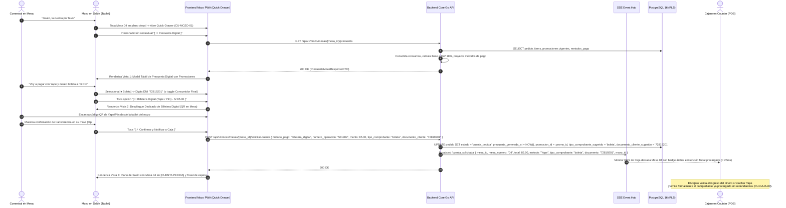
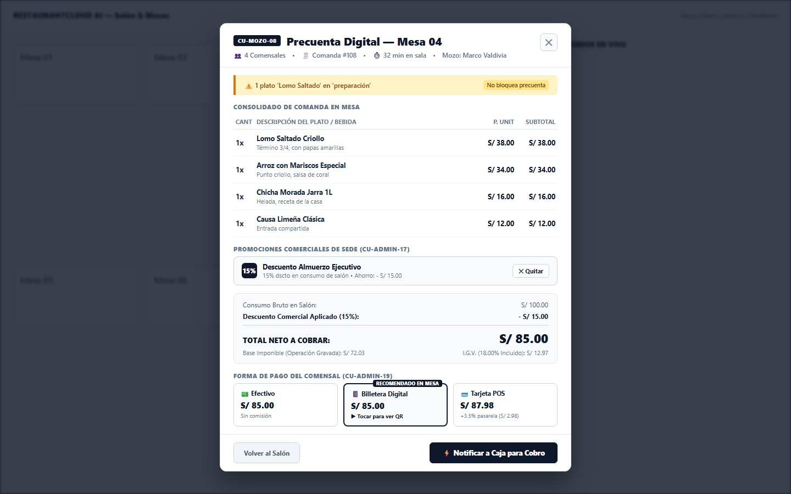
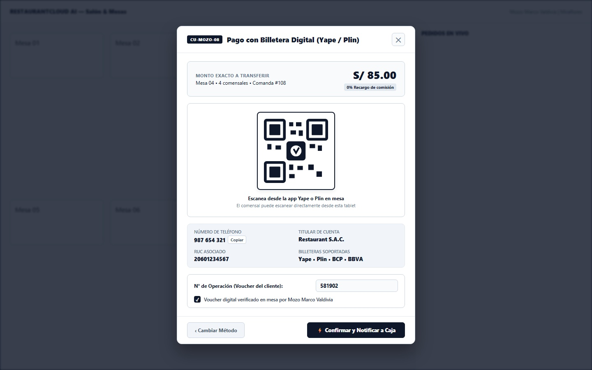
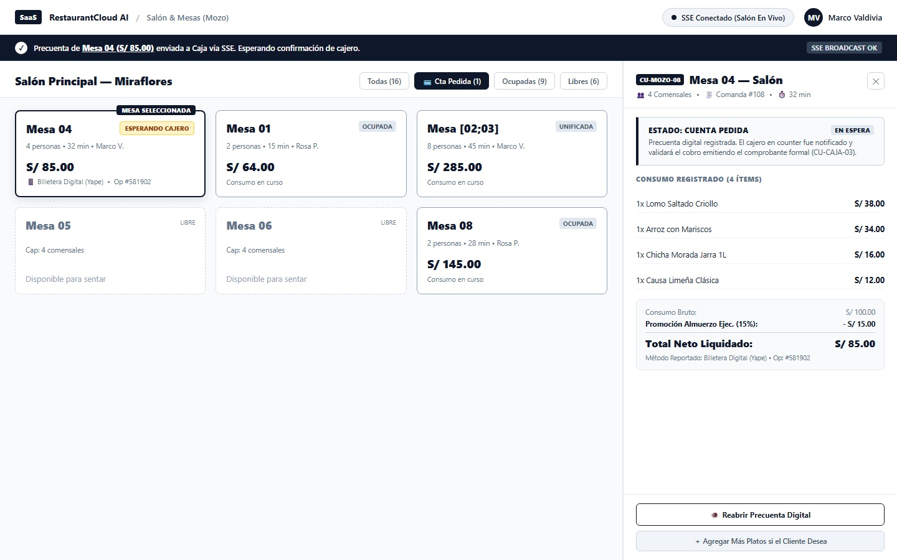

# CU-MOZO-08: Consultar y Presentar Precuenta Digital en Mesa

Especificación técnica de interfaz de usuario táctil, arquitectura de datos transaccional, divulgación progresiva de métodos de pago (*Progressive Disclosure*), cobro asistido con código QR dinámico de billeteras digitales en mesa, sincronización reactiva en tiempo real vía Server-Sent Events (SSE), cálculo fiscal según normativa SUNAT Perú, contratos de API en Go y persistencia en PostgreSQL 16 para **RestaurantCloud AI**.

---

## 1. Ficha Técnica del Caso de Uso

| Atributo | Detalle |
| :--- | :--- |
| **Código CU** | `CU-MOZO-08` |
| **Nombre** | Consultar y presentar precuenta digital en mesa |
| **Actor Principal** | `mozo` (Personal de atención en sala; operador táctil en tablet/móvil) |
| **Actores Secundarios** | `comensal` (Receptor de la precuenta digital y emisor del pago), `cajero` (Receptor de la notificación SSE en counter para validación y emisión de comprobante tributario `CU-CAJA-03`), `admin_local` (Supervisión operativa) |
| **Dispositivo / Viewport** | Responsive Tablet en Salón (`1440x900` horizontal / `1024x768`), Mobile POS (`375x812` / `412x915`), terminales táctiles PWA Grayscale Blueprint |
| **Precondición** | La mesa se encuentra en estado `ocupada` con pedidos despachados activos en `pedido` y `pedido_item`; el mozo cuenta con sesión activa autenticada en la sede; las promociones vigentes de `CU-ADMIN-17` y los métodos de pago de `CU-ADMIN-19` están pre-configurados. **No requiere que el cajero esté interactuando ni aprobando previamente la cuenta (cálculo determinista on-demand en < 15ms).** |
| **Postcondición** | La precuenta es exhibida de forma 100% digital al cliente; si califica, se aplica la promoción comercial en 1 toque recalculando Base Imponible e IGV 18%; si el comensal elige pagar con Yape o Plin, se despliega el código QR en mesa; al presionar `[ ⚡ Notificar a Caja para Cobro ]`, la mesa conmuta a estado ámbar `[ CUENTA PEDIDA ]` y transmite el evento SSE `cuenta_solicitada` al monitor POS de Caja con el monto exacto, método y número de operación para su validación contable y emisión de comprobante fiscal (`CU-CAJA-03`). Flujo **100% Digital y Cero Papel**. |

---

## 2. Diagrama de Flujo y Secuencia en Tiempo Real (Autonomía del Mozo)



---

## 3. Especificación de Pantallas y Wireframes Blueprint (3 Vistas Canónicas)

### Vista 1: Modal Táctil de Precuenta con Promociones Integradas (`wf_mozo_08_modal_precuenta.jpg`)

Modal táctil de alta densidad (640px de ancho) que se superpone sobre el plano de salón atenuado de `CU-MOZO-01`. Agrupa la comanda consolidada, el banner sintético de cocina sin bloqueo, las promociones activas aplicadas en 1 toque (`CU-ADMIN-17`), el desglose oficial SUNAT Perú, el selector de comprobante fiscal sugerido y un selector limpio con los 3 métodos de pago configurados en la sede (`CU-ADMIN-19`).



#### Layout Estructural ASCII (Modal Centrado 640px sobre Salón 1440x900):
```text
+----------------------------------------------------------------------------------------------------+
| RESTAURANTCLOUD AI — Salón & Mesas                 (•) SSE Conectado        [MV] Marco Valdivia    |
| ============================== FONDO ATENUADO (SALÓN CU-MOZO-01) ================================= |
|                                                                                                    |
|                       +----------------------------------------------------+                       |
|                       | [CU-MOZO-08] Precuenta Digital — Mesa 04       [✕] |                       |
|                       | 👥 4 Comensales • 🧾 Comanda #108 • ⏱️ 32 min       |                       |
|                       +----------------------------------------------------+                       |
|                       | ⚠️ 1 plato 'Lomo Saltado' en 'preparación'         |                       |
|                       +----------------------------------------------------+                       |
|                       | CONSOLIDADO DE COMANDA EN MESA         CANT  TOTAL |                       |
|                       | 1. Lomo Saltado Criollo (Término 3/4)    1  S/38.00|                       |
|                       | 2. Arroz con Mariscos Especial           1  S/34.00|                       |
|                       | 3. Chicha Morada Jarra 1L                1  S/16.00|                       |
|                       | 4. Causa Limeña Clásica (Entrada)        1  S/12.00|                       |
|                       +----------------------------------------------------+                       |
|                       | PROMOCIONES COMERCIALES DE SEDE (CU-ADMIN-17)      |                       |
|                       | [15%] Descuento Almuerzo Ejecutivo    [✕ Quitar]   |                       |
|                       |       15% dscto en consumo • Ahorro: - S/ 15.00    |                       |
|                       +----------------------------------------------------+                       |
|                       | DESGLOSE TRIBUTARIO SUNAT (PERÚ)                   |                       |
|                       | Consumo Bruto:                            S/ 100.00|                       |
|                       | Descuento Comercial (15%):              - S/  15.00|                       |
|                       | -------------------------------------------------- |                       |
|                       | TOTAL NETO A COBRAR:                      S/  85.00|                       |
|                       | Base Imponible: S/ 72.03   |   IGV 18%: S/ 12.97   |                       |
|                       +----------------------------------------------------+                       |
|                       | COMPROBANTE FISCAL SOLICITADO                      |                       |
|                       | [● Boleta ]           [ Factura ]     [ Nota Venta]|                       |
|                       | DNI: [ 72819201    ]  [ ] Consumidor Final         |                       |
|                       +----------------------------------------------------+                       |
|                       | FORMA DE PAGO DEL COMENSAL (CU-ADMIN-19)           |                       |
|                       | +----------------+ +----------------+ +----------+ |                       |
|                       | | 💵 Efectivo    | | [RECOMENDADO]  | | 💳 Tarj. | |                       |
|                       | | S/ 85.00       | | 📱 Billetera   | | S/ 87.98 | |                       |
|                       | | Sin comisión   | | S/ 85.00 (QR)  | | (+3.5%)  | |                       |
|                       | +----------------+ +----------------+ +----------+ |                       |
|                       +----------------------------------------------------+                       |
|                       | [ Volver al Salón ]    [ ⚡ Notificar a Caja ]     |                       |
|                       +----------------------------------------------------+                       |
|                                                                                                    |
+----------------------------------------------------------------------------------------------------+
```

- **Componentes Clave y Microcopias:**
  - **Banner Conciso de Cocina:** `⚠️ 1 plato 'Lomo Saltado' en 'preparación'`. Comunica el estado real en fogones de forma sintética sin bloquear la cuenta.
  - **Tabla de Consumos Consolidados:** Cantidades acumuladas, notas de cocina del cliente, precio unitario congelado y subtotales.
  - **Promoción Integrada:** Visualiza el descuento comercial activo (`- S/ 15.00`) con acción de reversión rápida en un toque.
  - **Desglose SUNAT Oficial:** Total Neto calculado restando el descuento del bruto ($100 - 15 = 85$), con Base Imponible ($85 / 1.18 = 72.03$) e IGV ($85 - 72.03 = 12.97$).
  - **Selector de Métodos de Pago Limpio:** Tarjetas táctiles directas. La opción de Billetera Digital invita al toque (`▶ Tocar para ver QR`) sin sobrecargar la pantalla inicial.

---

### Vista 2: Despliegue de Información y QR de Billetera Digital (`wf_mozo_08_detalle_billetera_qr.jpg`)

Despliegue bajo demanda (*Progressive Disclosure*) al tocar la opción de Billetera Digital (Yape / Plin). Optimizado para que el mozo acerque la tablet o celular al comensal y este escanee el código QR dinámico directamente sin levantarse de la mesa ni esperar tickets de papel.



#### Layout Estructural ASCII (Modal Enfocado 580px):
```text
+----------------------------------------------------------------------------------------------------+
|                       +----------------------------------------------------+                       |
|                       | [CU-MOZO-08] Pago con Billetera Digital (Yape/Plin)| [✕]                   |
|                       +----------------------------------------------------+                       |
|                       | MONTO EXACTO A TRANSFERIR:                S/ 85.00 |                       |
|                       | Mesa 04 • 4 comensales • Comanda #108   (0% Recargo|                       |
|                       +----------------------------------------------------+                       |
|                       |            +--------------------------+            |                       |
|                       |            |  [ ■■■■■■■■■■■■■■■■■■ ]  |            |                       |
|                       |            |  [ ■■   [✓]      ■■ ]  |            |                       |
|                       |            |  [ ■■■■■■■■■■■■■■■■■■ ]  |            |                       |
|                       |            |   CÓDIGO QR YAPE / PLIN  |            |                       |
|                       |            +--------------------------+            |                       |
|                       |      Escanea desde la app Yape o Plin en mesa      |                       |
|                       |   El comensal puede escanear directo de la tablet  |                       |
|                       +----------------------------------------------------+                       |
|                       | NÚMERO DE TELÉFONO:          TITULAR DE CUENTA:    |                       |
|                       | 987 654 321 [ Copiar ]       Restaurant S.A.C.     |                       |
|                       | RUC ASOCIADO:                BILLETERAS:           |                       |
|                       | 20601234567                  Yape • Plin • BCP     |                       |
|                       +----------------------------------------------------+                       |
|                       | N° de Operación (Voucher del cliente): [ 581902  ] |                       |
|                       | [✓] Voucher digital verificado en mesa por Mozo    |                       |
|                       +----------------------------------------------------+                       |
|                       | [ ‹ Cambiar Método ] [ ⚡ Confirmar y Notificar ]  |                       |
|                       +----------------------------------------------------+                       |
+----------------------------------------------------------------------------------------------------+
```

- **Mecanismos de Interacción y Usabilidad:**
  - **Monto Prominente de Transferencia:** Exhibición en tipografía de alto contraste (26px bold) de `S/ 85.00` con badge `0% Recargo de comisión`.
  - **Contenedor Vectorial de Código QR:** Renderizado a alta definición garantizando lectura óptica instantánea desde cualquier teléfono inteligente a más de 40 cm de distancia.
  - **Datos del Comercio Visibles:** Teléfono con botón `[ Copiar ]` y RUC del establecimiento por si el cliente utiliza transferencias interbancarias Plin.
  - **Verificación Táctica en Mesa:** Input ágil para capturar el código de operación del voucher móvil y casilla de confirmación visual del personal de salón.

---

### Vista 3: Salón en Vivo con Mesa Notificada a Caja (`wf_mozo_08_mesa_notificada_salon.jpg`)

Vista activa del salón en tiempo real tras pulsar el botón de notificación. La mesa actualiza su estado en el plano visual, se despliega el Toast accesible con acuse de transmisión SSE hacia la terminal de caja, y el Quick-Drawer se mantiene en modo de espera de confirmación y emisión del comprobante formal por el cajero (`CU-CAJA-03`).



#### Layout Estructural ASCII (Desktop / Tablet 1440x900):
```text
+----------------------------------------------------------------------------------------------------+
| [SaaS] RestaurantCloud AI  /  Salón & Mesas (Mozo)       [● SSE Conectado (Salón En Vivo)]  [MV]   |
+----------------------------------------------------------------------------------------------------+
| [✓] Precuenta de Mesa 04 (S/ 85.00) enviada a Caja vía SSE. Esperando confirmación de cajero.      |
+------------------------------------------------------------------+---------------------------------+
| SALÓN PRINCIPAL — MIRAFLORES                                     | QUICK-DRAWER MESA 04 — SALÓN    |
| Filtros: [Todas (16)] [💳 Cta Pedida (1)] [Ocupadas] [Libres]    | 👥 4 Comensales • Comanda #108  |
|                                                                  +---------------------------------+
| +-------------------------+ +-------------------------+          | ESTADO: CUENTA PEDIDA           |
| | Mesa 04 [SELECCIONADA]  | | Mesa 01 [OCUPADA]       |          | Precuenta digital registrada.   |
| | [ ESPERANDO CAJERO ]    | | 2 personas • 15 min     |          | El cajero en counter validará   |
| | 4 personas • 32 min     | | S/ 64.00                |          | el cobro formal (CU-CAJA-03).   |
| | S/ 85.00                | | Consumo en curso        |          +---------------------------------+
| | 📱 Yape • Op #581902    | |                         |          | CONSUMO REGISTRADO (4 ÍTEMS)    |
| +-------------------------+ +-------------------------+          | • Lomo Saltado          S/ 38.00|
| +-------------------------+ +-------------------------+          | • Arroz con Mariscos    S/ 34.00|
| | Mesa [02;03] [UNIFICADA]| | Mesa 08 [OCUPADA]       |          | • Chicha Morada Jarra   S/ 16.00|
| | 8 personas • S/ 285.00  | | 2 personas • S/ 145.00  |          | • Causa Limeña Clásica  S/ 12.00|
| +-------------------------+ +-------------------------+          +---------------------------------+
| +-------------------------+ +-------------------------+          | Consumo Bruto:         S/ 100.00|
| | Mesa 05 [LIBRE]         | | Mesa 06 [LIBRE]         |          | Promoción Almuerzo:   - S/  15.00|
| | Cap: 4 comensales       | | Cap: 4 comensales       |          | TOTAL NETO:            S/  85.00|
| +-------------------------+ +-------------------------+          | Método: Yape • Op: #581902      |
|                                                                  +---------------------------------+
|                                                                  | [ 👁️ Reabrir Precuenta Digital ]|
|                                                                  | [ ＋ Agregar Más Platos ]       |
+------------------------------------------------------------------+---------------------------------+
```

- **Métricas e Indicadores Visuales:**
  - **Toast Superior Accesible:** `✓ Precuenta de Mesa 04 (S/ 85.00) enviada a Caja vía SSE. Esperando confirmación de cajero.`.
  - **Tarjeta de Mesa en Salón:** Borde resaltado con badge ámbar `[ ESPERANDO CAJERO ]`, indicando el monto liquidado (`S/ 85.00`) y el método acordado (`Yape • Op #581902`).
  - **Quick-Drawer Informativo:** Permite al mozo volver a desplegar la precuenta digital en cualquier momento (`[ 👁️ Reabrir Precuenta Digital ]`) o incorporar platos adicionales si los comensales deciden pedir un postre o café de sobremesa de último minuto.

---

## 4. Matriz de Control de Acceso Basado en Roles (RBAC)

| Acción / Capacidad | `mozo` | `cajero` | `admin_local` | `propietario` | `cocina` |
| :--- | :---: | :---: | :---: | :---: | :---: |
| Consultar precuenta digital de mesa en salón (`GET /precuenta`) | ✅ Permitido | ✅ Permitido | ✅ Permitido | ✅ Permitido | ❌ Bloqueado |
| Aplicar o remover promociones comerciales de sede (`POST /precuenta/promocion`) | ✅ Permitido | ✅ Permitido | ✅ Permitido | ✅ Permitido | ❌ Bloqueado |
| Presentar código QR dinámico de Yape/Plin en mesa | ✅ Permitido | ❌ Bloqueado | ✅ Permitido | ✅ Permitido | ❌ Bloqueado |
| Notificar precuenta y solicitar cobro a caja (`POST /solicitar-cuenta`)| ✅ Permitido | ❌ Bloqueado | ✅ Permitido | ✅ Permitido | ❌ Bloqueado |
| Validar ingresos y emitir comprobante tributario Boleta/Factura (`CU-CAJA-03`)| ❌ Bloqueado | ✅ Permitido | ✅ Permitido | ✅ Permitido | ❌ Bloqueado |

---

## 5. Contratos de API Go y DTOs (`internal/domain/mozo/precuenta_dto.go`)

```go
package mozo

import (
	"time"
	"github.com/google/uuid"
)

// PrecuentaItemDTO ítem de comanda consolidado para la pantalla móvil del mozo
type PrecuentaItemDTO struct {
	ProductoID     uuid.UUID `json:"producto_id"`
	Nombre         string    `json:"nombre" example:"Lomo Saltado Criollo"`
	NotaCocina     string    `json:"nota_cocina,omitempty" example:"Término 3/4, con papas amarillas"`
	Cantidad       int       `json:"cantidad" example:"1"`
	PrecioUnitario float64   `json:"precio_unitario" example:"38.00"`
	Subtotal       float64   `json:"subtotal" example:"38.00"`
	EstadoCocina   string    `json:"estado_cocina" example:"en_preparacion"` // 'en_cola', 'en_preparacion', 'listo', 'entregado'
}

// DesgloseSUNATMozoDTO cálculo fiscal según norma SUNAT Perú
type DesgloseSUNATMozoDTO struct {
	ConsumoBruto       float64 `json:"consumo_bruto" example:"100.00"`
	DescuentoComercial float64 `json:"descuento_comercial" example:"15.00"`
	TotalNeto          float64 `json:"total_neto" example:"85.00"`
	BaseImponible      float64 `json:"base_imponible" example:"72.03"` // TotalNeto / 1.18
	IGV                float64 `json:"igv" example:"12.97"`            // TotalNeto - BaseImponible
	TasaIGV            float64 `json:"tasa_igv" example:"0.18"`
}

// DetalleBilleteraDigitalDTO metadata para despliegue de QR en mesa
type DetalleBilleteraDigitalDTO struct {
	Telefono       string  `json:"telefono" example:"987 654 321"`
	Titular        string  `json:"titular" example:"Restaurant S.A.C."`
	RUC            string  `json:"ruc" example:"20601234567"`
	QRImagenURL    string  `json:"qr_imagen_url" example:"/assets/qr/yape_local_01.png"`
	MontoExacto    float64 `json:"monto_exacto" example:"85.00"`
}

// OpcionPagoMozoDTO información de medio de pago con soporte de QR en mesa
type OpcionPagoMozoDTO struct {
	Codigo             string                      `json:"codigo" example:"billetera_digital"`
	Nombre             string                      `json:"nombre" example:"Yape / Plin"`
	ComisionPorcentaje float64                     `json:"comision_porcentaje" example:"0.00"`
	MontoComision      float64                     `json:"monto_comision" example:"0.00"`
	TotalEstimado      float64                     `json:"total_estimado" example:"85.00"`
	DetalleBilletera   *DetalleBilleteraDigitalDTO `json:"detalle_billetera,omitempty"`
}

// PrecuentaMozoResponseDTO payload completo retornado a la tablet del mozo
type PrecuentaMozoResponseDTO struct {
	MesaID               uuid.UUID            `json:"mesa_id"`
	MesaNumero           string               `json:"mesa_numero" example:"04"`
	EsMesaUnida          bool                 `json:"es_mesa_unida" example:"false"`
	MozoNombre           string               `json:"mozo_nombre" example:"Marco Valdivia"`
	Comensales           int                  `json:"comensales" example:"4"`
	Items                []PrecuentaItemDTO   `json:"items"`
	TieneCocinaPendiente bool                 `json:"tiene_cocina_pendiente" example:"true"`
	AlertaCocina         string               `json:"alerta_cocina,omitempty" example:"1 plato 'Lomo Saltado' en 'preparación'"`
	PromocionActivaID    *uuid.UUID           `json:"promocion_activa_id,omitempty"`
	TributacionSUNAT     DesgloseSUNATMozoDTO `json:"tributacion_sunat"`
	OpcionesPago         []OpcionPagoMozoDTO  `json:"opciones_pago"`
	CalculadaAt          time.Time            `json:"calculada_at"`
}

// SolicitarCuentaRequest payload de notificación enviado a caja desde el salón
type SolicitarCuentaRequest struct {
	MetodoPagoSeleccionado string  `json:"metodo_pago" binding:"required" example:"billetera_digital"`
	NumeroOperacion        string  `json:"numero_operacion,omitempty" example:"581902"`
	MontoDeclarado         float64 `json:"monto_declarado" binding:"required,gt=0" example:"85.00"`
	
	// Intención fiscal capturada en mesa (poka-yoke para agilizar el cobro en CU-CAJA-03)
	TipoComprobante        *string `json:"tipo_comprobante,omitempty" example:"boleta"`    // 'boleta', 'factura', 'nota_venta'
	DocumentoCliente       *string `json:"documento_cliente,omitempty" example:"72819201"` // DNI 8 dígitos o RUC 11 dígitos
	NombreCliente          *string `json:"nombre_cliente,omitempty" example:"Carlos Mendoza Quispe"`
	ConsumidorFinal        bool    `json:"consumidor_final,omitempty"`                     // true si no solicita DNI (< S/ 700.00)
}
```

---

## 6. Catálogo de Endpoints REST

| Método | Endpoint | Rol Mínimo | Código Éxito | Descripción |
| :--- | :--- | :---: | :---: | :--- |
| `GET` | `/api/v1/mozo/mesas/{mesa_id}/precuenta` | `mozo`, `admin_local` | `200 OK` | Consulta on-demand de la precuenta digital de la mesa sin esperar a caja |
| `POST` | `/api/v1/mozo/mesas/{mesa_id}/precuenta/promocion` | `mozo`, `admin_local` | `200 OK` | Aplica una promoción comercial de `CU-ADMIN-17` y recalcula Base e IGV en < 10ms |
| `DELETE` | `/api/v1/mozo/mesas/{mesa_id}/precuenta/promocion` | `mozo`, `admin_local` | `200 OK` | Remueve la promoción activa y restaura los importes brutos originales |
| `POST` | `/api/v1/mozo/mesas/{mesa_id}/solicitar-cuenta` | `mozo`, `admin_local` | `200 OK` | Conmuta a `cuenta_pedida`, guarda método acordado y notifica a Caja vía SSE |

### Catálogo de Errores de Negocio (`AppError`):

| Código Error | HTTP Status | Causa y Mensaje |
| :--- | :---: | :--- |
| `ERR_MESA_SIN_CONSUMOS` | `404 Not Found` | La mesa no tiene pedidos activos o todos sus ítems fueron anulados. |
| `ERR_PROMOCION_NO_APLICABLE` | `422 Unprocessable` | La promoción comercial no está vigente para el día/hora actual o no alcanza el consumo mínimo. |
| `ERR_CUENTA_YA_PEDIDA` | `409 Conflict` | La mesa ya fue conmutada a `cuenta_pedida` previamente. Permite reabrir la precuenta en modo solo lectura. |

---

## 7. Modelo Relacional PostgreSQL 16 y Fórmulas SUNAT

### 7.1 Fórmulas Tributarias Oficiales SUNAT Perú

1. **Consumo Bruto ($C_{bruto}$):** $\sum (\text{precio\_unitario} \times \text{cantidad})$ de ítems activos no anulados.
2. **Descuento Comercial ($D$):** Deducción comercial otorgada antes de impuestos ($C_{bruto} \times \%$ o monto fijo).
3. **Total Neto a Cobrar ($T_{neto}$):** $T_{neto} = C_{bruto} - D$.
4. **Base Imponible / Operación Gravada ($B$):** $B = T_{neto} / 1.18$.
5. **Impuesto General a las Ventas (IGV 18%):** $\text{IGV} = T_{neto} - B$.

### 7.2 Soporte Relacional en PostgreSQL 16

```sql
-- 1. Soporte de trazabilidad en tabla pedido
ALTER TABLE pedido
    ADD COLUMN IF NOT EXISTS metodo_pago_tentativo varchar(30) DEFAULT NULL,
    ADD COLUMN IF NOT EXISTS numero_operacion_tentativo varchar(60) DEFAULT NULL;

-- 2. Índice para consulta instantánea de precuenta (< 0.2ms)
CREATE INDEX IF NOT EXISTS idx_pedido_mesa_mozo_precuenta 
    ON pedido(mesa_id, estado) 
    WHERE estado IN ('enviado', 'cuenta_pedida');
```

---

## 8. Checklist de Accesibilidad WCAG 2.1 AA

- [x] **Contraste de Color:** Títulos principales (`#0F172A`) y totales monetarios (`S/ 85.00`) sobre fondo blanco superan ratio de `12:1`. Banner conciso de cocina (`#92400E` sobre `#FEF3C7`) mantiene ratio `4.8:1`.
- [x] **Focus Management y Diálogos:** El modal de precuenta (Vista 1) y el modal de código QR (Vista 2) atrapan el foco del teclado con atributos `role="dialog"` y `aria-modal="true"`.
- [x] **Tamaño de Touch Targets:** Tarjetas de método de pago, chip de promociones y botón primario cuentan con altura mínima superior a `44px` y espaciado de `10px`.
- [x] **Live Region para Toast:** El toast de confirmación utiliza `role="status"` y `aria-live="polite"` para alertar a lectores de pantalla sin interrumpir la interacción táctil.
