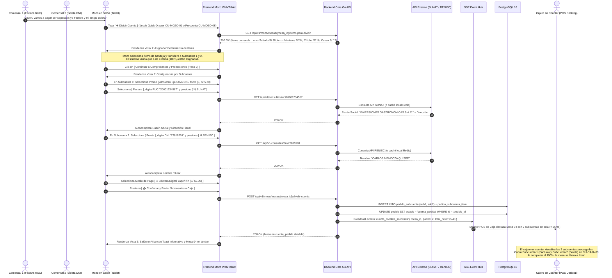
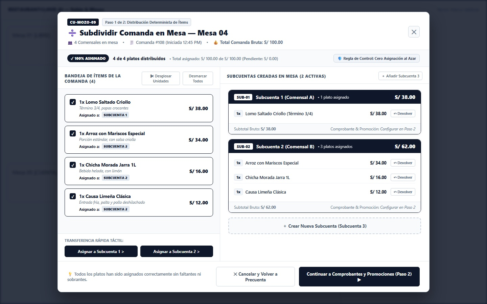
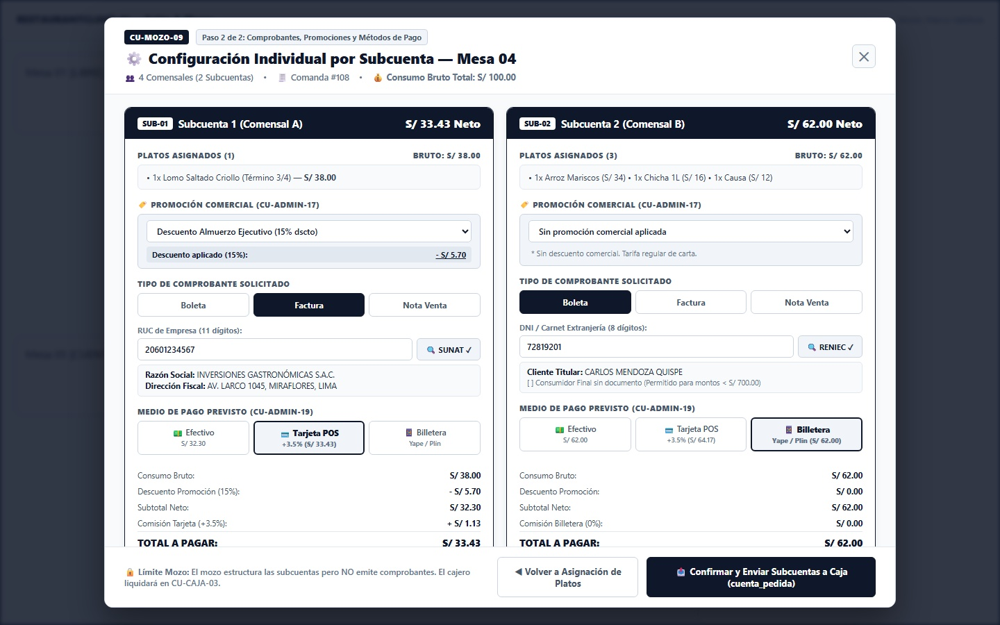
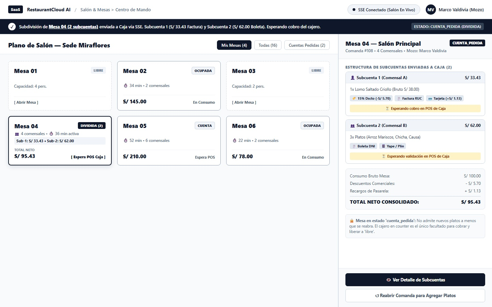
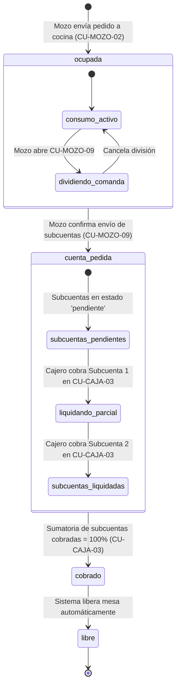

# CU-MOZO-09: Subdividir Comanda en Mesa y Asociar Comprobantes (Factura, Boleta, Nota de Venta)

Especificación técnica de interfaz de usuario táctil, arquitectura de asignación determinista de ítems (cero azar), aplicación independiente de promociones por subcuenta (`CU-ADMIN-17`), captura de tres comprobantes oficiales (Factura con RUC, Boleta con DNI, Nota de Venta con solo nombre), sincronización en tiempo real vía Server-Sent Events (SSE) y contratos de API REST en **RestaurantCloud AI**.

---

## 1. Ficha Técnica del Caso de Uso

| Atributo | Detalle |
| :--- | :--- |
| **Código CU** | `CU-MOZO-09` |
| **Nombre** | Subdividir comanda en mesa y asociar comprobantes (Factura, Boleta, Nota de Venta) |
| **Actor(es)** | `mozo` (Personal de atención en sala; operador táctil en tablet/móvil), `comensal` (Receptor de subcuentas y pagador), `cajero` (Receptor de la estructura dividida en `CU-CAJA-02` y emisor formal en `CU-CAJA-03` / `CU-CAJA-04`) |
| **Dispositivo / Viewport** | Tablet en orientación horizontal / Terminal táctil de sala (`1440x900` estándar corporativo Grayscale Blueprint, escalable a `1024x768`) |
| **Precondición** | La mesa se encuentra en estado `ocupada` con pedidos despachados activos en `pedido` y `pedido_item`; el mozo cuenta con sesión activa asignada a la sede; la comanda cuenta con más de un ítem consumido o más de un comensal. El caso de uso puede invocarse directamente desde el Quick-Drawer de mesa en `CU-MOZO-01` o desde el modal de precuenta digital en `CU-MOZO-08`. |
| **Postcondición** | Todos los ítems de la comanda son asignados al 100% (cero ítems huérfanos o al azar) a $N$ subcuentas en `pedido_subcuenta` y `pedido_subcuenta_item`; cada subcuenta cuenta con su promoción comercial individualizada (`CU-ADMIN-17`), tipo de comprobante (Factura, Boleta o Nota de Venta) y medio de pago tentativo (`CU-ADMIN-19`); el pedido conmuta a estado `cuenta_pedida`; se emite vía Server-Sent Events (SSE) el evento `cuenta_dividida_solicitada` al Monitor POS de Caja; la tablet del mozo regresa al plano de salón exhibiendo la mesa con badge prioritario de espera de caja. **Flujo 100% Digital / Cero Papel. El mozo NO emite comprobantes fiscales ante SUNAT.** |

---

## 2. Diagrama de Flujo y Secuencia en Tiempo Real (SSE)



---

## 3. Especificación de Pantallas y Wireframes Blueprint (1440x900)

### Vista 1: Asignación Determinista de Ítems a Subcuentas (`wf_mozo_09_asignacion_items.jpg`)

Modal táctil enfocado (1100px de ancho) sobre fondo de salón atenuado, diseñado para repartir los platos consumidos con precisión absoluta e intuitiva.



#### Layout Estructural (Arte ASCII 1440x900):
```text
+--------------------------------------------------------------------------------------------------------------------+
| ============================== FONDO ATENUADO (SALÓN CU-MOZO-01) ================================================= |
|                                                                                                                    |
|   +------------------------------------------------------------------------------------------------------------+   |
|   | [CU-MOZO-09] Paso 1 de 2: Distribución Determinista de Ítems                                           [✕] |   |
|   | ➗ Subdividir Comanda en Mesa — Mesa 04                                                                     |   |
|   | 👥 4 Comensales • 🧾 Comanda #108 (12:45 PM) • 💰 Total Comanda Bruta: S/ 100.00                           |   |
|   +------------------------------------------------------------------------------------------------------------+   |
|   | [✓ 100% ASIGNADO] 4 de 4 platos distribuidos • S/ 100.00 asignado (S/ 0.00 pend.)  | 🛡️ Cero Azar Operativo |   |
|   +-----------------------------------------------------+------------------------------------------------------+   |
|   | BANDEJA DE ÍTEMS DE LA COMANDA (4)                  | SUBCUENTAS CREADAS EN MESA (2 ACTIVAS) [＋ Subcuenta 3]  |   |
|   | [ ✂ Desglosar Unidades ]   [ Desmarcar Todos ]      | +--------------------------------------------------+ |   |
|   |                                                     | | SUB-01 Subcuenta 1 (Comensal A)         S/ 38.00 | |   |
|   | [x] 1x Lomo Saltado Criollo                S/ 38.00 | | • 1x Lomo Saltado Criollo (Término 3/4) S/ 38.00 | |   |
|   |     Término 3/4, papas crocantes                    | |   ↳ [ ↶ Devolver a Bandeja ]                     | |   |
|   |     ↳ Asignado a: [SUBCUENTA 1]                     | +--------------------------------------------------+ |   |
|   |                                                     | +--------------------------------------------------+ |   |
|   | [x] 1x Arroz con Mariscos Especial         S/ 34.00 | | SUB-02 Subcuenta 2 (Comensal B)         S/ 62.00 | |   |
|   |     ↳ Asignado a: [SUBCUENTA 2]                     | | • 1x Arroz Mariscos Especial            S/ 34.00 | |   |
|   |                                                     | | • 1x Chicha Morada Jarra 1L             S/ 16.00 | |   |
|   | [x] 1x Chicha Morada Jarra 1L              S/ 16.00 | | • 1x Causa Limeña Clásica               S/ 12.00 | |   |
|   |     ↳ Asignado a: [SUBCUENTA 2]                     | |   ↳ [ ↶ Devolver Ítem ]                          | |   |
|   |                                                     | +--------------------------------------------------+ |   |
|   | [x] 1x Causa Limeña Clásica                S/ 12.00 | +--------------------------------------------------+ |   |
|   |     ↳ Asignado a: [SUBCUENTA 2]                     | | [ ＋ Crear Nueva Subcuenta (Subcuenta 3) ]       | |   |
|   |                                                     | +--------------------------------------------------+ |   |
|   | --------------------------------------------------- |                                                      |   |
|   | Transferencia Rápida Táctil:                        |                                                      |   |
|   | [ Asignar a Subcuenta 1 > ] [ Asignar a Subcuenta 2 >]                                                     |   |
|   +-----------------------------------------------------+------------------------------------------------------+   |
|   | 💡 Todos los platos han sido asignados correctamente.   [✕ Cancelar]  [ Continuar a Paso 2 (Comprobantes) ▶] |   |
|   +------------------------------------------------------------------------------------------------------------+   |
|                                                                                                                    |
+--------------------------------------------------------------------------------------------------------------------+
```

- **Componentes Clave y Microcopias:**
  - **Barra de Progreso y Control Cero Azar:** `[✓ 100% ASIGNADO] 4 de 4 platos distribuidos • Total asignado: S/ 100.00 de S/ 100.00 (Pendiente: S/ 0.00)`. Garantiza que ningún ítem quede sin comensal responsable.
  - **Botón `[ ✂ Desglosar Unidades ]`:** Permite que un ítem con cantidad $>1$ (ej. 2 Cervezas) se divida en líneas de 1 unidad para asignarse a subcuentas distintas.
  - **Dock de Transferencia Táctil:** Botones ergonómicos de un toque (`[ Asignar a Subcuenta 1 > ]`, `[ Asignar a Subcuenta 2 > ]`) además de soporte de Drag & Drop táctil.
  - **Botón Primario de Avance:** Bloqueado si el total asignado es menor al total bruto de la comanda.

---

### Vista 2: Configuración de Comprobantes, Promociones y Métodos de Pago por Subcuenta (`wf_mozo_09_configuracion_comprobantes.jpg`)

Formulario en dos columnas que parametriza independientemente las promociones comerciales de sede (`CU-ADMIN-17`), el tipo de comprobante (Factura, Boleta, Nota de Venta) y el método de pago (`CU-ADMIN-19`) de cada subcuenta.



#### Layout Estructural (Arte ASCII 1440x900):
```text
+--------------------------------------------------------------------------------------------------------------------+
| ============================== FONDO ATENUADO (SALÓN CU-MOZO-01) ================================================= |
|                                                                                                                    |
|   +------------------------------------------------------------------------------------------------------------+   |
|   | [CU-MOZO-09] Paso 2 de 2: Comprobantes, Promociones y Métodos de Pago                                   [✕] |   |
|   | ⚙️ Configuración Individual por Subcuenta — Mesa 04                                                         |   |
|   | 👥 4 Comensales (2 Subcuentas) • 🧾 Comanda #108 • 💰 Consumo Bruto Total: S/ 100.00                        |   |
|   +------------------------------------------------------------------------------------------------------------+   |
|   | SUBCUENTA 1 (1 Plato)          S/ 33.43 Neto | SUBCUENTA 2 (3 Platos)                     S/ 62.00 Neto |   |
|   | +------------------------------------------+ +--------------------------------------------------------+ |   |
|   | | Platos: 1x Lomo Saltado Criollo S/ 38.00 | | Platos: Arroz Mariscos (34), Chicha (16), Causa (12)   | |   |
|   | |                                          | |                                                        | |   |
|   | | 🏷️ Promoción Comercial (CU-ADMIN-17):    | | 🏷️ Promoción Comercial (CU-ADMIN-17):                  | |   |
|   | | [ Almuerzo Ejecutivo (15% dscto)       v]| | [ Sin promoción comercial aplicada                   v]| |   |
|   | | ✓ Descuento aplicado (15%):    - S/ 5.70 | | * Sin descuento comercial. Tarifa regular.             | |   |
|   | |                                          | |                                                        | |   |
|   | | Tipo de Comprobante:                     | | Tipo de Comprobante:                                   | |   |
|   | | [ Boleta ]   [● Factura ]   [ Nota Venta]| | [● Boleta ]   [ Factura ]   [ Nota Venta ]             | |   |
|   | | RUC Empresa: [ 20601234567 ] [🔍 SUNAT ✓]| | DNI Titular: [ 72819201 ] [🔍 RENIEC ✓]                | |   |
|   | | Raz. Soc: INVERSIONES GASTRONÓMICAS S.A.C| | Cliente: CARLOS MENDOZA QUISPE                         | |   |
|   | | Dir: AV. LARCO 1045, MIRAFLORES, LIMA    | | [ ] Consumidor Final sin documento (< S/ 700.00)       | |   |
|   | |                                          | |                                                        | |   |
|   | | Medio de Pago Previsto:                  | | Medio de Pago Previsto:                                | |   |
|   | | [ Efectivo ] [● 💳 Tarjeta POS (+3.5%) ]  | | [ Efectivo ] [ Tarjeta POS ] [● 📱 Billetera (Yape) ]   | |   |
|   | |                                          | | Recaudación: 987 654 321 • Restaurant S.A.C. [ Ver QR ] | |   |
|   | |                                          | | N° Operación: [ 581902    ]                            | |   |
|   | |                                          | |                                                        | |   |
|   | | Desglose SUNAT:                          | | Desglose SUNAT:                                        | |   |
|   | | Bruto: S/ 38.00 | Dscto (15%): - S/ 5.70 | | Bruto: S/ 62.00 | Dscto: S/ 0.00                       | |   |
|   | | Subtotal Neto: S/ 32.30                  | | Subtotal Neto: S/ 62.00                                | |   |
|   | | Comisión Tarjeta (+3.5%):      + S/ 1.13 | | Comisión Billetera (0%):                      S/ 0.00  | |   |
|   | | TOTAL A PAGAR:                  S/ 33.43 | | TOTAL A PAGAR:                                S/ 62.00 | |   |
|   | | (Base: S/ 27.37 • IGV 18%: S/ 4.93)      | | (Base: S/ 52.54 • IGV 18%: S/ 9.46)                    | |   |
|   | +------------------------------------------+ +--------------------------------------------------------+ |   |
|   | +--------------------------------------------------------------------------------------------------------+ |   |
|   | | ℹ️ Opción Nota de Venta: Si se solicita Nota de Venta, solo requiere 'Nombre del Cliente'.               | |   |
|   | |    No exige DNI/RUC, no reporta a SUNAT y su impresión física es opcional. [✓ Soporte Nativo]          | |   |
|   | +--------------------------------------------------------------------------------------------------------+ |   |
|   +------------------------------------------------------------------------------------------------------------+   |
|   | 🔒 Límite Mozo: El mozo NO emite comprobantes.   [◀ Volver a Platos]  [📤 Confirmar y Enviar Subcuentas a Caja] |   |
|   +------------------------------------------------------------------------------------------------------------+   |
|                                                                                                                    |
+--------------------------------------------------------------------------------------------------------------------+
```

- **Componentes Clave y Microcopias:**
  - **Gestión Independiente de Promociones (`CU-ADMIN-17`):** Cada comensal puede aprovechar promociones comerciales vigentes sin interferir en la cuenta del otro. Subcuenta 1 descuenta $15\%$ sobre $S/\ 38.00$ (ahorro: $-S/\ 5.70$). Subcuenta 2 abona tarifa íntegra ($S/\ 62.00$).
  - **Soporte Riguroso de los Tres Comprobantes:**
    - **Factura:** Exige RUC de 11 dígitos (validando prefijos peruanos `10` o `20`), consulta automática a API SUNAT y exhibición de Razón Social y Domicilio Fiscal.
    - **Boleta:** Exige DNI de 8 dígitos con consulta a RENIEC. Permite checkbox de excepción *"Consumidor Final sin documento"* solo si el importe es menor a $S/\ 700.00$.
    - **Nota de Venta:** Comprobante de control interno que requiere únicamente el `Nombre del Cliente` (ej. "Carlos Gómez"), sin validar documentos de identidad ni declarar ante SUNAT.
  - **Límite Operativo Explícito:** Microcopia de seguridad: *"🔒 Límite Mozo: El mozo estructura las subcuentas pero NO emite comprobantes. El cajero liquidará en CU-CAJA-03"*.

---

### Vista 3: Salón en Vivo con Mesa Subdividida Notificada a Caja (`wf_mozo_09_mesa_notificada_salon.jpg`)

El mozo regresa al plano visual de salón en vivo (`CU-MOZO-01`). La Mesa 04 destaca con badge prioritario ámbar/oscuro y el Quick-Drawer lateral refleja la estructura de subcuentas a la espera del cobro en el POS de Caja.



#### Layout Estructural (Arte ASCII 1440x900):
```text
+--------------------------------------------------------------------------------------------------------------------+
| [SaaS] RestaurantCloud AI  /  Salón & Mesas > Centro de Mando           (•) SSE Conectado    [MV Marco Valdivia]   |
+--------------------------------------------------------------------------------------------------------------------+
| [✓] Subdivisión de Mesa 04 (2 subcuentas) enviada a Caja vía SSE. Subcuenta 1 (S/ 33.43 Factura) y Subcuenta 2     |
|     (S/ 62.00 Boleta). Esperando cobro del cajero.                            [ ESTADO: CUENTA_PEDIDA (DIVIDIDA) ] |
+--------------------------------------------------------------------+-----------------------------------------------+
| PLANO DE SALÓN — SEDE MIRAFLORES                                   | Mesa 04 — Salón Principal     [CUENTA_PEDIDA] |
| Filtros: [● Mis Mesas (4)] [Todas (16)] [Cuentas Pedidas (2)]      | Comanda #108 • 4 Comensales • Mozo: Marco V.  |
|                                                                    +-----------------------------------------------+
| +-------------------------+ +-------------------------+            | ESTRUCTURA DE SUBCUENTAS ENVIADAS A CAJA (2)  |
| | Mesa 01 [LIBRE]         | | Mesa 02 [OCUPADA]       |            | +-------------------------------------------+ |
| | Capacidad: 4 pers.      | | ⏱️ 34 min • S/ 145.00   |            | | 👤 Subcuenta 1 (Comensal A)      S/ 33.43 | |
| | [ Abrir Mesa ]          | | En Consumo              |            | | • 1x Lomo Saltado (Bruto S/ 38.00)        | |
| +-------------------------+ +-------------------------+            | | [🏷️ 15% Dscto] [🧾 Factura] [💳 Tarjeta]  | |
| +-------------------------+ +-------------------------+            | | ⏳ Esperando cobro en POS de Caja         | |
| | Mesa 03 [LIBRE]         | | Mesa 04 [DIVIDIDA (2)]  |            | +-------------------------------------------+ |
| | Capacidad: 2 pers.      | | 👥 4 com • ⏱️ 36 min     |            | +-------------------------------------------+ |
| | [ Abrir Mesa ]          | | Sub-1: 33.43 • Sub-2: 62|            | | 👥 Subcuenta 2 (Comensal B)      S/ 62.00 | |
| +-------------------------+ | TOTAL NETO: S/ 95.43    |            | | • 3x Platos (Arroz, Chicha, Causa)        | |
| +-------------------------+ | [ Espera POS Caja ]     |            | | [🧾 Boleta DNI] [📱 Yape / Plin]          | |
| | Mesa 05 [CUENTA]        | +-------------------------+            | | ⏳ Esperando validación en POS de Caja    | |
| | ⏱️ 52 min • S/ 210.00   | +-------------------------+            | +-------------------------------------------+ |
| | Espera POS              | | Mesa 06 [OCUPADA]       |            | Consumo Bruto Mesa:                  S/ 100.00|
| +-------------------------+ | ⏱️ 22 min • S/ 78.00    |            | Descuentos Comerciales:              - S/  5.70|
|                             +-------------------------+            | Recargos de Pasarela:                + S/  1.13|
|                                                                    | TOTAL NETO CONSOLIDADO:              S/  95.43|
|                                                                    | --------------------------------------------- |
|                                                                    | 🔒 Mesa en estado 'cuenta_pedida': No admite  |
|                                                                    |    nuevos platos. El cajero liquidará en POS. |
|                                                                    +-----------------------------------------------+
|                                                                    | [ 👁️ Ver Detalle de Subcuentas ]              |
|                                                                    | [ ↺ Reabrir Comanda para Agregar Platos ]     |
+--------------------------------------------------------------------+-----------------------------------------------+
```

- **Componentes Clave y Microcopias:**
  - **Toast Persistente Reactivo:** Comunica el despacho exitoso vía SSE sin obstruir la pantalla de operaciones.
  - **Badge de Mesa Dividida:** Diferencia una comanda unificada (`[ CUENTA ]`) de una estructurada por partes (`[ DIVIDIDA (2) ]`), permitiendo al mozo identificar qué mesas tienen subpagos pendientes.
  - **Quick-Drawer Informativo:** Expone el estado individual de cada subcuenta (`⏳ Esperando cobro en POS de Caja` vs `⏳ Esperando validación en POS de Caja`), permitiendo al mozo consultar datos fiscales o reimprimir QR si un cliente lo solicita.

---

## 4. Matriz de Estados de la Comanda y Subcuentas



| Entidad | Estado Origen | Evento Desencadenante | Estado Destino | Acción de Sistema |
| :--- | :--- | :--- | :--- | :--- |
| `pedido` | `ocupada` | Mozo ejecuta `POST /dividir-cuenta` | `cuenta_pedida` | Persiste `pedido_subcuenta`, congela adición de nuevos platos culinarios. |
| `pedido_subcuenta` | `NULL` | Creación de subcuentas | `pendiente` | Registra ítems vinculados, tipo de comprobante, documento cliente y total individual. |
| `pedido_subcuenta` | `pendiente` | Cajero liquida pago en `CU-CAJA-03` | `cobrado` | Genera registro en `comprobante`, asocia `comprobante_id` y genera token QR fiscal. |
| `pedido` | `cuenta_pedida` | Última subcuenta pasa a `cobrado` | `cobrado` | Verifica $\sum \text{subcuentas.total} = \text{pedido.total}$, emite SSE `pedido_cobrado`. |
| `mesa` | `cuenta_pedida` | Pedido pasa a `cobrado` | `libre` | Conmuta `mesa.estado = 'libre'`, lista para nuevos clientes en salón. |

---

## 5. Reglas de Negocio y Salvaguardas Financieras

1. **Principio de Asignación Determinista (Cero Azar):**
   - El sistema **prohíbe tajantemente repartos aleatorios** o divisiones automáticas ciegas.
   - Todo plato o bebida debe estar explícitamente asignado a una subcuenta específica.
   - El botón `[ Continuar a Paso 2 ]` permanece deshabilitado hasta que `items_sin_asignar == 0`.
2. **Desglose de Ítems con Cantidades Múltiples:**
   - Si un pedido contiene `cantidad > 1` (ej. 2 Cervezas Cuzqueña), la acción `[ ✂ Desglosar Unidades ]` fragmenta el registro visualmente en filas unitarias de cantidad 1, permitiendo derivar una unidad a la Subcuenta A y otra a la Subcuenta B sin alterar el `pedido_item_id` original.
3. **Independencia Promocional por Subcuenta (`CU-ADMIN-17`):**
   - Las promociones comerciales se evalúan contra los platos y el subtotal de *cada subcuenta*.
   - Si una subcuenta no alcanza el `monto_minimo_consumo`, el dropdown marca la promoción como no disponible para esa parte.
4. **Validaciones Estrictas por Tipo de Comprobante:**
   - **Factura:** Requiere RUC válido de 11 dígitos numéricos que inicie con `10`, `15`, `17` o `20`. Obligatorio consultar Razón Social y Dirección Fiscal.
   - **Boleta:** Requiere DNI de 8 dígitos numéricos o Carnet de Extranjería (CE). Solo si el importe neto de la subcuenta es menor a $S/\ 700.00$, se autoriza la casilla *"Consumidor Final sin documento"*.
   - **Nota de Venta:** Requiere únicamente `Nombre del Cliente` (mínimo 3 caracteres). No exige documento de identidad, no declara ante SUNAT y su impresión física es opcional (comprobante interno).
5. **Límite Operativo Inviolable del Mozo:**
   - El mozo **bajo ninguna circunstancia** genera comprobantes con valor fiscal ni declara ingresos a caja.
   - El mozo solo recopila la estructura de intención de cobro y deja la orden en `cuenta_pedida`.
   - La potestad de conmutar a `cobrado` es exclusiva del rol `cajero` en `CU-CAJA-03` / `CU-CAJA-04`.

---

## 6. Contratos de API REST y Payload SSE

### 6.1 Obtener Ítems Disponibles para Dividir
`GET /api/v1/mozo/mesas/{mesa_id}/items-para-dividir`

#### Response (`200 OK`):
```json
{
  "pedido_id": "b1f8c4e2-7649-4b45-9756-11b3f94a8001",
  "mesa_numero": "04",
  "comensales": 4,
  "total_bruto": 100.00,
  "items": [
    {
      "pedido_item_id": "c201a111-0001-4b45-9756-000000000001",
      "producto_id": "p001-lomo-saltado",
      "nombre": "Lomo Saltado Criollo",
      "nota_cocina": "Término 3/4, papas crocantes",
      "cantidad": 1,
      "precio_unitario": 38.00,
      "subtotal": 38.00
    },
    {
      "pedido_item_id": "c201a111-0002-4b45-9756-000000000002",
      "producto_id": "p002-arroz-mariscos",
      "nombre": "Arroz con Mariscos Especial",
      "nota_cocina": "Porción estándar",
      "cantidad": 1,
      "precio_unitario": 34.00,
      "subtotal": 34.00
    },
    {
      "pedido_item_id": "c201a111-0003-4b45-9756-000000000003",
      "producto_id": "p003-chicha-1l",
      "nombre": "Chicha Morada Jarra 1L",
      "nota_cocina": "Helada",
      "cantidad": 1,
      "precio_unitario": 16.00,
      "subtotal": 16.00
    },
    {
      "pedido_item_id": "c201a111-0004-4b45-9756-000000000004",
      "producto_id": "p004-causa-limena",
      "nombre": "Causa Limeña Clásica",
      "nota_cocina": "Entrada fría",
      "cantidad": 1,
      "precio_unitario": 12.00,
      "subtotal": 12.00
    }
  ]
}
```

---

### 6.2 Enviar Subcuentas Estructuradas a Caja
`POST /api/v1/mozo/mesas/{mesa_id}/dividir-cuenta`

#### Request Body (`application/json`):
```json
{
  "pedido_id": "b1f8c4e2-7649-4b45-9756-11b3f94a8001",
  "subcuentas": [
    {
      "numero_subcuenta": 1,
      "tipo_comprobante": "factura",
      "documento_cliente": "20601234567",
      "nombre_cliente": "INVERSIONES GASTRONÓMICAS S.A.C.",
      "direccion_cliente": "AV. LARCO 1045, MIRAFLORES, LIMA",
      "promocion_id": "pr01-almuerzo-ejecutivo",
      "metodo_pago_id": "mp02-tarjeta-pos",
      "medio_pago": "tarjeta",
      "subtotal_bruto": 38.00,
      "descuento": 5.70,
      "monto_recargo": 1.13,
      "total": 33.43,
      "items": [
        {
          "pedido_item_id": "c201a111-0001-4b45-9756-000000000001",
          "cantidad": 1,
          "precio_unitario": 38.00,
          "subtotal": 38.00
        }
      ]
    },
    {
      "numero_subcuenta": 2,
      "tipo_comprobante": "boleta",
      "documento_cliente": "72819201",
      "nombre_cliente": "CARLOS MENDOZA QUISPE",
      "direccion_cliente": null,
      "promocion_id": null,
      "metodo_pago_id": "mp03-billetera-digital",
      "medio_pago": "billetera_digital",
      "numero_operacion": "581902",
      "subtotal_bruto": 62.00,
      "descuento": 0.00,
      "monto_recargo": 0.00,
      "total": 62.00,
      "items": [
        {
          "pedido_item_id": "c201a111-0002-4b45-9756-000000000002",
          "cantidad": 1,
          "precio_unitario": 34.00,
          "subtotal": 34.00
        },
        {
          "pedido_item_id": "c201a111-0003-4b45-9756-000000000003",
          "cantidad": 1,
          "precio_unitario": 16.00,
          "subtotal": 16.00
        },
        {
          "pedido_item_id": "c201a111-0004-4b45-9756-000000000004",
          "cantidad": 1,
          "precio_unitario": 12.00,
          "subtotal": 12.00
        }
      ]
    }
  ]
}
```

#### Response (`200 OK`):
```json
{
  "status": "success",
  "mesa_id": "m004-piso1",
  "mesa_numero": "04",
  "estado_mesa": "cuenta_pedida",
  "partes": 2,
  "total_bruto": 100.00,
  "total_neto": 95.43,
  "mensaje": "Subcuentas registradas con éxito. Comanda enviada a Caja vía SSE."
}
```

---

### 6.3 Evento Server-Sent Events (SSE) hacia Monitor POS de Caja
- **Canal:** `sse:local:{local_id}:caja`
- **Evento:** `cuenta_dividida_solicitada`
- **Payload:**
```json
{
  "tipo_evento": "cuenta_dividida_solicitada",
  "mesa_id": "m004-piso1",
  "mesa_numero": "04",
  "pedido_id": "b1f8c4e2-7649-4b45-9756-11b3f94a8001",
  "mozo_nombre": "Marco Valdivia",
  "partes": 2,
  "total_neto": 95.43,
  "subcuentas": [
    {
      "numero": 1,
      "tipo_comprobante": "factura",
      "cliente": "INVERSIONES GASTRONÓMICAS S.A.C. (RUC 20601234567)",
      "medio_pago": "tarjeta",
      "total": 33.43
    },
    {
      "numero": 2,
      "tipo_comprobante": "boleta",
      "cliente": "CARLOS MENDOZA QUISPE (DNI 72819201)",
      "medio_pago": "billetera_digital",
      "total": 62.00
    }
  ],
  "timestamp": "2026-10-10T17:55:00-05:00"
}
```

---

## 7. Criterios de Aceptación (Gherkin BDD)

### Escenario 1: Asignación determinista completa de platos sin faltantes
```gherkin
Dado que el mozo tiene la Mesa 04 con 4 platos consumidos por un total de S/ 100.00
Cuando abre el modal de división en CU-MOZO-09
Y asigna 1 plato a la Subcuenta 1 y 3 platos a la Subcuenta 2
Entonces el indicador de progreso muestra "4 de 4 platos distribuidos (100%)"
Y el botón "Continuar a Comprobantes y Promociones (Paso 2)" se activa
Y no se permite continuar si queda al menos 1 plato sin asignar.
```

### Escenario 2: Aplicación independiente de promoción comercial por subcuenta
```gherkin
Dado que la Subcuenta 1 contiene 1 Lomo Saltado por S/ 38.00
Y la Subcuenta 2 contiene consumos por S/ 62.00
Cuando el mozo selecciona la promoción "Almuerzo Ejecutivo (15% dscto)" en la Subcuenta 1
Y selecciona "Sin promoción comercial" en la Subcuenta 2
Entonces la Subcuenta 1 descuenta exactamente S/ 5.70 dejando un neto de S/ 32.30
Y la Subcuenta 2 mantiene su total íntegro de S/ 62.00
Y el total consolidado de la mesa se recalcula a S/ 95.43 sin distorsionar la facturación.
```

### Escenario 3: Selección de Nota de Venta simplificada
```gherkin
Dado que un comensal solicita Nota de Venta para su subcuenta
Cuando el mozo pulsa el botón "Nota Venta" en el Paso 2
Entonces el sistema oculta los campos de RUC y DNI
Y presenta un único campo obligatorio "Nombre del Cliente"
Y la subcuenta queda registrada como comprobante de control interno sin reporte a SUNAT.
```

### Escenario 4: Límite estricto del mozo y notificación a caja
```gherkin
Dado que el mozo completó la configuración de las 2 subcuentas
Cuando presiona "Confirmar y Enviar Subcuentas a Caja"
Entonces la comanda transmuta a estado "cuenta_pedida"
Y el sistema emite el evento SSE "cuenta_dividida_solicitada" en menos de 25 ms al POS de Caja
Y la tablet del mozo regresa al plano de salón mostrando la Mesa 04 en ámbar con badge "DIVIDIDA (2)"
Y el mozo no puede emitir boletas ni cobrar la cuenta.
```

---

## 8. Accesibilidad y Usabilidad Touch-First (WCAG 2.1 AA)

1. **Blancos Táctiles Generosos:** Botones de asignación táctil con altura mínima de `44px` y padding amplio (`padding: 10px 14px`), aptos para dedos de mozo en tablets de `10` pulgadas en movimiento.
2. **Contraste de Color:** Texto oscuro `#0F172A` sobre fondos `#FFFFFF` y `#F8FAFC`, superando la relación de contraste requerida de `7:1` para texto estándar y `4.5:1` para microcopias secundarias `#475569`.
3. **Poka-Yoke Operativo (Prevención de Errores):**
   - Imposibilidad de despachar subcuentas con montos en cero o platos huérfanos.
   - Validación de máscara numérica de 11 dígitos para RUC y 8 dígitos para DNI.
   - Restricción de emisión fiscal limitada al rol `cajero` en el counter.
