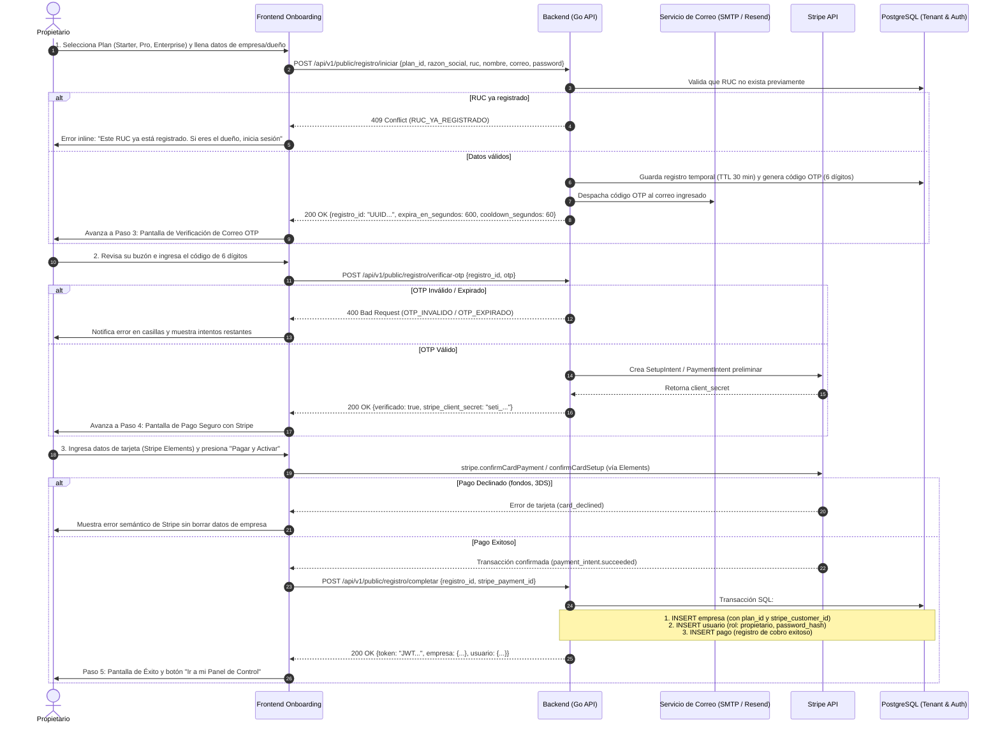
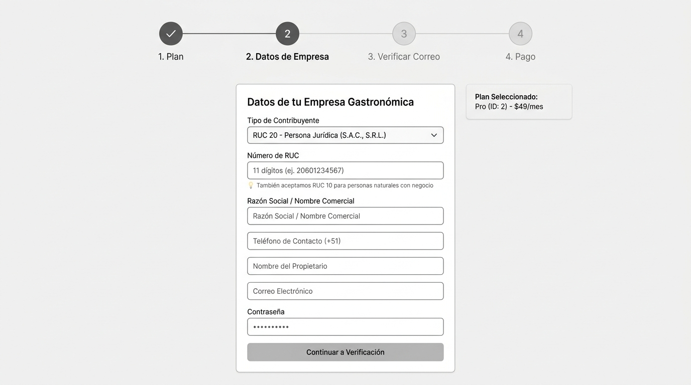
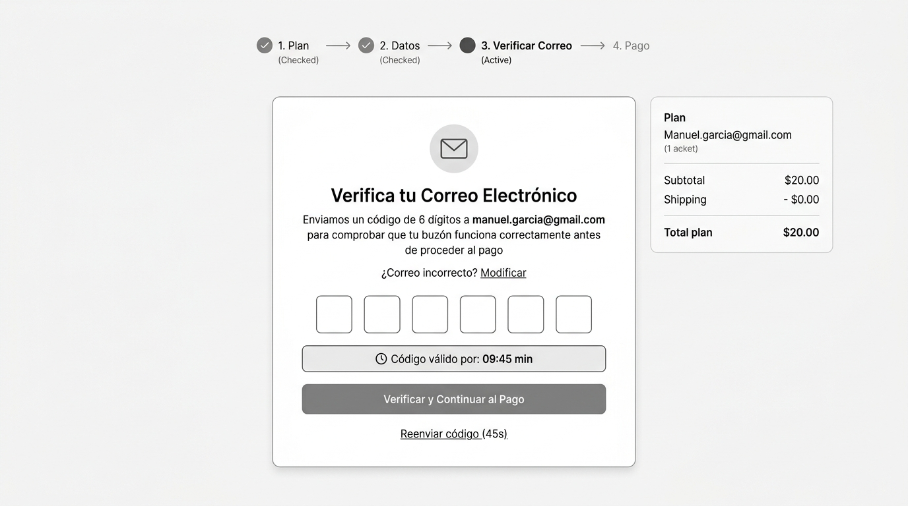
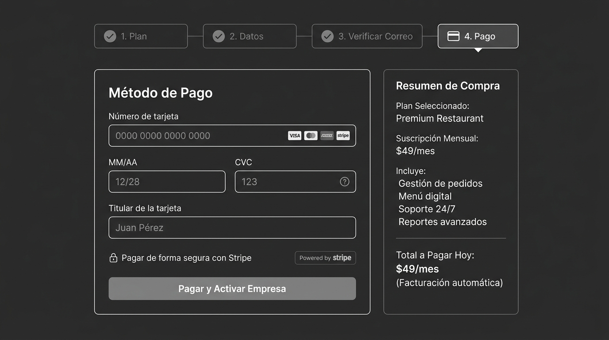
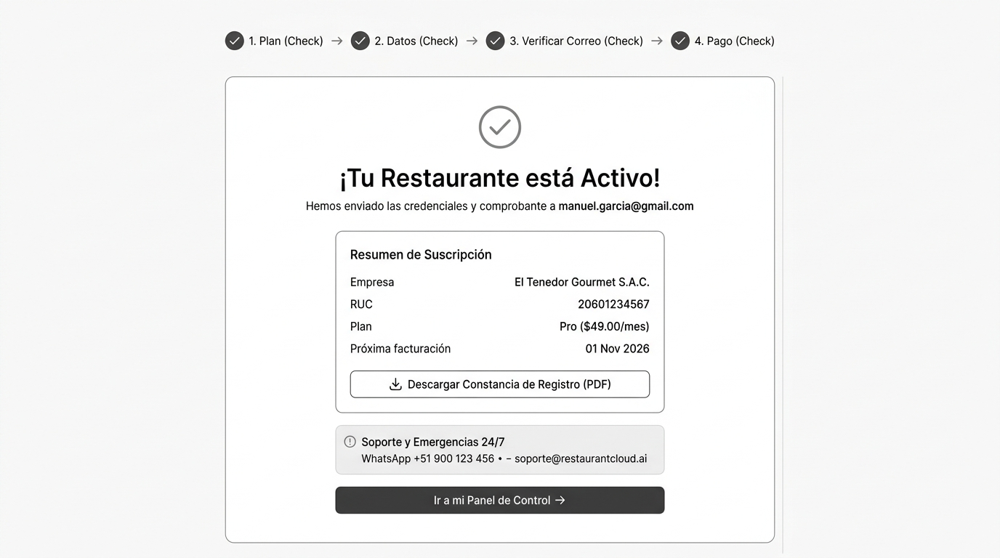

# CU-PROP-01: Registrar Empresa y Suscribirse con Verificación OTP de Correo

Especificación técnica de interfaz de usuario, arquitectura de información, estados UX y contratos de API para el flujo de autoservicio (*onboarding*) de nuevos propietarios en **RestaurantCloud AI**.

---

## 1. Ficha Técnica del Caso de Uso

| Atributo | Detalle |
| :--- | :--- |
| **Código CU** | `CU-PROP-01` |
| **Nombre** | Registrar empresa y suscribirse (autoservicio) con verificación OTP previa |
| **Actor(es)** | Propietario del restaurante (nuevo cliente / visitante público) |
| **Dispositivo / Viewport** | Responsive: Web Desktop (`1440x900`), Tablet (`768x1024`), Mobile (`375x812`) |
| **Precondición** | El visitante accede al portal público y desea registrar su restaurante |
| **Postcondición** | Empresa dada de alta en `empresa`, suscripción activa en Stripe (`pago`), usuario administrador creado en `usuario` con rol `propietario` y sesión iniciada automáticamente |

---

## 2. Diagrama de Flujo y Secuencia



---

## 3. Wireframes Estructurales y Layout

> [!NOTE]
> El diseño se enfoca en distribución espacial, jerarquía de información y accesibilidad sin aplicar tokens de diseño cosméticos (paleta de colores ni tipografías de marca definitivas).

---

### 3.1 Paso 2: Datos de Empresa y Propietario

#### Distribución Estructural (Layout ASCII)
```text
+---------------------------------------------------------------------------------+
|  Header: [LOGO]                                           ¿Ya tienes cuenta? [Entrar]
+---------------------------------------------------------------------------------+
|  [ ✓ 1. Plan ] ---- [ 2. Datos de Empresa (Activo) ] ---- [ 3. Verificar Correo ] ---- [ 4. Pago ]
+---------------------------------------------------------------------------------+
|                                                                                 |
|   +----------------------------------------------+  +-------------------------+ |
|   | Datos de tu Empresa Gastronómica             |  | Resumen del Registro    | |
|   |                                              |  +-------------------------+ |
|   | Tipo de Contribuyente                        |  | Plan Seleccionado:      | |
|   | [ RUC 20 - Persona Jurídica (S.A.C.)     ▼ ] |  | Pro (ID: 2) — S/ 249/mes | |
|   |                                              |  |                         | |
|   | Número de RUC                                |  | Restaurante:            | |
|   | [ 20601234567                              ] |  | El Tenedor S.A.C.       | |
|   | 💡 RUC 20 para empresas o RUC 10 para        |  |                         | |
|   |    persona natural con negocio.              |  | RUC:                    | |
|   |                                              |  | 20601234567             | |
|   | Razón Social / Nombre Comercial              |  +-------------------------+ |
|   | [ El Tenedor Gourmet S.A.C.                ] |                              |
|   |                                              |                              |
|   | Teléfono de Contacto (+51)                   |                              |
|   | [ +51 987 654 321                          ] |                              |
|   |                                              |                              |
|   | Nombre del Propietario                       |                              |
|   | [ Manuel García                            ] |                              |
|   |                                              |                              |
|   | Correo Electrónico (Login y Facturas)        |                              |
|   | [ manuel.garcia@gmail.com                  ] |                              |
|   |                                              |                              |
|   | Contraseña                                   |                              |
|   | [ *************                          (o) ] |                              |
|   |                                              |                              |
|   | [x] Acepto los Términos y Condiciones        |                              |
|   |                                              |                              |
|   | +------------------------------------------+ |                              |
|   | |        CONTINUAR A VERIFICACIÓN          | |                              |
|   | +------------------------------------------+ |                              |
|   +----------------------------------------------+                              |
|                                                                                 |
+---------------------------------------------------------------------------------+
```

#### Imagen Referencial del Wireframe


---

### 3.2 Paso 3: Verificación OTP del Correo Electrónico

Este paso garantiza que el correo ingresado realmente funciona, no tiene errores de tipeo y pertenece al usuario **antes** de procesar el cobro en Stripe.

#### Distribución Estructural (Layout ASCII)
```text
+---------------------------------------------------------------------------------+
|  [ ✓ 1. Plan ] ---- [ ✓ 2. Datos ] ---- [ 3. Verificar Correo (Activo) ] ---- [ 4. Pago ]
+---------------------------------------------------------------------------------+
|                                                                                 |
|                    +---------------------------------------+                    |
|                    |             [ICONO CORREO]            |                    |
|                    |                                       |                    |
|                    |     Verifica tu Correo Electrónico    |                    |
|                    | Enviamos un código de 6 dígitos a:    |                    |
|                    | manuel.garcia@gmail.com               |                    |
|                    | para comprobar que tu buzón funciona  |                    |
|                    | correctamente antes de pagar.         |                    |
|                    |                                       |                    |
|                    |     <¿Correo incorrecto? Modificar>   |                    |
|                    |                                       |                    |
|                    |  [ 5 ] [ 2 ] [ 9 ] [ 1 ] [ 4 ] [ 8 ]  |                    |
|                    |                                       |                    |
|                    | +-----------------------------------+ |                    |
|                    | | (Reloj) Código válido por: 09:45 m| |                    |
|                    | +-----------------------------------+ |                    |
|                    |                                       |                    |
|                    | +-----------------------------------+ |                    |
|                    | |   VERIFICAR Y CONTINUAR AL PAGO   | |                    |
|                    | +-----------------------------------+ |                    |
|                    |                                       |                    |
|                    | ¿No recibiste el código? Reenviar     |                    |
|                    |                 (45s)                 |                    |
|                    +---------------------------------------+                    |
|                                                                                 |
+---------------------------------------------------------------------------------+
```

#### Imagen Referencial del Wireframe


---

### 3.3 Paso 4: Checkout Seguro con Stripe

#### Distribución Estructural (Layout ASCII)
```text
+---------------------------------------------------------------------------------+
|  [ ✓ 1. Plan ] ---- [ ✓ 2. Datos ] ---- [ ✓ 3. Verificado ] ---- [ 4. Pago (Activo) ]
+---------------------------------------------------------------------------------+
|                                                                                 |
|   +----------------------------------------------+  +-------------------------+ |
|   | Método de Pago                               |  | Resumen de Compra       | |
|   |                                              |  +-------------------------+ |
|   | Número de Tarjeta (Stripe Elements)          |  | Plan Seleccionado:      | |
|   | [ 0000 0000 0000 0000         [VISA][MC][AMX] |  | Plan Pro                | |
|   |                                              |  |                         | |
|   | MM / AA                 CVC                  |  | Suscripción Mensual:    | |
|   | [ 12/28            ]    [ 123              ] |  | S/ 249.00 / mes         | |
|   |                                              |  |                         | |
|   | Titular de la Tarjeta                        |  | Incluye:                | |
|   | [ Manuel García                            ] |  | - Hasta 3 locales       | |
|   |                                              |  | - Menú digital QR       | |
|   | (Icono Candado) Pagar de forma segura vía     |  | - IA Forecasting        | |
|   | Stripe. Cifrado TLS de extremo a extremo.    |  |                         | |
|   |                                              |  | Total a Pagar Hoy:      | |
|   | +------------------------------------------+ |  | S/ 249.00               | |
|   | |         PAGAR Y ACTIVAR EMPRESA          | |  +-------------------------+ |
|   | +------------------------------------------+ |                              |
|   +----------------------------------------------+                              |
|                                                                                 |
+---------------------------------------------------------------------------------+
```

#### Imagen Referencial del Wireframe


---

### 3.4 Paso 5: Pantalla de Registro Exitoso, Constancia y Soporte Técnico

Esta pantalla confirma la activación del restaurante tras el cobro de Stripe, permite descargar la constancia legal/comprobante de suscripción en PDF y proporciona las vías de soporte y emergencias 24/7 conforme a lo establecido en `context/cu.md`.

#### Distribución Estructural (Layout ASCII)
```text
+---------------------------------------------------------------------------------+
|  [ ✓ 1. Plan ] ---- [ ✓ 2. Datos ] ---- [ ✓ 3. Verificado ] ---- [ ✓ 4. Pago ]
+---------------------------------------------------------------------------------+
|                                                                                 |
|                   +-----------------------------------------------+             |
|                   |              (✓) ICONO CHECK                  |             |
|                   |                                               |             |
|                   |          ¡Tu Restaurante está Activo!         |             |
|                   | Hemos enviado las credenciales y comprobante  |             |
|                   | a: manuel.garcia@gmail.com                    |             |
|                   |                                               |             |
|                   | +-------------------------------------------+ |             |
|                   | | Resumen de Suscripción                    | |             |
|                   | | Empresa: El Tenedor Gourmet S.A.C.        | |             |
|                   | | RUC:     20601234567                      | |             |
|                   | | Plan:    Pro (S/ 249.00/mes)              | |             |
|                   | | Próxima facturación: 01 Nov 2026          | |             |
|                   | |                                           | |             |
|                   | | [ 📥 Descargar Constancia Registro (PDF) ]| |             |
|                   | +-------------------------------------------+ |             |
|                   |                                               |             |
|                   | +-------------------------------------------+ |             |
|                   | | (!) Soporte y Emergencias 24/7            | |             |
|                   | | WhatsApp: +51 900 123 456                 | |             |
|                   | | Correo:   soporte@restaurantcloud.ai      | |             |
|                   | +-------------------------------------------+ |             |
|                   |                                               |             |
|                   | +-------------------------------------------+ |             |
|                   | |         IR A MI PANEL DE CONTROL ->       | |             |
|                   | +-------------------------------------------+ |             |
|                   +-----------------------------------------------+             |
|                                                                                 |
+---------------------------------------------------------------------------------+
```

#### Imagen Referencial del Wireframe


---

## 4. Matriz de Estados UX (Casos Esperados e Inesperados)

| Estado | Paso 2: Datos de Empresa | Paso 3: Verificación OTP | Paso 4: Pago con Stripe | Paso 5: Registro Exitoso & Soporte |
| :--- | :--- | :--- | :--- | :--- |
| **1. Ideal (Happy Path)** | Validación en vivo de RUC (formato y dígito verificador), contraseña con medidor de seguridad. | Ingreso o pegado de los 6 dígitos. Validación exitosa habilita el paso de pago sin recargar. | Tokenización de tarjeta con Stripe Elements. Mensaje *"Procesando pago seguro..."*. | Resumen de suscripción visible, credenciales despachadas por correo, botón de descarga de constancia habilitado y enlaces de soporte activos. |
| **2. Vacío (Empty State)** | Inputs en blanco con placeholders limpios. | Casillas vacías; foco en la primera casilla. | Campos de Stripe Elements limpios. | N/A (Pantalla terminal con datos consolidados). |
| **3. Carga (Loading)** | Botón disabled con spinner *"Validando datos y enviando código..."*. | Botón disabled con spinner *"Validando código..."*; casillas temporalmente bloqueadas. | Botón disabled con spinner *"Confirmando transacción bancaria con Stripe..."* (bloqueo anti-doble clic). | Botón de descarga con spinner: *"Generando PDF de constancia..."*. |
| **4. Error / Validación** | - **RUC Duplicado (409):** *"El RUC ingresado ya cuenta con una cuenta registrada. [Iniciar sesión]"*.<br>- **Campos requeridos:** Mensajes inline bajo los inputs faltantes. | - **Código Erróneo (400):** Sacudida (*shake*), casillas en rojo: *"Código incorrecto. Intentos restantes: 2"*.<br>- **OTP Vencido (400):** *"El código expiró. Haz clic en Reenviar"*. | - **Tarjeta Declinada:** Error semántico de Stripe (*"Fondos insuficientes"*, *"Tarjeta expirada"*, *"CVC erróneo"*).<br>- **Fallo 3D Secure:** Modal de autenticación bancaria cancelado por el usuario. | Si falla la descarga del PDF (500): Notificación toast *"No se pudo generar el PDF en este momento. Te lo hemos enviado por correo o puedes descargarlo luego en 'Mi Suscripción'"*. |
| **5. Borde / Inesperado (Edge Cases)** | - **Conexión inestable:** Si falla la llamada HTTP, mensaje *"Error de conexión. Tus datos siguen aquí, intenta nuevamente"*. | - **Error de tipeo en correo:** Enlace *"¿Correo incorrecto? Modificar"* abre un modal para cambiar el correo sin perder los datos de la empresa ya ingresados.<br>- **Fuerza bruta:** Al 3er intento fallido, el código se anula de inmediato.<br>- **Cooldown:** Botón de reenvío bloqueado durante 60 segundos. | - **Doble cobro prevenido:** Backend envía `Idempotency-Key` a Stripe con el `registro_id`. Si hay doble clic o corte de red, Stripe garantiza un único cargo.<br>- **Cierre accidental de pestaña:** El `registro_id` se guarda en `sessionStorage`; si refresca, recupera el estado de verificación. | - **Abandono / Inactividad:** Si el usuario no presiona *"Ir a mi Panel de Control"*, el frontend ejecuta un temporizador de auto-redirección de 60 segundos hacia la configuración inicial del primer local.<br>- **Emergencia técnica:** El botón de WhatsApp abre chat directo pre-llenado con el `empresa_id` y `ruc`. |

---

## 5. Contratos de API (Frontend ↔ Backend)

Todos los contratos respetan el formato estándar del backend Go definido en [`context/mock.md`](file:///j:/proyectos_git/RestaurantCloud_AI_backend/context/mock.md).

---

### 5.1 Endpoint 1: Iniciar Registro y Solicitar OTP

- **Método:** `POST`
- **Ruta:** `/api/v1/public/registro/iniciar`
- **Autenticación:** Pública

#### Request Payload
```json
{
  "plan_id": 2,
  "tipo_contribuyente": "RUC_20",
  "ruc": "20601234567",
  "razon_social": "El Tenedor Gourmet S.A.C.",
  "telefono": "+51987654321",
  "nombre_propietario": "Manuel García",
  "correo": "manuel.garcia@gmail.com",
  "password": "PasswordPropietario2026!"
}
```

#### Response 200 OK
```json
{
  "exito": true,
  "datos": {
    "registro_id": "r9a8b7c6-d5e4-3f2a-1b0c-9d8e7f6a5b4c",
    "mensaje": "Se ha enviado un código de verificación de 6 dígitos a tu correo.",
    "correo": "manuel.garcia@gmail.com",
    "expira_en_segundos": 600,
    "cooldown_reenvio_segundos": 60
  },
  "meta": {
    "timestamp": "2026-10-01T22:30:00Z"
  }
}
```

---

### 5.2 Endpoint 2: Modificar Correo (Si el usuario nota un error de tipeo)

- **Método:** `PATCH`
- **Ruta:** `/api/v1/public/registro/modificar-correo`
- **Autenticación:** Pública

#### Request Payload
```json
{
  "registro_id": "r9a8b7c6-d5e4-3f2a-1b0c-9d8e7f6a5b4c",
  "nuevo_correo": "manuel.garcia.rest@gmail.com"
}
```

#### Response 200 OK
```json
{
  "exito": true,
  "datos": {
    "registro_id": "r9a8b7c6-d5e4-3f2a-1b0c-9d8e7f6a5b4c",
    "mensaje": "Correo actualizado. Hemos enviado un nuevo código de verificación.",
    "correo": "manuel.garcia.rest@gmail.com",
    "expira_en_segundos": 600,
    "cooldown_reenvio_segundos": 60
  },
  "meta": {
    "timestamp": "2026-10-01T22:31:00Z"
  }
}
```

---

### 5.3 Endpoint 3: Verificar Código OTP

- **Método:** `POST`
- **Ruta:** `/api/v1/public/registro/verificar-otp`
- **Autenticación:** Pública

#### Request Payload
```json
{
  "registro_id": "r9a8b7c6-d5e4-3f2a-1b0c-9d8e7f6a5b4c",
  "otp": "529148"
}
```

#### Response 200 OK (Listo para Stripe Checkout)
```json
{
  "exito": true,
  "datos": {
    "registro_id": "r9a8b7c6-d5e4-3f2a-1b0c-9d8e7f6a5b4c",
    "correo_verificado": true,
    "stripe_client_secret": "seti_1N..._secret_...",
    "stripe_public_key": "pk_test_51Mz...",
    "monto_total": 249.00,
    "moneda": "PEN"
  },
  "meta": {
    "timestamp": "2026-10-01T22:32:00Z"
  }
}
```

---

### 5.4 Endpoint 4: Completar Registro y Activar Empresa

- **Método:** `POST`
- **Ruta:** `/api/v1/public/registro/completar`
- **Autenticación:** Pública (requiere `registro_id` verificado previamente)

#### Request Payload
```json
{
  "registro_id": "r9a8b7c6-d5e4-3f2a-1b0c-9d8e7f6a5b4c",
  "stripe_payment_method_id": "pm_1N...abc"
}
```

#### Response 200 OK (Empresa Creada y Sesión Iniciada)
```json
{
  "exito": true,
  "datos": {
    "mensaje": "¡Empresa registrada y suscripción activada con éxito!",
    "token": "eyJhbGciOiJIUzI1NiIsInR5cCI6IkpXVCJ9.SESION_PROPIETARIO_JWT...",
    "refresh_token": "f4a5b6c7-d8e9-0f1a-2b3c-4d5e6f7a8b9c",
    "empresa": {
      "id": "e9a8b7c6-1234-5678-9abc-def012345678",
      "razon_social": "El Tenedor Gourmet S.A.C.",
      "ruc": "20601234567",
      "estado": "activa",
      "plan": {
        "id": 2,
        "nombre": "Pro",
        "precio": 249.00
      }
    },
    "usuario": {
      "id": "u1a2b3c4-5678-90ab-cdef-1234567890ab",
      "nombre": "Manuel García",
      "correo": "manuel.garcia@gmail.com",
      "rol": "propietario"
    },
    "constancia": {
      "numero_comprobante": "REC-2026-0001",
      "periodo": "Mensual",
      "fecha_pago": "2026-10-01T22:33:00Z",
      "proximo_cobro": "2026-11-01T22:33:00Z",
      "monto_pagado": 249.00,
      "moneda": "PEN",
      "url_descarga_pdf": "/api/v1/descargas/constancia-registro/e9a8b7c6-1234-5678-9abc-def012345678"
    },
    "soporte_emergencia": {
      "whatsapp": "+51900123456",
      "correo": "soporte@restaurantcloud.ai",
      "disponibilidad": "24/7 Prioritaria"
    }
  },
  "meta": {
    "timestamp": "2026-10-01T22:33:00Z"
  }
}
```

---

### 5.5 Endpoint 5: Descargar Constancia de Registro en PDF

- **Método:** `GET`
- **Ruta:** `/api/v1/descargas/constancia-registro/{empresa_id}`
- **Headers:** `Authorization: Bearer <token>`
- **Response:** `200 OK` — `Content-Type: application/pdf` (Flujo binario con cabecera `Content-Disposition: attachment; filename="constancia-registro.pdf"`).

---

### 5.6 Catálogo de Errores Específicos

| HTTP Status | Código de Error (`apiresponse.ErrorDetail.Codigo`) | Mensaje al Usuario | Causa / Manejo UX |
| :--- | :--- | :--- | :--- |
| `400 Bad Request` | `CAMPOS_INVALIDOS` | "Por favor revisa los campos señalados" | Fallo en formato de RUC, teléfono o longitud de contraseña |
| `400 Bad Request` | `OTP_INVALIDO` | "El código de verificación es incorrecto" | Código OTP errado; decrementa intentos disponibles |
| `400 Bad Request` | `OTP_EXPIRADO` | "El código ha expirado. Solicita un reenvío" | Transcurrieron los 10 minutos de validez |
| `400 Bad Request` | `CORREO_NO_VERIFICADO` | "Debes verificar tu correo antes de pagar" | Se intentó llamar a completar registro sin pasar el OTP |
| `402 Payment Required` | `PAGO_DECLINADO` | "Tu tarjeta fue rechazada por el banco emisor" | Fondos insuficientes, tarjeta bloqueada o 3DS no superado |
| `409 Conflict` | `RUC_YA_REGISTRADO` | "El RUC ingresado ya cuenta con una empresa activa" | Unicidad fiscal violada; se ofrece enlace a login |
| `429 Too Many Requests` | `COOLDOWN_ACTIVO` | "Espera unos segundos antes de solicitar otro código" | Reenvío antes de cumplir los 60s |

---

## 6. Estructuras Go Sugeridas (Backend DTOs)

```go
package onboardingdto

import "github.com/google/uuid"

// IniciarRegistroRequest recopila datos iniciales de empresa y propietario (mercado Perú)
type IniciarRegistroRequest struct {
    PlanID            int    `json:"plan_id" binding:"required,min=1"`                            // 1: Starter, 2: Pro, 3: Enterprise
    TipoContribuyente string `json:"tipo_contribuyente" binding:"required,oneof=RUC_20 RUC_10"` // RUC 20: Jurídica, RUC 10: Natural con negocio
    RUC               string `json:"ruc" binding:"required,len=11,numeric"`                       // Exactamente 11 dígitos numéricos
    RazonSocial       string `json:"razon_social" binding:"required,min=3,max=150"`
    Telefono          string `json:"telefono" binding:"required"`
    NombrePropietario string `json:"nombre_propietario" binding:"required,min=3"`
    Correo            string `json:"correo" binding:"required,email"`
    Password          string `json:"password" binding:"required,min=8"`
}

type IniciarRegistroResponseDTO struct {
    RegistroID              uuid.UUID `json:"registro_id"`
    Mensaje                 string    `json:"mensaje"`
    Correo                  string    `json:"correo"`
    ExpiraEnSegundos        int       `json:"expira_en_segundos"`
    CooldownReenvioSegundos int       `json:"cooldown_reenvio_segundos"`
}

// ModificarCorreoRequest permite cambiar el email si el usuario detectó un typo
type ModificarCorreoRequest struct {
    RegistroID  uuid.UUID `json:"registro_id" binding:"required"`
    NuevoCorreo string    `json:"nuevo_correo" binding:"required,email"`
}

// VerificarRegistroOTPRequest valida el código numérico de 6 dígitos
type VerificarRegistroOTPRequest struct {
    RegistroID uuid.UUID `json:"registro_id" binding:"required"`
    OTP        string    `json:"otp" binding:"required,len=6,numeric"`
}

type VerificarRegistroOTPResponseDTO struct {
    RegistroID         uuid.UUID `json:"registro_id"`
    CorreoVerificado   bool      `json:"correo_verificado"`
    StripeClientSecret string    `json:"stripe_client_secret"`
    StripePublicKey    string    `json:"stripe_public_key"`
    MontoTotal         float64   `json:"monto_total"`
    Moneda             string    `json:"moneda"`
}

// CompletarRegistroRequest concluye el alta tras la confirmación de Stripe
type CompletarRegistroRequest struct {
    RegistroID            uuid.UUID `json:"registro_id" binding:"required"`
    StripePaymentMethodID string    `json:"stripe_payment_method_id" binding:"required"`
}

type CompletarRegistroResponseDTO struct {
    Mensaje           string                 `json:"mensaje"`
    Token             string                 `json:"token"`
    RefreshToken      string                 `json:"refresh_token"`
    Empresa           EmpresaCreadaDTO       `json:"empresa"`
    Usuario           UsuarioCreadoDTO       `json:"usuario"`
    Constancia        ConstanciaRegistroDTO  `json:"constancia"`
    SoporteEmergencia SoporteEmergenciaDTO   `json:"soporte_emergencia"`
}

type ConstanciaRegistroDTO struct {
    NumeroComprobante string    `json:"numero_comprobante"`
    Periodo           string    `json:"periodo"`
    FechaPago         string    `json:"fecha_pago"`
    ProximoCobro      string    `json:"proximo_cobro"`
    MontoPagado       float64   `json:"monto_pagado"`
    Moneda            string    `json:"moneda"`
    URLDescargaPDF    string    `json:"url_descarga_pdf"`
}

type SoporteEmergenciaDTO struct {
    WhatsApp       string `json:"whatsapp"`
    Correo         string `json:"correo"`
    Disponibilidad string `json:"disponibilidad"`
}

type EmpresaCreadaDTO struct {
    ID          uuid.UUID `json:"id"`
    RazonSocial string    `json:"razon_social"`
    RUC         string    `json:"ruc"`
    Estado      string    `json:"estado"`
}

type UsuarioCreadoDTO struct {
    ID     uuid.UUID `json:"id"`
    Nombre string    `json:"nombre"`
    Correo string    `json:"correo"`
    Rol    string    `json:"rol"`
}
```

---

## 7. Consideraciones de Seguridad y Backend Multi-tenant

1. **Arquitectura de Persistencia Temporal (Redis + sessionStorage):**
   - **Frontend (`sessionStorage`):** Almacena **únicamente** el `registro_id` (UUID). De esta forma, si el usuario refresca la página (F5) en el paso 3 o 4, el cliente recupera el progreso sin exponer contraseñas, RUC ni datos sensibles ante scripts maliciosos o extensiones (anti-XSS).
   - **Backend (Redis con TTL 30 min):** El backend almacena el payload completo temporal en Redis bajo la clave `registro:onboarding:<registro_id>` con comando `SETEX ... 1800`. La contraseña se guarda ya hasheada con `bcrypt`.
   - **PostgreSQL 100% Limpio:** **No se inserta ninguna fila en las tablas relacionales (`empresa`, `usuario`, `pago`) hasta que Stripe confirme el cobro exitoso**. Si el usuario abandona en el paso 2 o 3, Redis purga la información automáticamente a los 30 minutos sin dejar basura en la base de datos ni bloquear restricciones `UNIQUE(ruc)`.
2. **Garantía Anti-Error de Tipeo (Valor de Negocio del OTP):**
   - Al forzar la verificación del correo antes del checkout, eliminamos al 100% el riesgo de clientes que pagan pero no pueden recibir sus comprobantes ni acceder a su panel porque escribieron mal su correo (`ej. gnail.com` en lugar de `gmail.com`).
   - El endpoint `PATCH /api/v1/public/registro/modificar-correo` permite subsanar el error sin forzar al usuario a rellenar el formulario de empresa y plan desde cero.
3. **Idempotencia y Manejo de Stripe:**
   - El cobro de suscripción recurrente en Stripe utiliza `registro_id` como `Idempotency-Key` en las cabeceras de la API de Stripe.
   - Si la red se interrumpe durante el pago, reintentar la llamada no generará dos cobros bancarios.
4. **Activación Transaccional y RLS:**
   - Una vez confirmado el pago, el backend ejecuta una única transacción de base de datos (`BEGIN ... COMMIT`) para crear el tenant en `empresa`, el usuario en `usuario` y el registro en `pago`.
   - Inmediatamente después, el backend emite el JWT de sesión con el nuevo `empresa_id`, dejando al propietario listo para empezar a configurar su local.
