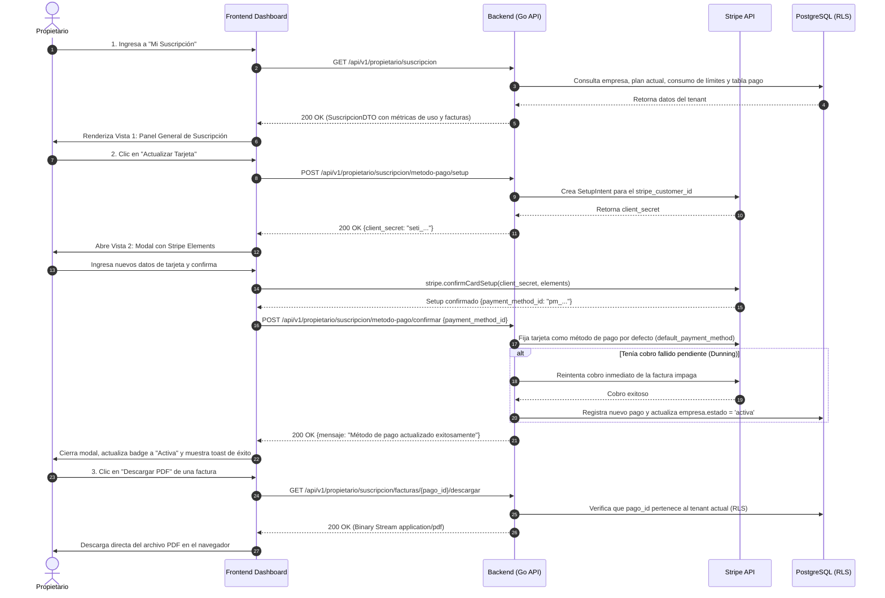
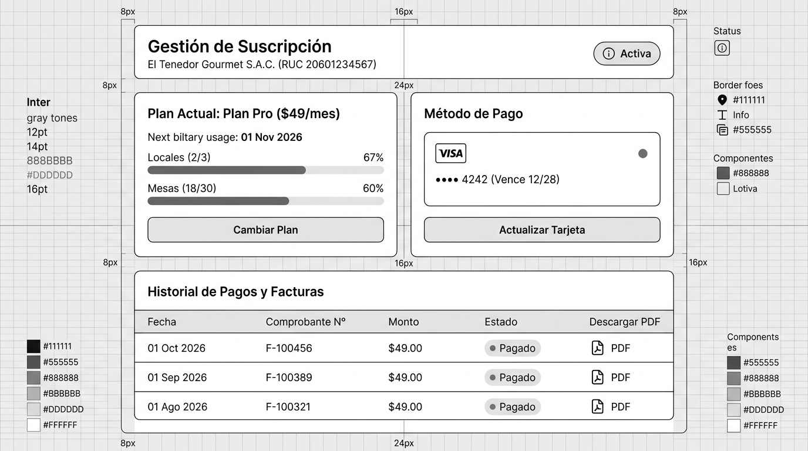
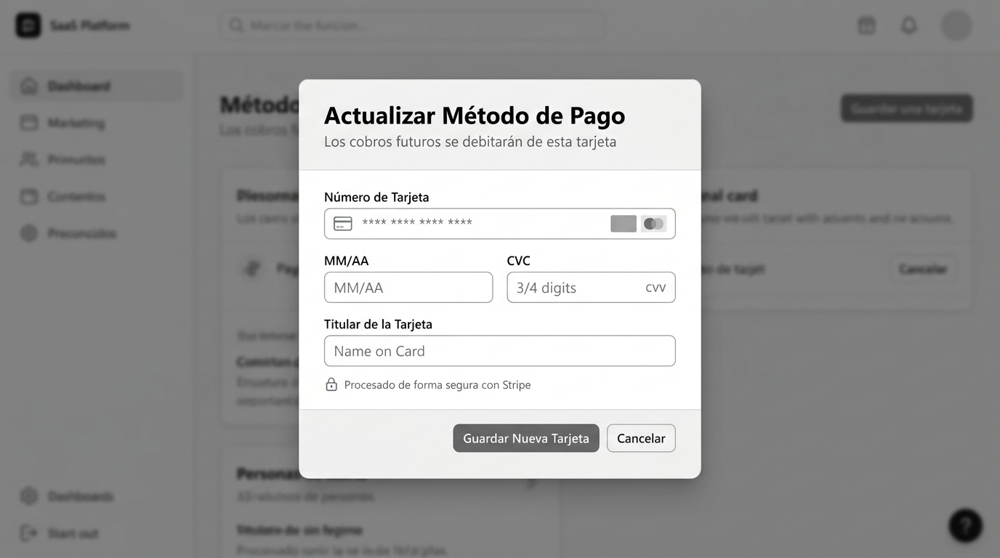
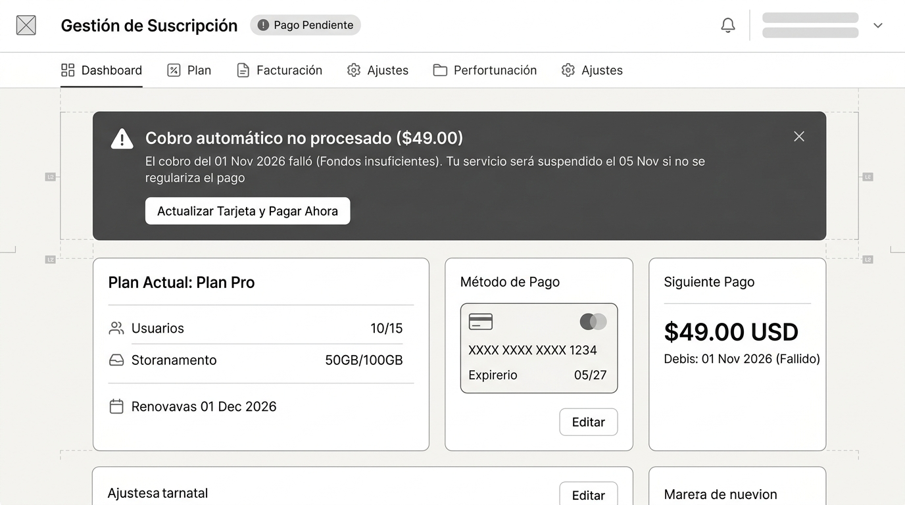

# CU-PROP-02: Gestionar Suscripción y Método de Pago

Especificación técnica de interfaz de usuario, arquitectura de información, estados UX y contratos de API para el módulo de facturación y suscripción corporativa en **RestaurantCloud AI**.

---

## 1. Ficha Técnica del Caso de Uso

| Atributo | Detalle |
| :--- | :--- |
| **Código CU** | `CU-PROP-02` |
| **Nombre** | Gestionar suscripción y método de pago |
| **Actor(es)** | `propietario` (único actor corporativo con acceso a facturación) |
| **Dispositivo / Viewport** | Responsive Desktop (`1440x900`), Tablet (`768x1024`), Mobile (`375x812`) |
| **Precondición** | La empresa está registrada en la plataforma y el usuario inició sesión como `propietario` |
| **Postcondición** | Método de pago actualizado en Stripe, facturas descargadas en PDF o cobro regularizado |

---

## 2. Diagrama de Flujo y Secuencia



---

## 3. Wireframes Estructurales y Layout

> [!NOTE]
> El diseño se enfoca en distribución espacial, jerarquía de información y accesibilidad sin aplicar tokens de diseño cosméticos (paleta de colores ni tipografías de marca definitivas).

---

### 3.1 Vista 1: Panel General de Suscripción y Facturación

#### Distribución Estructural (Layout ASCII)
```text
+---------------------------------------------------------------------------------+
|  Topbar: [LOGO] Restaurante: El Tenedor S.A.C.             Manuel García [Salir]|
+---------------------------------------------------------------------------------+
|  Sidebar  |  Gestión de Suscripción                     [ Badge: Activa ]       |
|  - Locales|  El Tenedor Gourmet S.A.C. (RUC 20601234567)                        |
|  - Carta  |                                                                     |
|  - Personal| +-------------------------------+  +-----------------------------+ |
|  - Planes | | Plan Actual: Plan Pro ($49/mes) |  | Método de Pago              | |
|  * Suscrip| | Próxima facturación: 01 Nov 2026|  |                             | |
|           | |                                 |  | [ VISA ]  •••• 4242         | |
|           | | Locales (2 / 3)      [=====   ] |  | Vence: 12/28                | |
|           | | Mesas   (18 / 30)    [====    ] |  |                             | |
|           | |                                 |  | +-------------------------+ | |
|           | | +-----------------------------+ |  | |    ACTUALIZAR TARJETA   | | |
|           | | |         CAMBIAR PLAN        | |  | +-------------------------+ | |
|           | | +-----------------------------+ |  +-----------------------------+ |
|           | +-------------------------------+                                   |
|           |                                                                     |
|           | +-----------------------------------------------------------------+ |
|           | | Historial de Pagos y Facturas                                   | |
|           | | Fecha        | Comprobante N° | Monto    | Estado   | Acciones  | |
|           | | -------------+----------------+----------+----------+---------- | |
|           | | 01 Oct 2026  | F-100456       | $49.00   | [Pagado] | [📥 PDF]  | |
|           | | 01 Sep 2026  | F-100389       | $49.00   | [Pagado] | [📥 PDF]  | |
|           | | 01 Ago 2026  | F-100321       | $49.00   | [Pagado] | [📥 PDF]  | |
|           | +-----------------------------------------------------------------+ |
+---------------------------------------------------------------------------------+
```

#### Imagen Referencial del Wireframe


---

### 3.2 Vista 2: Modal de Actualización de Tarjeta

#### Distribución Estructural (Layout ASCII)
```text
+-----------------------------------------------------------------------+
|  Modal Centrado (Fondo Atenuado)                                      |
+-----------------------------------------------------------------------+
|                                                                       |
|                     +---------------------------------------+         |
|                     |        Actualizar Método de Pago      |         |
|                     | Los cobros futuros se debitarán de    |         |
|                     | esta nueva tarjeta:                   |         |
|                     |                                       |         |
|                     | Número de Tarjeta (Stripe Elements)   |         |
|                     | [ **** **** **** ****          [LOGO] ]|         |
|                     |                                       |         |
|                     | MM / AA                 CVC           |         |
|                     | [ 12/28            ]    [ 123       ] |         |
|                     |                                       |         |
|                     | Titular de la Tarjeta                 |         |
|                     | [ Manuel García                     ] |         |
|                     |                                       |         |
|                     | (Icono Candado) Cifrado seguro Stripe |         |
|                     |                                       |         |
|                     | +-------------------+  +------------+ |         |
|                     | | GUARDAR TARJETA   |  |  Cancelar  | |         |
|                     | +-------------------+  +------------+ |         |
|                     +---------------------------------------+         |
|                                                                       |
+-----------------------------------------------------------------------+
```

#### Imagen Referencial del Wireframe


---

### 3.3 Vista 3: Caso Inesperado — Cobro Fallido y Riesgo de Suspensión (Dunning)

Cuando el cobro automático de Stripe falla (ej. tarjeta vencida, sin saldo o rechazo bancario), la plataforma entra en un **periodo de gracia de 5 días** antes de la suspensión definitiva, alertando al usuario en todas las secciones del sistema.

#### Distribución Estructural (Layout ASCII)
```text
+---------------------------------------------------------------------------------+
|  Topbar: [LOGO] Restaurante: El Tenedor S.A.C.   [ ⚠️ Pago Pendiente ]  Manuel  |
+---------------------------------------------------------------------------------+
|                                                                                 |
|   +-------------------------------------------------------------------------+   |
|   | ⚠️ COBRO AUTOMÁTICO NO PROCESADO ($49.00)                                |   |
|   | El cobro del 01 Nov 2026 falló (Fondos insuficientes). Tu servicio será    |   |
|   | suspendido el 05 Nov si no se regulariza el pago.                       |   |
|   |                                                                         |   |
|   | [ ACTUALIZAR TARJETA Y PAGAR AHORA ]                                    |   |
|   +-------------------------------------------------------------------------+   |
|                                                                                 |
|   +-------------------------------+  +--------------------------------------+   |
|   | Plan Actual: Plan Pro         |  | Método de Pago (Con Problemas)       |   |
|   | Próximo cobro: Vencido        |  | •••• 1234 (Exp: 05/27) [Rechazado]   |   |
|   +-------------------------------+  +--------------------------------------+   |
|                                                                                 |
+---------------------------------------------------------------------------------+
```

#### Imagen Referencial del Wireframe


---

## 4. Matriz de Estados UX (Casos Esperados e Inesperados)

| Estado | Vista 1: Panel de Suscripción | Vista 2: Modal de Tarjeta | Vista 3: Alerta de Cobro Fallido |
| :--- | :--- | :--- | :--- |
| **1. Ideal (Happy Path)** | Suscripción en estado `Activa`, barras de consumo en verde/gris, tarjeta al día y lista de facturas pagadas. | Formulario limpio de Stripe Elements listo para digitar nueva tarjeta. | N/A (Solo visible cuando hay deuda pendiente). |
| **2. Vacío (Empty State)** | Primer mes de alta: solo 1 comprobante en el historial (el de la activación inicial). | Inputs en blanco con placeholders de Stripe. | N/A. |
| **3. Carga (Loading)** | Skeletons en tarjetas y tabla de facturas mientras resuelve `GET /suscripcion`. | Botón *"Guardar Nueva Tarjeta"* deshabilitado con spinner *"Validando con tu banco..."*. | Botón *"Pagar Ahora"* deshabilitado con spinner *"Procesando cobro pendiente..."*. |
| **4. Error / Validación** | Error al cargar datos: Alerta *"No pudimos cargar la información de suscripción. [Reintentar]"*. | - Tarjeta rechazada por CVC o fecha expirada.<br>- 3D Secure cancelado por el usuario en ventana emergente bancaria. | Si el reintento de cobro con la nueva tarjeta vuelve a fallar: *"Tu banco volvió a rechazar la transacción. Por favor contacta a tu entidad bancaria o prueba con otra tarjeta"*. |
| **5. Borde / Inesperado (Edge Cases)** | - **Límite de recursos alcanzado (3/3 locales):** La barra de progreso se llena al 100% y muestra aviso: *"Has alcanzado el límite de locales de tu plan. [Mejorar a Enterprise]"*.<br>- **Tarjeta próxima a vencer (< 30 días):** Badge de advertencia en la tarjeta: *"Tu tarjeta vence este mes. Actualízala para evitar interrupciones"*. | - **Doble submit bloqueado:** Previene doble generación de tokens de pago.<br>- **Cierre accidental:** El modal no se cierra si el usuario hace clic fuera (*backdrop click disabled*) mientras se está procesando el cobro. | - **Periodo de Gracia (Dunning de 5 días):** El sistema permite seguir operando normalmente (cocina, mozos y ventas no se detienen), pero muestra el banner a nivel del propietario.<br>- **Suspensión Definitiva (Día 6):** Si no se regulariza tras 3 intentos, la empresa pasa a `estado = 'suspendida'`, bloqueando la operación de salones hasta el pago. |

---

## 5. Contratos de API (Frontend ↔ Backend)

Todos los contratos respetan el estándar general del backend Go definido en [`context/mock.md`](file:///j:/proyectos_git/RestaurantCloud_AI_backend/context/mock.md).

---

### 5.1 Endpoint 1: Consultar Estado de la Suscripción

- **Método:** `GET`
- **Ruta:** `/api/v1/propietario/suscripcion`
- **Headers:** `Authorization: Bearer <token_propietario>`

#### Response 200 OK
```json
{
  "exito": true,
  "datos": {
    "empresa": {
      "id": "e9a8b7c6-1234-5678-9abc-def012345678",
      "razon_social": "El Tenedor Gourmet S.A.C.",
      "ruc": "20601234567",
      "estado": "activa"
    },
    "plan": {
      "id": 2,
      "nombre": "Pro",
      "precio": 49.00,
      "periodicidad": "mensual",
      "proximo_cobro": "2026-11-01T22:33:00Z"
    },
    "metodo_pago": {
      "marca": "visa",
      "ultimos_4": "4242",
      "exp_mes": 12,
      "exp_ano": 2028,
      "proximo_a_vencer": false
    },
    "uso_recursos": {
      "locales": { "usados": 2, "maximo": 3 },
      "mesas": { "usadas": 18, "maximo": 30 },
      "incluye_ia_forecasting": true,
      "incluye_asistente_ia": false
    },
    "estado_cobro": {
      "al_dia": true,
      "dias_gracia_restantes": 0,
      "monto_pendiente": 0.00
    },
    "historial_pagos": [
      {
        "id": "p1a2b3c4-0001-0000-0000-000000000001",
        "numero_comprobante": "F-100456",
        "fecha": "2026-10-01T22:33:00Z",
        "monto": 49.00,
        "moneda": "USD",
        "estado": "exitoso",
        "url_descarga_pdf": "/api/v1/propietario/suscripcion/facturas/p1a2b3c4-0001-0000-0000-000000000001/descargar"
      }
    ]
  },
  "meta": {
    "timestamp": "2026-10-01T23:30:00Z"
  }
}
```

---

### 5.2 Endpoint 2: Solicitar Setup de Nueva Tarjeta

- **Método:** `POST`
- **Ruta:** `/api/v1/propietario/suscripcion/metodo-pago/setup`
- **Headers:** `Authorization: Bearer <token_propietario>`

#### Response 200 OK (Genera SetupIntent en Stripe)
```json
{
  "exito": true,
  "datos": {
    "client_secret": "seti_1Nxyz..._secret_Abc123",
    "stripe_public_key": "pk_test_51Mz..."
  },
  "meta": {
    "timestamp": "2026-10-01T23:31:00Z"
  }
}
```

---

### 5.3 Endpoint 3: Confirmar Nueva Tarjeta

- **Método:** `POST`
- **Ruta:** `/api/v1/propietario/suscripcion/metodo-pago/confirmar`
- **Headers:** `Authorization: Bearer <token_propietario>`

#### Request Payload
```json
{
  "stripe_payment_method_id": "pm_1NabcDef456"
}
```

#### Response 200 OK
```json
{
  "exito": true,
  "datos": {
    "mensaje": "Método de pago actualizado exitosamente.",
    "metodo_pago": {
      "marca": "mastercard",
      "ultimos_4": "8899",
      "exp_mes": 10,
      "exp_ano": 2029
    },
    "cobro_pendiente_regularizado": true
  },
  "meta": {
    "timestamp": "2026-10-01T23:32:00Z"
  }
}
```

---

### 5.4 Endpoint 4: Descargar Factura de Suscripción en PDF

- **Método:** `GET`
- **Ruta:** `/api/v1/propietario/suscripcion/facturas/{pago_id}/descargar`
- **Headers:** `Authorization: Bearer <token_propietario>`
- **Response:** `200 OK` — `Content-Type: application/pdf` con stream del comprobante fiscal.

---

### 5.5 Catálogo de Errores Específicos

| HTTP Status | Código de Error (`apiresponse.ErrorDetail.Codigo`) | Mensaje al Usuario | Causa / Manejo UX |
| :--- | :--- | :--- | :--- |
| `400 Bad Request` | `METODO_PAGO_INVALIDO` | "El método de pago no pudo ser verificado por Stripe" | Error en tokenización o CVC inválido |
| `402 Payment Required` | `COBRO_PENDIENTE_FALLIDO` | "Se guardó la tarjeta pero el cobro pendiente fue rechazado" | La nueva tarjeta tampoco contaba con fondos |
| `403 Forbidden` | `ACCESO_DENEGADO` | "Solo el propietario de la empresa puede gestionar la suscripción" | Un mozo o admin de local intentó acceder al módulo |
| `404 Not Found` | `FACTURA_NO_ENCONTRADA` | "El comprobante solicitado no existe o no pertenece a tu empresa" | Validación de aislamiento RLS de pagos |

---

## 6. Estructuras Go Sugeridas (Backend DTOs)

```go
package suscripciondto

import "github.com/google/uuid"

// SuscripcionDashboardDTO estructura de respuesta general para el panel
type SuscripcionDashboardDTO struct {
    Empresa        EmpresaResumenDTO   `json:"empresa"`
    Plan           PlanDetalleDTO      `json:"plan"`
    MetodoPago     *MetodoPagoDTO      `json:"metodo_pago"`
    UsoRecursos    UsoRecursosDTO      `json:"uso_recursos"`
    EstadoCobro    EstadoCobroDTO      `json:"estado_cobro"`
    HistorialPagos []FacturaResumenDTO `json:"historial_pagos"`
}

type EmpresaResumenDTO struct {
    ID          uuid.UUID `json:"id"`
    RazonSocial string    `json:"razon_social"`
    RUC         string    `json:"ruc"`
    Estado      string    `json:"estado"`
}

type PlanDetalleDTO struct {
    ID           int     `json:"id"`
    Nombre       string  `json:"nombre"`
    Precio       float64 `json:"precio"`
    Periodicidad string  `json:"periodicidad"`
    ProximoCobro string  `json:"proximo_cobro"`
}

type MetodoPagoDTO struct {
    Marca           string `json:"marca"`
    Ultimos4        string `json:"ultimos_4"`
    ExpMes          int    `json:"exp_mes"`
    ExpAno          int    `json:"exp_ano"`
    ProximoAVencer  bool   `json:"proximo_a_vencer"`
}

type UsoRecursosDTO struct {
    Locales              MetricaLimiteDTO `json:"locales"`
    Mesas                MetricaLimiteDTO `json:"mesas"`
    IncluyeIAForecasting bool             `json:"incluye_ia_forecasting"`
    IncluyeAsistenteIA   bool             `json:"incluye_asistente_ia"`
}

type MetricaLimiteDTO struct {
    Usados int `json:"usados"`
    Maximo int `json:"maximo"`
}

type EstadoCobroDTO struct {
    AlDia                bool    `json:"al_dia"`
    DiasGraciaRestantes  int     `json:"dias_gracia_restantes"`
    MontoPendiente       float64 `json:"monto_pendiente"`
}

type FacturaResumenDTO struct {
    ID                uuid.UUID `json:"id"`
    NumeroComprobante string    `json:"numero_comprobante"`
    Fecha             string    `json:"fecha"`
    Monto             float64   `json:"monto"`
    Moneda            string    `json:"moneda"`
    Estado            string    `json:"estado"`
    URLDescargaPDF    string    `json:"url_descarga_pdf"`
}

// SetupMetodoPagoResponseDTO cliente secret para Stripe Elements
type SetupMetodoPagoResponseDTO struct {
    ClientSecret    string `json:"client_secret"`
    StripePublicKey string `json:"stripe_public_key"`
}

// ConfirmarMetodoPagoRequest recibe el payment method de Stripe
type ConfirmarMetodoPagoRequest struct {
    StripePaymentMethodID string `json:"stripe_payment_method_id" binding:"required"`
}

type ConfirmarMetodoPagoResponseDTO struct {
    Mensaje                    string        `json:"mensaje"`
    MetodoPago                 MetodoPagoDTO `json:"metodo_pago"`
    CobroPendienteRegularizado bool          `json:"cobro_pendiente_regularizado"`
}
```

---

## 7. Consideraciones de Seguridad y Backend Multi-tenant

1. **Aislamiento Estricto por Rol y RLS:**
   - La gestión de facturación es exclusiva del rol `propietario`. Mozos, cocineros o cajeros reciben `403 Forbidden` a nivel del middleware de roles.
   - En PostgreSQL, las consultas a la tabla `pago` están filtradas por `empresa_id = current_setting('app.tenant_id')::uuid`. Ningún propietario puede ver los pagos ni facturas de otra empresa.
2. **Nunca se Almacenan Tarjetas en el Backend:**
   - Los datos PAN (número completo de tarjeta) y CVC nunca tocan los servidores de RestaurantCloud AI. Se procesan de extremo a extremo mediante Stripe Elements.
   - En la base de datos o en la respuesta únicamente se guarda la metadata retornada por Stripe: `marca`, `ultimos_4`, `exp_mes`, `exp_ano`.
3. **Manejo de Webhooks de Stripe (Dunning y Reintentos):**
   - Cuando Stripe intenta cobrar la suscripción mensual recurrente y el banco emisor la declina, Stripe emite el evento `invoice.payment_failed`.
   - El webhook en Go recibe el evento, marca un nuevo registro en `pago` con `estado = 'fallido'`, fija `empresa.estado = 'activa'` (pero con bandera de periodo de gracia por 5 días) y despacha un correo de alerta al propietario.
   - Si tras 5 días y 3 reintentos automáticos el pago no prospera, Stripe emite `customer.subscription.deleted` o el backend suspende la empresa: `empresa.estado = 'suspendida'`, bloqueando el acceso operativo de salones y mesas hasta su regularización.
