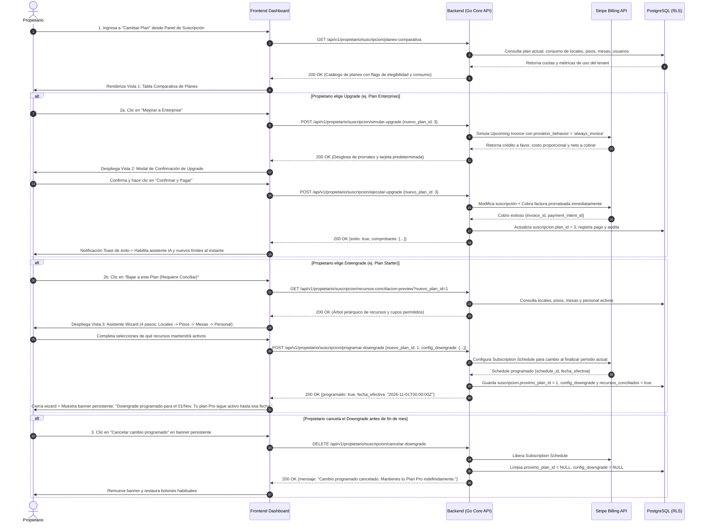
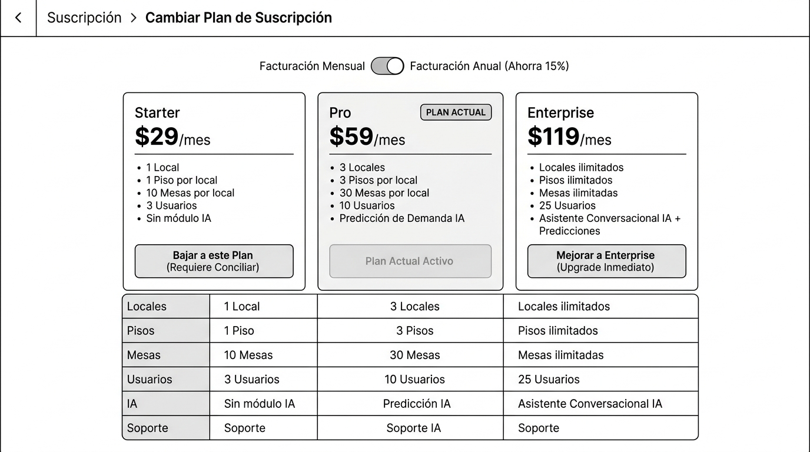
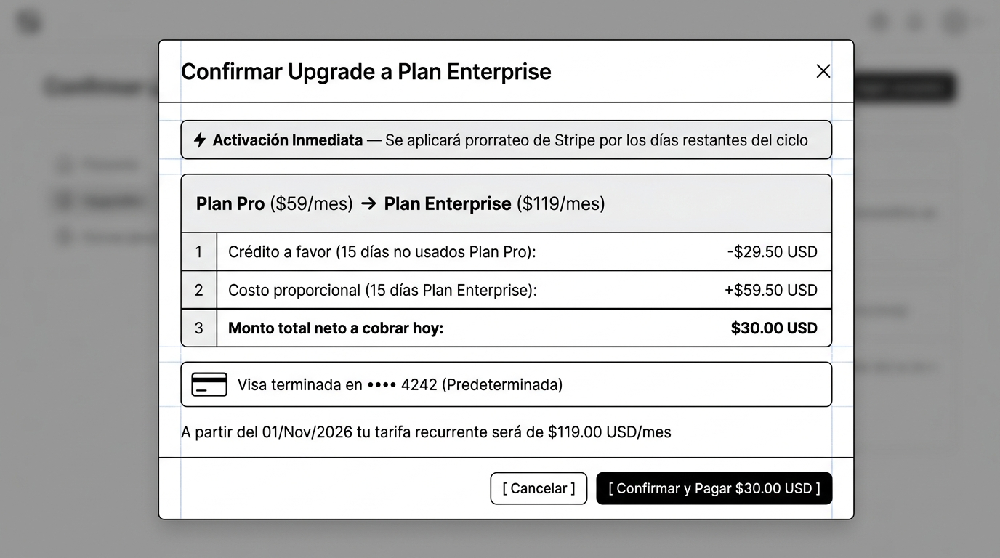
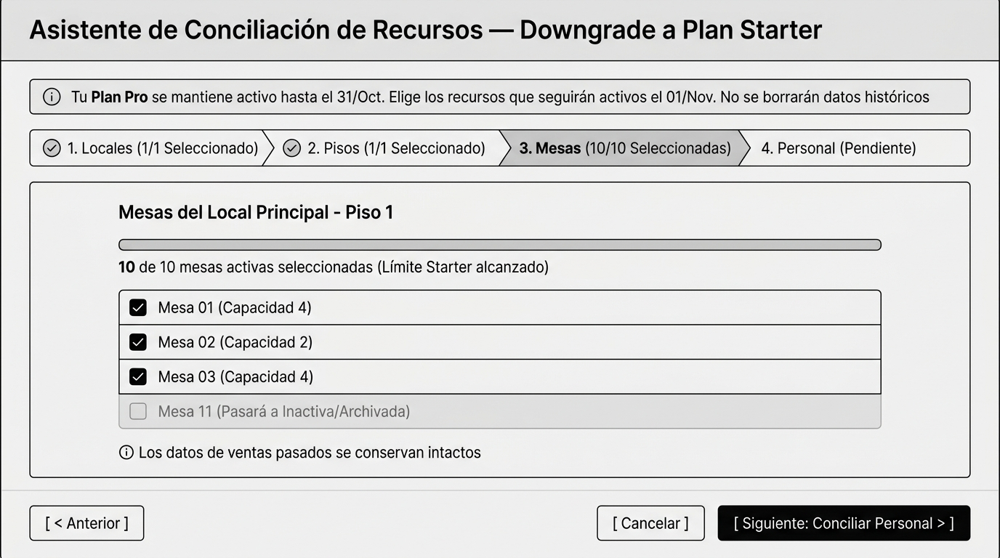

# CU-PROP-03: Cambiar Plan de Suscripción

Especificación técnica de interfaz de usuario, arquitectura de información, estados UX y contratos de API para la transición de planes de suscripción (Upgrade inmediato y Downgrade programado con conciliación de recursos) en **RestaurantCloud AI**.

---

## 1. Ficha Técnica del Caso de Uso

| Atributo | Detalle |
| :--- | :--- |
| **Código CU** | `CU-PROP-03` |
| **Nombre** | Cambiar plan de suscripción |
| **Actor(es)** | `propietario` (único rol corporativo autorizado para modificar niveles de suscripción) |
| **Dispositivo / Viewport** | Responsive Desktop (`1440x900`), Tablet (`768x1024`), Mobile (`375x812`) |
| **Precondición** | La empresa tiene una suscripción activa (`estado = 'activa'`) y un método de pago válido guardado en Stripe. |
| **Postcondición** | **Upgrade:** Plan actualizado de inmediato, cargo prorrateado procesado en Stripe y nuevas funciones de IA activas.<br>**Downgrade:** Plan programado para el fin del periodo de facturación con conciliación no destructiva de los 4 recursos (`locales`, `pisos`, `mesas`, `usuarios`). |

---

## 2. Diagrama de Flujo y Secuencia



---

## 3. Wireframes Estructurales y Layout

> [!NOTE]
> Los wireframes siguen el patrón arquitectural blueprint en escala de grises, priorizando jerarquía de información, ergonomía operativa y accesibilidad WCAG 2.1 AA sin distractores cosméticos.

---

### 3.1 Vista 1: Tabla Comparativa de Planes y Límites de Recursos

Permite al propietario visualizar su plan actual, comparar los 4 recursos (`locales`, `pisos`, `mesas`, `usuarios`) y funciones de IA, y tomar una decisión informada de Upgrade o Downgrade.

#### Distribución Estructural (Layout ASCII)
```text
+---------------------------------------------------------------------------------------------------+
|  Topbar: [LOGO] Restaurante: El Tenedor S.A.C.                             Manuel García [Salir]   |
+---------------------------------------------------------------------------------------------------+
|  < Suscripción  >  Cambiar Plan de Suscripción                                                    |
|                                                                                                   |
|                             [ Facturación Mensual ] (O) [ Facturación Anual (-15%) ]               |
|                                                                                                   |
|  +---------------------------+ +---------------------------+ +----------------------------------+ |
|  | Starter                   | | Pro         [PLAN ACTUAL] | | Enterprise                       | |
|  | S/ 99 / mes               | | S/ 249 / mes              | | S/ 499 / mes                     | |
|  |---------------------------| |---------------------------| |----------------------------------| |
|  | • 1 Local                 | | • 3 Locales               | | • Hasta 10 Locales               | |
|  | • 1 Piso por local        | | • 2 Pisos por local       | | • Hasta 5 Pisos por local        | |
|  | • 25 Mesas por local      | | • 30 Mesas por local      | | • Hasta 60 Mesas por local       | |
|  | • 5 Usuarios staff        | | • 15 Usuarios staff       | | • Hasta 40 Usuarios staff        | |
|  | • Sin módulo de reservas  | | • Módulo de Reservas      | | • Reservas + Reportes Avanzados  | |
|  | • Sin módulo de IA        | | • Asistente IA de Salón   | | • Asistente IA + Predicción IA   | |
|  | +-----------------------+ | | +-----------------------+ | | +------------------------------+ | |
|  | |   Bajar a este Plan   | | | |  Plan Actual Activo   | | | |    Mejorar a Enterprise      | | |
|  | | (Requiere Conciliar)  | | | |      (Deshabilitado)  | | | |    (Upgrade Inmediato)       | | |
|  | +-----------------------+ | | +-----------------------+ | | +------------------------------+ | |
|  +---------------------------+ +---------------------------+ +----------------------------------+ |
|                                                                                                   |
|  +----------------------------------------------------------------------------------------------+ |
|  | Matriz Detallada de Comparación de Recursos                                                   | |
|  | Recurso / Característica  | Starter             | Pro (Actual)        | Enterprise           | |
|  |---------------------------|---------------------|---------------------|----------------------| |
|  | Locales permitidos        | 1 Local             | 3 Locales           | 10 Locales           | |
|  | Pisos / Áreas por local   | 1 Piso              | 2 Pisos             | 5 Pisos              | |
|  | Mesas por local           | 25 Mesas            | 30 Mesas            | 60 Mesas             | |
|  | Personal / Usuarios staff | 5 Cuentas           | 15 Cuentas          | 40 Cuentas           | |
|  | Módulo de Reservas        | No disponible       | Incluido en salón   | Incluido en salón    | |
|  | Asistente IA Operativo    | No disponible       | Incluido (Salón)    | Incluido (Salón)     | |
|  | Predicción de Demanda IA  | No disponible       | No disponible       | Forecasting multi-sede| |
|  | Reportes y Exportación    | Básico (CSV)        | Avanzado (PDF/Excel)| Auditoría + BI       | |
|  | Soporte Técnico           | Correo (48h)        | Chat (24h)          | Prioritario 24/7     | |
|  +----------------------------------------------------------------------------------------------+ |
+---------------------------------------------------------------------------------------------------+
```

#### Blueprint Visual


#### Jerarquía de Componentes y Accesibilidad
- **Toggle de Ciclo de Facturación:** Control accesible mediante teclas de flecha `[←] [→]` con atributos `role="radiogroup"` y `aria-label="Periodo de cobro"`.
- **Badges de Plan Actual:** `aria-current="true"` en la tarjeta Pro. El botón del plan actual está deshabilitado visual y semánticamente (`disabled` y `aria-disabled="true"`).
- **Indicadores de Acción Condicionados:**
  - El botón *"Mejorar a Enterprise"* es un botón de acción primaria con alto contraste visual.
  - El botón *"Bajar a Starter"* advierte explícitamente `(Requiere Conciliar)` para anticipar al usuario que sus recursos actuales exceden el nuevo plan.

---

### 3.2 Vista 2: Modal de Confirmación de Upgrade con Prorrateo Stripe

Garantiza transparencia financiera total antes de emitir cualquier cobro bancario inmediato.

#### Distribución Estructural (Layout ASCII)
```text
+-----------------------------------------------------------------------------------+
|  [ Fondo difuminado / Backdrop ]                                                  |
|                                                                                   |
|  +-----------------------------------------------------------------------------+  |
|  | Confirmar Upgrade a Plan Enterprise                                    [X]  |  |
|  |-----------------------------------------------------------------------------|  |
|  | [⚡] Activación Inmediata — Se aplicará prorrateo de Stripe por días restantes|  |
|  |                                                                             |  |
|  |  Plan Pro (S/ 249.00/mes)  ━━━━━━>  Plan Enterprise (S/ 499.00/mes)              |  |
|  |                                                                             |  |
|  |  +-----------------------------------------------------------------------+  |  |
|  |  | Desglose de Facturación Inmediata                                      |  |  |
|  |  | 1. Crédito a favor (15 días no utilizados de Plan Pro):   -S/ 124.50 PEN |  |  |
|  |  | 2. Costo proporcional (15 días restantes Enterprise):      +S/ 249.50 PEN |  |  |
|  |  |-----------------------------------------------------------------------|  |  |
|  |  | 3. Monto total neto a cobrar hoy:                          S/ 125.00 PEN |  |  |
|  |  +-----------------------------------------------------------------------+  |  |
|  |                                                                             |  |
|  |  Método de Pago para el cargo:                                              |  |
|  |  +-----------------------------------------------------------------------+  |  |
|  |  | [ TARJETA ]  Visa terminada en •••• 4242 (Predeterminada)             |  |  |
|  |  +-----------------------------------------------------------------------+  |  |
|  |                                                                             |  |
|  |  (i) A partir del 01/Nov/2026 tu tarifa regular recurrente será S/ 499.00 PEN|  |
|  |-----------------------------------------------------------------------------|  |
|  |                                     [ Cancelar ]  [ Confirmar y Pagar S/ 125 ]|  |
|  +-----------------------------------------------------------------------------+  |
+-----------------------------------------------------------------------------------+
```

#### Blueprint Visual


#### Comportamiento Funcional y Seguridad Financiera
1. **Prorrateo Exacto:** El backend calcula con Stripe el monto neto en centavos. Si el resultado es menor a $0 (crédito remanente), el cobro hoy es $0.00 y el crédito se abona a la siguiente factura.
2. **Prevención de Doble Cargo:** El botón *"Confirmar y Pagar"* se desactiva inmediatamente tras el primer clic, mostrando un spinner *"Procesando con Stripe..."*.
3. **Manejo 3D Secure:** Si el banco emisor requiere autenticación multifactor, se despliega el iframe de Stripe sin cerrar el modal de contexto.

---

### 3.3 Vista 3: Asistente Wizard de Conciliación de Recursos para Downgrade

Resuelve la reducción a un plan inferior garantizando que **no se pierda información histórica** mediante un proceso en cascada jerárquica de 4 pasos.

#### Distribución Estructural (Layout ASCII)
```text
+---------------------------------------------------------------------------------------------------+
|  Asistente de Conciliación de Recursos — Downgrade a Plan Starter                            [X]  |
+---------------------------------------------------------------------------------------------------+
|  (i) Tu Plan Pro se mantiene activo hasta el 31/Oct. Elige los recursos que seguirán activos       |
|      el 01/Nov. No se borrarán datos históricos ni ventas pasadas.                                |
|                                                                                                   |
|  +---------------------------------------------------------------------------------------------+  |
|  | [✓ 1. Locales (1/1)] > [✓ 2. Pisos (1/1)] > [● 3. Mesas (10/10)] > [○ 4. Personal (0/3)]    |  |
|  +---------------------------------------------------------------------------------------------+  |
|                                                                                                   |
|  +---------------------------------------------------------------------------------------------+  |
|  | Mesas del Local Principal - Piso 1                                                          |  |
|  | [========================================================================]                  |  |
|  | 10 de 10 mesas activas seleccionadas (Límite Starter alcanzado)                            |  |
|  |                                                                                             |  |
|  |  [✓] Mesa 01 (Capacidad: 4 personas)                                                        |  |
|  |  [✓] Mesa 02 (Capacidad: 2 personas)                                                        |  |
|  |  [✓] Mesa 03 (Capacidad: 4 personas)                                                        |  |
|  |  ... (7 mesas más seleccionadas)                                                             |  |
|  |  [ ] Mesa 11 (Pasará a Inactiva / Archivada)                                                |  |
|  |  [ ] Mesa 12 (Pasará a Inactiva / Archivada)                                                |  |
|  |                                                                                             |  |
|  |  (i) Los datos de ventas, comandas y pedidos pasados se conservan intactos para auditoría. |  |
|  +---------------------------------------------------------------------------------------------+  |
|                                                                                                   |
|  [ < Anterior: Pisos ]                                   [ Cancelar ]   [ Siguiente: Personal > ] |
+---------------------------------------------------------------------------------------------------+
```

#### Blueprint Visual


#### Pasos del Asistente y Cascada Operativa
- **Paso 1 (Locales):** Si tiene 2 locales y Starter permite 1, selecciona cuál continúa activo. El otro local pasa a estado `inactivo` y en cascada todos sus pisos y mesas se pausan.
- **Paso 2 (Pisos):** Si el local activo tiene 2 pisos y Starter permite 1, selecciona cuál piso permanece abierto al público.
- **Paso 3 (Mesas):** Dentro del piso activo, selecciona las 10 mesas que tendrán atención. Las excedentes pasan a `estado = 'inactiva'`.
- **Paso 4 (Personal / Usuarios):** La cuenta del Propietario siempre está activa. Elige cuáles 2 o 3 cuentas de mozos/cajeros/cocineros mantendrán credenciales de acceso.
- **Confirmación Final:** Muestra un resumen del estado futuro antes de programar la suscripción en Stripe.

---

## 4. Matriz de Estados UX (5 Estados Canónicos)

| Estado | Vista 1: Tabla de Planes | Vista 2: Modal Upgrade Prorrateo | Vista 3: Asistente Downgrade |
| :--- | :--- | :--- | :--- |
| **1. Ideal (Happy Path)** | Planes cargados con insignias correctas; botones habilitados según la relación con el plan actual. | Cálculo exacto recibido de Stripe; botón de pago activo con desglose positivo/negativo claro. | Wizard guiado paso a paso con contadores de cupo dinámicos (ej. `10/10`) y validaciones satisfechas. |
| **2. Vacío (Empty State)** | Si la empresa está en el plan máximo (Enterprise), la columna superior muestra *"Estás en el plan máximo"* sin opciones de upgrade. | N/A (Solo abre si hay un plan seleccionado). | Si el usuario ya consume menos recursos que los límites del plan inferior (ej. tiene 1 local, 8 mesas y 2 usuarios), el asistente muestra: *"¡Cumples todos los requisitos! No requieres desactivar recursos"*. |
| **3. Carga (Loading)** | Skeleton animado en las 3 tarjetas de planes y filas de la tabla comparativa. | Spinner modal: *"Calculando prorrateo oficial con Stripe..."*. Botón de confirmación deshabilitado con spinner. | Skeleton al cargar el árbol de recursos del local. Al guardar: *"Programando cambio en Stripe..."*. |
| **4. Error / Validación** | Error al cargar catálogo: *"No fue posible consultar los planes. [Reintentar]"*. | - Tarjeta rechazada por fondos insuficientes o CVC.<br>- Error de conexión con Stripe.<br>- Mensaje claro: *"Tu tarjeta fue rechazada. Actualiza tu método de pago en CU-PROP-02"*. | Si el usuario intenta avanzar de paso sin seleccionar exactamente el cupo permitido (ej. seleccionó 12 mesas en un plan que solo permite 10): *"Debes seleccionar como máximo 10 mesas para continuar"*. |
| **5. Borde / Inesperado (Edge Cases)** | - **Downgrade ya programado:** Se muestra un banner persistente: *"Tienes un cambio programado a Starter para el 01/Nov. [Cancelar cambio]"* y se bloquea la selección de otros downgrades.<br>- **Congelamiento de creación:** Si intenta crear un 2do local durante el mes pagado: *"Acción no permitida: tienes un downgrade programado"*. | - **Prorrateo neto igual a cero o a favor:** Si el crédito cubre el costo, el botón cambia a *"Activar Plan (Sin cobro hoy)"* y se añade saldo a la cuenta de Stripe.<br>- **Autenticación 3D Secure requerida:** Despliega challenge de Visa/Mastercard. | - **Renovación con conciliación incompleta (`pendiente_ajuste`):** Si por alguna anomalía el ciclo venció sin conciliar, el Propietario ve un Gate Operativo a pantalla completa que le impide despachar pedidos hasta elegir sus recursos activos. |

---

## 5. Contratos de API (Frontend ↔ Backend Go)

Todos los contratos utilizan el estándar oficial de respuesta `apiresponse.Response` definido en [`context/mock.md`](file:///j:/proyectos_git/RestaurantCloud_AI_backend/context/mock.md).

---

### 5.1 Endpoint 1: Obtener Comparativa de Planes y Límites de Uso

Permite al frontend renderizar la tabla comparativa contrastando el uso real del restaurante con los límites de cada plan.

- **Método:** `GET`
- **Ruta:** `/api/v1/propietario/suscripcion/planes-comparativa`
- **Headers:** `Authorization: Bearer <jwt_propietario>`

#### Response 200 OK
```json
{
  "exito": true,
  "datos": {
    "plan_actual": {
      "id": 2,
      "nombre": "Pro",
      "precio_mensual": 59.00,
      "precio_anual": 599.00,
      "dias_restantes_ciclo": 15,
      "fecha_renovacion": "2026-11-01T00:00:00Z",
      "downgrade_programado": false,
      "proximo_plan": null
    },
    "recursos_en_uso": {
      "locales_activos": 2,
      "pisos_activos": 3,
      "mesas_activas": 26,
      "usuarios_activos": 8
    },
    "planes": [
      {
        "id": 1,
        "nombre": "Starter",
        "precio_mensual": 29.00,
        "precio_anual": 290.00,
        "limites": {
          "max_locales": 1,
          "max_pisos": 1,
          "max_mesas": 10,
          "max_usuarios": 3,
          "incluye_prediccion_ia": false,
          "incluye_asistente_ia": false,
          "reportes": "basicos"
        },
        "es_plan_actual": false,
        "tipo_accion": "downgrade",
        "requiere_conciliacion": true,
        "recursos_excedidos": ["locales", "pisos", "mesas", "usuarios"]
      },
      {
        "id": 2,
        "nombre": "Pro",
        "precio_mensual": 59.00,
        "precio_anual": 599.00,
        "limites": {
          "max_locales": 3,
          "max_pisos": 3,
          "max_mesas": 30,
          "max_usuarios": 10,
          "incluye_prediccion_ia": true,
          "incluye_asistente_ia": false,
          "reportes": "avanzados"
        },
        "es_plan_actual": true,
        "tipo_accion": "actual",
        "requiere_conciliacion": false,
        "recursos_excedidos": []
      },
      {
        "id": 3,
        "nombre": "Enterprise",
        "precio_mensual": 119.00,
        "precio_anual": 1190.00,
        "limites": {
          "max_locales": 999,
          "max_pisos": 999,
          "max_mesas": 999,
          "max_usuarios": 25,
          "incluye_prediccion_ia": true,
          "incluye_asistente_ia": true,
          "reportes": "auditoria_completa"
        },
        "es_plan_actual": false,
        "tipo_accion": "upgrade",
        "requiere_conciliacion": false,
        "recursos_excedidos": []
      }
    ]
  },
  "meta": {
    "timestamp": "2026-10-02T19:15:00Z"
  }
}
```

---

### 5.2 Endpoint 2: Simular Prorrateo de Upgrade (Stripe Invoice Preview)

Consulta la API de Stripe para previsualizar el crédito y débito proporcional exacto antes de realizar el cargo.

- **Método:** `POST`
- **Ruta:** `/api/v1/propietario/suscripcion/simular-upgrade`
- **Headers:** `Authorization: Bearer <jwt_propietario>`

#### Request Body
```json
{
  "nuevo_plan_id": 3,
  "periodicidad": "mensual"
}
```

#### Response 200 OK
```json
{
  "exito": true,
  "datos": {
    "plan_origen": "Pro",
    "plan_destino": "Enterprise",
    "dias_restantes_ciclo": 15,
    "fecha_proximo_ciclo": "2026-11-01T00:00:00Z",
    "credito_plan_actual": 124.50,
    "costo_nuevo_plan_proporcional": 249.50,
    "monto_neto_a_pagar_hoy": 125.00,
    "moneda": "PEN",
    "nuevo_monto_recurrente": 499.00,
    "metodo_pago_defecto": {
      "marca": "visa",
      "ultimos_4": "4242",
      "exp_mes": 8,
      "exp_ano": 2028
    }
  },
  "meta": {
    "timestamp": "2026-10-02T19:15:30Z"
  }
}
```

---

### 5.3 Endpoint 3: Ejecutar Upgrade Inmediato

Aplica el cambio en Stripe de inmediato, realiza el cargo bancario y activa las características.

- **Método:** `POST`
- **Ruta:** `/api/v1/propietario/suscripcion/ejecutar-upgrade`
- **Headers:** `Authorization: Bearer <jwt_propietario>`

#### Request Body
```json
{
  "nuevo_plan_id": 3,
  "periodicidad": "mensual"
}
```

#### Response 200 OK
```json
{
  "exito": true,
  "datos": {
    "suscripcion_id": "s1a2b3c4-9999-0000-0000-000000000001",
    "plan_id": 3,
    "plan_nombre": "Enterprise",
    "estado": "activa",
    "comprobante_pago": {
      "pago_id": "p8f7e6d5-1111-2222-3333-444455556666",
      "numero_factura": "F-100892",
      "monto_cobrado": 125.00,
      "moneda": "PEN",
      "url_recibo_pdf": "/api/v1/propietario/suscripcion/facturas/p8f7e6d5-1111-2222-3333-444455556666/descargar"
    },
    "modulos_activados": [
      "asistente_conversacional_ia",
      "prediccion_diaria_demanda",
      "reportes_auditoria_bi"
    ]
  },
  "meta": {
    "timestamp": "2026-10-02T19:16:00Z"
  }
}
```

---

### 5.4 Endpoint 4: Previsualizar Árbol de Recursos para Conciliación de Downgrade

Obtiene el desglose de recursos actuales del restaurante agrupados jerárquicamente para poblar el asistente wizard.

- **Método:** `GET`
- **Ruta:** `/api/v1/propietario/suscripcion/recursos-conciliacion-preview?nuevo_plan_id=1`
- **Headers:** `Authorization: Bearer <jwt_propietario>`

#### Response 200 OK
```json
{
  "exito": true,
  "datos": {
    "nuevo_plan": {
      "id": 1,
      "nombre": "Starter",
      "limites": {
        "max_locales": 1,
        "max_pisos": 1,
        "max_mesas": 10,
        "max_usuarios": 3
      }
    },
    "arbol_locales": [
      {
        "id": "loc-1111-aaaa-bbbb-cccc",
        "nombre": "Sede Principal - Miraflores",
        "es_casa_matriz": true,
        "pisos": [
          {
            "id": "pis-1001-aaaa-bbbb-cccc",
            "nombre": "Piso 1 - Salón Principal",
            "mesas": [
              { "id": "mes-0001", "etiqueta": "Mesa 01", "capacidad": 4 },
              { "id": "mes-0002", "etiqueta": "Mesa 02", "capacidad": 2 },
              { "id": "mes-0003", "etiqueta": "Mesa 03", "capacidad": 4 },
              { "id": "mes-0011", "etiqueta": "Mesa 11", "capacidad": 6 },
              { "id": "mes-0012", "etiqueta": "Mesa 12", "capacidad": 4 }
            ]
          },
          {
            "id": "pis-1002-aaaa-bbbb-cccc",
            "nombre": "Piso 2 - Terraza VIP",
            "mesas": [
              { "id": "mes-0021", "etiqueta": "Terraza 01", "capacidad": 4 }
            ]
          }
        ]
      },
      {
        "id": "loc-2222-aaaa-bbbb-cccc",
        "nombre": "Sucursal San Isidro",
        "es_casa_matriz": false,
        "pisos": [
          {
            "id": "pis-2001-aaaa-bbbb-cccc",
            "nombre": "Planta Baja",
            "mesas": [
              { "id": "mes-0031", "etiqueta": "Mesa SI-01", "capacidad": 4 }
            ]
          }
        ]
      }
    ],
    "usuarios_staff": [
      { "id": "usr-prop-01", "nombre": "Manuel García", "rol": "propietario", "protegido": true },
      { "id": "usr-adm-01", "nombre": "Carlos Rojas", "rol": "admin_local", "protegido": false },
      { "id": "usr-caj-01", "nombre": "Lucía Flores", "rol": "cajero", "protegido": false },
      { "id": "usr-moz-01", "nombre": "David Méndez", "rol": "mozo", "protegido": false },
      { "id": "usr-coc-01", "nombre": "Rosa Morales", "rol": "cocina", "protegido": false }
    ]
  },
  "meta": {
    "timestamp": "2026-10-02T19:16:30Z"
  }
}
```

---

### 5.5 Endpoint 5: Programar Downgrade con Conciliación de Recursos

Almacena la configuración elegida y programa el downgrade al corte del ciclo actual en Stripe.

- **Método:** `POST`
- **Ruta:** `/api/v1/propietario/suscripcion/programar-downgrade`
- **Headers:** `Authorization: Bearer <jwt_propietario>`

#### Request Body
```json
{
  "nuevo_plan_id": 1,
  "config_downgrade": {
    "local_id_activo": "loc-1111-aaaa-bbbb-cccc",
    "piso_id_activo": "pis-1001-aaaa-bbbb-cccc",
    "mesas_ids_activas": [
      "mes-0001", "mes-0002", "mes-0003", "mes-0004", "mes-0005",
      "mes-0006", "mes-0007", "mes-0008", "mes-0009", "mes-0010"
    ],
    "usuarios_ids_activos": [
      "usr-prop-01",
      "usr-adm-01",
      "usr-caj-01"
    ]
  }
}
```

#### Response 200 OK
```json
{
  "exito": true,
  "datos": {
    "programado": true,
    "plan_actual": "Pro",
    "proximo_plan": "Starter",
    "fecha_efectiva": "2026-11-01T00:00:00Z",
    "recursos_conciliados": true,
    "resumen_desactivacion_programada": {
      "locales_a_inactivar": 1,
      "pisos_a_inactivar": 2,
      "mesas_a_inactivar": 16,
      "usuarios_a_inactivar": 2
    },
    "aviso": "Tu plan actual Pro seguirá funcionando sin limitaciones hasta el 01/Nov/2026. A partir de esa fecha se aplicará la tarifa Starter (S/ 99/mes)."
  },
  "meta": {
    "timestamp": "2026-10-02T19:17:00Z"
  }
}
```

---

### 5.6 Endpoint 6: Cancelar Downgrade Programado

Permite al propietario arrepentirse del downgrade antes de la fecha de corte, manteniendo su plan actual.

- **Método:** `DELETE`
- **Ruta:** `/api/v1/propietario/suscripcion/cancelar-downgrade`
- **Headers:** `Authorization: Bearer <jwt_propietario>`

#### Response 200 OK
```json
{
  "exito": true,
  "datos": {
    "cancelado": true,
    "plan_activo": "Pro",
    "tarifa_mensual": 59.00,
    "proximo_cobro": "2026-11-01T00:00:00Z",
    "mensaje": "Se canceló la programación de downgrade. Tu Plan Pro continúa activo indefinidamente."
  },
  "meta": {
    "timestamp": "2026-10-02T19:17:30Z"
  }
}
```

---

## 6. Manejo de Errores y Códigos de Negocio (`AppError`)

| Código de Error | HTTP Status | Causa y Solución para el Usuario |
| :--- | :--- | :--- |
| `DOWNGRADE_EXCEDE_MAX_LOCALES` | 422 Unprocessable | El usuario intentó programar el downgrade seleccionando más locales de los permitidos por el plan destino. |
| `DOWNGRADE_EXCEDE_MAX_PISOS` | 422 Unprocessable | El número de pisos activos seleccionados excede el límite del plan. |
| `DOWNGRADE_EXCEDE_MAX_MESAS` | 422 Unprocessable | La cantidad de mesas activas marcadas supera el cupo del nuevo plan. |
| `DOWNGRADE_EXCEDE_MAX_USUARIOS` | 422 Unprocessable | Se seleccionaron más usuarios del límite permitido para cuentas activas. |
| `PROPIETARIO_NO_PUEDE_DESACTIVARSE` | 400 Bad Request | El usuario deseleccionó su propia cuenta de propietario en el paso de conciliación de usuarios. |
| `UPGRADE_PAGO_RECHAZADO` | 402 Payment Required | Stripe rechazó el cargo de prorrateo (fondos insuficientes o tarjeta declinada). Debe actualizar la tarjeta en `CU-PROP-02`. |
| `DOWNGRADE_CONGELAMIENTO_ACTIVO` | 409 Conflict | El usuario intentó crear un nuevo local o contratar un usuario cuando ya existe un downgrade programado. Debe cancelar el downgrade primero. |
| `NO_EXISTE_DOWNGRADE_PROGRAMADO` | 404 Not Found | Se intentó llamar a `DELETE /cancelar-downgrade` en una suscripción sin programación futura. |

---

## 7. Consideraciones Técnicas y de Base de Datos

1. **Tabla `suscripcion`:**  
   Garantiza el desacoplamiento entre el ciclo de vida de la entidad `empresa` y los eventos transaccionales de facturación recurrente de Stripe (`Subscription Schedules`).
2. **Atomicidad en Renovación (Día de Facturación):**  
   Cuando Stripe despacha el webhook `customer.subscription.updated` con el nuevo plan:
   - Se abre una transacción SQL en Go (`tx.Begin()`).
   - Se actualizan a `inactivo` los IDs guardados en `suscripcion.config_downgrade`.
   - Se actualiza `suscripcion.plan_id = proximo_plan_id`, `suscripcion.proximo_plan_id = NULL` y `suscripcion.recursos_conciliados = false`.
   - Se hace commit.
3. **Preservación Total de Auditoría:**  
   Dado que los locales, pisos, mesas y usuarios únicamente cambian su bandera a `inactivo`, ninguna relación de claves foráneas en tablas de `pedido`, `comanda`, `caja_sesion` o `venta` se rompe ni sufre inconsistencias.
4. **Reversibilidad de 1 Clic:**  
   Si el restaurante recontrata el plan Pro o Enterprise en el futuro, una pantalla de *"Restaurar Recursos Anteriores"* permite volver a conmutar las banderas a `activo` instantáneamente.
