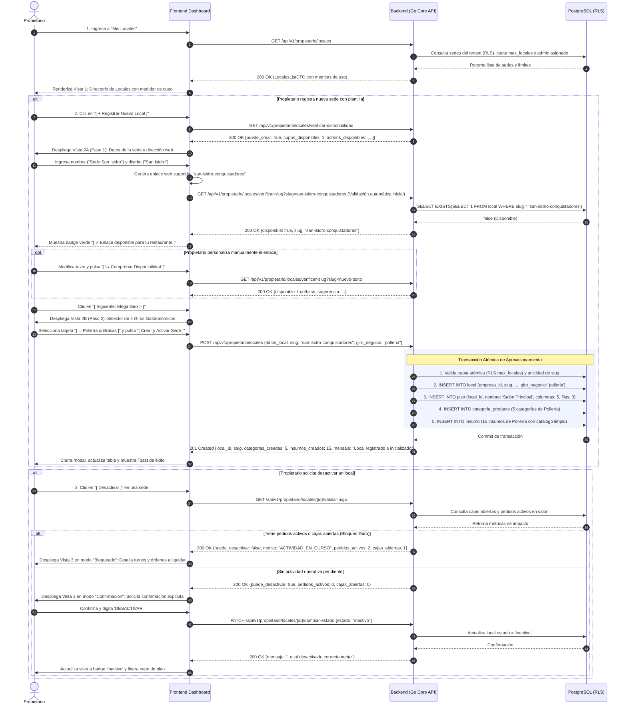
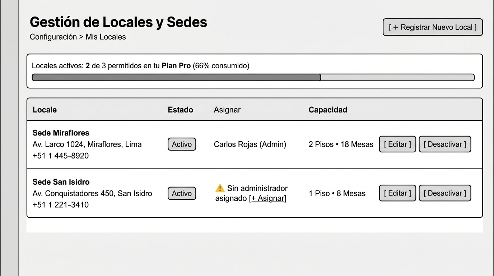
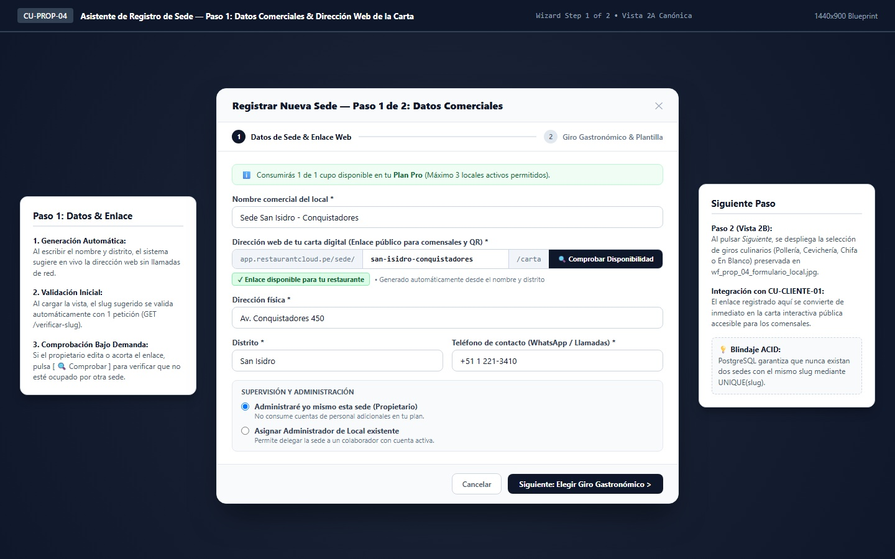
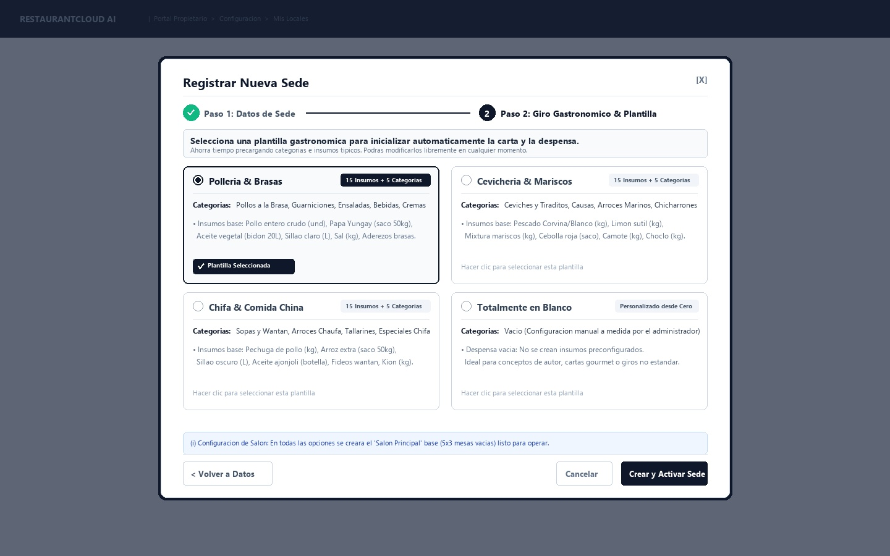
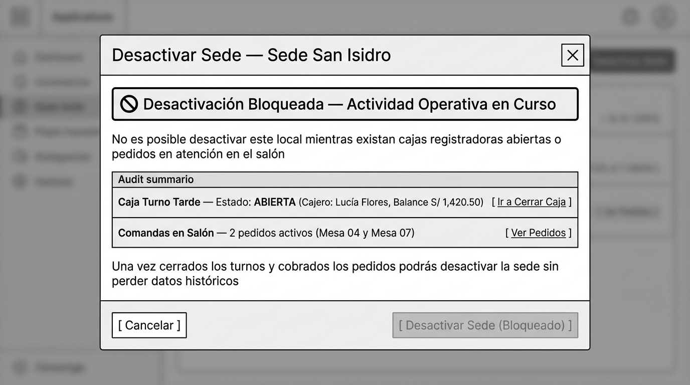

# CU-PROP-04: Registrar y Administrar Locales

Especificación técnica de interfaz de usuario, arquitectura de información, estados UX y contratos de API para la gestión del directorio de sedes operativas en **RestaurantCloud AI**.

---

## 1. Ficha Técnica del Caso de Uso

| Atributo | Detalle |
| :--- | :--- |
| **Código CU** | `CU-PROP-04` |
| **Nombre** | Registrar y administrar locales |
| **Actor(es)** | `propietario` (único rol con potestad corporativa para crear o dar de baja sedes de la empresa) |
| **Dispositivo / Viewport** | Responsive Desktop (`1440x900`), Tablet (`768x1024`), Mobile (`375x812`) |
| **Precondición** | La empresa está activa y el propietario inició sesión en la plataforma. |
| **Postcondición** | Nueva sede creada y lista para configurar mesas (`CU-LOCAL-02`), o sede existente editada, desactivada o reactivada en la base de datos. |

---

## 2. Diagrama de Flujo y Secuencia



---

## 3. Wireframes Estructurales y Layout

> [!NOTE]
> Los wireframes siguen el patrón arquitectural blueprint en escala de grises, priorizando jerarquía de información, ergonomía operativa y accesibilidad WCAG 2.1 AA sin distractores cosméticos.

---

### 3.1 Vista 1: Directorio de Locales y Medidor de Cupo

Muestra la lista de sedes de la empresa, el estado operativo de cada una, el administrador asignado y el consumo actual respecto al límite del plan.

#### Distribución Estructural (Layout ASCII)
```text
+---------------------------------------------------------------------------------------------------+
|  Topbar: [LOGO] Restaurante: El Tenedor S.A.C.                             Manuel García [Salir]   |
+---------------------------------------------------------------------------------------------------+
|  Configuración > Mis Locales                                                                      |
|  Gestión de Locales y Sedes                                             [ + Registrar Nuevo Local ]|
|                                                                                                   |
|  +---------------------------------------------------------------------------------------------+  |
|  | Locales activos: 2 de 3 permitidos en tu Plan Pro (66% consumido)                           |  |
|  | [=======================================================                     ]              |  |
|  +---------------------------------------------------------------------------------------------+  |
|                                                                                                   |
|  +---------------------------------------------------------------------------------------------+  |
|  | Local / Sede         | Estado   | Asignación de Admin        | Capacidad      | Acciones      |  |
|  |----------------------|----------|----------------------------|----------------|---------------|  |
|  | Sede Miraflores      | [Activo] | Carlos Rojas (Admin)       | 2 Pisos        | [ Editar ]    |  |
|  | Av. Larco 1024, Lima |          |                            | 18 Mesas       | [ Desactivar ]|  |
|  | +51 1 445-8920       |          |                            |                |               |  |
|  |----------------------|----------|----------------------------|----------------|---------------|  |
|  | Sede San Isidro      | [Activo] | ⚠️ Sin administrador        | 1 Piso         | [ Editar ]    |  |
|  | Av. Conquistadores   |          | asignado [ + Asignar ]     | 8 Mesas        | [ Desactivar ]|  |
|  | +51 1 221-3410       |          |                            |                |               |  |
|  +---------------------------------------------------------------------------------------------+  |
+---------------------------------------------------------------------------------------------------+
```

#### Blueprint Visual


#### Jerarquía de Componentes y Accesibilidad
- **Barra de Progreso de Cuota:** Elemento `role="progressbar"` con atributos `aria-valuenow="2"`, `aria-valuemin="0"`, `aria-valuemax="3"`.
- **Botón de Alta Condicionado:** Si `locales_activos == max_locales`, el botón `[ + Registrar Nuevo Local ]` se muestra deshabilitado con un badge adjunto: *"Límite de plan alcanzado (3/3). [Mejorar a Enterprise]"*.
- **Indicador de Falta de Administrador:** La etiqueta `⚠️ Sin administrador asignado` utiliza `role="status"` y no frena la operativa; enlaza directamente con `CU-PROP-05`.

---

### 3.2 Vista 2A: Asistente de Registro — Paso 1: Datos de la Sede & Dirección Web de la Carta (`wf_prop_04_paso1_datos_enlace_web.jpg`)

Modal guiado (Etapa 1 de 2) para ingresar los datos comerciales, teléfono de contacto y configurar la **dirección web pública de la carta digital** con validación predictiva contra redundancias.

#### Distribución Estructural — Paso 1: Datos de la Sede & Dirección Web (Layout ASCII)
```text
+-----------------------------------------------------------------------------------+
|  [ Fondo difuminado / Backdrop ]                                                  |
|                                                                                   |
|  +-----------------------------------------------------------------------------+  |
|  | Registrar Nueva Sede — Paso 1 de 2: Datos Comerciales                  [X]  |  |
|  | [ (1) Datos de Sede ● ] ---------------------- [ (2) Giro Gastronómico ○ ]    |  |
|  |-----------------------------------------------------------------------------|  |
|  |  (i) Consumirás 1 de 1 cupo disponible en tu Plan Pro (Máximo 3 locales)    |  |
|  |                                                                             |  |
|  |  Nombre comercial del local *                                               |  |
|  |  [ Sede San Isidro - Conquistadores                                      ]  |  |
|  |                                                                             |  |
|  |  Dirección web de tu carta digital (Enlace público para comensales y QR) *  |  |
|  |  +-----------------------------------------------------+------------------+ |  |
|  |  | app.restaurantcloud.pe/sede/[ san-isidro-conq... ]  | [ 🔍 Comprobar ] | |  |
|  |  +-----------------------------------------------------+------------------+ |  |
|  |  [ ✓ Enlace disponible para tu restaurante ]                                |  |
|  |                                                                             |  |
|  |  Dirección física *                                                         |  |
|  |  [ Av. Conquistadores 450                                                ]  |  |
|  |                                                                             |  |
|  |  Distrito *                                 Teléfono de contacto *          |  |
|  |  [ San Isidro                            ]  [ +51 1 221-3410             ]  |  |
|  |                                                                             |  |
|  |  +-----------------------------------------------------------------------+  |  |
|  |  | Supervisión del Local                                                 |  |  |
|  |  | (•) Administraré yo mismo esta sede (Propietario)                      |  |  |
|  |  |     No consume cuentas de personal adicionales                        |  |  |
|  |  | ( ) Asignar Administrador de Local existente                          |  |  |
|  |  +-----------------------------------------------------------------------+  |  |
|  |-----------------------------------------------------------------------------|  |
|  |                                    [ Cancelar ]  [ Siguiente: Elegir Giro >]|  |
|  +-----------------------------------------------------------------------------+  |
+-----------------------------------------------------------------------------------+
```

#### Blueprint Visual — Paso 1


---

### 3.3 Vista 2B: Asistente de Registro — Paso 2: Giro Gastronómico & Plantilla Inicial (`wf_prop_04_formulario_local.jpg`)

Modal guiado (Etapa 2 de 2) para seleccionar la plantilla culinaria base que aprovisiona automáticamente ambientes, categorías de carta e insumos de inventario.

#### Distribución Estructural — Paso 2: Giro Gastronómico & Plantilla Inicial (Layout ASCII)
```text
+-----------------------------------------------------------------------------------+
|  [ Fondo difuminado / Backdrop ]                                                  |
|                                                                                   |
|  +-----------------------------------------------------------------------------+  |
|  | Registrar Nueva Sede — Paso 2 de 2: Giro Gastronómico                  [X]  |  |
|  | [ (1) Datos de Sede ✓ ] ---------------------- [ (2) Giro Gastronómico ● ]    |  |
|  |-----------------------------------------------------------------------------|  |
|  |  Elige una plantilla para inicializar automáticamente la carta e inventario |  |
|  |  de tu local. Podrás personalizar todo libremente en cualquier momento.     |  |
|  |                                                                             |  |
|  |  +-----------------------------------+   +--------------------------------+  |  |
|  |  | [•] 🍗 Pollería & Brasas          |   | [ ] 🐟 Cevichería & Mariscos   |  |  |
|  |  | Categorías: Pollos, Guarniciones, |   | Categorías: Ceviches, Causas,  |  |  |
|  |  | Ensaladas, Bebidas y Cremas       |   | Arroces marinos, Chicharrones  |  |  |
|  |  | Insumos: Pollo, papa, aderezos... |   | Insumos: Pescado, limón, maris.|  |  |
|  |  +-----------------------------------+   +--------------------------------+  |  |
|  |                                                                             |  |
|  |  +-----------------------------------+   +--------------------------------+  |  |
|  |  | [ ] 🥢 Chifa & Comida China       |   | [ ] ⚪ Totalmente en Blanco    |  |  |
|  |  | Categorías: Wantanes, Chaufa,     |   | Sin categorías ni insumos.     |  |  |
|  |  | Tallarines, Platos Especiales     |   | Ideal para conceptos únicos    |  |  |
|  |  | Insumos: Pechuga, arroz, sillao...|   | o cartas personalizadas desde 0|  |  |
|  |  +-----------------------------------+   +--------------------------------+  |  |
|  |                                                                             |  |
|  |  (i) En todas las opciones se creará el ambiente inicial "Salón Principal"  |  |
|  |      con cuadrícula base 5x3 mesas listo para operar.                       |  |
|  |-----------------------------------------------------------------------------|  |
|  |                                 [ < Volver a Datos ]  [ Crear y Activar Sede]  |  |
|  +-----------------------------------------------------------------------------+  |
+-----------------------------------------------------------------------------------+
```

#### Blueprint Visual — Paso 2 (Preservado Intacto)


#### Comportamiento Funcional y Validaciones
1. **Mercado Peruano Específico:** Zona horaria fijada automáticamente en `America/Lima (UTC-5)` y moneda en Soles (`PEN - S/`).
2. **Validación Telefónica:** Valida formato de línea fija (`01 445-8920`) o celular (`9XX XXX XXX`).
3. **Dirección Web de la Carta Digital (Slug):**
   - **Autogeneración en memoria:** Combina reactivamente `slugify(nombre) + "-" + slugify(distrito)`.
   - **Comprobación inicial:** Valida automáticamente en segundo plano la sugerencia por defecto mostrando `[ ✓ Enlace disponible para tu restaurante ]`.
   - **Personalización bajo demanda:** Si el usuario edita el texto, el estado pasa a pendiente y se habilita el botón `[ 🔍 Comprobar Disponibilidad ]`, evitando tráfico repetitivo en red.
4. **Desacoplamiento de Personal:** El Propietario puede crear sedes sin necesidad de haber contratado o asignado previamente un administrador.
5. **Giro Gastronómico Cerrado (4 Opciones):** `polleria`, `cevicheria`, `chifa`, `en_blanco`.
6. **Aprovisionamiento Atómico:**
   - Para `polleria`, `cevicheria` y `chifa`: genera de inmediato "Salón Principal" (5x3), sus 5 categorías de carta y 15 insumos iniciales de almacén.
   - Para `en_blanco`: genera "Salón Principal" (5x3) con carta y almacén vacíos para configuración manual.

---

### 3.4 Vista 3: Modal de Auditoría y Desactivación con Bloqueo Duro

Aplica una estricta política de protección operativa: si existen comandas activas o cajas abiertas, la baja queda completamente inhabilitada para prevenir descuadres y fraude.

#### Distribución Estructural (Layout ASCII)
```text
+-----------------------------------------------------------------------------------+
|  [ Fondo difuminado / Backdrop ]                                                  |
|                                                                                   |
|  +-----------------------------------------------------------------------------+  |
|  | Desactivar Sede — Sede San Isidro                                      [X]  |  |
|  |-----------------------------------------------------------------------------|  |
|  |  [🚫] Desactivación Bloqueada — Actividad Operativa en Curso               |  |
|  |                                                                             |  |
|  |  No es posible desactivar este local mientras existan cajas registradoras   |  |
|  |  abiertas o pedidos en atención en el salón.                                |  |
|  |                                                                             |  |
|  |  +-----------------------------------------------------------------------+  |  |
|  |  | Auditoría Operativa en Tiempo Real                                   |  |  |
|  |  | Caja Turno Tarde — Estado: ABIERTA (Cajero: Lucía F., S/ 1,420.50)    |  |  |
|  |  | [ Ir a Cerrar Caja ]                                                  |  |  |
|  |  |-----------------------------------------------------------------------|  |  |
|  |  | Comandas en Salón — 2 pedidos activos (Mesa 04 y Mesa 07)             |  |  |
|  |  | [ Ver Pedidos en Salón ]                                              |  |  |
|  |  +-----------------------------------------------------------------------+  |  |
|  |                                                                             |  |
|  |  (i) Una vez cerrados los turnos y cobrados los pedidos podrás desactivar   |  |
|  |      la sede sin perder datos históricos ni reportes de ventas.             |  |
|  |-----------------------------------------------------------------------------|  |
|  |                                     [ Cancelar ]  [ Desactivar (Bloqueado) ]|  |
|  +-----------------------------------------------------------------------------+  |
+-----------------------------------------------------------------------------------+
```

#### Blueprint Visual


---

## 4. Matriz de Estados UX (5 Estados Canónicos)

| Estado | Vista 1: Directorio de Locales | Vista 2: Formulario Modal de Sede (Paso 1 y Paso 2) | Vista 3: Modal de Desactivación |
| :--- | :--- | :--- | :--- |
| **1. Ideal (Happy Path)** | Lista de locales renderizada, barra de cuota con espacio disponible (ej. 2/3), acciones de edición y baja operativas. | Formulario limpio con placeholders y auto-administración preseleccionada. Dirección web de la carta digital autogenerada reactivamente (`slugify(nombre) + "-" + slugify(distrito)`) y validada automáticamente en segundo plano (`[ ✓ Enlace disponible para tu restaurante ]`). | Sin órdenes ni cajas abiertas: mensaje de confirmación pidiendo digitar 'DESACTIVAR' y botón activo. |
| **2. Vacío (Empty State)** | Si es la primera vez que ingresa (caso anómalo de 0 locales): *"No tienes sedes registradas. [Registrar tu primera sede]"*. | Selector de administradores existentes vacío si todos están ocupados. | N/A (Solo abre sobre una sede existente). |
| **3. Carga (Loading)** | Skeleton animado en las filas de la tabla mientras resuelve `GET /locales`. | Spinner en botón de comprobación: *"Comprobando disponibilidad..."* y en guardado: *"Verificando cupos y aprovisionando sede..."*. | Spinner en modal mientras audita cajas y pedidos: *"Verificando estado operativo de la sede..."*. |
| **4. Error / Validación** | Error de red: *"No pudimos cargar tus locales. [Reintentar]"*. | - Dirección web duplicada (`LOCAL_SLUG_DUPLICADO`): muestra badge de alerta con botón de 1 clic `[ Usar Sugerencia ]` (ej. `san-isidro-conquistadores-2`).<br>- Dirección web editada manualmente sin comprobar: botón `[ Siguiente: Elegir Giro > ]` inhabilitado hasta pulsar `[ 🔍 Comprobar Disponibilidad ]`.<br>- Nombre de sede duplicado en la misma empresa.<br>- Teléfono inválido.<br>- Campos obligatorios vacíos. | Si ocurre un error al auditar el local: *"Error al comprobar turnos de caja. Reintente en unos momentos"*. |
| **5. Borde / Inesperado (Edge Cases)** | - **Límite de Plan alcanzado (3/3):** Botón `[ + Registrar Local ]` deshabilitado con tooltip hacia `CU-PROP-03`.<br>- **Congelamiento por Downgrade:** Si hay un cambio a Starter (máx 1 local) programado, no permite crear nuevos locales.<br>- **Regla de Sede Única:** Si solo queda 1 local activo, el botón `[ Desactivar ]` se deshabilita: *"No puedes desactivar la única sede activa de tu restaurante"*. | Si justo al enviar el formulario otro administrador ocupó el cupo: Error `LOCAL_LIMITE_PLAN_ALCANZADO`. Si otra sede tomó la misma dirección web en milisegundos concurrentes: Error 409 `LOCAL_SLUG_DUPLICADO` con sugerencia inmediata. | **Bloqueo Duro Activo:** Muestra cajas abiertas y pedidos en salón con enlaces directos para liquidarlos antes de permitir la desactivación. |

---

## 5. Contratos de API (Frontend ↔ Backend Go)

Todos los contratos utilizan el envoltorio estándar `apiresponse.Response` definido en [`context/mock.md`](file:///j:/proyectos_git/RestaurantCloud_AI_backend/context/mock.md).

---

### 5.1 Endpoint 1: Listar Directorio de Locales del Tenant

Obtiene todas las sedes activas e inactivas de la empresa junto con el consumo de cuota del plan contratado y sus enlaces públicos de carta digital.

- **Método:** `GET`
- **Ruta:** `/api/v1/propietario/locales`
- **Headers:** `Authorization: Bearer <jwt_propietario>`

#### Response 200 OK
```json
{
  "exito": true,
  "datos": {
    "cuota_plan": {
      "plan_id": 2,
      "plan_nombre": "Pro",
      "locales_permitidos": 3,
      "locales_activos": 2,
      "cupos_disponibles": 1,
      "limite_alcanzado": false,
      "downgrade_programado": false
    },
    "locales": [
      {
        "id": "loc-1111-aaaa-bbbb-cccc",
        "nombre": "Sede Miraflores",
        "slug": "sede-miraflores",
        "url_carta_digital": "https://app.restaurantcloud.pe/carta/sede-miraflores",
        "direccion": "Av. Larco 1024",
        "distrito": "Miraflores",
        "ciudad": "Lima",
        "telefono": "+51 1 445-8920",
        "estado": "activo",
        "administrador": {
          "id": "usr-adm-01",
          "nombre": "Carlos Rojas",
          "correo": "carlos.rojas@tenedor.pe"
        },
        "metricas": {
          "total_pisos": 2,
          "total_mesas": 18
        },
        "puede_desactivar": true
      },
      {
        "id": "loc-2222-aaaa-bbbb-cccc",
        "nombre": "Sede San Isidro",
        "slug": "san-isidro-conquistadores",
        "url_carta_digital": "https://app.restaurantcloud.pe/carta/san-isidro-conquistadores",
        "direccion": "Av. Conquistadores 450",
        "distrito": "San Isidro",
        "ciudad": "Lima",
        "telefono": "+51 1 221-3410",
        "estado": "activo",
        "administrador": null,
        "metricas": {
          "total_pisos": 1,
          "total_mesas": 8
        },
        "puede_desactivar": true
      }
    ]
  },
  "meta": {
    "timestamp": "2026-10-02T19:40:00Z"
  }
}
```

---

### 5.2 Endpoint 2: Verificar Disponibilidad y Datos Previos para Alta

Permite al frontend saber si puede abrir el formulario y cargar los administradores disponibles para asignación.

- **Método:** `GET`
- **Ruta:** `/api/v1/propietario/locales/verificar-disponibilidad`
- **Headers:** `Authorization: Bearer <jwt_propietario>`

#### Response 200 OK
```json
{
  "exito": true,
  "datos": {
    "puede_crear": true,
    "cupos_disponibles": 1,
    "max_permitido": 3,
    "administradores_disponibles": [
      {
        "id": "usr-adm-02",
        "nombre": "Pedro Castillo",
        "correo": "pedro.c@tenedor.pe"
      }
    ]
  },
  "meta": {
    "timestamp": "2026-10-02T19:40:15Z"
  }
}
```

---

### 5.3 Endpoint 3: Comprobar Disponibilidad de Dirección Web de Carta Digital (Slug)

Verifica si una dirección web propuesta está libre en la plataforma. Si existe colisión, retorna una sugerencia alternativa lista para ser adoptada con 1 clic en la interfaz.

- **Método:** `GET`
- **Ruta:** `/api/v1/propietario/locales/verificar-slug?slug={slug}`
- **Headers:** `Authorization: Bearer <jwt_propietario>`

#### Response 200 OK — Dirección Disponible
```json
{
  "exito": true,
  "datos": {
    "slug": "san-isidro-conquistadores",
    "disponible": true,
    "sugerencia": null,
    "mensaje": "Enlace disponible para tu restaurante."
  },
  "meta": {
    "timestamp": "2026-10-02T19:40:20Z"
  }
}
```

#### Response 200 OK — Dirección Ocupada (Colisión con Sugerencia)
```json
{
  "exito": true,
  "datos": {
    "slug": "san-isidro-conquistadores",
    "disponible": false,
    "sugerencia": "san-isidro-conquistadores-2",
    "mensaje": "Esta dirección web ya está en uso. Puedes usar la sugerencia generada."
  },
  "meta": {
    "timestamp": "2026-10-02T19:40:22Z"
  }
}
```

---

### 5.4 Endpoint 4: Registrar Nueva Sede / Local

Registra un local validando atómicamente la cuota del plan bajo RLS y asignando la dirección web única para la carta digital.

- **Método:** `POST`
- **Ruta:** `/api/v1/propietario/locales`
- **Headers:** `Authorization: Bearer <jwt_propietario>`

#### Request Body
```json
{
  "nombre": "Sede San Isidro - Conquistadores",
  "slug": "san-isidro-conquistadores",
  "direccion": "Av. Conquistadores 450",
  "distrito": "San Isidro",
  "ciudad": "Lima",
  "telefono": "+51 1 221-3410",
  "modo_administracion": "propietario",
  "administrador_usuario_id": null,
  "giro_negocio": "polleria"
}
```

#### Response 201 Created
```json
{
  "exito": true,
  "datos": {
    "id": "loc-2222-aaaa-bbbb-cccc",
    "nombre": "Sede San Isidro - Conquistadores",
    "slug": "san-isidro-conquistadores",
    "url_carta_digital": "https://app.restaurantcloud.pe/carta/san-isidro-conquistadores",
    "giro_negocio": "polleria",
    "estado": "activo",
    "zona_horaria": "America/Lima",
    "moneda": "PEN",
    "administrador_asignado": false,
    "resumen_inicializacion": {
      "pisos_creados": 1,
      "piso_nombre": "Salón Principal",
      "categorias_creadas": 5,
      "insumos_creados": 15
    },
    "mensaje": "Sede registrada exitosamente y catálogo inicial de Pollería & Brasas aprovisionado."
  },
  "meta": {
    "timestamp": "2026-10-02T19:40:30Z"
  }
}
```

---

### 5.5 Endpoint 5: Actualizar Datos de una Sede Existente

Modifica los datos comerciales, teléfono de contacto y dirección web de un local.

- **Método:** `PUT`
- **Ruta:** `/api/v1/propietario/locales/{id}`
- **Headers:** `Authorization: Bearer <jwt_propietario>`

#### Request Body
```json
{
  "nombre": "Sede San Isidro Gourmet",
  "slug": "san-isidro-gourmet",
  "direccion": "Av. Conquistadores 450, Interior 2",
  "distrito": "San Isidro",
  "ciudad": "Lima",
  "telefono": "+51 1 221-3499",
  "administrador_usuario_id": "usr-adm-02"
}
```

#### Response 200 OK
```json
{
  "exito": true,
  "datos": {
    "id": "loc-2222-aaaa-bbbb-cccc",
    "nombre": "Sede San Isidro Gourmet",
    "slug": "san-isidro-gourmet",
    "url_carta_digital": "https://app.restaurantcloud.pe/carta/san-isidro-gourmet",
    "estado": "activo",
    "mensaje": "Datos del local actualizados exitosamente."
  },
  "meta": {
    "timestamp": "2026-10-02T19:40:45Z"
  }
}
```

---

### 5.6 Endpoint 6: Validar Viabilidad Operativa de Baja (Auditoría de Bloqueo Duro)

Verifica en tiempo real si el local puede desactivarse o si tiene cajas abiertas o pedidos en curso.

- **Método:** `GET`
- **Ruta:** `/api/v1/propietario/locales/{id}/validar-baja`
- **Headers:** `Authorization: Bearer <jwt_propietario>`

#### Response 200 OK (Caso Bloqueo Duro)
```json
{
  "exito": true,
  "datos": {
    "local_id": "loc-2222-aaaa-bbbb-cccc",
    "nombre": "Sede San Isidro",
    "puede_desactivar": false,
    "es_ultimo_local_activo": false,
    "bloqueos_operativos": [
      {
        "tipo": "CAJA_ABIERTA",
        "descripcion": "Caja Turno Tarde se encuentra ABIERTA",
        "responsable": "Lucía Flores (Cajero)",
        "monto_acumulado": 1420.50,
        "sesion_id": "caj-ses-9988"
      },
      {
        "tipo": "PEDIDOS_ACTIVOS",
        "descripcion": "Existen 2 pedidos pendientes de atención o cobro en el salón",
        "mesas_afectadas": ["Mesa 04", "Mesa 07"]
      }
    ],
    "aviso": "Debes cerrar todas las sesiones de caja y liquidar los pedidos en comanda antes de desactivar la sede."
  },
  "meta": {
    "timestamp": "2026-10-02T19:41:00Z"
  }
}
```

#### Response 200 OK (Caso Limpio / Desactivable)
```json
{
  "exito": true,
  "datos": {
    "local_id": "loc-2222-aaaa-bbbb-cccc",
    "nombre": "Sede San Isidro",
    "puede_desactivar": true,
    "es_ultimo_local_activo": false,
    "bloqueos_operativos": [],
    "aviso": "La sede no tiene actividad operativa en curso. Puedes desactivarla de forma segura sin perder datos históricos."
  },
  "meta": {
    "timestamp": "2026-10-02T19:41:15Z"
  }
}
```

---

### 5.7 Endpoint 7: Cambiar Estado de un Local (Desactivar / Reactivar)

Conmuta el local entre `'activo'` e `'inactivo'` sin pérdida física de registros.

- **Método:** `PATCH`
- **Ruta:** `/api/v1/propietario/locales/{id}/cambiar-estado`
- **Headers:** `Authorization: Bearer <jwt_propietario>`

#### Request Body
```json
{
  "nuevo_estado": "inactivo",
  "codigo_confirmacion": "DESACTIVAR"
}
```

#### Response 200 OK
```json
{
  "exito": true,
  "datos": {
    "id": "loc-2222-aaaa-bbbb-cccc",
    "nombre": "Sede San Isidro",
    "estado": "inactivo",
    "cupos_plan_liberados": 1,
    "mensaje": "La sede ha sido desactivada. Puedes reactivarla en cualquier momento desde tu panel."
  },
  "meta": {
    "timestamp": "2026-10-02T19:41:30Z"
  }
}
```

---

## 6. Manejo de Errores y Códigos de Negocio (`AppError`)

| Código de Error | HTTP Status | Causa y Solución para el Usuario |
| :--- | :--- | :--- |
| `LOCAL_SLUG_DUPLICADO` | 409 Conflict | La dirección web de la carta digital ya está en uso por otro restaurante. El usuario puede aceptar la sugerencia generada o personalizarla. |
| `LOCAL_SLUG_FORMATO_INVALIDO` | 422 Unprocessable | La dirección web contiene caracteres inválidos. Solo se admiten letras minúsculas sin acentos, números y guiones medios (longitud mínima 3, máxima 100 caracteres). |
| `LOCAL_LIMITE_PLAN_ALCANZADO` | 403 Forbidden | La empresa ya alcanzó el máximo de locales activos permitidos por su plan. Debe mejorar su suscripción en `CU-PROP-03`. |
| `LOCAL_DOWNGRADE_CONGELAMIENTO_ACTIVO` | 409 Conflict | Existe un downgrade programado con límite inferior. Debe cancelar el downgrade para expandir locales. |
| `LOCAL_UNICO_ACTIVO_NO_PUEDE_DESACTIVARSE` | 422 Unprocessable | Es el único local activo de la empresa. Una empresa no puede quedarse con 0 locales activos. |
| `LOCAL_DESACTIVACION_BLOQUEADA_CAJAS_ABIERTAS` | 422 Unprocessable | La sede tiene al menos un turno de caja abierto. Debe cerrarse la caja antes de continuar. |
| `LOCAL_DESACTIVACION_BLOQUEADA_PEDIDOS_ACTIVOS` | 422 Unprocessable | Existen mesas con pedidos en comanda o sin cobrar en salón. Deben cerrarse las cuentas. |
| `LOCAL_NOMBRE_DUPLICADO` | 409 Conflict | Ya existe una sede registrada con ese mismo nombre en la empresa. |
| `LOCAL_NO_ENCONTRADO` | 404 Not Found | El identificador del local no existe o pertenece a otro tenant. |

---

## 7. Consideraciones Técnicas y de Base de Datos

1. **Aislamiento Multi-Tenant (RLS):**  
   Toda consulta a la tabla `local` está protegida por `local.empresa_id = current_setting('app.tenant_id')::uuid`. Ningún propietario puede ver ni modificar locales de otra empresa.
2. **Validación Atómica de Cupo:**  
   Al ejecutar `POST /locales`, el backend realiza un bloqueo a nivel de fila (`SELECT ... FOR UPDATE` sobre la suscripción) para evitar que dos solicitudes simultáneas rompan el límite `max_locales`.
3. **Preservación No Destructiva (*Soft-Deactivation*):**  
   Desactivar un local nunca elimina registros de las tablas `piso`, `mesa`, `pedido`, `caja_sesion` o `comprobante`. La integridad referencial histórica y contable de auditoría se mantiene al 100%.
4. **Desacoplamiento de Roles:**  
   El campo `usuario.local_id` vincula al administrador con su local. Si el local se desactiva, el usuario administrador permanece en la base de datos pero sus intentos de iniciar sesión son rechazados con el mensaje: *"Tu sede asignada se encuentra actualmente inactiva"*.
5. **Unicidad Global del Enlace Web (`local.slug`):**  
   A diferencia de las tablas multi-tenant cuya clave única se compone con `(empresa_id, ...)`, el campo `local.slug` posee una restricción global `UNIQUE(slug)` en PostgreSQL y un índice B-Tree dedicado `idx_local_slug`. Esto permite resolver rutas públicas limpias (`https://app.restaurantcloud.pe/carta/{slug}`) para los comensales en `CU-CLIENTE-01` sin requerir IDs opacos ni autenticación.
