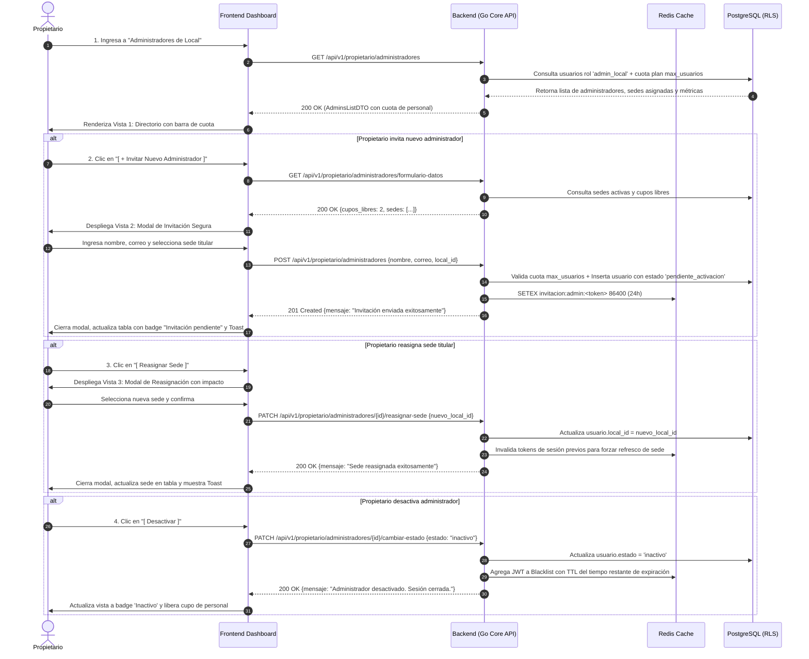
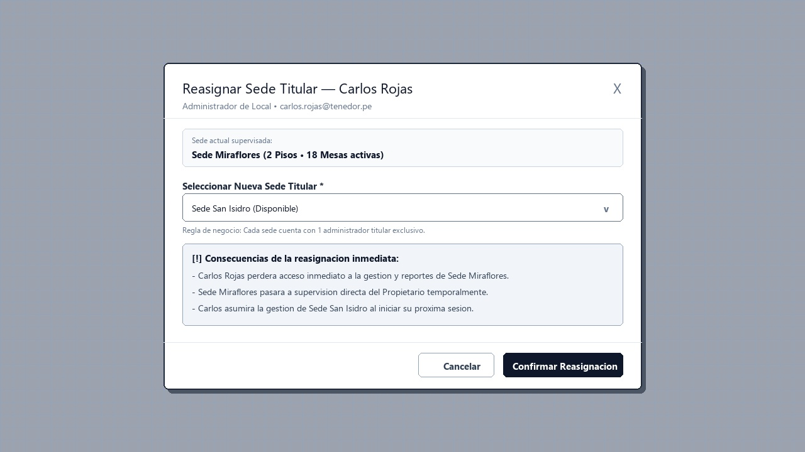

# CU-PROP-05: Crear y Gestionar Administradores de Local

Especificación técnica de interfaz de usuario, arquitectura de información, estados UX y contratos de API para la gestión del personal administrativo de sede en **RestaurantCloud AI**.

---

## 1. Ficha Técnica del Caso de Uso

| Atributo | Detalle |
| :--- | :--- |
| **Código CU** | `CU-PROP-05` |
| **Nombre** | Crear y gestionar administradores de local |
| **Actor(es)** | `propietario` (único rol con potestad corporativa para nombrar o destituir administradores de sede) |
| **Dispositivo / Viewport** | Responsive Desktop (`1440x900`), Tablet (`768x1024`), Mobile (`375x812`) |
| **Precondición** | La empresa tiene al menos una sede activa registrada (`CU-PROP-04`) y el propietario tiene sesión iniciada. |
| **Postcondición** | Invitación enviada con token seguro por correo, cuenta activada con contraseña elegida por el administrador, sede titular asignada o credenciales revocadas en Redis. |

---

## 2. Diagrama de Flujo y Secuencia



---

## 3. Wireframes Estructurales y Layout

> [!NOTE]
> Los wireframes siguen el patrón arquitectural blueprint en escala de grises, priorizando jerarquía de información, ergonomía operativa y accesibilidad WCAG 2.1 AA sin distractores cosméticos.

---

### 3.1 Vista 1: Directorio de Administradores y Medidor de Cupo de Personal

Permite monitorear las cuentas administrativas activas, la sede titular asignada y la cuota consumida de cuentas de personal (`max_usuarios`).

#### Distribución Estructural (Layout ASCII)
```text
+---------------------------------------------------------------------------------------------------+
|  Topbar: [LOGO] Restaurante: El Tenedor S.A.C.                             Manuel García [Salir]   |
+---------------------------------------------------------------------------------------------------+
|  Configuración > Personal > Administradores                                                       |
|  Gestión de Administradores de Local                               [ + Invitar Nuevo Administrador]|
|                                                                                                   |
|  +---------------------------------------------------------------------------------------------+  |
|  | Personal activo: 8 de 10 cuentas permitidas en tu Plan Pro (2 cupos disponibles)            |  |
|  | [=======================================================                     ]              |  |
|  +---------------------------------------------------------------------------------------------+  |
|                                                                                                   |
|  +---------------------------------------------------------------------------------------------+  |
|  | Administrador / Correo       | Sede Titular   | Estado             | Último Login | Acciones    |  |
|  |------------------------------|----------------|--------------------|--------------|-------------|  |
|  | [Avatar] Carlos Rojas        | Sede           | [ Activo ]         | Hoy 14:20    | [Reasignar] |  |
|  | carlos.rojas@tenedor.pe      | Miraflores     |                    |              | [Desactivar]|  |
|  |------------------------------|----------------|--------------------|--------------|-------------|  |
|  | [Avatar] David Méndez        | Sede           | [ Invitación       | Expira en    | [Reenviar]  |  |
|  | david.m@tenedor.pe           | San Isidro     |   pendiente ]      | 18 horas     | [Cancelar]  |  |
|  +---------------------------------------------------------------------------------------------+  |
+---------------------------------------------------------------------------------------------------+
```

#### Blueprint Visual


#### Jerarquía de Componentes y Accesibilidad
- **Barra de Progreso de Usuarios (`max_usuarios`):** Elemento accesible `role="progressbar"` indicando cuentas staff consumidas (mozos, cocineros, cajeros y administradores).
- **Insignias de Estado Semánticas:** Badge `Activo` (cuenta operativa) e `Invitación pendiente` con tooltip indicando fecha de expiración del enlace.
- **Acciones Rápidas:** Menú contextual para reasignar sede, reenviar invitación por correo o revocar acceso de inmediato.

---

### 3.2 Vista 2: Modal de Invitación Segura de Administrador

Reemplaza el envío inseguro de contraseñas por un token temporal de activación por correo electrónico.

#### Distribución Estructural (Layout ASCII)
```text
+-----------------------------------------------------------------------------------+
|  [ Fondo difuminado / Backdrop ]                                                  |
|                                                                                   |
|  +-----------------------------------------------------------------------------+  |
|  | Invitar Administrador de Local                                         [X]  |  |
|  |-----------------------------------------------------------------------------|  |
|  |  (i) Consumirás 1 de 2 cuentas de personal disponibles en tu Plan Pro       |  |
|  |                                                                             |  |
|  |  Nombre completo *                                                          |  |
|  |  [ Pedro Ramos Morales                                                   ]  |  |
|  |                                                                             |  |
|  |  Correo electrónico *                                                       |  |
|  |  [ pedro.ramos@gmail.com                                                 ]  |  |
|  |                                                                             |  |
|  |  Sede Titular a supervisar *                                                |  |
|  |  [ Sede San Isidro (Disponible)                                         v]  |  |
|  |  Regla de negocio: 1 administrador titular por sede                         |  |
|  |                                                                             |  |
|  |  +-----------------------------------------------------------------------+  |  |
|  |  | [🔒] Invitación Segura — Se enviará un enlace de activación por correo|  |  |
|  |  |     electrónico válido por 24 horas para que el administrador cree su |  |  |
|  |  |     contraseña personal.                                              |  |  |
|  |  +-----------------------------------------------------------------------+  |  |
|  |-----------------------------------------------------------------------------|  |
|  |                                       [ Cancelar ]  [ Enviar Invitación ]   |  |
|  +-----------------------------------------------------------------------------+  |
+-----------------------------------------------------------------------------------+
```

#### Blueprint Visual


#### Comportamiento Funcional y Seguridad
1. **Unicidad de Administrador Titular:** El selector de sede indica qué sedes están disponibles y cuáles ya tienen un administrador asignado.
2. **Activación Asistida:** El correo no contiene contraseñas provisionales. El enlace conduce a una pantalla protegida (`/activar-cuenta?token=...`) para definir su propia clave con validación de fortaleza (`CU-AUTH-02`).
3. **Persistencia Efímera en Redis:** El token de activación se almacena con clave `invitacion:admin:<token>` con TTL de 24 horas (`86400s`) y consumo atómico (`GETDEL`).

---

### 3.3 Vista 3: Modal de Reasignación de Sede Titular (1:1)

Permite transferir la supervisión operativa de un administrador de una sede a otra informando el impacto en permisos de forma transparente.

#### Distribución Estructural (Layout ASCII)
```text
+-----------------------------------------------------------------------------------+
|  [ Fondo difuminado / Backdrop ]                                                  |
|                                                                                   |
|  +-----------------------------------------------------------------------------+  |
|  | Reasignar Sede Titular — Carlos Rojas                                  [X]  |  |
|  | Administrador de Local • carlos.rojas@tenedor.pe                           |  |
|  |-----------------------------------------------------------------------------|  |
|  |  +-----------------------------------------------------------------------+  |  |
|  |  | Sede actual supervisada:                                              |  |  |
|  |  | Sede Miraflores (2 Pisos • 18 Mesas activas)                          |  |  |
|  |  +-----------------------------------------------------------------------+  |  |
|  |                                                                             |  |
|  |  Seleccionar Nueva Sede Titular *                                           |  |
|  |  [ Sede San Isidro (Disponible)                                         v]  |  |
|  |  Regla de negocio: Cada sede cuenta con 1 administrador titular exclusivo.  |  |
|  |                                                                             |  |
|  |  +-----------------------------------------------------------------------+  |  |
|  |  | [!] Consecuencias de la reasignación inmediata:                      |  |  |
|  |  | • Carlos Rojas perderá acceso a la gestión de Sede Miraflores.        |  |  |
|  |  | • Sede Miraflores pasará a supervisión directa del Propietario.      |  |  |
|  |  | • Carlos asumirá la gestión de San Isidro al iniciar su próxima sesión.|  |  |
|  |  +-----------------------------------------------------------------------+  |  |
|  |-----------------------------------------------------------------------------|  |
|  |                                 [ Cancelar ]  [ Confirmar Reasignación ]    |  |
|  +-----------------------------------------------------------------------------+  |
+-----------------------------------------------------------------------------------+
```

#### Blueprint Visual


---

## 4. Matriz de Estados UX (5 Estados Canónicos)

| Estado | Vista 1: Directorio de Admins | Vista 2: Modal de Invitación | Vista 3: Modal de Reasignación |
| :--- | :--- | :--- | :--- |
| **1. Ideal (Happy Path)** | Tabla con administradores activos y pendientes; cuota de usuarios disponible (ej. 8/10); acciones habilitadas. | Formulario limpio con sedes libres destacadas en el dropdown. | Sede disponible seleccionada y botón de confirmación activo. |
| **2. Vacío (Empty State)** | Si no hay administradores creados: *"Todos tus locales están bajo supervisión directa del Propietario. [Invitar Administrador]"*. | Si todas las sedes activas ya tienen administrador: *"Todas tus sedes tienen un administrador titular. Para nombrar otro, reasigna o registra una nueva sede"*. | N/A (Solo abre sobre un administrador existente). |
| **3. Carga (Loading)** | Skeleton animado en las filas de administradores mientras resuelve `GET /administradores`. | Spinner en botón: *"Generando token seguro y enviando correo..."*. | Spinner en botón: *"Actualizando permisos y refrescando sesiones..."*. |
| **4. Error / Validación** | Error de red: *"No pudimos cargar la lista de administradores. [Reintentar]"*. | - Correo inválido.<br>- Correo ya registrado en la empresa con otro rol (dispara diálogo de Promoción de Empleado). | Si la sede destino fue ocupada por otro administrador simultáneamente: *"La sede destino ya cuenta con administrador titular. [Refrescar]"*. |
| **5. Borde / Inesperado (Edge Cases)** | - **Límite de Personal alcanzado (10/10):** Botón `[ + Invitar ]` deshabilitado con alerta: *"Has alcanzado el límite de 10 cuentas de personal de tu Plan Pro. [Mejorar a Enterprise]"*.<br>- **Invitación expirada (> 24h):** Badge cambia a `Invitación expirada` con botón destacado `[ Reenviar Enlace ]`. | Intento de registrar al propio Propietario como admin: Error `PROPIETARIO_NO_PUEDE_SER_ADMIN_LOCAL`. | **Desactivación con sesión abierta:** Al confirmar desactivación, el token JWT del usuario se revoca de inmediato en Redis vía Blacklist. |

---

## 5. Contratos de API (Frontend ↔ Backend Go)

Todos los contratos utilizan el estándar oficial de respuesta `apiresponse.Response` definido en [`context/mock.md`](file:///j:/proyectos_git/RestaurantCloud_AI_backend/context/mock.md).

---

### 5.1 Endpoint 1: Listar Administradores de Local y Cuota de Usuarios

- **Método:** `GET`
- **Ruta:** `/api/v1/propietario/administradores`
- **Headers:** `Authorization: Bearer <jwt_propietario>`

#### Response 200 OK
```json
{
  "exito": true,
  "datos": {
    "cuota_usuarios": {
      "plan_id": 2,
      "plan_nombre": "Pro",
      "usuarios_permitidos": 10,
      "usuarios_activos": 8,
      "cupos_disponibles": 2,
      "limite_alcanzado": false
    },
    "administradores": [
      {
        "id": "usr-adm-01",
        "nombre": "Carlos Rojas",
        "correo": "carlos.rojas@tenedor.pe",
        "telefono": "+51 987 654 321",
        "estado": "activo",
        "sede_asignada": {
          "id": "loc-1111-aaaa-bbbb-cccc",
          "nombre": "Sede Miraflores"
        },
        "ultimo_login": "2026-10-02T14:20:00Z"
      },
      {
        "id": "usr-adm-02",
        "nombre": "David Méndez",
        "correo": "david.m@tenedor.pe",
        "telefono": "+51 999 111 222",
        "estado": "pendiente_activacion",
        "sede_asignada": {
          "id": "loc-2222-aaaa-bbbb-cccc",
          "nombre": "Sede San Isidro"
        },
        "invitacion_expira_en": "2026-10-03T18:00:00Z",
        "invitacion_expirada": false
      }
    ]
  },
  "meta": {
    "timestamp": "2026-10-02T20:10:00Z"
  }
}
```

---

### 5.2 Endpoint 2: Obtener Datos Previos y Sedes para Invitación

- **Método:** `GET`
- **Ruta:** `/api/v1/propietario/administradores/formulario-datos`
- **Headers:** `Authorization: Bearer <jwt_propietario>`

#### Response 200 OK
```json
{
  "exito": true,
  "datos": {
    "puede_invitar": true,
    "cupos_libres": 2,
    "sedes_disponibles": [
      {
        "id": "loc-2222-aaaa-bbbb-cccc",
        "nombre": "Sede San Isidro",
        "tiene_administrador": false,
        "administrador_actual": null
      }
    ],
    "sedes_ocupadas": [
      {
        "id": "loc-1111-aaaa-bbbb-cccc",
        "nombre": "Sede Miraflores",
        "tiene_administrador": true,
        "administrador_actual": "Carlos Rojas"
      }
    ]
  },
  "meta": {
    "timestamp": "2026-10-02T20:10:15Z"
  }
}
```

---

### 5.3 Endpoint 3: Invitar Nuevo Administrador de Local

- **Método:** `POST`
- **Ruta:** `/api/v1/propietario/administradores`
- **Headers:** `Authorization: Bearer <jwt_propietario>`

#### Request Body
```json
{
  "nombre": "Pedro Ramos Morales",
  "correo": "pedro.ramos@gmail.com",
  "telefono": "+51 912 345 678",
  "local_id": "loc-2222-aaaa-bbbb-cccc"
}
```

#### Response 201 Created
```json
{
  "exito": true,
  "datos": {
    "id": "usr-adm-03",
    "nombre": "Pedro Ramos Morales",
    "correo": "pedro.ramos@gmail.com",
    "rol": "admin_local",
    "estado": "pendiente_activacion",
    "local_id": "loc-2222-aaaa-bbbb-cccc",
    "sede_nombre": "Sede San Isidro",
    "mensaje": "Invitación enviada exitosamente por correo electrónico. El enlace expira en 24 horas."
  },
  "meta": {
    "timestamp": "2026-10-02T20:10:30Z"
  }
}
```

---

### 5.4 Endpoint 4: Reenviar Enlace de Invitación

- **Método:** `POST`
- **Ruta:** `/api/v1/propietario/administradores/{id}/reenviar-invitacion`
- **Headers:** `Authorization: Bearer <jwt_propietario>`

#### Response 200 OK
```json
{
  "exito": true,
  "datos": {
    "usuario_id": "usr-adm-02",
    "correo": "david.m@tenedor.pe",
    "nueva_expiracion": "2026-10-03T20:10:45Z",
    "mensaje": "Se ha reenviado un nuevo enlace seguro de activación por correo electrónico."
  },
  "meta": {
    "timestamp": "2026-10-02T20:10:45Z"
  }
}
```

---

### 5.5 Endpoint 5: Reasignar Sede Titular

- **Método:** `PATCH`
- **Ruta:** `/api/v1/propietario/administradores/{id}/reasignar-sede`
- **Headers:** `Authorization: Bearer <jwt_propietario>`

#### Request Body
```json
{
  "nuevo_local_id": "loc-2222-aaaa-bbbb-cccc"
}
```

#### Response 200 OK
```json
{
  "exito": true,
  "datos": {
    "usuario_id": "usr-adm-01",
    "nombre": "Carlos Rojas",
    "sede_anterior": "Sede Miraflores",
    "nueva_sede": "Sede San Isidro",
    "mensaje": "Sede reasignada exitosamente. El administrador asumirá el control de la nueva sede en su próxima sesión."
  },
  "meta": {
    "timestamp": "2026-10-02T20:11:00Z"
  }
}
```

---

### 5.6 Endpoint 6: Desactivar / Reactivar Administrador

- **Método:** `PATCH`
- **Ruta:** `/api/v1/propietario/administradores/{id}/cambiar-estado`
- **Headers:** `Authorization: Bearer <jwt_propietario>`

#### Request Body
```json
{
  "nuevo_estado": "inactivo"
}
```

#### Response 200 OK
```json
{
  "exito": true,
  "datos": {
    "usuario_id": "usr-adm-01",
    "nombre": "Carlos Rojas",
    "estado": "inactivo",
    "sesiones_revocadas": true,
    "mensaje": "Administrador desactivado exitosamente. Se revocaron sus sesiones en tiempo real."
  },
  "meta": {
    "timestamp": "2026-10-02T20:11:15Z"
  }
}
```

---

## 6. Manejo de Errores y Códigos de Negocio (`AppError`)

| Código de Error | HTTP Status | Causa y Solución para el Usuario |
| :--- | :--- | :--- |
| `PERSONAL_LIMITE_PLAN_ALCANZADO` | 403 Forbidden | La empresa ya utilizó todas las cuentas de usuario permitidas por su plan (`max_usuarios`). Debe escalar su plan en `CU-PROP-03`. |
| `ADMIN_SEDE_YA_TIENE_TITULAR` | 409 Conflict | La sede seleccionada ya cuenta con un administrador titular asignado. Cada sede solo permite 1 administrador exclusivo. |
| `ADMIN_CORREO_EXISTE_MISMA_EMPRESA` | 409 Conflict | El correo pertenece a otro usuario de la empresa. El sistema ofrece el diálogo de Promoción de Rol. |
| `ADMIN_REENVIO_EN_ENFRIAMIENTO` | 429 Too Many Requests | Se intentó reenviar el correo antes del tiempo de enfriamiento de 60 segundos. |
| `ADMIN_NO_ENCONTRADO` | 404 Not Found | El usuario no existe o pertenece a otro tenant. |
| `PROPIETARIO_NO_PUEDE_SER_ADMIN_LOCAL` | 422 Unprocessable | La cuenta del propietario tiene alcance global sobre todos los locales y no puede subordinarse a un solo local. |

---

## 7. Consideraciones Técnicas y de Base de Datos

1. **Unicidad de Correo por Tenant:**  
   La restricción relacional `UNIQUE(empresa_id, correo)` previene duplicados internos pero permite que una misma persona tenga cuentas independientes en distintos restaurantes de la plataforma.
2. **Tokens Efímeros de Activación (Redis):**  
   Los enlaces de invitación se firman criptográficamente y se registran en Redis con TTL de 24 horas: `SETEX invitacion:admin:<token> 86400 <json_datos>`. Al consumirse, se eliminan atómicamente con `GETDEL` para evitar ataques de repetición.
3. **Revocación Instantánea (Blacklist):**  
   Al desactivar a un administrador, el middleware de autenticación consulta la lista negra en Redis antes de procesar cualquier llamada a la API (`SETEX jwt:blacklist:<jti> <tiempo_restante> "revocado"`).
4. **Desacoplamiento de Sede:**  
   Si una sede se desactiva en `CU-PROP-04`, el usuario `admin_local` no se elimina de la base de datos; su acceso al local se bloquea suavemente con el mensaje: *"Tu sede asignada se encuentra actualmente inactiva"*.
