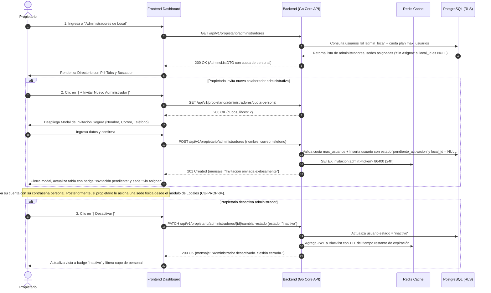
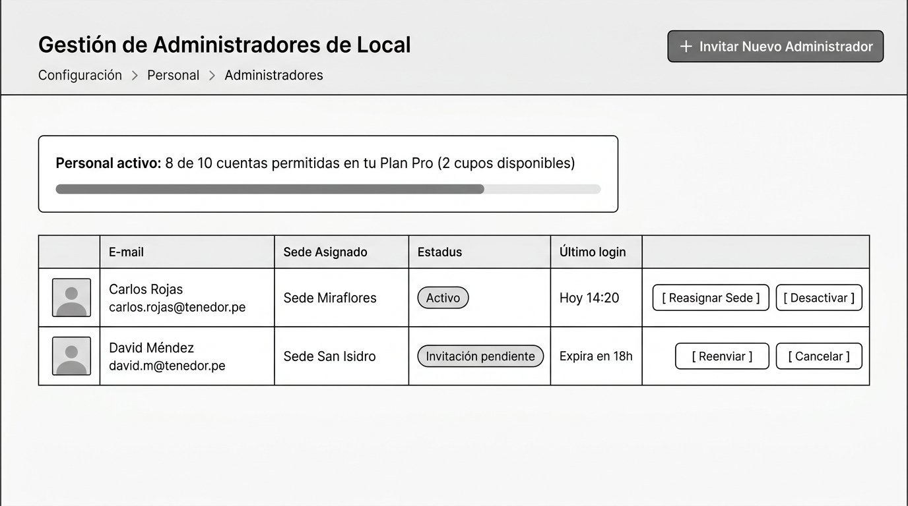
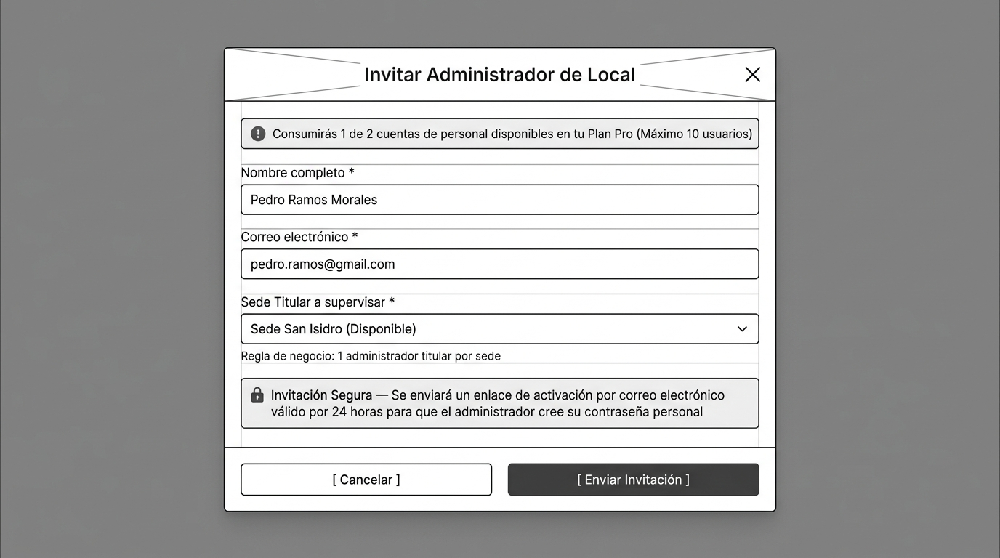

# CU-PROP-05: Crear y Gestionar Administradores de Local

Especificación técnica de interfaz de usuario, arquitectura de información, estados UX y contratos de API para la gestión del personal administrativo de sede en **RestaurantCloud AI**.

> [!NOTE]
> **Desacoplamiento Arquitectural (SRP):**
> Este caso de uso se enfoca exclusivamente en el ciclo de vida de la **cuenta y credenciales del personal administrativo** (invitación con token efímero, activación, suspensión y reactivación). La asignación y reasignación física a sedes operativas se gestiona directamente en el módulo de locales (**CU-PROP-04**), evitando bloqueos circulares y asegurando que solo administradores con cuenta activa y verificada asuman el control de sedes físicas.

---

## 1. Ficha Técnica del Caso de Uso

| Atributo | Detalle |
| :--- | :--- |
| **Código CU** | `CU-PROP-05` |
| **Nombre** | Crear y gestionar administradores de local (Personal y Accesos) |
| **Actor(es)** | `propietario` (único rol con potestad corporativa para nombrar o destituir administradores de sede) |
| **Dispositivo / Viewport** | Responsive Desktop (`1440x900`), Tablet (`768x1024`), Mobile (`375x812`) |
| **Precondición** | La empresa tiene sesión iniciada como propietario y cupos de colaboradores disponibles en su plan (`cuota.max_usuarios`). |
| **Postcondición** | Invitación enviada con token seguro por correo, cuenta activada con contraseña elegida por el administrador en estado 'Sin Asignar' (o con sede asignada desde CU-PROP-04), o credenciales revocadas en Redis. |

---

## 2. Diagrama de Flujo y Secuencia



---

## 3. Wireframes Estructurales y Layout

> [!NOTE]
> Los wireframes siguen el patrón arquitectural blueprint en escala de grises, priorizando jerarquía de información, ergonomía operativa y accesibilidad WCAG 2.1 AA sin distractores cosméticos.

---

### 3.1 Vista 1: Directorio de Administradores y Medidor de Cupo de Personal

Permite monitorear las cuentas administrativas activas, la sede titular asignada y la cuota consumida de cuentas de personal (`max_usuarios`). Cuenta con un control segmentado tipo **Pill-Tabs** con contadores numéricos en tiempo real (`Activos`, `Pendientes`, `Desactivados`, `Todos`) y una barra de búsqueda instantánea.

#### Distribución Estructural (Layout ASCII)
```text
+---------------------------------------------------------------------------------------------------+
|  Topbar: [LOGO] Restaurante: El Tenedor S.A.C.                             Manuel García [Salir]   |
+---------------------------------------------------------------------------------------------------+
|  Configuración > Personal > Administradores                                                       |
|  Gestión de Administradores de Local                               [ + Invitar Nuevo Administrador]|
|                                                                                                   |
|  +---------------------------------------------------------------------------------------------+  |
|  | Personal activo: 8 de 10 cuentas permitidas en tu Plan Pro (2 cupos disponibles)            |  |
|  | [=======================================================                     ]              |  |
|  +---------------------------------------------------------------------------------------------+  |
|                                                                                                   |
|  +-- BARRA DE PESTAÑAS (SEGMENTED PILL-TABS) Y BÚSQUEDA EN TIEMPO REAL ------------------------+  |
|  |  [ Activos (2) ]  [ Pendientes (1) ]  [ Desactivados (1) ]  [ Todos (4) ]                   |  |
|  |                                                 [ 🔍 Buscar por nombre, correo o sede... [X] ] |  |
|  +---------------------------------------------------------------------------------------------+  |
|                                                                                                   |
|  +---------------------------------------------------------------------------------------------+  |
|  | Administrador / Correo       | Sede Titular   | Estado             | Último Login | Acciones    |  |
|  |------------------------------|----------------|--------------------|--------------|-------------|  |
|  | [Avatar] Carlos Rojas        | Sede           | [ Activo ]         | Hoy 14:20    | [Desactivar]|  |
|  | carlos.rojas@tenedor.pe      | Miraflores     |                    |              |             |  |
|  |------------------------------|----------------|--------------------|--------------|-------------|  |
|  | [Avatar] Valeria Mendoza     | [ Sin Asignar ]| [ Activo ]         | Ayer 18:30   | [Desactivar]|  |
|  | valeria.m@tenedor.pe         |                |                    |              |             |  |
|  |------------------------------|----------------|--------------------|--------------|-------------|  |
|  | [Avatar] David Méndez        | [ Sin Asignar ]| [ Invitación       | Expira en    | [Enlace]    |  |
|  | david.m@tenedor.pe           |                |   pendiente ]      | 18 horas     | [Reenviar]  |  |
|  |                              |                |                    |              | [Cancelar]  |  |
|  +---------------------------------------------------------------------------------------------+  |
+---------------------------------------------------------------------------------------------------+
```

#### Blueprint Visual


#### Jerarquía de Componentes y Accesibilidad
- **Barra de Progreso de Usuarios (`max_usuarios`):** Elemento accesible `role="progressbar"` indicando cuentas staff consumidas (mozos, cocineros, cajeros y administradores).
- **Segmented Control / Pill-Tabs con Contadores Dinámicos:**
  - `Activos (N)`: Pestaña predeterminada al ingresar, filtrando solo administradores operativos sin mezclar usuarios inactivos.
  - `Pendientes (N)`: Pestaña para seguimiento inmediato de invitaciones por correo (token de 24h), alertando en color ámbar si hay invitaciones activas o por expirar.
  - `Desactivados (N)`: Historial de personal con permisos revocados para auditoría y reactivación sin ensuciar la vista operativa.
  - `Todos (N)`: Consolidado global de cuentas administrativas registradas.
  - Soporte de accesibilidad `role="tablist"`, `role="tab"`, atributos `aria-selected` y navegación por teclado.
- **Buscador en Tiempo Real:** Input con icono `Search` y botón rápido `X` para borrar términos, filtrando reactivamente en memoria por nombre de persona, correo electrónico o sede asignada.
- **Insignias de Sede Asignada Semánticas:**
  - Sede configurada: Badge con icono `Building2` y nombre de sede (ej. `Sede Miraflores`).
  - Sede no configurada o invitación pendiente: Badge `Sin Asignar` en tono neutral/ámbar suave, informando que el colaborador no supervisa una sede física aún.
- **Acciones Rápidas de Cuenta:**
  - Activo: `[ Desactivar ]`. *(La asignación de sede física se gestiona en CU-PROP-04 Locales)*.
  - Pendiente: `[ Enlace ]` (copiar URL segura), `[ Reenviar ]`, `[ Cancelar ]`.
  - Inactivo: Indicador `Asignar en Locales` *(la reactivación y asignación de sede física se realiza exclusivamente en CU-PROP-04 Locales)*.

---

### 3.2 Vista 2: Modal de Invitación Segura de Administrador

Permite dar de alta a un nuevo administrador de local en la empresa mediante el envío de un enlace temporal cifrado de 24 horas por correo electrónico, **sin requerir asignación de sede física previa**.

#### Distribución Estructural (Layout ASCII)
```text
+-----------------------------------------------------------------------------------+
|  [ Fondo difuminado / Backdrop ]                                                  |
|                                                                                   |
|  +-----------------------------------------------------------------------------+  |
|  | Invitar Administrador de Local                                         [X]  |  |
|  |-----------------------------------------------------------------------------|  |
|  |  (i) Consumirás 1 de 2 cuentas de personal disponibles en tu Plan Pro       |  |
|  |                                                                             |  |
|  |  Nombre completo *                                                          |  |
|  |  [ Pedro Ramos Morales                                                   ]  |  |
|  |                                                                             |  |
|  |  Correo electrónico *                                                       |  |
|  |  [ pedro.ramos@gmail.com                                                 ]  |  |
|  |                                                                             |  |
|  |  Teléfono de contacto (opcional)                                            |  |
|  |  [ 🇵🇪 +51 ][ 912 345 678                                                  ]  |  |
|  |  * Formato móvil Perú: 9 dígitos iniciando con 9 (estandar_telefono_whatsapp)  |  |
|  |                                                                             |  |
|  |  +-----------------------------------------------------------------------+  |  |
|  |  | [ℹ️] Asignación de Sede — Una vez que el administrador active su cuenta |  |  |
|  |  |     mediante el enlace seguro, podrás asignarlo a cualquiera de tus    |  |  |
|  |  |     sedes físicas desde el módulo de Locales.                         |  |  |
|  |  +-----------------------------------------------------------------------+  |  |
|  |                                                                             |  |
|  |  +-----------------------------------------------------------------------+  |  |
|  |  | [🔒] Invitación Segura — Se enviará un enlace de activación por correo|  |  |
|  |  |     electrónico válido por 24 horas para que el administrador cree su |  |  |
|  |  |     contraseña personal con validación de fortaleza.                  |  |  |
|  |  +-----------------------------------------------------------------------+  |  |
|  |-----------------------------------------------------------------------------|  |
|  |                                       [ Cancelar ]  [ Enviar Invitación ]   |  |
|  +-----------------------------------------------------------------------------+  |
+-----------------------------------------------------------------------------------+
```

#### Blueprint Visual


#### Comportamiento Funcional y Seguridad
1. **Desacoplamiento Total de Sede:** El formulario no bloquea la invitación si todas las sedes están ocupadas. El colaborador nace en estado `pendiente_activacion` y `local_id = NULL` (mostrado como `Sin Asignar`).
2. **Activación Asistida:** El correo no contiene contraseñas provisionales. El enlace conduce a una pantalla protegida (`/activar-cuenta?token=...`) para definir su propia clave con validación de fortaleza (`CU-AUTH-02`).
3. **Persistencia Efímera en Redis:** El token de activación se almacena con clave `invitacion:admin:<token>` con TTL de 24 horas (`86400s`) y consumo atómico (`GETDEL`).

---

### 3.3 Asignación y Reasignación de Sedes (Delegada a CU-PROP-04)

> [!NOTE]
> La vinculación operativa entre un administrador y una sede física se realiza exclusivamente en **CU-PROP-04 (Gestión de Sedes y Locales)** mediante `ModalEditarLocal` o `ModalCrearLocal`.
> - Desde la tarjeta o fila de cada local, el propietario selecciona la opción **"👤 Asignar a un Administrador de Local"**.
> - El selector en CU-PROP-04 filtra y lista a todos los administradores en estado **`activo`**.
> - Esto previene asignar invitaciones pendientes no verificadas a locales físicos y centraliza la configuración de sedes en su módulo natural.

---

## 4. Matriz de Estados UX (5 Estados Canónicos)

| Estado | Vista 1: Directorio de Admins | Vista 2: Modal de Invitación | Asignación en CU-PROP-04 (Locales) |
| :--- | :--- | :--- | :--- |
| **1. Ideal (Happy Path)** | Tabla filtrada según la pestaña activa (`Activos`, `Pendientes`, `Desactivados`, `Todos`) con contadores en tiempo real; badges de sede o `Sin Asignar`; cuota de usuarios disponible (ej. 8/10); acciones contextuales. | Formulario limpio con campos de nombre, correo y teléfono; botón de invitación activo. | Selector de sede lista únicamente administradores con cuenta activa y verificada. |
| **2. Vacío (Empty State)** | **Contextual por Pestaña y Búsqueda:**<br>• *Sin administradores:* "No tienes administradores en tu equipo. [Invitar Administrador]".<br>• *Tab Activos vacío:* "No tienes administradores activos actualmente."<br>• *Tab Pendientes vacío:* "No tienes invitaciones pendientes ni enlaces por activar."<br>• *Tab Desactivados vacío:* "Historial limpio: no cuentas con administradores desactivados."<br>• *Búsqueda sin coincidencias:* "No se encontraron administradores para '[término]'. [Limpiar búsqueda]". | Si se alcanza el límite de plan: Bloquea formulario con mensaje de actualización de plan. | Si no hay administradores activos: *"No hay administradores activos registrados. Invita uno desde el módulo de Administradores"*. |
| **3. Carga (Loading)** | Skeleton animado en las filas de administradores mientras resuelve `GET /administradores`. | Spinner en botón: *"Generando token seguro y enviando correo..."*. | Spinner en botón: *"Guardando supervisión de sede..."*. |
| **4. Error / Validación** | Error de red: *"No pudimos cargar la lista de administradores. [Reintentar]"*. | - Correo inválido.<br>- Correo ya registrado en la empresa (dispara diálogo de Promoción de Empleado). | Error al asignar sede: *"No se pudo actualizar el responsable del local"*. |
| **5. Borde / Inesperado (Edge Cases)** | - **Límite de Personal alcanzado (10/10):** Botón `[ + Invitar ]` deshabilitado con alerta: *"Has alcanzado el límite de 10 cuentas de personal de tu Plan Pro. [Mejorar a Enterprise]"*.<br>- **Invitación expirada (> 24h):** Badge cambia a `Invitación expirada` con botón destacado `[ Reenviar Enlace ]`.<br>- **Preservación de Pestaña:** Al desactivar o reactivar a un administrador, la vista permanece en la pestaña actual del usuario sin forzar recarga brusca a 'Activos'. | Intento de registrar al propio Propietario como admin: Error `PROPIETARIO_NO_PUEDE_SER_ADMIN_LOCAL`. | **Desactivación de cuenta asignada:** Si un administrador con sede asignada es desactivado en CU-PROP-05, la sede pasa inmediatamente a modo Autogestionado por el Propietario. |

---

## 5. Contratos de API (Frontend ↔ Backend Go)

Todos los contratos utilizan el estándar oficial de respuesta `apiresponse.Response` definido en [`context/mock.md`](file:///j:/proyectos_git/RestaurantCloud_AI_backend/context/mock.md).

---

### 5.1 Endpoint 1: Listar Administradores de Local y Cuota de Usuarios

- **Método:** `GET`
- **Ruta:** `/api/v1/propietario/administradores`
- **Headers:** `Authorization: Bearer <jwt_propietario>`

#### Response 200 OK
```json
{
  "exito": true,
  "datos": {
    "cuota_usuarios": {
      "plan_id": 2,
      "plan_nombre": "Pro",
      "usuarios_permitidos": 10,
      "usuarios_activos": 8,
      "cupos_disponibles": 2,
      "limite_alcanzado": false
    },
    "administradores": [
      {
        "id": "usr-adm-01",
        "nombre": "Carlos Rojas",
        "correo": "carlos.rojas@tenedor.pe",
        "telefono": "+51 987 654 321",
        "estado": "activo",
        "sede_asignada": {
          "id": "loc-1111-aaaa-bbbb-cccc",
          "nombre": "Sede Miraflores"
        },
        "ultimo_login": "2026-10-02T14:20:00Z"
      },
      {
        "id": "usr-adm-02",
        "nombre": "Valeria Mendoza",
        "correo": "valeria.m@tenedor.pe",
        "telefono": "+51 900 000 102",
        "estado": "activo",
        "sede_asignada": null,
        "ultimo_login": "2026-10-01T18:30:00Z"
      },
      {
        "id": "usr-adm-03",
        "nombre": "David Méndez",
        "correo": "david.m@tenedor.pe",
        "telefono": "+51 999 111 222",
        "estado": "pendiente_activacion",
        "sede_asignada": null,
        "invitacion_expira_en": "2026-10-03T18:00:00Z",
        "invitacion_expirada": false
      }
    ]
  },
  "meta": {
    "timestamp": "2026-10-02T20:10:00Z"
  }
}
```

---

### 5.2 Endpoint 2: Obtener Disponibilidad y Cuota de Personal
 
- **Método:** `GET`
- **Ruta:** `/api/v1/propietario/administradores/cuota-personal`
- **Headers:** `Authorization: Bearer <jwt_propietario>`

#### Response 200 OK
```json
{
  "exito": true,
  "datos": {
    "puede_invitar": true,
    "cupos_libres": 2
  },
  "meta": {
    "timestamp": "2026-10-02T20:10:15Z"
  }
}
```

---

### 5.3 Endpoint 3: Invitar Nuevo Administrador de Local (Sin atar a sede)

- **Método:** `POST`
- **Ruta:** `/api/v1/propietario/administradores`
- **Headers:** `Authorization: Bearer <jwt_propietario>`

#### Request Body
```json
{
  "nombre": "Pedro Ramos Morales",
  "correo": "pedro.ramos@gmail.com",
  "telefono": "+51 912 345 678"
}
```

#### Response 201 Created
```json
{
  "exito": true,
  "datos": {
    "id": "usr-adm-04",
    "nombre": "Pedro Ramos Morales",
    "correo": "pedro.ramos@gmail.com",
    "rol": "admin_local",
    "estado": "pendiente_activacion",
    "local_id": null,
    "sede_asignada": null,
    "mensaje": "Invitación enviada exitosamente por correo electrónico. El enlace expira en 24 horas."
  },
  "meta": {
    "timestamp": "2026-10-02T20:10:30Z"
  }
}
```

---

### 5.4 Endpoint 4: Reenviar Enlace de Invitación

- **Método:** `POST`
- **Ruta:** `/api/v1/propietario/administradores/{id}/reenviar-invitacion`
- **Headers:** `Authorization: Bearer <jwt_propietario>`

#### Response 200 OK
```json
{
  "exito": true,
  "datos": {
    "usuario_id": "usr-adm-03",
    "correo": "david.m@tenedor.pe",
    "nueva_expiracion": "2026-10-03T20:10:45Z",
    "mensaje": "Se ha reenviado un nuevo enlace seguro de activación por correo electrónico."
  },
  "meta": {
    "timestamp": "2026-10-02T20:10:45Z"
  }
}
```

---

### 5.5 Endpoint 5: Desactivar / Reactivar Administrador

- **Método:** `PATCH`
- **Ruta:** `/api/v1/propietario/administradores/{id}/cambiar-estado`
- **Headers:** `Authorization: Bearer <jwt_propietario>`

#### Request Body
```json
{
  "nuevo_estado": "inactivo"
}
```

#### Response 200 OK
```json
{
  "exito": true,
  "datos": {
    "usuario_id": "usr-adm-01",
    "nombre": "Carlos Rojas",
    "estado": "inactivo",
    "sesiones_revocadas": true,
    "mensaje": "Administrador desactivado exitosamente. Se revocaron sus sesiones en tiempo real."
  },
  "meta": {
    "timestamp": "2026-10-02T20:11:15Z"
  }
}
```

---

## 6. Manejo de Errores y Códigos de Negocio (`AppError`)

| Código de Error | HTTP Status | Causa y Solución para el Usuario |
| :--- | :--- | :--- |
| `PERSONAL_LIMITE_PLAN_ALCANZADO` | 403 Forbidden | La empresa ya utilizó todas las cuentas de usuario permitidas por su plan (`max_usuarios`). Debe escalar su plan en `CU-PROP-03`. |
| `ADMIN_CORREO_EXISTE_MISMA_EMPRESA` | 409 Conflict | El correo pertenece a otro usuario de la empresa. El sistema ofrece el diálogo de Promoción de Rol. |
| `ADMIN_REENVIO_EN_ENFRIAMIENTO` | 429 Too Many Requests | Se intentó reenviar el correo antes del tiempo de enfriamiento de 60 segundos. |
| `ADMIN_NO_ENCONTRADO` | 404 Not Found | El usuario no existe o pertenece a otro tenant. |
| `PROPIETARIO_NO_PUEDE_SER_ADMIN_LOCAL` | 422 Unprocessable | La cuenta del propietario tiene alcance global sobre todos los locales y no puede subordinarse a un solo local. |

---

## 7. Consideraciones Técnicas y de Base de Datos

1. **Unicidad de Correo por Tenant:**  
   La restricción relacional `UNIQUE(empresa_id, correo)` previene duplicados internos pero permite que una misma persona tenga cuentas independientes en distintos restaurantes de la plataforma.
2. **Tokens Efímeros de Activación (Redis):**  
   Los enlaces de invitación se firman criptográficamente y se registran en Redis con TTL de 24 horas: `SETEX invitacion:admin:<token> 86400 <json_datos>`. Al consumirse, se eliminan atómicamente con `GETDEL` para evitar ataques de repetición.
3. **Revocación Instantánea (Blacklist):**  
   Al desactivar a un administrador, el middleware de autenticación consulta la lista negra en Redis antes de procesar cualquier llamada a la API (`SETEX jwt:blacklist:<jti> <tiempo_restante> "revocado"`).
4. **Desacoplamiento de Sede:**  
   Si una sede se desactiva en `CU-PROP-04`, el usuario `admin_local` no se elimina de la base de datos; su acceso al local se bloquea suavemente con el mensaje: *"Tu sede asignada se encuentra actualmente inactiva"*.
