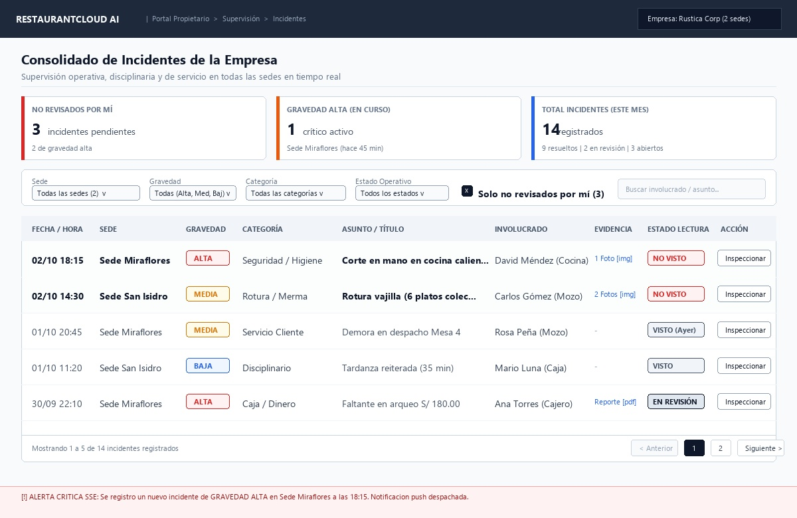
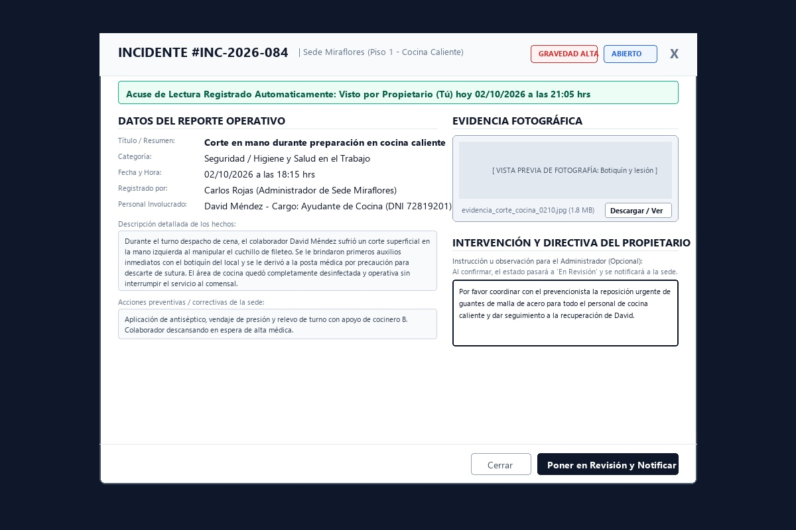
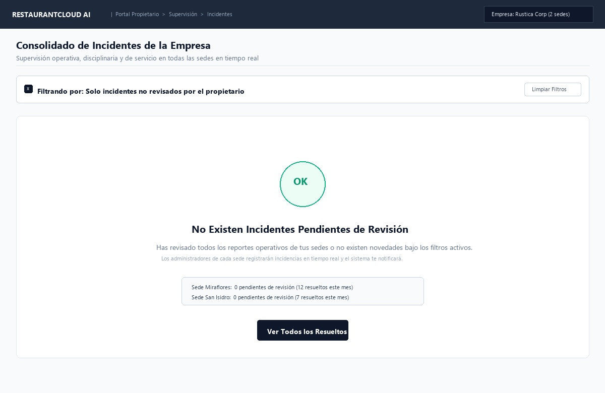

# CU-PROP-09: Ver Incidentes de la Empresa

Especificación técnica de interfaz de usuario, arquitectura de información, estados UX y contratos de API para la supervisión y control ejecutivo de incidentes operativos en **RestaurantCloud AI**.

---

## 1. Ficha Técnica del Caso de Uso

| Atributo | Detalle |
| :--- | :--- |
| **Código CU** | `CU-PROP-09` |
| **Nombre** | Ver incidentes de la empresa |
| **Actor(es)** | `propietario` (acceso a todos los locales de la empresa) |
| **Dispositivo / Viewport** | Responsive Desktop (`1440x900`), Tablet (`768x1024`), Mobile (`375x812`) |
| **Precondición** | El propietario tiene sesión iniciada con token JWT válido y la empresa tiene al menos una sede activa registrada (`CU-PROP-04`). |
| **Postcondición** | Incidentes consultados con filtrado multi-sede, marcado automático de lectura (`visto_por_propietario = true`), y opcionalmente incidentes pasados a estado `en_revision` con directiva ejecutiva (`nota_propietario`). |

---

## 2. Diagrama de Flujo y Secuencia

```mermaid
sequenceDiagram
    autonumber
    actor P as Propietario
    participant FE as Frontend Dashboard
    participant BE as Backend (Go Core API)
    participant SSE as SSE Hub (Eventos Tiempo Real)
    participant DB as PostgreSQL (RLS)

    %% 1. Canal en Tiempo Real para Incidentes Críticos
    P->>FE: Inicia sesión en el portal
    FE->>SSE: Conexión persistente SSE: GET /api/v1/propietario/incidentes/sse
    SSE-->>FE: Stream abierto (Handshake 200 OK)

    %% 2. Consulta de Bandeja Consolidada
    P->>FE: 1. Ingresa a "Incidentes" desde menú Supervisión
    FE->>BE: GET /api/v1/propietario/incidentes?local_id=&gravedad=&estado=&no_vistos=true
    BE->>DB: SET app.tenant_id = :empresa_id; SELECT incidentes con agregados de KPI
    DB-->>BE: Retorna lista de incidentes consolidados + métricas
    BE-->>FE: 200 OK (apiresponse.Response con IncidentesBandejaDTO)
    FE->>P: Renderiza Vista 1: Bandeja Consolidada con tarjetas KPI

    %% 3. Alerta en Vivo desde Sede (Simulación de evento concurrente)
    Note over BE,SSE: Un Administrador registra incidente de gravedad ALTA en Sede Miraflores
    BE->>SSE: Broadcast evento 'incidente_critico' para tenant :empresa_id
    SSE->>FE: Evento SSE {id: "INC-084", gravedad: "alta", local: "Miraflores"}
    FE->>P: Despliega Toast sonoro / Banner de Alerta Crítica en vivo

    %% 4. Inspección y Marcado Automático de Lectura
    P->>FE: 2. Clic en "Inspeccionar" del incidente crítico
    FE->>BE: GET /api/v1/propietario/incidentes/{id}
    BE->>DB: SELECT incidente WHERE id = :id AND tenant_id = :empresa_id;<br/>UPDATE incidente SET visto_por_propietario = true, fecha_visto = NOW()<br/>WHERE id = :id AND visto_por_propietario = false;
    DB-->>BE: Retorna registro completo actualizado con fecha_visto
    BE-->>FE: 200 OK (apiresponse.Response con IncidenteDetalleDTO)
    FE->>P: Despliega Vista 2: Modal de Detalle con evidencia y badge "Visto automáticamente"

    %% 5. Intervención Ejecutiva (Paso a Revisión)
    alt Propietario interviene con directiva
        P->>FE: 3. Redacta nota de instrucción y clic en "[ Poner en Revisión y Notificar ]"
        FE->>BE: PATCH /api/v1/propietario/incidentes/{id}/pasar-a-revision {nota_propietario: "..."}
        BE->>DB: UPDATE incidente SET estado = 'en_revision', nota_propietario = :nota, updated_at = NOW()<br/>WHERE id = :id AND tenant_id = :empresa_id;
        DB-->>BE: Actualización confirmada
        BE-->>FE: 200 OK (apiresponse.Response con IncidenteResumenDTO)
        FE->>P: Cierra modal, actualiza badge a 'EN REVISIÓN' en tabla y muestra Toast verde
    else Propietario solo toma conocimiento
        P->>FE: 4. Clic en "[ Cerrar ]" (el incidente ya quedó registrado como visto en DB)
        FE->>P: Cierra modal y refresca contador de pendientes sin modificar estado operativo
    end
```

---

## 3. Especificación de Pantallas y Wireframes Blueprint

### Vista 1: Bandeja Consolidada Multi-Sede (`wf_prop_09_bandeja_incidentes.jpg`)



#### Layout Estructural ASCII (Desktop 1440x900)
```text
+----------------------------------------------------------------------------------------------------+
| RESTAURANTCLOUD AI   | Portal Propietario > Supervisión > Incidentes    [ Empresa: Rustica Corp v] |
+----------------------------------------------------------------------------------------------------+
|                                                                                                    |
| Consolidado de Incidentes de la Empresa                                                            |
| Supervisión operativa, disciplinaria y de servicio en todas las sedes en tiempo real               |
|----------------------------------------------------------------------------------------------------|
|                                                                                                    |
| +-------------------------+ +-------------------------+ +----------------------------------------+ |
| | NO REVISADOS POR MÍ     | | GRAVEDAD ALTA (EN CURSO)| | TOTAL INCIDENTES (ESTE MES)            | |
| | [ 3 ] pendientes        | | [ 1 ] crítico activo    | | [ 14 ] registrados                     | |
| | 2 de gravedad alta      | | Sede Miraflores (45 min)| | 9 resueltos | 2 en revisión | 3 abiertos |
| +-------------------------+ +-------------------------+ +----------------------------------------+ |
|                                                                                                    |
| +------------------------------------------------------------------------------------------------+ |
| | Sede:                Gravedad:         Categoría:           Estado:        [X] Solo no         | |
| | [ Todas (2 sedes) v] [ Todas v       ] [ Todas v          ] [ Todos v    ]     revisados (3)   | |
| |                                                        [ Buscar involucrado / asunto... ]      | |
| +------------------------------------------------------------------------------------------------+ |
|                                                                                                    |
| +------------------------------------------------------------------------------------------------+ |
| | FECHA/HORA | SEDE        | GRAVEDAD | CATEGORÍA    | ASUNTO / TÍTULO     | INVOLUCRADO | ACCIÓN| |
| |------------|-------------|----------|--------------|---------------------|-------------|-------| |
| | 02/10 18:15| Miraflores  | [ ALTA ] | Seg./Higiene | Corte en mano co... | D. Méndez   | [Ver] | |
| | 02/10 14:30| San Isidro  | [ MEDIA] | Rotura/Merma | Rotura vajilla 6... | C. Gómez    | [Ver] | |
| | 01/10 20:45| Miraflores  | [ MEDIA] | Serv.Cliente | Demora despacho ... | R. Peña     | [Ver] | |
| | 01/10 11:20| San Isidro  | [ BAJA ] | Disciplinario| Tardanza reiterada  | M. Luna     | [Ver] | |
| | 30/09 22:10| Miraflores  | [ ALTA ] | Caja/Dinero  | Faltante arqueo ... | A. Torres   | [Ver] | |
| |------------------------------------------------------------------------------------------------| |
| | Mostrando 1 a 5 de 14 incidentes                  [ < Anterior ] [ 1 ] [ 2 ] [ Siguiente > ]   | |
| +------------------------------------------------------------------------------------------------+ |
|                                                                                                    |
| [!] ALERTA CRÍTICA SSE: Se registró nuevo incidente GRAVEDAD ALTA en Sede Miraflores (hace 5m)     |
+----------------------------------------------------------------------------------------------------+
```

#### Elementos y Reglas de la Bandeja
1. **Tarjetas KPI Consolidadas:**
   - **No revisados por mí:** Contador de incidentes donde `visto_por_propietario == false`. Si es `> 0`, resalta con alerta ámbar/roja.
   - **Gravedad Alta en curso:** Incidentes de gravedad `alta` con estado `abierto` o `en_revision`.
   - **Total del mes:** Desglose acumulado del mes calendario actual.
2. **Barra de Filtrado Ágil:**
   - **Selector de Sede:** Permite aislar una sede específica o ver todas las sedes del grupo gastronómico.
   - **Selector de Gravedad:** `alta`, `media`, `baja`.
   - **Selector de Categoría:** `servicio_cliente`, `disciplinario`, `rotura_merma`, `seguridad_higiene`, `caja_dinero`, `otro`.
   - **Toggle "Solo no revisados por mí":** Activado por defecto si existen incidentes no leídos.
3. **Banner de Alerta Crítica (SSE):** Notificación reactiva en tiempo real que aparece en el pie o cabecera cuando una sede registra un hecho grave.

---

### Vista 2: Modal de Detalle, Evidencia y Paso a Revisión (`wf_prop_09_detalle_incidente.jpg`)



#### Layout Estructural ASCII
```text
+-----------------------------------------------------------------------------------------------+
| INCIDENTE #INC-2026-084 | Sede Miraflores (Cocina Caliente)      [ ALTA ] [ ABIERTO ]     [X] |
+-----------------------------------------------------------------------------------------------+
| [✓] Acuse de Lectura Automático: Visto por Propietario (Tú) hoy 02/10/2026 a las 21:05 hrs    |
|-----------------------------------------------------------------------------------------------|
| DATOS DEL REPORTE OPERATIVO                   | EVIDENCIA FOTOGRÁFICA                         |
|                                               | +-------------------------------------------+ |
| Título: Corte en mano en cocina caliente      | |                                           | |
| Categoría: Seguridad / Higiene en Trabajo     | |  [ VISTA PREVIA: Botiquín y lesión ]      | |
| Fecha/Hora: 02/10/2026 a las 18:15 hrs        | |                                           | |
| Registrado por: Carlos Rojas (Admin Sede)     | +-------------------------------------------+ |
| Personal: David Méndez (Ayudante Cocina)      | evidencia_corte_0210.jpg  [ Descargar / Ver]| |
|                                               |                                               |
| Descripción de los hechos:                    | INTERVENCIÓN Y DIRECTIVA DEL PROPIETARIO      |
| "Durante el turno cena, el colaborador sufrió |                                               |
| un corte superficial al maniobrar cuchillo. Se| Instrucción u observación para el Admin:      |
| brindó primeros auxilios y fue a la posta... " | +-------------------------------------------+ |
|                                               | | Por favor coordinar con el prevencionista | |
| Medidas inmediatas tomadas por la sede:       | | la reposición de guantes de malla y dar   | |
| "Curación de emergencia, relevo de turno con  | | seguimiento al colaborador David.         | |
| cocinero B. Área operativa y desinfectada."   | +-------------------------------------------+ |
|-----------------------------------------------------------------------------------------------|
|                                         [ Cerrar ]  [ Poner en Revisión y Enviar Directiva ]  |
+-----------------------------------------------------------------------------------------------+
```

#### Reglas de Interacción en el Detalle
1. **Marcado Automático Transparente:**
   - La apertura del modal dispara `GET /api/v1/propietario/incidentes/{id}`.
   - El backend marca `visto_por_propietario = true` y fija `fecha_visto = NOW()` si estaba en `false`.
   - El frontend visualiza el badge verde: `[✓] Acuse de Lectura Automático: Visto hoy a las HH:mm`.
2. **Doble Vía de Acción:**
   - **Solo lectura / Enterado:** El propietario presiona `[ Cerrar ]`. El incidente queda marcado como visto, saliendo de la lista de pendientes sin alterar el flujo operativo de la sede.
   - **Intervención Ejecutiva:** El propietario escribe una directiva en `nota_propietario` y presiona `[ Poner en Revisión y Enviar Directiva ]`. El incidente pasa a `en_revision`, y el administrador de la sede recibe una notificación con la orden del dueño.

---

### Vista 3: Estado Vacío Positivo (`wf_prop_09_incidentes_vacio.jpg`)



#### Layout Estructural ASCII
```text
+-----------------------------------------------------------------------------------------------+
| [X] Filtrando por: Solo incidentes no revisados por el propietario          [ Limpiar Filtros]|
+-----------------------------------------------------------------------------------------------+
|                                                                                               |
|                                            ( OK )                                             |
|                                                                                               |
|                            No Existen Incidentes Pendientes de Revisión                       |
|        Has revisado todos los reportes operativos o no existen novedades con los filtros.     |
|              Los administradores de cada sede registrarán incidencias en tiempo real.         |
|                                                                                               |
|                +---------------------------------------------------------------+              |
|                | Sede Miraflores: 0 pendientes de revisión (12 resueltos este mes)|              |
|                | Sede San Isidro: 0 pendientes de revisión (7 resueltos este mes) |              |
|                +---------------------------------------------------------------+              |
|                                                                                               |
|                                   [ Ver Todos los Resueltos ]                                 |
|                                                                                               |
+-----------------------------------------------------------------------------------------------+
```

---

## 4. Matriz de Estados UX

| Estado | Indicador Visual | Comportamiento del Sistema | Acción del Propietario |
| :--- | :--- | :--- | :--- |
| **1. Vacío (Empty State)** | Ilustración con check verde y badge "Al día". Resumen por sede con 0 incidentes pendientes. | Muestra botón `[ Ver Todos los Resueltos ]` o `[ Limpiar Filtros ]`. | Clic para explorar histórico o ajustar filtros. |
| **2. Cargando (Skeleton)** | 3 tarjetas KPI con pulso gris (`animate-pulse`) y tabla con 5 filas esqueleto. | Deshabilita temporalmente selectores y barra de búsqueda mientras resuelve la consulta. | Espera reactiva (~150ms). |
| **3. Éxito / Poblado** | Tabla con filas destacadas (negrita para no vistos), badges de gravedad (`Alta` en rojo suave, `Media` en ámbar, `Baja` en azul). | Carga lista paginada y activa listener de SSE para eventos entrantes. | Clic en fila o botón `[ Inspeccionar ]`. |
| **4. Error Controlado** | Banner rojo superior: *"No se pudo sincronizar la bandeja de incidentes. Error de conexión con el servidor."* | Botón `[ Reintentar ]` con retroceso exponencial. | Clic en reintentar o verificar conexión. |
| **5. Validación / Deshabilitado** | En modal de detalle, botón `[ Poner en Revisión ]` se deshabilita si el incidente ya se encuentra en `resuelto` o `en_revision` por otro usuario. | Muestra tooltip explicativo: *"Este incidente ya está siendo gestionado."* | Lectura de antecedentes sin re-apertura no autorizada. |

---

## 5. Catálogo de Errores y Alertas

| Código de Error | HTTP Status | Causa Raíz | Mensaje Visual al Usuario | Acción de Recuperación |
| :--- | :--- | :--- | :--- | :--- |
| `ERR_INCIDENTE_NOT_FOUND` | `404 Not Found` | El incidente fue eliminado o pertenece a otra empresa (violación de aislamiento RLS). | *"El incidente solicitado no existe o no pertenece a su organización."* | Redirección inmediata a la bandeja consolidada. |
| `ERR_INCIDENTE_YA_RESUELTO` | `409 Conflict` | El administrador de sede marcó el incidente como resuelto simultáneamente. | *"El incidente ya fue resuelto por la administración de la sede y no puede pasar a revisión."* | Refresca el modal mostrando la resolución del administrador. |
| `ERR_NOTA_PROPIETARIO_EXCEDE_MAX` | `422 Unprocessable` | La directiva ingresada excede los 2,000 caracteres. | *"La instrucción u observación no puede superar los 2,000 caracteres."* | El usuario recorta el texto y vuelve a enviar. |
| `ERR_SSE_CONNECTION_LOST` | `503 Service Unavailable` | Pérdida de canal Server-Sent Events por timeout de red. | Badge sutil en navbar: *"Reconectando canal de alertas en vivo..."* | Reconexión automática transparente en segundo plano cada 5 segundos. |

---

## 6. Contratos de API Backend Go (`pkg/apiresponse`)

### 6.1. Bandeja Consolidada de Incidentes
- **Endpoint:** `GET /api/v1/propietario/incidentes`
- **Headers:** `Authorization: Bearer <token_jwt>`
- **Query Params:**
  - `local_id`: UUID opcional (filtrar por sede específica).
  - `gravedad`: string opcional (`alta`, `media`, `baja`).
  - `categoria`: string opcional (`servicio_cliente`, `disciplinario`, `rotura_merma`, `seguridad_higiene`, `caja_dinero`, `otro`).
  - `estado`: string opcional (`abierto`, `en_revision`, `resuelto`).
  - `no_vistos`: boolean opcional (`true` para filtrar los no leídos por el propietario).
  - `q`: string opcional (búsqueda de texto en título o nombre de involucrado).
  - `page`: int (default `1`).
  - `page_size`: int (default `15`).

#### Respuesta Exitosa (`200 OK`)
```json
{
  "success": true,
  "data": {
    "kpis": {
      "no_revisados": 3,
      "gravedad_alta_activos": 1,
      "total_mes": 14,
      "desglose_mes": {
        "abiertos": 3,
        "en_revision": 2,
        "resueltos": 9
      }
    },
    "incidentes": [
      {
        "id": "e4a2d8a0-21a5-48b9-87a2-c7c4892c9001",
        "codigo": "INC-2026-084",
        "local_id": "a1b2c3d4-0001-4000-8000-000000000001",
        "local_nombre": "Sede Miraflores",
        "gravedad": "alta",
        "categoria": "seguridad_higiene",
        "titulo": "Corte en mano en cocina caliente",
        "involucrado_nombre": "David Méndez",
        "involucrado_cargo": "Ayudante de Cocina",
        "estado": "abierto",
        "visto_por_propietario": false,
        "fecha_visto": null,
        "tiene_evidencia": true,
        "created_at": "2026-10-02T18:15:00-05:00"
      },
      {
        "id": "f5b3e9b1-32b6-49c0-98b3-d8d5903d0002",
        "codigo": "INC-2026-083",
        "local_id": "b2c3d4e5-0002-4000-8000-000000000002",
        "local_nombre": "Sede San Isidro",
        "gravedad": "media",
        "categoria": "rotura_merma",
        "titulo": "Rotura vajilla (6 platos colección)",
        "involucrado_nombre": "Carlos Gómez",
        "involucrado_cargo": "Mozo",
        "estado": "abierto",
        "visto_por_propietario": false,
        "fecha_visto": null,
        "tiene_evidencia": true,
        "created_at": "2026-10-02T14:30:00-05:00"
      }
    ],
    "pagination": {
      "current_page": 1,
      "page_size": 15,
      "total_records": 14,
      "total_pages": 1
    }
  },
  "message": "Incidentes de la empresa obtenidos exitosamente",
  "meta": {
    "timestamp": "2026-10-02T21:05:00Z"
  }
}
```

---

### 6.2. Detalle de Incidente con Marcado Automático de Lectura
- **Endpoint:** `GET /api/v1/propietario/incidentes/{id}`
- **Headers:** `Authorization: Bearer <token_jwt>`
- **Efecto Colateral Transparente en DB:** Si `visto_por_propietario == false`, el backend ejecuta en la misma transacción:
  ```sql
  UPDATE incidente 
  SET visto_por_propietario = true, fecha_visto = NOW() 
  WHERE id = :id AND tenant_id = current_setting('app.tenant_id')::uuid;
  ```

#### Respuesta Exitosa (`200 OK`)
```json
{
  "success": true,
  "data": {
    "id": "e4a2d8a0-21a5-48b9-87a2-c7c4892c9001",
    "codigo": "INC-2026-084",
    "local_id": "a1b2c3d4-0001-4000-8000-000000000001",
    "local_nombre": "Sede Miraflores",
    "piso_id": "c1d2e3f4-0001-4000-8000-000000000001",
    "piso_nombre": "Piso 1 - Cocina Caliente",
    "gravedad": "alta",
    "categoria": "seguridad_higiene",
    "titulo": "Corte en mano durante preparación en cocina caliente",
    "descripcion": "Durante el turno despacho de cena, el colaborador David Méndez sufrió un corte superficial en la mano izquierda al manipular el cuchillo de fileteo. Se le brindaron primeros auxilios inmediatos con el botiquín del local y se le derivó a la posta médica por precaución para descarte de sutura. El área de cocina quedó completamente desinfectada y operativa sin interrumpir el servicio al comensal.",
    "medidas_inmediatas": "Aplicación de antiséptico, vendaje de presión y relevo de turno con apoyo de cocinero B.",
    "involucrado": {
      "nombre": "David Méndez",
      "cargo": "Ayudante de Cocina",
      "documento": "72819201"
    },
    "registrado_por": {
      "id": "99b1c2d3-1111-4000-8000-000000000001",
      "nombre": "Carlos Rojas",
      "cargo": "Administrador de Sede"
    },
    "evidencias": [
      {
        "id": "ev-001",
        "tipo": "imagen",
        "url": "https://storage.restaurantcloud.ai/evidencias/evidencia_corte_cocina_0210.jpg",
        "nombre_archivo": "evidencia_corte_cocina_0210.jpg",
        "tamano_bytes": 1887436
      }
    ],
    "estado": "abierto",
    "visto_por_propietario": true,
    "fecha_visto": "2026-10-02T21:05:00-05:00",
    "nota_propietario": null,
    "created_at": "2026-10-02T18:15:00-05:00",
    "updated_at": "2026-10-02T21:05:00-05:00"
  },
  "message": "Detalle de incidente obtenido exitosamente",
  "meta": {
    "timestamp": "2026-10-02T21:05:00Z"
  }
}
```

---

### 6.3. Intervención: Poner en Revisión con Directiva
- **Endpoint:** `PATCH /api/v1/propietario/incidentes/{id}/pasar-a-revision`
- **Headers:** `Authorization: Bearer <token_jwt>`, `Content-Type: application/json`

#### Request Payload
```json
{
  "nota_propietario": "Por favor coordinar con el prevencionista la reposición urgente de guantes de malla de acero para todo el personal de cocina caliente y dar seguimiento a la recuperación de David."
}
```

#### Respuesta Exitosa (`200 OK`)
```json
{
  "success": true,
  "data": {
    "id": "e4a2d8a0-21a5-48b9-87a2-c7c4892c9001",
    "codigo": "INC-2026-084",
    "estado": "en_revision",
    "nota_propietario": "Por favor coordinar con el prevencionista la reposición urgente de guantes de malla de acero para todo el personal de cocina caliente y dar seguimiento a la recuperación de David.",
    "updated_at": "2026-10-02T21:06:12-05:00"
  },
  "message": "Incidente puesto en estado de revisión y directiva registrada",
  "meta": {
    "timestamp": "2026-10-02T21:06:12Z"
  }
}
```

#### Respuesta con Error de Validación (`422 Unprocessable Entity`)
```json
{
  "success": false,
  "error": {
    "code": "ERR_NOTA_PROPIETARIO_EXCEDE_MAX",
    "message": "La instrucción u observación no puede superar los 2,000 caracteres",
    "details": [
      {
        "field": "nota_propietario",
        "issue": "longitud máxima permitida es de 2,000 caracteres"
      }
    ]
  },
  "meta": {
    "timestamp": "2026-10-02T21:06:12Z"
  }
}
```

---

### 6.4. Canal en Tiempo Real (SSE Stream)
- **Endpoint:** `GET /api/v1/propietario/incidentes/sse`
- **Headers:** `Authorization: Bearer <token_jwt>`, `Accept: text/event-stream`

#### Estructura del Evento SSE Emitido al Ocurrir Hecho Crítico
```text
event: incidente_critico
data: {"id":"e4a2d8a0-21a5-48b9-87a2-c7c4892c9001","codigo":"INC-2026-084","local_nombre":"Sede Miraflores","gravedad":"alta","categoria":"seguridad_higiene","titulo":"Corte en mano en cocina caliente","created_at":"2026-10-02T18:15:00-05:00"}
```

---

## 7. Reglas de Negocio y Seguridad Multi-Tenant

1. **Aislamiento Multi-Tenant con RLS:**
   - Toda consulta a `incidente` o `local` se ejecuta bajo la sesión PostgreSQL del tenant:
     ```sql
     SET LOCAL app.tenant_id = '<empresa_id>';
     ```
   - Un propietario solo puede visualizar incidentes ocurridos en locales asociados a su empresa (`empresa_id`).
2. **Atomicidad de Acuse de Lectura:**
   - La actualización de `visto_por_propietario = true` y `fecha_visto = NOW()` solo se efectúa si el valor actual es `false`. Si ya fue leído previamente, no se sobrescribe `fecha_visto` para conservar la trazabilidad del primer momento de lectura ejecutiva.
3. **Flujo de Estados Permitidos para el Propietario:**
   - De `abierto` -> `en_revision` (a través de `PATCH .../pasar-a-revision`).
   - El propietario no puede pasar un incidente directamente a `resuelto` desde este módulo corporativo; la resolución operativa corresponde al administrador de la sede correspondiente tras subsanar los hechos.
4. **Almacenamiento Seguro de Evidencias:**
   - Los archivos adjuntos (fotografías, actas policiales, informes médicos) se alojan en un bucket S3 privado con URLs prefirmadas (`pre-signed URLs`) de validez máxima de 15 minutos para prevenir filtraciones de información sensible de colaboradores o clientes.
