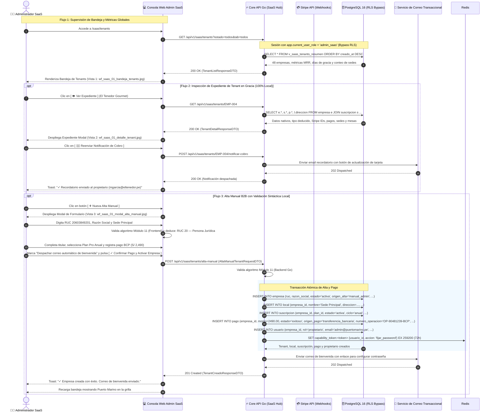

# Especificación Técnica y Wireframes: CU-SAAS-01: Supervisar Empresas Registradas, Activaciones y Renovaciones de Suscripción

## 1. Ficha Técnica del Caso de Uso

| Atributo | Detalle |
| :--- | :--- |
| **Código** | `CU-SAAS-01` |
| **Nombre** | **Supervisar empresas registradas, activaciones y renovaciones de suscripción** (Centro de Monitoreo de Tenants y Gestión de Onboarding SaaS) |
| **Rol / Actor** | **Administrador Global SaaS** (`admin_saas`) |
| **Módulo** | Administración Central SaaS / Tenancy & Suscripciones |
| **Objetivo de Negocio** | Brindar a los operadores de la plataforma SaaS una consola centralizada para: (1) monitorear el estado global de empresas gastronómicas registradas (activas, en período de gracia de 5 días, canceladas o suspendidas), (2) verificar ingresos recurrentes (MRR), volumen de locales operativos conectados y renovaciones automáticas gestionadas vía Stripe, (3) inspeccionar el expediente comercial y técnico de cada tenant (RUC, locales, consumo de cuotas del plan, transacciones de pago), y (4) registrar altas manuales para contratos corporativos que formalizan su pago directo mediante transferencia bancaria (sin pasarela online de tarjeta). |
| **Precondiciones** | El usuario cuenta con sesión activa autenticada con rol `admin_saas` (`empresa_id = NULL`, `local_id = NULL`). Existen tenants registrados vía autoservicio Stripe ([`CU-PROP-01`](file:///j:/proyectos_git/RestaurantCloud_AI_backend/wireframe/propietario/CU-PROP-01-registro-empresa/wireframe.md)) o altas corporativas previas. |
| **Postcondiciones** | Auditoría y seguimiento en tiempo real de la base instalada de restaurantes; expedientes actualizados; generación de tenants corporativos con pagos verificados asentados en la tabla `pago`; emisión de credenciales de onboarding al propietario mediante capability token por correo electrónico. |
| **Tokens de Diseño** | Grayscale Blueprint: `#0F172A` (Primario / Slate Dark), `#1E293B` (Superficie), `#F8FAFC` (Canvas), `#FFFFFF` (Card), `#E2E8F0` (Bordes), `#0F172A` (Texto Principal), `#64748B` (Texto Muted), `#15803D` (Verde Activo / Pago Exitoso), `#B45309` (Ámbar Período de Gracia), `#991B1B` (Rojo Suspensión / Pago Fallido). |
| **Resolución Canónica** | `1440x900` px (Desktop Blueprint, JPG calidad 95). |

### Reglas de Negocio y Políticas de Supervisión SaaS

1. **Autoservicio Stripe por Defecto y Supervisión No Bloqueante:**
   - La vía estándar de contratación es 100% autoservicio a través de [`CU-PROP-01`](file:///j:/proyectos_git/RestaurantCloud_AI_backend/wireframe/propietario/CU-PROP-01-registro-empresa/wireframe.md) con tarjeta de crédito/débito tokenizada en Stripe Checkout.
   - El administrador de la plataforma **no interviene para autorizar manualmente cada alta**, evitando cuellos de botella en la adquisición de clientes. La consola de `CU-SAAS-01` provee visibilidad analítica, detección de cobros fallidos y control del ciclo de vida.

2. **Período de Gracia Oficial de 5 Días (Alineación con [`CU-PROP-02`](file:///j:/proyectos_git/RestaurantCloud_AI_backend/wireframe/propietario/CU-PROP-02-gestionar-suscripcion/wireframe.md)):**
   - Cuando Stripe reporta el evento `invoice.payment_failed` en una renovación periódica, la empresa entra automáticamente en estado `periodo_gracia`.
   - El período de gracia tiene una duración inmutable de **5 días calendario**. Durante este lapso, el restaurante continúa operando con normalidad (no se interrumpen comandas ni facturación de salón), mientras Stripe reintenta el cobro automáticamente (días 1, 3 y 5) y el sistema notifica al propietario.
   - Si tras el 5to día el pago no se consolida, el sistema ejecuta la suspensión automática (`CU-SAAS-02`), inhabilitando el acceso al sistema.

3. **Alta Manual B2B con Pago Verificado Obligatorio (Sin Gratuidades Ficticias):**
   - Para clientes corporativos, franquicias o cadenas que pagan mediante factura comercial o transferencia bancaria (BCP, BBVA, Interbank, Yape Empresa), el administrador SaaS puede crear el tenant manualmente (Vista 3).
   - **Regla de integridad contable:** No se admiten altas sin respaldo económico en base de datos. Toda alta manual exige registrar el pago en la tabla `pago` con `estado = 'exitoso'`, indicando: monto cobrado en PEN, medio de pago bancario, número de constancia/operación y nota administrativa de respaldo.
   - Tras el registro exitoso, el sistema despacha un correo con enlace seguro (*capability token* de un solo uso con 72h de vigencia) para que el propietario establezca su contraseña e inicie la configuración de locales y cartas.

4. **Bypass de Seguridad Multitenant (Row-Level Security):**
   - La base de datos opera bajo aislamiento estricto de tenants (`empresa_id = current_setting('app.current_empresa_id')`).
   - El rol `admin_saas` posee `empresa_id = NULL`. Las políticas RLS de PostgreSQL implementan una cláusula de bypass:
     `current_setting('app.current_user_role', true) = 'admin_saas'`, permitiendo lectura y auditoría global consolidada de todas las empresas.

5. **Métricas Clave de la Plataforma (KPIs de Operación):**
   - **Total Empresas:** Universo total de cuentas en el sistema (ej. 48 empresas).
   - **Suscripciones Activas & Al Día:** Tenants solventes operando sin deudas (ej. 41 empresas, 85.4%).
   - **En Período de Gracia:** Cuentas con pago de renovación en reintento dentro de la ventana de 5 días (ej. 3 empresas, S/ 747 MRR en riesgo).
   - **Sedes Operativas Conectadas:** Total acumulado de locales físicos en producción (ej. 112 locales, promedio 2.3 sedes por empresa), indicador directo del uso real de la infraestructura.

6. **Independencia de APIs Externas (SUNAT / ApiPerú) y Validación Matemática Local:**
   - La visualización del expediente (Vista 2) y el formulario de alta manual (Vista 3) no dependen de llamadas a APIs externas de SUNAT ni ApiPerú, eliminando costos por consulta, riesgos de timeout y cuellos de botella de red.
   - El RUC de 11 dígitos se valida internamente en frontend y backend mediante el **algoritmo matemático de Módulo 11**, verificando la consistencia de su dígito verificador.
   - La tipificación del contribuyente se deduce limpiamente del prefijo del RUC: prefijo `20` $\rightarrow$ `Persona Jurídica (Empresa)`; prefijo `10` $\rightarrow$ `Persona Natural con Negocio`.
   - El estado tributario se reemplaza por el **Estado de Cuenta en Plataforma** (`● ACTIVA & OPERATIVA`, `⚠️ EN PERÍODO DE GRACIA`, `🚫 SUSPENDIDA`), resolviéndose con un `JOIN` local de base de datos en $< 10\text{ ms}$.

---

## 2. Diagrama de Secuencia Mermaid



---

## 3. Diagramación Wireframe ASCII y Guía de Microcopias

---

### 3.1 Vista 1: Consola Central de Supervisión de Tenants (`wf_saas_01_bandeja_tenants.jpg`)

Consola maestra para el administrador global SaaS con métricas consolidadas, pestañas de segmentación, buscador en tiempo real y tabla interactiva.

#### Distribución Estructural (Layout ASCII)
```text
+-------------------------------------------------------------------------------------------------------------------------------------+
| [RESTAURANTCLOUD AI]   [CONSOLA ADMIN SAAS]                             [https://admin.restaurantcloud.pe/saas/tenants] [Admin Root ▼]     |
+-------------------------------------------------------------------------------------------------------------------------------------+
|  SUPERVISIÓN DE EMPRESAS Y SUSCRIPCIONES SAAS                                                                                       |
|  Monitoreo del ciclo de vida de clientes gastronómicos, activaciones, renovaciones y cobros recurrentes de la plataforma.           |
|-------------------------------------------------------------------------------------------------------------------------------------|
|  +------------------------+  +------------------------+  +------------------------+  +------------------------+                     |
|  | TOTAL EMPRESAS REGISTR |  | SUSCRIPCIONES ACTIVAS  |  | EN PERÍODO DE GRACIA   |  | SEDES OPERATIVAS CONECT|                     |
|  | 48 Empresas            |  | 41 Activas (85.4%)     |  | 3 en Gracia (Día 1-5)  |  | 112 Locales Activos    |                     |
|  | ▲ +4 este mes (MRR: S/ |  | ● Facturación al día   |  | ⚠️ S/ 747 MRR en riesg|  | Promedio: 2.3 sedes/cl |                     |
|  +------------------------+  +------------------------+  +------------------------+  +------------------------+                     |
|                                                                                                                                     |
|  +-------------------------------------------------------------------------------------------------------------------------------+  |
|  | [Todos (48)] [Activos (41)] [En Gracia (3)] [Suspendidos (3)] [Baja (1)]  |  [🔍 Buscar empresa, RUC...] [Plan: Todos ▼] [➕ Alta]   |  |
|  +-------------------------------------------------------------------------------------------------------------------------------+  |
|                                                                                                                                     |
|  BANDEJA GENERAL DE RESTAURANTES                                                                                                    |
|  +-------------------------------------------------------------------------------------------------------------------------------+  |
|  | EMPRESA / RAZÓN SOCIAL     RUC         PLAN SAAS  SEDES ESTADO SUSCRIPCIÓN        PRÓXIMO COBRO / VENC  MEDIO PAGO  ACCIONES      |  |
|  | -------------------------- ----------- ---------- ----- ------------------------- --------------------- ----------- -------------|  |
|  | Pollería Las Brasas S.A.C. 20491823012 Plan Pro   3 sed [● Activa / Al Día]       15/10/2026 (en 4 d.)  💳 Visa     [👁️ Expediente|  |
|  | La Mar Cevichería E.I.R.L. 20551928371 Plan Pro   2 sed [⚠️ En Gracia (Día 2/5)]  09/10/2026 (reintento)💳 Visa     [👁️ Expediente|  |
|  | Trattoria Bella Italia     20102938475 Enterprise 5 sed [● Activa / Al Día]       28/10/2026 (en 17 d.) 💳 Masterca [👁️ Expediente|  |
|  | Café Bistró Francés S.A.C. 20601928472 Starter    1 sed [⚠️ En Gracia (Día 4/5)]  07/10/2026 (reintento)💳 Amex     [👁️ Expediente|  |
|  | Rústika Burger Bar         20394819201 Plan Pro   2 sed [🚫 Suspendida (Impago)]  01/10/2026 (cortado)  💳 Visa     [👁️ Expediente|  |
|  | Sanguchería El Chinito     20481920394 Plan Pro   3 sed [● Activa / Al Día]       18/10/2026 (en 7 d.)  💳 Visa     [👁️ Expediente|  |
|  | Pizzería Bella Napoli      20519283019 Starter    1 sed [✓ Baja Solicitada]       30/09/2026 (fin cic.) 💳 Visa     [👁️ Expediente|  |
|  +-------------------------------------------------------------------------------------------------------------------------------+  |
|  Mostrando 7 de 48 empresas registradas                                                           [Página 1 de 7] [← Ant] [Sig →]   |
+-------------------------------------------------------------------------------------------------------------------------------------+
```

#### Guía de Elementos y Microcopias
- **Barra de Navegación Global:** Muestra título corporativo, badge `CONSOLA ADMIN SAAS`, URL canónica `https://admin.restaurantcloud.pe/saas/tenants` e indicador de sesión `Admin Root`.
- **Card KPI 1 (Total Empresas):** Valor `48 Empresas`, delta `▲ +4 este mes (MRR: S/ 11,450.00)`.
- **Card KPI 2 (Suscripciones Activas):** Valor `41 Activas (85.4%)`, subtítulo `● Facturación al día en pasarela Stripe`.
- **Card KPI 3 (En Período de Gracia):** Valor `3 en Gracia (Día 1-5)`, badge ámbar `⚠️ S/ 747 MRR en riesgo de suspensión`.
- **Card KPI 4 (Sedes Operativas Conectadas):** Valor `112 Locales Activos`, subtítulo `Promedio: 2.3 sedes por cliente`.
- **Barra de Filtros y Búsqueda:** Pestañas de estado con conteos en tiempo real: `[Todos (48)]`, `[Activos (41)]`, `[En Gracia (3)]`, `[Suspendidos (3)]`, `[Baja (1)]`. Input de búsqueda `[🔍 Buscar por razón social, nombre comercial o RUC...]`, filtro por plan `[Plan: Todos ▼]` y botón de acción principal `[➕ Nueva Alta Manual]`.
- **Grilla de Datos:** Columnas con anchos proporcionales, badges de estado semánticos con microcopia de días de gracia (`Día 2 de 5 de gracia`, `Día 4 de 5 de gracia`), fechas relativas de cobro y acciones de expediente.

---

### 3.2 Vista 2: Expediente Detallado de Empresa y Estado de Cobros (`wf_saas_01_detalle_tenant.jpg`)

Modal de auditoría 360° que desglosa la relación comercial, estado en SUNAT, contratos en Stripe, historial de transacciones y cuotas de consumo.

#### Distribución Estructural (Layout ASCII)
```text
+-------------------------------------------------------------------------------------------------------------------------------------+
| [MODAL DE EXPEDIENTE: CU-SAAS-01: DETALLE DE EMPRESA & SUSCRIPCIÓN]                                                                 |
+-------------------------------------------------------------------------------------------------------------------------------------+
|  EXPEDIENTE DEL TENANT: EL TENEDOR GOURMET S.A.C.                                                                          [✕]      |
|  ID Tenant: e9a8b7c6-1234-5678-9abc-def012345678 • Registro: 15/09/2026 • Estado: [⚠️ EN PERÍODO DE GRACIA (DÍA 2 DE 5)]            |
|-------------------------------------------------------------------------------------------------------------------------------------|
|  +-------------------------------------------------------------------------------------------------------------------------------+  |
|  | 1. IDENTIDAD DE EMPRESA & TITULAR PROPIETARIO                              | [● CUENTA ACTIVA & OPERATIVA]                    |  |
|  | Razón Social Registrada: El Tenedor Gourmet S.A.C.                         | RUC & Tipo: 20601234567 (RUC 20 — Persona Juríd.)|  |
|  | Sede Principal / Dirección: Av. Mariscal La Mar 1285, Miraflores, Lima     | Teléfono de Contacto: +51 1 445-8920 (Principal) |  |
|  | Titular Propietario: Manuel García Mendoza (rol: propietario)              | Correo Electrónico: mgarcia@eltenedor.pe [✓ Act.]|  |
|  +-------------------------------------------------------------------------------------------------------------------------------+  |
|  +-------------------------------------------------------------------------------------------------------------------------------+  |
|  | 2. CONTRATO SAAS & PASARELA STRIPE                    | Origen: Autoservicio Online (CU-PROP-01)                              |  |
|  | Plan Contratado: Plan Pro — S/ 249.00 / mes           | Vencimiento / Próx. Cobro: 09/10/2026 (En reintento Stripe)          |  |
|  | Stripe Customer ID: cus_Q8x9L2k1mP09 [↗ Abrir Stripe] | Stripe Sub ID: sub_1N9a8b2c4e5f6 [↗ Ver suscripción]                 |  |
|  | Método Vinculado: 💳 Visa •••• 4242 (Vence 12/28)     | Gracia Restante: 3 días restantes (Corte: 14/10/2026 23:59)          |  |
|  +-------------------------------------------------------------------------------------------------------------------------------+  |
|  +-------------------------------------------------------------------------------------------------------------------------------+  |
|  | 3. HISTORIAL DE TRANSACCIONES (TABLA `pago`)          | Sincronizado vía Webhooks Stripe                                     |  |
|  | FECHA            COMPROBANTE   MONTO (PEN)  MEDIO / ORIGEN    ESTADO                  STRIPE PAYMENT ID                       |  |
|  | 09/10/2026 22:30 REC-RENOV-02  S/ 249.00    Visa •••• 4242    ❌ Fallido (Sin fondos) ch_3MzaBc2eZvKYlo2C...                  |  |
|  | 15/09/2026 18:45 REC-ALTA-01   S/ 249.00    Visa •••• 4242    ✓ Exitoso (Alta Inicial)ch_3MxyZ82eZvKYlo1A...                  |  |
|  +-------------------------------------------------------------------------------------------------------------------------------+  |
|  +-------------------------------------------------------------------------------------------------------------------------------+  |
|  | 4. USO DE RECURSOS VS LÍMITES DEL PLAN PRO                                                                                    |  |
|  | Sedes / Locales: 2 / 3 (67%) [████████░░░░] | Mesas: 28 / 30 (93%) [███████████░] | Personal: 11 / 15 (73%) [████████░░░░]  |  |
|  +-------------------------------------------------------------------------------------------------------------------------------+  |
|-------------------------------------------------------------------------------------------------------------------------------------|
|  [⚠️ Suspender Empresa Preventivamente]           [✉️ Reenviar Notificación de Cobro]  [💳 Ver en Stripe]  [Cerrar Expediente]      |
+-------------------------------------------------------------------------------------------------------------------------------------+
```

#### Guía de Elementos y Microcopias
- **Cabecera del Expediente:** Nombre legal, UUID del tenant, fecha de creación y badge de estado `⚠️ En Período de Gracia (Día 2 de 5)`.
- **Sección 1 (Identidad de Empresa & Titular Propietario):** 100% nativa de base de datos (`empresa.razon_social`, `empresa.ruc`, derivación de tipo `RUC 20 — Persona Jurídica`, dirección de sede principal `local.direccion`, teléfono de contacto y titular con badge `● CUENTA ACTIVA & OPERATIVA`).
- **Sección 2 (Contrato SaaS & Stripe):** Plan actual (Pro S/ 249/mes), ID de cliente y suscripción en Stripe con deep links a la consola de Stripe, tarjeta vinculada y fecha exacta de corte de servicio tras cumplirse los 5 días de gracia.
- **Sección 3 (Historial de Pagos):** Tabla con registros inmutables de cobro provenientes de la tabla `pago`. Destaca en fondo rosado el cobro fallido del 09/10 con causa `"Fondos insuficientes"` y el cargo exitoso del alta inicial.
- **Sección 4 (Uso de Recursos):** Barras de progreso de locales (2 de 3), mesas (28 de 30) y cuentas de personal (11 de 15).
- **Acciones del Footer:**
  - `[⚠️ Suspender Empresa Preventivamente]`: Permite actuar administrativamente antes de que venza el plazo de gracia en caso de fraude manifiesto.
  - `[✉️ Reenviar Notificación de Cobro]`: Despacha correo inmediato al titular con link de actualización de tarjeta.
  - `[💳 Ver en Stripe Dashboard]`: Abre la suscripción en el portal oficial de Stripe.
  - `[Cerrar Expediente]`: Cierra la ventana modal sin cambios.

---

### 3.3 Vista 3: Modal de Alta Manual con Pago Verificado (`wf_saas_01_modal_alta_manual.jpg`)

Formulario de registro administrativo para clientes corporativos B2B que cancelan mediante transferencia bancaria.

#### Distribución Estructural (Layout ASCII)
```text
+-------------------------------------------------------------------------------------------------------------------------------------+
| [MODAL: CU-SAAS-01: NUEVA ALTA MANUAL DE EMPRESA (PAGO DIRECTO VERIFICADO)]                                                         |
+-------------------------------------------------------------------------------------------------------------------------------------+
|  + NUEVA ALTA MANUAL DE EMPRESA (PAGO DIRECTO VERIFICADO)                                                                 [✕]       |
|  Registro administrativo para clientes corporativos con pago por transferencia bancaria (sin pasarela Stripe online)                |
|-------------------------------------------------------------------------------------------------------------------------------------|
|  +-------------------------------------------------------------------------------------------------------------------------------+  |
|  | 1. IDENTIFICACIÓN DE LA EMPRESA (INGRESO DIRECTO & VALIDACIÓN SINTÁCTICA LOCAL)                                               |  |
|  | RUC de la Empresa (11 dígitos): * [ 20603849201 ]        | Tipo Deducido: ✓ RUC 20 — Persona Jurídica (Módulo 11 conforme)|  |
|  | Razón Social Oficial: * [ Cevichería Puerto Marino S.A.C.           ]  | Dirección Sede: * [ Av. Primavera 450, Surco, Lima ]|  |
|  +-------------------------------------------------------------------------------------------------------------------------------+  |
|  +-------------------------------------------------------------------------------------------------------------------------------+  |
|  | 2. DATOS DEL PROPIETARIO ADMINISTRADOR                                                                                         |  |
|  | Nombre y Apellidos: * [ Jorge Medina Castro   ]                         | Teléfono / WhatsApp: * [ +51 991 882 334          ] |  |
|  | Correo Electrónico Corporativo: * [ admin@puertomarino.pe           ] (Recibirá enlace seguro para fijar contraseña)          |  |
|  +-------------------------------------------------------------------------------------------------------------------------------+  |
|  +-------------------------------------------------------------------------------------------------------------------------------+  |
|  | 3. PLAN CONTRATADO Y VIGENCIA DE SERVICIO                                                                                     |  |
|  | Plan SaaS: * [ Plan Pro — S/ 249.00 / mes (Hasta 3 locales, 30 mesas) ▼ ]| Periodicidad: ( ) Mensual (●) Anual (S/ 2,490 / año)    |  |
|  | Fecha Inicio: * [ 11/10/2026            📅 ]                             | Fecha Fin Periodo: * [ 11/10/2027              📅 ] |  |
|  +-------------------------------------------------------------------------------------------------------------------------------+  |
|  +-------------------------------------------------------------------------------------------------------------------------------+  |
|  | 4. REGISTRO DEL PAGO VERIFICADO (TABLA `pago` CON ESTADO 'EXITOSO')                                                           |  |
|  | Monto Cobrado (PEN): * [ S/ 2,490.00         ]                         | Medio de Pago: * [ Transferencia Bancaria BCP    ▼] |  |
|  | N° de Operación / Constancia: * [ OP-90481239-BCP                      ] | Fecha Operación: * [ 10/10/2026                 📅 ] |  |
|  | Observaciones / Nota de Respaldo: * [ Cliente formalizó suscripción anual BCP. Abono confirmado por tesorería en estado de cta] |  |
|  +-------------------------------------------------------------------------------------------------------------------------------+  |
|  [✓] Despachar correo automático de bienvenida: El propietario recibirá un enlace con capability token para crear su clave.         |
|-------------------------------------------------------------------------------------------------------------------------------------|
|  [ Cancelar ]                                                                             [ ✓ Confirmar Pago y Activar Empresa ]     |
+-------------------------------------------------------------------------------------------------------------------------------------+
```

#### Guía de Elementos y Microcopias
- **Bloque 1 (Identificación de la Empresa):** Ingreso directo de RUC (11 dígitos con máscara), validación local matemática Módulo 11 sin llamadas externas, deducción de tipo de contribuyente (`RUC 20 — Persona Jurídica`), Razón Social y Dirección física de la primera sede.
- **Bloque 2 (Datos del Titular):** Nombres, apellidos, teléfono corporativo y email donde se despachará la invitación de bienvenida.
- **Bloque 3 (Plan y Términos):** Selector de Plan (Starter, Pro, Enterprise), periodicidad (Mensual o Anual con 2 meses de bonificación) y fechas de vigencia.
- **Bloque 4 (Pago Verificado):** Monto en Soles, selector de medio de pago bancario (Transferencia BCP, BBVA, Interbank, Yape Empresa, Efectivo Corporativo), número de constancia bancaria y nota administrativa de tesorería.
- **Checkbox de Activación:** `"Despachar correo automático de bienvenida"` activo por defecto.
- **Botón de Guardado:** `[ ✓ Confirmar Pago y Activar Empresa ]` que ejecuta la transacción atómica integral.

---

### 3.4 Vista 4: Estado Vacío de Filtro / Suscripciones al Día (`wf_saas_01_estado_vacio.jpg`)

Estado visual cuando un filtro no arroja resultados o la plataforma se encuentra completamente al día en cobros.

#### Distribución Estructural (Layout ASCII)
```text
+-------------------------------------------------------------------------------------------------------------------------------------+
| [RESTAURANTCLOUD AI]   [CONSOLA ADMIN SAAS]                             [https://admin.restaurantcloud.pe/saas/tenants] [Admin Root ▼]     |
+-------------------------------------------------------------------------------------------------------------------------------------+
|  SUPERVISIÓN DE EMPRESAS Y SUSCRIPCIONES SAAS                                                                                       |
|-------------------------------------------------------------------------------------------------------------------------------------|
|  +------------------------+  +------------------------+  +------------------------+  +------------------------+                     |
|  | TOTAL EMPRESAS REGISTR |  | SUSCRIPCIONES ACTIVAS  |  | EN PERÍODO DE GRACIA   |  | SEDES OPERATIVAS CONECT|                     |
|  | 48 Empresas            |  | 41 Activas (85.4%)     |  | 0 en Gracia            |  | 112 Locales Activos    |                     |
|  +------------------------+  +------------------------+  +------------------------+  +------------------------+                     |
|                                                                                                                                     |
|  +-------------------------------------------------------------------------------------------------------------------------------+  |
|  | [Todos (48)] [Activos (41)] [En Gracia (0) (Activo)] [Suspendidos (3)] [Baja (1)]  |  [🔍 Buscar...] [Plan: Todos ▼] [➕ Alta]    |  |
|  +-------------------------------------------------------------------------------------------------------------------------------+  |
|                                                                                                                                     |
|  +-------------------------------------------------------------------------------------------------------------------------------+  |
|  |                                                                                                                               |  |
|  |                                                     🛡️                                                                        |  |
|  |                                  No hay empresas en período de gracia ni cobros pendientes                                    |  |
|  |                 Todas las suscripciones activas se encuentran al día con sus pagos en Stripe y canales B2B.                  |  |
|  |                                      No se registran transacciones fallidas en los últimos 30 días.                           |  |
|  |                                                                                                                               |  |
|  |                                           [ 🔄 Actualizar Estado ]  [ Ver Todas las Empresas ]                                |  |
|  |                                                                                                                               |  |
|  +-------------------------------------------------------------------------------------------------------------------------------+  |
+-------------------------------------------------------------------------------------------------------------------------------------+
```

---

## 4. Matriz de Estados UX

| Estado | Indicador Visual | Mensaje al Operador SaaS | Comportamiento / Acción Disponible |
| :--- | :--- | :--- | :--- |
| **Ideal (Lista Poblada)** | Grilla completa con badges semánticos (Verde, Ámbar, Rojo). | "Mostrando X de N empresas registradas." | Navegación, ordenamiento, filtrado por tabs y apertura de expedientes 360°. |
| **Vacío (Filtro sin filas)** | Ícono de escudo `🛡️` con recuadro neutral `#F8FAFC`. | "No hay empresas en período de gracia ni cobros pendientes." | Botones para limpiar filtros o recargar datos en tiempo real. |
| **Carga (Skeleton)** | Animación shimmer en cards de KPIs y filas de tabla. | "Cargando métricas de suscripciones y tenants..." | Controles inhabilitados hasta completar la resolución de consultas SQL. |
| **Error (Fallo de API)** | Banner de alerta `#FEF2F2` con ícono `⚠️`. | "Error al sincronizar datos con Stripe API. Mostrando última instantánea de base de datos local." | Botón `[ 🔄 Reintentar Sincronización ]` con reintento exponencial. |
| **Borde (Último Día de Gracia)** | Badge ámbar parpadeante `⚠️ En Gracia (Día 5/5 - Vence Hoy 23:59)`. | "La suscripción será suspendida automáticamente al finalizar el día si no se regulariza el pago." | Acción destacada `[ ✉️ Notificación Urgente ]` y opción de suspensión manual inmediata. |

---

## 5. Contratos de API Go / Echo (DTOs)

### 5.1 Endpoint Listado de Tenants con Métricas
`GET /api/v1/saas/tenants`

```go
package dto

import "time"

type TenantFilterParams struct {
	Estado    string `query:"estado"`    // "todos", "activa", "periodo_gracia", "suspendida", "cancelada"
	PlanID    string `query:"plan_id"`   // "todos", "starter", "pro", "enterprise"
	Buscar    string `query:"buscar"`    // RUC, Razón Social, Nombre Comercial
	Pagina    int    `query:"pagina"`    // Default 1
	PorPagina int    `query:"por_pagina"`// Default 10
}

type TenantItemDTO struct {
	EmpresaID           string     `json:"empresa_id"`
	CodigoEmpresa       string     `json:"codigo_empresa"`       // ej. "EMP-001"
	RazonSocial         string     `json:"razon_social"`
	NombreComercial     string     `json:"nombre_comercial"`
	RUC                 string     `json:"ruc"`
	PlanNombre          string     `json:"plan_nombre"`          // "Starter", "Plan Pro", "Enterprise"
	LocalesActivos      int        `json:"locales_activos"`
	EstadoSuscripcion   string     `json:"estado_suscripcion"`   // "activa", "periodo_gracia", "suspendida", "cancelada"
	DiaGraciaActual     *int       `json:"dia_gracia_actual"`     // 1 a 5 si está en gracia
	FechaProximoCobro   time.Time  `json:"fecha_proximo_cobro"`
	MetodoPagoTipo      string     `json:"metodo_pago_tipo"`      // "tarjeta_visa", "tarjeta_mastercard", "transferencia_bancaria"
	MetodoPagoDetalle   string     `json:"metodo_pago_detalle"`   // "•••• 4242" o "BCP Cta. Cte."
	OrigenAlta          string     `json:"origen_alta"`          // "autoservicio_stripe", "manual_admin"
	CreadoAt            time.Time  `json:"creado_at"`
}

type MetricasSaaSResumenDTO struct {
	TotalEmpresas           int     `json:"total_empresas"`
	NuevasEmpresasEsteMes   int     `json:"nuevas_empresas_este_mes"`
	MRRTotalPEN             float64 `json:"mrr_total_pen"`
	SuscripcionesActivas    int     `json:"suscripciones_activas"`
	SuscripcionesEnGracia   int     `json:"suscripciones_en_gracia"`
	MRREnRiesgoPEN          float64 `json:"mrr_en_riesgo_pen"`
	SuscripcionesSuspendidas int     `json:"suscripciones_suspendidas"`
	SedesOperativasTotales  int     `json:"sedes_operativas_totales"`
	PromedioSedesPorTenant  float64 `json:"promedio_sedes_por_tenant"`
}

type TenantListResponseDTO struct {
	Metricas    MetricasSaaSResumenDTO `json:"metricas"`
	Tenants     []TenantItemDTO        `json:"tenants"`
	TotalFilas  int                    `json:"total_filas"`
	Pagina      int                    `json:"pagina"`
	TotalPaginas int                   `json:"total_paginas"`
}
```

### 5.2 Endpoint Detalle de Expediente de Tenant
`GET /api/v1/saas/tenants/:id`

```go
package dto

import "time"

type PagoHistorialDTO struct {
	PagoID              string    `json:"pago_id"`
	Fecha               time.Time `json:"fecha"`
	ComprobanteCodigo   string    `json:"comprobante_codigo"`
	MontoPEN            float64   `json:"monto_pen"`
	OrigenPago          string    `json:"origen_pago"`         // "stripe", "transferencia_bancaria", "deposito_bancario", "yape_empresa"
	MedioDetalle        string    `json:"medio_detalle"`
	Estado              string    `json:"estado"`              // "exitoso", "fallido", "reembolsado"
	StripePaymentIntentID string  `json:"stripe_payment_intent_id,omitempty"`
	NumeroOperacion     string    `json:"numero_operacion,omitempty"`
	Nota                string    `json:"nota,omitempty"`
}

type ConsumoRecursosDTO struct {
	LocalesActuales int `json:"locales_actuales"`
	LocalesLimite   int `json:"locales_limite"`
	MesasActuales   int `json:"mesas_actuales"`
	MesasLimite     int `json:"mesas_limite"`
	UsuariosActuales int `json:"usuarios_actuales"`
	UsuariosLimite  int `json:"usuarios_limite"`
}

type TenantDetailResponseDTO struct {
	EmpresaID              string             `json:"empresa_id"`
	CodigoEmpresa          string             `json:"codigo_empresa"`
	RUC                    string             `json:"ruc"`
	TipoContribuyente      string             `json:"tipo_contribuyente"`       // "RUC 20 — Persona Jurídica" o "RUC 10 — Persona Natural"
	RazonSocial            string             `json:"razon_social"`
	DireccionSedePrincipal string             `json:"direccion_sede_principal"`
	EstadoCuentaPlataforma string             `json:"estado_cuenta_plataforma"` // "activa", "periodo_gracia", "suspendida"
	FechaRegistro          time.Time          `json:"fecha_registro"`
	ContactoNombre         string             `json:"contacto_nombre"`
	ContactoEmail          string             `json:"contacto_email"`
	ContactoTelefono       string             `json:"contacto_telefono"`
	PlanID                 string             `json:"plan_id"`
	PlanNombre             string             `json:"plan_nombre"`
	PrecioPeriodoPEN       float64            `json:"precio_periodo_pen"`
	CicloFacturacion       string             `json:"ciclo_facturacion"`        // "mensual", "anual"
	EstadoSuscripcion      string             `json:"estado_suscripcion"`
	DiaGraciaActual        *int               `json:"dia_gracia_actual"`
	FechaInicio            time.Time          `json:"fecha_inicio"`
	FechaProximoCobro      time.Time          `json:"fecha_proximo_cobro"`
	FechaCorteGracia       *time.Time         `json:"fecha_corte_gracia"`
	StripeCustomerID       string             `json:"stripe_customer_id,omitempty"`
	StripeSubscriptionID   string             `json:"stripe_subscription_id,omitempty"`
	MetodoPagoRegistrado   string             `json:"metodo_pago_registrado"`
	HistorialPagos         []PagoHistorialDTO `json:"historial_pagos"`
	Consumo                ConsumoRecursosDTO `json:"consumo"`
}
```

### 5.3 Endpoint Alta Manual de Empresa con Pago Verificado (B2B)
`POST /api/v1/saas/tenants/alta-manual`

```go
package dto

import "time"

type AltaManualTenantRequestDTO struct {
	// Identificación de la Empresa (Ingreso Directo & Validación Módulo 11)
	RUC                 string    `json:"ruc" binding:"required,len=11"` // Validado con algoritmo Módulo 11 en Go
	RazonSocial         string    `json:"razon_social" binding:"required,min=3"`
	DireccionSede       string    `json:"direccion_sede" binding:"required,min=5"`
	
	// Datos Propietario
	PropietarioNombre   string    `json:"propietario_nombre" binding:"required,min=3"`
	PropietarioEmail    string    `json:"propietario_email" binding:"required,email"`
	PropietarioTelefono string    `json:"propietario_telefono" binding:"required,min=9"`
	
	// Contrato SaaS
	PlanID              string    `json:"plan_id" binding:"required"` // "starter", "pro", "enterprise"
	CicloFacturacion    string    `json:"ciclo_facturacion" binding:"required,oneof=mensual anual"`
	FechaInicio         time.Time `json:"fecha_inicio" binding:"required"`
	FechaFinPeriodo     time.Time `json:"fecha_fin_periodo" binding:"required"`
	
	// Pago Bancario Verificado (Obligatorio)
	MontoCobradoPEN     float64   `json:"monto_cobrado_pen" binding:"required,gt=0"`
	OrigenPago          string    `json:"origen_pago" binding:"required,oneof=transferencia_bancaria deposito_bancario yape_empresa efectivo"`
	NumeroOperacion     string    `json:"numero_operacion" binding:"required,min=4"`
	FechaOperacion      time.Time `json:"fecha_operacion" binding:"required"`
	NotaAdministrativa  string    `json:"nota_administrativa" binding:"required,min=10"`
	
	// Despacho de Correo
	EnviarEmailBienvenida bool    `json:"enviar_email_bienvenida"`
}

type AltaManualTenantResponseDTO struct {
	EmpresaID           string    `json:"empresa_id"`
	CodigoEmpresa       string    `json:"codigo_empresa"`
	UsuarioID           string    `json:"usuario_id"`
	PagoID              string    `json:"pago_id"`
	EmailEnviado        bool      `json:"email_enviado"`
	Mensaje             string    `json:"mensaje"`
}
```

---

## 6. Matriz de Permisos RBAC y Seguridad

| Rol de Usuario | Ver Bandeja Global | Ver Expediente Tenant | Alta Manual B2B | Reenviar Notificación Cobro | Suspender Empresa |
| :--- | :---: | :---: | :---: | :---: | :---: |
| **Admin SaaS (`admin_saas`)** | **Pleno** (Global) | **Pleno** (Global) | **Pleno** | **Pleno** | **Pleno** (`CU-SAAS-02`) |
| **Propietario (`propietario`)** | Denegado | Solo su empresa (`CU-PROP-02`) | Denegado | Denegado | Denegado |
| **Administrador (`administrador`)** | Denegado | Denegado | Denegado | Denegado | Denegado |
| **Cajero / Mozo / Cocina** | Denegado | Denegado | Denegado | Denegado | Denegado |

---

## 7. Modelo de Datos PostgreSQL y Políticas RLS

### 7.1 Extensiones al Esquema Relacional

```sql
-- 1. Ampliación de la tabla empresa para registrar origen de alta
ALTER TABLE empresa 
ADD COLUMN IF NOT EXISTS origen_alta VARCHAR(30) NOT NULL DEFAULT 'autoservicio_stripe' 
CHECK (origen_alta IN ('autoservicio_stripe', 'manual_admin')),
ADD COLUMN IF NOT EXISTS nota_alta TEXT;

-- 2. Ampliación de la tabla pago para soportar transacciones bancarias verificadas
ALTER TABLE pago
ADD COLUMN IF NOT EXISTS origen_pago VARCHAR(40) NOT NULL DEFAULT 'stripe'
CHECK (origen_pago IN ('stripe', 'transferencia_bancaria', 'deposito_bancario', 'yape_empresa', 'efectivo')),
ADD COLUMN IF NOT EXISTS numero_operacion VARCHAR(100),
ADD COLUMN IF NOT EXISTS nota TEXT;

-- 3. Ampliación de la tabla suscripcion para gestión de período de gracia y dunning
ALTER TABLE suscripcion
ADD COLUMN IF NOT EXISTS dias_gracia_restantes INT DEFAULT 5,
ADD COLUMN IF NOT EXISTS fecha_corte_gracia TIMESTAMPTZ,
ADD COLUMN IF NOT EXISTS ultimo_error_cobro TEXT,
ADD COLUMN IF NOT EXISTS reintentos_stripe_conteo INT DEFAULT 0;
```

### 7.2 Política de Row-Level Security (RLS) con Bypass para `admin_saas`

```sql
-- Función auxiliar para verificar si el usuario en sesión es administrador SaaS
CREATE OR REPLACE FUNCTION fn_es_admin_saas() 
RETURNS BOOLEAN AS $$
BEGIN
    RETURN current_setting('app.current_user_role', true) = 'admin_saas';
END;
$$ LANGUAGE plpgsql STABLE SECURITY DEFINER;

-- Política RLS en tabla empresa:
-- Los usuarios regulares solo ven su propio tenant; admin_saas tiene visibilidad global
DROP POLICY IF EXISTS rls_empresa_isolation ON empresa;
CREATE POLICY rls_empresa_isolation ON empresa
    FOR ALL
    USING (
        fn_es_admin_saas() OR id = NULLIF(current_setting('app.current_empresa_id', true), '')::UUID
    );

-- Política RLS en tabla pago:
DROP POLICY IF EXISTS rls_pago_isolation ON pago;
CREATE POLICY rls_pago_isolation ON pago
    FOR ALL
    USING (
        fn_es_admin_saas() OR empresa_id = NULLIF(current_setting('app.current_empresa_id', true), '')::UUID
    );

-- Política RLS en tabla suscripcion:
DROP POLICY IF EXISTS rls_suscripcion_isolation ON suscripcion;
CREATE POLICY rls_suscripcion_isolation ON suscripcion
    FOR ALL
    USING (
        fn_es_admin_saas() OR empresa_id = NULLIF(current_setting('app.current_empresa_id', true), '')::UUID
    );
```

---

## 8. Criterios de Aceptación y Accesibilidad

### Criterios de Aceptación Funcionales (Gherkin)

```gherkin
Escenario: Visualización consolidada de tenants y métricas de plataforma
  Dado que el usuario autenticado tiene el rol "admin_saas"
  Cuando ingresa a la ruta "/saas/tenants"
  Entonces el sistema consulta las métricas globales aplicando bypass de RLS
  Y muestra 4 tarjetas de KPI: Total Empresas, Suscripciones Activas, En Período de Gracia y Sedes Operativas Conectadas
  Y lista las empresas en una grilla ordenada por fecha de registro descendente.

Escenario: Identificación visual y seguimiento de cuentas en período de gracia de 5 días
  Dado que una empresa registra un cobro de renovación fallido en Stripe
  Cuando el administrador SaaS filtra por la pestaña "En Gracia"
  Entonces la empresa aparece con badge ámbar indicando "Día X de 5 de gracia"
  Y al abrir el expediente se visualiza el motivo del fallo y la fecha exacta de corte.

Escenario: Registro exitoso de alta manual corporativa con validación sintáctica local
  Dado que el administrador SaaS se encuentra en el modal de Alta Manual
  Cuando ingresa el RUC "20603849201", la Razón Social "Cevichería Puerto Marino S.A.C." y la Dirección "Av. Primavera 450"
  Entonces el sistema valida localmente el RUC mediante el algoritmo Módulo 11 sin consultar APIs externas
  Y deduce automáticamente la clasificación "RUC 20 — Persona Jurídica"
  Y el administrador selecciona "Plan Pro Anual", ingresa "S/ 2,490.00", número de operación "OP-90481239-BCP" y nota de respaldo
  Y confirma la creación
  Entonces se inserta la empresa con origen_alta "manual_admin" y su sede principal
  Y se inserta el registro en la tabla "pago" con estado "exitoso" y origen "transferencia_bancaria"
  Y se despacha un correo con capability token de 72h al propietario para configurar su contraseña.

Escenario: Denegación de alta manual sin comprobante o pago en cero
  Dado que el administrador SaaS intenta registrar una empresa con monto S/ 0.00 o sin número de operación
  Cuando pulsa "Confirmar Pago y Activar Empresa"
  Entonces el sistema bloquea el envío resaltando los campos requeridos en rojo
  Y no inserta ningún registro en las tablas "empresa", "suscripcion" ni "pago".
```

### Accesibilidad (WCAG 2.1 Nivel AA)
- **Contraste de Color:** Todos los textos y badges cumplen un ratio de contraste mínimo de `4.5:1` sobre fondos claros (`#0F172A` sobre `#F8FAFC` ratio `14.2:1`; `#991B1B` sobre `#FEF2F2` ratio `5.8:1`).
- **Navegación por Teclado:** Foco visible en tabulación secuencial (`Tab`, `Shift+Tab`) en todos los inputs, selectores y botones del modal.
- **Atributos ARIA:** Los diálogos modales implementan `role="dialog"`, `aria-modal="true"`, `aria-labelledby` y cierre con tecla `Escape`.
- **Anuncios Asincrónicos:** Los toasts y validaciones de RUC incorporan `aria-live="polite"` para lectores de pantalla.
