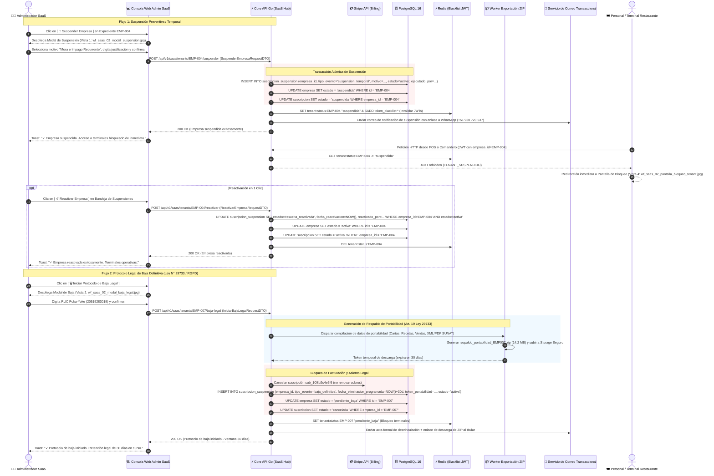

# Especificación Técnica y Wireframes: CU-SAAS-02: Dar de Baja / Suspender Empresa (Conforme a Ley)

## 1. Ficha Técnica del Caso de Uso

| Atributo | Detalle |
| :--- | :--- |
| **Código** | `CU-SAAS-02` |
| **Nombre** | **Dar de baja / suspender empresa conforme a ley** (Protocolo de Suspensión Preventiva, Desvinculación Definitiva, Portabilidad y Retención Legal de Datos) |
| **Rol / Actor** | **Administrador Global SaaS** (`admin_saas`) |
| **Módulo** | Administración Central SaaS / Tenancy, Facturación & Cumplimiento Normativo |
| **Objetivo de Negocio** | Proveer al operador de la plataforma una consola formal y auditada para: (1) aplicar suspensión temporal a empresas en mora o infracción de términos con preservación inmutable del 100% de su información histórica y reactivación instantánea en un clic tras regularizar cobros; (2) procesar bajas definitivas con estricto apego a la legislación de protección de datos personales (Ley N° 29733 en Perú / RGPD), garantizando el derecho de portabilidad mediante la generación de un paquete descargable de datos (`.ZIP`), la congelación de facturación recurrente en Stripe, una ventana obligatoria de retención preventiva de 30 días naturales con reversibilidad previa a la purga final, y confirmación de seguridad Poka-Yoke digitando el RUC del tenant; (3) supervisar la bandeja central de contingencias y bajas pendientes; y (4) desplegar una pantalla informativa de bloqueo operativo que canaliza la atención directa al WhatsApp de Soporte (+51 930 723 537). |
| **Precondiciones** | El usuario cuenta con sesión activa autenticada con rol `admin_saas`. Existe un tenant registrado en el sistema ([`CU-PROP-01`](file:///j:/proyectos_git/RestaurantCloud_AI_backend/wireframe/propietario/CU-PROP-01-registro-empresa/wireframe.md) o [`CU-SAAS-01`](file:///j:/proyectos_git/RestaurantCloud_AI_backend/wireframe/saas_admin/CU-SAAS-01-supervisar-tenants/wireframe.md)) en estado `activa` o en `periodo_gracia`. |
| **Postcondiciones** | Registro inmutable de la acción en la entidad dedicada `suscripcion_suspension`; actualización atómica de `empresa.estado` (`suspendida` o `pendiente_baja`); invalidación inmediata de tokens JWT de empleados y terminales en Redis; cancelación de cobros recurrentes en Stripe si aplica; despacho de correo formal con acta legal y enlace seguro de portabilidad; y habilitación de pantalla de corte operativo canalizada a WhatsApp. |
| **Tokens de Diseño** | Grayscale Blueprint: `#0F172A` (Primario / Slate Dark), `#1E293B` (Superficie), `#F8FAFC` (Canvas), `#FFFFFF` (Card), `#E2E8F0` (Bordes), `#0F172A` (Texto Principal), `#64748B` (Texto Muted), `#991B1B` (Rojo Crítico / Suspensión / Baja), `#B45309` (Ámbar Advertencia / Retención), `#15803D` (Verde Reactivación / Portabilidad Lista), `#25D366` (Verde WhatsApp). |
| **Resolución Canónica** | `1440x900` px (Desktop Blueprint, JPG calidad 95). |

### Reglas de Negocio y Políticas de Cumplimiento Legal

1. **Diferenciación Operativa entre Suspensión Temporal y Baja Definitiva:**
   - **Suspensión Preventiva / Temporal:** Aplica a incumplimientos de pago tras agotar el período de gracia de 5 días ([`CU-PROP-02`](file:///j:/proyectos_git/RestaurantCloud_AI_backend/wireframe/propietario/CU-PROP-02-gestionar-suscripcion/wireframe.md) / [`CU-SAAS-01`](file:///j:/proyectos_git/RestaurantCloud_AI_backend/wireframe/saas_admin/CU-SAAS-01-supervisar-tenants/wireframe.md)), infracciones a los términos de uso, o cierre temporal por remodelación solicitado por el titular. Se pausan terminales y accesos POS de inmediato. **Se preservan intactos el 100% de datos históricos** (comandas, cartas, clientes, inventarios y comprobantes). Es **100% reversible en un clic** mediante la acción `[ ↺ Reactivar Empresa ]`.
   - **Baja Definitiva:** Desvinculación contractual irreversible solicitada por el restaurante o por quiebra/cierre mercantil definitivo. Inicia un protocolo legal con ventana de 30 días, generación de backup y purga programada.

2. **Protocolo Legal de Baja (Ley N° 29733 de Protección de Datos Personales / RGPD):**
   - **Derecho a la Portabilidad (Art. 19 Ley N° 29733):** El sistema compila y encripta automáticamente un paquete de respaldo estándar (`respaldo_portabilidad_EMPX_YYYYMMDD.zip`) con el catálogo de productos, recetas, inventario histórico, ventas y comprobantes electrónicos XML/PDF emitidos a la fecha. Se provee descarga inmediata en el panel y un enlace seguro firmado con caducidad de 30 días enviado por correo electrónico al titular.
   - **Ventana de Retención Legal Obligatoria de 30 Días:** Al formalizar la baja, la empresa pasa a `estado = 'pendiente_baja'`. Durante 30 días naturales se congelan accesos operativos y facturación, pero la información **no se destruye físicamente**, otorgando al cliente la posibilidad de solicitar restauración o rescatar respaldos contables.
   - **Purga y Anonimización al Vencimiento (Día 31):** Un proceso automatizado en segundo plano (*cron job de saneamiento*) anonimiza datos personales de usuarios y purga credenciales, manteniendo únicamente metadatos fiscales exigidos por SUNAT (conservación de comprobantes de pago por 5 años según Código Tributario).

3. **Entidad Dedicada `suscripcion_suspension`:**
   - Para no sobrecargar la tabla `empresa` con flags dispersos y para permitir un historial inmutable y auditable de incidencias contractuales, todas las suspensiones, reactivaciones y bajas se asientan en la tabla especializada `suscripcion_suspension`.
   - Cuenta con un índice parcial de alto rendimiento: `CREATE INDEX idx_suspension_activa ON suscripcion_suspension(empresa_id) WHERE estado = 'activa';`, permitiendo consultas en $O(1)$ sin sobrecoste en el middleware de autenticación.

4. **Invalidación de Sesiones Activas e Inmediata Denegación de Servicio (Redis + JWT):**
   - En el instante en que se ejecuta la suspensión o baja, el backend publica un evento en el canal Redis `tenant:suspension:<empresa_id>` que invalida todos los tokens de refresco y listas de sesiones activas de la empresa.
   - En peticiones subsecuentes, el middleware API verifica el estado del tenant en Redis ($< 1\text{ ms}$). Si está suspendido o en baja, rechaza la solicitud con código `HTTP 403 Forbidden` (`code: TENANT_SUSPENDIDO`) y redirige al usuario a la Pantalla de Bloqueo Informativa (Vista 4).

5. **Poka-Yoke de Seguridad para Baja Definitiva:**
   - La baja definitiva es una acción de alto impacto. El botón de confirmación permanece bloqueado en el modal hasta que el administrador SaaS digite manualmente el **número de RUC exacto de 11 dígitos** de la empresa, previniendo bajas accidentales por confusión de filas en la grilla.

6. **Canal de Contacto Exclusivo de Soporte (WhatsApp Directo):**
   - En la pantalla de corte operativo vista por el cliente (Vista 4), no se exponen opciones ambiguas ni portales externos de pago desatendidos. El único canal oficial de resolución es un enlace directo al WhatsApp del área de soporte y tesorería: `+51 930 723 537` (`https://wa.me/51930723537?text=...`), donde se valida la reactivación y se brinda asistencia inmediata.

---

## 2. Diagrama de Secuencia Mermaid



---

## 3. Especificación de Pantallas y Wireframes Blueprint

### Vista 1: Modal de Suspensión Preventiva / Temporal (`wf_saas_02_modal_suspension.jpg`)

Modal centrado con overlay modal oscurecido (`#0F172A` con opacidad), encabezado de advertencia ámbar/rojo, ficha resumen de la empresa, opciones de tipificación del motivo con radio buttons, área de justificación administrativa obligatoria, selector de notificación al titular y advertencia de preservación de datos.

```
+------------------------------------------------------------------------------------------------------------------------+
| RESTAURANTCLOUD AI   [ CONSOLA ADMIN SAAS ]             https://admin.restaurantcloud.pe/saas/tenants/EMP-004/suspender  Admin Root  PRODUCCIÓN |
+------------------------------------------------------------------------------------------------------------------------+
|                                                                                                                        |
|       +--------------------------------------------------------------------------------------------------------+       |
|       | ⚠️ Suspensión Preventiva / Temporal de Empresa                                                    [ X ]|       |
|       | Pausa inmediata de terminales y accesos en salón con preservación inmutable de datos históricos        |       |
|       +--------------------------------------------------------------------------------------------------------+       |
|       |                                                                                                        |       |
|       |  RAZÓN SOCIAL & RUC:                                     PLAN CONTRATADO & SEDES:                      |       |
|       |  El Tenedor Gourmet S.A.C. — 20601234567                 Plan Pro (S/ 249/mes) — 2 Locales Activos     |       |
|       |                                                                                                        |       |
|       |  ESTADO DE CUENTA ACTUAL:                                TITULAR PROPIETARIO:                          |       |
|       |  ⚠️ En Período de Gracia (Día 5 de 5 — Vence Hoy 23:59)   Manuel García Mendoza (mgarcia@eltenedor.pe)  |       |
|       +--------------------------------------------------------------------------------------------------------+       |
|       | MOTIVO PRINCIPAL DE LA SUSPENSIÓN (TABLA `suscripcion_suspension`)                                     |       |
|       |                                                                                                        |       |
|       |  (o) Mora e Impago Recurrente (Período de gracia de 5 días agotado)                                    |       |
|       |      Se realizaron 3 reintentos automáticos de tarjeta en Stripe sin consolidación del cobro periódico.|       |
|       |                                                                                                        |       |
|       |  ( ) Infracción de Términos de Servicio y Condiciones de Uso                                           |       |
|       |      Uso indebido de límites multi-tenant, vulneración operativa o conducta contraria al contrato.     |       |
|       |                                                                                                        |       |
|       |  ( ) Solicitud Temporal del Propietario (Cierre temporal / Remodelación)                               |       |
|       |      Pausa de mutuo acuerdo sin pérdida de configuración de pisos ni comandas históricas.              |       |
|       |                                                                                                        |       |
|       | Justificación Administrativa Obligatoria: * (Mínimo 15 caracteres para auditoría)                      |       |
|       | [ Suscripción en mora tras 3 reintentos de Stripe fallidos. Período de gracia oficial de 5 días...    ] |       |
|       |                                                                                                        |       |
|       | [X] Despachar notificación formal al propietario: Envía email al titular con aviso de corte y enlace   |       |
|       |     directo a WhatsApp de soporte (+51 930 723 537).                                                   |       |
|       |                                                                                                        |       |
|       | [i] Garantía de Preservación Total: La suspensión bloquea de inmediato las terminales de salón pero    |       |
|       |     NO elimina mesas, comandas, cartas ni comprobantes. La empresa puede reactivarse en 1 clic.        |       |
|       +--------------------------------------------------------------------------------------------------------+       |
|       |  [ Cancelar ]                                                        [ ⚠️ Confirmar Suspensión Inmediata ]  |       |
|       +--------------------------------------------------------------------------------------------------------+       |
|                                                                                                                        |
+------------------------------------------------------------------------------------------------------------------------+
```

#### Componentes Clave de la Vista 1:
- **Tarjeta de Identificación:** Razón Social, RUC, plan vigente, sedes activas, estado actual (ej. Día 5 de gracia agotado) y correo del titular.
- **Selector de Motivo Canónico:** 3 motivos predefinidos que mapean a la columna `motivo` de la tabla `suscripcion_suspension`.
- **Campo de Justificación de Auditoría:** `textarea` obligatorio con validación de longitud mínima ($\ge 15$ caracteres) que asienta el argumento en `detalle_justificacion`.
- **Checkbox de Notificación:** Despacha el correo formal con copia al administrador y canaliza al titular a WhatsApp de soporte.
- **Banners de Garantía:** Recordatorio explícito de que la suspensión **no es destructiva** y que los datos permanecen 100% seguros.

---

### Vista 2: Modal de Baja Definitiva de Empresa — Ley N° 29733 / RGPD (`wf_saas_02_modal_baja_legal.jpg`)

Modal crítico con encabezado rojo oscuro institucional, ficha legal de la empresa, cronograma legal de 3 etapas con ventana de 30 días, bloque de portabilidad de datos con descarga directa de backup `.ZIP`, advertencia de congelación de Stripe y caja de confirmación Poka-Yoke digitando el RUC.

```
+------------------------------------------------------------------------------------------------------------------------+
| RESTAURANTCLOUD AI   [ CONSOLA ADMIN SAAS ]             https://admin.restaurantcloud.pe/saas/tenants/EMP-007/baja-legal  Admin Root  PRODUCCIÓN |
+------------------------------------------------------------------------------------------------------------------------+
|                                                                                                                        |
|       +--------------------------------------------------------------------------------------------------------+       |
|       | 🗑️ Protocolo Legal de Baja Definitiva de Empresa (Ley N° 29733 / RGPD)                             [ X ]|       |
|       | Inicio de desvinculación formal con ventana de retención de 30 días y portabilidad de datos           |       |
|       +--------------------------------------------------------------------------------------------------------+       |
|       | Pizzería Bella Napoli E.I.R.L.                                         [ Solicitud de Baja Voluntaria ]|       |
|       | RUC: 20519283019 • Plan Starter (1 local) • Titular: Giancarlo Rossi (propietario)                     |       |
|       +--------------------------------------------------------------------------------------------------------+       |
|       | 1. CRONOGRAMA LEGAL DE RETENCIÓN PREVENTIVA (VENTANA DE 30 DÍAS)                 REVERSIBLE HASTA EL DÍA 30 |       |
|       |                                                                                                        |       |
|       |  PASO 1: SOLICITUD FORMAL           PASO 2: RETENCIÓN LEGAL (30D)       PASO 3: PURGA / ANONIMIZACIÓN  |       |
|       |  11/10/2026 14:30                   11/10 — 10/11/2026                  10/11/2026 23:59:59            |       |
|       |  Se suspenden terminales y se       Plazo para descarga de backup o     Eliminación definitiva de      |       |
|       |  congela facturación en Stripe.     cancelación de baja.                cartas y credenciales.         |       |
|       +--------------------------------------------------------------------------------------------------------+       |
|       | 2. DERECHO DE PORTABILIDAD DE DATOS (RESPALDO DESCARGABLE DEL CLIENTE)                 LEY N° 29733 ART. 19 |       |
|       |                                                                                                        |       |
|       |  [📦] respaldo_portabilidad_EMP007_20261011.zip (14.2 MB)                          [ ⬇ Descargar Copia ]|       |
|       |       Incluye: Catálogo de platos, recetas, inventario, ventas históricas y comprobantes XML/PDF.     |       |
|       |                                                                                                        |       |
|       |  [X] Despachar correo formal al titular (rossi@bellanapoli.pe) con enlace seguro válido por 30 días.  |       |
|       +--------------------------------------------------------------------------------------------------------+       |
|       | 3. CANCELACIÓN EN PASARELA DE PAGOS STRIPE                                                             |       |
|       |    Se cancelará de inmediato la suscripción sub_1O8b2c4e5f6 vinculada al Customer cus_P09a12k4m.     |       |
|       |    No se efectuarán cobros futuros de renovación ni recargos por mora en la tarjeta del titular.       |       |
|       +--------------------------------------------------------------------------------------------------------+       |
|       | ⚠️ CONFIRMACIÓN DE SEGURIDAD POKA-YOKE (ACCIÓN CRÍTICA)                                                 |       |
|       | Para iniciar el protocolo de baja de 30 días, digite el RUC de la empresa (20519283019):               |       |
|       | [ 20519283019                                     ]   ✓ RUC verificado correctamente                   |       |
|       +--------------------------------------------------------------------------------------------------------+       |
|       |  [ Cancelar ]                                              [ 🗑️ Iniciar Protocolo Legal de Baja (30 Días) ]|       |
|       +--------------------------------------------------------------------------------------------------------+       |
|                                                                                                                        |
+------------------------------------------------------------------------------------------------------------------------+
```

#### Componentes Clave de la Vista 2:
- **Cronograma de 3 Fases:**
  - *Fase 1 (Día 0):* Solicitud formal, corte de terminales y congelamiento de Stripe.
  - *Fase 2 (Días 1 a 30):* Retención preventiva conforme a ley, descarga de respaldos y opción de cancelar baja.
  - *Fase 3 (Día 31):* Purga física y anonimización de credenciales.
- **Generador de Portabilidad (.ZIP):** Cumplimiento automático del Art. 19 de la Ley N° 29733 con botón de descarga inmediata y token firmado con 30 días de vigencia.
- **Integración Stripe:** Detalle explícito de cancelación de la suscripción periódica (`sub_...`).
- **Verificación Poka-Yoke por RUC:** Input validado reactivamente; el botón final sólo se habilita si el valor ingresado coincide con el RUC de la empresa.

---

### Vista 3: Centro de Gestión de Suspensiones y Bajas Legales SaaS (`wf_saas_02_bandeja_bajas_suspensiones.jpg`)

Bandeja de contingencias accesible desde la Consola SaaS para controlar y dar seguimiento exclusivo a todas las cuentas no operativas del ecosistema.

```
+------------------------------------------------------------------------------------------------------------------------+
| RESTAURANTCLOUD AI   [ CONSOLA ADMIN SAAS ]      https://admin.restaurantcloud.pe/saas/tenants/bajas-suspensiones  Admin Root  PRODUCCIÓN |
+------------------------------------------------------------------------------------------------------------------------+
|                                                                                                                        |
| Centro de Gestión de Suspensiones y Bajas Legales SaaS          [ 📥 Exportar Reporte ]  [ ← Volver a Bandeja General ]|
| Supervisión de cuentas fuera de servicio, resolución de incidentes de mora y control de retención de 30 días          |
|                                                                                                                        |
| +-------------------------+ +-------------------------+ +-------------------------+ +-------------------------+        |
| | EMPRESAS SUSPENDIDAS  🚫| | EN RETENCIÓN DE BAJA ⏳| | MRR EN PAUSA / AFECTADO 💵| | RESPALDOS PORTABILIDAD 📦|        |
| | 3 Cuentas               | | 1 Cuenta                | | S/ 747.00               | | 100%                    |        |
| | 2 por mora • 1 términos | | Día 12 de 30 (Purga 18d)| | Recuperable tras pago   | | 1 de 1 con ZIP generado |        |
| +-------------------------+ +-------------------------+ +-------------------------+ +-------------------------+        |
|                                                                                                                        |
| [ Todas Fuera de Servicio (4) ] [ Suspendidas Temporales (3) ] [ Pendientes de Baja (1) ]   [ 🔍 Buscar por RUC... ]    |
|                                                                                                                        |
| +--------------------------------------------------------------------------------------------------------------------+ |
| | EMPRESA / RAZÓN SOCIAL     RUC         TIPO EVENTO    MOTIVO DETALLADO      FECHA INICIO  RETENCIÓN/ESTADO ID ACCIONES     | |
| +--------------------------------------------------------------------------------------------------------------------+ |
| | El Tenedor Gourmet S.A.C.  20601234567 [🚫 Suspensión] Mora recurrente (5d) 10/10/2026   Pausa Indefinida SUS-042 [↺ Reactivar][👁]|
| | Rústika Burger Bar S.A.C.  20394819201 [🚫 Suspensión] Infracción Términos  01/10/2026   Pausa Indefinida SUS-039 [↺ Reactivar][👁]|
| | Café Bistró Francés S.A.C. 20601928472 [⏸ Pausa Sol.] Solicitud del titular 07/10/2026   Hasta 01/11/2026 SUS-041 [↺ Reactivar][👁]|
| | Pizzería Bella Napoli      20519283019 [⏳ Pend. Baja] Cierre Definitivo     30/09/2026   18 días restantesBAJ-004 [↺ Cancel][📦][✉]|
| +--------------------------------------------------------------------------------------------------------------------+ |
| Mostrando 4 cuentas fuera de servicio (3 suspendidas, 1 en retención de baja legal)     Ley N° 29733: Cumplimiento 30 Días    |
+------------------------------------------------------------------------------------------------------------------------+
```

#### Componentes Clave de la Vista 3:
- **4 Tarjetas de Métricas:**
  1. *Empresas Suspendidas:* Desglose por causa (mora vs. términos).
  2. *En Retención de Baja (30d):* Días transcurridos y cuenta regresiva de purga.
  3. *MRR en Pausa / Afectado:* Impacto monetario mensual susceptible de recuperación.
  4. *Respaldos de Portabilidad:* Porcentaje de paquetes `.ZIP` generados y entregados.
- **Acciones Rápidas Contextuales:**
  - `[ ↺ Reactivar Empresa ]`: Revierte la suspensión preventiva restaurando la operativa inmediatamente.
  - `[ ↺ Cancelar Baja ]`: Permite abortar el protocolo legal de baja si el cliente decide renovar antes de que venza el día 30.
  - `[ 📦 Backup ZIP ]`: Descarga directa del paquete de portabilidad para inspección técnica.
  - `[ ✉ Enlace ]`: Reenvía por correo el token seguro de portabilidad al propietario.

---

### Vista 4: Pantalla de Bloqueo de Acceso para el Tenant (`wf_saas_02_pantalla_bloqueo_tenant.jpg`)

Pantalla informativa de seguridad desplegada cuando cualquier usuario (mozo, cajero, administrador o propietario) intenta interactuar con un restaurante suspendido o en baja. Elimina la incertidumbre técnica, certifica la indemnidad de los datos y canaliza directamente la regularización vía WhatsApp.

```
+------------------------------------------------------------------------------------------------------------------------+
| RESTAURANTCLOUD AI   [ ACCESO RESTRINGIDO ]                  https://app.restaurantcloud.pe/auth/bloqueado  Manuel García  BLOQUEO 403 |
+------------------------------------------------------------------------------------------------------------------------+
|                                                                                                                        |
|                               +--------------------------------------------------------+                               |
|                               |                         [ 🔒 ]                         |                               |
|                               |              SERVICIO TEMPORALMENTE SUSPENDIDO         |                               |
|                               |                                                        |                               |
|                               |       Acceso Operativo Pausado para El Tenedor         |                               |
|                               |                     Gourmet S.A.C.                     |                               |
|                               |        RUC: 20601234567 • Sede Principal: Miraflores   |                               |
|                               |                                                        |                               |
|                               |  [i] Motivo de la suspensión administrativa:           |                               |
|                               |      Regularización de suscripción mensual pendiente.  |                               |
|                               |      El período de gracia oficial de facturación       |                               |
|                               |      concluyó el 14/10/2026 sin registro de pago       |                               |
|                               |      exitoso en la tarjeta asociada.                   |                               |
|                               |                                                        |                               |
|                               |  [🛡️] Tus datos se encuentran completamente seguros:    |                               |
|                               |      La configuración de mesas, recetas, cartas,       |                               |
|                               |      clientes y comprobantes electrónicos emitidos     |                               |
|                               |      permanecen intactos y se habilitarán de inmediato |                               |
|                               |      tras la reactivación.                             |                               |
|                               |                                                        |                               |
|                               |      [ 💬 Contactar a Soporte por WhatsApp (+51 930 723 537) ]                         |                               |
|                               |                                                        |                               |
|                               |  Atención directa de Tesorería: Lunes a Domingo de     |                               |
|                               |  08:00 a 22:00 hrs. Reactivación en menos de 5 minutos.|                               |
|                               |                                                        |                               |
|                               |  ← Cerrar Sesión          ID de Soporte: #SUS-0042     |                               |
|                               +--------------------------------------------------------+                               |
|                                                                                                                        |
+------------------------------------------------------------------------------------------------------------------------+
```

#### Componentes Clave de la Vista 4:
- **Insignia Central de Corte:** Icono `🔒` con badge destacado de "Servicio Temporalmente Suspendido".
- **Identificación Precisa del Tenant:** Nombre comercial, RUC y local para evitar confusiones de sesión.
- **Detalle Transparente del Motivo:** Explicación amigable indicando la fecha en que venció el período de gracia oficial de 5 días.
- **Garantía de Indemnidad de Datos:** Mensaje explícito que tranquiliza al cliente confirmando que sus comandas, ventas e inventarios no han sido eliminados.
- **Botón Primario de WhatsApp:** Enlace directo formateado: `https://wa.me/51930723537?text=Hola%20Soporte%20RestaurantCloud,%20solicito%20asistencia%20para%20la%20reactivacion%20de%20mi%20cuenta%20RUC%2020601234567%20(ID:%20SUS-0042)`.
- **Identificador de Ticket (#SUS-0042):** Correlativo de auditoría para que el operador de soporte localice la cuenta al instante.

---

## 4. Matriz de Estados UX

| Estado de la Pantalla | Disparador / Criterio | Elementos Visibles | Acciones Permitidas | Transición a |
| :--- | :--- | :--- | :--- | :--- |
| **1. Idle / Selección de Acción** | Admin visualiza expediente de tenant activo o en mora en [`CU-SAAS-01`](file:///j:/proyectos_git/RestaurantCloud_AI_backend/wireframe/saas_admin/CU-SAAS-01-supervisar-tenants/wireframe.md). | Botones `[ 🚫 Suspender Empresa ]` y `[ 🗑️ Baja Definitiva ]`. | Clic para abrir el modal correspondiente. | Modal de Suspensión (Vista 1) o Modal de Baja (Vista 2). |
| **2. Modal Suspensión Abierto** | Clic en suspender. Se consulta estado actual en PostgreSQL. | Ficha del tenant, radio buttons de motivos, textarea de justificación, checkbox de notificación por email. | Selección de motivo, redacción de justificación ($\ge 15$ caracteres). | Confirmar suspensión $\rightarrow$ Estado 4 (Procesando). |
| **3. Modal Baja Legal Abierto** | Clic en baja definitiva. Se verifica RUC y suscripción Stripe activa. | Cronograma legal de 30 días, bloque de backup `.ZIP`, advertencia Stripe, input Poka-Yoke de RUC. | Descargar `.ZIP` preliminar, digitar RUC de 11 dígitos. Botón deshabilitado si RUC no coincide. | RUC válido y confirmar $\rightarrow$ Estado 4 (Procesando). |
| **4. Procesando Acción (Loading)** | Envío de formulario al endpoint correspondiente. | Spinners de carga en botones `[ Confirmando... ]`, inputs bloqueados (`disabled`), overlay semitransparente. | Ninguna acción interactiva permitida (prevención de doble submit). | Éxito $\rightarrow$ Toast y redirección a Bandeja (Vista 3). Error $\rightarrow$ Banner de error con reintento. |
| **5. Bloqueo Activo en Tenant (Vista 4)** | Empleado o propietario intenta navegar con sesión de empresa en estado `suspendida` o `pendiente_baja`. | Card de bloqueo, motivo administrativo, garantía de indemnidad de datos, botón directo a WhatsApp. | Clic en WhatsApp `+51 930 723 537`, Cerrar sesión. El resto del sistema queda inaccesible. | Regularización de pago $\rightarrow$ Reactivación en Consola SaaS $\rightarrow$ Estado Activo. |

---

## 5. Contratos de API Go / Echo

### 5.1. DTOs de Solicitud y Respuesta (Go)

```go
package saasdto

import (
	"time"
	"github.com/google/uuid"
)

// SuspenderEmpresaRequestDTO define la carga útil para suspender temporalmente a un tenant
type SuspenderEmpresaRequestDTO struct {
	Motivo                  string `json:"motivo" validate:"required,oneof=mora_impago infraccion_terminos solicitud_propietario otro"`
	DetalleJustificacion    string `json:"detalle_justificacion" validate:"required,min=15,max=1000"`
	NotificarPropietario    bool   `json:"notificar_propietario"`
}

// IniciarBajaLegalRequestDTO define la solicitud formal de baja bajo Ley N° 29733
type IniciarBajaLegalRequestDTO struct {
	RUCConfirmacion         string `json:"ruc_confirmacion" validate:"required,len=11,numeric"`
	Motivo                  string `json:"motivo" validate:"required,oneof=cierre_definitivo_negocio cancelacion_voluntaria rescision_contrato"`
	DetalleJustificacion    string `json:"detalle_justificacion" validate:"required,min=15,max=1000"`
	DespacharRespaldoEmail  bool   `json:"despachar_respaldo_email"`
}

// ReactivarEmpresaRequestDTO define los parámetros para levantar la suspensión
type ReactivarEmpresaRequestDTO struct {
	NotaReactivacion        string `json:"nota_reactivacion" validate:"required,min=10,max=500"`
	VerificacionPagoId      *uuid.UUID `json:"verificacion_pago_id,omitempty"` // Opcional si se regularizó por transferencia
}

// SuscripcionSuspensionDTO representa el evento inmutable de suspensión o baja
type SuscripcionSuspensionDTO struct {
	ID                          uuid.UUID  `json:"id"`
	EmpresaID                   uuid.UUID  `json:"empresa_id"`
	RazonSocial                 string     `json:"razon_social"`
	RUC                         string     `json:"ruc"`
	TipoEvento                  string     `json:"tipo_evento"` // suspension_temporal | baja_definitiva
	Motivo                      string     `json:"motivo"`
	DetalleJustificacion        string     `json:"detalle_justificacion"`
	FechaInicio                 time.Time  `json:"fecha_inicio"`
	FechaReactivacion           *time.Time `json:"fecha_reactivacion,omitempty"`
	ReactivadoPorNombre         *string    `json:"reactivado_por_nombre,omitempty"`
	FechaEliminacionProgramada  *time.Time `json:"fecha_eliminacion_programada,omitempty"`
	DiasRestantesRetencion      *int       `json:"dias_restantes_retencion,omitempty"`
	TokenPortabilidadDescarga   *string    `json:"token_portabilidad_descarga,omitempty"`
	Estado                      string     `json:"estado"` // activa | resuelta_reactivada | ejecutada_baja
	EjecutadoPorNombre          string     `json:"ejecutado_por_nombre"`
	CreadoAt                    time.Time  `json:"creado_at"`
}

// ResumenSuspensionesBajasResponseDTO agrupa métricas y lista de empresas afectadas
type ResumenSuspensionesBajasResponseDTO struct {
	Metricas struct {
		TotalEmpresasSuspendidas int     `json:"total_empresas_suspendidas"`
		TotalEnRetencionBaja     int     `json:"total_en_retencion_baja"`
		MRRAfectadoPEN           float64 `json:"mrr_afectado_pen"`
		PorcentajeRespaldosListos float64 `json:"porcentaje_respaldos_listos"`
	} `json:"metricas"`
	Items []SuscripcionSuspensionDTO `json:"items"`
}
```

### 5.2. Endpoints REST (Echo Router)

```go
// RegisterSaaSSuspensionRoutes registra las rutas de gestión de suspensiones y bajas legales
func RegisterSaaSSuspensionRoutes(e *echo.Group, authMiddleware echo.MiddlewareFunc, rbacMiddleware echo.MiddlewareFunc) {
	saasGroup := e.Group("/saas/tenants", authMiddleware, rbacMiddleware) // Requiere rol admin_saas

	// Bandeja de suspensiones y bajas activas
	saasGroup.GET("/bajas-suspensiones", GetBandejaSuspensionesHandler)

	// Suspensión preventiva temporal
	saasGroup.POST("/:id/suspender", SuspenderEmpresaHandler)

	// Reactivación de empresa suspendida
	saasGroup.POST("/:id/reactivar", ReactivarEmpresaHandler)

	// Protocolo legal de baja definitiva (Ley N° 29733 / RGPD)
	saasGroup.POST("/:id/baja-legal", IniciarBajaLegalHandler)

	// Cancelar protocolo de baja antes del día 30 (restauración)
	saasGroup.POST("/:id/cancelar-baja", CancelarBajaLegalHandler)

	// Generar o descargar paquete de portabilidad ZIP
	saasGroup.GET("/:id/portabilidad-zip", DescargarPortabilidadZipHandler)
}
```

---

## 6. Matriz de Permisos RBAC

| Rol | Ver Bandeja Bajas/Suspensiones | Aplicar Suspensión Temporal | Ejecutar Reactivación en 1 Clic | Iniciar Baja Legal (30 Días) | Cancelar Protocolo de Baja | Descargar Respaldo Portabilidad | Ver Pantalla de Bloqueo |
| :--- | :---: | :---: | :---: | :---: | :---: | :---: | :---: |
| **`admin_saas`** | ✅ Permitido | ✅ Permitido | ✅ Permitido | ✅ Permitido (con Poka-Yoke RUC) | ✅ Permitido | ✅ Permitido | 🚫 N/A (Consola Admin) |
| **`propietario`** | ❌ Denegado | ❌ Denegado | ❌ Denegado | ❌ Denegado (Vía Soporte) | ❌ Denegado | ✅ Descarga de su ZIP (Email) | ✅ Visible si suspendido |
| **`administrador`** | ❌ Denegado | ❌ Denegado | ❌ Denegado | ❌ Denegado | ❌ Denegado | ❌ Denegado | ✅ Visible si suspendido |
| **`mozo` / `cocinero` / `cajero`** | ❌ Denegado | ❌ Denegado | ❌ Denegado | ❌ Denegado | ❌ Denegado | ❌ Denegado | ✅ Redirigido a Bloqueo |

---

## 7. Modelo de Datos PostgreSQL

### 7.1. Definición DDL de la Entidad Dedicada `suscripcion_suspension`

```sql
-- ============================================================================
-- TABLA DEDICADA: suscripcion_suspension
-- Registra eventos inmutables de suspensión preventiva y bajas legales SaaS
-- ============================================================================
CREATE TABLE IF NOT EXISTS suscripcion_suspension (
    id UUID PRIMARY KEY DEFAULT gen_random_uuid(),
    empresa_id UUID NOT NULL REFERENCES empresa(id) ON DELETE CASCADE,
    suscripcion_id UUID NOT NULL REFERENCES suscripcion(id) ON DELETE CASCADE,
    tipo_evento VARCHAR(30) NOT NULL CHECK (tipo_evento IN ('suspension_temporal', 'baja_definitiva')),
    motivo VARCHAR(100) NOT NULL,
    detalle_justificacion TEXT NOT NULL,
    fecha_inicio TIMESTAMPTZ NOT NULL DEFAULT NOW(),
    fecha_reactivacion TIMESTAMPTZ NULL,
    reactivado_por UUID NULL REFERENCES usuario(id) ON DELETE SET NULL,
    nota_reactivacion TEXT NULL,
    ejecutado_por UUID NOT NULL REFERENCES usuario(id) ON DELETE RESTRICT,
    fecha_eliminacion_programada TIMESTAMPTZ NULL, -- Calculado como NOW() + INTERVAL '30 days' para baja definitiva
    token_portabilidad VARCHAR(255) NULL,
    token_portabilidad_expira_at TIMESTAMPTZ NULL,
    estado VARCHAR(30) NOT NULL DEFAULT 'activa' CHECK (estado IN ('activa', 'resuelta_reactivada', 'ejecutada_baja')),
    creado_at TIMESTAMPTZ NOT NULL DEFAULT NOW(),
    actualizado_at TIMESTAMPTZ NOT NULL DEFAULT NOW()
);

-- Comentarios explicativos de auditoría
COMMENT ON TABLE suscripcion_suspension IS 'Entidad dedicada para el registro histórico y gestión legal de suspensiones y bajas de empresas';
COMMENT ON COLUMN suscripcion_suspension.tipo_evento IS 'Indica si es una suspensión temporal reversible o una baja legal con ventana de 30 días';
COMMENT ON COLUMN suscripcion_suspension.fecha_eliminacion_programada IS 'Fecha límite de retención legal (30 días). Pasado este plazo, el cron purga credenciales';
COMMENT ON COLUMN suscripcion_suspension.token_portabilidad IS 'Token de acceso seguro al paquete ZIP de datos del cliente (Ley 29733)';

-- Índices de alto rendimiento para validaciones en tiempo real
CREATE INDEX IF NOT EXISTS idx_suspension_activa 
    ON suscripcion_suspension(empresa_id) 
    WHERE estado = 'activa';

CREATE INDEX IF NOT EXISTS idx_suspension_empresa_historial 
    ON suscripcion_suspension(empresa_id, creado_at DESC);

CREATE INDEX IF NOT EXISTS idx_suspension_bajas_pendientes 
    ON suscripcion_suspension(fecha_eliminacion_programada) 
    WHERE estado = 'activa' AND tipo_evento = 'baja_definitiva';
```

### 7.2. Estados del Tenant y Políticas de Retención

```sql
-- Asegurar valores canónicos en el ENUM o CHECK de la tabla empresa
ALTER TABLE empresa 
    DROP CONSTRAINT IF EXISTS chk_empresa_estado;

ALTER TABLE empresa 
    ADD CONSTRAINT chk_empresa_estado 
    CHECK (estado IN ('activa', 'periodo_gracia', 'suspendida', 'pendiente_baja', 'eliminada'));
```

---

## 8. Criterios de Aceptación (Gherkin) y Accesibilidad

### 8.1. Escenarios de Aceptación BDD (Gherkin)

```gherkin
Característica: Protocolo de Suspensión Preventiva y Baja Definitiva de Empresas (CU-SAAS-02)

  Esquema del escenario: Suspensión preventiva temporal por mora de pago tras agotarse el período de gracia
    Dado que el usuario "admin_saas" ha iniciado sesión en la Consola SaaS
    Y la empresa "El Tenedor Gourmet S.A.C." tiene RUC "20601234567" y su estado es "periodo_gracia"
    Cuando abre el modal de suspensión temporal
    Y selecciona el motivo "Mora e Impago Recurrente"
    Y escribe la justificación "Suscripción en mora tras 3 reintentos de Stripe fallidos. Período de gracia de 5 días concluido."
    Y presiona "Confirmar Suspensión Inmediata"
    Entonces el sistema inserta un registro en la tabla "suscripcion_suspension" con "tipo_evento = suspension_temporal"
    Y actualiza el campo "estado" de la tabla "empresa" a "suspendida"
    Y añade los tokens activos del tenant a la lista de revocación en Redis
    Y las terminales de salón del restaurante que intenten realizar peticiones reciben un código "HTTP 403 Forbidden" y son redirigidas a la pantalla de bloqueo

  Escenario: Reactivación en un clic de empresa previamente suspendida
    Dado que la empresa "El Tenedor Gourmet S.A.C." se encuentra en estado "suspendida"
    Y existe un registro con "estado = activa" en la tabla "suscripcion_suspension"
    Cuando el usuario "admin_saas" pulsa el botón "Reactivar Empresa" en la bandeja de suspensiones
    Y confirma la acción ingresando la nota de reactivación "Pago regularizado vía transferencia BCP verificada"
    Entonces el registro en "suscripcion_suspension" actualiza su "estado" a "resuelta_reactivada"
    Y el campo "empresa.estado" cambia inmediatamente a "activa"
    Y se elimina la clave de bloqueo en Redis
    Y los empleados del restaurante pueden volver a operar terminales y emitir comandas normalmente

  Escenario: Inicio de protocolo legal de baja definitiva con verificación Poka-Yoke (Ley N° 29733)
    Dado que la empresa "Pizzería Bella Napoli E.I.R.L." tiene RUC "20519283019" y solicita desvinculación
    Cuando el usuario "admin_saas" abre el modal de baja definitiva
    Y digita erróneamente el RUC "20519283000" en el campo de confirmación
    Entonces el botón "Iniciar Protocolo Legal de Baja (30 Días)" permanece deshabilitado
    Cuando el usuario corrige y digita el RUC exacto "20519283019"
    Entonces el botón se habilita mostrando "✓ RUC verificado correctamente"
    Y al confirmarse la acción, el sistema genera el archivo "respaldo_portabilidad_EMP007.zip"
    Y cancela la renovación periódica de la suscripción en Stripe
    Y fija la fecha de eliminación programada en "NOW() + 30 días" en la tabla "suscripcion_suspension"
    Y actualiza "empresa.estado" a "pendiente_baja"

  Escenario: Visualización de pantalla de corte y contacto a WhatsApp por parte del tenant
    Dado que un mozo o administrador intenta acceder al sistema de un restaurante con estado "suspendida"
    Cuando la aplicación carga la URL "/auth/bloqueado"
    Entonces se presenta la pantalla de bloqueo con el nombre comercial del restaurante y su RUC
    Y se visualiza el motivo administrativo de la suspensión
    Y se presenta un mensaje destacando que los datos históricos se encuentran seguros
    Y se muestra un botón destacado que enlaza directamente a WhatsApp con el número "+51 930 723 537" y el identificador de ticket prellenado
```

### 8.2. Requisitos de Accesibilidad (WCAG 2.1 Nivel AA)
1. **Contraste de Color:** Todos los textos en modales y pantallas de corte cumplen una relación de contraste mínima de $4.5:1$ sobre sus fondos (`#0F172A` sobre `#FFFFFF` $= 15.3:1$, `#991B1B` sobre `#FFFFFF` $= 6.1:1$, `#15803D` sobre `#FFFFFF` $= 5.4:1$).
2. **Atributos ARIA en Modales Críticos:** Los modales de suspensión y baja implementan `role="dialog"`, `aria-modal="true"`, `aria-labelledby="modal-title"` y trampeo de foco accesible (*focus trap* con tecla `Tab` y cierre con tecla `Escape`).
3. **Navegación por Teclado:** El botón de acción crítica Poka-Yoke no es interactuable ni accionable mediante la tecla `Enter` mientras el valor del RUC ingresado no sea idéntico al del tenant activo.
4. **Semántica en Pantalla de Bloqueo:** La pantalla de corte utiliza encabezados `<h1>` claros, regiones `aria-live="polite"` para alertas, y el botón de WhatsApp cuenta con etiqueta accesible descriptiva: `aria-label="Contactar a Soporte RestaurantCloud por WhatsApp al número más 51 930 723 537"`.
